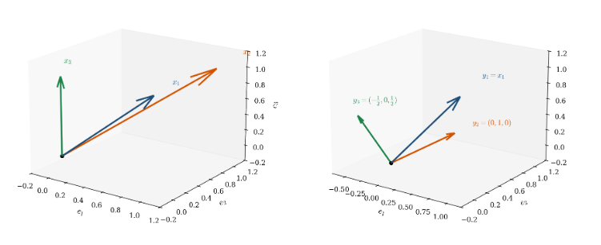
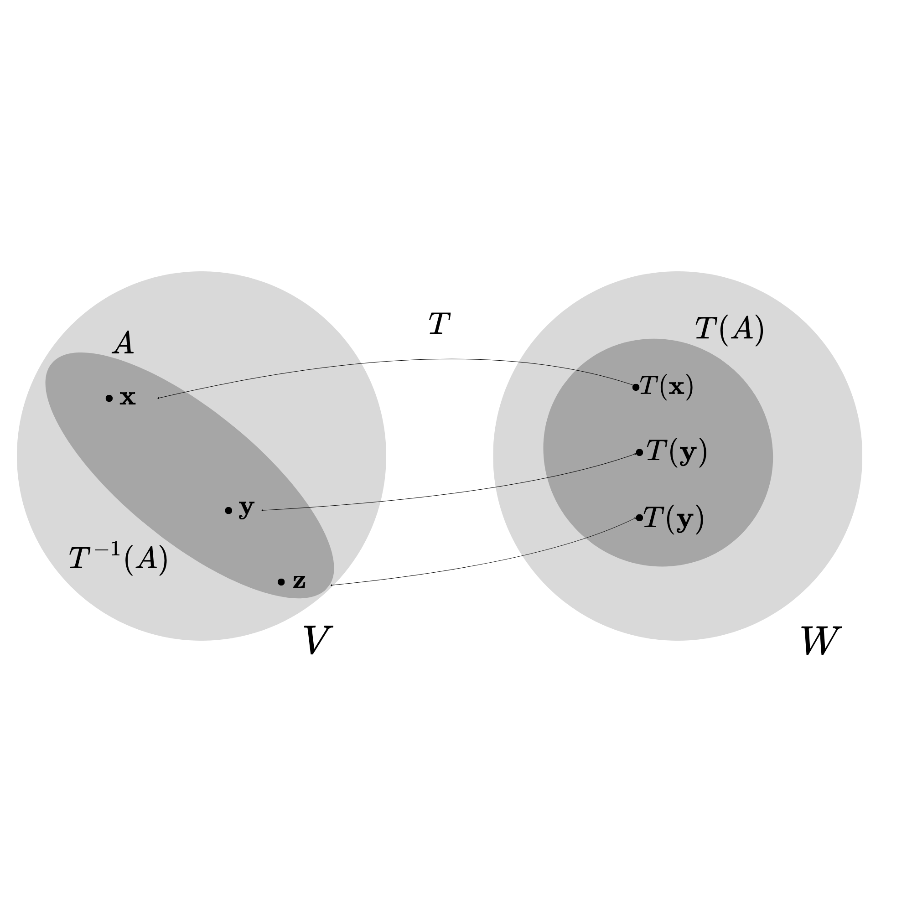
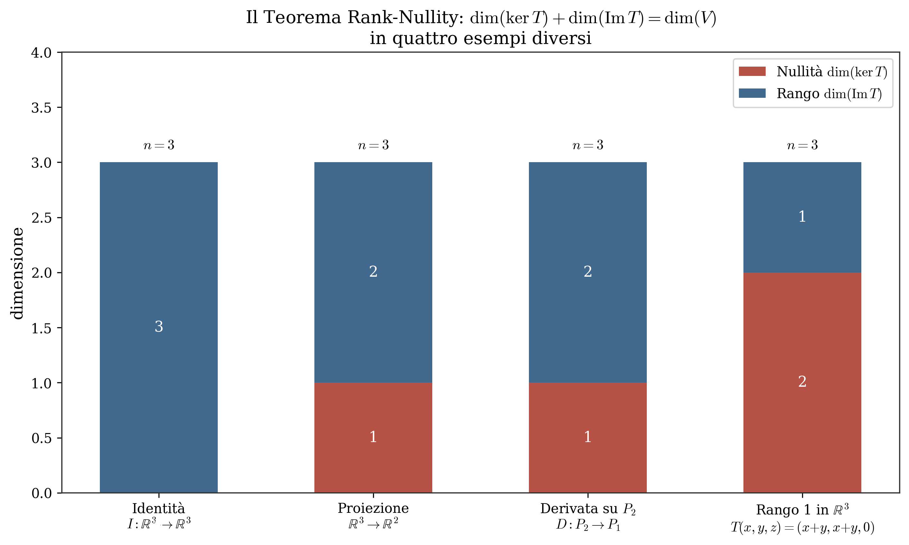
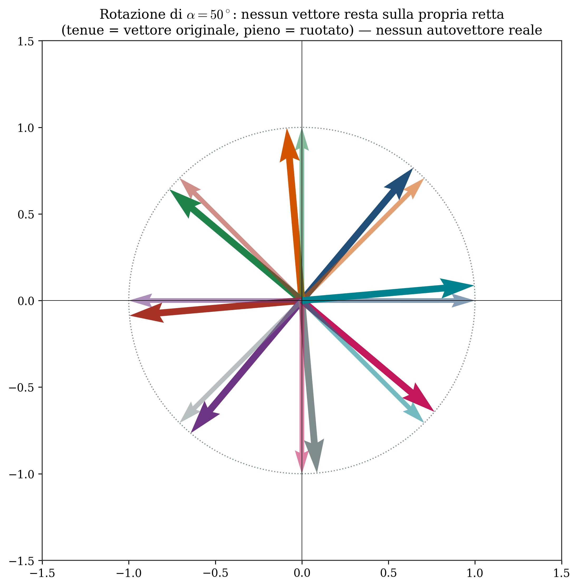
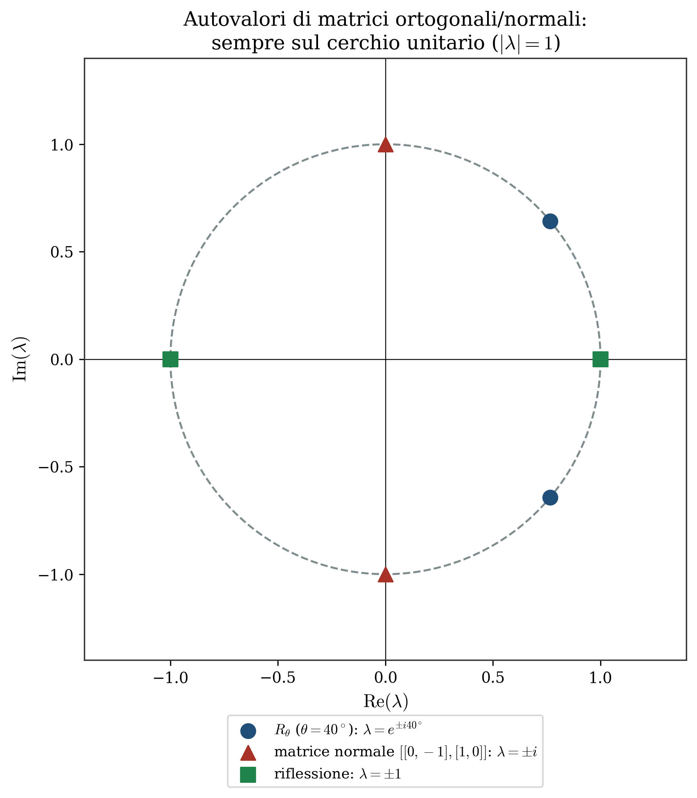

# Spazi Lineari

## Definizione di Spazio Lineare

Sia $V$ un insieme non vuoto di oggetti, chiamati elementi. $V$ è uno spazio lineare se soddisfa i seguenti assiomi:

- **Assiomi di chiusura**: rispetto all'addizione e alla moltiplicazione

- **Assiomi per l'addizione**: legge commutativa, legge associativa, esistenza dell'elemento $0$, esistenza degli elementi negativi

- **Assiomi per la moltiplicazione per un numero $\in \mathbb{R}$ o $\mathbb{C}$**: legge associativa, legge distributiva, esistenza dell'identità ($\forall x\in V: 1x=x$).

Uno spazio lineare è anche detto **spazio vettoriale** e i numeri usati come moltiplicatori sono chiamati **scalari**: essi appartengono al generico campo $\mathbb{F}$ che può essere identificato con $\mathbb{R}$ oppure con $\mathbb{C}$.\
Se specifichiamo l'insieme $V$ e indichiamo come sommare i suoi elementi e come moltiplicarli per gli scalari $\in \mathbb{F}$, otteniamo esempi concreti di spazi lineari:

- Sia $V=\mathbb{R}$ e sia $x+y$ e $ax$ l'ordinaria addizione e moltiplicazione per scalare

- sia $V=\mathbb{C}$ e sia $x+y$ e $ax$ ($a\in\mathbb{R}, x\in\mathbb{C}$). In questo caso, anche se gli elementi di $V$ sono numeri complessi, questo è uno spazio lineare reale poichè gli scalari appartengono al campo $\mathbb{F}=\mathbb{R}$

- L'insieme di tutte le funzioni definite su un dato intervallo è uno spazio lineare  L'insieme di tutti i polinomi di grado massimo $n$ è uno spazio lineare

::: mybox
Conseguenze elementari degli assiomi

- **Unicità dell'elemento 0**: in ogni spazio lineare esiste uno ed un solo ($\exists!$) elemento $0$

- **Unicità degli elementi negativi**: in ogni spazio lineare ogni elemento ha esattamente uno ed un solo negativo, cioè $\forall x\in V,\quad \exists!y\quad t.c\quad x+y=0$

- siano $x,y$ elementi arbitrari di uno spazio lineare e siano $a,b\in \mathbb{F}$ scalari. Allora si hanno le seguenti proprietà:

  1.  $0x=0$

  2.  $a0=0$

  3.  $(-a)x=-(ax)=a(-x)$

  4.  $ax=0 \implies a=0 \lor  x=0$

  5.  $ax=ay \implies x=y$, se $a\neq0$

  6.  $ax=bx \implies a=b$, se $x\neq 0$

  7.  $-(x+y)=(-x)+(-y)=-x-y$

  8.  $x+x=2x$ e in generale $\sum^n x=nx$
:::

## Sottospazi di spazi lineari e Span

Dato uno spazio lineare $V$, sia $S$ un sottoinsieme non vuoto di $V$. Se $S$ è anche uno spazio lineare, allora è un sottospazio di $V$.\
Un elemento $\mathbf{x}\in V$ della forma: $$\mathbf{x}=\sum_{i=1}^kc_ix_i$$ dove $x_i\in S$ e $c_i\in\mathbb{F}$ è chiamato combinazione lineare finita di elementi di $S$.\
Chiamiamo questo sottospazio generato da $S$ come **span** $\mathcal{L}(S)$. Se $S=\emptyset$, allora $\mathcal{L}(S)=\{ 0\}$\
**NB**: $\mathcal{L}(S)$ è il più piccolo sottospazio di $V$ che contiene $S$.

{#fig-span}

## Insiemi dipendenti e indipendenti in uno spazio lineare

**Insieme Dipendente:**\
Un insieme $S$ di elementi in uno spazio lineare $V$ è **linearmente dipendente** se esiste un sottoinsieme finito di vettori $x_1, \dots, x_k \in S$ e un corrispondente insieme di scalari $c_1, \dots, c_k \in \mathbb{F}$ (**non tutti nulli**) tali che: $$\sum_{i=1}^k c_i x_i = \mathbf{0}$$ Dunque, esiste almeno una combinazione lineare non banale che dà come risultato il vettore nullo.

**Insieme Indipendente:**\
Un insieme $S$ di elementi in uno spazio $V$ è invece **linearmente indipendente** se, per ogni scelta di elementi distinti $x_1, \dots, x_k \in S$ e di scalari $c_i \in \mathbb{F}$, l'unica combinazione lineare che produce il vettore nullo è quella in cui tutti i coefficienti sono zero: $$\sum_{i=1}^k c_i x_i = \mathbf{0} \implies c_i = 0 \quad \forall i = 1, \dots, k$$

**Significato Intuitivo e Geometrico: \"La Ridondanza\"**\
Queste definizioni formalizzano il concetto di *ridondanza* delle informazioni o delle direzioni geometriche:

- Se un insieme è **dipendente**, significa che almeno un vettore è \"superfluo\", poiché può essere costruito mescolando gli altri. In un'equazione in cui i $c_i$ non sono tutti nulli, possiamo sempre isolare un vettore e scriverlo come combinazione lineare dei rimanenti. Geometricamente (ad esempio in $\mathbb{R}^3$), tre vettori dipendenti sono \"schiacciati\" sullo stesso piano.

- Se un insieme è **indipendente**, ogni vettore punta in una direzione fondamentalmente nuova e indipendente. Nessun vettore può essere generato dagli altri, rendendo l'insieme di elementi \"essenziale\" e privo di sprechi.

\
Gli elementi di un insieme indipendente sono detti vettori (o elementi) indipendenti. Dalle definizioni appena viste derivano direttamente le seguenti proprietà fondamentali:

- Se un sottoinsieme $T \subset S$ è dipendente, allora l'intero insieme $S$ è esso stesso dipendente. Per contro, questo equivale ad affermare che **ogni sottoinsieme di un insieme indipendente è indipendente**.

- Se un elemento $\mathbf{x} \in S$ è un multiplo scalare di un altro ($\mathbf{x} = c\mathbf{y}$), allora $S$ è **dipendente**. *(Infatti, possiamo ottenere il vettore nullo con la combinazione lineare non banale $1\mathbf{x} - c\mathbf{y} = \mathbf{0}$).*

- Se il vettore nullo appartiene all'insieme ($\mathbf{0} \in S$), allora $S$ è **dipendente**. *(Basta moltiplicare il vettore $\mathbf{0}$ per uno scalare non nullo e tutti gli altri vettori per $0$, ottenendo una combinazione lineare nulla con coefficienti non tutti nulli).*

- L'insieme vuoto $\emptyset$ è considerato **indipendente** per definizione (in modo \"vacuo\", non essendoci elementi che possano violare la regola).

**Esempi pratici negli spazi di funzioni**\
L'indipendenza lineare non si applica solo ai classici vettori colonna, ma a qualsiasi spazio lineare, come quello delle funzioni continue:

- Siano $u_1(t) = \cos^2(t)$, $u_2(t) = \sin^2(t)$ e $u_3(t) = 1$. L'identità trigonometrica fondamentale ci permette di scrivere $u_1(t) + u_2(t) - u_3(t) = 0$. Poiché i coefficienti $(1, 1, -1)$ non sono tutti nulli e producono la funzione costantemente nulla, i tre elementi sono linearmente **dipendenti**.

- Sia $u_k(t) = t^k$ per $k \in \mathbb{N}$ e $t \in \mathbb{R}$. L'insieme infinito $S = \{u_0, u_1, u_2, \dots\} = \{1, t, t^2, \dots\}$ è linearmente **indipendente**. Infatti, per il Principio di Identità dei Polinomi, l'unico modo in cui una combinazione lineare finita (cioè un polinomio) può risultare costantemente pari al vettore $\mathbf{0}$ per ogni $t$ è che ogni singolo coefficiente $c_k$ sia pari a $0$.

![Indipendenza lineare in spazi di funzioni. (a) <em>u</em>1 = cos2<em>t</em>, <em>u</em>2 = sin2<em>t</em>, <em>u</em>3 = 1 sono dipendenti: la combinazione <em>u</em>1 + <em>u</em>2 − <em>u</em>3 è identicamente nulla per l’identità trigonometrica fondamentale. (b) La base monomiale {1, <em>t</em>, <em>t</em>2, …} è indipendente: per il principio di identità dei polinomi nessuna combinazione finita non banale si annulla ovunque.](figures/fig4-funzioni.png){#fig-funzioni}

::: mybox
Teorema fondamentale della dipendenza (o dell'eccesso) **Enunciato:**\
Sia $S = \{x_1, \dots, x_k\}$ un insieme indipendente costituito da $k$ elementi in uno spazio lineare $V$ e sia $\mathcal{L}(S)$ il sottospazio generato da $S$ (spesso indicato anche come $\text{Span}(S)$).

Allora, ogni insieme costituito da $k+1$ (o più) elementi appartenenti a $\mathcal{L}(S)$ è matematicamente **dipendente**.
:::

**Significato Intuitivo: La \"capienza massima\" di uno spazio**\
Questo teorema esprime il concetto di limite o \"capienza\" geometrica di uno spazio vettoriale. Se il sottospazio $\mathcal{L}(S)$ è stato costruito miscelando esattamente $k$ \"ingredienti base\" indipendenti, significa che quello spazio possiede esattamente $k$ gradi di libertà.

Cercare di trovare $k+1$ vettori completamente indipendenti all'interno di uno spazio generato da $k$ vettori è come pretendere di muoversi in 4 direzioni spaziali indipendenti (su, giù, destra, sinistra, avanti, indietro\... e una quarta?) stando all'interno di una stanza tridimensionale: è geometricamente impossibile. Almeno uno di quei $k+1$ vettori sarà costretto ad essere una combinazione lineare (cioè una sovrapposizione) degli altri.

**Conseguenza fondamentale**\
È proprio questo teorema a garantirci che la **dimensione** di uno spazio vettoriale è un numero ben definito e fisso: se uno spazio è generato da $k$ vettori indipendenti, la massima quantità di vettori linearmente indipendenti che potrai mai trovare al suo interno sarà sempre e solo $k$.

{#fig-placeholder}

## Basi, Dimensioni e Componenti

### Basi {#sec-basi .unnumbered}

Un insieme finito $S$ di elementi di uno spazio lineare $V$ è chiamato **base finita** per $V$ se $S$ è un insieme indipendente e al contempo genera $V$.\
Lo spazio $V$ è a **dimensione finita** se possiede una base finita, oppure se $V$ è costituito solo dal vettore nullo $\mathbf{0}$ (in tal caso convenzionalmente la base è l'insieme vuoto). In tutti gli altri casi, $V$ è detto a dimensione infinita.

::: mybox
Teorema dell'invarianza della dimensione Sia $V$ uno spazio lineare a dimensione finita. Allora ogni base finita per $V$ ha esattamente **lo stesso numero di elementi**.
:::

### Dimensioni {#sec-dimensioni .unnumbered}

Se uno spazio $V$ ha una base formata da $n$ elementi, il numero intero $n$ è chiamato **dimensione** di $V$ e scriviamo $\dim V = n$. (Se $V=\{\mathbf{0}\}$, allora $\dim V = 0$).

**Esempi notevoli di dimensioni e basi:**

- **Lo spazio euclideo $\mathbb{R}^n$:** Ha dimensione $n$. Una base standard (chiamata *base canonica*) è l'insieme degli $n$ vettori coordinati unitari (i versori della geometria analitica, come $\mathbf{i, j, k}$ in $\mathbb{R}^3$).

- **Lo spazio dei polinomi limitati ($P_n$):** Lo spazio di tutti i polinomi $p(t)$ di grado massimo $n$ ha dimensione $n+1$, poiché una sua base naturale è l'insieme: $$B = \{1, t, t^2, \dots, t^n\}$$ Infatti, ogni polinomio in $P_n$ può essere scritto in modo unico come combinazione lineare di questi $n+1$ monomi di base.

- **Lo spazio delle soluzioni di una ODE:** Lo spazio delle soluzioni dell'equazione differenziale lineare omogenea $y'' - 2y' - 3y = 0$ ha dimensione $2$. Una base è costituita dalle due funzioni esponenziali indipendenti $u_1(x) = e^{-x}$ e $u_2(x) = e^{3x}$. Qualsiasi soluzione dell'equazione è una combinazione lineare di queste due.

- **Lo spazio di tutti i polinomi:** Lo spazio che contiene *tutti* i polinomi di grado arbitrario è a **dimensione infinita**. Sebbene l'insieme infinito $\{1, t, t^2, \dots\}$ ne costituisca una base (poiché ogni polinomio specifico ha grado finito), nessun insieme *finito* di polinomi potrà mai essere sufficiente a generare l'intero spazio.

::: mybox
Teorema del Completamento della Base Sia $V$ uno spazio vettoriale di dimensione finita $\dim V = n$. Se $S = \{\mathbf{v}_1, \dots, \mathbf{v}_k\}$ è un insieme di $k$ vettori linearmente indipendenti di $V$ (con $k < n$), allora è sempre possibile trovare altri $(n - k)$ vettori $\mathbf{v}_{k+1}, \dots, \mathbf{v}_n$ in $V$ tali che l'insieme unito: $$\mathcal{B} = \{\mathbf{v}_1, \dots, \mathbf{v}_k, \mathbf{v}_{k+1}, \dots, \mathbf{v}_n\}$$ costituisca una **base** per l'intero spazio $V$.
:::

**Significato Pratico:**\
Questo teorema ci assicura che qualsiasi insieme di vettori linearmente indipendenti può essere \"allargato\" (completato) aggiungendo vettori scelti opportunamente fino a raggiungere la dimensione dello spazio, diventando così una base. Ad esempio, se in $\mathbb{R}^3$ hai due vettori linearmente indipendenti (che formano un piano), puoi sempre trovarne un terzo fuori da quel piano per formare una base completa di tutto lo spazio 3D.

::: mybox
Completamento a base e Criterio di Sufficienza Sia $V$ uno spazio lineare a dimensione finita, con $\dim V = n$. Allora valgono le seguenti proprietà:

- **Teorema di completamento a base:** Qualsiasi insieme di elementi linearmente indipendenti in $V$ è un sottoinsieme di qualche base per $V$. (Ovvero, può sempre essere esteso aggiungendo altri vettori opportuni fino a formare una base completa).

- **Criterio della dimensione:** Qualsiasi insieme formato esattamente da $n$ elementi linearmente indipendenti è automaticamente una base per $V$.
:::

**Perché il secondo punto è un salvavita negli esercizi?**\
Per definizione, per dimostrare che un insieme di vettori è una base di uno spazio, devi verificare **due cose**: che siano indipendenti e che generino l'intero spazio (lo Span). La verifica dello Span spesso richiede di risolvere un sistema lineare per un vettore generico.

Il secondo punto di questo teorema ti regala una scorciatoia potentissima. Se sai già in anticipo che lo spazio ha dimensione $n$ (ad esempio $\mathbb{R}^3$, che ha dimensione $3$), ti basta trovare $3$ vettori indipendenti. Non hai bisogno di sprecare tempo a dimostrare che generano lo spazio: la matematica ti garantisce che lo generano automaticamente! Riprendendo l'analogia della \"capienza massima\": se metti $3$ vettori indipendenti in uno spazio che ha una capienza massima di $3$, essi \"saturano\" lo spazio, riempiendolo completamente e diventandone una base.

### Componenti rispetto a una Base Ordinata

::: mybox
Definizione di Coordinate (o Componenti) Sia $V$ uno spazio lineare di dimensione $n$ e sia $\{e_1, e_2, \dots, e_n\}$ una sua base. Se consideriamo questi elementi presi in un dato ordine, denotiamo questa **base ordinata** come la $n$-upla $\mathbf{e} = [e_1, \dots, e_n]$.

Se $\mathbf{x} \in V$, possiamo esprimere il vettore $\mathbf{x}$ come combinazione lineare di questi elementi di base: $$\mathbf{x} = \sum_{i=1}^n c_i e_i$$ con $c_i \in \mathbb{F}$. I coefficienti scalari di questa equazione determinano una $n$-upla di valori $\mathbf{c} = [c_1, \dots, c_n]$ chiamata **vettore delle componenti** (o delle coordinate) di $\mathbf{x}$ rispetto alla base ordinata $\mathbf{e}$.
:::

**Teorema: Unicità delle componenti**\
Il vettore delle componenti $\mathbf{c}$ è **univocamente determinato** da $\mathbf{x}$. *Dimostrazione:* Supponiamo per assurdo di avere un'altra rappresentazione dello stesso vettore $\mathbf{x}$ rispetto alla medesima base $\mathbf{e}$, con coefficienti diversi: $$\mathbf{x} = \sum_{i=1}^n d_i e_i$$ Sottraendo questa equazione dalla precedente, otteniamo: $$\mathbf{x} - \mathbf{x} = \sum_{i=1}^n (c_i - d_i) e_i = \mathbf{0}$$ Poiché gli elementi di una base sono, per definizione, **linearmente indipendenti**, l'unica combinazione lineare che dà come risultato il vettore nullo $\mathbf{0}$ è quella in cui tutti i coefficienti sono pari a zero. Questo implica che: $$c_i - d_i = 0 \implies c_i = d_i \quad \forall i$$ Dunque, le due rappresentazioni sono identiche.

**Ricapitolando (Il quadro generale):**\
Si parte da uno spazio $V$ di dimensione $n$. Questo significa che servono esattamente $n$ vettori \"direzionali\" indipendenti per esplorare e generare tutto lo spazio. Una base fornisce esattamente questi $n$ generatori. Una volta fissata la base, qualsiasi vettore $\mathbf{x} \in V$ può essere costruito usando una e una sola *ricetta*: gli scalari $\mathbf{c} = [c_1, \dots, c_n]$ rappresentano le \"dosi\" esatte di ciascun generatore necessarie per costruire il vettore $\mathbf{x}$.

**NB sull'ordine:** Una base si dice *ordinata* perché l'ordine dei vettori conta! Scambiare due elementi cambia l'ordine delle componenti: la base $[e_1, e_2, e_3]$ è diversa dalla base $[e_2, e_1, e_3]$. È lo stesso motivo per cui, nel piano cartesiano standard, il punto di coordinate $(3, 5)$ è profondamente diverso dal punto $(5, 3)$.

![Lo stesso vettore <strong>x</strong> = (3, 2) espresso rispetto a due basi ordinate diverse di ℝ2. Le componenti <strong>c</strong> dipendono interamente dalla base scelta: [3, 2] nella base canonica, [1.99, 1.08] nella base obliqua <strong>f</strong> = [<em>f</em>1, <em>f</em>2], a conferma del teorema di unicità delle componenti.](figures/fig3-basi.png){#fig-basi}

**NB:** Si noti che, dato un sottospazio $S$ di $V$:

- Se $V$ ha dimensione finita, allora $\dim S \leq \dim V$.

- $\dim S = \dim V$ se e solo se $S = V$.

- Ogni base di $S$ può essere **estesa** (o completata) a una base per $V$, ma una generica base per $V$ non deve necessariamente contenere una base per $S$.

## Inner Product e Norme

Nello spazio euclideo $\mathbb{R}^n$ possiamo misurare lunghezze ed angoli usando il prodotto scalare (o dot product). L'obiettivo ora è definire i concetti di \"lunghezza\" e \"angolo\" in spazi vettoriali più astratti e generali (come spazi di matrici, polinomi o funzioni).

### Inner product (Prodotto Interno) {#sec-inner-product-prodotto-interno .unnumbered}

L'inner product è una funzione $\langle \cdot, \cdot \rangle : V \times V \rightarrow \mathbb{F}$ che prende due vettori e restiruisce uno scalare. è la generalizzazione astratta del dot product standard, che in $\mathbb{R}^n$ era definito come: $$\mathbf{x} \cdot \mathbf{y} = \sum_{i=1}^n x_i y_i$$ per $\mathbf{x}, \mathbf{y} \in \mathbb{R}^n$.\
In uno spazio lineare generico $V$, denotiamo l'inner product tra due elementi con il simbolo $\langle \mathbf{x}, \mathbf{y} \rangle$. A differenza del dot product, l'inner product astratto non è definito da una formula specifica a priori, ma da un insieme di **assiomi** fondamentali che la funzione scelta deve obbligatoriamente soddisfare:

::: mybox
Assiomi dell'Inner Product Sia $V$ uno spazio lineare reale. Una funzione $\langle \cdot, \cdot \rangle : V \times V \rightarrow \mathbb{R}$ è un inner product se, per ogni $\mathbf{x}, \mathbf{y}, \mathbf{z} \in V$ e per ogni scalare $c \in \mathbb{R}$, valgono le seguenti proprietà:

- **Simmetria**: $$\langle \mathbf{x}, \mathbf{y} \rangle = \langle \mathbf{y}, \mathbf{x} \rangle$$

- **Additività (Linearità rispetto alla somma)**: $$\langle \mathbf{x} + \mathbf{y}, \mathbf{z} \rangle = \langle \mathbf{x}, \mathbf{z} \rangle + \langle \mathbf{y}, \mathbf{z} \rangle$$

- **Omogeneità (Linearità rispetto al prodotto per scalare)**: $$\langle c\mathbf{x}, \mathbf{y} \rangle = c \langle \mathbf{x}, \mathbf{y} \rangle$$

- **Definitezza Positiva**: Il prodotto di un vettore con se stesso è sempre non negativo, e si annulla solo per il vettore nullo: $$\langle \mathbf{x}, \mathbf{x} \rangle \geq 0 \quad \text{e} \quad \langle \mathbf{x}, \mathbf{x} \rangle = 0 \iff \mathbf{x} = \mathbf{0}$$

*Nota:* Additività e Omogeneità, prese insieme, implicano che l'inner product è un operatore lineare nel suo primo argomento. Grazie alla simmetria, la linearità vale anche per il secondo argomento (si parla quindi di forma **bilineare**).
:::

### Il caso complesso (Prodotto Interno Hermitiano) {#sec-il-caso-complesso-prodotto-interno-hermitiano .unnumbered}

Se lo spazio vettoriale $V$ è definito sul campo dei numeri complessi $\mathbb{C}$, il prodotto interno restituisce un numero complesso. Per garantire che la \"lunghezza\" di un vettore (cioè $\langle \mathbf{x}, \mathbf{x} \rangle$) rimanga sempre un numero reale e positivo, gli assiomi vengono leggermente modificati:

::: mybox
Assiomi dell'Inner Product Complesso Sia $V$ uno spazio lineare complesso. Una funzione $\langle \cdot, \cdot \rangle : V \times V \rightarrow \mathbb{C}$ è un prodotto interno se, per ogni $\mathbf{x}, \mathbf{y}, \mathbf{z} \in V$ e per ogni scalare $c \in \mathbb{C}$, valgono le seguenti proprietà:

- **Simmetria Hermitiana (o Coniugata)**: Scambiando l'ordine dei vettori, il risultato subisce la coniugazione complessa (indicata con la barra): $$\langle \mathbf{x}, \mathbf{y} \rangle = \overline{\langle \mathbf{y}, \mathbf{x} \rangle}$$

- **Additività (nel primo argomento)**: $$\langle \mathbf{x} + \mathbf{y}, \mathbf{z} \rangle = \langle \mathbf{x}, \mathbf{z} \rangle + \langle \mathbf{y}, \mathbf{z} \rangle$$

- **Omogeneità (nel primo argomento)**: Lo scalare \"esce\" inalterato se si trova nel primo argomento: $$\langle c\mathbf{x}, \mathbf{y} \rangle = c \langle \mathbf{x}, \mathbf{y} \rangle$$

- **Definitezza Positiva**: Grazie alla simmetria hermitiana, $\langle \mathbf{x}, \mathbf{x} \rangle = \overline{\langle \mathbf{x}, \mathbf{x} \rangle}$, il che garantisce che il risultato sia un numero puramente **reale**. L'assioma richiede che: $$\langle \mathbf{x}, \mathbf{x} \rangle \geq 0 \quad \text{e} \quad \langle \mathbf{x}, \mathbf{x} \rangle = 0 \iff \mathbf{x} = \mathbf{0}$$
:::

**Osservazione fondamentale (Antilinearità nel secondo argomento):**\
A causa della combinazione tra simmetria hermitiana e omogeneità nel primo argomento, se estraiamo uno scalare dal *secondo* argomento, esso deve uscire **coniugato**.\
Dimostrazione rapida: $$\langle \mathbf{x}, c\mathbf{y} \rangle = \overline{\langle c\mathbf{y}, \mathbf{x} \rangle} = \overline{c \langle \mathbf{y}, \mathbf{x} \rangle} = \overline{c} \, \overline{\langle \mathbf{y}, \mathbf{x} \rangle} = \overline{c} \langle \mathbf{x}, \mathbf{y} \rangle$$ Per questo motivo, l'inner product complesso non è bilineare, ma si definisce operatore **sesquilineare** (letteralmente: \"una volta e mezza lineare\", poiché è lineare nel primo argomento e antilineare nel secondo).

### Esempi fondamentali di Inner Product {#sec-esempi-fondamentali-di-inner-product .unnumbered}

Vediamo come si costruisce in pratica un prodotto interno, sia lavorando con i classici vettori, sia applicandolo agli spazi di funzioni che abbiamo studiato nei capitoli precedenti.

- **Spazio Euclideo Reale ($\mathbb{R}^n$): Il Dot Product standard**\
  Se $\mathbf{x}, \mathbf{y} \in \mathbb{R}^n$ sono vettori colonna reali, il prodotto interno canonico è la semplice somma dei prodotti componente per componente (il classico prodotto scalare della geometria): $$\langle \mathbf{x}, \mathbf{y} \rangle = \sum_{j=1}^n x_j y_j = \mathbf{y}^T \mathbf{x}$$ La definitezza positiva è banalmente garantita dal fatto che $\langle \mathbf{x}, \mathbf{x} \rangle = \sum_{j=1}^n x_j^2 \geq 0$, poiché la somma di quadrati reali non può mai essere negativa.

- **Spazio Euclideo Complesso ($\mathbb{C}^n$): Il prodotto con Coniugio**\
  Se $\mathbf{x}, \mathbf{y} \in \mathbb{C}^n$ hanno componenti complesse, la formula precedente fallirebbe. Se calcolassimo $\langle \mathbf{x}, \mathbf{x} \rangle = \sum x_j^2$ e avessimo una componente $x_1 = i$, otterremmo $i^2 = -1$, violando l'assioma di positività! Per salvare la geometria, l'inner product complesso impone di **coniugare la seconda componente**: $$\langle \mathbf{x}, \mathbf{y} \rangle = \sum_{j=1}^n x_j \overline{y}_j = \mathbf{y}^H \mathbf{x}$$ *(Nota: $\mathbf{y}^H$ è la trasposta coniugata, o matrice Hermitiana, di $\mathbf{y}$).*\
  In questo modo, calcolando la lunghezza del vettore su se stesso otteniamo sempre un numero reale positivo: $\langle \mathbf{x}, \mathbf{x} \rangle = \sum x_j \overline{x}_j = \sum |x_j|^2 \geq 0$.

- **Spazio $L^2$ Reale (Funzioni a quadrato integrabile)**\
  Abbandonando i vettori finiti, consideriamo lo spazio delle funzioni continue (o delle variabili aleatorie che abbiamo visto in probabilità). L'inner product si trasforma da una somma discreta a una \"somma continua\", ovvero un **integrale**: $$\langle f, g \rangle = \int_a^b f(t)g(t) dt \quad \text{(oppure } \mathbb{E}[XY] \text{ in probabilità)}$$

- **Spazio $L^2$ Complesso (Meccanica Quantistica / Elaborazione Segnali)**\
  Se le funzioni restituiscono valori complessi (come le funzioni d'onda in fisica o i segnali analitici in ingegneria), applichiamo la stessa regola del caso $\mathbb{C}^n$, inserendo il coniugio sul secondo elemento: $$\langle f, g \rangle = \int_a^b f(t)\overline{g(t)} dt$$ Anche qui, l'autoprodotto restituisce l'integrale del modulo quadro $\int |f(t)|^2 dt \geq 0$, garantendo una \"lunghezza\" (norma) reale e positiva per il segnale.

### Il concetto di Angolo

::: mybox
Disuguaglianza di Cauchy-Schwarz per gli Inner Products **Enunciato:**\
In uno spazio vettoriale $V$ dotato di inner product, vale sempre la seguente disuguaglianza fondamentale (nota come disuguaglianza di Cauchy-Schwarz): $$|\langle \mathbf{x},\mathbf{y} \rangle|^2 \leq \langle \mathbf{x},\mathbf{x} \rangle \langle \mathbf{y},\mathbf{y} \rangle = \Vert \mathbf{x}\Vert^2 \Vert \mathbf{y}\Vert^2$$ Estrazione della radice quadrata in ambo i membri restituisce la forma lineare più comune: $$|\langle \mathbf{x},\mathbf{y} \rangle| \leq \Vert \mathbf{x}\Vert \Vert \mathbf{y}\Vert$$

**Condizione di uguaglianza:**\
Vale il segno di uguaglianza ($=$) se e solo se $\mathbf{x}$ e $\mathbf{y}$ sono **linearmente dipendenti**, ovvero se uno è un multiplo scalare dell'altro ($\mathbf{x} = c\mathbf{y}$ per qualche scalare $c$).
:::

**Significato Geometrico (Il legame con il coseno dell'angolo)**\
Questa disuguaglianza è ciò che ci permette di definire rigorosamente un \"angolo\" in spazi astratti. Poiché sappiamo che $|\langle \mathbf{x},\mathbf{y} \rangle| \leq \Vert \mathbf{x}\Vert \Vert \mathbf{y}\Vert$, possiamo dividere ambo i membri per le norme (supponendo i vettori non nulli) ottenendo: $$-1 \leq \frac{\langle \mathbf{x},\mathbf{y} \rangle}{\Vert \mathbf{x}\Vert \Vert \mathbf{y}\Vert} \leq 1$$ Poiché questa quantità è sempre confinata tra $-1$ e $1$, possiamo legittimamente affermare che essa rappresenta il **coseno dell'angolo** $\theta$ compreso tra i due vettori astratti: $$\cos(\theta) = \frac{\langle \mathbf{x},\mathbf{y} \rangle}{\Vert \mathbf{x}\Vert \Vert \mathbf{y}\Vert}$$ L'uguaglianza si ha quando il coseno vale $\pm 1$, ovvero quando l'angolo è $0^\circ$ o $180^\circ$ (vettori paralleli e quindi linearmente dipendenti). Quando l'inner product è zero, il coseno è zero: l'angolo è di $90^\circ$ e i vettori sono **ortogonali**.

**NB (Legame geometrico con l'angolo):**\
Se desideriamo visualizzare l'ortogonalità usando la definizione di angolo tra due vettori **non nulli**, abbiamo: $$\langle \mathbf{x}, \mathbf{y} \rangle = \Vert \mathbf{x} \Vert \Vert \mathbf{y} \Vert \cos\theta = 0$$ Poiché stiamo assumendo che i vettori non siano nulli (quindi $\Vert \mathbf{x} \Vert \neq 0$ e $\Vert \mathbf{y} \Vert \neq 0$), l'equazione si soddisfa se e solo se $\cos\theta = 0$.

Siccome $\cos\theta = 0 \implies \theta = \pi/2$ (ovvero $90^\circ$), l'ortogonalità algebrica si ottiene quando l'angolo compreso è retto, coincidendo esattamente con la **perpendicolarità** geometrica.

### Applicazione di Cauchy-Schwarz agli spazi notevoli {#sec-applicazione-di-cauchy-schwarz-agli-spazi-notevoli .unnumbered}

La forza del teorema appena enunciato è che, essendo stato dimostrato solo usando gli assiomi astratti, esso produce automaticamente disuguaglianze specifiche per ogni spazio dotato di prodotto interno:

- **In $\mathbb{R}^n$ (Disuguaglianza classica delle somme):**\
  Sostituendo l'inner product euclideo, otteniamo la disuguaglianza fondamentale per le serie numeriche reali: $$\left( \sum_{j=1}^n x_j y_j \right)^2 \leq \left( \sum_{j=1}^n x_j^2 \right) \left( \sum_{j=1}^n y_j^2 \right)$$

- **In $\mathbb{C}^n$ (Il caso complesso):**\
  Usando il prodotto interno hermitiano, i quadrati diventano moduli al quadrato e compare il valore assoluto sul termine misto: $$\left| \sum_{j=1}^n x_j \overline{y}_j \right|^2 \leq \left( \sum_{j=1}^n |x_j|^2 \right) \left( \sum_{j=1}^n |y_j|^2 \right)$$

- **In $L^2$ Reale (Disuguaglianza integrale di Bunyakovsky):**\
  Se lo spazio è quello delle funzioni continue a valori reali, la somma diventa un integrale. Questa formula è fondamentale in analisi matematica: $$\left( \int_a^b f(t)g(t) \, dt \right)^2 \leq \left( \int_a^b (f(t))^2 \, dt \right) \left( \int_a^b (g(t))^2 \, dt \right)$$

- **In $L^2$ Complesso (Meccanica Quantistica):**\
  Analogamente a $\mathbb{C}^n$, con gli integrali di funzioni complesse otteniamo: $$\left| \int_a^b f(t)\overline{g(t)} \, dt \right|^2 \leq \left( \int_a^b |f(t)|^2 \, dt \right) \left( \int_a^b |g(t)|^2 \, dt \right)$$

**Nota di Probabilità:**\
Anche il valore atteso è un integrale (di Lebesgue). Sostituendo l'inner product probabilistico $\langle X, Y \rangle = \mathbb{E}[XY]$, ritroviamo esattamente la disuguaglianza di Cauchy-Schwarz (ovvero il caso particolare di Hölder con $p=2, q=2$) che abbiamo visto nei capitoli iniziali: $$(\mathbb{E}[XY])^2 \leq \mathbb{E}[X^2] \cdot \mathbb{E}[Y^2]$$

![La disuguaglianza di Cauchy-Schwarz e il concetto di angolo. (a) cos <em>θ</em> è definito come il rapporto fra ⟨<em>x</em>, <em>y</em>⟩ e ‖<em>x</em>‖‖<em>y</em>‖. (b) Al variare dell’angolo <em>θ</em> fra 0∘ e 180∘, ⟨<em>x</em>, <em>y</em>⟩ resta sempre compreso fra −‖<em>x</em>‖‖<em>y</em>‖ e +‖<em>x</em>‖‖<em>y</em>‖; l’uguaglianza si realizza solo per vettori paralleli, cioè dipendenti.](figures/fig5-cauchy-schwarz.png){#fig-cauchyschwarz}

### Il concetto di Lunghezza (Norma Indotta dall'inner product)

In uno spazio vettoriale $V$ dotato di inner product, il numero reale non negativo definito da: $$\Vert \mathbf{x}\Vert = \sqrt{\langle \mathbf{x},\mathbf{x}\rangle}$$ è detto **norma** (o lunghezza) del vettore $\mathbf{x}$, ed è banalmente la radice quadrata dell'inner product di un vettore con se stesso.

Quando la disuguaglianza di Cauchy-Schwarz è espressa in termini di queste norme, assume la sua forma più celebre e compatta: $$|\langle \mathbf{x},\mathbf{y} \rangle| \leq \Vert\mathbf{x} \Vert \Vert\mathbf{y} \Vert$$

**NB:** Poiché è possibile definire un inner product in molti modi diversi (come abbiamo visto per i vettori colonna o per gli integrali di funzioni), la \"lunghezza\" di un elemento e le distanze nello spazio cambieranno a seconda dell'inner product che abbiamo scelto di utilizzare!

::: mybox
Proprietà della Norma Indotta La norma derivata da un inner product soddisfa sempre le regole fondamentali delle lunghezze. Per tutti gli elementi $\mathbf{x},\mathbf{y} \in V$ e per tutti gli scalari $c \in \mathbb{F}$:

- **Definitezza Positiva**: $\Vert \mathbf{x} \Vert \geq 0$, e in particolare $\Vert \mathbf{x} \Vert = 0 \iff \mathbf{x} = \mathbf{0}$ (il vettore nullo).

- **Omogeneità Assoluta**: $\Vert c\mathbf{x} \Vert = |c| \Vert \mathbf{x} \Vert$ (lo scalare \"esce\" in valore assoluto, o in modulo se il campo è complesso).

- **Disuguaglianza Triangolare**: $\Vert \mathbf{x} + \mathbf{y}\Vert \leq \Vert\mathbf{x} \Vert + \Vert\mathbf{y} \Vert$
:::

![La disuguaglianza triangolare ‖<em>x</em> + <em>y</em>‖ ≤ ‖<em>x</em>‖+‖<em>y</em>‖. (a) Rappresentazione vettoriale del "triangolo" formato da <em>x</em>, <em>y</em> e <em>x</em> + <em>y</em>. (b) ‖<em>x</em> + <em>y</em>‖ al variare dell’angolo fra <em>x</em> e <em>y</em>: raggiunge il proprio massimo ‖<em>x</em>‖+‖<em>y</em>‖ esattamente quando <em>θ</em> = 0∘, cioè quando i due vettori sono concordi e dipendenti — coerentemente con la dimostrazione basata su Cauchy-Schwarz.](figures/fig6-triangolare.png){#fig-triangolare}

**Osservazione (Il legame tra Triangolare e Cauchy-Schwarz)**\
Come facciamo a essere certi che valga la disuguaglianza triangolare? La magia sta proprio nella Cauchy-Schwarz! Se calcoliamo il quadrato della norma di una somma usando la linearità dell'inner product (nel caso reale): $$\Vert \mathbf{x} + \mathbf{y} \Vert^2 = \langle \mathbf{x}+\mathbf{y}, \mathbf{x}+\mathbf{y} \rangle = \Vert\mathbf{x}\Vert^2 + 2\langle \mathbf{x},\mathbf{y} \rangle + \Vert\mathbf{y}\Vert^2$$ Maggiorando il termine misto $\langle \mathbf{x},\mathbf{y} \rangle$ con la Cauchy-Schwarz (sostituendolo cioè con $\Vert\mathbf{x}\Vert\Vert\mathbf{y}\Vert$), otteniamo un quadrato di binomio perfetto: $$\Vert \mathbf{x} + \mathbf{y} \Vert^2 \leq \Vert\mathbf{x}\Vert^2 + 2\Vert\mathbf{x}\Vert\Vert\mathbf{y}\Vert + \Vert\mathbf{y}\Vert^2 = (\Vert\mathbf{x}\Vert + \Vert\mathbf{y}\Vert)^2$$ Estraendo la radice quadrata da ambo i membri, ritroviamo esattamente la disuguaglianza triangolare. Questo dimostra che *ogni prodotto interno induce validamente una norma*.

::: mybox
Disuguaglianza Triangolare e Caso di Uguaglianza In ogni spazio vettoriale normato, per ogni coppia di vettori $\mathbf{x}$ e $\mathbf{y}$, vale la **disuguaglianza triangolare**: $$\Vert \mathbf{x} + \mathbf{y} \Vert \leq \Vert \mathbf{x} \Vert + \Vert \mathbf{y} \Vert$$ **Condizione per l'uguaglianza:**\
Il segno di uguaglianza si verifica se e solo se i due vettori sono **linearmente dipendenti con lo stesso verso**. Ovvero, l'uguaglianza vale: $$\Vert \mathbf{x} + \mathbf{y} \Vert = \Vert \mathbf{x} \Vert + \Vert \mathbf{y} \Vert \iff \mathbf{x} = \alpha \mathbf{y} \quad \text{con } \alpha \geq 0$$ (oppure se uno dei due vettori è il vettore nullo $\mathbf{0}$).

*Significato geometrico:* La somma delle lunghezze di due lati di un triangolo è uguale al terzo lato solo se il triangolo è \"degenere\", ovvero \"schiacciato\" su una linea retta senza cambi di direzione.
:::

### Teorema del Coseno (di Carnot) negli Spazi Euclidei {#sec-teorema-del-coseno-di-carnot-negli-spazi-euclidei .unnumbered}

Nel piano euclideo reale, il Teorema di Carnot permette di calcolare la lunghezza del terzo lato di un triangolo conoscendo gli altri due e l'angolo $\theta$ compreso tra essi: $$c^2 = a^2 + b^2 - 2ab \cos\theta$$ Negli spazi euclidei astratti (anche a dimensione infinita), questo teorema non è altro che l'espansione della norma al quadrato della somma (o differenza) di due vettori.

::: mybox
Teorema del Coseno Generalizzato Sia $V$ uno spazio euclideo e siano $\mathbf{x}, \mathbf{y} \in V$. Allora vale la seguente identità: $$\Vert \mathbf{x} + \mathbf{y} \Vert^2 = \Vert \mathbf{x} \Vert^2 + \Vert \mathbf{y} \Vert^2 + 2\langle \mathbf{x}, \mathbf{y} \rangle$$ Analogamente, per la differenza si ha: $$\Vert \mathbf{x} - \mathbf{y} \Vert^2 = \Vert \mathbf{x} \Vert^2 + \Vert \mathbf{y} \Vert^2 - 2\langle \mathbf{x}, \mathbf{y} \rangle$$
:::

**Dimostrazione:**\
Sfruttando la bilinearità e la simmetria del prodotto interno: $$\begin{aligned}
\Vert \mathbf{x} + \mathbf{y} \Vert^2 &= \langle \mathbf{x} + \mathbf{y}, \mathbf{x} + \mathbf{y} \rangle \\
&= \langle \mathbf{x}, \mathbf{x} \rangle + \langle \mathbf{x}, \mathbf{y} \rangle + \langle \mathbf{y}, \mathbf{x} \rangle + \langle \mathbf{y}, \mathbf{y} \rangle \\
&= \Vert \mathbf{x} \Vert^2 + 2\langle \mathbf{x}, \mathbf{y} \rangle + \Vert \mathbf{y} \Vert^2
\end{aligned}$$

**Il legame con l'angolo tra vettori:**\
Ricordando la definizione di angolo $\theta$ tra due vettori in uno spazio euclideo: $$\cos\theta = \frac{\langle \mathbf{x}, \mathbf{y} \rangle}{\Vert \mathbf{x} \Vert \Vert \mathbf{y} \Vert} \implies \langle \mathbf{x}, \mathbf{y} \rangle = \Vert \mathbf{x} \Vert \Vert \mathbf{y} \Vert \cos\theta$$ Sostituendo nell'equazione della differenza si ritrova esattamente la formula di Carnot del liceo: $$\Vert \mathbf{x} - \mathbf{y} \Vert^2 = \Vert \mathbf{x} \Vert^2 + \Vert \mathbf{y} \Vert^2 - 2\Vert \mathbf{x} \Vert \Vert \mathbf{y} \Vert \cos\theta$$

## Ortogonalità negli spazi euclidei

In uno spazio euclideo $V$ (ovvero uno spazio vettoriale dotato di prodotto interno), due elementi $\mathbf{x}$ e $\mathbf{y}$ si dicono **ortogonali** se il loro inner product è nullo:

## Ortogonalità negli spazi euclidei

In uno spazio euclideo $V$ (ovvero uno spazio vettoriale dotato di prodotto interno), due elementi $\mathbf{x}$ e $\mathbf{y}$ si dicono **ortogonali** se il loro inner product è nullo: $$\langle \mathbf{x}, \mathbf{y} \rangle = 0 \iff \mathbf{x} \perp \mathbf{y}$$

Un sottoinsieme $S$ di $V$ è detto **insieme ortogonale** se ogni coppia di elementi *distinti* al suo interno è formata da vettori ortogonali tra loro: $$\langle \mathbf{x}, \mathbf{y} \rangle = 0 \quad \forall \mathbf{x}, \mathbf{y} \in S \text{ con } \mathbf{x} \neq \mathbf{y}$$ Un insieme ortogonale è detto **ortonormale** se, in aggiunta, ciascuno dei suoi elementi ha norma unitaria (ovvero $\Vert \mathbf{x} \Vert = 1$ per ogni $\mathbf{x} \in S$).\
**NB sul vettore nullo**: L'elemento $\mathbf{0}$ è banalmente ortogonale a ogni elemento di $V$ (per l'assioma di omogeneità, $\langle \mathbf{0}, \mathbf{y} \rangle = 0$). Inoltre, per la regola di definitezza positiva, $\mathbf{0}$ è l'unico elemento dello spazio ad essere ortogonale a se stesso!

::: mybox
Teorema di Ortogonalità e Indipendenza In uno spazio euclideo $V$, ogni insieme ortogonale costituito da elementi non nulli è automaticamente **linearmente indipendente**.

Di conseguenza (grazie al teorema sul criterio della dimensione), in uno spazio euclideo a dimensione finita con $\dim V = n$, ogni insieme ortogonale costituito da esattamente $n$ elementi non nulli costituisce una **base ortogonale** per $V$.
:::

**Perché vettori ortogonali sono sempre indipendenti? (Dimostrazione rapida)**\
Il motivo è bellissimo e si dimostra in un colpo solo. Supponiamo di avere una combinazione lineare di vettori ortogonali $\mathbf{x}_i$ che dà il vettore nullo: $$c_1\mathbf{x}_1 + c_2\mathbf{x}_2 + \dots + c_k\mathbf{x}_k = \mathbf{0}$$ Se vogliamo trovare il coefficiente $c_1$, ci basta fare l'inner product di tutta l'equazione con $\mathbf{x}_1$: $$\langle \mathbf{x}_1, c_1\mathbf{x}_1 + \dots + c_k\mathbf{x}_k \rangle = \langle \mathbf{x}_1, \mathbf{0} \rangle = 0$$ Per la linearità, possiamo \"distribuire\" il prodotto. Ma poiché i vettori sono tutti ortogonali a $\mathbf{x}_1$, i termini misti come $\langle \mathbf{x}_1, \mathbf{x}_2 \rangle$ valgono zero e \"spariscono\"! Rimane solo: $$c_1 \langle \mathbf{x}_1, \mathbf{x}_1 \rangle = 0$$ Poiché il vettore $\mathbf{x}_1$ non è nullo, il suo autoprodotto è strettamente positivo, il che forza il coefficiente a essere $c_1 = 0$. Ripetendo il trucco per tutti gli altri vettori, otteniamo che tutti i coefficienti devono essere zero, che è l'esatta definizione di indipendenza lineare.

![Ortogonalità in ℝ2. (a) I vettori <em>v</em>1 = (1, 1) e <em>v</em>2 = (1, −1) hanno inner product nullo: sono ortogonali ma non ortonormali, poiché $\Vert v_1\Vert=\Vert v_2\Vert=\sqrt{2}$. (b) Dividendo ciascun vettore per la propria norma si ottiene una base ortonormale {<em>u</em>1, <em>u</em>2}.](figures/fig7-ortogonalita.png){#fig-ortogonalita}

### Esempi di Insiemi Ortogonali e Ortonormali {#sec-esempi-di-insiemi-ortogonali-e-ortonormali .unnumbered}

- **La base canonica in $\mathbb{R}^3$ (Ortonormale):**\
  Nello spazio euclideo $\mathbb{R}^3$ con il normale prodotto scalare (dot product), l'insieme dei versori degli assi cartesiani: $$\mathbf{e}_1 = \begin{bmatrix} 1 \\ 0 \\ 0 \end{bmatrix}, \quad \mathbf{e}_2 = \begin{bmatrix} 0 \\ 1 \\ 0 \end{bmatrix}, \quad \mathbf{e}_3 = \begin{bmatrix} 0 \\ 0 \\ 1 \end{bmatrix}$$ è un insieme **ortonormale**. Infatti, il prodotto scalare tra due vettori diversi è banalmente zero (es. $\mathbf{e}_1^T \mathbf{e}_2 = 1\cdot0 + 0\cdot1 + 0\cdot0 = 0$), e la norma di ciascun vettore è esattamente $1$. Essendo $3$ vettori ortogonali in uno spazio di dimensione $3$, essi formano una base per $\mathbb{R}^3$.

- **Vettori ortogonali ma non ortonormali in $\mathbb{R}^2$:**\
  Consideriamo i vettori $\mathbf{v}_1 = \begin{bmatrix} 1 \\ 1 \end{bmatrix}$ e $\mathbf{v}_2 = \begin{bmatrix} 1 \\ -1 \end{bmatrix}$. Calcoliamo il loro inner product: $$\langle \mathbf{v}_1, \mathbf{v}_2 \rangle = (1)(1) + (1)(-1) = 1 - 1 = 0$$ I vettori sono ortogonali e, non essendo nulli, formano un insieme indipendente (e quindi una base per $\mathbb{R}^2$). Tuttavia, l'insieme **non è ortonormale**, poiché le loro norme non valgono 1: $$\Vert \mathbf{v}_1 \Vert = \sqrt{1^2 + 1^2} = \sqrt{2}, \quad \Vert \mathbf{v}_2 \Vert = \sqrt{1^2 + (-1)^2} = \sqrt{2}$$

- **Funzioni Trigonometriche in $L^2([-\pi, \pi])$ (La base di Fourier):**\
  Passando agli spazi di funzioni con l'inner product integrale $\langle f, g \rangle = \int_{-\pi}^{\pi} f(t)g(t) dt$, consideriamo l'insieme di funzioni: $$S = \{ 1, \cos(t), \sin(t), \cos(2t), \sin(2t), \dots \}$$ Questo è un insieme infinito e **ortogonale**. Se prendiamo, ad esempio, $\sin(t)$ e $\cos(t)$, il loro inner product è: $$\langle \sin(t), \cos(t) \rangle = \int_{-\pi}^{\pi} \sin(t)\cos(t) dt = 0$$ (L'integrale fa zero perché stiamo integrando una funzione dispari su un intervallo simmetrico). Questa è la magia alla base delle Serie di Fourier: stiamo semplicemente proiettando una funzione complessa su una \"base ortogonale\" di seni e coseni, esattamente come proietteremmo un vettore sugli assi $x, y, z$.

  {#fig-ortogonalita-trig}

**Nota pratica (Il processo di Normalizzazione):**\
Se abbiamo un insieme ortogonale ma non ortonormale (come nel secondo esempio), possiamo sempre trasformarlo in un insieme ortonormale in modo banale: basta dividere ogni vettore per la propria norma. Ad esempio, i vettori $\mathbf{u}_1 = \frac{\mathbf{v}_1}{\sqrt{2}}$ e $\mathbf{u}_2 = \frac{\mathbf{v}_2}{\sqrt{2}}$ formano ora una base perfettamente ortonormale!

::: mybox
Componenti rispetto a una Base Ortogonale (Teorema di Proiezione) Sia $V$ uno spazio euclideo a dimensione finita, con $\dim V=n$, e supponiamo che $S=\{e_1, \dots, e_n\}$ sia una **base ortogonale** per $V$.

Se un elemento $\mathbf{x}$ è espresso come una combinazione lineare degli elementi della base, cioè: $$\mathbf{x} = \sum_{i=1}^n c_i e_i$$ allora le sue componenti (o coordinate) relative alla base ordinata $\mathbf{e}=[e_1, \dots, e_n]$ sono date dalle formule: $$c_j = \frac{\langle \mathbf{x}, e_j \rangle}{\langle e_j, e_j \rangle} \quad \text{per } j=1, \dots, n$$

**Il caso Ortonormale:**\
In particolare, se $S$ è una base **ortonormale** (ovvero ortogonale e con $\Vert e_j \Vert = 1$ per ogni $j$), il denominatore diventa pari a $1$. Di conseguenza, ogni componente $c_j$ è calcolabile banalmente come: $$c_j = \langle \mathbf{x}, e_j \rangle$$
:::

![Le componenti rispetto a una base ortogonale come proiezioni. (a) Il vettore <strong>x</strong> = (3, 5) decomposto lungo <em>v</em>1 = (1, 1) e <em>v</em>2 = (1, −1): ogni coefficiente <em>c</em><em>j</em> è il rapporto ⟨<em>x</em>, <em>v</em><em>j</em>⟩/⟨<em>v</em><em>j</em>, <em>v</em><em>j</em>⟩. (b) Ricostruzione di <strong>x</strong> come somma vettoriale <em>c</em>1<em>v</em>1 + <em>c</em>2<em>v</em>2.](figures/fig9-proiezione-base-ortogonale.png){#fig-proiezione-ortogonale}

**Perché questo teorema è un \"superpotere\" computazionale?**\
Normalmente, per trovare le componenti $c_j$ di un vettore rispetto a una base generica, sei costretto a impostare e risolvere un **sistema lineare** di $n$ equazioni in $n$ incognite (usando, ad esempio, l'eliminazione di Gauss). È un procedimento lungo e noioso.

Se però hai l'accortezza di usare una base ortogonale, il sistema lineare si \"disaccoppia\". Questo teorema ti dice che puoi calcolare ogni singola componente $c_j$ in modo totalmente indipendente dalle altre, usando un semplice prodotto interno. Geometricamente, stai semplicemente proiettando \"l'ombra\" del vettore $\mathbf{x}$ su ciascun asse indipendente. (Non a caso, questi coefficienti $c_j$ prendono il nome di **Coefficienti di Fourier** generalizzati).

### Esempi di calcolo delle componenti (Proiezioni) {#sec-esempi-di-calcolo-delle-componenti-proiezioni .unnumbered}

- **Esempio 1: Base Ortogonale in $\mathbb{R}^3$**\
  Consideriamo i seguenti tre vettori in $\mathbb{R}^3$: $$\mathbf{v}_1 = \begin{bmatrix} 1 \\ 1 \\ 0 \end{bmatrix}, \quad \mathbf{v}_2 = \begin{bmatrix} 1 \\ -1 \\ 0 \end{bmatrix}, \quad \mathbf{v}_3 = \begin{bmatrix} 0 \\ 0 \\ 2 \end{bmatrix}$$ È facile verificare che sono a due a due ortogonali (es. $\langle \mathbf{v}_1, \mathbf{v}_2 \rangle = 1 - 1 + 0 = 0$). Formano quindi una base ortogonale (ma non ortonormale, poiché le loro norme al quadrato sono rispettivamente $2, 2$ e $4$).

  Vogliamo trovare le componenti del vettore $\mathbf{x} = \begin{bmatrix} 2 \\ 4 \\ 6 \end{bmatrix}$ rispetto a questa base. Invece di risolvere un sistema lineare $3\times3$, applichiamo la formula proiettiva: $$\begin{aligned}
          c_1 &= \frac{\langle \mathbf{x}, \mathbf{v}_1 \rangle}{\langle \mathbf{v}_1, \mathbf{v}_1 \rangle} = \frac{(2)(1) + (4)(1) + (6)(0)}{1^2 + 1^2 + 0^2} = \frac{6}{2} = 3 \\[2mm]
          c_2 &= \frac{\langle \mathbf{x}, \mathbf{v}_2 \rangle}{\langle \mathbf{v}_2, \mathbf{v}_2 \rangle} = \frac{(2)(1) + (4)(-1) + (6)(0)}{1^2 + (-1)^2 + 0^2} = \frac{-2}{2} = -1 \\[2mm]
          c_3 &= \frac{\langle \mathbf{x}, \mathbf{v}_3 \rangle}{\langle \mathbf{v}_3, \mathbf{v}_3 \rangle} = \frac{(2)(0) + (4)(0) + (6)(2)}{0^2 + 0^2 + 2^2} = \frac{12}{4} = 3
  \end{aligned}$$ Dunque, possiamo scrivere direttamente: $\mathbf{x} = 3\mathbf{v}_1 - 1\mathbf{v}_2 + 3\mathbf{v}_3$.

- **Esempio 2: Base Ortonormale in $\mathbb{R}^2$**\
  Prendiamo una base **ortonormale** (i vettori sono ortogonali e hanno lunghezza $1$), ad esempio una base ruotata di $45^\circ$: $$\mathbf{u}_1 = \begin{bmatrix} \frac{1}{\sqrt{2}} \\ \frac{1}{\sqrt{2}} \end{bmatrix}, \quad \mathbf{u}_2 = \begin{bmatrix} \frac{1}{\sqrt{2}} \\ -\frac{1}{\sqrt{2}} \end{bmatrix}$$ Se vogliamo le coordinate del vettore $\mathbf{x} = \begin{bmatrix} 3 \\ 5 \end{bmatrix}$, il calcolo è ancora più veloce perché il denominatore della formula è $1$: $$\begin{aligned}
          c_1 &= \langle \mathbf{x}, \mathbf{u}_1 \rangle = 3\left(\frac{1}{\sqrt{2}}\right) + 5\left(\frac{1}{\sqrt{2}}\right) = \frac{8}{\sqrt{2}} = 4\sqrt{2} \\[2mm]
          c_2 &= \langle \mathbf{x}, \mathbf{u}_2 \rangle = 3\left(\frac{1}{\sqrt{2}}\right) + 5\left(-\frac{1}{\sqrt{2}}\right) = -\frac{2}{\sqrt{2}} = -\sqrt{2}
  \end{aligned}$$

- **Esempio 3: Applicazione in $L^2$ (Le Serie di Fourier)**\
  Questo teorema non vale solo per i vettori colonna! Nello spazio delle funzioni $L^2([-\pi, \pi])$, l'insieme di funzioni trigonometriche $\{1, \cos(t), \sin(t), \cos(2t), \dots \}$ costituisce una base ortogonale. Se vogliamo esprimere una funzione $f(t)$ come combinazione lineare di queste funzioni base (cioè svilupparla in Serie di Fourier), come troviamo i coefficienti? Usando esattamente questo teorema!

  Il coefficiente $c_n$ associato alla funzione base $e_n(t) = \sin(nt)$ è dato da: $$c_n = \frac{\langle f, \sin(nt) \rangle}{\langle \sin(nt), \sin(nt) \rangle} = \frac{\int_{-\pi}^{\pi} f(t)\sin(nt) \, dt}{\int_{-\pi}^{\pi} \sin^2(nt) \, dt}$$ Poiché l'integrale a denominatore fa sempre $\pi$, ritroviamo la celebre formula dei coefficienti di Fourier: $$c_n = \frac{1}{\pi} \int_{-\pi}^{\pi} f(t)\sin(nt) \, dt$$

::: mybox
Formula di Parseval Sia $V$ uno spazio euclideo a dimensione finita con $\dim V=n$, e supponiamo che $\mathbf{e}=[e_1, \dots, e_n]$ sia una **base ortonormale** per $V$.

Allora, per ogni coppia di elementi $\mathbf{x}$ e $\mathbf{y}$ in $V$, abbiamo: $$\langle \mathbf{x}, \mathbf{y} \rangle = \sum_{i=1}^n \langle \mathbf{x}, e_i \rangle \langle \mathbf{y}, e_i \rangle$$ e, nel caso in cui $\mathbf{x} = \mathbf{y}$, l'equazione si riduce a: $$\Vert\mathbf{x} \Vert^2 = \sum_{i=1}^n \vert \langle \mathbf{x}, e_i \rangle \vert^2$$
:::

**Significato Geometrico: Il Teorema di Pitagora in $n$ dimensioni**\
La seconda formula del teorema non è altro che la generalizzazione estrema del Teorema di Pitagora. Ci sta dicendo che il quadrato della lunghezza totale di un vettore ($\Vert\mathbf{x}\Vert^2$, l'ipotenusa) è esattamente uguale alla somma dei quadrati delle sue proiezioni lungo gli $n$ assi ortogonali (i cateti). L'uso del valore assoluto $\vert \cdot \vert$ rende la formula valida anche nel caso di spazi vettoriali complessi.

**L'Isomorfismo con $\mathbb{R}^n$**\
Guarda bene la prima formula. I termini $\langle \mathbf{x}, e_i \rangle$ e $\langle \mathbf{y}, e_i \rangle$ sono semplicemente le *componenti* (o coordinate) dei vettori $\mathbf{x}$ e $\mathbf{y}$ rispetto alla base ortonormale. La formula ci sta dicendo che calcolare un astratto e complicato inner product (magari un integrale bruttissimo di due funzioni) equivale semplicemente a moltiplicare tra loro le coordinate come faremmo con un normalissimo **dot product in $\mathbb{R}^n$**. Questo teorema ci garantisce che, finché usiamo una base ortonormale, *qualsiasi* spazio euclideo astratto di dimensione $n$ si comporta esattamente come il familiare spazio cartesiano.\

### Esempi pratici sulla Formula di Parseval {#sec-esempi-pratici-sulla-formula-di-parseval .unnumbered}

- **Esempio 1: L'invarianza della lunghezza in $\mathbb{R}^2$**\
  Consideriamo il vettore $\mathbf{x} = \begin{bmatrix} 3 \\ 4 \end{bmatrix}$ nel piano cartesiano standard. Il quadrato della sua norma è banalmente $\Vert\mathbf{x}\Vert^2 = 3^2 + 4^2 = 25$.

  Ora, consideriamo una **diversa base ortonormale** per $\mathbb{R}^2$, ottenuta ruotando gli assi di $45^\circ$: $$\mathbf{u}_1 = \begin{bmatrix} \frac{1}{\sqrt{2}} \\ \frac{1}{\sqrt{2}} \end{bmatrix}, \quad \mathbf{u}_2 = \begin{bmatrix} -\frac{1}{\sqrt{2}} \\ \frac{1}{\sqrt{2}} \end{bmatrix}$$ Calcoliamo le componenti (le proiezioni) di $\mathbf{x}$ su questa nuova base: $$\begin{aligned}
          c_1 &= \langle \mathbf{x}, \mathbf{u}_1 \rangle = 3\left(\frac{1}{\sqrt{2}}\right) + 4\left(\frac{1}{\sqrt{2}}\right) = \frac{7}{\sqrt{2}} \\[2mm]
          c_2 &= \langle \mathbf{x}, \mathbf{u}_2 \rangle = 3\left(-\frac{1}{\sqrt{2}}\right) + 4\left(\frac{1}{\sqrt{2}}\right) = \frac{1}{\sqrt{2}}
  \end{aligned}$$ Applichiamo la Formula di Parseval sommando il quadrato di queste componenti: $$\sum_{i=1}^2 \vert \langle \mathbf{x}, \mathbf{u}_i \rangle \vert^2 = c_1^2 + c_2^2 = \left(\frac{7}{\sqrt{2}}\right)^2 + \left(\frac{1}{\sqrt{2}}\right)^2 = \frac{49}{2} + \frac{1}{2} = \frac{50}{2} = 25$$ Abbiamo ritrovato esattamente $25$! Parseval ci garantisce che, indipendentemente da come \"ruotiamo\" il nostro sistema di riferimento, se la base rimane ortonormale, la formula per calcolare le lunghezze (il Teorema di Pitagora) continua a funzionare perfettamente.

- **Esempio 2: Conservazione dell'energia in $L^2$ (Elaborazione Segnali)**\
  Nello spazio funzionale $L^2$, la norma al quadrato di una funzione (o di un segnale) $f(t)$ ha un significato fisico ben preciso: rappresenta l'**energia totale** del segnale nel dominio del tempo. $$\Vert f \Vert^2 = \int_a^b |f(t)|^2 \, dt$$ Se scomponiamo questo segnale tramite le Serie di Fourier, stiamo calcolando le sue componenti $c_k$ rispetto a una base ortonormale infinita di seni e coseni (le sue armoniche o frequenze). La formula di Parseval per questo spazio diventa: $$\int_a^b |f(t)|^2 \, dt = \sum_{k=1}^{\infty} |c_k|^2$$ **Il significato è profondo:** l'energia totale che misuriamo nel dominio del tempo (calcolando un integrale bruttissimo e complicato) è identica alla semplice somma delle energie delle singole frequenze separate (nel dominio spettrale). Grazie a Parseval, possiamo misurare l'energia di un segnale acustico, elettrico o elettromagnetico analizzando solo i coefficienti del suo spettro.

## Costruzione di un insieme ortogonale: l'algoritmo di Gram-Schmidt

Abbiamo dimostrato che ogni spazio a dimensione finita ha una base finita. Se lo spazio è euclideo (cioè dotato di inner product) possiamo sempre sfruttare questa struttura per costruire una base perfettamente ortogonale.

::: mybox
Teorema dell'ortogonalizzazione (Gram-Schmidt) Sia $\{\mathbf{x}_n \}_{n\geq 1}$ una successione finita o infinita di elementi linearmente indipendenti di uno spazio euclideo $V$. Allora esiste una corrispondente successione di elementi $\{\mathbf{y}_n \}_{n\geq 1} \in V$ che gode delle seguenti proprietà per ogni intero $k$:

- L'elemento $\mathbf{y}_k$ è ortogonale a ogni elemento nel sottospazio generato dai vettori precedenti, ovvero $\mathcal{L}(\mathbf{y}_1, \dots, \mathbf{y}_{k-1})$.

- Il sottospazio generato dai primi $k$ elementi nuovi coincide esattamente con quello generato dai primi $k$ elementi originali: $$\mathcal{L}(\mathbf{y}_1, \dots, \mathbf{y}_k) = \mathcal{L}(\mathbf{x}_1, \dots, \mathbf{x}_k)$$

- La successione $\{\mathbf{y}_n \}_{n\geq 1}$ è unica a meno di fattori scalari moltiplicativi.
:::

**L'Algoritmo in pratica (Le Formule)**\
L'algoritmo di Gram-Schmidt prende un insieme di vettori linearmente indipendenti e li trasforma in un insieme di vettori ortogonali (o ortonormali) che generano lo stesso identico sottospazio.

**L'idea geometrica** alla base dell'algoritmo è elegantissima e procede per estrazione successiva:

- Al **primo passo** si tiene il primo vettore invariato, usandolo per fissare la prima direzione del nuovo sistema.

- A ogni **passo successivo**, prendiamo il nuovo vettore originale $\mathbf{x}_k$ e gli \"sottraiamo\" la sua proiezione lungo tutte le direzioni ortogonali $\mathbf{y}_i$ che abbiamo già costruito e \"messo al sicuro\". In questo modo, eliminiamo la parte ridondante ed estraiamo unicamente la componente \"nuova\" di $\mathbf{x}_k$, che risulta per costruzione perpendicolare a tutte le precedenti.

::: mybox
Formule Ricorsive di Gram-Schmidt Dato un insieme di vettori linearmente indipendenti $\{\mathbf{x}_1, \dots, \mathbf{x}_k\}$, la base ortogonale $\{\mathbf{y}_1, \dots, \mathbf{y}_k\}$ si costruisce così: $$\begin{aligned}
    \mathbf{y}_1 &= \mathbf{x}_1 \\
    \mathbf{y}_2 &= \mathbf{x}_2 - \frac{\langle \mathbf{x}_2, \mathbf{y}_1 \rangle}{\langle \mathbf{y}_1, \mathbf{y}_1 \rangle}\mathbf{y}_1 \\
    \mathbf{y}_3 &= \mathbf{x}_3 - \frac{\langle \mathbf{x}_3, \mathbf{y}_1 \rangle}{\langle \mathbf{y}_1, \mathbf{y}_1 \rangle}\mathbf{y}_1 - \frac{\langle \mathbf{x}_3, \mathbf{y}_2 \rangle}{\langle \mathbf{y}_2, \mathbf{y}_2 \rangle}\mathbf{y}_2 \\
    \mathbf{y}_4 &= \mathbf{x}_4 - \frac{\langle \mathbf{x}_4, \mathbf{y}_1 \rangle}{\langle \mathbf{y}_1, \mathbf{y}_1 \rangle}\mathbf{y}_1 - \frac{\langle \mathbf{x}_4, \mathbf{y}_2 \rangle}{\langle \mathbf{y}_2, \mathbf{y}_2 \rangle}\mathbf{y}_2 - \frac{\langle \mathbf{x}_4, \mathbf{y}_3 \rangle}{\langle \mathbf{y}_3, \mathbf{y}_3 \rangle}\mathbf{y}_3 \\
    \mathbf{y}_5 &= \mathbf{x}_5 - \frac{\langle \mathbf{x}_5, \mathbf{y}_1 \rangle}{\langle \mathbf{y}_1, \mathbf{y}_1 \rangle}\mathbf{y}_1 - \frac{\langle \mathbf{x}_5, \mathbf{y}_2 \rangle}{\langle \mathbf{y}_2, \mathbf{y}_2 \rangle}\mathbf{y}_2 - \frac{\langle \mathbf{x}_5, \mathbf{y}_3 \rangle}{\langle \mathbf{y}_3, \mathbf{y}_3 \rangle}\mathbf{y}_3 - \frac{\langle \mathbf{x}_5, \mathbf{y}_4 \rangle}{\langle \mathbf{y}_4, \mathbf{y}_4 \rangle}\mathbf{y}_4 \\
    &\vdots \\
    \mathbf{y}_k &= \mathbf{x}_k - \sum_{i=1}^{k-1} \frac{\langle \mathbf{x}_k, \mathbf{y}_i \rangle}{\langle \mathbf{y}_i, \mathbf{y}_i \rangle}\mathbf{y}_i
\end{aligned}$$
:::

**NB (Ortonormalizzazione):**\
L'algoritmo di Gram-Schmidt puro restituisce una base *ortogonale*. Se il problema o la dimostrazione richiede una base *ortonormale* (cioè formata da versori di lunghezza unitaria), la strategia migliore per i calcoli a mano è la normalizzazione a posteriori: basta svolgere tutto l'algoritmo e, solo alla primissima fine, dividere ciascun vettore $\mathbf{y}_k$ ottenuto per la propria norma. $$\mathbf{e}_k = \frac{\mathbf{y}_k}{\Vert \mathbf{y}_k \Vert}$$ Questa accortezza ti eviterà di trascinare fastidiose radici quadrate nei denominatori durante i calcoli delle proiezioni intermedie.

![L’idea geometrica di Gram-Schmidt in ℝ2. (a) Base di partenza {<em>x</em>1, <em>x</em>2}, indipendente ma non ortogonale. (b) Si pone <em>y</em>1 = <em>x</em>1 e si sottrae a <em>x</em>2 la sua proiezione lungo <em>y</em>1: ciò che resta, <em>y</em>2, è ortogonale a <em>y</em>1.](figures/fig10-gram-schmidt-2d.png){#fig-gram-schmidt-2d}

### Esempio pratico 1: Algoritmo di Gram-Schmidt in $\mathbb{R}^3$ {#sec-esempio-pratico-1-algoritmo-di-gram-schmidt-in-mathbbr3 .unnumbered}

Siano dati i tre vettori linearmente indipendenti: $$\mathbf{x}_1 = \begin{bmatrix} 1 \\ 0 \\ 1 \end{bmatrix}, \quad \mathbf{x}_2 = \begin{bmatrix} 1 \\ 1 \\ 1 \end{bmatrix}, \quad \mathbf{x}_3 = \begin{bmatrix} 0 \\ 0 \\ 1 \end{bmatrix}$$ Costruiamo la base ortogonale $\{\mathbf{y}_1, \mathbf{y}_2, \mathbf{y}_3\}$ passo dopo passo.

**Passo 1: Fissare la prima direzione**\
Il primo vettore rimane inalterato: $$\mathbf{y}_1 = \mathbf{x}_1 = \begin{bmatrix} 1 \\ 0 \\ 1 \end{bmatrix}$$ Calcoliamo subito la sua norma al quadrato, ci servirà per i denominatori successivi: $\langle \mathbf{y}_1, \mathbf{y}_1 \rangle = 1^2 + 0^2 + 1^2 = 2$.

**Passo 2: Ortogonalizzare il secondo vettore**\
Prendiamo $\mathbf{x}_2$ e gli sottraiamo la sua \"ombra\" (proiezione) lungo $\mathbf{y}_1$. Calcoliamo il prodotto scalare a numeratore: $\langle \mathbf{x}_2, \mathbf{y}_1 \rangle = (1)(1) + (1)(0) + (1)(1) = 2$. Applichiamo la formula: $$\mathbf{y}_2 = \mathbf{x}_2 - \frac{\langle \mathbf{x}_2, \mathbf{y}_1 \rangle}{\langle \mathbf{y}_1, \mathbf{y}_1 \rangle}\mathbf{y}_1 
= \begin{bmatrix} 1 \\ 1 \\ 1 \end{bmatrix} - \frac{2}{2} \begin{bmatrix} 1 \\ 0 \\ 1 \end{bmatrix} 
= \begin{bmatrix} 0 \\ 1 \\ 0 \end{bmatrix}$$ Abbiamo trovato $\mathbf{y}_2$. La sua norma al quadrato è: $\langle \mathbf{y}_2, \mathbf{y}_2 \rangle = 1$.

**Passo 3: Ortogonalizzare il terzo vettore**\
Prendiamo $\mathbf{x}_3$ e gli sottraiamo le sue proiezioni lungo $\mathbf{y}_1$ e lungo $\mathbf{y}_2$. Calcoliamo i numeratori:

- $\langle \mathbf{x}_3, \mathbf{y}_1 \rangle = (0)(1) + (0)(0) + (1)(1) = 1$

- $\langle \mathbf{x}_3, \mathbf{y}_2 \rangle = (0)(0) + (0)(1) + (1)(0) = 0$ (Comodo! $\mathbf{x}_3$ è già ortogonale a $\mathbf{y}_2$)

Applichiamo la formula: $$\mathbf{y}_3 = \mathbf{x}_3 - \frac{\langle \mathbf{x}_3, \mathbf{y}_1 \rangle}{\langle \mathbf{y}_1, \mathbf{y}_1 \rangle}\mathbf{y}_1 - \frac{\langle \mathbf{x}_3, \mathbf{y}_2 \rangle}{\langle \mathbf{y}_2, \mathbf{y}_2 \rangle}\mathbf{y}_2
= \begin{bmatrix} 0 \\ 0 \\ 1 \end{bmatrix} - \frac{1}{2} \begin{bmatrix} 1 \\ 0 \\ 1 \end{bmatrix} - \frac{0}{1} \begin{bmatrix} 0 \\ 1 \\ 0 \end{bmatrix}
= \begin{bmatrix} -1/2 \\ 0 \\ 1/2 \end{bmatrix}$$

**Risultato finale e un \"Trucco\" utile:**\
La base ortogonale generata è: $$S' = \left\{ \begin{bmatrix} 1 \\ 0 \\ 1 \end{bmatrix}, \begin{bmatrix} 0 \\ 1 \\ 0 \end{bmatrix}, \begin{bmatrix} -1/2 \\ 0 \\ 1/2 \end{bmatrix} \right\}$$ *Trucco:* Poiché il teorema afferma che i vettori sono unici \"a meno di fattori scalari\", è prassi comune moltiplicare il terzo vettore per $2$ per eliminare le frazioni senza rovinare l'ortogonalità. La base più \"pulita\" da usare sarà quindi $S'_{pulita} = \left\{ [1, 0, 1]^T, [0, 1, 0]^T, [-1, 0, 1]^T \right\}$.

{#fig-gram-schmidt-3d}

### Esempio avanzato: Gram-Schmidt e i Polinomi di Legendre {#sec-esempio-avanzato-gram-schmidt-e-i-polinomi-di-legendre .unnumbered}

Consideriamo lo spazio vettoriale dei polinomi di grado $\leq 2$, definito sull'intervallo $[-1, 1]$, dotato del prodotto interno integrale: $$\langle p, q \rangle = \int_{-1}^{1} p(x)q(x) \, dx$$ Partiamo dalla **base standard** dei monomi, che è linearmente indipendente ma *non* ortogonale: $$p_0(x) = 1, \quad p_1(x) = x, \quad p_2(x) = x^2$$ Applichiamo l'algoritmo di Gram-Schmidt per costruire una base ortogonale $\{q_0, q_1, q_2\}$.

**Passo 1: Il primo polinomio**\
Teniamo il primo elemento inalterato: $$q_0(x) = p_0(x) = 1$$ Calcoliamo la sua \"norma al quadrato\" (ci serve per i denominatori): $$\langle q_0, q_0 \rangle = \int_{-1}^{1} 1 \cdot 1 \, dx = \Big[ x \Big]_{-1}^1 = 2$$

**Passo 2: Ortogonalizzare il secondo polinomio**\
Sottraiamo a $p_1(x)$ la sua proiezione lungo $q_0(x)$. Calcoliamo il numeratore: $\langle p_1, q_0 \rangle = \int_{-1}^{1} x \cdot 1 \, dx = \left[ \frac{x^2}{2} \right]_{-1}^1 = 0$. (L'integrale di una funzione dispari su un intervallo simmetrico è zero). $$q_1(x) = p_1(x) - \frac{\langle p_1, q_0 \rangle}{\langle q_0, q_0 \rangle} q_0(x) = x - \frac{0}{2} (1) = x$$ La norma al quadrato del nuovo elemento è: $$\langle q_1, q_1 \rangle = \int_{-1}^{1} x \cdot x \, dx = \int_{-1}^{1} x^2 \, dx = \left[ \frac{x^3}{3} \right]_{-1}^1 = \frac{2}{3}$$

**Passo 3: Ortogonalizzare il terzo polinomio**\
Sottraiamo a $p_2(x)$ le proiezioni lungo $q_0(x)$ e $q_1(x)$. Calcoliamo i numeratori:

- $\langle p_2, q_0 \rangle = \int_{-1}^{1} x^2 \cdot 1 \, dx = \frac{2}{3}$

- $\langle p_2, q_1 \rangle = \int_{-1}^{1} x^2 \cdot x \, dx = \int_{-1}^{1} x^3 \, dx = 0$

Applichiamo la formula: $$q_2(x) = p_2(x) - \frac{\langle p_2, q_0 \rangle}{\langle q_0, q_0 \rangle} q_0(x) - \frac{\langle p_2, q_1 \rangle}{\langle q_1, q_1 \rangle} q_1(x) 
= x^2 - \frac{2/3}{2} (1) - 0 
= x^2 - \frac{1}{3}$$

**Conclusione: La nascita dei Polinomi di Legendre**\
Abbiamo ottenuto la base ortogonale di polinomi: $\{1, \ x, \ x^2 - \frac{1}{3}\}$. Questa base è famosissima! Moltiplicando l'ultimo polinomio per una costante scalare opportuna (nello specifico $\frac{3}{2}$, sfruttando il \"trucco\" visto nell'esempio precedente per normalizzarne il valore a $1$ per $x=1$), otteniamo esattamente i primi tre **Polinomi di Legendre**: $$P_0(x) = 1, \quad P_1(x) = x, \quad P_2(x) = \frac{1}{2}(3x^2 - 1)$$ L'algoritmo di Gram-Schmidt, se continuato all'infinito, genera tutti i polinomi di Legendre, che formano una base ortogonale per l'intero spazio $L^2([-1, 1])$.

![Gram-Schmidt applicato ai monomi {1, <em>x</em>, <em>x</em>2} su [−1, 1] con prodotto interno integrale. (a) Base di partenza, indipendente ma non ortogonale. (b) Base ortogonale risultante, che coincide (a meno di riscalamento) con i primi tre polinomi di Legendre <em>P</em>0, <em>P</em>1, <em>P</em>2.](figures/fig12-legendre.png){#fig-legendre}

**NB**: **Cosa succede se Gram-Schmidt restituisce il vettore nullo ($\mathbf{y}_k = \mathbf{0}$)?**

Questa è una casistica eccellente da analizzare, perché tocca esattamente il cuore geometrico dell'algoritmo di Gram-Schmidt. Per capirlo a fondo, dobbiamo guardare a cosa fa fisicamente l'algoritmo quando calcola un nuovo vettore ortogonale $\mathbf{y}_k$ a partire da un vettore originale $\mathbf{x}_k$.

**L'idea geometrica della \"pulizia\"**\
Ogni passo dell'algoritmo prende il vettore originale $\mathbf{x}_k$ e gli sottrae le sue proiezioni (ovvero le sue \"ombre\") lungo tutte le direzioni ortogonali $\mathbf{y}_1, \mathbf{y}_2, \dots$ che abbiamo già calcolato e messo in cassaforte.

In altre parole, l'algoritmo dice: *\"Prendo $\mathbf{x}_k$ e gli tolgo tutta la parte che è già spiegata (generata) dai vettori precedenti. Quello che avanza è l'informazione totalmente nuova e indipendente.\"*

Ma cosa succede se, dopo aver tolto tutte queste ombre, il risultato è il vettore nullo ($\mathbf{y}_k = \mathbf{0}$)? Significa che non è avanzato assolutamente nulla. Tutta la \"sostanza\" del vettore $\mathbf{x}_k$ era già interamente descritta dalle direzioni precedenti. Geometricamente, $\mathbf{x}_k$ non punta verso una nuova dimensione fuori dal piano o dallo spazio già creato dai vettori precedenti, ma giace esattamente lì in mezzo, appiattito su di loro.

**La dimostrazione algebrica**\
Possiamo vederlo in modo rigoroso guardando la formula di Gram-Schmidt. Il nuovo vettore ortogonale si ottiene così: $$\mathbf{y}_k = \mathbf{x}_k - \left( \text{proiezioni di } \mathbf{x}_k \text{ sui vettori precedenti} \right)$$ Se il risultato del processo ci restituisce $\mathbf{y}_k = \mathbf{0}$, l'equazione diventa: $$\mathbf{0} = \mathbf{x}_k - \sum_{i=1}^{k-1} c_i \mathbf{y}_i \quad \left( \text{dove } c_i = \frac{\langle \mathbf{x}_k, \mathbf{y}_i \rangle}{\langle \mathbf{y}_i, \mathbf{y}_i \rangle} \right)$$ Spostando la sommatoria delle proiezioni dall'altra parte dell'uguale (cambiando segno), otteniamo: $$\mathbf{x}_k = \sum_{i=1}^{k-1} c_i \mathbf{y}_i$$ Ricordiamo ora cosa sono queste proiezioni: sono dei semplici multipli scalari dei vettori precedenti sommati tra loro (ad esempio $c_1\mathbf{y}_1 + c_2\mathbf{y}_2$). Quindi quest'ultima equazione ci sta dicendo letteralmente:

::: center
**$\mathbf{x}_k$ è uguale a una combinazione lineare dei vettori precedenti.**
:::

L'equazione appena ricavata è l'esatta definizione matematica di **dipendenza lineare**. Se un vettore può essere costruito riciclando frammenti e multipli degli altri vettori che hai già a disposizione, allora dipende da loro.

L'algoritmo di Gram-Schmidt è così elegante che fa da vero e proprio *detector* per queste situazioni: se gli dai in pasto un vettore dipendente, lui cerca di estrarre la sua parte indipendente, non ne trova nessuna, e **ti restituisce uno zero per dirti \"questo vettore è inutile ai fini della base, scartalo!\"**.

::: mybox
Teorema: Esistenza della base ortonormale **Enunciato:**\
Ogni spazio euclideo $V$ a dimensione finita (non banale, cioè con $\dim V \geq 1$) possiede sempre almeno una **base ortonormale**.
:::

**Dimostrazione costruttiva (Perché è sempre vero?)**\
La validità di questo teorema è una conseguenza diretta dei concetti precedenti e si dimostra \"costruendo\" fisicamente la base in tre passaggi:

1.  **Esistenza della base:** Poiché $V$ ha dimensione finita $n$, sappiamo per definizione che possiede una base formata da $n$ vettori linearmente indipendenti, chiamiamola $\{\mathbf{x}_1, \dots, \mathbf{x}_n\}$.

2.  **Ortogonalizzazione:** Essendo $V$ uno spazio euclideo (dotato di prodotto interno), applichiamo l'**algoritmo di Gram-Schmidt** a questa base iniziale. Il teorema dell'ortogonalizzazione ci garantisce l'esistenza di una nuova base $\{\mathbf{y}_1, \dots, \mathbf{y}_n\}$ che genera lo stesso spazio, ma che è perfettamente **ortogonale**.

3.  **Normalizzazione:** Poiché gli elementi di una base non possono essere nulli, calcoliamo la norma di ciascun vettore $\mathbf{y}_i$ e dividiamo il vettore per se stesso: $$\mathbf{e}_i = \frac{\mathbf{y}_i}{\Vert \mathbf{y}_i \Vert} \quad \text{per } i=1, \dots, n$$

L'insieme risultante $\mathbf{e} = [\mathbf{e}_1, \dots, \mathbf{e}_n]$ è formato da $n$ vettori a due a due ortogonali e tutti di norma unitaria. È, per definizione, una **base ortonormale** per $V$.\
Questo risultato ci conferisce un grandissimo potere teorico e pratico. Da questo momento in poi, in qualsiasi dimostrazione o calcolo su uno spazio a dimensione finita, **possiamo sempre assumere di lavorare con una base ortonormale**. Questo ci autorizza a usare fin da subito tutte le scorciatoie di calcolo più potenti (come la formula semplificata per le componenti $c_j = \langle \mathbf{x}, \mathbf{e}_j \rangle$ e la **Formula di Parseval**) senza la paura che, in quello specifico spazio, una base così \"comoda\" non si possa trovare.

## Complementi Ortogonali e Proiezioni

Sia $V$ uno spazio euclideo e sia $S$ un sottospazio di $V$ di dimensione finita. Dato un elemento generico $\mathbf{x}\in V$, un problema classico è trovare l'elemento $\mathbf{s}\in S$ la cui distanza da $\mathbf{x}$ sia la più piccola possibile.

In $\mathbb{R}^3$ (lo spazio tridimensionale), immaginiamo che $S$ sia un piano passante per l'origine e $\mathbf{x}$ sia un punto nello spazio:

- Se $\mathbf{x}$ giace nel piano $S$, allora il punto $\mathbf{s}\in S$ più vicino a $\mathbf{x}$ è banalmente $\mathbf{x}$ stesso.

- Se $\mathbf{x}$ non giace nel piano $S$, il punto $\mathbf{s}$ più vicino si trova \"scendendo\" perpendicolarmente dal punto $\mathbf{x}$ fino al piano $S$. In altre parole, il vettore differenza $(\mathbf{x}-\mathbf{s})$ deve essere perpendicolare (ortogonale) al piano $S$.

### Complemento Ortogonale $S^\perp$

Per formalizzare l'idea della perpendicolarità rispetto a un intero insieme (un piano, una retta, ecc.), introduciamo la definizione di **complemento ortogonale**.\
Sia $S$ un sottoinsieme di uno spazio euclideo $V$. Un elemento in $V$ si dice ortogonale a $S$ se è ortogonale ad *ogni* singolo elemento $\mathbf{s}\in S$. L'insieme di tutti gli elementi ortogonali a $S$ è chiamato complemento ortogonale e si indica con $S^\perp$ (letto \"S ortogonale\"): $$S^\perp = \{\mathbf{x}\in V: \langle \mathbf{x}, \mathbf{s} \rangle=0 \quad \forall\mathbf{s}\in S\}$$

**NB**: $S^\perp$ è **sempre** un sottospazio vettoriale di $V$, indipendentemente dal fatto che $S$ lo sia o meno.

*Esempio geometrico:* Se $S$ è un piano (sottospazio bidimensionale) passante per l'origine in $\mathbb{R}^3$, allora il suo complemento ortogonale $S^\perp$ è la retta (sottospazio unidimensionale) passante per l'origine che è perpendicolare a quel piano.

::: mybox
Teorema della Decomposizione Ortogonale Sia $V$ uno spazio euclideo ed $S$ un sottospazio di $V$ a dimensione finita. Allora ogni elemento $\mathbf{x}\in V$ può essere rappresentato in **modo unico** come la somma di due componenti: $$\mathbf{x} = \mathbf{s} + \mathbf{s}^\perp \quad \text{con } \mathbf{s}\in S, \ \mathbf{s}^\perp \in S^\perp$$ In forma astratta (usando il concetto di Somma Diretta), questo si scrive come: $$V = S \oplus S^\perp$$
:::

**Nota (Teorema di Pitagora):** Poiché per definizione $\mathbf{s}$ e $\mathbf{s}^\perp$ sono ortogonali tra loro, la norma al quadrato del vettore originale $\mathbf{x}$ è data dalla somma dei quadrati delle norme dei cateti: $$\Vert \mathbf{x} \Vert^2 = \Vert \mathbf{s} \Vert^2 + \Vert \mathbf{s}^\perp \Vert^2$$

![Decomposizione ortogonale <strong>x</strong> = <strong>s</strong> + <strong>s</strong>⟂ rispetto al piano <em>S</em> = span(<em>e</em>1, <em>e</em>2). (a) <strong>s</strong> = <em>Π</em><em>S</em>(<strong>x</strong>) è la proiezione ortogonale, <strong>s</strong>⟂ la componente in <em>S</em>⟂. (b) Verifica numerica del Teorema di Pitagora ‖<em>x</em>‖2 = ‖<em>s</em>‖2+‖<em>s</em>⟂‖2.](figures/fig13-complemento-ortogonale.png){#fig-complemento-ortogonale}

### Operatore di Proiezione Ortogonale ($\Pi_S$)

Sia $S$ un sottospazio a dimensione finita di uno spazio euclideo $V$. Sia $\mathbf{e}=[e_1, \dots, e_n]$ una **base ortonormale** per $S$. Dato un vettore $\mathbf{x}\in V$, l'elemento definito da: $$\Pi_S(\mathbf{x}) = \sum_{i=1}^n \langle \mathbf{x}, e_i\rangle e_i$$ è chiamato **proiezione ortogonale** di $\mathbf{x}$ sul sottospazio $S$.

**Significato dell'operatore:**\
L'inner product $\langle \mathbf{x}, e_i\rangle$ misura esattamente \"quanto\" del vettore $\mathbf{x}$ giace nella direzione del vettore base $e_i$. La sommatoria prende la componente di $\mathbf{x}$ in ciascuna delle direzioni fondamentali (ortogonali) che generano $S$ e le ricombina per formare un nuovo vettore.\
**L'Analogia dell'Ombra**\
Per capire perché parliamo di \"scarto\" o \"errore\", e perché questo deve essere per forza ortogonale, visualizziamo la scena in $\mathbb{R}^3$:

- Il terreno piatto su cui camminiamo è il nostro sottospazio $S$.

- Un palo piantato a terra e inclinato verso l'alto rappresenta il vettore originale $\mathbf{x}$.

- Il sole, esattamente a \"picco\" sopra di noi, proietta l'ombra del palo sul terreno. Quell'ombra piatta è la **proiezione** $\Pi_S(\mathbf{x})$, che nel teorema indichiamo con $\mathbf{s}$.

*Come facciamo ad arrivare dalla punta dell'ombra (sul terreno) fino alla punta del palo vero e proprio?*\
Dobbiamo tracciare un vettore che sale dritto verso l'alto, staccandosi dal terreno. Questo segmento, che collega la punta di $\mathbf{s}$ alla punta di $\mathbf{x}$, è esattamente la differenza vettoriale $(\mathbf{x} - \mathbf{s})$. Poiché stiamo andando in verticale rispetto al terreno piatto, questo vettore \"distanza\" è perfettamente perpendicolare al piano $S$. Ecco perché lo indichiamo come la componente ortogonale $\mathbf{s}^\perp$.

::: mybox
Perché lo chiamiamo \"Errore\"? (L'intuizione dell'Approssimazione) Questa decomposizione non è solo un puro esercizio geometrico, ma è il cuore di tutta la statistica e dell'ottimizzazione (ad esempio, il metodo dei Minimi Quadrati).

Nella pratica dell'analisi dati:

- Il sottospazio $S$ rappresenta **tutto ciò che il nostro modello matematico può descrivere**.

- Il vettore $\mathbf{x}$ rappresenta i **dati veri**, che sono complessi, \"rumorosi\" e sfuggono quasi sempre al nostro modello (non giacciono in $S$).

Cerchiamo allora il punto $\mathbf{s}$ (dentro il nostro modello $S$) che si avvicini il più possibile alla realtà. La differenza tra la realtà vera ($\mathbf{x}$) e la nostra migliore approssimazione ($\mathbf{s}$) è letteralmente l'**errore di approssimazione** (o scarto): $$\text{Errore} = \mathbf{x} - \mathbf{s} = \mathbf{s}^\perp$$

**La necessità dell'Ortogonalità:**\
Il Teorema della Decomposizione Ortogonale ci garantisce che *l'approssimazione è la migliore in assoluto* se e solo se l'errore è perpendicolare al modello.\
Se l'errore *non* fosse perpendicolare a $S$, significherebbe che ha ancora una \"pendenza\" verso il piano. Di conseguenza, conterrebbe ancora delle informazioni utili (una componente orizzontale) che il nostro modello poteva catturare per migliorare l'approssimazione. Quando l'errore è puramente ortogonale ($\mathbf{s}^\perp$), abbiamo la certezza matematica di aver \"spremuto\" tutte le informazioni possibili nel vettore $\mathbf{s}$. Ciò che rimane è puro \"rumore\" ortogonale, strutturalmente irraggiungibile per il nostro spazio $S$.
:::

::: mybox
Teorema dell'Approssimazione (Proiezione Ottima) Sia $V$ uno spazio euclideo e sia $S$ un suo sottospazio a dimensione finita. Dato un qualsiasi elemento $\mathbf{x} \in V$, la sua proiezione ortogonale $\Pi_S(\mathbf{x})$ su $S$ è l'elemento di $S$ **più vicino in assoluto** a $\mathbf{x}$.

In formule, per ogni possibile vettore $\mathbf{t} \in S$, vale la disuguaglianza: $$\Vert \mathbf{x} - \Pi_S(\mathbf{x}) \Vert \leq \Vert \mathbf{x} - \mathbf{t} \Vert$$ *L'uguaglianza si verifica se e solo se $\mathbf{t} = \Pi_S(\mathbf{x})$.*
:::

![Il Teorema dell’Approssimazione. (a) La proiezione <em>Π</em><em>S</em>(<strong>x</strong>) è più vicina a <strong>x</strong> di qualunque altro punto <em>t</em> ∈ <em>S</em>. (b) La distanza ‖<em>x</em> − <em>t</em>‖ lungo una retta di <em>S</em> passante per la proiezione raggiunge il proprio minimo esattamente in <em>t</em> = <em>Π</em><em>S</em>(<em>x</em>), coerentemente con la scomposizione pitagorica della distanza.](figures/fig14-approssimazione-ottima.png){#fig-approssimazione-ottima}

Questo teorema ci garantisce che la proiezione $\Pi_S(\mathbf{x})$ è la soluzione ottima al problema di minimizzazione della distanza. Il residuo, o vettore di **errore di approssimazione**: $$\mathbf{e} = \mathbf{x} - \Pi_S(\mathbf{x})$$ è strettamente ortogonale all'intero sottospazio $S$.

Questo fatto è universalmente noto come **Principio di Ortogonalità**. È l'esatto fondamento geometrico su cui si basa il metodo dei **Minimi Quadrati Ordinari (OLS - Ordinary Least Squares)** in econometria e statistica: per trovare la retta o l'iperpiano di regressione migliore, l'algoritmo impone che il vettore dei residui sia perfettamente ortogonale allo spazio generato dai dati osservati (le variabili esplicative).

**Dimostrazione rapida (Il trucco di Pitagora)**\
Perché nessun altro punto $\mathbf{t} \in S$ può fare di meglio della proiezione? Scriviamo la distanza al quadrato tra $\mathbf{x}$ e un punto generico $\mathbf{t}$ aggiungendo e sottraendo furbamente la proiezione: $$\Vert \mathbf{x} - \mathbf{t} \Vert^2 = \Vert \underbrace{(\mathbf{x} - \Pi_S(\mathbf{x}))}_{\text{ortogonale a } S} + \underbrace{(\Pi_S(\mathbf{x}) - \mathbf{t})}_{\text{giace dentro } S} \Vert^2$$ Poiché i due termini tra parentesi sono ortogonali tra loro, possiamo applicare il Teorema di Pitagora e separare le norme: $$\Vert \mathbf{x} - \mathbf{t} \Vert^2 = \Vert \mathbf{x} - \Pi_S(\mathbf{x}) \Vert^2 + \Vert \Pi_S(\mathbf{x}) - \mathbf{t} \Vert^2$$ Poiché il termine $\Vert \Pi_S(\mathbf{x}) - \mathbf{t} \Vert^2$ è sempre positivo o nullo (essendo una norma al quadrato), l'intera somma raggiunge il suo valore minimo solo e soltanto quando quel termine è zero, ovvero quando scegliamo esattamente $\mathbf{t} = \Pi_S(\mathbf{x})$.

### Formulario Pratico: Come calcolare la Proiezione Ortogonale {#sec-formulario-pratico-come-calcolare-la-proiezione-ortogonale .unnumbered}

Nella pratica, il calcolo della proiezione $\Pi_S(\mathbf{x})$ dipende dal tipo di informazioni (e di base) che abbiamo a disposizione per descrivere il sottospazio $S$.

- **Se abbiamo una base ortonormale** $E = \{e_1, \dots, e_n\}$:\
  Come definito all'inizio, la formula è la più semplice possibile. Basta proiettare $\mathbf{x}$ su ciascun versore e sommare i risultati: $$\Pi_S(\mathbf{x}) = \sum_{i=1}^n \langle \mathbf{x}, e_i \rangle e_i$$

- **Se abbiamo una base solo ortogonale** $V = \{v_1, \dots, v_n\}$:\
  Non è necessario normalizzare i vettori in anticipo. Possiamo \"correggere\" la formula dividendo per la norma al quadrato di ciascun vettore, esattamente come facciamo nei passaggi dell'algoritmo di Gram-Schmidt: $$\Pi_S(\mathbf{x}) = \sum_{i=1}^n \frac{\langle \mathbf{x}, v_i \rangle}{\langle v_i, v_i \rangle} v_i$$

- **Se abbiamo una base qualsiasi (Approccio Matriciale / OLS)**:\
  Se assembliamo i vettori base di $S$ come *colonne* di una matrice $A$, la proiezione si calcola in blocco usando la **matrice di proiezione** $P$. La formula per trovare il vettore proiettato è: $$\Pi_S(\mathbf{x}) = A(A^T A)^{-1}A^T \mathbf{x}$$ Questa è la formula regina dell'econometria, da cui scaturisce il noto vettore dei coefficienti stimati $\boldsymbol{\hat{\beta}} = (A^T A)^{-1}A^T \mathbf{x}$.

## Applicazioni del Teorema dell'Approssimazione in Spazi Funzionali

Il Teorema della Proiezione Ottima ci fornisce uno strumento potentissimo: se lo spazio vettoriale $V$ è formato da funzioni (ad esempio $L^2([a,b])$) e scegliamo un sottospazio $S$ generato da una famiglia di funzioni \"semplici\", proiettare una funzione $f \in V$ su $S$ equivale a trovare la sua migliore approssimazione nel senso dei minimi quadrati continui (cioè minimizzando l'integrale dell'errore al quadrato).

### Approssimazione con Polinomi Trigonometrici (Serie di Fourier) {#sec-approssimazione-con-polinomi-trigonometrici-serie-di-fourier .unnumbered}

Sia $V = L^2([-\pi, \pi])$ lo spazio delle funzioni a quadrato integrabile, dotato del consueto prodotto interno: $$\langle f, g \rangle = \int_{-\pi}^{\pi} f(x)g(x) \, dx$$ Scegliamo come sottospazio $S_N$ lo spazio vettoriale generato dalle prime $2N+1$ funzioni trigonometriche (che sappiamo già essere un sistema ortogonale): $$S_N = \text{span}\{1, \cos(x), \sin(x), \cos(2x), \sin(2x), \dots, \cos(Nx), \sin(Nx)\}$$ Questo spazio ha dimensione finita ($2N+1$). Se abbiamo una generica funzione $f(x)$ molto complessa (es. un'onda quadra), vogliamo trovare il \"polinomio trigonometrico\" $\mathbf{s} \in S_N$ che le assomiglia di più.

Grazie al teorema dell'approssimazione, la soluzione ottima è semplicemente la **proiezione ortogonale** di $f$ su $S_N$: $$\Pi_{S_N}(f) = a_0 \cdot 1 + \sum_{k=1}^N \left( a_k \cos(kx) + b_k \sin(kx) \right)$$ I coefficienti si calcolano banalmente sfruttando la formula della proiezione su basi ortogonali: $$a_k = \frac{\langle f, \cos(kx) \rangle}{\langle \cos(kx), \cos(kx) \rangle} = \frac{1}{\pi} \int_{-\pi}^{\pi} f(x)\cos(kx) \, dx$$ Questo risultato è straordinario: i famosi coefficienti di Fourier non sono altro che le coordinate della proiezione ortogonale di $f$ sul sottospazio delle frequenze limitate! Il teorema ci garantisce matematicamente che troncando la Serie di Fourier al termine $N$-esimo stiamo compiendo il minor errore quadratico possibile.

## Somme Dirette $\oplus$

Le somme di sottospazi sono analoghe alle unioni di sottoinsiemi. Dati due sottospazi vettoriali, il più piccolo sottospazio che li contiene entrambi è la loro somma. Analogamente, dati due sottoinsiemi, il più piccolo sottoinsieme che li contiene è la loro unione.\
Supponiamo che $V_1, \dots, V_m$ siano sottospazi di $V$. Ogni elemento $\mathbf{v} \in V_1 + \dots + V_m$ può essere scritto come: $$\mathbf{v}_1 + \dots + \mathbf{v}_m$$ dove ogni $\mathbf{v}_k \in V_k$. Di particolare interesse sono i casi in cui ogni vettore in questa somma può essere rappresentato nella forma precedente in un **solo modo**.

Supponiamo che $V_1, \dots, V_m$ siano sottospazi di $V$. La somma $V_1 + \dots + V_m$ è chiamata **somma diretta** se ogni elemento della somma può essere scritto in un solo modo come: $$\mathbf{v}_1 + \dots + \mathbf{v}_m \quad (\text{con } \mathbf{v}_k \in V_k)$$ Se $V_1 + \dots + V_m$ è una somma diretta, la si denota con il simbolo speciale: $$V_1 \oplus \dots \oplus V_m$$

### Condizione per una somma diretta {#sec-condizione-per-una-somma-diretta .unnumbered}

Siano $V_1, \dots, V_m$ sottospazi di $V$. Allora la somma $V_1 + \dots + V_m$ è una somma diretta se e solo se l'unico modo per scrivere l'elemento nullo $\mathbf{0}$ come somma $\mathbf{v}_1 + \dots + \mathbf{v}_m$ (con $\mathbf{v}_k \in V_k$) è che ogni componente sia il vettore nullo, cioè $\mathbf{v}_1 = \mathbf{v}_2 = \dots = \mathbf{v}_m = \mathbf{0}$.

::: mybox
Somma Standard vs Somma Diretta (Il Test dell'Intersezione) Dati due sottospazi $U$ e $W$ di $V$:

- **Somma standard ($U + W$):** $$U + W = \{ \mathbf{u} + \mathbf{w} : \mathbf{u}\in U, \mathbf{w}\in W \} \quad \text{con } U \cap W \neq \{\mathbf{0}\}$$ Cioè i due sottospazi possono intersecarsi \"condividendo\" altri vettori oltre a quello nullo. La scomposizione di un vettore non è unica.

- **Somma diretta ($U \oplus W$):** $$U \oplus W = \{ \mathbf{u} + \mathbf{w} : \mathbf{u}\in U, \mathbf{w}\in W \} \quad \text{con } U \cap W = \{\mathbf{0}\}$$ Cioè l'unica intersezione tra i due sottospazi è l'elemento nullo. Questo garantisce che la scomposizione di ogni vettore nella sua parte in $U$ e nella sua parte in $W$ sia **univoca**.
:::

![Il test dell’intersezione in ℝ3. (a) Somma standard: <em>U</em> (piano <em>x</em><em>y</em>) e <em>W</em> (piano <em>y</em><em>z</em>) si intersecano lungo l’asse <em>y</em>; il vettore <strong>v</strong> = (2, 3, 4) ammette infinite decomposizioni diverse (due sono mostrate, a tratto continuo e tratteggiato). (b) Somma diretta: <em>U</em> (piano <em>x</em><em>y</em>) e <em>W</em> (asse <em>z</em>) si intersecano solo nell’origine; la decomposizione di <strong>v</strong> è unica.](figures/fig17-somma-diretta.png){#fig-somma-diretta}

::: mybox
Formula di Grassmann (Dimensioni) Siano $U$ e $W$ due sottospazi a dimensione finita di $V$:

- **Per la somma standard:** $$\dim(U + W) = \dim(U) + \dim(W) - \dim(U \cap W)$$

- **Per la somma diretta:** Poiché l'intersezione si riduce al solo vettore nullo ($\dim(U \cap W) = 0$), la formula si semplifica splendidamente: $$\dim(U \oplus W) = \dim(U) + \dim(W)$$
:::

{#fig-grassmann}

### Esempi pratici: Somma Standard vs Somma Diretta {#sec-esempi-pratici-somma-standard-vs-somma-diretta .unnumbered}

- **Esempio 1: Somma standard in $\mathbb{R}^3$ (Ambiguità e intersezione)**\
  Siano $U$ e $W$ due piani in $\mathbb{R}^3$:

  - $U = \text{piano } xy$ (generato dai vettori $(1,0,0)$ e $(0,1,0)$)

  - $W = \text{piano } yz$ (generato dai vettori $(0,1,0)$ e $(0,0,1)$)

  *Test dell'intersezione:* I due piani si intersecano lungo tutto l'asse $y$. Quindi $U \cap W \neq \{\mathbf{0}\}$. L'intersezione ha dimensione $1$.\
  *Formula di Grassmann:* $\dim(U+W) = 2 + 2 - 1 = 3$. La somma genera tutto $\mathbb{R}^3$.\
  *Il problema (Non unicità):* Prendiamo il vettore $\mathbf{v} = (2, 3, 4)$. Possiamo scriverlo come somma di un vettore in $U$ e uno in $W$ in **infiniti modi diversi**! Ad esempio: $$\begin{aligned}
          (2, 3, 4) &= \underbrace{(2, 3, 0)}_{\in U} + \underbrace{(0, 0, 4)}_{\in W} \\
          (2, 3, 4) &= \underbrace{(2, 1, 0)}_{\in U} + \underbrace{(0, 2, 4)}_{\in W}
  \end{aligned}$$ Poiché l'asse $y$ è condiviso, possiamo \"spostare\" il valore della coordinata $y$ dal primo vettore al secondo a nostro piacimento. Non è una somma diretta.

- **Esempio 2: Somma diretta in $\mathbb{R}^3$ (Scomposizione unica)**\
  Manteniamo $U$ come il piano $xy$, ma scegliamo un $W$ diverso:

  - $U = \text{piano } xy$ (tutti i vettori del tipo $(x,y,0)$)

  - $W = \text{asse } z$ (tutti i vettori del tipo $(0,0,z)$)

  *Test dell'intersezione:* Il piano orizzontale e l'asse verticale si incontrano solo ed esclusivamente nell'origine. Quindi $U \cap W = \{\mathbf{0}\}$.\
  *Formula di Grassmann:* $\dim(U \oplus W) = 2 + 1 = 3$. La somma genera tutto $\mathbb{R}^3$.\
  *Il vantaggio (Unicità):* Prendiamo lo stesso vettore $\mathbf{v} = (2, 3, 4)$. Ora esiste **un solo e unico modo** al mondo per scomporlo usando un pezzo di $U$ e un pezzo di $W$: $$(2, 3, 4) = \underbrace{(2, 3, 0)}_{\in U} + \underbrace{(0, 0, 4)}_{\in W}$$ Non ci sono coordinate condivise su cui \"giocare\". Per questo motivo possiamo scrivere con fierezza $\mathbb{R}^3 = U \oplus W$.

- **Esempio 3: L'astrazione (Matrici Simmetriche e Antisimmetriche)**\
  Usciamo dalla geometria visiva e andiamo nello spazio vettoriale delle matrici quadrate $M_{n \times n}$. Definiamo due sottospazi:

  - $U$: l'insieme di tutte le matrici simmetriche ($A = A^T$)

  - $W$: l'insieme di tutte le matrici antisimmetriche ($A = -A^T$)

  L'unica matrice che è contemporaneamente uguale alla sua trasposta e all'opposto della sua trasposta (cioè $A = -A$) è la matrice nulla di soli zeri. Quindi $U \cap W = \{\mathbf{0}\}$.\
  L'algebra lineare ci insegna che *qualsiasi* matrice quadrata $M$ può essere scritta in modo unico come la somma di una parte simmetrica e una antisimmetrica: $$M = \underbrace{\frac{M + M^T}{2}}_{\in U} + \underbrace{\frac{M - M^T}{2}}_{\in W}$$ Dato che l'intersezione è nulla e la scomposizione è unica, lo spazio delle matrici quadrate è la **somma diretta** di questi due sottospazi: $M_{n \times n} = U \oplus W$.

{#fig-matrici-simm-antisimm}

# Trasformazioni Lineari e Matrici

## Definizioni Fondamentali

Dati due spazi lineari $V$ e $W$ definiti sullo stesso campo $\mathbb{F}$:

- **Trasformazione (o Mappa)**: una funzione $T: V \rightarrow W$ che associa a ogni elemento del dominio $V$ un unico elemento nel codominio $W$.

- **Immagine di un elemento**: $\forall \mathbf{x} \in V$, l'elemento $T(\mathbf{x}) \in W$ è chiamato *immagine* di $\mathbf{x}$ tramite $T$.

- **Immagine di un insieme**: Se $A \subseteq V$, l'insieme di tutte le immagini $T(\mathbf{x})$ per $\mathbf{x} \in A$ è chiamato *immagine di $A$* tramite $T$ e si indica con $T(A)$.

- **Range (o Immagine di $T$)**: è l'insieme di tutti i valori effettivamente assunti dalla trasformazione, ovvero l'immagine dell'intero dominio $V$, indicato con $T(V)$ o $\text{Im}(T)$.

<figure id="fig:placeholder" data-latex-placement="H">

 

</figure>

::: mybox
Definizione di Trasformazione Lineare Una funzione $T: V \rightarrow W$ è una **trasformazione lineare** (o operatore lineare) se conserva le due operazioni fondamentali degli spazi vettoriali. Per ogni $\mathbf{x}, \mathbf{y} \in V$ e per ogni scalare $c \in \mathbb{F}$, deve soddisfare:

- **Additività**: $T(\mathbf{x} + \mathbf{y}) = T(\mathbf{x}) + T(\mathbf{y})$

- **Omogeneità**: $T(c\mathbf{x}) = cT(\mathbf{x})$
:::

**Il Principio di Sovrapposizione**\
Le due proprietà possono essere combinate in un'unica condizione di linearità. Una trasformazione è lineare se e solo se preserva le combinazioni lineari: $$T(a\mathbf{x} + b\mathbf{y}) = aT(\mathbf{x}) + bT(\mathbf{y})$$ Per induzione, la linearità si estende a qualsiasi combinazione lineare finita: $$T\left( \sum_{j=1}^n c_j \mathbf{x}_j \right) = \sum_{j=1}^n c_j T(\mathbf{x}_j)$$

**Perché le trasformazioni lineari sono così importanti?**\

- **Preservano la struttura:** Mappano sottospazi vettoriali in altri sottospazi vettoriali (ad esempio, tramite una trasformazione lineare, l'immagine di una retta è sempre una retta o al massimo un punto, l'immagine di un piano è un piano, ecc.).

- **Modellano la realtà:** Sistemi fisici dinamici, circuiti elettrici, equazioni differenziali e algoritmi di machine learning si basano proprio sul principio di sovrapposizione.

- **Geometria e Algebra:** Costituiscono il ponte perfetto tra queste due discipline. Rotazioni, riflessioni, dilatazioni e proiezioni geometriche sono tutte trasformazioni lineari che possono essere codificate e calcolate meccanicamente tramite l'algebra delle matrici.

**Proprietà fondamentale dello zero:**\
Un test immediato (condizione necessaria ma non sufficiente) per capire se una trasformazione è lineare è verificare dove finisce il vettore nullo. Ponendo $c=0$ nell'assioma di omogeneità, otteniamo: $$T(\mathbf{0}) = T(0 \cdot \mathbf{x}) = 0 \cdot T(\mathbf{x}) = \mathbf{0}$$ Una trasformazione lineare mappa **sempre** lo zero del dominio nello zero del codominio! Se $T(\mathbf{0}) \neq \mathbf{0}$, la trasformazione non è lineare (potrebbe essere affine, come $y = mx + q$, ma non puramente lineare).\

## Esempi Fondamentali di Trasformazioni Lineari

In questa sezione verifichiamo la linearità di alcuni degli operatori più importanti della matematica. Per dimostrare che una trasformazione $T: V \rightarrow W$ è lineare, dobbiamo sempre verificare i due assiomi fondamentali per ogni $\mathbf{x}, \mathbf{y} \in V$ e per ogni scalare $c \in \mathbb{F}$:

1.  **Additività**: $T(\mathbf{x} + \mathbf{y}) = T(\mathbf{x}) + T(\mathbf{y})$

2.  **Omogeneità**: $T(c\mathbf{x}) = cT(\mathbf{x})$

### 1. Trasformazione Identità {#sec-trasformazione-identit .unnumbered}

Sia $V$ uno spazio vettoriale. L'operatore identità $I: V \rightarrow V$ associa a ogni elemento se stesso: $I(\mathbf{x}) = \mathbf{x}$.

- *Additività:* $I(\mathbf{x} + \mathbf{y}) = \mathbf{x} + \mathbf{y} = I(\mathbf{x}) + I(\mathbf{y})$

- *Omogeneità:* $I(c\mathbf{x}) = c\mathbf{x} = cI(\mathbf{x})$

L'identità è sempre una trasformazione lineare.

### 2. Trasformazione Zero (o Nulla) {#sec-trasformazione-zero-o-nulla .unnumbered}

Siano $V, W$ spazi vettoriali. L'operatore zero $Z: V \rightarrow W$ mappa ogni elemento di $V$ nel vettore nullo di $W$: $Z(\mathbf{x}) = \mathbf{0}$.

- *Additività:* $Z(\mathbf{x} + \mathbf{y}) = \mathbf{0} = \mathbf{0} + \mathbf{0} = Z(\mathbf{x}) + Z(\mathbf{y})$

- *Omogeneità:* $Z(c\mathbf{x}) = \mathbf{0} = c\mathbf{0} = cZ(\mathbf{x})$

La trasformazione che annulla tutto è sempre lineare.

### 3. Moltiplicazione per uno scalare fisso (Omotetia) {#sec-moltiplicazione-per-uno-scalare-fisso-omotetia .unnumbered}

Sia $V$ uno spazio vettoriale e $k \in \mathbb{F}$ uno scalare fisso. Definiamo $T_k: V \rightarrow V$ come $T_k(\mathbf{x}) = k\mathbf{x}$. Se $k>1$ è una dilatazione, se $0<k<1$ è una contrazione.

- *Additività:* $T_k(\mathbf{x} + \mathbf{y}) = k(\mathbf{x} + \mathbf{y}) = k\mathbf{x} + k\mathbf{y} = T_k(\mathbf{x}) + T_k(\mathbf{y})$

- *Omogeneità:* $T_k(c\mathbf{x}) = k(c\mathbf{x}) = c(k\mathbf{x}) = cT_k(\mathbf{x})$

Il riscalamento proporzionale è un'operazione lineare.

### 4. Sistemi di Equazioni Lineari (Moltiplicazione per Matrice) {#sec-sistemi-di-equazioni-lineari-moltiplicazione-per-matrice .unnumbered}

Sia $A$ una matrice di dimensioni $m \times n$ a coefficienti reali. Essa definisce una trasformazione $T_A: \mathbb{R}^n \rightarrow \mathbb{R}^m$ tramite il prodotto matrice-vettore: $T_A(\mathbf{x}) = A\mathbf{x}$.

- *Additività:* Per le proprietà distributive del prodotto tra matrici: $$T_A(\mathbf{x} + \mathbf{y}) = A(\mathbf{x} + \mathbf{y}) = A\mathbf{x} + A\mathbf{y} = T_A(\mathbf{x}) + T_A(\mathbf{y})$$

- *Omogeneità:* Poiché gli scalari commutano con il prodotto matriciale: $$T_A(c\mathbf{x}) = A(c\mathbf{x}) = c(A\mathbf{x}) = cT_A(\mathbf{x})$$

Questo dimostra che **ogni matrice rappresenta una trasformazione lineare** tra spazi euclidei.

### 5. Prodotto scalare con un elemento fisso (Funzionale Lineare) {#sec-prodotto-scalare-con-un-elemento-fisso-funzionale-lineare .unnumbered}

Sia $V$ uno spazio euclideo e sia $\mathbf{a} \in V$ un vettore fisso scelto a piacere. Definiamo la funzione $T_{\mathbf{a}}: V \rightarrow \mathbb{R}$ (che prende un vettore e restituisce uno scalare) come $T_{\mathbf{a}}(\mathbf{x}) = \langle \mathbf{x}, \mathbf{a} \rangle$.

- *Additività:* Per l'assioma di additività dell'inner product nel primo argomento: $$T_{\mathbf{a}}(\mathbf{x} + \mathbf{y}) = \langle \mathbf{x} + \mathbf{y}, \mathbf{a} \rangle = \langle \mathbf{x}, \mathbf{a} \rangle + \langle \mathbf{y}, \mathbf{a} \rangle = T_{\mathbf{a}}(\mathbf{x}) + T_{\mathbf{a}}(\mathbf{y})$$

- *Omogeneità:* Per l'assioma di omogeneità dell'inner product nel primo argomento: $$T_{\mathbf{a}}(c\mathbf{x}) = \langle c\mathbf{x}, \mathbf{a} \rangle = c\langle \mathbf{x}, \mathbf{a} \rangle = cT_{\mathbf{a}}(\mathbf{x})$$

Mappare un vettore sulla sua \"proiezione ombra\" lungo una direzione fissa è un'operazione lineare.

### 6. Proiezione Ortogonale su un Sottospazio {#sec-proiezione-ortogonale-su-un-sottospazio .unnumbered}

Sia $V$ uno spazio euclideo e $S$ un suo sottospazio a dimensione finita con base ortonormale $\{ \mathbf{e}_1, \dots, \mathbf{e}_k \}$. Definiamo l'operatore di proiezione $\Pi_S: V \rightarrow V$ come $\Pi_S(\mathbf{x}) = \sum_{i=1}^k \langle \mathbf{x}, \mathbf{e}_i \rangle \mathbf{e}_i$.

- *Additività:* $$\begin{aligned}
      \Pi_S(\mathbf{x} + \mathbf{y}) &= \sum_{i=1}^k \langle \mathbf{x} + \mathbf{y}, \mathbf{e}_i \rangle \mathbf{e}_i \\
      &= \sum_{i=1}^k \left( \langle \mathbf{x}, \mathbf{e}_i \rangle + \langle \mathbf{y}, \mathbf{e}_i \rangle \right) \mathbf{e}_i \\
      &= \sum_{i=1}^k \langle \mathbf{x}, \mathbf{e}_i \rangle \mathbf{e}_i + \sum_{i=1}^k \langle \mathbf{y}, \mathbf{e}_i \rangle \mathbf{e}_i = \Pi_S(\mathbf{x}) + \Pi_S(\mathbf{y})
  \end{aligned}$$

- *Omogeneità:* $$\Pi_S(c\mathbf{x}) = \sum_{i=1}^k \langle c\mathbf{x}, \mathbf{e}_i \rangle \mathbf{e}_i = \sum_{i=1}^k c\langle \mathbf{x}, \mathbf{e}_i \rangle \mathbf{e}_i = c \sum_{i=1}^k \langle \mathbf{x}, \mathbf{e}_i \rangle \mathbf{e}_i = c\Pi_S(\mathbf{x})$$

La linearità della proiezione è una diretta conseguenza della linearità dell'inner product.

### 7. Operatore di Derivazione {#sec-operatore-di-derivazione .unnumbered}

Sia $V = C^1(I)$ lo spazio delle funzioni derivabili con continuità sull'intervallo $I$, e $W = C^0(I)$ lo spazio delle funzioni continue. Definiamo l'operatore differenziale $D: V \rightarrow W$ come $D(f) = f'$.

- *Additività:* La derivata di una somma è la somma delle derivate: $$D(f + g) = (f + g)' = f' + g' = D(f) + D(g)$$

- *Omogeneità:* La derivata del prodotto di una costante per una funzione: $$D(cf) = (cf)' = c(f') = cD(f)$$

Questo dimostra che la derivata è una trasformazione lineare tra spazi di funzioni (il che rende lineari le equazioni differenziali ordinarie!).

### 8. Operatore di Integrazione Definito {#sec-operatore-di-integrazione-definito .unnumbered}

Sia $V = C^0([a,b])$ lo spazio delle funzioni continue su un intervallo. Definiamo l'operatore di integrazione $J: V \rightarrow \mathbb{R}$ (che prende una funzione e restituisce un numero, l'area sottesa) come $J(f) = \int_a^b f(t) dt$.

- *Additività:* L'integrale di una somma è la somma degli integrali: $$J(f + g) = \int_a^b (f(t) + g(t)) dt = \int_a^b f(t) dt + \int_a^b g(t) dt = J(f) + J(g)$$

- *Omogeneità:* Le costanti moltiplicative possono essere portate fuori dal segno di integrale: $$J(cf) = \int_a^b cf(t) dt = c \int_a^b f(t) dt = cJ(f)$$

Anche l'integrazione è un'operazione intrinsecamente lineare.

## Kernel, Range, Nullity e Rank

### Kernel

L'insieme di tutti gli elementi $\mathbf{x}\in V$ che la trasformazione $T$ mappa nel vettore nullo $\mathbf{0}$ è chiamato **nucleo** (o **kernel**) di $T$ ed è denotato come: $$\ker(T) = \{\mathbf{x}\in V: T(\mathbf{x}) = \mathbf{0}\}$$

::: mybox
Teorema del Kernel Il kernel $\ker(T)$ è sempre un **sottospazio vettoriale** del dominio $V$.
:::

**Dimostrazione (Chiusura):**\
Per dimostrare che è un sottospazio, basta verificare la linearità. Siano $\mathbf{x}, \mathbf{y} \in \ker(T)$ (quindi $T(\mathbf{x})=\mathbf{0}$ e $T(\mathbf{y})=\mathbf{0}$) e siano $a, b$ due scalari. Calcoliamo la trasformazione della loro combinazione lineare: $$T(a\mathbf{x} + b\mathbf{y}) = aT(\mathbf{x}) + bT(\mathbf{y}) = a(\mathbf{0}) + b(\mathbf{0}) = \mathbf{0}$$ Poiché il risultato è ancora il vettore nullo, la combinazione lineare $a\mathbf{x} + b\mathbf{y}$ appartiene a sua volta al $\ker(T)$, dimostrando che è un sottospazio chiuso.

### Esempi di Kernel per le trasformazioni notevoli {#sec-esempi-di-kernel-per-le-trasformazioni-notevoli .unnumbered}

Riprendiamo gli 8 esempi del paragrafo precedente per vedere geometricamente e algebricamente \"cosa viene schiacciato a zero\" in ciascun caso.

- **1. Trasformazione Identità ($I(\mathbf{x}) = \mathbf{x}$):**\
  Quali vettori vengono mappati in $\mathbf{0}$? Solo ed esclusivamente il vettore nullo stesso. $$\ker(I) = \{\mathbf{0}\}$$ Il kernel è il sottospazio banale (dimensione zero).

- **2. Trasformazione Zero ($Z(\mathbf{x}) = \mathbf{0}$):**\
  Questa trasformazione mappa *qualsiasi* vettore in $\mathbf{0}$. Di conseguenza, l'intero dominio viene \"distrutto\". $$\ker(Z) = V$$

- **3. Moltiplicazione per uno scalare fisso ($T_k(\mathbf{x}) = k\mathbf{x}$):**\
  Se $k \neq 0$, l'unico modo per ottenere $k\mathbf{x} = \mathbf{0}$ è che $\mathbf{x} = \mathbf{0}$, quindi $\ker(T_k) = \{\mathbf{0}\}$. Se invece scegliamo $k=0$, ricadiamo nel caso della Trasformazione Zero, e $\ker(T_0) = V$.

- **4. Sistemi di Equazioni Lineari ($T_A(\mathbf{x}) = A\mathbf{x}$):**\
  Il kernel di una matrice $A$ (spesso chiamato *Spazio Nullo* o *Null Space*) è l'insieme di tutti i vettori $\mathbf{x}$ tali che: $$A\mathbf{x} = \mathbf{0}$$ Questo sottospazio rappresenta geometricamente **l'insieme di tutte le soluzioni del sistema lineare omogeneo** associato alla matrice $A$.

- **5. Prodotto scalare con un elemento fisso ($T_{\mathbf{a}}(\mathbf{x}) = \langle \mathbf{x}, \mathbf{a} \rangle$):**\
  Cercare il kernel significa cercare i vettori $\mathbf{x}$ tali che $\langle \mathbf{x}, \mathbf{a} \rangle = 0$. Ma questa è l'esatta definizione di **ortogonalità**! Quindi il kernel è formato da tutti i vettori perpendicolari ad $\mathbf{a}$: $$\ker(T_{\mathbf{a}}) = \{\mathbf{a}\}^\perp$$ In $\mathbb{R}^3$, se $\mathbf{a}$ è un vettore, il kernel di questa trasformazione è l'intero piano perpendicolare ad $\mathbf{a}$ passante per l'origine.

- **6. Proiezione Ortogonale su un Sottospazio ($\Pi_S(\mathbf{x})$):**\
  Ricordiamo il Teorema della Decomposizione Ortogonale: $\mathbf{x} = \mathbf{s} + \mathbf{s}^\perp$. La proiezione estrae solo la parte $\mathbf{s}$. Quali vettori hanno proiezione nulla ($\mathbf{s} = \mathbf{0}$)? Esattamente quelli che vivono interamente nello spazio perpendicolare, cioè i vettori composti solo da $\mathbf{s}^\perp$. $$\ker(\Pi_S) = S^\perp$$ Tutto il complemento ortogonale viene \"schiacciato\" a zero dall'ombra della proiezione.

- **7. Operatore di Derivazione ($D(f) = f'$):**\
  Nel mondo delle funzioni, cercare il kernel significa cercare le funzioni la cui derivata è zero dappertutto ($f'(x) = 0$). Dal calcolo differenziale sappiamo che queste sono unicamente le **funzioni costanti**. $$\ker(D) = \{ f(x) = c \quad \forall c \in \mathbb{R} \}$$ *Nota cruciale:* È proprio per colpa di questo kernel \"non vuoto\" che quando facciamo un integrale indefinito dobbiamo aggiungere la famosa costante $+C$! L'operatore di derivata \"distrugge\" l'informazione sulla costante, quindi per tornare indietro dobbiamo rimetterla.

- **8. Operatore di Integrazione Definito ($J(f) = \int_a^b f(t) dt$):**\
  Il kernel è l'insieme di tutte le funzioni la cui area netta sottesa (l'integrale) vale zero. $$\ker(J) = \left\{ f : \int_a^b f(t) dt = 0 \right\}$$ Questo è un sottospazio infinito che contiene, ad esempio, tutte le funzioni dispari se l'intervallo di integrazione è simmetrico rispetto all'origine (es. $[-1, 1]$).

### Range

L'insieme di tutti i vettori nel codominio $W$ che sono l'immagine di almeno un vettore del dominio $V$ è chiamato **Immagine** (o **Range**) di $T$. Si denota con $\text{Im}(T)$ o $R(T)$: $$\text{Im}(T) = \{ \mathbf{w} \in W : \exists \mathbf{x} \in V \text{ tale che } T(\mathbf{x}) = \mathbf{w} \}$$ In altre parole, è l'insieme di tutti i possibili \"risultati\" o \"output\" della trasformazione.

::: mybox
Teorema dell'Immagine L'immagine $\text{Im}(T)$ è sempre un **sottospazio vettoriale** del codominio $W$.
:::

**Dimostrazione (Chiusura):**\
Siano $\mathbf{w}_1, \mathbf{w}_2 \in \text{Im}(T)$. Questo significa che esistono due vettori $\mathbf{x}_1, \mathbf{x}_2 \in V$ tali che $T(\mathbf{x}_1) = \mathbf{w}_1$ e $T(\mathbf{x}_2) = \mathbf{w}_2$. Per una qualsiasi combinazione lineare $a\mathbf{w}_1 + b\mathbf{w}_2$, sfruttando la linearità di $T$, possiamo scrivere: $$a\mathbf{w}_1 + b\mathbf{w}_2 = aT(\mathbf{x}_1) + bT(\mathbf{x}_2) = T(a\mathbf{x}_1 + b\mathbf{x}_2)$$ Poiché il dominio $V$ è uno spazio vettoriale, il vettore $(a\mathbf{x}_1 + b\mathbf{x}_2)$ appartiene a $V$. Quindi abbiamo appena trovato un vettore in $V$ la cui trasformazione dà esattamente $a\mathbf{w}_1 + b\mathbf{w}_2$. Questo dimostra che la combinazione lineare appartiene all'immagine, rendendo $\text{Im}(T)$ un sottospazio chiuso.

### Esempi di Immagine (Range) per le trasformazioni notevoli {#sec-esempi-di-immagine-range-per-le-trasformazioni-notevoli .unnumbered}

Riprendiamo gli stessi 8 esempi, questa volta guardando cosa otteniamo in \"uscita\":

- **1. Trasformazione Identità ($I(\mathbf{x}) = \mathbf{x}$):**\
  Copre tutto lo spazio di partenza. $\text{Im}(I) = V$.

- **2. Trasformazione Zero ($Z(\mathbf{x}) = \mathbf{0}$):**\
  L'unico risultato possibile è il vettore nullo. $\text{Im}(Z) = \{\mathbf{0}\}$.

- **3. Moltiplicazione per uno scalare ($T_k(\mathbf{x}) = k\mathbf{x}$):**\
  Se $k \neq 0$, possiamo raggiungere qualsiasi vettore $\mathbf{y}$ del codominio semplicemente fornendo in input il vettore $\mathbf{x} = \frac{1}{k}\mathbf{y}$. Quindi $\text{Im}(T_k) = V$.

- **4. Sistemi di Equazioni Lineari ($T_A(\mathbf{x}) = A\mathbf{x}$):**\
  Poiché il prodotto matrice-vettore $A\mathbf{x}$ non è altro che una combinazione lineare delle colonne di $A$ (con pesi pari alle componenti di $\mathbf{x}$), l'immagine della matrice è lo spazio generato dalle sue colonne, noto come **Spazio delle Colonne** (Column Space).

- **5. Prodotto scalare con un elemento fisso ($T_{\mathbf{a}}(\mathbf{x}) = \langle \mathbf{x}, \mathbf{a} \rangle$):**\
  Il risultato di un prodotto interno è uno scalare. Variando $\mathbf{x}$, possiamo ottenere qualsiasi numero reale. Quindi l'immagine è l'intero campo degli scalari: $\text{Im}(T_{\mathbf{a}}) = \mathbb{R}$ (purché $\mathbf{a} \neq \mathbf{0}$).

- **6. Proiezione Ortogonale su un Sottospazio ($\Pi_S(\mathbf{x})$):**\
  Per definizione, la proiezione di un vettore \"atterra\" sempre sul sottospazio $S$. Possiamo raggiungere tutti i punti di $S$ (proiettando i punti di $S$ stesso, che rimangono fermi). L'ombra non può mai uscire da $S$. Quindi $\text{Im}(\Pi_S) = S$.

- **7. Operatore di Derivazione ($D(f) = f'$):**\
  Stiamo trasformando funzioni $C^1$ in funzioni $C^0$ (continue). Per il Teorema Fondamentale del Calcolo Integrale, *ogni* funzione continua ammette una primitiva. Questo significa che qualsiasi funzione in $C^0$ è la derivata di qualche funzione in $C^1$. Pertanto, l'operatore \"copre\" l'intero codominio: $\text{Im}(D) = C^0(I)$.

- **8. Operatore di Integrazione Definito ($J(f) = \int_a^b f(t) dt$):**\
  Il risultato è un'area, cioè un numero reale. Scegliendo funzioni adatte, possiamo ottenere come integrale qualsiasi numero reale desideriamo. $\text{Im}(J) = \mathbb{R}$.

### Il Teorema della Dimensione (Rank-Nullity Theorem) {#sec-il-teorema-della-dimensione-rank-nullity-theorem .unnumbered}

Se combiniamo lo studio del Kernel (cosa viene distrutto) e del Range (cosa viene creato), scopriamo che obbediscono a una ferrea legge di conservazione, simile alla conservazione dell'energia in fisica.

In algebra lineare, per abbreviare la notazione, assegniamo dei nomi specifici alle dimensioni di questi due sottospazi:

- $\dim(\ker(T))$ è chiamata **Nullità** (Nullity) di $T$.

- $\dim(\text{Im}(T))$ è chiamata **Rango** (Rank) di $T$.

::: mybox
Teorema della Dimensione (Rank-Nullity) Sia $T: V \rightarrow W$ una trasformazione lineare, e supponiamo che il dominio $V$ abbia dimensione finita $\dim(V) = n$. Allora vale sempre la seguente equazione di bilancio: $$\dim(\ker(T)) + \dim(\text{Im}(T)) = \dim(V)$$ Ovvero: $\text{Nullità}(T) + \text{Rango}(T) = n$.
:::

**Significato Fisico e Informatico: La \"Conservazione dei Gradi di Libertà\"**\
La dimensione del dominio $n$ rappresenta il numero di gradi di libertà (o la quantità di \"informazione\" indipendente) che immettiamo nella trasformazione. La trasformazione smista questa informazione in due percorsi separati e mutualmente esclusivi:

1.  Una parte cade nel **Kernel**: questa è l'informazione che viene \"schiacciata a zero\" e scompare per sempre (la Nullità ci dice quante dimensioni abbiamo perso).

2.  La restante parte forma l'**Immagine**: questa è l'informazione che \"sopravvive\" al viaggio e arriva nel codominio (il Rango ci dice di quante dimensioni è fatto l'output).

Il teorema garantisce che **l'informazione non si crea e non si distrugge misteriosamente**: la somma delle dimensioni perse e delle dimensioni sopravvissute deve restituire esattamente la quantità di dimensioni in ingresso.

*Esempio (Proiezione in $\mathbb{R}^3$):* Se proiettiamo tutto lo spazio $3D$ ($n=3$) su un piano bidimensionale, l'Immagine è il piano (Rango = $2$). Secondo il teorema, il Kernel deve avere dimensione $3 - 2 = 1$. E infatti, come visto prima, il Kernel è la retta perpendicolare al piano (dimensione $1$). I conti tornano perfettamente.

![Rank-Nullity per la proiezione <em>T</em>(<em>x</em>, <em>y</em>, <em>z</em>) = (<em>x</em>, <em>y</em>). (a) Nel dominio ℝ3 il nucleo è l’intero asse <em>z</em> (dim = 1). (b) Nel codominio ℝ2 l’immagine copre tutto lo spazio (rango = 2). La somma 1 + 2 = 3 = dim (<em>V</em>).](figures/fig21-kernel-range.png){#fig-kernel-range}

{#fig-rank-nullity}

## Operazioni algebriche con le trasformazioni lineari

Siano $S:V\rightarrow W$ e $T:V\rightarrow W$ due trasformazioni lineari con lo stesso dominio e codominio. Per ogni scalare $c$ definiamo;

- **Somma**: $(S+T)(\mathbf{x})=S(\mathbf{x})+T(\mathbf{x})\quad \forall \mathbf{x}\in V$

- **Prodotto Scalare**: $(cT)(\textbf{x})=cT(\mathbf{x})\quad \forall \mathbf{x}\in V$

## Spazio delle trasformazioni lineari $\mathcal{L}$

$\mathcal{L}(V,W)$ denota lo spazio di tutte le trasformazioni lineari da $V$ a $W$.\
$\mathcal{L}(V,W)$ è uno **spazio vettoriale**, ovvero rispetta gli assiomi degli spazi lineari.

## Composizione di Trasformazioni Lineari (Prodotto)

Oltre a sommare trasformazioni e moltiplicarle per scalari, possiamo \"concatenarle\". Se l'output di una trasformazione vive in uno spazio che è il dominio di una seconda trasformazione, possiamo applicarle in sequenza.

Siano $U, V$ e $W$ spazi vettoriali. Date due trasformazioni lineari:

- $T: U \rightarrow V$

- $S: V \rightarrow W$

La loro **composizione** (spesso chiamata anche prodotto di trasformazioni) è una nuova funzione denotata con $ST$ (oppure $S \circ T$), che mappa direttamente da $U$ a $W$, definita come: $$(ST)(\mathbf{x}) = S(T(\mathbf{x})) \quad \forall \mathbf{x} \in U$$ *Attenzione all'ordine:* L'operatore si legge da destra verso sinistra. Prima si applica $T$ al vettore $\mathbf{x}$, e poi si applica $S$ al risultato.

::: mybox
Teorema: La composizione preserva la linearità Se $S$ e $T$ sono entrambe trasformazioni lineari, allora anche la loro composizione $ST$ è una trasformazione lineare.
:::

**Dimostrazione (Linearità della composizione):**\
Dobbiamo verificare che $ST$ rispetti il principio di sovrapposizione. Per ogni $\mathbf{x}, \mathbf{y} \in U$ e costanti $a,b$: $$\begin{aligned}
(ST)(a\mathbf{x} + b\mathbf{y}) &= S\big( T(a\mathbf{x} + b\mathbf{y}) \big) & (\text{definizione di composizione}) \\
&= S\big( aT(\mathbf{x}) + bT(\mathbf{y}) \big) & (\text{sfruttando la linearità di } T) \\
&= aS(T(\mathbf{x})) + bS(T(\mathbf{y})) & (\text{sfruttando la linearità di } S) \\
&= a(ST)(\mathbf{x}) + b(ST)(\mathbf{y}) & (\text{tornando alla notazione compatta})
\end{aligned}$$

### Proprietà Algebriche della Composizione {#sec-propriet-algebriche-della-composizione .unnumbered}

L'operazione di composizione si comporta, algebricamente, quasi come una normale moltiplicazione, ma con una differenza fondamentale. Per trasformazioni lineari $R, S, T$ e per ogni scalare $c$, valgono le seguenti proprietà (purché le dimensioni di domini e codomini permettano la concatenazione):

- **Associatività**: $$R(ST) = (RS)T$$ (Possiamo raggruppare le concatenazioni come vogliamo).

- **Distributività rispetto alla somma**: $$\begin{aligned}
      R(S + T) &= RS + RT \quad (\text{Distributiva sinistra}) \\
      (R + S)T &= RT + ST \quad (\text{Distributiva destra})
  \end{aligned}$$

- **Omogeneità con scalari**: $$c(ST) = (cS)T = S(cT)$$

::: mybox
La non-commutatività (Attenzione!) In generale, la composizione di trasformazioni lineari **non è commutativa**: $$ST \neq TS$$ Anche nel caso in cui sia possibile calcolare entrambe le direzioni (cioè se sono operatori sullo stesso spazio $V \rightarrow V$), l'ordine in cui esegui le trasformazioni cambia il risultato. *Esempio geometrico:* Se $T$ è una rotazione di $90^\circ$ e $S$ è una proiezione sull'asse $x$, ruotare e poi proiettare genera un risultato completamente diverso dal proiettare prima e ruotare l'ombra dopo!
:::

![Non-commutatività della composizione: <em>T</em> = rotazione di 90∘, <em>S</em> = proiezione sull’asse <em>e</em>1. (a) Ruotare e poi proiettare porta <strong>x</strong> in (−0.6, 0). (b) Proiettare e poi ruotare porta lo stesso <strong>x</strong> in (0, 1.6): risultati completamente diversi.](figures/fig23-non-commutativita.png){#fig-non-commutativita}

## Inversi Sinistri, Inversi Destri e Invertibilità

Nel mondo dei numeri reali, l'inverso moltiplicativo di un numero $x$ (con $x \neq 0$) è quel numero $y$ tale che $xy = yx = 1$. Per le trasformazioni lineari l'idea è la stessa, ma poiché la composizione non è commutativa, dobbiamo distinguere rigorosamente tra l'annullamento \"da sinistra\" e quello \"da destra\".

Sia $T: V \rightarrow W$ una trasformazione lineare. Ricordiamo che l'elemento neutro della composizione è la trasformazione identità (denotata con $I_V$ per lo spazio $V$ e $I_W$ per lo spazio $W$).

### Inverso Sinistro (Left Inverse) {#sec-inverso-sinistro-left-inverse .unnumbered}

Una trasformazione lineare $L: W \rightarrow V$ è chiamata **inverso sinistro** di $T$ se la loro composizione (con $L$ a sinistra) restituisce l'identità sul dominio $V$: $$LT = I_V \quad \implies \quad L(T(\mathbf{x})) = \mathbf{x} \quad \forall \mathbf{x} \in V$$

::: mybox
Teorema: Esistenza dell'Inverso Sinistro Una trasformazione lineare $T: V \rightarrow W$ possiede (almeno) un inverso sinistro se e solo se $T$ è **iniettiva** (ovvero $\ker(T) = \{\mathbf{0}\}$).
:::

*Significato geometrico:* Se $T$ è iniettiva, non sovrappone mai due vettori diversi nello stesso punto. Questo permette a un operatore $L$ di \"tornare indietro\" al vettore di partenza senza alcuna ambiguità. Tuttavia, per i punti in $W$ che $T$ non riesce a raggiungere (se non è suriettiva), l'operatore $L$ può essere definito in modo completamente arbitrario (ad esempio mappandoli in zero). Ecco perché, in generale, *possono esistere infiniti inversi sinistri diversi*.

### Inverso Destro (Right Inverse) {#sec-inverso-destro-right-inverse .unnumbered}

Una trasformazione lineare $R: W \rightarrow V$ è chiamata **inverso destro** di $T$ se la loro composizione (con $R$ a destra) restituisce l'identità sul codominio $W$: $$TR = I_W \quad \implies \quad T(R(\mathbf{w})) = \mathbf{w} \quad \forall \mathbf{w} \in W$$

::: mybox
Teorema: Esistenza dell'Inverso Destro Una trasformazione lineare $T: V \rightarrow W$ possiede (almeno) un inverso destro se e solo se $T$ è **suriettiva** (ovvero $\text{Im}(T) = W$).
:::

*Significato geometrico:* L'inverso destro $R$ deve \"preparare\" un punto di partenza per $T$ a partire da qualsiasi punto del codominio. Questo è fisicamente possibile solo se $T$ è in grado di coprire tutto $W$.

### L'Invertibilità e l'Unicità (Al massimo un Inverso) {#sec-linvertibilit-e-lunicit-al-massimo-un-inverso .unnumbered}

Cosa succede se incrociamo le proprietà? Se una trasformazione ammette sia un inverso sinistro che un inverso destro, la situazione diventa magicamente \"rigida\": gli infiniti inversi spariscono.

::: mybox
Teorema di Unicità (Al massimo un Inverso Sinistro) Se una trasformazione $T: V \rightarrow W$ possiede un inverso destro $R$, allora essa possiede **al massimo un** inverso sinistro $L$.

Se tale inverso sinistro esiste, esso è **unico** e coincide necessariamente con l'inverso destro ($L = R$). In questo caso esclusivo, la trasformazione prende il nome di **invertibile** (isomorfismo) e l'operatore unico si denota con $T^{-1}$.
:::

**Dimostrazione dell'Unicità:**\
La dimostrazione sfrutta la proprietà associativa della composizione in modo elegantissimo. Supponiamo che $T$ abbia un inverso destro $R$ (quindi $TR = I_W$) e un inverso sinistro $L$ (quindi $LT = I_V$). Partiamo dall'operatore $L$ e componiamolo furbamente con l'identità: $$L = L I_W$$ Sostituiamo $I_W$ con l'inverso destro: $$L = L (TR)$$ Spostiamo le parentesi grazie alla proprietà associativa: $$L = (LT) R$$ Poiché $LT = I_V$ per definizione di inverso sinistro, sostituiamo di nuovo: $$L = I_V R = R$$ Abbiamo appena dimostrato che $L = R$! La coesistenza distrugge ogni grado di libertà: l'inverso, se c'è da ambo i lati, è identico e unico.

::: mybox
Il Legame con il Teorema della Dimensione Un corollario fondamentale del Teorema della Dimensione (Rank-Nullity) ci regala un'enorme scorciatoia computazionale. Se gli spazi $V$ e $W$ hanno la **stessa dimensione finita** ($\dim(V) = \dim(W) = n$), allora per una trasformazione $T: V \rightarrow W$ le seguenti affermazioni sono **matematicamente equivalenti**:

1.  $T$ è invertibile ($T^{-1}$ esiste ed è unica).

2.  $T$ è iniettiva (ha un inverso sinistro).

3.  $T$ è suriettiva (ha un inverso destro).

*Nota pratica:* Questo significa che se stai operando tra spazi della stessa dimensione (il caso tipico delle matrici quadrate), non devi fare il doppio lavoro di controllare sia il Kernel che il Range. Se scopri che l'operatore ha un inverso sinistro, la parità delle dimensioni garantisce che ha anche un inverso destro, rendendolo automaticamente l'unico inverso bilaterale!
:::

### Esempi: Inversi e Invertibilità {#sec-esempi-inversi-e-invertibilit .unnumbered}

- **1. Solo Inverso Sinistro (Trasformazione Iniettiva, non Suriettiva)**\
  Consideriamo la trasformazione $T: \mathbb{R}^2 \rightarrow \mathbb{R}^3$ definita come: $$T\left( \begin{bmatrix} x \\ y \end{bmatrix} \right) = \begin{bmatrix} x \\ y \\ 0 \end{bmatrix}$$ Questa trasformazione \"immerge\" un piano 2D nello spazio 3D (diventa il piano $xy$).

  - *È iniettiva?* Sì, il kernel è solo l'origine. Quindi il teorema ci assicura che ha un **inverso sinistro**.

  - *È suriettiva?* No, non possiamo mai raggiungere i punti con $z \neq 0$.

  - *Troviamo gli inversi sinistri ($LT = I$):* L'operatore $L: \mathbb{R}^3 \rightarrow \mathbb{R}^2$ deve estrarre $x$ e $y$ scartando $z$. Possiamo scegliere $L_1(x,y,z) = (x, y)$. Ma possiamo anche inventarci $L_2(x,y,z) = (x, y + 5z)$! Verifichiamo $L_2$: $$L_2(T(x,y)) = L_2(x, y, 0) = (x, y + 5(0)) = (x, y)$$ Entrambi sono validi inversi sinistri. Non essendo suriettiva, $L$ può fare quello che vuole con la dimensione in eccesso (l'asse $z$). Abbiamo infiniti inversi sinistri.

- **2. Solo Inverso Destro (Trasformazione Suriettiva, non Iniettiva)**\
  Consideriamo la trasformazione \"ombra\" (proiezione) $T: \mathbb{R}^3 \rightarrow \mathbb{R}^2$ definita come: $$T\left( \begin{bmatrix} x \\ y \\ z \end{bmatrix} \right) = \begin{bmatrix} x \\ y \end{bmatrix}$$ Questa trasformazione schiaccia tutto lo spazio 3D sul piano.

  - *È suriettiva?* Sì, copre tutto $\mathbb{R}^2$. Quindi ha un **inverso destro**.

  - *È iniettiva?* No, tutto l'asse $z$ viene schiacciato a zero ($\ker(T) \neq \{\mathbf{0}\}$).

  - *Troviamo gli inversi destri ($TR = I$):* L'operatore $R: \mathbb{R}^2 \rightarrow \mathbb{R}^3$ deve \"sollevare\" un punto del piano nello spazio. Possiamo scegliere $R_1(x,y) = (x, y, 0)$. Ma possiamo anche scegliere $R_2(x,y) = (x, y, 7x-3y)$! Verifichiamo $R_2$: $$T(R_2(x,y)) = T(x, y, 7x-3y) = (x, y)$$ Entrambi riportano il punto esattamente dove $T$ lo schiaccerà di nuovo. Essendo il kernel non banale, abbiamo infiniti punti di partenza validi. Abbiamo infiniti inversi destri.

- **3. Isomorfismo: L'Inverso Bilatero Unico**\
  Consideriamo una rotazione nel piano $T: \mathbb{R}^2 \rightarrow \mathbb{R}^2$, ad esempio di $90^\circ$ in senso antiorario: $$T(x, y) = (-y, x)$$ Questa mappa non schiaccia nulla ($\ker = \{\mathbf{0}\}$) e copre tutto il piano ($\text{Im} = \mathbb{R}^2$). Dimensioni uguali, iniettiva e suriettiva. In questo caso, esiste un **solo e unico** operatore capace di annullare l'effetto, sia se applicato prima, sia se applicato dopo: è la rotazione di $90^\circ$ in senso opposto (orario). $$T^{-1}(x,y) = (y, -x)$$ Se verifichi $T^{-1}(T(x,y))$ oppure $T(T^{-1}(x,y))$, otterrai sempre $(x,y)$.

- **4. L'Esempio Analitico Supremo: Derivata e Integrale**\
  Sia $V = \mathbb{R}[x]$ lo spazio dei polinomi. Definiamo la trasformazione $D(p) = p'$ (la derivata) e la trasformazione $J(p) = \int_0^x p(t) dt$ (l'integrale con estremo zero).

  - Calcoliamo la composizione $DJ$ (prima integro, poi derivo): $$D(J(p)) = \frac{d}{dx} \int_0^x p(t) dt = p(x)$$ Per il Teorema Fondamentale del Calcolo, la composizione dà l'identità. Quindi **$J$ è un inverso destro di $D$**.

  - Calcoliamo la composizione $JD$ (prima derivo, poi integro): $$J(D(p)) = \int_0^x p'(t) dt = p(x) - p(0)$$ Il risultato NON è $p(x)$ a meno che il polinomio non passasse per l'origine! L'informazione sul termine noto $p(0)$ è andata persa per sempre durante la derivata. Quindi **$J$ NON è un inverso sinistro di $D$**.

  Questo dimostra algebricamente che l'operatore derivata è suriettivo ma non iniettivo, e che l'integrale è il suo inverso destro, ma non l'unico (potremmo aggiungere un qualsiasi polinomio nel nucleo!).

![Iniettività e suriettività come proprietà opposte. (a) L’immersione <em>T</em>(<em>x</em>, <em>y</em>) = (<em>x</em>, <em>y</em>, 0) è iniettiva ma non suriettiva: i punti con <em>z</em> ≠ 0 non sono mai raggiunti. (b) La proiezione <em>T</em>(<em>x</em>, <em>y</em>, <em>z</em>) = (<em>x</em>, <em>y</em>) è suriettiva ma non iniettiva: infiniti punti del dominio atterrano sullo stesso punto del codominio.](figures/fig24-iniettiva-suriettiva.png){#fig-iniettiva-suriettiva}

## Trasformazioni one-to-one (Iniettive)

Siano $V, W$ spazi lineari definiti sullo stesso campo di scalari e sia $T \in \mathcal{L}(V,W)$ una trasformazione lineare.

Dire che una trasformazione mappa vettori distinti in immagini distinte (cioè non c'è mai \"sovrapposizione\") significa dire che è una funzione **1-to-1** (iniettiva).

::: mybox
Teorema dell'Iniettività Le seguenti tre affermazioni sono matematicamente **equivalenti**:

- $T$ è una trasformazione 1-to-1 (iniettiva) su $V$.

- $\forall \mathbf{x} \in V, \ T(\mathbf{x}) = \mathbf{0} \implies \mathbf{x} = \mathbf{0}$. Ovvero, il nucleo della trasformazione è scarico: $\ker(T) = \{\mathbf{0}\}$.

- $T$ ammette una trasformazione lineare inversa $T^{-1}$, definita (e unica) **esclusivamente sul suo range**, ovvero $T^{-1}: T(V) \rightarrow V$.
:::

**Significato della terza proprietà (Attenzione al Codominio!)**\
L'equivalenza tra iniettività e invertibilità è vera se e solo se accettiamo di \"scartare\" tutti i punti di $W$ che la trasformazione non riesce a raggiungere. Se restringiamo artificialmente il codominio $W$ in modo da farlo coincidere esattamente con l'immagine $T(V)$, la trasformazione diventa per definizione anche suriettiva. Essendo ora iniettiva e suriettiva, essa possiede un inverso bilatero univoco $T^{-1}$, che permette di tornare indietro da qualsiasi punto dell'immagine al suo esatto punto di origine nel dominio.

::: mybox
Iniettività in termini di Indipendenza e Dimensionalità Quando $V$ è a dimensione finita, la proprietà di iniettività può essere formulata in termini di indipendenza lineare e dimensionalità.

Sia $T:V\rightarrow W$ una trasformazione lineare in $\mathcal{L}(V,W)$ e assumiamo che $\dim V = n$. Allora le seguenti affermazioni sono **equivalenti**:

- $T$ è iniettiva (1-to-1) su $V$.

- Se $\{e_1, \dots, e_k\}$ è un insieme di vettori linearmente **indipendenti** in $V$, allora le loro immagini $\{T(e_1), \dots, T(e_k)\}$ sono linearmente **indipendenti** in $W$.

- $\dim(T(V)) = n$ (Il Rango della trasformazione è uguale alla dimensione del dominio).

- Se $\{e_1, \dots, e_n\}$ è una **base** per $V$, allora le immagini $\{T(e_1), \dots, T(e_n)\}$ costituiscono una **base** per il range $T(V)$.
:::

**Il motore nascosto: Il Teorema della Dimensione**\
Perché la terza affermazione ($\dim T(V) = n$) è vera? È una conseguenza del Teorema della Dimensione (Rank-Nullity) che abbiamo appena visto.

L'equazione di bilancio ci dice che: $$\dim(\ker(T)) + \dim(T(V)) = \dim(V) = n$$ Poiché $T$ è iniettiva, sappiamo dal teorema precedente che il suo nucleo è scarico ($\ker(T) = \{\mathbf{0}\}$), il che significa che la sua dimensione è zero: $\dim(\ker(T)) = 0$. Sostituendo questo zero nell'equazione, otteniamo immediatamente $\dim(T(V)) = n$.

**Significato geometrico: Nessuno \"schiacciamento\"**\
Questo teorema ci garantisce che una trasformazione lineare iniettiva si comporta come un \"trasloco perfetto\". Prende lo spazio originale e lo sposta (eventualmente deformandolo, dilatandolo o ruotandolo) dentro il codominio $W$, ma **senza mai fargli perdere dimensioni**. Un oggetto 3D rimarrà rigorosamente 3D; non collasserà mai in un'ombra 2D o in una linea. L'informazione geometrica viene interamente preservata.

## Costruzione di Trasformazioni Lineari (Valori su una base)

Uno dei teoremi più potenti dell'algebra lineare afferma che per definire compiutamente una trasformazione lineare, non abbiamo bisogno di specificare dove finiscono tutti gli infiniti punti del dominio. È sufficiente decidere dove finiscono i vettori di una base. La linearità (il principio di sovrapposizione) deciderà automaticamente il destino di tutti gli altri punti.

::: mybox
Teorema di Esistenza e Unicità (Valori fissati a priori) Sia $V$ uno spazio vettoriale di dimensione finita $n$, e sia $B = \{\mathbf{e}_1, \dots, \mathbf{e}_n\}$ una sua base. Siano $\mathbf{u}_1, \dots, \mathbf{u}_n$ $n$ elementi **arbitrari** scelti in uno spazio vettoriale $W$.

Allora, **esiste una ed una sola** trasformazione lineare $T: V \rightarrow W$ tale che: $$T(\mathbf{e}_k) = \mathbf{u}_k \quad \text{per } k = 1, 2, \dots, n$$
:::

**Come funziona in pratica? (La formula di estensione)**\
Questa trasformazione unica come calcola l'immagine di un vettore generico $\mathbf{x} \in V$? Poiché $B$ è una base di $V$, sappiamo che $\mathbf{x}$ può essere scritto in modo unico come combinazione lineare degli elementi della base: $$\mathbf{x} = \sum_{k=1}^n x_k \mathbf{e}_k$$ Applicando la trasformazione $T$ e sfruttando la sua (richiesta) linearità, possiamo portare fuori i coefficienti e le somme: $$T(\mathbf{x}) = T\left( \sum_{k=1}^n x_k \mathbf{e}_k \right) = \sum_{k=1}^n x_k T(\mathbf{e}_k)$$ Poiché il teorema ci impone che $T(\mathbf{e}_k) = \mathbf{u}_k$, otteniamo la formula finale per calcolare qualsiasi immagine: $$T(\mathbf{x}) = \sum_{k=1}^n x_k \mathbf{u}_k$$

**Significato Costruttivo (Libertà totale):**\
Questo teorema ci regala una libertà assoluta. I vettori destinazione $\mathbf{u}_k$ in $W$ possono essere qualsiasi cosa. Possono essere indipendenti, possono essere tutti lo stesso vettore, possono essere tutti il vettore nullo. Non importa quanto \"strana\" sia la destinazione scelta per i vettori di base, l'algebra ci garantisce che esisterà sempre un'unica mappa perfettamente coerente (lineare) che rispetta quella scelta e la propaga a tutto il resto dello spazio.

**Dimostrazione rapida dell'Unicità:**\
Supponiamo per assurdo che esistano due trasformazioni lineari diverse, $T$ e $S$, che fanno lo stesso lavoro sulla base, ovvero $T(\mathbf{e}_k) = \mathbf{u}_k$ e $S(\mathbf{e}_k) = \mathbf{u}_k$ per ogni $k$. Prendiamo un vettore qualsiasi $\mathbf{x} = \sum x_k \mathbf{e}_k$. Calcoliamo $T(\mathbf{x})$ e $S(\mathbf{x})$: $$\begin{aligned}
T(\mathbf{x}) &= \sum x_k T(\mathbf{e}_k) = \sum x_k \mathbf{u}_k \\
S(\mathbf{x}) &= \sum x_k S(\mathbf{e}_k) = \sum x_k \mathbf{u}_k
\end{aligned}$$ Poiché il risultato è identico per ogni singolo vettore $\mathbf{x} \in V$, le funzioni $T$ e $S$ sono identiche. Non possono esistere due \"strade lineari\" diverse se gli estremi (i punti della base) coincidono.

## Rappresentazione matriciale delle trasformazioni lineari

Il teorema precedente mostra che una trasformazione lineare $T:V\rightarrow W$ di uno spazio lineare $V$ a dimensione finita è completamente determinata dalla sua azione su una determinata base $\mathcal{B}_V = [\mathbf{e}_1, \dots, \mathbf{e}_n]$ scelta per $V$.

Ora supponiamo che anche lo spazio $W$ sia a dimensione finita, con $\dim W=m$ e sia $\mathcal{B}_W=[\mathbf{w}_1, \dots, \mathbf{w}_m]$ una base ordinata per $W$. Poiché $T$ ha valori in $W$, ogni elemento $T(\mathbf{e}_k)$ può essere espresso in modo unico come combinazione lineare degli elementi della base di arrivo. Avremo: $$T(\mathbf{e}_k) = \sum_{i=1}^m t_{ik} \mathbf{w}_i \quad \text{per } k=1, \dots, n$$ Dove $t_{1k}, \dots, t_{mk}$ sono le componenti di $T(\mathbf{e}_k)$ relative alla base ordinata $\mathcal{B}_W$.

::: mybox
La Matrice Associata $M(T)$ Gli $m \times n$ scalari $t_{ik}$ formano una griglia rettangolare chiamata **matrice associata** alla trasformazione $T$ rispetto alle basi $\mathcal{B}_V$ e $\mathcal{B}_W$.

Si indica solitamente con la notazione $[T]_{\mathcal{B}_V}^{\mathcal{B}_W}$ (o semplicemente $A$). La regola d'oro per costruirla è: **le coordinate delle immagini dei vettori della base di partenza formano le COLONNE della matrice**. $$[T]_{\mathcal{B}_V}^{\mathcal{B}_W} = 
\begin{bmatrix}
| & | & & | \\
[T(\mathbf{e}_1)]_{\mathcal{B}_W} & [T(\mathbf{e}_2)]_{\mathcal{B}_W} & \dots & [T(\mathbf{e}_n)]_{\mathcal{B}_W} \\
| & | & & |
\end{bmatrix}
=
\begin{bmatrix}
t_{11} & t_{12} & \dots & t_{1n} \\
t_{21} & t_{22} & \dots & t_{2n} \\
\vdots & \vdots & \ddots & \vdots \\
t_{m1} & t_{m2} & \dots & t_{mn}
\end{bmatrix}$$ Questa matrice ha $m$ righe (la dimensione dell'arrivo) e $n$ colonne (la dimensione della partenza).
:::

**Prodotto Matrice-Vettore**\
Prendiamo un vettore generico $\mathbf{x} \in V$. Conosciamo le sue coordinate rispetto alla base di partenza: $\mathbf{x} = \sum_{k=1}^n x_k \mathbf{e}_k$. Vogliamo trovare le coordinate della sua immagine $\mathbf{y} = T(\mathbf{x})$ rispetto alla base di arrivo ($\mathbf{y} = \sum_{i=1}^m y_i \mathbf{w}_i$).

Applichiamo la trasformazione e sostituiamo la definizione della matrice: $$\begin{aligned}
\mathbf{y} = T(\mathbf{x}) &= T\left( \sum_{k=1}^n x_k \mathbf{e}_k \right) \\
&= \sum_{k=1}^n x_k T(\mathbf{e}_k) \quad (\text{per linearità}) \\
&= \sum_{k=1}^n x_k \left( \sum_{i=1}^m t_{ik} \mathbf{w}_i \right)
\end{aligned}$$ Scambiando l'ordine delle due sommatorie e raggruppando i termini lungo i vettori $\mathbf{w}_i$, otteniamo: $$\mathbf{y} = \sum_{i=1}^m \left( \sum_{k=1}^n t_{ik} x_k \right) \mathbf{w}_i$$ Questo significa che la generica coordinata $i$-esima dell'immagine ($y_i$) è data esattamente da: $$y_i = \sum_{k=1}^n t_{ik} x_k = t_{i1}x_1 + t_{i2}x_2 + \dots + t_{in}x_n$$ Ma questa è l'esatta definizione del **prodotto riga per colonna**! In notazione matriciale compatta e potentissima, tutto si riduce all'equazione fondamentale dell'algebra lineare applicata: $$[\mathbf{y}]_{\mathcal{B}_W} = [T]_{\mathcal{B}_V}^{\mathcal{B}_W} [\mathbf{x}]_{\mathcal{B}_V}$$ *Conclusione:* Calcolare l'effetto di una complicatissima trasformazione lineare astratta equivale semplicemente a moltiplicare la sua matrice associata per il vettore colonna delle coordinate di partenza.

### L'Isomorfismo tra Trasformazioni e Matrici {#sec-lisomorfismo-tra-trasformazioni-e-matrici .unnumbered}

Questa costruzione dimostra che, una volta fissate le basi per dominio e codominio, esiste una corrispondenza perfetta (un *isomorfismo*) tra lo spazio di tutte le trasformazioni lineari $\mathcal{L}(V, W)$ e lo spazio di tutte le matrici $M_{m \times n}(\mathbb{F})$. Da questo derivano tre conseguenze computazionali monumentali:

1.  La somma di due trasformazioni ($T+S$) corrisponde alla **somma** delle loro matrici.

2.  Il prodotto di una trasformazione per uno scalare ($cT$) corrisponde al **prodotto per scalare** della matrice.

3.  *(Il risultato più importante)* La **composizione** di due trasformazioni ($S \circ T$) corrisponde all'esatto **prodotto riga per colonna** delle loro rispettive matrici. (Ecco perché il prodotto tra matrici è definito in quel modo apparentemente strano e non commutativo: serve a imitare la composizione di funzioni!).

### Esempi di Costruzione della Matrice Associata {#sec-esempi-di-costruzione-della-matrice-associata .unnumbered}

**Esempio 1: Geometria (Riflessione in $\mathbb{R}^2$)**\
Consideriamo la trasformazione lineare $T: \mathbb{R}^2 \rightarrow \mathbb{R}^2$ che riflette ogni punto del piano rispetto all'asse $x$. La sua formula è: $$T\left( \begin{bmatrix} x \\ y \end{bmatrix} \right) = \begin{bmatrix} x \\ -y \end{bmatrix}$$ Vogliamo trovare la matrice di $T$ rispetto alla **base canonica** in partenza e in arrivo, ovvero $\mathcal{B} = [\mathbf{e}_1, \mathbf{e}_2]$, dove $\mathbf{e}_1 = \begin{bmatrix} 1 \\ 0 \end{bmatrix}$ e $\mathbf{e}_2 = \begin{bmatrix} 0 \\ 1 \end{bmatrix}$.

*Passo 1: Calcolo le immagini dei vettori della base di partenza.* $$\begin{aligned}
    T(\mathbf{e}_1) &= T\left( \begin{bmatrix} 1 \\ 0 \end{bmatrix} \right) = \begin{bmatrix} 1 \\ 0 \end{bmatrix} \\
    T(\mathbf{e}_2) &= T\left( \begin{bmatrix} 0 \\ 1 \end{bmatrix} \right) = \begin{bmatrix} 0 \\ -1 \end{bmatrix}
\end{aligned}$$ *Passo 2: Inserisco questi vettori come COLONNE della matrice.* $$[T]_{\mathcal{B}}^{\mathcal{B}} = 
\begin{bmatrix}
    | & | \\
    T(\mathbf{e}_1) & T(\mathbf{e}_2) \\
    | & |
\end{bmatrix}
=
\begin{bmatrix}
    1 & 0 \\
    0 & -1
\end{bmatrix}$$ *Verifica:* Se moltiplichiamo questa matrice per un vettore generico, otteniamo: $\begin{bmatrix} 1 & 0 \\ 0 & -1 \end{bmatrix} \begin{bmatrix} x \\ y \end{bmatrix} = \begin{bmatrix} x \\ -y \end{bmatrix}$. Funziona perfettamente!

{#fig-trasformazione-griglia}

**Esempio 2: Spazi di dimensioni diverse (da $\mathbb{R}^3$ a $\mathbb{R}^2$)**\
Sia $T: \mathbb{R}^3 \rightarrow \mathbb{R}^2$ definita in modo astratto come: $$T(x, y, z) = (x + 2y, \ 3y - z)$$ Usiamo le basi canoniche $\mathcal{B}_V = [\mathbf{e}_1, \mathbf{e}_2, \mathbf{e}_3]$ per $\mathbb{R}^3$ e $\mathcal{B}_W = [\mathbf{w}_1, \mathbf{w}_2]$ per $\mathbb{R}^2$. Calcoliamo dove finiscono i tre vettori della base di partenza:

- $T(\mathbf{e}_1) = T(1, 0, 0) = (1 + 0, 0 - 0) = (1, 0) \implies$ **Prima colonna:** $\begin{bmatrix} 1 \\ 0 \end{bmatrix}$

- $T(\mathbf{e}_2) = T(0, 1, 0) = (0 + 2(1), 3(1) - 0) = (2, 3) \implies$ **Seconda colonna:** $\begin{bmatrix} 2 \\ 3 \end{bmatrix}$

- $T(\mathbf{e}_3) = T(0, 0, 1) = (0 + 0, 0 - 1) = (0, -1) \implies$ **Terza colonna:** $\begin{bmatrix} 0 \\ -1 \end{bmatrix}$

Mettendo tutto insieme, la matrice associata (che avrà 2 righe e 3 colonne) è: $$A = \begin{bmatrix}
    1 & 2 & 0 \\
    0 & 3 & -1
\end{bmatrix}$$

**Esempio 3: L'Operatore di Derivazione**\
Questo è l'esempio più affascinante, perché non stiamo usando vettori con coordinate geometriche, ma funzioni! Sia $V = P_2$ lo spazio dei polinomi di grado massimo 2. La sua base standard è $\mathcal{B}_V = [1, x, x^2]$. Sia $W = P_1$ lo spazio dei polinomi di grado massimo 1. La sua base standard è $\mathcal{B}_W = [1, x]$. Definiamo la trasformazione lineare come la derivata prima: $D(p(x)) = p'(x)$.

Vediamo dove la derivata mappa ogni elemento della base di partenza e scriviamo il risultato usando la base di arrivo:

- $D(1) = 0$. Come lo scrivo nella base $[1, x]$? È $0(1) + 0(x)$. Quindi la colonna è $\begin{bmatrix} 0 \\ 0 \end{bmatrix}$.

- $D(x) = 1$. Come lo scrivo nella base $[1, x]$? È $1(1) + 0(x)$. Quindi la colonna è $\begin{bmatrix} 1 \\ 0 \end{bmatrix}$.

- $D(x^2) = 2x$. Come lo scrivo nella base $[1, x]$? È $0(1) + 2(x)$. Quindi la colonna è $\begin{bmatrix} 0 \\ 2 \end{bmatrix}$.

La matrice associata all'operatore di derivazione da $P_2$ a $P_1$ è: $$[D] = \begin{bmatrix}
    0 & 1 & 0 \\
    0 & 0 & 2
\end{bmatrix}$$ *Verifica:* Vogliamo derivare il polinomio $p(x) = 5 + 3x - 4x^2$. Le sue coordinate nella base di partenza sono il vettore colonna $[5, 3, -4]^T$. Moltiplichiamo la nostra matrice per questo vettore: $$\begin{bmatrix}
    0 & 1 & 0 \\
    0 & 0 & 2
\end{bmatrix}
\begin{bmatrix}
    5 \\ 3 \\ -4
\end{bmatrix}
=
\begin{bmatrix}
    0(5) + 1(3) + 0(-4) \\
    0(5) + 0(3) + 2(-4)
\end{bmatrix}
=
\begin{bmatrix}
    3 \\ -8
\end{bmatrix}$$ Il vettore risultato $[3, -8]^T$ nella base di arrivo $[1, x]$ corrisponde al polinomio $3(1) - 8(x) = 3 - 8x$. Che è esattamente la derivata di $p(x)$ calcolata a mano! L'algebra delle matrici ha appena fatto una derivata.

## Dalla Matrice alla Legge della Trasformazione

Spesso, negli esercizi o nelle applicazioni pratiche, una trasformazione lineare non viene fornita tramite la sua espressione analitica esplicita (la sua \"legge\"), ma *esclusivamente* tramite la sua matrice associata $A$. Come facciamo a ricostruire le equazioni originali?

Il processo è estremamente meccanico e si basa sull'essenza stessa delle matrici associate: **la matrice è il \"motore\" che, moltiplicato per il vettore di input, restituisce il vettore di output**.

::: mybox
Legge Analitica dalla Matrice Associata Sia $T: \mathbb{R}^n \rightarrow \mathbb{R}^m$ una trasformazione lineare e sia $A$ la sua matrice associata (di dimensione $m \times n$) rispetto alle basi canoniche. Dato un generico vettore di input $\mathbf{x} = [x_1, x_2, \dots, x_n]^T \in \mathbb{R}^n$, l'immagine $\mathbf{y} = T(\mathbf{x}) \in \mathbb{R}^m$ si ottiene fisicamente tramite il prodotto righe per colonne: $$\mathbf{y} = A\mathbf{x}$$
:::

**Il ruolo delle basi canoniche**\
Se il testo dell'esercizio non specifica diversamente, si assume *sempre* che la matrice sia scritta rispetto alle **basi canoniche** sia in partenza che in arrivo. Questo ci semplifica enormemente la vita, perché le coordinate dei vettori rispetto alla base canonica coincidono esattamente con i componenti del vettore stesso!

### Esempio Pratico: Costruire l'espressione analitica {#sec-esempio-pratico-costruire-lespressione-analitica .unnumbered}

Supponiamo di avere una trasformazione $T: \mathbb{R}^3 \rightarrow \mathbb{R}^2$ la cui matrice associata è: $$A = \begin{bmatrix}
    2 & -1 & 3 \\
    0 & 4 & -2
\end{bmatrix}$$ Vogliamo trovare l'espressione esplicita di $T(x_1, x_2, x_3)$.

**Passo 1: Impostare il prodotto righe per colonne**\
Scriviamo il vettore generico di input di $\mathbb{R}^3$ come un vettore colonna e moltiplichiamolo per la matrice $A$: $$T(\mathbf{x}) = 
\begin{bmatrix}
    2 & -1 & 3 \\
    0 & 4 & -2
\end{bmatrix}
\begin{bmatrix}
    x_1 \\ x_2 \\ x_3
\end{bmatrix}$$

**Passo 2: Svolgere il calcolo**\
Eseguiamo il prodotto. Otterremo un vettore colonna con due righe (perché l'output vive in $\mathbb{R}^2$):

- *Prima riga (prima componente dell'output):* $2x_1 - 1x_2 + 3x_3$

- *Seconda riga (seconda componente dell'output):* $0x_1 + 4x_2 - 2x_3$

**Passo 3: Scrivere la legge finale**\
Ora riassembliamo il tutto in orizzontale, usando la notazione standard delle funzioni. La legge analitica della nostra trasformazione lineare è: $$T(x_1, x_2, x_3) = (2x_1 - x_2 + 3x_3, \; 4x_2 - 2x_3)$$

**Il Trucco Visivo (Lettura Istantanea)**\
Se osservi bene il risultato finale e lo confronti con la matrice di partenza, noterai una regolarità fantastica che ti permette di saltare completamente i calcoli formali:

- Ogni **riga** della matrice corrisponde a una **componente** del vettore di output (la prima riga costruisce la prima \"virgola\", la seconda riga la seconda).

- Ogni **colonna** della matrice contiene i coefficienti associati a una **specifica variabile** di input. Ad esempio, la prima colonna $\left[\begin{smallmatrix} 2 \\ 0 \end{smallmatrix}\right]$ ci dice che $x_1$ è moltiplicato per $2$ nella prima equazione e scompare (moltiplicato per $0$) nella seconda!

### Esempio Pratico: Costruire l'espressione di una Rotazione {#sec-esempio-pratico-costruire-lespressione-di-una-rotazione .unnumbered}

Un caso che ricorre spessissimo negli esercizi è la trasformazione geometrica del piano, come una rotazione antioraria di un angolo $\theta$. Supponiamo di avere una trasformazione $T: \mathbb{R}^2 \rightarrow \mathbb{R}^2$ la cui matrice associata è la celebre matrice di rotazione: $$R_\theta = \begin{bmatrix}
    \cos\theta & -\sin\theta \\
    \sin\theta & \cos\theta
\end{bmatrix}$$ Vogliamo trovare l'espressione analitica esplicita $T(x, y)$.

**Passo 1: Impostare il prodotto righe per colonne**\
Scriviamo il vettore generico di input di $\mathbb{R}^2$ come un vettore colonna e moltiplichiamolo per la matrice $R_\theta$: $$T(\mathbf{x}) = 
\begin{bmatrix}
    \cos\theta & -\sin\theta \\
    \sin\theta & \cos\theta
\end{bmatrix}
\begin{bmatrix}
    x \\ y
\end{bmatrix}$$

**Passo 2: Svolgere il calcolo**\
Eseguiamo il prodotto riga per colonna. Otterremo un nuovo vettore colonna con due righe (l'output vive in $\mathbb{R}^2$):

- *Prima riga (la nuova coordinata x):* $x\cos\theta - y\sin\theta$

- *Seconda riga (la nuova coordinata y):* $x\sin\theta + y\cos\theta$

**Passo 3: Scrivere la legge finale**\
Riassemblando il risultato in orizzontale, otteniamo la legge analitica generale della rotazione nel piano: $$T(x, y) = (x\cos\theta - y\sin\theta, \; x\sin\theta + y\cos\theta)$$

*Nota applicativa:* Se all'esame ti viene chiesta, ad esempio, una rotazione fissa di $90^\circ$ ($\pi/2$), ti basterà sostituire i valori noti $\cos(\pi/2) = 0$ e $\sin(\pi/2) = 1$ in questa formula, ottenendo istantaneamente la trasformazione semplificata $T(x, y) = (-y, x)$.

### L'eleganza delle Coordinate Polari: La prova geometrica {#sec-leleganza-delle-coordinate-polari-la-prova-geometrica .unnumbered}

L'espressione appena trovata per la rotazione ($x\cos\theta - y\sin\theta, \; x\sin\theta + y\cos\theta$) può sembrare un po' astratta. Per capire davvero cosa sta succedendo geometricamente, traduciamola in coordinate polari.

**Passo 1: Definire il punto in coordinate polari**\
Ogni punto $(x, y)$ nel piano può essere descritto dal suo raggio $r$ (distanza dall'origine) e dal suo angolo originario $\alpha$ rispetto all'asse delle ascisse: $$\begin{cases}
    x = r \cos\alpha \\
    y = r \sin\alpha
\end{cases}$$

**Passo 2: Sostituire nella trasformazione**\
Prendiamo l'espressione analitica di $T(x,y)$ trovata nel paragrafo precedente e sostituiamo $x$ e $y$ con le loro definizioni polari. Calcoliamo le nuove coordinate $(x', y')$:

- *Nuova coordinata $x'$:* $$x' = (r \cos\alpha)\cos\theta - (r \sin\alpha)\sin\theta = r (\cos\alpha \cos\theta - \sin\alpha \sin\theta)$$

- *Nuova coordinata $y'$:* $$y' = (r \cos\alpha)\sin\theta + (r \sin\alpha)\cos\theta = r (\sin\alpha \cos\theta + \cos\alpha \sin\theta)$$

**Passo 3: Applicare le formule di addizione**\
Riconosciamo immediatamente dentro le parentesi le formule di addizione della trigonometria!

- $\cos(\alpha + \theta) = \cos\alpha \cos\theta - \sin\alpha \sin\theta$

- $\sin(\alpha + \theta) = \sin\alpha \cos\theta + \cos\alpha \sin\theta$

Sostituendole, otteniamo il risultato finale: $$\begin{cases}
    x' = r \cos(\alpha + \theta) \\
    y' = r \sin(\alpha + \theta)
\end{cases}$$

**Conclusione Geometrica**\
Il risultato è straordinariamente elegante: la trasformazione matriciale non ha alterato in alcun modo il raggio $r$ (la distanza dall'origine è rimasta intatta), ma ha letteralmente sommato l'angolo $\theta$ all'angolo di partenza $\alpha$. Questa è la dimostrazione rigorosa che la matrice $R_\theta$ rappresenta una rotazione rigida perfetta!

## Rappresentazione matriciale in forma canonica (diagonale a blocchi)

Poiché è possibile ottenere diverse rappresentazioni matriciali di una stessa trasformazione lineare semplicemente cambiando le basi, è naturale chiedersi se esista una scelta \"ottimale\" delle basi in grado di rendere la matrice associata il più semplice possibile.

::: mybox
Teorema (Forma Canonica di una Trasformazione) Siano $V, W$ spazi a dimensione finita, con $\dim V=n$ e $\dim W=m$. Assumiamo che $T \in \mathcal{L}(V,W)$ e sia $r = \dim(T(V))$ il rango di $T$.

Allora esiste una base $\mathcal{B}_V = \{\mathbf{e}_1, \dots, \mathbf{e}_n\}$ per $V$ e una base $\mathcal{B}_W = \{\mathbf{w}_1, \dots, \mathbf{w}_m\}$ per $W$ tali che: $$\begin{aligned}
    T(\mathbf{e}_i) &= \mathbf{w}_i \quad \text{per } i = 1, \dots, r \\
    T(\mathbf{e}_i) &= \mathbf{0} \quad \text{per } i = r+1, \dots, n
\end{aligned}$$
:::

**La Matrice Associata (Il blocco Identità)**\
Costruendo la matrice associata rispetto a queste due basi \"magiche\", la regola d'oro (le immagini della base formano le colonne) ci porta a un risultato fondamentale. La matrice $[T]_{\mathcal{B}_V}^{\mathcal{B}_W}$ (di dimensione $m \times n$) avrà degli $1$ sui primi $r$ elementi della diagonale principale e $0$ in tutte le altre posizioni: $$[T]_{\mathcal{B}_V}^{\mathcal{B}_W} = 
\begin{bmatrix}
    1 & 0 & \dots & 0 & 0 & \dots & 0 \\
    0 & 1 & \dots & 0 & 0 & \dots & 0 \\
    \vdots & \vdots & \ddots & \vdots & \vdots & & \vdots \\
    0 & 0 & \dots & 1 & 0 & \dots & 0 \\
    0 & 0 & \dots & 0 & 0 & \dots & 0 \\
    \vdots & \vdots & & \vdots & \vdots & \ddots & \vdots \\
    0 & 0 & \dots & 0 & 0 & \dots & 0
\end{bmatrix}
=
\begin{bmatrix}
    I_r & \mathbf{0} \\
    \mathbf{0} & \mathbf{0}
\end{bmatrix}$$ Questa configurazione super compatta a blocchi (dove $I_r$ è la matrice identità di dimensione $r \times r$) è chiamata **forma normale** o **canonica** della trasformazione.

**L'intuizione geometrica: Come si costruiscono queste basi?**\
Questa non è magia, ma una diretta applicazione del Teorema della Dimensione (Rank-Nullity). Ecco i passaggi logici che il teorema nasconde:

1.  **Gestire lo scarto:** Sappiamo che $\dim(\ker(T)) = n - r$. Troviamo una base per il nucleo e la usiamo per definire gli ultimi vettori della base di $V$, cioè da $\mathbf{e}_{r+1}$ a $\mathbf{e}_n$. Poiché appartengono al nucleo, è garantito che vengano mappati nel vettore $\mathbf{0}$.

2.  **Gestire l'informazione:** Completiamo questa base del nucleo aggiungendo i primi $r$ vettori $\{\mathbf{e}_1, \dots, \mathbf{e}_r\}$ fino a formare una base completa per l'intero spazio $V$.

3.  **Creare l'arrivo perfetto:** Applichiamo $T$ a questi primi $r$ vettori. Poiché non sono nel nucleo, le loro immagini saranno indipendenti! Li usiamo per definire esattamente i primi vettori della base di arrivo: battezziamo $\mathbf{w}_1 = T(\mathbf{e}_1)$, fino a $\mathbf{w}_r = T(\mathbf{e}_r)$.

4.  **Completare:** Se lo spazio $W$ è più grande dell'immagine ($m > r$), aggiungiamo semplicemente vettori indipendenti a caso $\mathbf{w}_{r+1}, \dots, \mathbf{w}_m$ per completare la base $\mathcal{B}_W$.

In sintesi, abbiamo allineato fisicamente i nostri assi cartesiani in modo che $r$ assi del dominio scorrano perfettamente in $r$ assi del codominio, mentre i restanti assi del dominio vengano annichiliti.\

### Esempi: Ricerca delle Basi per la Forma Canonica {#sec-esempi-ricerca-delle-basi-per-la-forma-canonica .unnumbered}

**Esempio 1: Proiezione da $\mathbb{R}^3$ a $\mathbb{R}^2$ (Caso semplice)**\
Sia $T: \mathbb{R}^3 \rightarrow \mathbb{R}^2$ definita come $T(x, y, z) = (x, y)$. Vogliamo trovare le basi ottimali per $V$ e $W$.

1.  *Troviamo il nucleo:* Chi viene mandato a zero? I vettori del tipo $(0, 0, z)$. Una base per il nucleo è $\mathbf{e}_3 = (0, 0, 1)$. Poiché il nucleo ha dimensione $1$, il rango sarà $r = 3 - 1 = 2$.

2.  *Completiamo la base di partenza:* Aggiungiamo due vettori indipendenti da $\mathbf{e}_3$ per formare una base di $\mathbb{R}^3$. Scegliamo i più facili: $\mathbf{e}_1 = (1, 0, 0)$ ed $\mathbf{e}_2 = (0, 1, 0)$.

3.  *Costruiamo la base di arrivo:* Calcoliamo le immagini dei primi due vettori: $$\begin{aligned}
            \mathbf{w}_1 &= T(\mathbf{e}_1) = T(1, 0, 0) = (1, 0) \\
            \mathbf{w}_2 &= T(\mathbf{e}_2) = T(0, 1, 0) = (0, 1)
    \end{aligned}$$ Poiché lo spazio di arrivo ha dimensione $2$ ed $r=2$, non dobbiamo aggiungere altro.

4.  *Risultato:* Rispetto a queste basi, la matrice è esattamente: $$[T]_{\mathcal{B}_V}^{\mathcal{B}_W} = 
        \begin{bmatrix}
            1 & 0 & 0 \\
            0 & 1 & 0
        \end{bmatrix}$$

**Esempio 2: Trasformazione con Rango 1 in $\mathbb{R}^3$**\
Sia $T: \mathbb{R}^3 \rightarrow \mathbb{R}^3$ definita come $T(x, y, z) = (x+y, x+y, 0)$.

1.  *Troviamo il nucleo:* Risolviamo $x+y=0 \implies y = -x$. I vettori del nucleo sono della forma $(x, -x, z)$. Estraiamo una base per il nucleo: $\mathbf{e}_2 = (1, -1, 0)$ ed $\mathbf{e}_3 = (0, 0, 1)$. Il nucleo ha dimensione 2, quindi il rango è $r = 3 - 2 = 1$.

2.  *Completiamo la base di partenza:* Ci serve un terzo vettore che non stia nel nucleo. Scegliamo $\mathbf{e}_1 = (1, 0, 0)$. La nostra base per il dominio è ora $\mathcal{B}_V = \{\mathbf{e}_1, \mathbf{e}_2, \mathbf{e}_3\}$.

3.  *Costruiamo la base di arrivo:* L'immagine di $\mathbf{e}_1$ diventerà il nostro primo vettore della base di arrivo: $$\mathbf{w}_1 = T(\mathbf{e}_1) = T(1, 0, 0) = (1, 1, 0)$$

4.  *Completiamo la base di arrivo:* Lo spazio $W$ è $\mathbb{R}^3$, quindi dobbiamo inventarci due vettori $\mathbf{w}_2, \mathbf{w}_3$ indipendenti da $\mathbf{w}_1$. Possiamo scegliere la base standard rimanente: $\mathbf{w}_2 = (1, 0, 0)$ e $\mathbf{w}_3 = (0, 0, 1)$.

5.  *Risultato:* Per costruzione sappiamo che $T(\mathbf{e}_1) = \mathbf{w}_1$ e che $\mathbf{e}_2, \mathbf{e}_3$ vanno in zero. La matrice diventa l'interruttore perfetto: $$[T]_{\mathcal{B}_V}^{\mathcal{B}_W} = 
        \begin{bmatrix}
            1 & 0 & 0 \\
            0 & 0 & 0 \\
            0 & 0 & 0
        \end{bmatrix}$$

{#fig-forma-canonica}

**Esempio 3: L'Operatore Derivata sui Polinomi**\
Sia $V = W = P_2$ lo spazio dei polinomi di grado al massimo 2 ($\dim = 3$). Sia $D(p(x)) = p'(x)$ la nostra trasformazione.

1.  *Troviamo il nucleo:* Quali polinomi hanno derivata nulla? Le costanti. Quindi una base per il nucleo è $\mathbf{e}_3 = 1$. Il nucleo ha dimensione $1$, quindi il rango è $r = 2$.

2.  *Completiamo la base di partenza:* Aggiungiamo vettori per arrivare a dimensione 3. Scegliamo $\mathbf{e}_1 = x^2$ ed $\mathbf{e}_2 = x$. La nostra base del dominio è $\mathcal{B}_V = \{x^2, x, 1\}$.

3.  *Costruiamo la base di arrivo:* Applichiamo $D$ ai vettori fuori dal nucleo: $$\begin{aligned}
            \mathbf{w}_1 &= D(\mathbf{e}_1) = D(x^2) = 2x \\
            \mathbf{w}_2 &= D(\mathbf{e}_2) = D(x) = 1
    \end{aligned}$$

4.  *Completiamo la base di arrivo:* Ci serve un terzo polinomio indipendente da $2x$ e $1$ per completare $W=P_2$. Scegliamo $\mathbf{w}_3 = x^2$. La base di arrivo è $\mathcal{B}_W = \{2x, 1, x^2\}$.

5.  *Risultato:* Costruendo la matrice, scopriamo che l'operatore di derivata (che rispetto alle basi canoniche standard è solitamente pieno di numeri su varie diagonali) è stato ridotto alla sua forma strutturale più pura: $$[D]_{\mathcal{B}_V}^{\mathcal{B}_W} = 
        \begin{bmatrix}
            1 & 0 & 0 \\
            0 & 1 & 0 \\
            0 & 0 & 0
        \end{bmatrix}$$

## Spazi Lineari di Matrici

Abbiamo visto come le matrici possano essere costruite come rappresentazioni pratiche e computazionali di trasformazioni lineari. Ora facciamo un passo ulteriore e le consideriamo come oggetti matematici indipendenti, dotati di vita propria, non necessariamente connessi a una trasformazione geometrica sottostante.

::: mybox
Definizione Formale di Matrice Siano $m, n$ due interi positivi. Definiamo $J_{m,n}$ come l'insieme di tutte le coppie ordinate di indici $(i,j)$ tali che $1 \leq i \leq m$ e $1 \leq j \leq n$.

Una **matrice di dimensioni $m \times n$** è definita formalmente come una qualsiasi funzione $A$ il cui dominio è l'insieme $J_{m,n}$. Il valore assunto dalla funzione in corrispondenza della coppia $(i,j)$ è chiamato *entrata* (o *elemento*) della matrice, e si denota tipicamente con $a_{ij}$.

La notazione matriciale standard compatta è: $$A = [a_{ij}]$$ Che esplosa visivamente diventa la classica griglia rettangolare: $$A = \begin{bmatrix}
a_{11} & a_{12} & \dots & a_{1n} \\
a_{21} & a_{22} & \dots & a_{2n} \\
\vdots & \vdots & \ddots & \vdots \\
a_{m1} & a_{m2} & \dots & a_{mn}
\end{bmatrix}$$
:::

**Natura degli elementi $a_{ij}$**\
Il vantaggio di questa rigorosa definizione astratta (come funzione su un dominio di indici) è che gli elementi $a_{ij}$ possono essere oggetti arbitrari di qualsiasi tipo: numeri reali o complessi, polinomi, funzioni analitiche o, in contesti statistici e di machine learning, persino variabili aleatorie.

### Perché parliamo di \"Spazio Lineare\"? {#sec-perch-parliamo-di-spazio-lineare .unnumbered}

Per poter definire l'insieme di tutte le matrici $m \times n$ (denotato con $M_{m,n}$ o $\mathbb{R}^{m \times n}$) come un vero e proprio **spazio lineare** (o spazio vettoriale), dobbiamo dotarlo di due operazioni fondamentali che rispettino gli assiomi classici di chiusura, commutatività e associatività. Lo facciamo definendo le operazioni *componente per componente*:

- **Somma tra matrici:** Se $A = [a_{ij}]$ e $B = [b_{ij}]$, la loro somma è la matrice $C = A+B$ definita come: $$c_{ij} = a_{ij} + b_{ij}$$

- **Moltiplicazione per uno scalare:** Se $A = [a_{ij}]$ e $c$ è uno scalare, la matrice $cA$ è definita come: $$(cA)_{ij} = c \cdot a_{ij}$$

Grazie a queste due semplici definizioni, l'intero blocco di matrici $m \times n$ si comporta esattamente come lo spazio dei vettori euclidei ordinari, solo \"spiegato\" su una griglia bidimensionale anziché su un'unica colonna! La \"matrice nulla\" (composta interamente da zeri) agirà da elemento neutro dello spazio.

## Moltiplicazione di matrici

A differenza della somma, che si calcola banalmente sommando gli elementi sovrapposti, il prodotto tra due matrici $A$ e $B$ **non** si esegue moltiplicando elemento per elemento. La sua definizione, apparentemente macchinosa, è costruita appositamente per uno scopo ben preciso: rappresentare algebricamente la **composizione di due trasformazioni lineari**.

::: mybox
Definizione: Il Prodotto \"Righe per Colonne\" Siano $A$ una matrice di dimensione $m \times p$ e $B$ una matrice di dimensione $p \times n$. Il prodotto matriciale $C = AB$ è definito **solo se** il numero di colonne di $A$ è esattamente uguale al numero di righe di $B$ (questa è chiamata *condizione di conformabilità*).

La matrice risultante $C$ avrà dimensione $m \times n$. La generica entrata $c_{ij}$ (che si trova all'incrocio tra la riga $i$ e la colonna $j$ di $C$) si ottiene calcolando il prodotto scalare tra l'intera riga $i$-esima di $A$ e l'intera colonna $j$-esima di $B$: $$c_{ij} = \sum_{k=1}^p a_{ik}b_{kj} = a_{i1}b_{1j} + a_{i2}b_{2j} + \dots + a_{ip}b_{pj}$$
:::

**Perché lo definiamo in questo modo \"strano\"? (L'origine geometrica)**\
Immaginiamo di avere tre spazi vettoriali: $U, V$ e $W$. Supponiamo di avere una prima trasformazione lineare $S: U \rightarrow V$ (rappresentata dalla matrice $B$) e una seconda trasformazione $T: V \rightarrow W$ (rappresentata dalla matrice $A$).

Se vogliamo applicare prima $S$ e poi $T$ a un vettore $\mathbf{x} \in U$, stiamo operando una **composizione di funzioni**: $\mathbf{y} = T(S(\mathbf{x})) = (T \circ S)(\mathbf{x})$. Sostituendo i vettori con i loro corrispettivi matriciali, otteniamo: $$[\mathbf{y}] = [A] \Big( [B][\mathbf{x}] \Big) = \Big( [A][B] \Big) [\mathbf{x}]$$ Il prodotto righe per colonne è l'unica definizione algebrica che fa sì che la matrice prodotto $AB$ sia esattamente la matrice associata alla trasformazione composta $T \circ S$.

### Proprietà Algebriche della Moltiplicazione {#sec-propriet-algebriche-della-moltiplicazione .unnumbered}

Mentre la moltiplicazione tra numeri reali gode di moltissime libertà, l'algebra delle matrici è un ambiente più \"rigido\". Siano $A, B, C$ matrici di dimensioni conformabili per i prodotti indicati, e sia $\lambda$ uno scalare. Valgono le seguenti proprietà:

1.  **Associatività:** $$A(BC) = (AB)C$$ *Nota:* Anche se calcolarle in ordine diverso richiede un numero di operazioni computazionali nettamente differente, il risultato finale è identico.

2.  **Distributività rispetto alla somma:** $$\begin{aligned}
            A(B + C) &= AB + AC \quad \text{(Distributività a sinistra)} \\
            (A + B)C &= AC + BC \quad \text{(Distributività a destra)}
    \end{aligned}$$

3.  **Omogeneità (estrazione dello scalare):** $$\lambda(AB) = (\lambda A)B = A(\lambda B)$$

4.  **Esistenza dell'Elemento Neutro (Matrice Identità):** Per ogni matrice $A$ quadrata di ordine $n$, esiste una matrice speciale $I_n$ (con $1$ sulla diagonale principale e $0$ altrove) tale che: $$AI_n = I_nA = A$$

::: mybox
ATTENZIONE: La Non-Commutatività Il prodotto tra matrici **NON** è commutativo. In generale: $$AB \neq BA$$ Questa non è una fastidiosa anomalia, ma riflette un fatto fisico e geometrico profondo: comporre due azioni in ordine inverso quasi mai porta allo stesso risultato (es. ruotare un oggetto lungo l'asse X e poi l'asse Y produce una posizione finale diversa rispetto a ruotarlo prima lungo Y e poi lungo X).

Inoltre:

- Può capitare che $AB$ sia calcolabile, ma $BA$ sia dimensionalmente impossibile.

- **Legge di annullamento del prodotto non valida:** È possibilissimo trovare due matrici *non nulle* ($A \neq 0$ e $B \neq 0$) tali per cui $AB = 0$. Tali matrici si chiamano *divisori dello zero*.
:::

## Isomorfismi tra trasformazioni lineari e matrici

Ora torniamo alla connessione tra matrici e trasformazioni lineari. Siano $V,W$ spazi lineari con $\dim V=n,\dim W=m$. Scegliamo una base $\mathcal{B}_V$ per $V$ e una $\mathcal{B}_W$ per $W$. Sia $\mathcal{L}(V,W)$ lo spazio di tutte le trasformazioni lineari di $V$ in $W$. Se $T \in \mathcal{L}(V,W)$, sia $m(T)$ la matrice di $T$ associata alle basi date.

Definiamo formalmente la funzione **rappresentazione matriciale** $m$: $$m: \mathcal{L}(V,W) \longrightarrow M_{m,n}$$ Questa funzione prende in input un'astratta trasformazione lineare $T$ e restituisce in output una concreta griglia di numeri (la matrice $m(T)$, spesso indicata come $[T]_{\mathcal{B}_V}^{\mathcal{B}_W}$).

::: mybox
Teorema dell'Isomorfismo La funzione $m: \mathcal{L}(V,W) \rightarrow M_{m,n}$, che associa ad ogni trasformazione lineare la sua matrice rispetto alle basi $\mathcal{B}_V$ e $\mathcal{B}_W$, è un **isomorfismo di spazi lineari**.

Di conseguenza, lo spazio delle trasformazioni lineari $\mathcal{L}(V,W)$ e lo spazio delle matrici $M_{m,n}$ sono **isomorfi**: $$\mathcal{L}(V,W) \cong M_{m,n}$$
:::

**Cosa significa in pratica? (I tre pilastri dell'isomorfismo)**\
Dire che $m$ è un isomorfismo significa che è una funzione lineare *biettiva*. Esploriamo questa affermazione per capire perché è così potente:

1.  **Linearità (Preservazione della struttura algebrica):** La funzione $m$ rispetta fedelmente le operazioni di somma e prodotto per scalare. Se $T$ ed $S$ sono trasformazioni e $c$ è uno scalare, vale che: $$\begin{aligned}
        m(T + S) &= m(T) + m(S) \\
        m(cT) &= c \cdot m(T)
    \end{aligned}$$ In altre parole, sommare due funzioni astratte equivale esattamente a sommare le loro rispettive matrici elemento per elemento.

2.  **Iniettività (Nessuna ambiguità):** Se due trasformazioni $T$ ed $S$ producono la stessa identica matrice, allora $T$ ed $S$ devono essere la stessa identica funzione ($m(T) = m(S) \implies T = S$). Il nucleo di $m$ contiene unicamente la trasformazione nulla. Non esistono due trasformazioni distinte con la stessa matrice.

3.  **Suriettività (Copertura totale):** Per qualsiasi matrice $A$ di dimensione $m \times n$ che tu possa scrivere o generare, il Teorema di Esistenza (quello dei valori fissati sulla base) ci garantisce che esiste sempre una e una sola trasformazione lineare $T \in \mathcal{L}(V,W)$ che ha proprio $A$ come sua matrice associata.

**Il Corollario della Dimensione**\
Due spazi isomorfi sono, da un punto di vista puramente algebrico, \"lo stesso spazio\" vestito in modo diverso. Condividono quindi la stessa struttura e la stessa identica dimensione. Poiché sappiamo che lo spazio delle matrici $M_{m,n}$ ha dimensione $m \cdot n$ (basta contare le sue singole entrate $a_{ij}$), il teorema ci regala un risultato dimensionale fondamentale e immediato: $$\dim(\mathcal{L}(V,W)) = \dim(M_{m,n}) = m \cdot n$$

Fissate le basi per dominio e codominio, il teorema dell'isomorfismo ci autorizza a smettere di pensare alle trasformazioni lineari come a concetti eterei. Possiamo prendere l'intero spazio astratto $\mathcal{L}(V,W)$, \"scaricarlo\" nel computer sotto forma di array bidimensionali, fare tutti i calcoli meccanici che ci servono (somme, prodotti), e infine \"ricaricare\" i risultati nel mondo geometrico con la certezza assoluta che nessuna informazione è stata corrotta o perduta.

## Sistemi di equazioni lineari

Il concetto di matrice trova la sua applicazione più celebre e potente nella risoluzione dei sistemi di equazioni. Sia $A = [a_{ik}]$ una matrice $m \times n$ di numeri e siano $c_1, \dots, c_m$ ulteriori $m$ numeri noti (i cosiddetti *termini noti*).

::: mybox
Definizione Algebrica del Sistema Un sistema di $m$ equazioni lineari in $n$ incognite (le variabili $x_1, \dots, x_n$) è descritto dalla forma: $$\sum_{k=1}^n a_{ik}x_k = c_i \quad \text{per } i = 1, \dots, m$$ Una **soluzione** del sistema è una qualsiasi $n$-upla ordinata di numeri $(x_1, \dots, x_n)$ per la quale tutte le $m$ equazioni sono simultaneamente soddisfatte. La matrice $A$, formata da tutti i valori $a_{ik}$, prende il nome di **matrice dei coefficienti** del sistema.
:::

**Il salto concettuale: Dai sistemi alle trasformazioni lineari**\
Invece di vedere il sistema come una lista di equazioni accoppiate da risolvere per sostituzione, possiamo studiarlo con l'aiuto della geometria e delle trasformazioni lineari.

Scegliamo le basi canoniche standard per gli spazi $V_n$ (il dominio, di dimensione $n$) e $V_m$ (il codominio, di dimensione $m$). La matrice dei coefficienti $A$ determina univocamente una trasformazione lineare $T: V_n \rightarrow V_m$. Questa trasformazione prende in input un vettore arbitrario delle incognite $\mathbf{x} = [x_1, \dots, x_n]^T \in V_n$ e lo mappa in un nuovo vettore $\mathbf{y} = [y_1, \dots, y_m]^T \in V_m$, le cui componenti sono calcolate proprio dalle equazioni lineari: $$y_i = \sum_{k=1}^n a_{ik}x_k \quad \text{per } i = 1, \dots, m$$

::: mybox
La Forma Matriciale (L'equazione fondamentale) Sfruttando la definizione di prodotto righe per colonne, l'intero sistema di equazioni si condensa nella forma matriciale compatta, che è l'equazione più importante di tutta l'algebra lineare: $$A\mathbf{x} = \mathbf{c}$$ Dove:

- $A$ è la matrice $m \times n$ dei coefficienti.

- $\mathbf{x}$ è il vettore colonna $n \times 1$ delle incognite (il punto del dominio che stiamo cercando).

- $\mathbf{c}$ è il vettore colonna $m \times 1$ dei termini noti (il punto di arrivo fissato nel codominio).
:::

**Il significato geometrico della risoluzione:**\
Risolvere il sistema lineare $A\mathbf{x} = \mathbf{c}$ significa abbandonare i calcoli manuali per rispondere a una profonda domanda geometrica: *\"Quali vettori $\mathbf{x}$ del dominio vengono mappati esattamente sul vettore $\mathbf{c}$ del codominio tramite la trasformazione associata ad $A$?\"*

Se il vettore $\mathbf{c}$ si trova al di fuori dell'immagine della trasformazione (ovvero $\mathbf{c} \notin \text{Im}(A)$), allora non esiste alcun vettore $\mathbf{x}$ in grado di raggiungerlo, e il sistema si dice **impossibile** (nessuna soluzione).

### Esempi Pratici sui Sistemi Lineari e la Forma Matriciale {#sec-esempi-pratici-sui-sistemi-lineari-e-la-forma-matriciale .unnumbered}

**Esempio 1: Dalle equazioni alla matrice (La traduzione)**\
Consideriamo un classico sistema di 2 equazioni in 3 incognite: $$\begin{aligned}
    2x_1 + 3x_2 - x_3 &= 5 \\
    4x_1 - x_2 + 2x_3 &= 1
\end{aligned}$$ Per tradurlo, \"strappiamo\" i coefficienti dalle variabili e li mettiamo in una griglia. Definiamo: $$A = \begin{bmatrix}
    2 & 3 & -1 \\
    4 & -1 & 2
\end{bmatrix}, \quad
\mathbf{x} = \begin{bmatrix}
    x_1 \\ x_2 \\ x_3
\end{bmatrix}, \quad
\mathbf{c} = \begin{bmatrix}
    5 \\ 1
\end{bmatrix}$$ L'intero sistema si riscrive nell'elegante forma $A\mathbf{x} = \mathbf{c}$: $$\begin{bmatrix}
    2 & 3 & -1 \\
    4 & -1 & 2
\end{bmatrix}
\begin{bmatrix}
    x_1 \\ x_2 \\ x_3
\end{bmatrix}
=
\begin{bmatrix}
    5 \\ 1
\end{bmatrix}$$ Se esegui mentalmente il prodotto righe per colonne a sinistra, vedrai che riotteniamo esattamente le due equazioni di partenza.

**Esempio 2: La visione per Colonne (Cercare la \"ricetta\")**\
L'equazione $A\mathbf{x} = \mathbf{c}$ nasconde un secondo significato geometrico profondissimo. Il prodotto matrice-vettore può essere letto come una **combinazione lineare delle colonne di $A$** pesate con i valori di $\mathbf{x}$. Prendiamo un sistema quadrato $2 \times 2$: $$\begin{bmatrix}
    1 & 2 \\
    3 & 4
\end{bmatrix}
\begin{bmatrix}
    x_1 \\ x_2
\end{bmatrix}
=
\begin{bmatrix}
    5 \\ 11
\end{bmatrix}$$ Possiamo riscriverlo separando le colonne della matrice: $$x_1 \begin{bmatrix} 1 \\ 3 \end{bmatrix} + x_2 \begin{bmatrix} 2 \\ 4 \end{bmatrix} = \begin{bmatrix} 5 \\ 11 \end{bmatrix}$$ *Il significato geometrico svelato:* Risolvere il sistema non significa manipolare numeri a caso, ma rispondere alla domanda: *\"Quanta parte ($x_1$) del primo vettore colonna e quanta parte ($x_2$) del secondo devo mescolare per raggiungere esattamente il punto $(5, 11)$ nello spazio?\"* (In questo caso, la soluzione è $x_1 = 1, x_2 = 2$).

**Esempio 3: Il Sistema Impossibile ($\mathbf{c}$ è fuori dall'immagine)**\
Vediamo cosa succede quando la geometria ci dice che non c'è speranza. Consideriamo: $$\begin{aligned}
    x_1 + x_2 &= 2 \\
    2x_1 + 2x_2 &= 5
\end{aligned}$$ Scriviamolo scomponendo per colonne come nell'esempio precedente: $$x_1 \begin{bmatrix} 1 \\ 2 \end{bmatrix} + x_2 \begin{bmatrix} 1 \\ 2 \end{bmatrix} = \begin{bmatrix} 2 \\ 5 \end{bmatrix}$$ Cosa notiamo? Entrambe le colonne di $A$ puntano nella **stessa identica direzione** (il vettore $[1, 2]^T$). Geometricamente, l'immagine della trasformazione $A$, ovvero $\text{Im}(A)$, non è tutto il piano $\mathbb{R}^2$, ma solo ed esclusivamente la retta che passa per l'origine e per il punto $(1, 2)$.

Qualsiasi combinazione lineare (qualsiasi scelta di $x_1$ e $x_2$) produrrà sempre un vettore che giace su quella retta, i cui punti sono tutti del tipo $(k, 2k)$, ovvero l'ordinata è sempre il doppio dell'ascissa. Ma il nostro vettore bersaglio è $\mathbf{c} = [2, 5]^T$. Poiché $5 \neq 2(2)$, il punto $(2, 5)$ si trova **fuori** dalla retta immagine. La conclusione è immediata: $\mathbf{c} \notin \text{Im}(A)$. È fisicamente impossibile combinare quei due vettori colonna per raggiungere il punto $(2, 5)$. Il sistema è perciò impossibile.

Sia $k$ la nullity di $T$ ($\dim \ker(T)$). Se riusciamo a trovare $k$ soluzioni indipendenti del sistema omogeneo, esse formeranno una base per $\ker(T)$ e ci permetteranno di descrivere in modo compatto **tutte le infinite soluzioni** del sistema.

**La Struttura della Soluzione Generale**\
Sia $\mathcal{B}_{\ker} = \{\mathbf{v}_1, \mathbf{v}_2, \dots, \mathbf{v}_k\}$ questa base del nucleo. Sappiamo che ogni possibile soluzione $\mathbf{v}$ del sistema omogeneo $A\mathbf{x} = \mathbf{0}$ può essere generata come combinazione lineare di questi vettori base: $$\mathbf{v} = t_1\mathbf{v}_1 + t_2\mathbf{v}_2 + \dots + t_k\mathbf{v}_k$$ dove $t_1, t_2, \dots, t_k$ sono coefficienti scalari arbitrari (i cosiddetti \"parametri liberi\", o gradi di libertà).

Unendo questo fatto alle due proprietà appena viste nel riquadro, arriviamo a un risultato fondamentale: per trovare *tutte* le soluzioni del sistema non omogeneo $A\mathbf{x} = \mathbf{c}$, basta trovare **una singola** soluzione particolare $\mathbf{b}$ e sommarle l'intero nucleo.

::: mybox
Teorema della Soluzione Generale Se il sistema $A\mathbf{x} = \mathbf{c}$ è compatibile (cioè ammette almeno una soluzione particolare $\mathbf{b}$), allora la sua **soluzione generale** $\mathbf{x}$ ha la forma strutturale: $$\mathbf{x} = \underbrace{\mathbf{b}}_{\text{Sol. particolare}} + \underbrace{t_1\mathbf{v}_1 + t_2\mathbf{v}_2 + \dots + t_k\mathbf{v}_k}_{\text{Sol. generale dell'omogeneo } (\ker T)}$$ al variare arbitrario dei parametri $t_1, \dots, t_k \in \mathbb{R}$.
:::

**L'intuizione geometrica: Il Sottospazio Affine (La Traslazione)**\
Geometricamente, l'insieme delle soluzioni di un sistema non omogeneo **non** è un sottospazio vettoriale vero e proprio, perché (a meno che $\mathbf{c}$ non sia zero) non contiene l'origine $\mathbf{0}$.

Cosa rappresenta allora? È un **sottospazio affine**. Immagina il nucleo $\ker(T)$ come una retta o un piano \"ancorato\" all'origine. La soluzione generale non fa altro che prendere questo intero piano (le infinite soluzioni dell'omogeneo) e **traslarlo rigidamente** nello spazio usando la soluzione particolare $\mathbf{b}$ come \"vettore di spostamento\".

Qualsiasi soluzione particolare $\mathbf{b}$ tu scelga di usare, finirà sempre per trascinare il nucleo sullo stesso identico piano parallelo. Le soluzioni del sistema sono esattamente tutti e soli i punti che giacciono su quel piano traslato.\

{#fig-soluzione-affine}

Abbiamo visto che la risoluzione di un sistema lineare non omogeneo $A\mathbf{x} = \mathbf{c}$ (o, in termini di trasformazioni, $T(\mathbf{x}) = \mathbf{c}$) si appoggia profondamente sulle proprietà geometriche del nucleo.

::: mybox
Teorema (Struttura delle Soluzioni di un Sistema Lineare) Sia $T: V_n \rightarrow V_m$ una trasformazione lineare definita da $T(\mathbf{x}) = A\mathbf{x}$, e sia $k = \text{nullity}(T) = \dim(\ker T)$ la dimensione del nucleo.

Se $\mathbf{v}_1, \dots, \mathbf{v}_k$ sono $k$ soluzioni **indipendenti** del sistema *omogeneo* corrispondente $T(\mathbf{x}) = \mathbf{0}$, e se $\mathbf{b}$ è **una singola soluzione particolare** del sistema *non omogeneo* $T(\mathbf{x}) = \mathbf{c}$, allora la **soluzione generale** (l'insieme di tutte le possibili soluzioni) del sistema non omogeneo è data da: $$\mathbf{x} = \mathbf{b} + t_1\mathbf{v}_1 + t_2\mathbf{v}_2 + \dots + t_k\mathbf{v}_k$$ dove $t_1, t_2, \dots, t_k$ sono scalari (parametri) arbitrari.
:::

**Cosa ci dice e cosa NON ci dice questo teorema**\
Questo teorema è una mappa strutturale potentissima, ma ha dei limiti operativi importanti che dobbiamo tenere a mente:

- **Non ci dice se il sistema ha soluzione:** Il teorema assume come ipotesi di partenza che la soluzione particolare $\mathbf{b}$ *esista*. Non ci fornisce uno strumento per capire a priori se il sistema è compatibile o impossibile (per quello serviranno il Teorema di Rouché-Capelli e lo studio del rango).

- **Non ci spiega come trovarli:** Non spiega come scovare la soluzione $\mathbf{b}$ né come estrarre i vettori base $\mathbf{v}_i$ del nucleo.

- **Ci dice però ESATTAMENTE cosa aspettarci:** Una volta trovati $\mathbf{b}$ e la base del nucleo, il teorema ci garantisce che abbiamo esaurito *tutte* le soluzioni possibili dell'universo. Non ne esistono altre.

### Esempio Illustrativo: Applicazione Pratica del Teorema {#sec-esempio-illustrativo-applicazione-pratica-del-teorema .unnumbered}

Anche su un sistema molto semplice, questo teorema svela la geometria dello spazio delle soluzioni. Consideriamo il sistema non omogeneo in $\mathbb{R}^3$: $$x_1 + x_2 + x_3 = 2$$ Qui la matrice dei coefficienti è $A = \begin{bmatrix} 1 & 1 & 1 \end{bmatrix}$ (rango $r=1$) e il termine noto è $c = 2$. Lo spazio di partenza ha dimensione $n=3$.

1.  **Troviamo la nullity ($k$):** Per il Teorema del Rango (Rank-Nullity), la dimensione del nucleo è $\dim(\ker T) = n - r = 3 - 1 = 2$. Ci aspettiamo quindi $k = 2$ vettori indipendenti a generare il nucleo (cioè le soluzioni dell'omogeneo $x_1 + x_2 + x_3 = 0$).

2.  **Troviamo due soluzioni indipendenti per l'omogeneo ($T(\mathbf{x}) = \mathbf{0}$):** Dobbiamo risolvere $x_1 + x_2 + x_3 = 0 \implies x_1 = -x_2 - x_3$. Scegliamo coppie di parametri liberi per trovare una base:

    - Se poniamo $x_2 = 1, x_3 = 0 \implies \mathbf{v}_1 = \begin{bmatrix} -1 \\ 1 \\ 0 \end{bmatrix}$

    - Se poniamo $x_2 = 0, x_3 = 1 \implies \mathbf{v}_2 = \begin{bmatrix} -1 \\ 0 \\ 1 \end{bmatrix}$

    Questi due vettori formano una base per $\ker T$.

3.  **Troviamo una soluzione particolare $\mathbf{b}$ per il non omogeneo ($T(\mathbf{x}) = 2$):** Cerchiamo a occhio una terna che faccia $2$. La scelta più facile è $\mathbf{b} = \begin{bmatrix} 2 \\ 0 \\ 0 \end{bmatrix}$ (infatti $2 + 0 + 0 = 2$).

4.  **Scriviamo la soluzione generale:** Applicando il teorema, la soluzione in forma parametrica diventa: $$\mathbf{x} = \mathbf{b} + t_1\mathbf{v}_1 + t_2\mathbf{v}_2 
        \implies 
        \begin{bmatrix}
            x_1 \\ x_2 \\ x_3
        \end{bmatrix}
        =
        \begin{bmatrix}
            2 \\ 0 \\ 0
        \end{bmatrix}
        + t_1 \begin{bmatrix} -1 \\ 1 \\ 0 \end{bmatrix} + t_2 \begin{bmatrix} -1 \\ 0 \\ 1 \end{bmatrix}$$

**Interpretazione geometrica finale:** Il nucleo di questa trasformazione è un piano passante per l'origine in $\mathbb{R}^3$ (generato da $\mathbf{v}_1$ e $\mathbf{v}_2$). La soluzione del nostro sistema non è altro che quel medesimo piano, traslato rigidamente nello spazio del vettore $\mathbf{b} = (2,0,0)$.

## Tecniche Computazionali per i Sistemi Lineari

Ora che abbiamo compreso la struttura geometrica delle soluzioni, ci serve un arsenale di tecniche algoritmiche per calcolarle materialmente. Il processo si divide logicamente in due fasi: prima la diagnosi (esiste una soluzione?) e poi il calcolo effettivo.

### 1. La Diagnosi: Il Teorema di Rouché-Capelli {#sec-la-diagnosi-il-teorema-di-rouch-capelli .unnumbered}

Prima di tentare di risolvere un sistema $A\mathbf{x} = \mathbf{c}$, dobbiamo chiederci se il vettore $\mathbf{c}$ appartiene all'immagine di $A$. Il Teorema di Rouché-Capelli risponde a questa domanda confrontando il **rango** della matrice dei coefficienti $A$ con il rango della **matrice completa** $[A | \mathbf{c}]$ (ottenuta affiancando la colonna dei termini noti ad $A$).

::: mybox
Teorema di Rouché-Capelli Dato un sistema lineare $A\mathbf{x} = \mathbf{c}$ con $n$ incognite:

1.  Il sistema è **compatibile** (ammette almeno una soluzione) se e solo se il rango della matrice incompleta è uguale al rango della matrice completa: $$\text{rg}(A) = \text{rg}([A | \mathbf{c}]) = r$$

2.  Se il sistema è compatibile, il numero di soluzioni dipende dal numero di incognite $n$:

    - Se $r = n$: Il sistema ammette **una e una sola soluzione**.

    - Se $r < n$: Il sistema ammette **infinite soluzioni**, che dipendono da $n - r$ parametri liberi (questo $n-r$ è esattamente la dimensione del nucleo!).

*Se $\text{rg}(A) < \text{rg}([A | \mathbf{c}])$, il sistema è impossibile (nessuna soluzione).*
:::

### 2. Il Metodo Universale: L'Eliminazione di Gauss {#sec-il-metodo-universale-leliminazione-di-gauss .unnumbered}

È l'algoritmo computazionale per eccellenza, capace di risolvere qualsiasi sistema (rettangolare o quadrato), calcolare il rango e trovare le basi del nucleo simultaneamente.

L'idea è applicare delle **operazioni elementari sulle righe** della matrice completa $[A | \mathbf{c}]$ (scambiare righe, moltiplicare una riga per uno scalare non nullo, sommare a una riga un multiplo di un'altra). Queste operazioni trasformano il sistema in uno equivalente (stesse soluzioni) ma con una matrice a \"gradini\" (triangolare superiore).

- **Fase di andata (Gauss):** Si azzerano tutti gli elementi sotto i pivot (i primi elementi non nulli di ogni riga) per ottenere la forma a gradini. Da qui si legge immediatamente il rango (è il numero di pivot) e si applica Rouché-Capelli.

- **Fase di ritorno (Sostituzione all'indietro / Gauss-Jordan):** Se il sistema è compatibile, si parte dall'ultima equazione e si risale verso l'alto, isolando le variabili una ad una, fino a trovare la soluzione espliciata.

### 3. Metodi per Sistemi Quadrati Non Singolari {#sec-metodi-per-sistemi-quadrati-non-singolari .unnumbered}

Quando il sistema è **quadrato** ($n$ equazioni e $n$ incognite) e la matrice $A$ ha rango massimo (cioè il suo determinante è diverso da zero, $\det(A) \neq 0$), esiste un'unica soluzione. In questo caso speciale, abbiamo due formule esplicite, molto eleganti dal punto di vista teorico ma computazionalmente inefficienti per sistemi grandi:

::: mybox
Matrice Inversa e Regola di Cramer **Il Metodo della Matrice Inversa:**\
Poiché $\det(A) \neq 0$, l'inversa $A^{-1}$ esiste. Moltiplicando a sinistra entrambi i membri di $A\mathbf{x} = \mathbf{c}$ per $A^{-1}$, otteniamo isolata la soluzione: $$A^{-1}A\mathbf{x} = A^{-1}\mathbf{c} \implies \mathbf{x} = A^{-1}\mathbf{c}$$

**La Regola di Cramer:**\
Fornisce una formula chiusa per calcolare direttamente ogni singola incognita $x_k$ tramite il rapporto di due determinanti: $$x_k = \frac{\det(A_k)}{\det(A)}$$ dove $A_k$ è la matrice ottenuta prendendo la matrice originale $A$ e sostituendo la sua $k$-esima colonna con la colonna dei termini noti $\mathbf{c}$.
:::

### Esempi Pratici: Le tre casistiche di Rouché-Capelli {#sec-esempi-pratici-le-tre-casistiche-di-rouch-capelli .unnumbered}

**Caso 1: Nessuna Soluzione (Sistema Impossibile)**\
Consideriamo il seguente sistema di due equazioni in due incognite: $$\begin{aligned}
    x_1 + 2x_2 &= 3 \\
    2x_1 + 4x_2 &= 10
\end{aligned}$$ Scriviamo la matrice completa associata e applichiamo una singola mossa dell'eliminazione di Gauss (sottraiamo alla seconda riga il doppio della prima, ovvero $R_2 \leftarrow R_2 - 2R_1$): $$[A | \mathbf{c}] = 
\begin{bmatrix}
    1 & 2 & \big| & 3 \\
    2 & 4 & \big| & 10
\end{bmatrix}
\xrightarrow{\text{Gauss}}
\begin{bmatrix}
    1 & 2 & \big| & 3 \\
    0 & 0 & \big| & 4
\end{bmatrix}$$ *La Diagnosi:* Guardiamo la seconda riga dopo l'eliminazione. Si legge $0x_1 + 0x_2 = 4$, ovvero $0 = 4$. Un'evidente assurdità! Se applichiamo Rouché-Capelli, vediamo che la matrice incompleta $A$ ha rango $1$ (c'è un solo pivot), ma la matrice completa ha rango $2$ (c'è un pivot anche nella colonna dei termini noti). Poiché $\text{rg}(A) \neq \text{rg}([A|\mathbf{c}])$, il sistema non ha soluzione.\
*Geometria:* Le due equazioni rappresentano due rette nel piano con la stessa pendenza ma intercette diverse: sono rette parallele che non si incontreranno mai.

**Caso 2: Soluzione Unica (Sistema Determinato)**\
Consideriamo questo sistema quadrato (2 equazioni, 2 incognite): $$\begin{aligned}
    x_1 + x_2 &= 5 \\
    2x_1 - x_2 &= 4
\end{aligned}$$ Impostiamo la matrice e azzeriamo l'elemento sotto il primo pivot ($R_2 \leftarrow R_2 - 2R_1$): $$[A | \mathbf{c}] = 
\begin{bmatrix}
    1 & 1 & \big| & 5 \\
    2 & -1 & \big| & 4
\end{bmatrix}
\xrightarrow{\text{Gauss}}
\begin{bmatrix}
    1 & 1 & \big| & 5 \\
    0 & -3 & \big| & -6
\end{bmatrix}$$ *La Diagnosi:* Qui la matrice incompleta ha rango $2$ (due gradini/pivot), la matrice completa ha rango $2$, e il numero di incognite è $n=2$. Poiché $r = n$, Rouché-Capelli assicura **una e una sola soluzione**.\
*Il Calcolo:* Partiamo dal basso. Dalla seconda riga ricaviamo $-3x_2 = -6 \implies x_2 = 2$. Sostituiamo nella prima riga: $x_1 + 2 = 5 \implies x_1 = 3$. La soluzione è il vettore $\mathbf{x} = [3, 2]^T$.\
*Geometria:* Le due equazioni rappresentano due rette con pendenze diverse. Il sistema ha trovato l'unico punto in tutto lo spazio bidimensionale in cui le due rette si incrociano: il punto $(3, 2)$.

**Caso 3: Infinite Soluzioni (Sistema Indeterminato)**\
Prendiamo un sistema di $2$ equazioni in $3$ incognite (abbiamo meno informazioni che incognite, una situazione classica per le infinite soluzioni): $$\begin{aligned}
    x_1 - x_2 + 2x_3 &= 3 \\
    2x_1 - 2x_2 + 5x_3 &= 7
\end{aligned}$$ Creiamo la matrice ed eseguiamo Gauss ($R_2 \leftarrow R_2 - 2R_1$): $$[A | \mathbf{c}] = 
\begin{bmatrix}
    1 & -1 & 2 & \big| & 3 \\
    2 & -2 & 5 & \big| & 7
\end{bmatrix}
\xrightarrow{\text{Gauss}}
\begin{bmatrix}
    1 & -1 & 2 & \big| & 3 \\
    0 & 0 & 1 & \big| & 1
\end{bmatrix}$$ *La Diagnosi:* Il rango della matrice incompleta $A$ è $2$ (i pivot sono nelle colonne 1 e 3). Il rango della matrice completa è anch'esso $2$. Il sistema è **compatibile**. Tuttavia, il numero di incognite è $n=3$. Poiché $r = 2 < 3$, avremo infinite soluzioni dipendenti da $n - r = 1$ parametro libero.\
*Il Calcolo:* La variabile $x_2$ non ha un pivot, quindi diventa il nostro parametro libero: la battezziamo $x_2 = t$. Dalla seconda riga ricaviamo immediatamente $x_3 = 1$. Sostituiamo $x_2$ e $x_3$ nella prima riga: $x_1 - t + 2(1) = 3 \implies x_1 = t + 1$.

La soluzione generale si scrive in forma vettoriale separando costanti e parametro: $$\mathbf{x} = 
\begin{bmatrix}
    x_1 \\ x_2 \\ x_3
\end{bmatrix}
=
\begin{bmatrix}
    t + 1 \\ t \\ 1
\end{bmatrix}
=
\underbrace{\begin{bmatrix} 1 \\ 0 \\ 1 \end{bmatrix}}_{\text{Sol. particolare}}
+
t \underbrace{\begin{bmatrix} 1 \\ 1 \\ 0 \end{bmatrix}}_{\text{Base del nucleo}}$$ *Geometria:* Le due equazioni di partenza rappresentano due piani nello spazio 3D. Questi piani non sono paralleli, si tagliano a vicenda. L'intersezione di due piani è una **retta**, e l'equazione vettoriale che abbiamo appena trovato è esattamente l'equazione parametrica di quella retta spaziale!

{#fig-rouche-capelli}

## Inversa di una matrice quadrata

Sia $A=[a_{ij}]$ una matrice quadrata di dimensione $n \times n$. Se esiste un'altra matrice $B$ di dimensione $n \times n$ tale che: $$BA = I_n$$ allora $A$ è detta **non singolare** (o invertibile) e $B$ è chiamata *inversa sinistra* di $A$.

Per comprendere appieno questa proprietà, appoggiamoci alla geometria. Scegliamo la solita base di vettori nello spazio $V_n$ e sia $T: V_n \rightarrow V_n$ la trasformazione lineare (endomorfismo) tale che la sua matrice associata sia $m(T) = A$.

::: mybox
Teorema dell'Invertibilità La matrice $A$ è non singolare se e solo se la trasformazione lineare $T$ è **invertibile** (ovvero è biettiva: iniettiva e suriettiva). In tal caso, la matrice $B$ che inverte l'azione di $A$ è esattamente la matrice associata alla trasformazione inversa: $$B = m(T^{-1})$$ Inoltre, denotiamo formalmente questa matrice $B$ con il simbolo $A^{-1}$.
:::

Tutte le proprietà delle trasformazioni lineari invertibili hanno le loro esatte controparti nel mondo delle matrici non singolari. In particolare, in dimensione finita, un'inversa sinistra (se esiste) è unica ed è automaticamente anche un'inversa destra. Pertanto, vale la doppia implicazione: $$A^{-1}A = I_n \quad \iff \quad AA^{-1} = I_n$$

**Il calcolo dell'inversa (Risolvere $n$ sistemi simultanei)**\
Determinare le entrate dell'inversa di una matrice non singolare $A$ è concettualmente equivalente a risolvere $n$ sistemi lineari non omogenei separati. Sia $A=[a_{ij}]$ non singolare e sia $A^{-1}=[b_{ij}]$ la sua inversa.

Poiché il prodotto $AA^{-1} = I_n$, le entrate di $A$ e $A^{-1}$ sono rigidamente legate da $n^2$ equazioni della forma: $$\sum_{k=1}^n a_{ik}b_{kj} = \delta_{ij}$$ dove $\delta_{ij}$ è il **Delta di Kronecker** (vale $1$ se $i=j$, e $0$ se $i \neq j$), che rappresenta le entrate della matrice identità $I_n$.

Se guardiamo questa relazione per colonne, stiamo letteralmente cercando di trovare $n$ vettori colonna $\mathbf{b}_j$ (le colonne di $A^{-1}$) tali che moltiplicati per $A$ restituiscano i vettori della base canonica $\mathbf{e}_j$ (le colonne di $I_n$): $$A\mathbf{b}_1 = \mathbf{e}_1, \quad A\mathbf{b}_2 = \mathbf{e}_2, \quad \dots, \quad A\mathbf{b}_n = \mathbf{e}_n$$

::: mybox
Metodo Pratico: Algoritmo di Gauss-Jordan per l'Inversa Invece di risolvere questi $n$ sistemi uno alla volta, possiamo risolverli tutti simultaneamente. Si costruisce una **super-matrice completa** affiancando alla matrice $A$ l'intera matrice Identità $I_n$: $$[A \mid I_n]$$ Applicando le operazioni elementari sulle righe (Eliminazione di Gauss), si lavora per trasformare il blocco di sinistra ($A$) in una matrice a gradini e poi, risalendo dal basso, nell'identità $I_n$. Poiché le stesse operazioni si ripercuotono sul blocco di destra, quando a sinistra compare $I_n$, il blocco di destra si sarà magicamente trasformato nell'inversa $A^{-1}$: $$[A \mid I_n] \xrightarrow{\text{Gauss-Jordan}} [I_n \mid A^{-1}]$$ *Nota diagnostica:* Se durante l'eliminazione una riga del blocco di sinistra si azzera completamente, significa che $\text{rg}(A) < n$. In tal caso la matrice $A$ è **singolare** e la sua inversa non esiste.
:::

### Esempi Pratici: Calcolo dell'Inversa con Gauss-Jordan {#sec-esempi-pratici-calcolo-dellinversa-con-gauss-jordan .unnumbered}

**Esempio 1: Il caso $2 \times 2$ (Matrice Invertibile)**\
Data la matrice $A = \begin{bmatrix} 2 & 1 \\ 1 & 1 \end{bmatrix}$, vogliamo trovare la sua inversa $A^{-1}$. Costruiamo la super-matrice affiancando l'identità $I_2$: $$[A \mid I_2] = 
\begin{bmatrix}
    2 & 1 & \big| & 1 & 0 \\
    1 & 1 & \big| & 0 & 1
\end{bmatrix}$$

1.  Scambiamo le due righe ($R_1 \leftrightarrow R_2$) per avere un comodo $1$ come primo pivot: $$\begin{bmatrix}
            1 & 1 & \big| & 0 & 1 \\
            2 & 1 & \big| & 1 & 0
        \end{bmatrix}$$

2.  Azzeriamo l'elemento sotto il primo pivot ($R_2 \leftarrow R_2 - 2R_1$): $$\begin{bmatrix}
            1 & 1 & \big| & 0 & 1 \\
            0 & -1 & \big| & 1 & -2
        \end{bmatrix}$$

3.  Cambiamo segno alla seconda riga per sistemare il secondo pivot ($R_2 \leftarrow -R_2$): $$\begin{bmatrix}
            1 & 1 & \big| & 0 & 1 \\
            0 & 1 & \big| & -1 & 2
        \end{bmatrix}$$

4.  Ora la *fase di ritorno* (Gauss-Jordan): azzeriamo l'elemento sopra il secondo pivot ($R_1 \leftarrow R_1 - R_2$): $$\begin{bmatrix}
            1 & 0 & \big| & 1 & -1 \\
            0 & 1 & \big| & -1 & 2
        \end{bmatrix}$$

A sinistra è comparsa la matrice identità. A destra, come per magia, è emersa l'inversa! $$A^{-1} = \begin{bmatrix} 1 & -1 \\ -1 & 2 \end{bmatrix}$$ *Nota al volo sulle $2 \times 2$:* Esiste una formula rapidissima per queste matrici. L'inversa di $\left[\begin{smallmatrix}a & b \\ c & d\end{smallmatrix}\right]$ è $\frac{1}{\det A} \left[\begin{smallmatrix}d & -b \\ -c & a\end{smallmatrix}\right]$. Infatti, nel nostro caso $\det(A) = (2)(1) - (1)(1) = 1$, quindi scambiando la diagonale principale e cambiando segno all'altra riotteniamo subito il risultato.

**Esempio 2: Il caso $3 \times 3$ completo**\
Consideriamo una matrice leggermente più complessa: $$A = \begin{bmatrix} 1 & 1 & 1 \\ 1 & 2 & 1 \\ 2 & 3 & 1 \end{bmatrix}$$ Affianchiamo l'identità $I_3$ e partiamo: $$\begin{bmatrix}
    1 & 1 & 1 & \big| & 1 & 0 & 0 \\
    1 & 2 & 1 & \big| & 0 & 1 & 0 \\
    2 & 3 & 1 & \big| & 0 & 0 & 1
\end{bmatrix}$$

- *Andata (Gradini in discesa):* Azzeriamo la prima colonna sotto il pivot ($R_2 \leftarrow R_2 - R_1$ e $R_3 \leftarrow R_3 - 2R_1$): $$\begin{bmatrix}
          1 & 1 & 1 & \big| & 1 & 0 & 0 \\
          0 & 1 & 0 & \big| & -1 & 1 & 0 \\
          0 & 1 & -1 & \big| & -2 & 0 & 1
      \end{bmatrix}$$ Azzeriamo la seconda colonna sotto il pivot ($R_3 \leftarrow R_3 - R_2$): $$\begin{bmatrix}
          1 & 1 & 1 & \big| & 1 & 0 & 0 \\
          0 & 1 & 0 & \big| & -1 & 1 & 0 \\
          0 & 0 & -1 & \big| & -1 & -1 & 1
      \end{bmatrix}$$ Cambiamo segno alla riga 3 ($R_3 \leftarrow -R_3$) per sistemare l'ultimo pivot: $$\begin{bmatrix}
          1 & 1 & 1 & \big| & 1 & 0 & 0 \\
          0 & 1 & 0 & \big| & -1 & 1 & 0 \\
          0 & 0 & 1 & \big| & 1 & 1 & -1
      \end{bmatrix}$$

- *Ritorno (Azzeramento in salita):* Eliminiamo gli elementi sopra il terzo pivot ($R_1 \leftarrow R_1 - R_3$): $$\begin{bmatrix}
          1 & 1 & 0 & \big| & 0 & -1 & 1 \\
          0 & 1 & 0 & \big| & -1 & 1 & 0 \\
          0 & 0 & 1 & \big| & 1 & 1 & -1
      \end{bmatrix}$$ Infine, eliminiamo l'elemento sopra il secondo pivot ($R_1 \leftarrow R_1 - R_2$): $$\begin{bmatrix}
          1 & 0 & 0 & \big| & 1 & -2 & 1 \\
          0 & 1 & 0 & \big| & -1 & 1 & 0 \\
          0 & 0 & 1 & \big| & 1 & 1 & -1
      \end{bmatrix}$$

Il processo è terminato. L'inversa di $A$ è la matrice nel blocco di destra: $$A^{-1} = \begin{bmatrix} 1 & -2 & 1 \\ -1 & 1 & 0 \\ 1 & 1 & -1 \end{bmatrix}$$

**Esempio 3: L'anomalia (Matrice Singolare)**\
Vediamo cosa succede computazionalmente quando una trasformazione \"schiaccia\" lo spazio e perde informazioni, rendendo impossibile la retromarcia. Sia $A = \begin{bmatrix} 1 & 2 \\ 2 & 4 \end{bmatrix}$. Impostiamo l'algoritmo: $$\begin{bmatrix}
    1 & 2 & \big| & 1 & 0 \\
    2 & 4 & \big| & 0 & 1
\end{bmatrix}$$ Azzeriamo sotto il primo pivot ($R_2 \leftarrow R_2 - 2R_1$): $$\begin{bmatrix}
    1 & 2 & \big| & 1 & 0 \\
    0 & 0 & \big| & -2 & 1
\end{bmatrix}$$ *Diagnosi fatale:* L'intera riga inferiore del blocco di sinistra si è azzerata. È **impossibile** trasformare la matrice di sinistra nell'identità $I_2$, perché manca un pivot. L'algoritmo si arresta e conclude che il rango di $A$ è $1$ (invece di $2$), la trasformazione non è biettiva, e l'inversa $A^{-1}$ **non esiste**.

## Potenze di una Trasformazione Lineare

Sia $T: V_n \rightarrow V_n$ un operatore lineare (endomorfismo) su uno spazio vettoriale di dimensione $n$. Poiché il dominio e il codominio coincidono, ha senso applicare la trasformazione al risultato di se stessa. Definiamo la **potenza $k$-esima** di $T$, denotata con $T^k$, come la **composizione** della trasformazione $T$ con se stessa per $k$ volte: $$T^k = \underbrace{T \circ T \circ \dots \circ T}_{k \text{ volte}}$$ Questo significa che per ogni vettore $\mathbf{v}$, l'azione di $T^k$ è $T^k(\mathbf{v}) = T(T(\dots T(\mathbf{v})\dots))$.

::: mybox
Proprietà delle Potenze di Trasformazioni Siano $r, s$ numeri interi non negativi. Le potenze di un operatore lineare $T$ si comportano esattamente come le potenze dei numeri reali, seguendo queste regole algebriche:

- **Potenza zero (Identità):** $T^0 = I_n$ (l'operatore identità, che lascia fermo ogni vettore).

- **Potenza uno:** $T^1 = T$.

- **Prodotto di potenze (Somma degli esponenti):** $$T^r \circ T^s = T^{r+s}$$ *Nota: poiché $T^r \circ T^s = T^s \circ T^r$, un operatore commuta sempre con le proprie potenze.*

- **Potenza di potenza (Prodotto degli esponenti):** $$(T^r)^s = T^{rs}$$

- **Isomorfismo matriciale:** Se $A = m(T)$ è la matrice associata a $T$ rispetto a una certa base, allora la matrice associata a $T^k$ è esattamente la matrice $A$ moltiplicata per se stessa $k$ volte: $$m(T^k) = [m(T)]^k = A^k$$
:::

### Estensione agli esponenti negativi (L'inversa) {#sec-estensione-agli-esponenti-negativi-linversa .unnumbered}

Cosa succede se l'esponente è negativo? La scrittura $T^{-k}$ ha senso **se e solo se** la trasformazione $T$ è invertibile (ovvero se $\det(A) \neq 0$). In tal caso, $T^{-k}$ è definita come l'operatore inverso applicato $k$ volte: $$T^{-k} = (T^{-1})^k = \underbrace{T^{-1} \circ T^{-1} \circ \dots \circ T^{-1}}_{k \text{ volte}}$$ Le regole di somma e prodotto degli esponenti viste sopra continuano a valere per tutti i numeri interi $r, s \in \mathbb{Z}$.

### Classificazione geometrica tramite le potenze {#sec-classificazione-geometrica-tramite-le-potenze .unnumbered}

Lo studio di $T^2$ e $T^k$ permette di classificare alcune trasformazioni geometriche fondamentali. Esistono tre casi \"patologici\" e importantissimi in algebra lineare:

1.  **Trasformazioni Idempotenti (Le Proiezioni):** Un operatore si dice idempotente se applicarlo due volte dà lo stesso risultato che applicarlo una volta sola: $$T^2 = T \implies T^k = T \quad \text{per ogni } k \geq 1$$ *Geometria:* Rappresenta una **proiezione**. Se proietti un'ombra sul pavimento ($T$) e poi tenti di proiettare l'ombra di quell'ombra ($T^2$), il risultato non cambia: sei già sul pavimento!

2.  **Trasformazioni Involutive (Le Riflessioni):** Un operatore si dice involutivo se applicarlo due volte ti riporta esattamente al punto di partenza: $$T^2 = I_n$$ *Geometria:* Rappresenta una **riflessione** (come uno specchio). Se rifletti la mano destra in uno specchio ottieni la sinistra ($T$); se rifletti quest'ultima in un altro specchio parallelo, torni alla mano destra ($T^2 = I_n$). La sua inversa coincide con se stessa ($T^{-1} = T$).

3.  **Trasformazioni Nilpotenti (I Buchi Neri):** Un operatore si dice nilpotente se, applicato un numero sufficiente di volte, \"distrugge\" l'intero spazio mandando tutto nel vettore nullo: $$\exists k \geq 1 \text{ tale che } T^k = \mathbf{0}$$ Il numero intero più piccolo $k$ per cui questo accade si chiama *indice di nilpotenza*. Queste trasformazioni non sono mai invertibili (il loro determinante è sempre $0$).

# Determinanti

Se $A=[a_{ij}]$ è una matrice quadrata $n\times n$ con entrate reali o complesse, denotiamo le sue righe con $A_1,\dots,A_n$. Quindi la $i$-esima riga di $A$ è un vettore nello spazio $n$-dimensionale dato da: $$A_i = [a_{i1}, a_{i2}, \dots, a_{in}]$$ Consideriamo il determinante come una funzione delle righe $A_1, \dots, A_n$ e denotiamo i suoi valori con $\det(A)$.

Una funzione $d$ a valori reali o complessi, definita per una $n$-upla ordinata di vettori $A_1,\dots,A_n$ dello spazio $n$-dimensionale è chiamata **funzione determinante** di ordine $n$ se soddisfa i seguenti assiomi per tutte le scelte di vettori e di scalari $c$:

::: mybox
Gli Assiomi del Determinante

1.  **Omogeneità in ogni riga**: Moltiplicando una singola riga per uno scalare $c$, l'intero determinante viene moltiplicato per $c$. $$d(A_1, \dots, cA_i, \dots, A_n) = c \cdot d(A_1, \dots, A_i, \dots, A_n)$$

2.  **Additività in ogni riga**: Se una singola riga può essere scritta come somma di due vettori, il determinante si spezza nella somma di due determinanti. $$d(A_1, \dots, A_i + A'_i, \dots, A_n) = d(A_1, \dots, A_i, \dots, A_n) + d(A_1, \dots, A'_i, \dots, A_n)$$

3.  **Annullamento se due righe sono uguali**: Se la matrice possiede due righe identiche ($A_i = A_j$ con $i \neq j$), il suo determinante è zero. $$d(A_1, \dots, A_i, \dots, A_i, \dots, A_n) = 0$$

4.  **Normalizzazione (Matrice Identità)**: Il determinante della matrice identità $I_n$ (le cui righe sono i vettori della base canonica $\mathbf{e}_1, \dots, \mathbf{e}_n$) vale esattamente $1$. $$d(\mathbf{e}_1, \dots, \mathbf{e}_n) = 1$$
:::

I primi 2 assiomi, presi insieme, affermano che il determinante di una matrice è una funzione **multilineare**: è lineare rispetto a ciascuna delle sue righe presa singolarmente (mantenendo rigorosamente \"congelate\" tutte le altre).

**Il Significato Geometrico (Il Volume Orientato)**\
Questa definizione assiomatica non è un'invenzione casuale, ma descrive esattamente il comportamento del **volume** del parallelepipedo $n$-dimensionale generato dai vettori riga $A_1, \dots, A_n$:

- *Omogeneità:* Se raddoppi la lunghezza di un lato del parallelepipedo (moltiplichi per $2$), il volume totale raddoppia.

- *Due righe uguali:* Se due lati (vettori) sono uguali, la figura si \"schiaccia\" perdendo una dimensione (es. diventa un quadrato piatto in uno spazio 3D). Un oggetto schiacciato non ha volume solido, quindi il determinante è $0$.

- *L'identità:* I vettori della matrice identità formano un cubo perfetto di lato $1$. Il suo volume è, banalmente, $1$. Questo assioma serve come \"unità di misura\" per ancorare la funzione.

![Il determinante come volume (area) orientato. (a) Il parallelogramma generato dalle righe <em>A</em>1, <em>A</em>2 ha area pari a |det (<em>A</em>)|. (b) Raddoppiando <em>A</em>1, l’area raddoppia esattamente: l’assioma di omogeneità <em>d</em>(2<em>A</em>1, <em>A</em>2) = 2 <em>d</em>(<em>A</em>1, <em>A</em>2) verificato numericamente.](figures/fig29-determinante-area.png){#fig-determinante-area}

{#fig-determinante-additivita}

![Gli ultimi due assiomi in ℝ3. (a) Se <em>A</em>1 = <em>A</em>2, il parallelepipedo collassa in una figura piatta: il volume solido si annulla, det (<em>A</em>) = 0. (b) I vettori della base canonica generano il cubo unitario, di volume esattamente 1: questo fissa la normalizzazione det (<em>I</em>3) = 1.](figures/fig31-determinante-degenere-identita.png){#fig-determinante-degenere-identita}

::: mybox
Proprietà derivate del Determinante Una funzione determinante $d$ che soddisfa gli assiomi 1, 2 e 3 ha le seguenti ulteriori proprietà fondamentali:

- **Il determinante si annulla se una riga è nulla**: se tutti gli elementi di una riga sono zero, l'intero determinante fa zero. (Dimostrazione rapida: per l'omogeneità, possiamo raccogliere uno scalare $0$ da quella riga). $$A_k = \mathbf{0} \implies d(A_1, \dots, \mathbf{0}, \dots, A_n) = 0$$

- **Scambio di righe adiacenti**: il determinante cambia di segno se due righe consecutive vengono scambiate di posto. $$d(A_1, \dots, A_k, A_{k+1}, \dots) = - d(A_1, \dots, A_{k+1}, A_k, \dots)$$

- **Scambio di due righe qualsiasi (Proprietà Alternante)**: il determinante cambia di segno se *due righe qualsiasi* (anche non adiacenti) vengono scambiate. $$d(A_1, \dots, A_i, \dots, A_j, \dots) = - d(A_1, \dots, A_j, \dots, A_i, \dots)$$

- **Righe proporzionali**: il determinante si annulla se una riga è un multiplo scalare di un'altra riga ($A_i = cA_j$). $$d(A_1, \dots, A_i, \dots, cA_i, \dots) = 0$$

- **Righe linearmente dipendenti**: il determinante si annulla se e solo se i vettori riga sono linearmente dipendenti. (Questa è la proprietà diagnostica più importante in assoluto per lo studio del rango e dell'invertibilità). $$\text{Se } \sum_{k=1}^n c_k A_k = \mathbf{0} \text{ con scalari non tutti nulli} \implies \det(A) = 0$$
:::

## Calcolo dei determinanti

Gli assiomi visti in precedenza definiscono in modo univoco il comportamento del determinante, ma per calcolarne materialmente il valore numerico utilizziamo formule specifiche che dipendono dalla dimensione o dalla struttura della matrice.

### 1. Il blocco base: Matrici $2 \times 2$ {#sec-il-blocco-base-matrici-2-times-2 .unnumbered}

È la formula fondamentale da cui derivano quasi tutti gli altri metodi computazionali. Il determinante di una matrice quadrata di ordine 2 è banalmente il prodotto degli elementi sulla diagonale principale meno il prodotto degli elementi sulla diagonale secondaria.

::: mybox
Determinante $2 \times 2$ Sia $A = \begin{bmatrix} a & b \\ c & d \end{bmatrix}$. Il suo determinante si indica spesso sostituendo le parentesi quadre con delle sbarre verticali: $$\det(A) = \begin{vmatrix} a & b \\ c & d \end{vmatrix} = ad - bc$$
:::

### 2. Matrici $3 \times 3$: La Regola di Sarrus {#sec-matrici-3-times-3-la-regola-di-sarrus .unnumbered}

Per le matrici di ordine 3 esiste una scorciatoia mnemonica nota come **Regola di Sarrus**. Consiste nel riscrivere le prime due colonne della matrice a destra della matrice stessa, per poi sommare i prodotti delle tre diagonali principali (da in alto a sinistra a in basso a destra) e sottrarre i prodotti delle tre diagonali secondarie (da in basso a sinistra a in alto a destra). $$\det(A) = (a_{11}a_{22}a_{33} + a_{12}a_{23}a_{31} + a_{13}a_{21}a_{32}) - (a_{31}a_{22}a_{13} + a_{32}a_{23}a_{11} + a_{33}a_{21}a_{12})$$ *Attenzione, errore fatale:* La Regola di Sarrus funziona **esclusivamente** per le matrici $3 \times 3$. Non cercare di applicarla a matrici $4 \times 4$ o superiori, produrrebbe risultati completamente sbagliati!

### 3. Matrici Triangolari e Diagonali (Il caso più semplice) {#sec-matrici-triangolari-e-diagonali-il-caso-pi-semplice .unnumbered}

Se una matrice ha una struttura triangolare (tutti zero sotto la diagonale principale, o tutti zero sopra) o diagonale, il calcolo del determinante diventa banale. È una diretta conseguenza degli assiomi che annullano tutti i termini incrociati.

::: mybox
Determinante di Matrici Triangolari Se $A$ è una matrice diagonale, triangolare superiore o triangolare inferiore, il suo determinante è semplicemente il **prodotto degli elementi sulla sua diagonale principale**: $$\det(A) = a_{11} \cdot a_{22} \cdots a_{nn} = \prod_{i=1}^n a_{ii}$$
:::

*Nota computazionale:* Questo è il motivo per cui, nei software matematici, per calcolare il determinante di matrici grandi si applica prima l'algoritmo di Gauss per renderle triangolari, e poi si moltiplica la diagonale!

### 4. Matrici di ordine qualsiasi $n \times n$: Lo Sviluppo di Laplace {#sec-matrici-di-ordine-qualsiasi-n-times-n-lo-sviluppo-di-laplace .unnumbered}

Per matrici di dimensioni generali, si utilizza un metodo ricorsivo (che \"smonta\" una matrice grande in tante matrici più piccole) noto come **Sviluppo di Laplace**.

Prima di definire la formula, ci servono due concetti chiave:

- **Minore complementare ($M_{ij}$):** È il determinante della sotto-matrice di ordine $(n-1) \times (n-1)$ che si ottiene cancellando fisicamente la riga $i$ e la colonna $j$ dalla matrice originale $A$.

- **Cofattore (o complemento algebrico) ($C_{ij}$):** È il minore complementare a cui viene assegnato un segno positivo o negativo in base alla sua posizione (come su una scacchiera): $$C_{ij} = (-1)^{i+j} M_{ij}$$

::: mybox
Primo Teorema di Laplace Il determinante di una matrice quadrata $A$ di ordine $n$ si può ottenere espandendo lungo una **qualsiasi riga $i$** (o una qualsiasi colonna $j$). Si moltiplica ogni elemento di quella riga (o colonna) per il rispettivo cofattore e si somma tutto:

**Sviluppo lungo la riga $i$:** $$\det(A) = \sum_{j=1}^n a_{ij} C_{ij} = a_{i1}C_{i1} + a_{i2}C_{i2} + \dots + a_{in}C_{in}$$
:::

*Trucco pratico:* Per minimizzare i calcoli, conviene sempre scegliere la riga o la colonna che contiene il **maggior numero di zeri**, poiché i termini $0 \cdot C_{ij}$ si annulleranno immediatamente!

### 5. Matrici a Blocchi {#sec-matrici-a-blocchi .unnumbered}

In algebra lineare avanzata, spesso si incontrano matrici enormi che possono essere suddivise in sotto-matrici (blocchi) più piccole. Se una matrice $M$ può essere partizionata in blocchi in modo da assumere una forma **triangolare a blocchi**: $$M = \begin{bmatrix} A & B \\ \mathbf{0} & C \end{bmatrix} \quad \text{oppure} \quad M = \begin{bmatrix} A & \mathbf{0} \\ B & C \end{bmatrix}$$ dove $A$ e $C$ sono a loro volta matrici quadrate (non necessariamente della stessa dimensione) e $\mathbf{0}$ è un blocco di zeri, allora il determinante si semplifica enormemente:

::: mybox
Determinante a Blocchi Il determinante di una matrice triangolare a blocchi è il prodotto dei determinanti dei blocchi sulla diagonale principale: $$\det(M) = \det(A) \cdot \det(C)$$
:::

### Esempi Pratici: Calcolo dei Determinanti {#sec-esempi-pratici-calcolo-dei-determinanti .unnumbered}

**Esempio 1: Matrice $2 \times 2$ (Il calcolo diretto)**\
Data la matrice $A = \begin{bmatrix} 3 & 4 \\ -1 & 2 \end{bmatrix}$, applichiamo la regola \"diagonale principale meno diagonale secondaria\": $$\det(A) = \begin{vmatrix} 3 & 4 \\ -1 & 2 \end{vmatrix} = (3 \cdot 2) - (4 \cdot -1) = 6 - (-4) = 10$$

**Esempio 2: Matrice $3 \times 3$ con la Regola di Sarrus**\
Sia $B = \begin{bmatrix} 1 & 2 & 3 \\ 0 & 1 & 4 \\ 5 & 6 & 0 \end{bmatrix}$. Riscriviamo idealmente le prime due colonne a destra e calcoliamo i prodotti incrociati: $$\begin{aligned}
\det(B) &= \big[ (1 \cdot 1 \cdot 0) + (2 \cdot 4 \cdot 5) + (3 \cdot 0 \cdot 6) \big] - \big[ (3 \cdot 1 \cdot 5) + (1 \cdot 4 \cdot 6) + (2 \cdot 0 \cdot 0) \big] \\
&= [ 0 + 40 + 0 ] - [ 15 + 24 + 0 ] \\
&= 40 - 39 = 1
\end{aligned}$$

{#fig-sarrus}

**Esempio 3: Sviluppo di Laplace (La ricerca degli zeri)**\
Sia $C = \begin{bmatrix} 2 & -1 & 0 \\ 3 & 4 & 5 \\ 0 & 1 & -2 \end{bmatrix}$. Possiamo sviluppare lungo qualsiasi riga o colonna. Per faticare di meno, scegliamo la **prima riga** perché contiene uno zero (il terzo calcolo si annullerà automaticamente). Applichiamo la formula $a_{11}C_{11} + a_{12}C_{12} + a_{13}C_{13}$: $$\begin{aligned}
\det(C) &= 2 \cdot (-1)^{1+1} \begin{vmatrix} 4 & 5 \\ 1 & -2 \end{vmatrix} \quad + \quad (-1) \cdot (-1)^{1+2} \begin{vmatrix} 3 & 5 \\ 0 & -2 \end{vmatrix} \quad + \quad 0 \\
&= 2 \cdot (+1) \cdot [4(-2) - 5(1)] \quad -1 \cdot (-1) \cdot [3(-2) - 5(0)] \\
&= 2 \cdot (-8 - 5) \quad + 1 \cdot (-6 - 0) \\
&= 2(-13) - 6 \\
&= -26 - 6 = -32
\end{aligned}$$

![Sviluppo di Laplace per la matrice <em>C</em> dell’Esempio 3. (a) Si sceglie la prima riga (arancione): il termine con <em>a</em>13 = 0 si annulla automaticamente. (b) Il minore <em>M</em>11 si ottiene cancellando riga 1 e colonna 1 (grigio), lasciando la sotto-matrice 2 × 2 (verde) da cui si calcola il cofattore <em>C</em>11 = −13.](figures/fig33-laplace.png){#fig-laplace}

**Esempio 4: Matrice Triangolare (La via immediata)**\
Data la matrice triangolare superiore $T = \begin{bmatrix} 5 & 2 & -3 \\ 0 & -2 & 7 \\ 0 & 0 & 3 \end{bmatrix}$, non serve né Sarrus né Laplace. Essendo triangolare, il determinante è semplicemente il prodotto degli elementi sulla diagonale principale: $$\det(T) = 5 \cdot (-2) \cdot 3 = -30$$

**Esempio 5: Matrice a Blocchi (Dividi et Impera)**\
Consideriamo questa grande matrice $4 \times 4$: $$M = \begin{bmatrix} 
2 & 1 & \big| & 5 & 6 \\ 
-1 & 3 & \big| & 7 & 8 \\
\hline
0 & 0 & \big| & 4 & 1 \\ 
0 & 0 & \big| & 2 & 3 
\end{bmatrix}$$ Notiamo immediatamente la struttura triangolare superiore a blocchi: c'è un blocco quadrato $2 \times 2$ in alto a sinistra ($A$), un blocco quadrato in basso a destra ($C$), e un blocco di soli zeri in basso a sinistra. Possiamo ignorare del tutto il blocco in alto a destra e calcolare solo i determinanti dei due blocchi diagonali: $$\begin{aligned}
\det(A) &= \begin{vmatrix} 2 & 1 \\ -1 & 3 \end{vmatrix} = (2 \cdot 3) - (1 \cdot -1) = 6 + 1 = 7 \\
\det(C) &= \begin{vmatrix} 4 & 1 \\ 2 & 3 \end{vmatrix} = (4 \cdot 3) - (1 \cdot 2) = 12 - 2 = 10
\end{aligned}$$ Il determinante dell'intera matrice $M$ è il loro prodotto: $$\det(M) = \det(A) \cdot \det(C) = 7 \cdot 10 = 70$$ *Nota:* Calcolare il determinante di questa $4 \times 4$ con Laplace avrebbe richiesto la risoluzione di quattro determinanti $3 \times 3$. Con i blocchi lo abbiamo risolto a mente in dieci secondi!

{#fig-matrice-blocchi}

## Teorema di Esistenza e Unicità del Determinante

Abbiamo definito il determinante partendo da quattro semplici assiomi geometrici e algebrici (omogeneità e additività sulle righe, annullamento per righe uguali, e normalizzazione sull'identità). Ma chi ci assicura che una tale funzione esista davvero in ogni dimensione e, soprattutto, che non ce ne siano due o più versioni diverse che rispettano queste stesse identiche regole?

::: mybox
Teorema di Esistenza e Unicità Esiste **una e una sola** funzione $d: M_{n \times n} \rightarrow \mathbb{R}$ (o $\mathbb{C}$) definita sulle matrici quadrate di ordine $n$ che soddisfa contemporaneamente i quattro assiomi fondamentali:

1.  È multilineare sulle righe (additiva e omogenea).

2.  Si annulla se due righe qualsiasi sono uguali.

3.  È normalizzata in modo che $d(I_n) = 1$.

Questa funzione unica è ciò che chiamiamo formalmente il **determinante** della matrice, denotato con $\det(A)$.
:::

**Il Significato Pratico (Perché questo teorema è rassicurante)**\
Questo teorema è una delle pietre miliari dell'algebra lineare, perché garantisce la **coerenza universale dei calcoli**. Ci dice due cose fondamentali:

- **Libertà di calcolo:** Non importa quale metodo tu scelga per aggredire una matrice. Che tu usi la Regola di Sarrus, lo Sviluppo di Laplace lungo la prima riga, lo Sviluppo lungo la terza colonna, l'algoritmo di Gauss per triangolarizzarla, o la scomposizione a blocchi\... arriverai **sempre e inevitabilmente allo stesso identico numero**. Tutte queste tecniche sono solo percorsi diversi per raggiungere la stessa, unica funzione.

- **La Formula di Leibniz (Esistenza):** L'esistenza di questa funzione si dimostra costruendo una formula generale basata su tutte le possibili permutazioni delle colonne (la formula di Leibniz, $\det(A) = \sum_{\sigma \in S_n} \text{sgn}(\sigma) a_{1\sigma(1)} \cdots a_{n\sigma(n)}$). Sebbene questa formula esista e provi il teorema, computazionalmente richiede un numero fattoriale di operazioni ($n!$), rendendola totalmente inutile nella pratica per $n > 3$.

- **Unicità via Gauss:** L'unicità è garantita dal fatto che, usando solo le regole di scambio riga e combinazione lineare (che derivano direttamente dagli assiomi), possiamo ridurre qualsiasi matrice a una matrice triangolare o diagonale, il cui determinante è univocamente fissato dall'assioma dell'identità.

Abbiamo dimostrato che *se* una funzione determinante esiste, allora è unica (ed è descritta dalla complessa formula di Leibniz). Ma come facciamo a essere certi che una tale funzione esista per qualsiasi dimensione $n$? Lo dimostriamo costruendola materialmente, passo dopo passo, sfruttando l'induzione.

::: mybox
Teorema di Esistenza del Determinante Assumiamo, per ipotesi induttiva, che la funzione determinante esista e sia ben definita per matrici di ordine $n-1$. Per ogni matrice quadrata $A = [a_{ij}]$ di ordine $n$, definiamo una funzione $f$ costruita tramite la seguente formula ricorsiva: $$f(A_1, \dots, A_n) = \sum_{i=1}^n (-1)^{i+1} a_{i1} \det(A_{i1})$$ dove $A_{i1}$ è la sottomatrice $(n-1) \times (n-1)$ ottenuta cancellando l'$i$-esima riga e la prima colonna di $A$.

Si dimostra che questa funzione $f$ soddisfa rigorosamente tutti i quattro assiomi del determinante per l'ordine $n$. Pertanto, per il principio di induzione, i determinanti di ordine $n$ **esistono per ogni intero $n \geq 1$**.
:::

**Il significato profondo del teorema:**\
Questo risultato è il cuore pulsante di tutta la teoria dei determinanti per due motivi fondamentali:

1.  **Legalizza lo Sviluppo di Laplace:** Se guardi bene la formula nel riquadro, ti accorgerai che non è altro che lo **sviluppo di Laplace lungo la prima colonna**! Quello che prima avevamo introdotto come un semplice \"trucco computazionale\", in realtà è la *definizione costruttiva originaria* del determinante. Sviluppando lungo la prima colonna, riduciamo il calcolo di un determinante $n \times n$ al calcolo di $n$ determinanti più piccoli $(n-1) \times (n-1)$.

2.  **L'innesco dell'Induzione (Il caso base):** Affinché la catena dell'induzione funzioni, serve un punto di partenza. Per $n=1$, la matrice è un singolo scalare $A = [a_{11}]$, e definiamo banalmente il suo determinante come $\det(A) = a_{11}$. Partendo da questo fatto solido:

    - Dato che esiste per $n=1$, la formula nel riquadro ci permette di costruirlo per $n=2$.

    - Ora che esiste per $n=2$, la formula ci permette di costruirlo per $n=3$ (la Regola di Sarrus nasce proprio da qui!).

    - E così via, in un effetto domino infinito, per ogni dimensione $n$.

*Nota algebrica:* Si è scelta la prima colonna per comodità formale nella dimostrazione (fissando l'indice di colonna a $1$), ma si può dimostrare in modo analogo che l'espansione lungo *qualsiasi* riga o *qualsiasi* colonna produce sempre lo stesso identico risultato, convergendo verso l'unica funzione determinante la cui unicità avevamo già dimostrato.

## Il Teorema di Binet (Determinante del Prodotto)

Il riquadro seguente contiene uno dei risultati più celebri dell'algebra lineare, noto come **Teorema di Binet**.

::: mybox
Teorema di Binet (Formula del prodotto) Date due matrici quadrate $A$ e $B$ della *stessa dimensione* $n\times n$, il determinante del loro prodotto è uguale al prodotto dei loro determinanti: $$\det(AB)=\det(A)\det(B)$$
:::

**Perché questo teorema è straordinario?**\
Se ci rifletti, l'operazione di moltiplicazione tra matrici $AB$ (il laborioso \"righe per colonne\") è complessa, intreccia tutti i numeri in modo caotico ed è profondamente *non commutativa* ($AB \neq BA$). Al contrario, la moltiplicazione tra due numeri reali $\det(A) \cdot \det(B)$ è banalissima e commutativa.

Il Teorema di Binet crea un ponte magico tra questi due mondi: ci garantisce che il \"volume\" della trasformazione composta $AB$ è semplicemente il prodotto dei volumi delle singole trasformazioni. Una conseguenza immediata e controintuitiva è che $\det(AB) = \det(BA)$ sempre, anche quando le matrici $AB$ e $BA$ sono completamente diverse tra loro!

### Corollari Fondamentali {#sec-corollari-fondamentali .unnumbered}

Dalla formula di Binet discendono immediatamente alcune proprietà cruciali che permettono di risparmiare ore di calcoli:

- **Determinante dell'Inversa:** Se una matrice $A$ è invertibile, per definizione sappiamo che $AA^{-1} = I_n$. Applicando Binet a entrambi i membri: $$\det(AA^{-1}) = \det(I_n) \implies \det(A) \cdot \det(A^{-1}) = 1 \implies \det(A^{-1}) = \frac{1}{\det(A)}$$ Questo dimostra matematicamente che una matrice è invertibile se e solo se $\det(A) \neq 0$ (poiché non si può dividere per zero).

- **Determinante di una Potenza:** Se moltiplichiamo una matrice per se stessa $k$ volte, applicando Binet a catena otteniamo: $$\det(A^k) = (\det(A))^k$$ Se devi calcolare il determinante di $A^{100}$, non serve calcolare l'infernale potenza di matrice: basta calcolare il determinante di $A$ ed elevare *quel singolo numero* alla centesima potenza!

### Esempio Pratico {#sec-esempio-pratico .unnumbered}

Verifichiamo il teorema calcolando il prodotto di due matrici $2 \times 2$: $$A = \begin{bmatrix} 1 & 2 \\ 3 & 4 \end{bmatrix}, \quad B = \begin{bmatrix} 2 & 0 \\ 1 & 3 \end{bmatrix}$$ Calcoliamo i singoli determinanti: $$\begin{aligned}
\det(A) &= (1 \cdot 4) - (2 \cdot 3) = 4 - 6 = -2 \\
\det(B) &= (2 \cdot 3) - (0 \cdot 1) = 6 - 0 = 6
\end{aligned}$$ Secondo Binet, il determinante del prodotto deve essere $\det(A)\det(B) = (-2)(6) = \textbf{-12}$.

Ora facciamo il percorso \"difficile\". Calcoliamo fisicamente la matrice prodotto $AB$: $$AB = \begin{bmatrix} 1 & 2 \\ 3 & 4 \end{bmatrix} \begin{bmatrix} 2 & 0 \\ 1 & 3 \end{bmatrix} = \begin{bmatrix} (2+2) & (0+6) \\ (6+4) & (0+12) \end{bmatrix} = \begin{bmatrix} 4 & 6 \\ 10 & 12 \end{bmatrix}$$ Calcoliamo il determinante della nuova matrice risultante: $$\det(AB) = (4 \cdot 12) - (6 \cdot 10) = 48 - 60 = \textbf{-12}$$ I conti tornano perfettamente!

{#fig-binet}

## Determinanti e indipendenza lineare dei vettori

Finora abbiamo visto (tramite le proprietà derivate) che il determinante si annulla se due righe sono uguali o banalmente proporzionali. Questo teorema generalizza enormemente il concetto, estendendolo a *qualsiasi* tipo di dipendenza lineare nascosta.

::: mybox
Test di Indipendenza Lineare Un insieme di $n$ vettori $A_1, \dots, A_n$ nello spazio $n$-dimensionale è **linearmente indipendente** se e solo se il determinante della matrice formata da questi vettori (come righe o come colonne) è diverso da zero: $$d(A_1, \dots, A_n) \neq 0$$ Di conseguenza, i vettori sono **linearmente dipendenti** se e solo se il loro determinante è esattamente uguale a $0$.
:::

**Perché funziona? (Le due visioni)**\
Questo test non è una formula magica, ma la naturale conseguenza di tutto ciò che abbiamo costruito finora:

- **Visione Geometrica (Il Volume):** Affinché $n$ vettori siano indipendenti, devono \"puntare\" in $n$ direzioni spaziali genuinamente diverse, generando un parallelepipedo $n$-dimensionale dotato di un volume reale e tangibile ($\det \neq 0$). Se invece i vettori sono dipendenti, significa che almeno uno di essi non aggiunge una nuova dimensione spaziale, ma è intrappolato nel sottospazio generato dagli altri (es. tre vettori che giacciono tutti sullo stesso piano 2D). La figura geometrica risultante si \"schiaccia\", perdendo una dimensione, e il suo volume solido collassa istantaneamente a zero.

- **Visione Algebrica (Il Nucleo):** Scrivere che $n$ vettori sono linearmente dipendenti equivale a dire che esiste una loro combinazione lineare pari al vettore nullo (con coefficienti non tutti uguali a zero). Tradotto in matrici, significa che il sistema omogeneo $A\mathbf{x} = \mathbf{0}$ ha infinite soluzioni oltre a quella banale. Questo implica che il nucleo $\ker(A)$ ha dimensione maggiore di zero, la trasformazione non è iniettiva, la matrice non è invertibile e, di conseguenza (per il Teorema di Binet e dell'Inversa), il suo determinante deve per forza essere zero.

### Esempio Pratico: Testare una base {#sec-esempio-pratico-testare-una-base .unnumbered}

Vogliamo capire se i tre vettori $\mathbf{v}_1 = [1, 2, 3]$, $\mathbf{v}_2 = [0, 1, 4]$ e $\mathbf{v}_3 = [2, 5, 10]$ formano una base per lo spazio $\mathbb{R}^3$. Affinché siano una base (essendo esattamente 3 vettori in dimensione 3), è sufficiente testare la loro indipendenza lineare.

Invece di impostare e risolvere un sistema lineare, li impiliamo in una matrice $A$ e calcoliamo il determinante (sviluppando ad esempio con Laplace lungo la prima colonna per sfruttare lo zero): $$A = \begin{bmatrix} 1 & 2 & 3 \\ 0 & 1 & 4 \\ 2 & 5 & 10 \end{bmatrix}$$ $$\begin{aligned}
\det(A) &= 1 \cdot \begin{vmatrix} 1 & 4 \\ 5 & 10 \end{vmatrix} - 0 + 2 \cdot \begin{vmatrix} 2 & 3 \\ 1 & 4 \end{vmatrix} \\
&= 1 \cdot (10 - 20) + 2 \cdot (8 - 3) \\
&= -10 + 2 \cdot 5 \\
&= -10 + 10 = 0
\end{aligned}$$ Il determinante è $0$. Possiamo concludere immediatamente, in pochissimi calcoli, che i tre vettori sono **linearmente dipendenti** (uno di essi è combinazione degli altri due) e pertanto *non* possono formare una base per $\mathbb{R}^3$. *(Infatti, a un'osservazione più attenta, si nota che $\mathbf{v}_3 = 2\mathbf{v}_1 + \mathbf{v}_2$).*

![I tre vettori dell’esempio, <em>v</em>1, <em>v</em>2, <em>v</em>3 = 2<em>v</em>1 + <em>v</em>2, sono complanari: giacciono tutti sullo stesso piano bidimensionale (grigio), coerentemente con det [<em>v</em>1; <em>v</em>2; <em>v</em>3] = 0. Non possono quindi formare una base di ℝ3.](figures/fig36-test-indipendenza.png){#fig-test-indipendenza}

## Determinante di una matrice trasposta

L'operazione di trasposizione $A^T$ prende una matrice e ne scambia le righe con le corrispondenti colonne (la prima riga diventa la prima colonna, ecc.).

::: mybox
Teorema della Matrice Trasposta Per ogni matrice quadrata $A$ di ordine $n$, il determinante della matrice originale è identico al determinante della sua trasposta: $$\det(A) = \det(A^T)$$
:::

**L'enorme conseguenza pratica: Simmetria tra righe e colonne**\
Abbiamo costruito l'intera teoria del determinante basandoci sugli assiomi definiti per le *righe* della matrice. Il Teorema della matrice trasposta ci garantisce che ai fini del determinante **righe e colonne sono perfettamente interscambiabili**.

Tutto ciò che è vero per le righe, diventa automaticamente vero per le colonne:

- **Sviluppo di Laplace:** Come avevamo già anticipato, non siamo costretti a sviluppare lungo una riga. Possiamo applicare Laplace espandendo lungo *qualsiasi colonna*, ottenendo esattamente lo stesso risultato numerico.

- **Proprietà di annullamento:** Il determinante vale zero non solo se ci sono due righe uguali o proporzionali, ma anche se ci sono due *colonne* uguali o proporzionali.

- **Operazioni elementari:** Scambiare di posto due colonne cambia il segno del determinante. Sommare a una colonna il multiplo di un'altra colonna lascia il determinante invariato.

### Esempio Pratico {#sec-esempio-pratico-1 .unnumbered}

Consideriamo la matrice $A$ e la sua trasposta $A^T$: $$A = \begin{bmatrix} 1 & 2 \\ 3 & 4 \end{bmatrix} \quad \implies \quad A^T = \begin{bmatrix} 1 & 3 \\ 2 & 4 \end{bmatrix}$$ Calcoliamo i determinanti: $$\begin{aligned}
\det(A) &= (1 \cdot 4) - (2 \cdot 3) = 4 - 6 = -2 \\
\det(A^T) &= (1 \cdot 4) - (3 \cdot 2) = 4 - 6 = -2
\end{aligned}$$ Il risultato non cambia. Questo significa che se in una matrice $3 \times 3$ noti una colonna piena di zeri (tranne un numero), puoi tranquillamente sviluppare Laplace lungo quella *colonna* per azzerare i calcoli.

## Matrice dei Cofattori e Matrice Aggiunta

Abbiamo già incontrato i cofattori (o complementi algebrici) parlando dello sviluppo di Laplace. Ora li useremo non per calcolare un singolo numero, ma per costruire un'intera nuova matrice che nasconde il segreto dell'inversa.

**1. Costruzione della Matrice dei Cofattori**\
Dato un elemento $a_{ij}$ di una matrice quadrata $A$ di ordine $n$, ricordiamo che il suo cofattore $C_{ij}$ è definito come: $$C_{ij} = (-1)^{i+j} \det(M_{ij})$$ dove $M_{ij}$ è il *minore complementare* (il determinante della sottomatrice ottenuta cancellando la riga $i$ e la colonna $j$). Il termine $(-1)^{i+j}$ non fa altro che assegnare un segno $+$ o $-$ seguendo lo schema alternato di una scacchiera.

Se sostituiamo *ogni singolo elemento* $a_{ij}$ della matrice originale $A$ con il suo rispettivo cofattore $C_{ij}$, otteniamo una nuova matrice che prende il nome di **matrice dei cofattori** (spesso denotata con $C$ o $\text{Cof}(A)$).

**2. La Matrice Aggiunta**\
Se prendiamo la matrice dei cofattori appena creata e la **trasponiamo** (scambiando le righe con le colonne), otteniamo quella che in algebra lineare è chiamata **matrice aggiunta** di $A$, denotata con $\text{Adj}(A)$ (dall'inglese *adjugate*): $$\text{Adj}(A) = C^T$$

::: mybox
Teorema dell'Inversa tramite Matrice Aggiunta Per ogni matrice quadrata $A$ invertibile (ovvero con $\det(A) \neq 0$), la matrice inversa $A^{-1}$ può essere calcolata esplicitamente dividendo la matrice aggiunta per il determinante di $A$: $$A^{-1} = \frac{1}{\det(A)} \text{Adj}(A) = \frac{1}{\det(A)} C^T$$
:::

*Nota teorica vs pratica:* Questa formula è fondamentale per le dimostrazioni teoriche (es. la Regola di Cramer deriva direttamente da qui). Tuttavia, per matrici di ordine $n \geq 4$, calcolare questa matrice richiede la risoluzione di $n^2$ determinanti, il che rende questo metodo computazionalmente molto più lento rispetto all'eliminazione di Gauss-Jordan.

### Esempi Pratici {#sec-esempi-pratici .unnumbered}

**Esempio 1: La formula magica per le matrici $2 \times 2$**\
Prendiamo una generica matrice $A = \begin{bmatrix} a & b \\ c & d \end{bmatrix}$. Calcoliamo i quattro cofattori (cancellando riga e colonna e applicando i segni della \"scacchiera\"):

- $C_{11} = + \det([d]) = d$

- $C_{12} = - \det([c]) = -c$

- $C_{21} = - \det([b]) = -b$

- $C_{22} = + \det([a]) = a$

La matrice dei cofattori è $C = \begin{bmatrix} d & -c \\ -b & a \end{bmatrix}$. Trasponiamola per ottenere l'aggiunta: $\text{Adj}(A) = \begin{bmatrix} d & -b \\ -c & a \end{bmatrix}$.

Applicando il teorema, otteniamo la famosa formula rapida per l'inversa: $$A^{-1} = \frac{1}{\det A} \begin{bmatrix} d & -b \\ -c & a \end{bmatrix} = \frac{1}{ad - bc} \begin{bmatrix} d & -b \\ -c & a \end{bmatrix}$$ *Abbiamo appena dimostrato matematicamente il trucco di scambiare la diagonale principale e cambiare segno a quella secondaria!*

**Esempio 2: Costruzione completa per una $3 \times 3$**\
Sia $A = \begin{bmatrix} 1 & 2 & 0 \\ 0 & 1 & 1 \\ 1 & 0 & 1 \end{bmatrix}$. Prima di tutto calcoliamo il determinante (ad esempio con Laplace sulla prima colonna): $\det(A) = 1(1-0) - 0 + 1(2-0) = 1 + 2 = 3$. Poiché $\det(A) \neq 0$, la matrice è invertibile.

Ora calcoliamo i $9$ cofattori. Mostriamo i calcoli per la prima riga: $$\begin{aligned}
C_{11} &= + \begin{vmatrix} 1 & 1 \\ 0 & 1 \end{vmatrix} = (1-0) = 1 \\
C_{12} &= - \begin{vmatrix} 0 & 1 \\ 1 & 1 \end{vmatrix} = -(0-1) = 1 \\
C_{13} &= + \begin{vmatrix} 0 & 1 \\ 1 & 0 \end{vmatrix} = (0-1) = -1
\end{aligned}$$ Facendo lo stesso per le altre righe otteniamo: $$C_{21} = -2, \quad C_{22} = 1, \quad C_{23} = 2$$ $$C_{31} = 2, \quad C_{32} = -1, \quad C_{33} = 1$$ Impiliamoli nella matrice dei cofattori $C$: $$C = \begin{bmatrix} 
1 & 1 & -1 \\ 
-2 & 1 & 2 \\ 
2 & -1 & 1 
\end{bmatrix}$$ Ora trasponiamo $C$ per ottenere la matrice aggiunta $\text{Adj}(A)$: $$\text{Adj}(A) = C^T = \begin{bmatrix} 
1 & -2 & 2 \\ 
1 & 1 & -1 \\ 
-1 & 2 & 1 
\end{bmatrix}$$ Infine, moltiplichiamo per $\frac{1}{\det(A)}$ (che vale $\frac{1}{3}$) per ottenere l'inversa: $$A^{-1} = \frac{1}{3} \begin{bmatrix} 
1 & -2 & 2 \\ 
1 & 1 & -1 \\ 
-1 & 2 & 1 
\end{bmatrix}
=
\begin{bmatrix} 
1/3 & -2/3 & 2/3 \\ 
1/3 & 1/3 & -1/3 \\ 
-1/3 & 2/3 & 1/3 
\end{bmatrix}$$ Se moltiplicassimo $A^{-1}$ per la matrice di partenza $A$, otterremmo l'identità $I_3$.

::: mybox
Identità notevoli della matrice dei cofattori Sia $A$ una matrice quadrata, sia $A^T$ la sua trasposta e sia $cof(A)$ la matrice dei cofattori di $A$ allora:

- $A(cofA)^T=(detA)I$

- $cof(A^T)=(cofA)^T$

- $(cofA)^TA=(\det A)I$

- $A(cofA)^T=(cofA)^TA$
:::

Queste quattro identità non sono solo un esercizio di notazione, ma descrivono meccanismi algebrici potentissimi:

1.  **La magia di Laplace sulle righe (Prima e Terza identità):** Leggendo queste identità come $A \cdot \text{Adj}(A) = (\det A)I_n$ e $\text{Adj}(A) \cdot A = (\det A)I_n$, scopriamo cosa succede quando moltiplichiamo una matrice per la sua aggiunta (a destra o a sinistra). Il prodotto righe per colonne genera una matrice identità moltiplicata per il determinante. Ma perché?

    - *Sulla diagonale principale:* Stiamo moltiplicando gli elementi di una riga (o colonna) di $A$ esattamente per i propri cofattori. Questo è il **Primo Teorema di Laplace** (lo sviluppo classico), e la somma fa giustamente $\det(A)$.

    - *Fuori dalla diagonale principale:* Stiamo moltiplicando gli elementi di una riga (o colonna) per i cofattori di un'*altra* riga (o colonna). In algebra lineare questo prende il nome di **Secondo Teorema di Laplace** (o Teorema di Alienazione), e si dimostra che questa \"ibridazione\" fa *sempre e rigorosamente $0$*.

2.  **La simmetria commutativa (Seconda identità):** L'operazione di \"calcolare i cofattori\" e quella di \"trasporre\" non si pestano i piedi a vicenda. Calcolare i cofattori della trasposta dà esattamente lo stesso risultato che calcolare i cofattori dell'originale e poi trasporre la matrice risultante.

3.  **L'eccezione alla regola (Quarta identità):** Sappiamo bene che il prodotto tra matrici *non* è commutativo in generale ($AB \neq BA$). Eppure, questa identità (che deriva direttamente dall'unione della prima e della terza) sancisce che ogni matrice quadrata commuta **sempre** con la sua matrice aggiunta.

### Corollario: La dimostrazione della formula dell'Inversa {#sec-corollario-la-dimostrazione-della-formula-dellinversa .unnumbered}

Questa impalcatura teorica ci regala immediatamente la formula analitica della matrice inversa su un piatto d'argento.

Partiamo dalla prima (o terza) identità $A \cdot (\text{cof}(A))^T = (\det A)I_n$. Se il determinante non è nullo ($\det A \neq 0$), possiamo dividere entrambi i membri per questo scalare: $$A \cdot \left[ \frac{1}{\det A} (\text{cof}(A))^T \right] = I_n$$ Confrontando questo risultato con la definizione stessa di matrice inversa ($A \cdot A^{-1} = I_n$), deduciamo inevitabilmente che il blocco tra parentesi quadre *deve essere per forza* l'inversa di $A$: $$A^{-1} = \frac{1}{\det A} (\text{cof}(A))^T$$ Abbiamo appena dimostrato il teorema dell'inversa in pochissimi e limpidi passaggi algebrici!

### Corollario: La dimostrazione della formula dell'Inversa {#sec-corollario-la-dimostrazione-della-formula-dellinversa-1 .unnumbered}

L'unione della seconda e della terza identità ci regala immediatamente la formula analitica della matrice inversa su un piatto d'argento.

Se partiamo dall'equazione $A \cdot (\text{cof}(A))^T = (\det A)I_n$ e dividiamo entrambi i membri per lo scalare $\det(A)$ (assumendo ovviamente che $\det(A) \neq 0$), otteniamo: $$A \cdot \left[ \frac{1}{\det A} (\text{cof}(A))^T \right] = I_n$$ Ma la definizione stessa di matrice inversa ci dice che $A \cdot A^{-1} = I_n$. Di conseguenza, il blocco tra parentesi quadre *deve essere per forza* la matrice inversa di $A$: $$A^{-1} = \frac{1}{\det A} (\text{cof}(A))^T$$ Abbiamo appena dimostrato il teorema dell'inversa in tre righe!

## La Regola di Cramer

Sappiamo che se un sistema lineare quadrato $A\mathbf{x} = \mathbf{c}$ ha la matrice dei coefficienti invertibile ($\det(A) \neq 0$), ammette una e una sola soluzione data da $\mathbf{x} = A^{-1}\mathbf{c}$. Se al posto di $A^{-1}$ sostituiamo la formula esplicita trovata nel paragrafo precedente (basata sulla matrice aggiunta) e svolgiamo il prodotto riga per colonna, otteniamo un risultato meraviglioso: ogni singola incognita può essere calcolata come il rapporto di due determinanti. Questo risultato prende il nome di **Regola di Cramer**.

::: mybox
Teorema (Regola di Cramer) Sia $A\mathbf{x} = \mathbf{c}$ un sistema lineare di $n$ equazioni in $n$ incognite, con $\det(A) \neq 0$. La soluzione unica del sistema $(x_1, x_2, \dots, x_n)$ è data dalla formula: $$x_k = \frac{\det(A_k)}{\det(A)} \quad \text{per } k = 1, \dots, n$$ dove $A_k$ è la matrice ottenuta prendendo la matrice originale $A$ e **sostituendo la sua $k$-esima colonna** con il vettore colonna dei termini noti $\mathbf{c}$.
:::

**Pregi teorici e difetti computazionali**\
Dal punto di vista teorico, la Regola di Cramer è un capolavoro. Ci fornisce una formula analitica esplicita per le soluzioni (molto utile, ad esempio, in fisica o ingegneria quando i coefficienti non sono numeri, ma parametri o funzioni, e vogliamo studiare come varia la soluzione al variare del parametro).

Dal punto di vista del calcolo numerico, però, è un **incubo computazionale**. Per risolvere un sistema $n \times n$, richiede il calcolo di $n+1$ determinanti di ordine $n$. Per un banale sistema $10 \times 10$, significherebbe calcolare 11 determinanti enormi, un'operazione che richiederebbe milioni di calcoli in più rispetto alla semplice e velocissima eliminazione di Gauss. Per questo motivo, Cramer viene usato quasi esclusivamente per sistemi $2 \times 2$ o $3 \times 3$.

### Esempio Pratico: Risoluzione di un sistema $2 \times 2$ {#sec-esempio-pratico-risoluzione-di-un-sistema-2-times-2 .unnumbered}

Consideriamo il seguente sistema lineare: $$\begin{aligned}
    2x_1 + 3x_2 &= 8 \\
    x_1 - 2x_2 &= -3
\end{aligned}$$

**1. Impostiamo le matrici**\
La matrice dei coefficienti $A$ e il vettore dei termini noti $\mathbf{c}$ sono: $$A = \begin{bmatrix} 2 & 3 \\ 1 & -2 \end{bmatrix}, \quad \mathbf{c} = \begin{bmatrix} 8 \\ -3 \end{bmatrix}$$

**2. Calcoliamo il determinante principale**\
Calcoliamo il determinante di $A$ per assicurarci che il sistema sia effettivamente determinato: $$\det(A) = \begin{vmatrix} 2 & 3 \\ 1 & -2 \end{vmatrix} = (2 \cdot -2) - (3 \cdot 1) = -4 - 3 = -7$$ Poiché $\det(A) \neq 0$, possiamo procedere con Cramer.

**3. Costruiamo le matrici modificate $A_1$ e $A_2$**\
Per trovare $x_1$, sostituiamo la *prima colonna* di $A$ con la colonna $\mathbf{c}$: $$A_1 = \begin{bmatrix} \mathbf{8} & 3 \\ \mathbf{-3} & -2 \end{bmatrix} \implies \det(A_1) = (8 \cdot -2) - (3 \cdot -3) = -16 - (-9) = -7$$ Per trovare $x_2$, sostituiamo la *seconda colonna* di $A$ con la colonna $\mathbf{c}$: $$A_2 = \begin{bmatrix} 2 & \mathbf{8} \\ 1 & \mathbf{-3} \end{bmatrix} \implies \det(A_2) = (2 \cdot -3) - (8 \cdot 1) = -6 - 8 = -14$$

**4. Applichiamo la formula finale**\
Ora basta fare il rapporto dei determinanti: $$\begin{aligned}
    x_1 &= \frac{\det(A_1)}{\det(A)} = \frac{-7}{-7} = 1 \\
    x_2 &= \frac{\det(A_2)}{\det(A)} = \frac{-14}{-7} = 2
\end{aligned}$$ La soluzione unica del sistema è il vettore $\mathbf{x} = [1, 2]^T$.

![La Regola di Cramer come rapporto di aree con segno. (a) Il parallelogramma delle colonne originali di <em>A</em> ha area det (<em>A</em>) = −7. (b) Sostituendo la prima colonna con <strong>c</strong> si ottiene <em>A</em>1, area det (<em>A</em>1) = −7: quindi <em>x</em>1 = −7/ − 7 = 1. (c) Sostituendo la seconda colonna si ottiene <em>A</em>2, area det (<em>A</em>2) = −14: quindi <em>x</em>2 = −14/ − 7 = 2.](figures/fig37-cramer.png){#fig-cramer}

# Autovalori e Autovettori

## Trasformazioni lineari con rappresentazione matriciale diagonale

Sia $T:V\rightarrow V$ un operatore lineare (endomorfismo). Quelle proprietà di $T$ che sono indipendenti da qualsiasi scelta di basi per $V$ sono chiamate **proprietà intrinseche** di $T$. Se si può scegliere una base in modo che la matrice associata abbia una forma semplice, potrebbe essere possibile rilevare alcune delle proprietà intrinseche direttamente dalla rappresentazione matriciale.

I tipi di matrice più semplici con cui lavorare sono le **matrici diagonali**. Pertanto ci chiediamo: ogni trasformazione lineare ha una rappresentazione matriciale diagonale? Se $A=[a_{ij}]$ è una matrice diagonale, scriviamo $A=\text{diag}(\lambda_1,\dots,\lambda_n)$. Diamo ora una condizione necessaria e sufficiente affinché un operatore lineare ammetta una rappresentazione matriciale diagonale:

::: mybox
Condizione per la Rappresentazione Diagonale Dato un operatore lineare $T:V\rightarrow V$, con $\dim V=n$:

Se $T$ ha una rappresentazione diagonale, allora esiste un insieme indipendente di $n$ elementi $u_1,\dots,u_n \in V$ e un corrispondente insieme di scalari $\lambda_1,\dots,\lambda_n$ tali che: $$T(u_k) = \lambda_k u_k \quad \text{per } k=1,2,\dots,n$$ *Inversamente*, se c'è un insieme indipendente di $n$ vettori $u_1,\dots,u_n \in V$ e un corrispondente insieme di scalari $\lambda_1,\dots,\lambda_n$ che soddisfano l'equazione sopra, allora questi vettori formano una base di $V$ e: $$A = \text{diag}(\lambda_1,\dots,\lambda_n)$$ è una rappresentazione di $T$ relativa alla base $\{u_1,\dots,u_n\}$.
:::

**La nascita di Autovalori e Autovettori**\
L'equazione fondamentale racchiusa nel teorema precedente battezza i protagonisti di questo intero capitolo. Data l'equazione $T(u) = \lambda u$:

- Il vettore non nullo $u$ prende il nome di **autovettore** (dal prefisso tedesco *eigen-*, che significa \"proprio\", \"caratteristico\").

- Lo scalare $\lambda$ prende il nome di **autovalore** associato a quell'autovettore.

**Il Significato Geometrico**\
Cosa significa fisicamente l'espressione $T(u) = \lambda u$? Normalmente, quando applichiamo una trasformazione lineare a un generico vettore nello spazio, questo cambia sia la sua lunghezza che la sua *direzione* (viene ruotato o inclinato).

Gli autovettori, invece, sono quei rarissimi vettori \"testardi\" che, una volta colpiti dalla trasformazione, **non cambiano direzione**. Rimangono perfettamente bloccati sulla loro retta di partenza. La trasformazione $T$ si limita a stirarli, comprimerli o, al massimo, ribaltarli (se il segno cambia). Il fattore di scala di questo allungamento/compressione è esattamente l'autovalore $\lambda$. Diagonalizzare una matrice significa proprio adottare questi vettori speciali come nuovo sistema di riferimento (nuova base) per lo spazio!\

![Il significato geometrico di autovalore e autovettore. (a) <em>u</em> è un autovettore: <em>A</em><em>u</em> giace sulla stessa retta di <em>u</em>, semplicemente riscalata di <em>λ</em> = 2. (b) <em>v</em> non è un autovettore: <em>A</em><em>v</em> punta in una direzione diversa da <em>v</em>.](figures/fig40-autovettore-concetto-2.png){#fig-autovettore-concetto}

**NB**: Perché l'algebra lineare fa di tutto per cercare una base di autovettori e trasformare la matrice in forma diagonale? La risposta è pratica: le matrici diagonali sono le più facili in assoluto da manipolare.

Se consideriamo una matrice diagonale $D = \text{diag}(\lambda_1, \lambda_2, \dots, \lambda_n)$, tutte le operazioni matriciali complesse collassano in operazioni elementari, agendo come se i numeri fossero scollegati tra loro:

- **Potenze istantanee:** Calcolare $D^{100}$ per una matrice standard richiederebbe 99 faticosissimi prodotti riga per colonna. Per una matrice diagonale, basta elevare alla $100$-esima potenza i singoli elementi sulla diagonale! $$D^{100} = \text{diag}(\lambda_1^{100}, \lambda_2^{100}, \dots, \lambda_n^{100})$$

- **Determinante immediato:** Come avevamo già visto nelle regole di calcolo, il determinante non richiede né Sarrus né Laplace. È semplicemente il prodotto degli autovalori sulla diagonale: $$\det(D) = \lambda_1 \cdot \lambda_2 \cdots \lambda_n$$

- **Inversa senza sforzo:** Dimentica l'algoritmo di Gauss-Jordan o la matrice dei cofattori. Se la matrice è invertibile (cioè se nessun $\lambda_i$ è uguale a $0$), la sua inversa si ottiene calcolando il reciproco dei singoli elementi: $$D^{-1} = \text{diag}\left(\frac{1}{\lambda_1}, \frac{1}{\lambda_2}, \dots, \frac{1}{\lambda_n}\right)$$

## Autovalori e Autovettori di Trasformazioni

Sia $V$ uno spazio lineare e $S$ un suo sottospazio. In questa definizione generale non è richiesto che $V$ ed $S$ siano a dimensione finita. Sia $T:S\rightarrow V$ una trasformazione lineare.

::: mybox
Definizione Formale Uno scalare $\lambda$ è chiamato **autovalore** di $T$ se esiste un elemento non nullo $\mathbf{x} \in S$ tale che: $$T(\mathbf{x}) = \lambda\mathbf{x}$$ L'elemento non nullo $\mathbf{x}$ è chiamato **autovettore** di $T$ appartenente (o associato) a $\lambda$.
:::

**Unicità dell'Autovalore vs Molteplicità degli Autovettori**\
C'è un'asimmetria fondamentale in questa definizione che merita di essere esplicitata:

- **C'è esattamente un autovalore corrispondente a un dato autovettore.** Se un vettore $\mathbf{x}$ viene scalato, non può essere allungato contemporaneamente di un fattore $2$ e di un fattore $3$. Matematicamente, se $T(\mathbf{x}) = \lambda_1 \mathbf{x}$ e $T(\mathbf{x}) = \lambda_2 \mathbf{x}$, allora $\lambda_1 \mathbf{x} = \lambda_2 \mathbf{x}$. Poiché per definizione $\mathbf{x} \neq \mathbf{0}$, possiamo fattorizzare ottenendo $(\lambda_1 - \lambda_2)\mathbf{x} = \mathbf{0}$, il che impone rigorosamente $\lambda_1 = \lambda_2$.

- **Ci sono infiniti autovettori corrispondenti a un dato autovalore.** Se $\mathbf{x}$ è un autovettore per $\lambda$, lo è anche qualsiasi suo multiplo scalare $c\mathbf{x}$ (con $c \neq 0$). Infatti, grazie alla linearità della trasformazione $T$: $$T(c\mathbf{x}) = cT(\mathbf{x}) = c(\lambda\mathbf{x}) = \lambda(c\mathbf{x})$$ L'insieme formato da tutti questi infiniti autovettori associati a $\lambda$, unito al vettore nullo $\mathbf{0}$, costituisce un vero e proprio sottospazio vettoriale, che prende il nome di **autospazio** relativo a $\lambda$ (e si denota spesso con $V_\lambda$ o $E_\lambda$).

### Perché precisare \"non a dimensione finita\"? (Le Autofunzioni) {#sec-perch-precisare-non-a-dimensione-finita-le-autofunzioni .unnumbered}

Rimuovere il vincolo della dimensione finita ci permette di applicare questi concetti alle funzioni. Ad esempio, se lo spazio $V$ è l'insieme delle funzioni derivabili all'infinito e $T$ è l'**operatore derivata** definito come $T(f) = f'$, l'equazione degli autovettori diventa un'equazione differenziale: $$f'(x) = \lambda f(x)$$ Le \"funzioni\" che soddisfano questa equazione (i nostri autovettori) sono le funzioni esponenziali della forma $f(x) = ce^{\lambda x}$. In questo contesto avanzato, gli autovettori prendono il nome di **autofunzioni**.

## L'Autospazio e la Molteplicità Geometrica

Per dare una struttura rigorosa all'insieme di tutti gli autovettori che condividono lo stesso fattore di scala, l'algebra lineare introduce una delle sue entità più importanti.

::: mybox
Definizione di Autospazio Sia $T: V \rightarrow V$ un operatore lineare e sia $\lambda$ un suo autovalore. Si definisce **autospazio** associato a $\lambda$ (spesso indicato con $V_\lambda$ o $E_\lambda$) l'insieme formato da tutti gli autovettori relativi a $\lambda$, con l'aggiunta necessaria del vettore nullo $\mathbf{0}$: $$V_\lambda = \{ \mathbf{x} \in V \mid T(\mathbf{x}) = \lambda\mathbf{x} \}$$
:::

**Il legame con il Nucleo (Ker): Il trucco dell'Identità**\
Possiamo riscrivere la condizione di appartenenza all'autospazio in un modo molto più operativo. Partiamo dall'equazione definitoria: $$T(\mathbf{x}) = \lambda\mathbf{x}$$ Portiamo tutto a sinistra: $$T(\mathbf{x}) - \lambda\mathbf{x} = \mathbf{0}$$ Per poter raccogliere il vettore $\mathbf{x}$, abbiamo bisogno di \"trasformare\" lo scalare $\lambda$ in una matrice/operatore. Lo facciamo introducendo l'operatore identità $I$ (che sappiamo non alterare il vettore, $I(\mathbf{x}) = \mathbf{x}$): $$(T - \lambda I)(\mathbf{x}) = \mathbf{0}$$ Questa equazione ci rivela una verità profonda: i vettori che soddisfano questa condizione non sono altro che i vettori che vengono \"azzerati\" dalla nuova trasformazione $(T - \lambda I)$. In termini rigorosi: $$V_\lambda = \ker(T - \lambda I)$$ L'autospazio associato a $\lambda$ è esattamente il **nucleo** dell'operatore spostato $(T - \lambda I)$. Questo dimostra matematicamente che l'autospazio è a tutti gli effetti un sottospazio vettoriale (poiché il nucleo di qualsiasi operatore lineare è per definizione un sottospazio).

**La Molteplicità Geometrica**\
Essendo un sottospazio vettoriale, l'autospazio possiede una propria dimensione (ovvero il numero di vettori necessari a formare una sua base). La dimensione dell'autospazio $V_\lambda$ prende il nome di **molteplicità geometrica** dell'autovalore $\lambda$: $$m_g(\lambda) = \dim(V_\lambda) = \dim(\ker(T - \lambda I))$$ *Nota geometrica:* La molteplicità geometrica ci dice letteralmente \"quante direzioni spaziali linearmente indipendenti\" subiscono l'allungamento o la compressione dettata dal fattore di scala $\lambda$ senza cambiare la propria inclinazione.

### Esempi Fondamentali di Autovalori e Autovettori {#sec-esempi-fondamentali-di-autovalori-e-autovettori .unnumbered}

Per comprendere a fondo il significato di autovalori e autospazi, abbandoniamo per un attimo il calcolo matriciale puro e analizziamo cinque operatori lineari dal punto di vista geometrico e analitico.

### 1. Moltiplicazione per uno scalare fissato (Omotetia) {#sec-moltiplicazione-per-uno-scalare-fissato-omotetia .unnumbered}

Sia $V$ uno spazio vettoriale qualsiasi e consideriamo l'operatore $T(\mathbf{v}) = c\mathbf{v}$, dove $c$ è un numero reale fissato.

- **Equazione:** Cerchiamo $\mathbf{v} \neq \mathbf{0}$ e uno scalare $\lambda$ tali che $T(\mathbf{v}) = \lambda\mathbf{v}$. Ma per definizione dell'operatore, $T(\mathbf{v}) = c\mathbf{v}$. Uguagliando otteniamo $c\mathbf{v} = \lambda\mathbf{v}$, da cui $(c - \lambda)\mathbf{v} = \mathbf{0}$.

- **Autovalori e Autospazi:** Poiché $\mathbf{v}$ non può essere nullo, deve essere necessariamente $\lambda = c$. Questo è l'**unico autovalore** della trasformazione. Quali vettori vengono moltiplicati per $c$? Tutti! L'intero spazio subisce lo stesso allungamento/compressione. Pertanto, ogni vettore non nullo è un autovettore e l'autospazio coincide con l'intero spazio: $V_c = V$.

### 2. Riflessione nel piano $xy$ {#sec-riflessione-nel-piano-xy .unnumbered}

Lavoriamo nello spazio tridimensionale $\mathbb{R}^3$. La trasformazione agisce come uno specchio posizionato sul piano orizzontale $xy$: inverte la quota (la coordinata $z$) e lascia intatte la larghezza e la profondità. La sua legge è $T(x,y,z) = (x, y, -z)$.

- **Autovalore $\lambda = 1$ (I vettori che non cambiano):** Quali vettori rimangono perfettamente identici a se stessi dopo essere stati riflessi? Quelli che giacciono già \"schiacciati\" sullo specchio, ovvero sul piano $xy$. Infatti, se $z=0$, abbiamo $T(x,y,0) = (x,y,0) = 1\cdot(x,y,0)$. Quindi $\lambda = 1$ è un autovalore, e il suo autospazio $V_1$ è l'intero piano $xy$ (dimensione 2).

  ![Gli autospazi della riflessione <em>T</em>(<em>x</em>, <em>y</em>, <em>z</em>) = (<em>x</em>, <em>y</em>, −<em>z</em>). Ogni vettore del piano <em>x</em><em>y</em> (blu) resta invariato (<em>λ</em> = 1); ogni vettore sull’asse <em>z</em> (verde) si ribalta (<em>λ</em> = −1). Un vettore generico <em>w</em> (arancione), fuori da entrambi gli autospazi, non conserva la propria direzione.](figures/fig41-riflessione-autospazi.png){#fig-riflessione-autospazi}

- **Autovalore $\lambda = -1$ (I vettori che si ribaltano):** Quali vettori, guardandosi allo specchio, si ritrovano ribaltati di 180 gradi ma mantengono la stessa direzione di partenza? Quelli perfettamente perpendicolari allo specchio, ovvero sull'asse $z$. Infatti, $T(0,0,z) = (0,0,-z) = -1\cdot(0,0,z)$. Quindi $\lambda = -1$ è un autovalore e il suo autospazio $V_{-1}$ è l'asse $z$ (dimensione 1).

{#fig-rotazione-no-autovettori}

![Le autofunzioni dell’operatore derivata. (a) Per ogni autovalore <em>λ</em>, l’autofunzione <em>e</em><em>λ</em><em>x</em> ha una forma diversa (decrescente, costante, crescente). (b) Per <em>λ</em> = 0.7, la funzione e la sua derivata sono sempre proporzionali: <em>f</em>′ = <em>λ</em><em>f</em>, l’equivalente funzionale di "non cambiare direzione".](figures/fig43-autofunzioni-derivata.png){#fig-autofunzioni-derivata}

### 3. Rotazione del piano di un angolo fissato $\alpha$ {#sec-rotazione-del-piano-di-un-angolo-fissato-alpha .unnumbered}

Siamo in $\mathbb{R}^2$. Consideriamo l'operatore $R_\alpha$ che ruota ogni vettore attorno all'origine di un angolo $\alpha$.

- **L'approccio geometrico:** Un autovettore, per definizione, è un vettore che *non cambia direzione* dopo la trasformazione. Ma se io ruoto l'intero piano (e tutti i suoi vettori) di un angolo $\alpha$, nessun vettore conserverà la propria retta di partenza!

- **Risultato (sui reali):** A meno che l'angolo non sia un caso banale ($\alpha = 0$ o $\alpha = \pi, 2\pi, \dots$), questa trasformazione lineare **non possiede alcun autovalore reale** e nessun autovettore. *Nota algebrica:* Se provassimo a cercare le radici del suo polinomio caratteristico nel campo dei numeri Complessi ($\mathbb{C}$), troveremmo due autovalori immaginari puri: $\lambda = \cos\alpha \pm i\sin\alpha = e^{\pm i\alpha}$. Nei complessi le rotazioni sono viste come \"fasi\" dell'esponenziale!

### 4. Operatore di Differenziazione {#sec-operatore-di-differenziazione .unnumbered}

Abbandoniamo la geometria piana e andiamo nell'Analisi Funzionale. Sia $V = C^\infty(\mathbb{R})$ lo spazio delle funzioni continue e infinite volte derivabili. Definiamo l'operatore derivata come $D(f) = f'$.

- **Equazione:** Cerchiamo un'autofunzione $f(x)$ non nulla e un autovalore $\lambda$ (reale o complesso) tali che $D(f) = \lambda f$. Questo si traduce nell'equazione differenziale del primo ordine: $$f'(x) = \lambda f(x)$$

- **Risultato:** Sappiamo dal calcolo differenziale che l'unica famiglia di funzioni proporzionale alla propria derivata è l'esponenziale. La soluzione generale è $f(x) = C e^{\lambda x}$. **Ogni singolo numero** $\lambda \in \mathbb{R}$ è un autovalore legittimo! L'autospazio associato a ogni $\lambda$ ha dimensione 1 ed è generato dall'autofunzione di base $e^{\lambda x}$.

### 5. Operatore di Integrazione (L'esempio patologico) {#sec-operatore-di-integrazione-lesempio-patologico .unnumbered}

Restiamo negli spazi funzionali. Consideriamo l'operatore integrale di Volterra $J$, che agisce sulle funzioni continue, definito da: $$J(f)(x) = \int_0^x f(t) \, dt$$ Cerchiamo autovalori e autofunzioni risolvendo $J(f) = \lambda f$: $$\int_0^x f(t) \, dt = \lambda f(x)$$

- **Caso $\lambda = 0$:** Significherebbe che l'integrale è sempre zero per ogni $x$. Derivando entrambi i lati rispetto a $x$, si ottiene $f(x) = 0$. Ma un'autofunzione non può essere la funzione nulla. Quindi $\lambda=0$ non è autovalore.

- **Caso $\lambda \neq 0$:** Se supponiamo l'esistenza di una soluzione, questa deve essere per forza derivabile (poiché l'integrale di una funzione continua è derivabile per il Teorema Fondamentale del Calcolo). Deriviamo entrambi i membri dell'equazione degli autovalori rispetto a $x$: $$f(x) = \lambda f'(x) \implies f'(x) = \frac{1}{\lambda} f(x)$$ La soluzione a questa equazione, come visto prima, è $f(x) = C e^{\frac{x}{\lambda}}$. Tuttavia, l'equazione di partenza impone una condizione al contorno. Valutando l'integrale per $x = 0$, abbiamo: $$\int_0^0 f(t) \, dt = \lambda f(0) \implies 0 = \lambda f(0)$$ Poiché $\lambda \neq 0$, deve essere per forza $f(0) = 0$. Ma valutando la nostra funzione $f(x) = C e^{\frac{x}{\lambda}}$ in zero otteniamo $f(0) = C e^0 = C$. Ne consegue inevitabilmente che $C = 0$, il che distrugge la funzione facendola collassare a $f(x) = 0$.

**Conclusione sorprendente:** L'operatore di integrazione **non possiede alcun autovalore** e nessuna autofunzione. Nonostante agisca su uno spazio a infinite dimensioni, l'equazione $J(f) = \lambda f$ ammette solo la soluzione banale (nulla)!

## Indipendenza lineare degli autovettori (Autovalori distinti)

::: mybox
Teorema di Indipendenza degli Autovettori Siano $\mathbf{u}_1, \dots, \mathbf{u}_k$ autovettori di una trasformazione lineare $T:S\rightarrow V$ e assumiamo che i rispettivi autovalori corrispondenti $\lambda_1, \dots, \lambda_k$ siano **tutti distinti tra loro** ($\lambda_i \neq \lambda_j$ per $i \neq j$). Allora l'insieme degli autovettori $\{ \mathbf{u}_1, \dots, \mathbf{u}_k \}$ è **linearmente indipendente**.
:::

**Il Corollario importante: Diagonalizzabilità Immediata**\
Immagina di avere una matrice quadrata $n \times n$. Se calcolando i suoi autovalori scopri che ci sono esattamente $n$ valori *tutti diversi tra loro*, puoi fermarti. Grazie a questo teorema, sai già per certo che i rispettivi $n$ autovettori saranno linearmente indipendenti. E poiché $n$ vettori indipendenti in uno spazio di dimensione $n$ formano automaticamente una **base**, la tua matrice è **sicuramente diagonalizzabile**! Non serve fare alcun test sul rango o sulle dimensioni degli autospazi.

### Dimostrazione per assurdo (Caso $k=2$) {#sec-dimostrazione-per-assurdo-caso-k2 .unnumbered}

Per capire la logica profonda del teorema, dimostriamolo nel caso più semplice, con due soli autovettori $\mathbf{u}_1$ e $\mathbf{u}_2$ associati a due autovalori diversi $\lambda_1 \neq \lambda_2$.

Procediamo per assurdo. Supponiamo che i due autovettori siano **linearmente dipendenti**. Poiché per definizione gli autovettori non sono mai il vettore nullo, l'unico modo per essere dipendenti è che uno sia multiplo dell'altro: $$\mathbf{u}_1 = c \mathbf{u}_2 \quad \text{(con } c \neq 0 \text{)}$$

Applichiamo ora la trasformazione lineare $T$ a entrambi i membri dell'equazione: $$T(\mathbf{u}_1) = T(c \mathbf{u}_2)$$ Sfruttiamo la linearità di $T$ per portare fuori la costante $c$: $$T(\mathbf{u}_1) = c T(\mathbf{u}_2)$$

Poiché sappiamo che sono autovettori, possiamo sostituire l'azione di $T$ con la semplice moltiplicazione per i rispettivi autovalori ($T(\mathbf{u}_1) = \lambda_1\mathbf{u}_1$ e $T(\mathbf{u}_2) = \lambda_2\mathbf{u}_2$): $$\lambda_1 \mathbf{u}_1 = c \lambda_2 \mathbf{u}_2$$

Ma attenzione! Noi sappiamo dalla nostra ipotesi iniziale assurda che $\mathbf{u}_1 = c \mathbf{u}_2$. Sostituiamo questa informazione nel lato sinistro: $$\lambda_1 (c \mathbf{u}_2) = c \lambda_2 \mathbf{u}_2$$ Portiamo tutto dalla stessa parte e raccogliamo i termini in comune ($c$ e $\mathbf{u}_2$): $$c \lambda_1 \mathbf{u}_2 - c \lambda_2 \mathbf{u}_2 = \mathbf{0}$$ $$c (\lambda_1 - \lambda_2) \mathbf{u}_2 = \mathbf{0}$$

A questo punto analizziamo i tre fattori moltiplicativi:

1.  Il numero $c$ non è zero (ipotesi della dipendenza).

2.  Il vettore $\mathbf{u}_2$ non è il vettore nullo (per definizione di autovettore).

3.  La parentesi $(\lambda_1 - \lambda_2)$ **non è zero**, perché l'ipotesi iniziale del teorema stabilisce che gli autovalori sono distinti ($\lambda_1 \neq \lambda_2$).

Il prodotto di tre quantità non nulle non può mai dare zero! Siamo giunti a un **assurdo matematico**. L'ipotesi che i vettori fossero dipendenti deve essere falsa. Pertanto, $\mathbf{u}_1$ e $\mathbf{u}_2$ sono inevitabilmente **linearmente indipendenti**.

## Numero massimo di autovalori e Diagonalizzazione

::: mybox
Numero di autovalori Sia $V$ uno spazio vettoriale di dimensione finita $\dim V = n$. Ogni operatore lineare $T:V\rightarrow V$ ha **al massimo $n$ autovalori distinti**.

Se $T$ possiede **esattamente $n$ autovalori distinti**, allora gli autovettori corrispondenti formano una base per $V$ e la **matrice associata** a $T$ relativa a questa base è diagonale, con gli autovalori come entrate sulla diagonale principale.
:::

**Perché al massimo $n$ autovalori?**\
Questa limitazione non è una coincidenza, ma una conseguenza diretta del Teorema di Indipendenza degli Autovettori. Procediamo per assurdo: se un operatore avesse $n+1$ autovalori tutti distinti, potremmo associare a ciascuno di essi un autovettore, ottenendo un insieme di $n+1$ autovettori. Per il teorema precedente, sapendo che gli autovalori sono tutti diversi, questi $n+1$ autovettori sarebbero **linearmente indipendenti**. Ma per le leggi fondamentali dell'algebra lineare, in uno spazio vettoriale di dimensione $n$ è **impossibile** avere più di $n$ vettori linearmente indipendenti (si supererebbe la dimensione della base dello spazio). Da qui, l'impossibilità di superare il tetto massimo di $n$ autovalori.

**Il Test Rapido di Diagonalizzabilità**\
La seconda parte di questo riquadro fornisce il criterio pratico più amato dagli studenti durante gli esami. Quando l'esercizio chiede di stabilire se una matrice $n \times n$ è diagonalizzabile, il primo passo è calcolare i suoi autovalori:

- **Il caso fortunato:** Se trovi esattamente $n$ numeri reali tutti diversi tra loro, **il test è già superato**. La matrice è sicuramente diagonalizzabile e non hai bisogno di fare ulteriori calcoli sulle dimensioni degli autospazi.

- **Il caso dubbio:** Se trovi *meno* di $n$ autovalori distinti (ad esempio un autovalore che si ripete più volte, detto con \"molteplicità algebrica\" maggiore di 1), il teorema *non* afferma che la matrice non sia diagonalizzabile. Ti avverte solo che questo criterio rapido fallisce, e sarai costretto a calcolare la molteplicità geometrica di quell'autovalore doppio per scoprire se fornirà abbastanza autovettori per completare la base.

## Il Polinomio Caratteristico

Sia $V$ uno spazio vettoriale di dimensione finita $\dim V = n$. Il problema di trovare gli autovalori di un operatore lineare $T:V\rightarrow V$ può essere risolto elegantemente con l'aiuto dei determinanti.

Desideriamo trovare quegli scalari $\lambda$ tali che l'equazione $T(\mathbf{x}) = \lambda\mathbf{x}$ abbia una soluzione $\mathbf{x}$, con $\mathbf{x} \neq \mathbf{0}$. Abbiamo già visto che l'equazione $T(\mathbf{x}) = \lambda\mathbf{x}$ può essere riorganizzata portando tutto a un membro e raccogliendo il vettore (inserendo l'operatore identità $I$): $$(\lambda I - T)(\mathbf{x}) = \mathbf{0}$$ Se poniamo il nuovo operatore $T_{\lambda} = \lambda I - T$, allora $\lambda$ è un autovalore se e solo se l'equazione omogenea: $$T_{\lambda}(\mathbf{x}) = \mathbf{0}$$ ha una soluzione non nulla $\mathbf{x}$.

Questo accade se e solo se l'operatore $T_{\lambda}$ **non è invertibile** (se fosse invertibile, l'unica soluzione sarebbe quella banale $\mathbf{x} = \mathbf{0}$). Passando alle matrici, se $M_T$ è una rappresentazione matriciale per $T$ rispetto a una certa base, allora la matrice $(\lambda I - M_T)$ è la rappresentazione matriciale di $T_{\lambda}$.

Affinché esista una soluzione non nulla, questa matrice deve essere **singolare**. L'algebra ci insegna che una matrice è singolare se e solo se il suo determinante è pari a zero.

::: mybox
Polinomio ed Equazione Caratteristica Sia $A = M_T$ la matrice associata a un operatore lineare $T$. Lo scalare $\lambda$ è un autovalore per $T$ se e solo se soddisfa l'equazione: $$\det(\lambda I - A) = 0$$

- L'espressione algebrica $p(\lambda) = \det(\lambda I - A)$ sviluppata calcolando il determinante è un polinomio di grado $n$ nella variabile $\lambda$, ed è chiamata **Polinomio Caratteristico** della matrice $A$.

- L'equazione $p(\lambda) = 0$ prende il nome di **Equazione Caratteristica**.
:::

**Nota di notazione (L'ordine non conta per le radici)**\
In molti libri di testo potresti trovare il polinomio caratteristico definito al contrario, ovvero come $\det(A - \lambda I) = 0$. Non c'è alcuna differenza pratica! Per le proprietà dei determinanti, invertire il segno di tutte le righe di una matrice di ordine $n$ moltiplica il determinante per $(-1)^n$. Quindi $\det(\lambda I - A) = (-1)^n \det(A - \lambda I)$. Poiché noi stiamo cercando i valori di $\lambda$ che rendono l'espressione uguale a *zero*, il fattore $(-1)^n$ si semplifica e le radici (gli autovalori) rimangono esattamente le stesse.

### Radici e Molteplicità Algebrica {#sec-radici-e-molteplicit-algebrica .unnumbered}

Dal Teorema Fondamentale dell'Algebra sappiamo che un polinomio di grado $n$ ha sempre esattamente $n$ radici nel campo dei numeri complessi $\mathbb{C}$ (alcune delle quali possono coincidere). Se il polinomio caratteristico viene fattorizzato, si presenterà nella forma: $$p(\lambda) = (\lambda - \lambda_1)^{m_1} (\lambda - \lambda_2)^{m_2} \cdots (\lambda - \lambda_k)^{m_k} = 0$$ L'esponente $m_i$ associato al fattore $(\lambda - \lambda_i)$ prende il nome di **molteplicità algebrica** dell'autovalore $\lambda_i$. Ci dice fisicamente \"quante volte\" quel numero compare come radice del polinomio. La somma di tutte le molteplicità algebriche è sempre uguale alla dimensione $n$ dello spazio vettoriale.

::: mybox
Proprietà del Polinomio Caratteristico Se $A$ è una qualsiasi matrice $n\times n$ e se $I_n$ è la matrice identità $n\times n$, la funzione $f$ definita da: $$f(\lambda) = \det(\lambda I_n - A)$$ è un polinomio in $\lambda$ di grado $n$.

Inoltre, i termini \"estremi\" di questo polinomio possiedono una struttura fissa e prevedibile:

- Il termine di grado massimo (il termine direttore) è sempre esattamente $\lambda^n$ (il suo coefficiente è sempre $1$).

- Il termine costante (il termine di grado $\lambda^0$) si ricava banalmente valutando la funzione in zero. Pertanto vale: $$f(0) = \det(0 \cdot I_n - A) = \det(-A) = (-1)^n\det(A)$$
:::

**Il trucco del termine noto (Controllo degli errori)**\
Questa proprietà del termine costante è una vera e propria ancora di salvezza durante i calcoli. Sappiamo dall'algebra di base che in un polinomio monico (con coefficiente di grado massimo pari a $1$), il termine noto è legato al prodotto di tutte le sue radici. Nel nostro caso, le radici del polinomio caratteristico sono proprio gli autovalori $\lambda_1, \lambda_2, \dots, \lambda_n$.

Questo significa che **il prodotto di tutti gli autovalori di una matrice è sempre uguale al suo determinante**! $$\lambda_1 \cdot \lambda_2 \cdots \lambda_n = \det(A)$$ Se calcoli gli autovalori di una matrice $3 \times 3$ e ottieni, ad esempio, $\lambda_1 = 2$, $\lambda_2 = 3$, $\lambda_3 = 1$, il loro prodotto è $6$. Se calcolando a parte il determinante della matrice originale $A$ scopri che fa $5$, sai immediatamente di aver commesso un errore di calcolo da qualche parte, senza dover rifare tutto da capo!

::: mybox
Radici del Polinomio Caratteristico Sia $T:V\rightarrow V$ una trasformazione lineare, dove $V$ è uno spazio vettoriale sul campo di scalari $\mathbb{F}$ e $\dim V=n$. Sia $A$ una rappresentazione matriciale di $T$.

Allora l'insieme degli autovalori di $T$ consiste esattamente in quelle radici del polinomio caratteristico di $A$ che **giacciono in $\mathbb{F}$**. Ciò significa che, a livello operativo, trovare gli autovalori di una trasformazione significa calcolare le radici del suo polinomio caratteristico e scartare quelle che non appartengono al campo di riferimento.
:::

**Il ruolo cruciale del Campo $\mathbb{F}$ (Reali vs Complessi)**\
Questa precisazione teorica risolve un problema pratico importantissimo che incontriamo spesso negli esercizi. Supponiamo di calcolare il polinomio caratteristico di una certa matrice e ottenere: $$p(\lambda) = \lambda^2 + 1 = 0$$ Quali sono gli autovalori? La risposta dipende interamente dal campo degli scalari $\mathbb{F}$ in cui stiamo lavorando:

- Se $V$ è uno spazio vettoriale reale ($\mathbb{F} = \mathbb{R}$), l'equazione $\lambda^2 = -1$ non ha soluzioni. Concludiamo che l'operatore **non possiede alcun autovalore**. (Questo è esattamente ciò che accadeva nell'esempio geometrico della rotazione del piano!).

- Se $V$ è uno spazio vettoriale complesso ($\mathbb{F} = \mathbb{C}$), il teorema fondamentale dell'algebra ci garantisce sempre $n$ radici. In questo caso troviamo due autovalori distinti: $\lambda_1 = i$ e $\lambda_2 = -i$. La matrice è, in campo complesso, perfettamente diagonalizzabile.

Ecco perché il teorema specifica accuratamente che dobbiamo prendere solo le radici \"che giacciono in $\mathbb{F}$\"!

## Calcolo degli autovalori e autovettori

Come abbiamo visto, gli autovalori di una trasformazione lineare $T$ (con matrice associata $A$) sono le radici del polinomio caratteristico. Una volta trovato un autovalore $\lambda$, gli autovettori corrispondenti sono tutti quei vettori $\mathbf{x} \neq \mathbf{0}$ che soddisfano l'equazione: $$A\mathbf{x} = \lambda \mathbf{x} \quad \text{ovvero} \quad (\lambda I - A)\mathbf{x} = \mathbf{0}$$ Dal punto di vista operativo, questo si traduce nel risolvere un sistema lineare omogeneo di $n$ equazioni per le componenti $x_1, \dots, x_n$ del vettore $\mathbf{x}$.

**NB**: Poiché $\lambda$ è stato calcolato apposta per rendere il determinante di $(\lambda I - A)$ pari a zero, il sistema omogeneo risultante avrà **sempre** infinite soluzioni! Se, risolvendo il sistema, trovi come unica soluzione quella banale ($\mathbf{x} = \mathbf{0}$), significa che hai sbagliato a calcolare l'autovalore $\lambda$.

### Esempio 1: Matrice con Autovalori Distinti {#sec-esempio-1-matrice-con-autovalori-distinti .unnumbered}

Consideriamo la seguente matrice $2 \times 2$: $$A = \begin{bmatrix} 4 & 1 \\ 2 & 3 \end{bmatrix}$$

**Fase 1: Il Polinomio Caratteristico**\
Costruiamo la matrice $(\lambda I - A)$ sottraendo la matrice $A$ dalla matrice $\lambda I$: $$\lambda I - A = \begin{bmatrix} \lambda & 0 \\ 0 & \lambda \end{bmatrix} - \begin{bmatrix} 4 & 1 \\ 2 & 3 \end{bmatrix} = \begin{bmatrix} \lambda - 4 & -1 \\ -2 & \lambda - 3 \end{bmatrix}$$ Calcoliamo il determinante (diagonale principale meno secondaria): $$\begin{aligned}
p(\lambda) = \det(\lambda I - A) &= (\lambda - 4)(\lambda - 3) - (-1)(-2) \\
&= \lambda^2 - 3\lambda - 4\lambda + 12 - 2 \\
&= \lambda^2 - 7\lambda + 10
\end{aligned}$$

**Fase 2: Gli Autovalori**\
Risolviamo l'equazione caratteristica $p(\lambda) = 0$: $$\lambda^2 - 7\lambda + 10 = 0 \implies (\lambda - 2)(\lambda - 5) = 0$$ Troviamo due autovalori **distinti**: $\lambda_1 = 2$ e $\lambda_2 = 5$. Essendo $2$ autovalori distinti per una matrice $2 \times 2$, sappiamo già dal teorema precedente che la matrice è diagonalizzabile. Le loro molteplicità algebriche sono $m_a(2)=1$ e $m_a(5)=1$.

**Fase 3: Autovettori e Autospazi**\
Calcoliamo l'autospazio per **$\lambda_1 = 2$**: Sostituiamo $\lambda = 2$ nella matrice $(\lambda I - A)$: $$(2I - A) = \begin{bmatrix} 2 - 4 & -1 \\ -2 & 2 - 3 \end{bmatrix} = \begin{bmatrix} -2 & -1 \\ -2 & -1 \end{bmatrix}$$ Risolviamo il sistema omogeneo $\begin{bmatrix} -2 & -1 \\ -2 & -1 \end{bmatrix} \begin{bmatrix} x \\ y \end{bmatrix} = \begin{bmatrix} 0 \\ 0 \end{bmatrix}$. Le due righe sono identiche! Basta la prima: $-2x - y = 0 \implies y = -2x$. Ponendo il parametro libero $x = 1$, otteniamo $y = -2$. L'autovettore base è $\mathbf{v}_1 = \left[\begin{smallmatrix} 1 \\ -2 \end{smallmatrix}\right]$. L'autospazio è $V_2 = \text{span}\left( \left[\begin{smallmatrix} 1 \\ -2 \end{smallmatrix}\right] \right)$ e la sua **dimensione (molteplicità geometrica) è 1**.

Calcoliamo l'autospazio per **$\lambda_2 = 5$**: Sostituiamo $\lambda = 5$: $$(5I - A) = \begin{bmatrix} 5 - 4 & -1 \\ -2 & 5 - 3 \end{bmatrix} = \begin{bmatrix} 1 & -1 \\ -2 & 2 \end{bmatrix}$$ Risolviamo il sistema: la seconda riga è multipla della prima, la scartiamo. Ci resta $1x - 1y = 0 \implies x = y$. Scegliendo $x=1$, abbiamo $y=1$. L'autovettore base è $\mathbf{v}_2 = \left[\begin{smallmatrix} 1 \\ 1 \end{smallmatrix}\right]$. L'autospazio è $V_5 = \text{span}\left( \left[\begin{smallmatrix} 1 \\ 1 \end{smallmatrix}\right] \right)$ con **dimensione 1**.

![Diagonalizzazione geometrica di $A=\left[\begin{smallmatrix}4&amp;1\\2&amp;3\end{smallmatrix}\right]$. (a) La griglia standard, trasformata da <em>A</em>, perde la propria regolarità. (b) La griglia allineata agli autovettori <em>v</em>1, <em>v</em>2 resta perfettamente regolare: ogni direzione viene solo stirata, di <em>λ</em>1 = 2 o <em>λ</em>2 = 5.](figures/fig44-diagonalizzazione-geometrica.png){#fig-diagonalizzazione-geometrica}

### Esempio 2: Matrice con Autovalori Ripetuti (Matrice Difettiva) {#sec-esempio-2-matrice-con-autovalori-ripetuti-matrice-difettiva .unnumbered}

Cosa succede quando un autovalore si ripete? Consideriamo questa matrice: $$B = \begin{bmatrix} 3 & 1 \\ 0 & 3 \end{bmatrix}$$

**Fase 1 e 2: Polinomio e Autovalori**\
Essendo una matrice triangolare superiore, gli autovalori si leggono subito sulla diagonale, ma facciamo comunque i calcoli completi: $$\det(\lambda I - B) = \begin{vmatrix} \lambda - 3 & -1 \\ 0 & \lambda - 3 \end{vmatrix} = (\lambda - 3)^2 = 0$$ Abbiamo un solo autovalore $\lambda_1 = 3$, che però ha **molteplicità algebrica $m_a = 2$** (è una radice doppia).

**Fase 3: Autovettori e Crollo della Molteplicità Geometrica**\
Calcoliamo l'autospazio associato a $\lambda = 3$. Sostituiamo il valore nella matrice del sistema omogeneo: $$(3I - B) = \begin{bmatrix} 3 - 3 & -1 \\ 0 & 3 - 3 \end{bmatrix} = \begin{bmatrix} 0 & -1 \\ 0 & 0 \end{bmatrix}$$ Risolviamo il sistema $\begin{bmatrix} 0 & -1 \\ 0 & 0 \end{bmatrix} \begin{bmatrix} x \\ y \end{bmatrix} = \begin{bmatrix} 0 \\ 0 \end{bmatrix}$. Tradotto in equazioni, questo sistema ci dà una sola informazione: $-y = 0 \implies y = 0$. E la variabile $x$? Non comparendo nelle equazioni, è completamente libera! Possiamo chiamarla $x = t$. I vettori soluzione hanno quindi la forma: $$\begin{bmatrix} x \\ y \end{bmatrix} = \begin{bmatrix} t \\ 0 \end{bmatrix} = t \begin{bmatrix} 1 \\ 0 \end{bmatrix}$$ L'autospazio è $V_3 = \text{span}\left( \left[\begin{smallmatrix} 1 \\ 0 \end{smallmatrix}\right] \right)$. C'è un solo autovettore indipendente per generare questo spazio, quindi la sua **dimensione (molteplicità geometrica) è 1**.

**La diagnosi fatale:**\
Per l'autovalore $\lambda = 3$, abbiamo: $$\text{Molteplicità geometrica } (1) < \text{Molteplicità algebrica } (2)$$ Lo spazio non è in grado di fornirci $2$ autovettori indipendenti per formare una base. Questa carenza strutturale definisce una **matrice difettiva**. La matrice $B$ non potrà **mai** essere diagonalizzata!

![La matrice difettiva <em>B</em>. (a) La griglia standard subisce un taglio (shear) sotto <em>B</em>. (b) Solo l’asse <em>x</em> resta una direzione fissa: l’autovalore <em>λ</em> = 3 ha molteplicità algebrica 2 ma molteplicità geometrica 1, quindi <em>B</em> non è diagonalizzabile.](figures/fig45-matrice-difettiva.png){#fig-matrice-difettiva}

### Esempio 3: Matrice $3 \times 3$ con Autovalori Distinti {#sec-esempio-3-matrice-3-times-3-con-autovalori-distinti .unnumbered}

Consideriamo la seguente matrice quadrata di ordine 3: $$A = \begin{bmatrix} 
1 & -1 & 0 \\ 
-1 & 2 & -1 \\ 
0 & -1 & 1 
\end{bmatrix}$$

**Fase 1: Il Polinomio Caratteristico**\
Impostiamo la matrice $(\lambda I - A)$ e calcoliamone il determinante (usiamo lo Sviluppo di Laplace sulla prima colonna per comodità): $$\lambda I - A = \begin{bmatrix} 
\lambda - 1 & 1 & 0 \\ 
1 & \lambda - 2 & 1 \\ 
0 & 1 & \lambda - 1 
\end{bmatrix}$$ $$\begin{aligned}
p(\lambda) &= (\lambda - 1) \begin{vmatrix} \lambda - 2 & 1 \\ 1 & \lambda - 1 \end{vmatrix} - 1 \begin{vmatrix} 1 & 0 \\ 1 & \lambda - 1 \end{vmatrix} + 0 \\
&= (\lambda - 1) [(\lambda - 2)(\lambda - 1) - 1] - 1 [(\lambda - 1) - 0] \\
&= (\lambda - 1)(\lambda^2 - 3\lambda + 1) - (\lambda - 1)
\end{aligned}$$ Raccogliamo il termine in comune $(\lambda - 1)$: $$\begin{aligned}
p(\lambda) &= (\lambda - 1)(\lambda^2 - 3\lambda + 1 - 1) \\
&= (\lambda - 1)(\lambda^2 - 3\lambda) \\
&= \lambda(\lambda - 1)(\lambda - 3)
\end{aligned}$$

**Fase 2: Gli Autovalori**\
L'equazione $p(\lambda) = 0$ ci fornisce immediatamente tre autovalori distinti: $\lambda_1 = 0$, $\lambda_2 = 1$, $\lambda_3 = 3$. Ciascuno ha molteplicità algebrica $m_a = 1$. Essendo $3$ autovalori distinti in $\mathbb{R}^3$, la matrice è sicuramente diagonalizzabile.

**Fase 3: Calcolo degli Autospazi**\

- **Per $\lambda_1 = 0$:** Sostituiamo nel sistema $(0I - A)\mathbf{x} = \mathbf{0}$, ovvero $-A\mathbf{x} = \mathbf{0}$: $$\begin{bmatrix} -1 & 1 & 0 \\ 1 & -2 & 1 \\ 0 & 1 & -1 \end{bmatrix} \begin{bmatrix} x \\ y \\ z \end{bmatrix} = \begin{bmatrix} 0 \\ 0 \\ 0 \end{bmatrix}$$ Dalla prima equazione: $-x + y = 0 \implies x = y$. Dalla terza equazione: $y - z = 0 \implies z = y$. Ponendo $y=1$, otteniamo l'autovettore $\mathbf{v}_1 = [1, 1, 1]^T$. Dimensione $m_g = 1$.

- **Per $\lambda_2 = 1$:** Risolviamo $(I - A)\mathbf{x} = \mathbf{0}$: $$\begin{bmatrix} 0 & 1 & 0 \\ 1 & -1 & 1 \\ 0 & 1 & 0 \end{bmatrix} \begin{bmatrix} x \\ y \\ z \end{bmatrix} = \begin{bmatrix} 0 \\ 0 \\ 0 \end{bmatrix}$$ La prima e la terza equazione ci dicono subito che $y = 0$. Sostituendo nella seconda: $x - 0 + z = 0 \implies z = -x$. Ponendo $x=1$, l'autovettore è $\mathbf{v}_2 = [1, 0, -1]^T$. Dimensione $m_g = 1$.

- **Per $\lambda_3 = 3$:** Risolviamo $(3I - A)\mathbf{x} = \mathbf{0}$: $$\begin{bmatrix} 2 & 1 & 0 \\ 1 & 1 & 1 \\ 0 & 1 & 2 \end{bmatrix} \begin{bmatrix} x \\ y \\ z \end{bmatrix} = \begin{bmatrix} 0 \\ 0 \\ 0 \end{bmatrix}$$ Dalla prima: $y = -2x$. Sostituendo nella seconda: $x + (-2x) + z = 0 \implies -x + z = 0 \implies z = x$. Ponendo $x=1$, l'autovettore è $\mathbf{v}_3 = [1, -2, 1]^T$. Dimensione $m_g = 1$.

### Esempio 4: Matrice $3 \times 3$ con Autovalori Ripetuti (Diagonalizzabile) {#sec-esempio-4-matrice-3-times-3-con-autovalori-ripetuti-diagonalizzabile .unnumbered}

Nel caso $2 \times 2$ avevamo visto che un autovalore ripetuto poteva \"rompere\" la diagonalizzabilità. Vediamo ora un caso in cui, nonostante la radice doppia, la matrice si salva. $$B = \begin{bmatrix} 
2 & 0 & 0 \\ 
0 & 3 & 1 \\ 
0 & 1 & 3 
\end{bmatrix}$$

**Fase 1 e 2: Polinomio e Autovalori**\
Poiché è una matrice a blocchi (o sviluppando semplicemente sulla prima riga/colonna), il calcolo è rapido: $$\det(\lambda I - B) = \begin{vmatrix} 
\lambda - 2 & 0 & 0 \\ 
0 & \lambda - 3 & -1 \\ 
0 & -1 & \lambda - 3 
\end{vmatrix}
= (\lambda - 2) \big[ (\lambda - 3)^2 - 1 \big]$$ Sviluppiamo la parentesi quadra: $(\lambda^2 - 6\lambda + 9 - 1) = (\lambda^2 - 6\lambda + 8) = (\lambda - 4)(\lambda - 2)$. Il polinomio caratteristico finale è: $$p(\lambda) = (\lambda - 2)^2 (\lambda - 4) = 0$$ Abbiamo due autovalori:

- $\lambda_1 = 4$, con molteplicità algebrica **$m_a = 1$** (radice semplice).

- $\lambda_2 = 2$, con molteplicità algebrica **$m_a = 2$** (radice doppia).

**Fase 3: Autospazi e il Test Decisivo**\
L'autospazio per l'autovalore semplice $\lambda_1 = 4$ non ci preoccupa (avrà sicuramente dimensione 1). Concentriamoci sull'autovalore \"problematico\" $\lambda_2 = 2$. Sostituiamo $\lambda = 2$ nel sistema $(2I - B)\mathbf{x} = \mathbf{0}$: $$\begin{bmatrix} 
2 - 2 & 0 & 0 \\ 
0 & 2 - 3 & -1 \\ 
0 & -1 & 2 - 3 
\end{bmatrix}
\begin{bmatrix} x \\ y \\ z \end{bmatrix}
=
\begin{bmatrix} 
0 & 0 & 0 \\ 
0 & -1 & -1 \\ 
0 & -1 & -1 
\end{bmatrix}
\begin{bmatrix} x \\ y \\ z \end{bmatrix}
= \begin{bmatrix} 0 \\ 0 \\ 0 \end{bmatrix}$$ Scriviamo le equazioni del sistema:

- La prima riga è tutta nulla: $0x + 0y + 0z = 0$. Questo significa che **la variabile $x$ è completamente libera**! (Poniamo $x = s$).

- La seconda e terza riga sono identiche: $-y - z = 0 \implies z = -y$. Anche qui abbiamo una variabile libera. (Poniamo $y = t$).

I vettori soluzione dipendono quindi da **due parametri liberi** ($s$ e $t$): $$\begin{bmatrix} x \\ y \\ z \end{bmatrix} = \begin{bmatrix} s \\ t \\ -t \end{bmatrix} = s \begin{bmatrix} 1 \\ 0 \\ 0 \end{bmatrix} + t \begin{bmatrix} 0 \\ 1 \\ -1 \end{bmatrix}$$ L'autospazio $V_2$ è generato da ben **due autovettori linearmente indipendenti**. La sua dimensione è 2.

**La diagnosi finale:**\
Per l'autovalore $\lambda_2 = 2$, abbiamo: $$\text{Molteplicità geometrica } (2) = \text{Molteplicità algebrica } (2)$$ La matrice ha superato la prova! Unendo questi due autovettori con l'autovettore proveniente da $\lambda_1 = 4$, otterremo esattamente 3 vettori indipendenti: una base completa per $\mathbb{R}^3$. La matrice $B$ è **diagonalizzabile**.

## Traccia di una Matrice e Invarianti

Sia $p(\lambda)$ il polinomio caratteristico di una matrice $A$ di dimensione $n \times n$. Per il Teorema Fondamentale dell'Algebra, $p(\lambda)$ possiede esattamente $n$ radici nel campo complesso (contate con la loro molteplicità algebrica). Denotiamo queste radici con $\lambda_1, \dots, \lambda_n$.

Possiamo scrivere il polinomio in due modi diversi. Il primo è la sua fattorizzazione completa: $$p(\lambda) = (\lambda - \lambda_1)(\lambda - \lambda_2) \cdots (\lambda - \lambda_n)$$ Il secondo è lo sviluppo in potenze decrescenti di $\lambda$: $$p(\lambda) = \lambda^n + c_{n-1}\lambda^{n-1} + \dots + c_1\lambda + c_0$$ Confrontando queste due scritture (tramite le formule di Viète), scopriamo che i coefficienti \"estremi\" del polinomio sono intimamente legati alle radici:

- Il termine noto è legato al **prodotto** delle radici: $c_0 = (-1)^n (\lambda_1 \lambda_2 \cdots \lambda_n)$

- Il coefficiente di grado $n-1$ è legato alla **somma** delle radici: $c_{n-1} = -(\lambda_1 + \lambda_2 + \dots + \lambda_n)$

Sappiamo già che il prodotto delle radici corrisponde al determinante della matrice ($\det(A)$). Ma cosa rappresenta operativamente la loro somma?

::: mybox
Definizione: Traccia di una matrice Data una matrice quadrata $A = [a_{ij}]$ di ordine $n$, si definisce **traccia** di $A$, denotata con $\text{tr}(A)$, la **somma degli elementi sulla sua diagonale principale**: $$\text{tr}(A) = \sum_{i=1}^n a_{ii} = a_{11} + a_{22} + \dots + a_{nn}$$
:::

::: mybox
Proprietà della traccia Date due matrici $A,B$ e uno scalare $c\in \mathbb{F}$:

- La traccia è un operatore lineare: $tr(A+B)=tr(A)+tr(B)$ e $tr(cA)=ctr(A)$

- Proprietà di ciclicità: $tr(AB)=tr(BA)$

- $tr(A^T)=tr(A)$
:::

### Il Teorema degli Invarianti

Il collegamento tra la definizione visiva/computazionale della traccia e il polinomio caratteristico è uno dei risultati più eleganti dell'algebra. Si dimostra infatti che **la traccia di una matrice coincide sempre con la somma dei suoi autovalori**.

Possiamo quindi riassumere i due grandi Invarianti di una matrice in queste due formule fondamentali: $$\begin{aligned}
    \text{Determinante:} \quad \det(A) &= \prod_{i=1}^n \lambda_i = \lambda_1 \cdot \lambda_2 \cdots \lambda_n \\
    \text{Traccia:} \quad \text{tr}(A) &= \sum_{i=1}^n \lambda_i = \lambda_1 + \lambda_2 + \dots + \lambda_n
\end{aligned}$$

Di conseguenza, il polinomio caratteristico di *qualsiasi* matrice quadrata può essere sempre scritto nella forma: $$p(\lambda) = \lambda^n - \text{tr}(A)\lambda^{n-1} + \dots + (-1)^n\det(A)$$ *Caso notevole:* **Per le matrici $2 \times 2$**, il polinomio caratteristico si scrive all'istante, senza calcolare determinanti parziali, come $p(\lambda) = \lambda^2 - \text{tr}(A)\lambda + \det(A)$. Per le matrici di ordine $n>2$ ciò non è sempre vero.

**Conclusione: Perché li chiamiamo \"Invarianti\"?**\
Determinante e Traccia sono definiti inizialmente come meri calcoli meccanici sugli elementi di una specifica matrice $A$. Tuttavia, abbiamo appena dimostrato che corrispondono esattamente al prodotto e alla somma degli autovalori. Poiché gli autovalori sono **proprietà intrinseche** della trasformazione lineare (non cambiano se cambiamo la base del nostro spazio), ne consegue inevitabilmente che **anche la Traccia e il Determinante sono indipendenti dalla base!**

Se cambi sistema di riferimento (usando matrici simili), i singoli numeri dentro la matrice cambieranno radicalmente, ma la loro somma sulla diagonale e il loro prodotto in croce rimarranno magicamente immutati. Questo ci permette di parlare concettualmente di \"Traccia di un operatore\" e \"Determinante di un operatore\" senza neanche dover specificare quale matrice stiamo guardando.

### Esempi {#sec-esempi .unnumbered}

**Esempio 1: Il trucco del polinomio per matrici $2 \times 2$**\
Consideriamo la matrice quadrata: $$A = \begin{bmatrix} 4 & 2 \\ 1 & 3 \end{bmatrix}$$ Invece di impostare la matrice $(\lambda I - A)$ e calcolarne faticosamente il determinante con i monomi, usiamo la formula diretta basata sugli invarianti:

- **Traccia:** $\text{tr}(A) = 4 + 3 = 7$

- **Determinante:** $\det(A) = (4 \cdot 3) - (2 \cdot 1) = 12 - 2 = 10$

Possiamo scrivere il polinomio caratteristico istantaneamente: $$p(\lambda) = \lambda^2 - \text{tr}(A)\lambda + \det(A) \implies p(\lambda) = \lambda^2 - 7\lambda + 10$$ Per conferma, calcoliamo le radici (autovalori) risolvendo l'equazione $\lambda^2 - 7\lambda + 10 = 0$. Otteniamo $\lambda_1 = 2$ e $\lambda_2 = 5$. Il teorema degli invarianti è perfettamente rispettato:

- Somma degli autovalori: $2 + 5 = 7 = \text{tr}(A)$

- Prodotto degli autovalori: $2 \cdot 5 = 10 = \det(A)$

**Esempio 2: L'invarianza al cambio di base (Matrici Simili)**\
Riprendiamo una matrice che abbiamo già studiato negli esempi precedenti: $$A = \begin{bmatrix} 4 & 1 \\ 2 & 3 \end{bmatrix}$$ I suoi autovalori erano $\lambda_1 = 2$ e $\lambda_2 = 5$. Se diagonalizziamo questa matrice (ovvero cambiamo il sistema di riferimento passando dalla base canonica alla base formata dai suoi autovettori), otteniamo la matrice diagonale $D$: $$D = \begin{bmatrix} 2 & 0 \\ 0 & 5 \end{bmatrix}$$ Le matrici $A$ e $D$ sono **simili**: descrivono la stessa identica trasformazione geometrica, ma da due prospettive (basi) diverse. I numeri al loro interno sono molto diversi (i fuori diagonale si sono azzerati, i valori sulla diagonale sono cambiati). Eppure, calcoliamo gli invarianti:

- $\text{tr}(A) = 4 + 3 = 7$ e $\text{tr}(D) = 2 + 5 = 7$

- $\det(A) = 12 - 2 = 10$ e $\det(D) = 10 - 0 = 10$

Nonostante la rappresentazione matriciale sia mutata radicalmente con il cambio di base, la \"carta d'identità\" della trasformazione (Traccia e Determinante) è rimasta rigorosamente intatta!

Questo legame prende il nome di **similitudine**. Quando cambiamo la base del nostro spazio vettoriale, la matrice che descrive la trasformazione cambia faccia, ma lo fa seguendo una rigida regola algebrica guidata da una terza matrice, detta \"matrice di passaggio\".

::: mybox
Definizione: Matrici Simili Siano $A$ e $B$ due matrici quadrate di ordine $n$. Si dice che $B$ è **simile** ad $A$ se esiste una matrice invertibile $P$ (matrice di passaggio o di cambiamento di base) tale per cui: $$B = P^{-1} A P$$
:::

**Il significato dell'operazione \"Sandwich\" ($P^{-1} A P$)**\
La formula $B = P^{-1} A P$ può sembrare astratta, ma descrive una sequenza logica di azioni precisissima se letta da destra verso sinistra (come si applicano le funzioni ai vettori):

1.  **$P$ traduce nella vecchia lingua:** Prende un vettore espresso nelle nuove coordinate e lo traduce nel vecchio sistema di riferimento. (Le colonne di $P$ sono proprio i vettori della nuova base scritti usando le vecchie coordinate).

2.  **$A$ esegue l'azione:** Ora che il vettore è nel vecchio sistema, la matrice originale $A$ può fare il suo lavoro e trasformarlo.

3.  **$P^{-1}$ traduce nella nuova lingua:** Il risultato viene preso dalla vecchia base e riportato nel nuovo sistema di coordinate grazie all'inversa $P^{-1}$.

**Il Teorema fondamentale delle Matrici Simili**\
Poiché due matrici simili sono letteralmente \"la stessa trasformazione lineare con un vestito diverso\", la matematica ci garantisce che esse debbano condividere tutte le proprietà profonde (intrinseche) dell'operatore. Se $A$ e $B$ sono matrici simili, allora possiedono:

- Lo stesso **determinante** ($\det(A) = \det(B)$).

- La stessa **traccia** ($\text{tr}(A) = \text{tr}(B)$).

- Lo stesso identico **polinomio caratteristico** ($p_A(\lambda) = p_B(\lambda)$).

- Di conseguenza, esattamente gli stessi **autovalori** (con le stesse molteplicità algebriche e geometriche).

### Il traguardo finale: La Diagonalizzazione {#sec-il-traguardo-finale-la-diagonalizzazione .unnumbered}

Diagonalizzare una matrice $A$ non è altro che **cercare una matrice simile $D$ che sia diagonale**: $$D = P^{-1} A P$$ Per farlo, abbiamo bisogno di costruire la matrice di passaggio $P$ perfetta. Quali vettori dobbiamo mettere in colonna dentro $P$ affinché il risultato di questo \"sandwich\" sia una matrice diagonale? **Gli autovettori!** Se (e solo se) riusciamo a trovare $n$ autovettori linearmente indipendenti, possiamo affiancarli per formare le colonne di $P$. In quel preciso sistema di riferimento, le direzioni non si mescolano più, e la trasformazione collassa nella comodissima matrice diagonale $D$ che contiene gli autovalori.

### Esempi Pratici: Costruire la Matrice $P$ e Diagonalizzare {#sec-esempi-pratici-costruire-la-matrice-p-e-diagonalizzare .unnumbered}

Il teorema della diagonalizzazione ci fornisce una ricetta pratica formidabile: per diagonalizzare una matrice, basta impilare i suoi autovettori in colonna per formare la matrice di passaggio $P$.

**Regola d'oro dell'ordine:** Non c'è un ordine \"giusto\" per incollare le colonne di $P$, ma **devi essere coerente**. L'ordine in cui inserisci gli autovettori in $P$ deve rispecchiare esattamente l'ordine in cui scriverai i rispettivi autovalori sulla diagonale di $D$.

**Esempio 1: Diagonalizzazione di una matrice $2 \times 2$**\
Riprendiamo la matrice analizzata precedentemente: $$A = \begin{bmatrix} 4 & 1 \\ 2 & 3 \end{bmatrix}$$ Avevamo calcolato i suoi autovalori e i relativi autovettori di base:

- Per $\lambda_1 = 2 \implies \mathbf{v}_1 = \begin{bmatrix} 1 \\ -2 \end{bmatrix}$

- Per $\lambda_2 = 5 \implies \mathbf{v}_2 = \begin{bmatrix} 1 \\ 1 \end{bmatrix}$

**Costruiamo le matrici:**\
Incolliamo $\mathbf{v}_1$ e $\mathbf{v}_2$ come colonne per formare $P$, e inseriamo $\lambda_1$ e $\lambda_2$ (nello stesso ordine!) sulla diagonale per formare $D$: $$P = \begin{bmatrix} 1 & 1 \\ -2 & 1 \end{bmatrix} \quad \text{e} \quad D = \begin{bmatrix} 2 & 0 \\ 0 & 5 \end{bmatrix}$$

Possiamo calcolare facilmente l'inversa di $P$ usando la formula rapida per le $2 \times 2$ (scambio la diagonale, cambio segno al resto, divido per il determinante che è $1 - (-2) = 3$): $$P^{-1} = \frac{1}{3} \begin{bmatrix} 1 & -1 \\ 2 & 1 \end{bmatrix} = \begin{bmatrix} 1/3 & -1/3 \\ 2/3 & 1/3 \end{bmatrix}$$

Il teorema delle matrici simili ci garantisce ora la seguente formidabile uguaglianza ($A = P D P^{-1}$): $$\begin{bmatrix} 4 & 1 \\ 2 & 3 \end{bmatrix} = 
\begin{bmatrix} 1 & 1 \\ -2 & 1 \end{bmatrix} 
\begin{bmatrix} 2 & 0 \\ 0 & 5 \end{bmatrix} 
\begin{bmatrix} 1/3 & -1/3 \\ 2/3 & 1/3 \end{bmatrix}$$

**Esempio 2: Diagonalizzazione di una matrice $3 \times 3$**\
Riprendiamo la prima matrice $3 \times 3$ di cui avevamo calcolato gli autospazi: $$A = \begin{bmatrix} 
1 & -1 & 0 \\ 
-1 & 2 & -1 \\ 
0 & -1 & 1 
\end{bmatrix}$$ Avevamo trovato tre autovalori distinti con i rispettivi autovettori:

- Per $\lambda_1 = 0 \implies \mathbf{v}_1 = \begin{bmatrix} 1 \\ 1 \\ 1 \end{bmatrix}$

- Per $\lambda_2 = 1 \implies \mathbf{v}_2 = \begin{bmatrix} 1 \\ 0 \\ -1 \end{bmatrix}$

- Per $\lambda_3 = 3 \implies \mathbf{v}_3 = \begin{bmatrix} 1 \\ -2 \\ 1 \end{bmatrix}$

**Costruiamo le matrici:**\
Affianchiamo in colonna $\mathbf{v}_1$, $\mathbf{v}_2$ e $\mathbf{v}_3$ per generare la matrice di passaggio $P$. La matrice $D$ avrà sulla diagonale principale $0, 1, 3$: $$P = \begin{bmatrix} 
1 & 1 & 1 \\ 
1 & 0 & -2 \\ 
1 & -1 & 1 
\end{bmatrix} 
\quad \text{e} \quad 
D = \begin{bmatrix} 
0 & 0 & 0 \\ 
0 & 1 & 0 \\ 
0 & 0 & 3 
\end{bmatrix}$$

Senza dover calcolare fisicamente $P^{-1}$, la teoria delle matrici simili (diagonalizzazione) ci permette di affermare a occhi chiusi che: $$D = P^{-1} A P$$ *Cosa significa geometricamente?* La matrice $P$ funge da \"occhiali magici\". Se indossi quegli occhiali e guardi la complicata matrice $A$, i suoi numeri fuori diagonale spariscono e la vedi come la semplicissima matrice diagonale $D$!

## Il Polinomio Minimo

Fino ad ora abbiamo classificato gli autovalori usando il polinomio caratteristico $p(\lambda)$. Tuttavia, esiste un altro polinomio, meno noto ma incredibilmente potente, che cattura l'essenza strutturale di una matrice.

Per introdurlo, dobbiamo ricordare il celebre **Teorema di Cayley-Hamilton**: *Ogni matrice quadrata annulla il proprio polinomio caratteristico*. Questo significa che se sostituiamo la matrice $A$ al posto di $\lambda$ nel polinomio (e usiamo la matrice identità $I$ per il termine noto), il risultato è la matrice nulla: $p(A) = 0$. Tuttavia, $p(\lambda)$ potrebbe non essere il polinomio di grado più basso a fare questa \"magia\".

::: mybox
Definizione: Polinomio Minimo Sia $A$ una matrice quadrata. Il **polinomio minimo** $m(\lambda)$ di $A$ è il polinomio di **grado minimo**, con coefficiente di grado massimo pari a 1 (monico), tale che: $$m(A) = 0$$
:::

**Proprietà Fondamentali del Polinomio Minimo:**\

- **Divide il caratteristico:** Il polinomio minimo $m(\lambda)$ divide sempre il polinomio caratteristico $p(\lambda)$.

- **Stesse radici, molteplicità diverse:** $m(\lambda)$ possiede *esattamente le stesse radici* (gli stessi autovalori) del polinomio caratteristico. L'unica cosa che può cambiare è la loro molteplicità algebrica (gli esponenti).

**Il Criterio Infallibile di Diagonalizzabilità**\
Perché ci interessa tanto il polinomio minimo? Perché ci fornisce un test strutturale definitivo per la diagonalizzazione, senza dover calcolare basi o sistemi lineari: *Una matrice $A$ è diagonalizzabile se e solo se il suo polinomio minimo ha tutte **radici semplici** (ovvero nessun fattore è elevato a potenza maggiore di 1).*

*Esempio lampante:* Consideriamo la matrice identità $I_n$. Il suo polinomio caratteristico è $p(\lambda) = (\lambda - 1)^n$, con radice $\lambda=1$ di molteplicità $n$. Ma qual è il polinomio più piccolo che la matrice Identità annulla? Banalmente, l'equazione $I - I = 0$ ci dice che il suo polinomio minimo è semplicemente $m(\lambda) = \lambda - 1$ (grado 1). Essendo formato da radici singole (esponente 1), la matrice identità è diagonalizzabile (è, di fatto, già diagonale!).

## Somma Diretta di Autospazi

Abbiamo visto che, se una matrice di ordine $n$ è diagonalizzabile, possiede una base formata da $n$ autovettori indipendenti. Possiamo esprimere questo concetto in modo molto più profondo e geometrico usando l'idea di \"Somma Diretta\".

::: mybox
Decomposizione in Somma Diretta Sia $V$ uno spazio vettoriale di dimensione $n$ e sia $T$ un operatore lineare diagonalizzabile con autovalori distinti $\lambda_1, \lambda_2, \dots, \lambda_k$. Allora l'intero spazio $V$ può essere scomposto nella **somma diretta** dei suoi autospazi: $$V = V_{\lambda_1} \oplus V_{\lambda_2} \oplus \dots \oplus V_{\lambda_k}$$
:::

**Cosa significa geometricamente?**\
Il simbolo della somma diretta ($\oplus$) è una condizione molto restrittiva. Ci dice due cose fondamentali:

1.  **Generazione:** Ogni vettore $\mathbf{v}$ dello spazio può essere costruito sommando vettori provenienti dai vari autospazi.

2.  **Indipendenza assoluta:** L'intersezione tra due autospazi qualsiasi contiene *solo* il vettore nullo. Non c'è alcuna sovrapposizione.

Di conseguenza, ogni singolo vettore dello spazio $\mathbf{v} \in V$ può essere scritto in un **unico, inequivocabile modo** come somma di componenti che sono autovettori: $$\mathbf{v} = \mathbf{x}_1 + \mathbf{x}_2 + \dots + \mathbf{x}_k \quad \text{(con } \mathbf{x}_i \in V_{\lambda_i} \text{)}$$ La trasformazione $T$ si comporta allora in modo banale: si limita a \"pescare\" ciascuna di queste componenti e a moltiplicarla per il rispettivo autovalore, disaccoppiando completamente l'azione sullo spazio: $T(\mathbf{v}) = \lambda_1\mathbf{x}_1 + \lambda_2\mathbf{x}_2 + \dots + \lambda_k\mathbf{x}_k$.

## Operatori che Commutano (Diagonalizzazione Simultanea)

L'ultimo grande traguardo riguarda il rapporto tra *due* trasformazioni lineari diverse, $T$ e $U$ (o le rispettive matrici $A$ e $B$). In generale, il prodotto tra matrici non gode della proprietà commutativa: fare $AB$ produce un risultato diverso rispetto a fare $BA$. Geometricamente, significa che \"ruotare e poi stirare\" produce un vettore diverso da \"stirare e poi ruotare\".

Ma cosa succede quando due operatori *commutano*, ovvero quando $AB = BA$?

::: mybox
Teorema della Diagonalizzazione Simultanea Siano $A$ e $B$ due matrici diagonalizzabili. Esse **commutano** ($AB = BA$) se e solo se **condividono la stessa base di autovettori**.

In termini matriciali, questo significa che esiste una *singola* matrice di passaggio $P$ in grado di diagonalizzare entrambe le matrici contemporaneamente: $$P^{-1} A P = D_1 \quad \text{e} \quad P^{-1} B P = D_2$$ dove $D_1$ e $D_2$ sono matrici diagonali.
:::

**La logica algebrica: Preservazione degli Autospazi**\
Se $A$ e $B$ commutano, l'operatore $B$ \"rispetta\" le geometrie di $A$. Dimostrazione rapida: sia $\mathbf{v}$ un autovettore di $A$ associato a $\lambda$ (cioè $A\mathbf{v} = \lambda\mathbf{v}$). Applichiamo $B$ e usiamo la commutatività ($AB=BA$): $$A(B\mathbf{v}) = (AB)\mathbf{v} = (BA)\mathbf{v} = B(A\mathbf{v}) = B(\lambda\mathbf{v}) = \lambda(B\mathbf{v})$$ Guarda l'inizio e la fine dell'equazione: $A(B\mathbf{v}) = \lambda(B\mathbf{v})$. Questo significa che anche il nuovo vettore $(B\mathbf{v})$ è un autovettore per $A$ con lo stesso autovalore $\lambda$! L'operatore $B$ trasforma gli autovettori di $A$ in altri autovettori di $A$, senza mai farli uscire dai propri autospazi.

**Il collegamento con la Meccanica Quantistica**\
Questa specifica sezione di algebra lineare è letteralmente il cuore matematico della meccanica quantistica di Heisenberg. In fisica quantistica, le \"grandezze fisiche osservabili\" (come posizione $X$ e quantità di moto $P$) sono rappresentate da matrici/operatori. Trovare una base di autovettori significa trovare gli stati in cui quelle grandezze possono essere misurate con precisione.

- Se due operatori **commutano**, condividono gli autovettori: significa che possiamo trovare stati in cui **entrambe le grandezze possono essere misurate simultaneamente con precisione assoluta**.

- Se due operatori **non commutano** (come Posizione e Quantità di moto), non condividono gli autovettori. È impossibile diagonalizzarle entrambe contemporaneamente. Questo è l'origine puramente matematica del famoso **Principio di Indeterminazione di Heisenberg**!

### Esempi Pratici sui Concetti Avanzati {#sec-esempi-pratici-sui-concetti-avanzati .unnumbered}

**Esempio 1: Il Polinomio Minimo smaschera le matrici difettive**\
Per capire la potenza del polinomio minimo, confrontiamo due matrici $3 \times 3$ che hanno **lo stesso identico polinomio caratteristico**, ma nature strutturali completamente diverse: $$A = \begin{bmatrix} 2 & 0 & 0 \\ 0 & 2 & 0 \\ 0 & 0 & 2 \end{bmatrix} \quad \text{e} \quad B = \begin{bmatrix} 2 & 1 & 0 \\ 0 & 2 & 0 \\ 0 & 0 & 2 \end{bmatrix}$$ Entrambe hanno sulla diagonale principale solo il numero 2 (ed essendo triangolari, quello è l'unico autovalore). Per entrambe il polinomio caratteristico è: $$p(\lambda) = (\lambda - 2)^3$$ Entrambe hanno $\lambda = 2$ con molteplicità algebrica $3$. Ma sono entrambe diagonalizzabili? Chiediamolo al **polinomio minimo**:

- **Matrice A:** Se proviamo a calcolare $(A - 2I)$, otteniamo subito la matrice nulla. Quindi l'equazione di grado 1 è sufficiente. Il polinomio minimo di $A$ è $m_A(\lambda) = (\lambda - 2)^1$. *Conclusione:* La radice ha molteplicità 1. $A$ è diagonalizzabile (è, infatti, già diagonale).

- **Matrice B:** Calcoliamo $(B - 2I)$. $$(B - 2I) = \begin{bmatrix} 0 & 1 & 0 \\ 0 & 0 & 0 \\ 0 & 0 & 0 \end{bmatrix} \neq \mathbf{0}$$ La potenza $1$ non basta per annullarla. Proviamo al quadrato $(B - 2I)^2$: $$\begin{bmatrix} 0 & 1 & 0 \\ 0 & 0 & 0 \\ 0 & 0 & 0 \end{bmatrix} \begin{bmatrix} 0 & 1 & 0 \\ 0 & 0 & 0 \\ 0 & 0 & 0 \end{bmatrix} = \begin{bmatrix} 0 & 0 & 0 \\ 0 & 0 & 0 \\ 0 & 0 & 0 \end{bmatrix} = \mathbf{0}$$ Ci siamo! Il grado più piccolo che la annulla è 2. Il polinomio minimo di $B$ è $m_B(\lambda) = (\lambda - 2)^2$. *Conclusione:* La radice nel polinomio minimo ha esponente maggiore di 1. La matrice $B$ è inequivocabilmente **non diagonalizzabile** (matrice difettiva).

**Esempio 2: Somma Diretta applicata a una Riflessione Piana**\
Lavoriamo in $V = \mathbb{R}^3$. Consideriamo l'operatore $T$ che esegue una riflessione rispetto al piano $xy$ (lascia invariati $x$ e $y$, inverte $z$). La matrice associata è: $$A = \begin{bmatrix} 1 & 0 & 0 \\ 0 & 1 & 0 \\ 0 & 0 & -1 \end{bmatrix}$$ Gli autovalori sono evidenti: $\lambda_1 = 1$ e $\lambda_2 = -1$. Calcoliamo gli autospazi:

- $V_1$: i vettori che non cambiano sono quelli sul piano $xy$. Quindi $V_1 = \text{span}\left(\left[\begin{smallmatrix}1\\0\\0\end{smallmatrix}\right], \left[\begin{smallmatrix}0\\1\\0\end{smallmatrix}\right]\right)$.

- $V_{-1}$: i vettori che si ribaltano sono quelli sull'asse $z$. Quindi $V_{-1} = \text{span}\left(\left[\begin{smallmatrix}0\\0\\1\end{smallmatrix}\right]\right)$.

La teoria ci dice che $\mathbb{R}^3 = V_1 \oplus V_{-1}$. Cosa significa in pratica? Prendi un qualsiasi vettore dello spazio, ad esempio $\mathbf{v} = [4, 5, 6]^T$. Esso può essere \"smontato\" in un unico modo usando un pezzo di $V_1$ e un pezzo di $V_{-1}$: $$\begin{bmatrix} 4 \\ 5 \\ 6 \end{bmatrix} = \underbrace{\begin{bmatrix} 4 \\ 5 \\ 0 \end{bmatrix}}_{\in V_1} + \underbrace{\begin{bmatrix} 0 \\ 0 \\ 6 \end{bmatrix}}_{\in V_{-1}}$$ Applicare la trasformazione $T$ all'intero vettore $\mathbf{v}$ ora è un gioco da ragazzi, perché sappiamo esattamente come $T$ agisce su ciascun autospazio (moltiplica per $1$ il primo, moltiplica per $-1$ il secondo): $$T(\mathbf{v}) = (1)\begin{bmatrix} 4 \\ 5 \\ 0 \end{bmatrix} + (-1)\begin{bmatrix} 0 \\ 0 \\ 6 \end{bmatrix} = \begin{bmatrix} 4 \\ 5 \\ -6 \end{bmatrix}$$ L'operatore ha agito in modo \"disaccoppiato\" sulle singole componenti spaziali.

![ℝ3 = <em>V</em>1 ⊕ <em>V</em>−1 per la riflessione rispetto al piano <em>x</em><em>y</em>. Il vettore <em>v</em> = (4, 5, 6) si decompone in modo unico in <em>x</em>1 = (4, 5, 0) ∈ <em>V</em>1 e <em>x</em>2 = (0, 0, 6) ∈ <em>V</em>−1; la trasformazione agisce separatamente su ciascuna componente, dando <em>T</em>(<em>v</em>) = (4, 5, −6).](figures/fig46-somma-diretta-autospazi.png){#fig-somma-diretta-autospazi}

**Esempio 3: Diagonalizzazione Simultanea (Operatori che Commutano)**\
Siano $A$ e $B$ due matrici $2 \times 2$: $$A = \begin{bmatrix} 2 & 1 \\ 1 & 2 \end{bmatrix} \quad \text{e} \quad B = \begin{bmatrix} 3 & 2 \\ 2 & 3 \end{bmatrix}$$ **Passo 1: Verifichiamo se commutano.**\
Calcoliamo $AB$: $$AB = \begin{bmatrix} 2 & 1 \\ 1 & 2 \end{bmatrix} \begin{bmatrix} 3 & 2 \\ 2 & 3 \end{bmatrix} = \begin{bmatrix} 8 & 7 \\ 7 & 8 \end{bmatrix}$$ Calcoliamo $BA$: $$BA = \begin{bmatrix} 3 & 2 \\ 2 & 3 \end{bmatrix} \begin{bmatrix} 2 & 1 \\ 1 & 2 \end{bmatrix} = \begin{bmatrix} 8 & 7 \\ 7 & 8 \end{bmatrix}$$ Poiché $AB = BA$, le due matrici commutano. Il teorema ci promette che **devono avere gli stessi autovettori**. Verifichiamo.

**Passo 2: Condivisione degli autovettori.**\
Troviamo gli autovettori di $A$. Il polinomio caratteristico è $(\lambda-2)^2 - 1 = \lambda^2 - 4\lambda + 3 = 0$, da cui $\lambda=3$ e $\lambda=1$. Risolvendo i sistemi per $A$, troviamo i due autovettori: $\mathbf{v}_1 = \left[\begin{smallmatrix} 1 \\ 1 \end{smallmatrix}\right]$ e $\mathbf{v}_2 = \left[\begin{smallmatrix} 1 \\ -1 \end{smallmatrix}\right]$.

Ora verifichiamo come si comporta l'operatore $B$ su questi esatti due vettori di $A$: $$B\mathbf{v}_1 = \begin{bmatrix} 3 & 2 \\ 2 & 3 \end{bmatrix} \begin{bmatrix} 1 \\ 1 \end{bmatrix} = \begin{bmatrix} 5 \\ 5 \end{bmatrix} = 5\begin{bmatrix} 1 \\ 1 \end{bmatrix} \implies \text{È un autovettore per } B \text{ con autovalore } 5!$$ $$B\mathbf{v}_2 = \begin{bmatrix} 3 & 2 \\ 2 & 3 \end{bmatrix} \begin{bmatrix} 1 \\ -1 \end{bmatrix} = \begin{bmatrix} 1 \\ -1 \end{bmatrix} = 1\begin{bmatrix} 1 \\ -1 \end{bmatrix} \implies \text{È un autovettore per } B \text{ con autovalore } 1!$$ Come previsto dal teorema, le due matrici condividono esattamente la stessa base di autovettori.

**Passo 3: La singola matrice $P$.**\
Usiamo questi vettori condivisi per formare una singola matrice di passaggio: $$P = \begin{bmatrix} 1 & 1 \\ 1 & -1 \end{bmatrix}$$ Questa unica matrice \"occhiale magico\" è in grado di diagonalizzare contemporaneamente entrambe le matrici: $$P^{-1}AP = \begin{bmatrix} 3 & 0 \\ 0 & 1 \end{bmatrix} \quad \text{e} \quad P^{-1}BP = \begin{bmatrix} 5 & 0 \\ 0 & 1 \end{bmatrix}$$ *Significato profondo:* Nello spazio generato da $P$, le trasformazioni $A$ e $B$ agiscono contemporaneamente senza pestarsi i piedi!

## Il Teorema dei Cerchi di Gershgorin

Nella pratica, calcolare le radici esatte del polinomio caratteristico per matrici molto grandi è computazionalmente proibitivo. Il Teorema di Gershgorin ci offre uno strumento elegantissimo per \"recintare\" gli autovalori, fornendoci una mappa geografica delle zone in cui essi possono o non possono trovarsi nel piano complesso.

::: mybox
Primo Teorema di Gershgorin: I Dischi Sia $A = [a_{ij}]$ una matrice quadrata $n \times n$ (reale o complessa). Per ogni riga $i$ della matrice, definiamo il **Disco di Gershgorin** $D_i$ nel piano complesso $\mathbb{C}$ come il cerchio avente:

- **Centro:** l'elemento sulla diagonale principale $a_{ii}$.

- **Raggio $R_i$:** la somma dei valori assoluti di tutti gli altri elementi di quella stessa riga: $$R_i = \sum_{\substack{j=1 \\ j \neq i}}^n |a_{ij}|$$

**Il Teorema:** Tutti gli autovalori della matrice $A$ sono contenuti nell'**unione** di questi $n$ dischi di Gershgorin: $$\lambda \in \bigcup_{i=1}^n D_i$$
:::

**Significato geometrico e la \"Trappola\" del piano complesso**\
Anche se la tua matrice è composta solo da numeri reali, i suoi autovalori possono essere complessi. Ecco perché parliamo di \"dischi\" o \"cerchi\" e non di semplici intervalli sulla retta reale. Ogni riga della matrice disegna un cerchio nel piano di Gauss: il centro è dettato dalla diagonale, mentre l'ampiezza (l'incertezza) è dettata dagli elementi fuori diagonale. Più i numeri fuori diagonale sono piccoli, più il raggio si stringe e \"intrappola\" l'autovalore vicino all'elemento diagonale!

::: mybox
Secondo Teorema di Gershgorin: Dischi Disgiunti Se un gruppo di $k$ dischi di Gershgorin è completamente separato (disgiunto) dagli altri $n-k$ dischi, allora l'unione di questi $k$ dischi contiene **esattamente $k$ autovalori** della matrice (contati con la loro molteplicità algebrica).
:::

*Corollario pazzesco:* Se calcoli i dischi e scopri che uno di essi è isolato da tutti gli altri, sai per certo che al suo interno c'è *esattamente* un autovalore! E se la matrice è reale, quell'autovalore isolato dovrà per forza essere un numero reale puro (perché le radici complesse viaggiano sempre in coppie coniugate e non potrebbero stare in un disco da sole sull'asse reale).

### Esempi {#sec-esempi-1 .unnumbered}

**Esempio 1: Tracciare la mappa degli autovalori**\
Consideriamo la matrice: $$A = \begin{bmatrix} 
8 & 1 & 0 \\ 
1 & 2 & 1 \\ 
0 & -1 & -6 
\end{bmatrix}$$ Costruiamo i tre dischi di Gershgorin analizzando riga per riga:

- **Riga 1:** Centro $c_1 = 8$. Raggio $R_1 = |1| + |0| = 1$.\
  Il disco $D_1$ è centrato in $8$ e arriva fino a $7$ e $9$.

- **Riga 2:** Centro $c_2 = 2$. Raggio $R_2 = |1| + |1| = 2$.\
  Il disco $D_2$ è centrato in $2$ e arriva fino a $0$ e $4$.

- **Riga 3:** Centro $c_3 = -6$. Raggio $R_3 = |0| + |-1| = 1$.\
  Il disco $D_3$ è centrato in $-6$ e arriva fino a $-7$ e $-5$.

**Cosa abbiamo scoperto?** Disegnando (o immaginando) questi tre cerchi sull'asse reale, notiamo che **non si toccano tra loro**! Il disco $[-7, -5]$, il disco $[0, 4]$ e il disco $[7, 9]$ sono completamente disgiunti. Grazie al *Secondo Teorema di Gershgorin*, possiamo affermare con assoluta certezza che la matrice possiede tre autovalori reali distinti (uno per ogni disco). E per il teorema che abbiamo studiato in precedenza (autovalori distinti $\implies$ autovettori indipendenti), possiamo garantire che **questa matrice è diagonalizzabile**, senza aver nemmeno calcolato un determinante o un polinomio di terzo grado!

**Esempio 2: Dimostrare l'invertibilità (Il trucco della Dominanza Diagonale)**\
Molto spesso all'esame ti viene data una matrice $10 \times 10$ e ti viene chiesto: *\"Questa matrice è invertibile?\"*. Calcolare il determinante sarebbe folle. Usiamo Gershgorin. Sia data: $$B = \begin{bmatrix} 
10 & -2 & 1 \\ 
-1 & 8 & 3 \\ 
2 & 2 & -7 
\end{bmatrix}$$ Ricordiamo che una matrice **non** è invertibile se ha determinante nullo. Ma poiché il determinante è il prodotto degli autovalori, *una matrice non è invertibile se e solo se $0$ è uno dei suoi autovalori*. Calcoliamo i dischi per vedere se lo zero può essere un autovalore:

- $D_1$: centro $10$, raggio $|-2| + |1| = 3$. Il disco va da $7$ a $13$. Lo zero **non** è qui.

- $D_2$: centro $8$, raggio $|-1| + |3| = 4$. Il disco va da $4$ a $12$. Lo zero **non** è qui.

- $D_3$: centro $-7$, raggio $|2| + |2| = 4$. Il disco va da $-11$ a $-3$. Lo zero **non** è qui.

L'unione dei tre dischi di Gershgorin **non contiene l'origine (lo zero)**. Quindi $0$ non può assolutamente essere un autovalore. Concludiamo istantaneamente che il determinante è diverso da zero e che la matrice **è invertibile**! *(Nota: Le matrici che rispettano questa proprietà, ovvero dove l'elemento diagonale è strettamente maggiore in modulo della somma degli altri elementi della riga, sono dette a \"diagonale strettamente dominante\").*

{#fig-gershgorin}

# Autovalori di operatori agenti su Spazi Euclidei

Fino ad ora abbiamo studiato gli autovalori in spazi vettoriali generali, dove esistevano solo le operazioni di somma e moltiplicazione per scalare. Aggiungendo un prodotto scalare (inner product), lo spazio acquisisce una struttura metrica e geometrica (possiamo misurare lunghezze e angoli) diventando uno **Spazio Euclideo**. Questo ci permette di misurare l'azione degli operatori lineari in modo molto più potente.

## Quoziente di Rayleigh

Negli spazi dotati di prodotto scalare, gli autovalori (se esistono) possono essere ricavati esplicitamente misurando la \"sovrapposizione\" (la proiezione) tra il vettore di partenza e il vettore trasformato.

::: mybox
Calcolo degli autovalori tramite prodotto scalare Sia $E$ uno spazio euclideo, sia $V$ un sottospazio di $E$ e sia $T:V\rightarrow E$ una trasformazione lineare avente un autovalore $\lambda$ con un corrispondente autovettore $\mathbf{x}$. Allora l'autovalore può essere espresso come: $$\lambda = \frac{\langle T(\mathbf{x}), \mathbf{x} \rangle}{\langle \mathbf{x}, \mathbf{x} \rangle} = \frac{\langle T(\mathbf{x}), \mathbf{x} \rangle}{\|\mathbf{x}\|^2}$$ Questa specifica frazione, che lega l'operatore $T$ e l'energia del vettore $\mathbf{x}$, prende il nome di **Quoziente di Rayleigh**.
:::

**Dimostrazione immediata**\
Questa formula non cade dal cielo, ma è una conseguenza diretta delle proprietà di linearità del prodotto scalare. Partiamo dall'equazione fondamentale degli autovalori: $$T(\mathbf{x}) = \lambda \mathbf{x}$$ Eseguiamo il prodotto scalare di entrambi i membri con il vettore $\mathbf{x}$ stesso: $$\langle T(\mathbf{x}), \mathbf{x} \rangle = \langle \lambda \mathbf{x}, \mathbf{x} \rangle$$ Sfruttiamo la proprietà di omogeneità del prodotto scalare per portare fuori lo scalare $\lambda$: $$\langle T(\mathbf{x}), \mathbf{x} \rangle = \lambda \langle \mathbf{x}, \mathbf{x} \rangle$$ Poiché $\mathbf{x}$ è un autovettore, per definizione $\mathbf{x} \neq \mathbf{0}$. Di conseguenza, il suo prodotto scalare con se stesso è strettamente positivo ($\langle \mathbf{x}, \mathbf{x} \rangle = \|\mathbf{x}\|^2 > 0$). Possiamo quindi dividere entrambi i membri per questa quantità senza rischiare di dividere per zero: $$\lambda = \frac{\langle T(\mathbf{x}), \mathbf{x} \rangle}{\langle \mathbf{x}, \mathbf{x} \rangle}$$ Come volevasi dimostrare.

**Interpretazione Geometrica**\
Cosa ci sta dicendo fisicamente questa formula? Il termine $\langle T(\mathbf{x}), \mathbf{x} \rangle$ calcola quanto il vettore trasformato $T(\mathbf{x})$ sia \"allineato\" con il vettore originale $\mathbf{x}$. Dividendo per il quadrato della lunghezza $\|\mathbf{x}\|^2$, stiamo letteralmente calcolando il **fattore di scala puro** lungo quella specifica direzione. Se $\mathbf{x}$ non fosse un autovettore, questa formula calcolerebbe comunque la migliore \"approssimazione\" scalare dell'operatore lungo quella direzione.

## Trasformazioni sul campo $\mathbb{F}$

Si introducono ora due tipi di operatori lineari che agiscono su spazi euclidei. Se lo spazio euclideo è reale si parla di trasformazioni **simmetriche e anti-simmetriche**; se lo spazio euclideo è complesso si parla di trasformazioni **hermitiane e anti-hermitiane**.

Queste famiglie di operatori sono definite dal modo in cui \"attraversano\" il prodotto scalare, ovvero come si comportano quando vengono spostati dal primo al secondo argomento (e viceversa).

::: mybox
Definizione: Operatori Autoaggiunti e Anti-autoaggiunti Sia $V$ uno spazio dotato di prodotto scalare (reale o complesso) e sia $T: V \rightarrow V$ un operatore lineare.

- $T$ si dice **simmetrico** (in $\mathbb{R}$) o **hermitiano** (in $\mathbb{C}$) se per ogni coppia di vettori $\mathbf{x}, \mathbf{y} \in V$ vale: $$\langle T(\mathbf{x}), \mathbf{y} \rangle = \langle \mathbf{x}, T(\mathbf{y}) \rangle$$ Questi operatori sono spesso chiamati **autoaggiunti**.

- $T$ si dice **anti-simmetrico** (in $\mathbb{R}$) o **anti-hermitiano** (in $\mathbb{C}$) se per ogni coppia di vettori $\mathbf{x}, \mathbf{y} \in V$ vale: $$\langle T(\mathbf{x}), \mathbf{y} \rangle = -\langle \mathbf{x}, T(\mathbf{y}) \rangle$$ Questi operatori sono spesso chiamati **anti-autoaggiunti**.
:::

**Il Legame con le Matrici e l'Operazione Aggiunta**\
Se fissiamo una base ortonormale per lo spazio $V$, queste proprietà astratte si traducono immediatamente in precise simmetrie visive per la matrice $A$ associata all'operatore $T$:

- **Caso Reale ($\mathbb{F} = \mathbb{R}$):** La trasposizione è l'unica operazione necessaria. La matrice di un operatore simmetrico coincide con la sua trasposta: $A = A^T$. La matrice di un operatore anti-simmetrico è l'opposto della sua trasposta: $A = -A^T$.

- **Caso Complesso ($\mathbb{F} = \mathbb{C}$):** La trasposizione semplice non basta più a causa delle unità immaginarie. Si utilizza la **trasposta coniugata** (o matrice aggiunta), indicata con $A^\dagger$ o $A^H$, che si ottiene trasponendo la matrice e cambiando di segno la parte immaginaria di ogni elemento (coniugio complesso). Un operatore hermitiano ha $A = A^\dagger$. Un anti-hermitiano ha $A = -A^\dagger$.

### Esempi Pratici di Matrici Associate {#sec-esempi-pratici-di-matrici-associate .unnumbered}

Vediamo come si presentano visivamente queste matrici. Il segreto per riconoscerle (o costruirle) a colpo d'occhio è osservare la **diagonale principale** e il modo in cui gli elementi si \"specchiano\" rispetto ad essa.

**1. Matrice Reale Simmetrica ($A = A^T$)**\
Gli elementi fuori dalla diagonale sono perfettamente speculari ($a_{ij} = a_{ji}$). Sulla diagonale principale, invece, non c'è alcun vincolo: può esserci qualsiasi numero reale. $$A = \begin{bmatrix}
2 & \mathbf{5} & \mathbf{-1} \\
\mathbf{5} & 0 & \mathbf{4} \\
\mathbf{-1} & \mathbf{4} & 3
\end{bmatrix}$$

**2. Matrice Reale Anti-simmetrica ($A = -A^T$)**\
Gli elementi speculari hanno segno opposto ($a_{ij} = -a_{ji}$). *Regola d'oro:* Affinché un elemento sulla diagonale rispetti questa regola, deve valere $a_{ii} = -a_{ii}$. L'unico numero reale uguale al suo opposto è lo zero. Quindi, **la diagonale principale deve essere composta solo da zeri**! $$B = \begin{bmatrix}
\mathbf{0} & \mathbf{3} & \mathbf{-2} \\
\mathbf{-3} & \mathbf{0} & \mathbf{1} \\
\mathbf{2} & \mathbf{-1} & \mathbf{0}
\end{bmatrix}$$

**3. Matrice Complessa Hermitiana ($C = C^\dagger$)**\
Gli elementi speculari sono l'uno il complesso coniugato dell'altro ($c_{ij} = \overline{c_{ji}}$). Ad esempio, se in alto a destra hai $2+3i$, in basso a sinistra avrai $2-3i$. *Regola d'oro:* Sulla diagonale deve valere $c_{ii} = \overline{c_{ii}}$. Questo accade solo se la parte immaginaria è nulla! Di conseguenza, **la diagonale principale deve contenere solo numeri reali puri**. $$C = \begin{bmatrix}
\mathbf{5} & \mathbf{2+3i} \\
\mathbf{2-3i} & \mathbf{-4}
\end{bmatrix}$$

**4. Matrice Complessa Anti-hermitiana ($D = -D^\dagger$)**\
Gli elementi speculari sono l'opposto del complesso coniugato ($d_{ij} = -\overline{d_{ji}}$). Se in alto a destra hai $-1+4i$, il suo coniugato è $-1-4i$, e il suo opposto è $1+4i$. *Regola d'oro:* Sulla diagonale deve valere $d_{ii} = -\overline{d_{ii}}$. Questo significa che la parte reale deve essere zero. Pertanto, **la diagonale principale può contenere solo zeri o numeri immaginari puri**. $$D = \begin{bmatrix}
\mathbf{2i} & \mathbf{-1+4i} \\
\mathbf{1+4i} & \mathbf{0}
\end{bmatrix}$$

{#fig-simm-antisimm-struttura}

**Ruolo degli Autovalori**\
Perché questa distinzione è la più importante di tutta la teoria spettrale? Perché l'essere autoaggiunto o anti-autoaggiunto \"forza\" la natura delle radici del polinomio caratteristico:

- Tutti gli autovalori di un operatore **simmetrico/hermitiano** sono sempre e rigorosamente **numeri reali** (anche se la matrice originale è complessa!).

- Tutti gli autovalori di un operatore **anti-simmetrico/anti-hermitiano** sono sempre e rigorosamente **numeri immaginari puri** (oppure zero).

*Nota fisica:* Questo è il motivo fondamentale per cui nella Meccanica Quantistica (che opera su spazi complessi) le grandezze fisiche osservabili come energia, posizione e quantità di moto sono sempre modellate da operatori *hermitiani*. Qualsiasi misura che leggiamo sugli strumenti del laboratorio deve necessariamente essere un numero reale, ed è garantito che lo sia!\

::: mybox
Proprietà dell'operatore hermitiano

- $T^n$ è hermitiano per ogni $n>0$

- $T^{-1}$ è hermitiano se $T$ è invertibile
:::

## Esempi nello spazio $C(a,b)$: Simmetria e Anti-simmetria

Per comprendere a fondo questi concetti, è fondamentale fare il salto dalle matrici agli spazi funzionali a infinite dimensioni. Lavoreremo nello spazio vettoriale $V = C(a,b)$, ovvero l'insieme delle funzioni continue (e sufficientemente derivabili per i nostri scopi) definite sull'intervallo $[a,b]$.

In questo spazio, il prodotto scalare canonico tra due funzioni $f$ e $g$ è definito dall'integrale del loro prodotto: $$\langle f, g \rangle = \int_a^b f(x)g(x) \, dx$$

### 1. Moltiplicazione per una funzione fissata (Operatore Simmetrico) {#sec-moltiplicazione-per-una-funzione-fissata-operatore-simmetrico .unnumbered}

Consideriamo una funzione continua fissata $p(x)$ e definiamo l'operatore $T$ che moltiplica qualsiasi funzione $f(x)$ per $p(x)$: $$T(f)(x) = p(x)f(x)$$

**Verifica della simmetria:**\
Calcoliamo il prodotto scalare $\langle T(f), g \rangle$: $$\langle T(f), g \rangle = \int_a^b [p(x)f(x)]g(x) \, dx$$ Poiché la moltiplicazione tra numeri reali è commutativa, possiamo riordinare i termini integrandoli come $f(x)[p(x)g(x)]$: $$\int_a^b f(x)[p(x)g(x)] \, dx = \int_a^b f(x)T(g)(x) \, dx = \langle f, T(g) \rangle$$ Abbiamo dimostrato che $\langle T(f), g \rangle = \langle f, T(g) \rangle$. L'operatore è perfettamente **simmetrico** (autoaggiunto).

*Il paradosso degli autovalori:* Se cerchiamo gli autovalori risolvendo $p(x)f(x) = \lambda f(x)$, otteniamo $(p(x) - \lambda)f(x) = 0$. Affinché $f(x)$ non sia costantemente nulla, deve annullarsi il termine $(p(x) - \lambda)$. Ma se $p(x)$ non è una funzione costante, questo operatore in $C(a,b)$ **non possiede autovalori tradizionali**! In analisi funzionale avanzata, si dice che questo operatore possiede uno \"spettro continuo\" (costituito da tutti i valori assunti dalla funzione $p(x)$) invece di autovalori puntuali.

### 2. Operatore di Differenziazione (Operatore Anti-simmetrico) {#sec-operatore-di-differenziazione-operatore-anti-simmetrico .unnumbered}

Definiamo l'operatore derivata prima $D(f) = f'$. Per fare in modo che l'operatore si comporti bene ai bordi, restringiamo il nostro dominio alle funzioni che si annullano agli estremi dell'intervallo: $f(a) = 0$ e $f(b) = 0$ (Condizioni di Dirichlet).

**Verifica dell'anti-simmetria:**\
Calcoliamo $\langle D(f), g \rangle$ utilizzando la formula di integrazione per parti: $$\langle D(f), g \rangle = \int_a^b f'(x)g(x) \, dx$$ $$\int_a^b f'(x)g(x) \, dx = \left[ f(x)g(x) \right]_a^b - \int_a^b f(x)g'(x) \, dx$$ Poiché abbiamo imposto che le funzioni si annullino agli estremi, il termine di bordo $\left[ f(x)g(x) \right]_a^b$ vale esattamente $0$. Ci rimane: $$= - \int_a^b f(x)g'(x) \, dx = - \langle f, D(g) \rangle$$ Abbiamo dimostrato che $\langle D(f), g \rangle = - \langle f, D(g) \rangle$. L'operatore derivata prima è rigorosamente **anti-simmetrico**.

*Il legame con gli autovalori immaginari:* Come abbiamo visto nella teoria generale, gli operatori anti-simmetrici reali ammettono solo autovalori complessi immaginari puri. Se provassimo a risolvere l'equazione $f' = \lambda f$ con le condizioni al bordo $f(a)=f(b)=0$, l'unica soluzione nel campo reale sarebbe la funzione nulla. Per trovare autovalori non banali, dobbiamo passare al campo complesso (ad esempio, le onde $e^{ikx}$ con autovalore immaginario $ik$).

### 3. Operatore di Sturm-Liouville (Il Re degli Operatori Simmetrici) {#sec-operatore-di-sturm-liouville-il-re-degli-operatori-simmetrici .unnumbered}

Questo è senza dubbio l'operatore differenziale più importante di tutta la fisica matematica (governa la propagazione del calore, le onde sonore e, nella sua variante complessa, l'Equazione di Schrödinger nella meccanica quantistica). È definito come: $$L(f) = -\frac{d}{dx}\left( p(x) \frac{df}{dx} \right) + q(x)f(x)$$ dove $p(x)$ e $q(x)$ sono funzioni note del sistema fisico (con $p(x) > 0$). Anche in questo caso imponiamo le condizioni al bordo $f(a)=f(b)=0$.

**Verifica della simmetria (Integrazione per parti doppia):**\
Il termine $q(x)f(x)$ è simmetrico per lo stesso motivo dell'Esempio 1. Concentriamoci sul termine differenziale. Calcoliamo $\langle L(f), g \rangle$: $$\int_a^b \left[ -\left( p(x)f'(x) \right)' \right] g(x) \, dx$$ Integriamo per parti, derivando $g(x)$ e integrando il blocco derivato $\left( p(x)f'(x) \right)'$: $$= - \left[ p(x)f'(x)g(x) \right]_a^b + \int_a^b p(x)f'(x)g'(x) \, dx$$ Grazie alle condizioni al bordo ($g(a)=g(b)=0$), il termine tra parentesi quadre si annulla. Resta l'integrale, che come si può notare è **perfettamente simmetrico** rispetto a $f$ e $g$: $$= \int_a^b p(x)f'(x)g'(x) \, dx$$ Se integrassimo di nuovo per parti (al contrario), sposteremmo la derivata da $f'$ a $g'$, ottenendo esattamente $\langle f, L(g) \rangle$. Quindi, l'operatore differenziale $L$ è rigorosamente **simmetrico**.

::: mybox
Proprietà Spettrali di Sturm-Liouville Essendo simmetrico, la teoria generale ci garantisce due risultati portentosi per queste equazioni differenziali:

1.  Tutti i suoi autovalori $\lambda_n$ (le frequenze di vibrazione del sistema) sono rigorosamente **numeri reali**.

2.  Le sue autofunzioni (i modi normali di vibrazione) sono **ortogonali tra loro**.

*Esempio aureo:* Se l'operatore è la semplice derivata seconda (con $p(x)=1$ e $q(x)=0$), le autofunzioni risultanti sono i seni e i coseni. Dalla loro naturale ortogonalità garantita da questo teorema nasce l'intera teoria delle **Serie di Fourier**!
:::

## Autovalori di operatori Hermitiani e Anti-hermitiani

Riguardo alla natura degli autovalori, questi due tipi di operatori obbediscono a un teorema fondamentale che ne restringe enormemente il campo di esistenza:

::: mybox
Teorema sugli Autovalori Assumiamo che la trasformazione lineare $T$ abbia un autovalore $\lambda$. Allora abbiamo:

- Se $T$ è **hermitiana** (o simmetrica reale), l'autovalore è un numero **reale puro**: $$\lambda = \overline{\lambda} \quad (\implies \lambda \in \mathbb{R})$$

- Se $T$ è **anti-hermitiana** (o anti-simmetrica reale), l'autovalore è un numero **immaginario puro** (o nullo): $$\lambda = -\overline{\lambda} \quad (\implies \text{Re}(\lambda) = 0)$$
:::

**Dimostrazione (Il trucco del prodotto scalare)**\
Dimostriamo il caso dell'operatore hermitiano (per cui $\langle T(\mathbf{x}), \mathbf{y} \rangle = \langle \mathbf{x}, T(\mathbf{y}) \rangle$). Sia $\mathbf{x}$ un autovettore associato all'autovalore $\lambda$, per cui per definizione $T(\mathbf{x}) = \lambda \mathbf{x}$ e $\mathbf{x} \neq \mathbf{0}$.

Calcoliamo il prodotto scalare del vettore trasformato con se stesso, $\langle T(\mathbf{x}), \mathbf{x} \rangle$, in due modi diversi:

1.  Sostituendo direttamente $T(\mathbf{x})$ nel *primo* argomento: $$\langle T(\mathbf{x}), \mathbf{x} \rangle = \langle \lambda \mathbf{x}, \mathbf{x} \rangle = \lambda \langle \mathbf{x}, \mathbf{x} \rangle$$

2.  Sfruttando la proprietà di operatore hermitiano per spostare $T$ sul *secondo* argomento: $$\langle T(\mathbf{x}), \mathbf{x} \rangle = \langle \mathbf{x}, T(\mathbf{x}) \rangle = \langle \mathbf{x}, \lambda \mathbf{x} \rangle$$ Per le proprietà del prodotto scalare complesso, estrarre uno scalare dal *secondo* argomento richiede di applicare il complesso coniugato: $$\langle \mathbf{x}, \lambda \mathbf{x} \rangle = \overline{\lambda} \langle \mathbf{x}, \mathbf{x} \rangle$$

Uguagliando i due risultati (dato che siamo partiti dalla stessa identica quantità) otteniamo: $$\lambda \langle \mathbf{x}, \mathbf{x} \rangle = \overline{\lambda} \langle \mathbf{x}, \mathbf{x} \rangle$$ Poiché $\mathbf{x}$ è un autovettore, esso non è il vettore nullo. Di conseguenza, il suo prodotto scalare con se stesso è un numero reale strettamente positivo ($\langle \mathbf{x}, \mathbf{x} \rangle = \|\mathbf{x}\|^2 > 0$). Possiamo quindi dividere entrambi i membri per questa quantità senza problemi, semplificandola. Otteniamo la tesi: $$\lambda = \overline{\lambda}$$ L'unico modo affinché un numero complesso sia identico al suo coniugato è che la sua parte immaginaria sia zero. Dunque, $\lambda$ è necessariamente reale. $\blacksquare$

*Nota:* La dimostrazione per l'anti-hermitiano è identica, ma lo spostamento dell'operatore genera un segno meno, portando al risultato $\lambda = -\overline{\lambda}$.

## Ortogonalità degli autovettori per autovalori distinti

Sappiamo dalla teoria generale che autovalori distinti di una qualsiasi trasformazione lineare corrispondono sempre ad autovettori linearmente indipendenti. Per le trasformazioni hermitiane e anti-hermitiane (dotate di prodotto scalare) c'è di più: l'indipendenza lineare si rafforza diventando **ortogonalità assoluta**.

::: mybox
Teorema di Ortogonalità degli Autovettori Sia $T$ una trasformazione hermitiana o anti-hermitiana, e siano $\lambda$ e $\mu$ due autovalori **distinti** di $T$ ($\lambda \neq \mu$), con autovettori corrispondenti $\mathbf{x}$ e $\mathbf{y}$. Allora i vettori $\mathbf{x}$ e $\mathbf{y}$ sono **ortogonali**, ovvero il loro prodotto scalare è nullo: $$\langle \mathbf{x}, \mathbf{y} \rangle = 0$$
:::

**Dimostrazione (per operatori Hermitiani)**\
Sfruttiamo l'equazione degli autovalori ($T\mathbf{x} = \lambda\mathbf{x}$ e $T\mathbf{y} = \mu\mathbf{y}$) e la proprietà hermitiana ($\langle T\mathbf{x}, \mathbf{y} \rangle = \langle \mathbf{x}, T\mathbf{y} \rangle$). Partiamo dal prodotto scalare $\langle T\mathbf{x}, \mathbf{y} \rangle$ e sviluppiamolo in due modi diversi:

1.  Applicando $T$ direttamente su $\mathbf{x}$: $$\langle T\mathbf{x}, \mathbf{y} \rangle = \langle \lambda\mathbf{x}, \mathbf{y} \rangle = \lambda \langle \mathbf{x}, \mathbf{y} \rangle$$

2.  Spostando $T$ sul secondo argomento grazie alla simmetria: $$\langle T\mathbf{x}, \mathbf{y} \rangle = \langle \mathbf{x}, T\mathbf{y} \rangle = \langle \mathbf{x}, \mu\mathbf{y} \rangle = \overline{\mu} \langle \mathbf{x}, \mathbf{y} \rangle$$

Per il teorema precedente, sappiamo che gli autovalori di un operatore hermitiano sono reali, quindi $\overline{\mu} = \mu$. L'equazione diventa: $$\langle \mathbf{x}, \mu\mathbf{y} \rangle = \mu \langle \mathbf{x}, \mathbf{y} \rangle$$

Uguagliando i due rami della dimostrazione otteniamo: $$\lambda \langle \mathbf{x}, \mathbf{y} \rangle = \mu \langle \mathbf{x}, \mathbf{y} \rangle \implies (\lambda - \mu)\langle \mathbf{x}, \mathbf{y} \rangle = 0$$ Poiché per ipotesi gli autovalori sono distinti ($\lambda \neq \mu$), la parentesi $(\lambda - \mu)$ è diversa da zero. L'unico modo affinché il prodotto dia zero è che sia nullo il prodotto scalare: $$\langle \mathbf{x}, \mathbf{y} \rangle = 0 \quad \blacksquare$$

### Esempi Pratici di Ortogonalità {#sec-esempi-pratici-di-ortogonalit .unnumbered}

**Esempio 1: Matrice Reale Simmetrica ($2 \times 2$)**\
Consideriamo la seguente matrice simmetrica reale: $$A = \begin{bmatrix} 1 & 2 \\ 2 & 1 \end{bmatrix}$$ Calcoliamo il polinomio caratteristico: $p(\lambda) = \lambda^2 - 2\lambda - 3 = 0$. Troviamo due autovalori distinti (rigorosamente reali, come previsto): $\lambda_1 = 3$ e $\lambda_2 = -1$.

- Per $\lambda_1 = 3$, risolviamo $(3I - A)\mathbf{x} = \mathbf{0} \implies \begin{bmatrix} 2 & -2 \\ -2 & 2 \end{bmatrix}\mathbf{x} = \mathbf{0}$. L'autovettore è $\mathbf{v}_1 = \begin{bmatrix} 1 \\ 1 \end{bmatrix}$.

- Per $\lambda_2 = -1$, risolviamo $(-I - A)\mathbf{x} = \mathbf{0} \implies \begin{bmatrix} -2 & -2 \\ -2 & -2 \end{bmatrix}\mathbf{x} = \mathbf{0}$. L'autovettore è $\mathbf{v}_2 = \begin{bmatrix} 1 \\ -1 \end{bmatrix}$.

Verifichiamo il teorema calcolando il prodotto scalare standard in $\mathbb{R}^2$: $$\langle \mathbf{v}_1, \mathbf{v}_2 \rangle = (1 \cdot 1) + (1 \cdot -1) = 1 - 1 = 0$$ I due autovettori sono perfettamente perpendicolari.

{#fig-autovettori-ortogonali-esempio}

**Esempio 2: Matrice Complessa Hermitiana (Matrici di Pauli)**\
Consideriamo la matrice $Y$ di Pauli, celebre in meccanica quantistica per descrivere lo spin degli elettroni. È hermitiana ($Y = Y^\dagger$): $$Y = \begin{bmatrix} 0 & -i \\ i & 0 \end{bmatrix}$$ Il polinomio caratteristico è $\lambda^2 - 1 = 0$. Gli autovalori sono $\lambda_1 = 1$ e $\lambda_2 = -1$ (sono reali, anche se la matrice è piena di numeri immaginari!).

- Per $\lambda_1 = 1$, risolviamo $(I - Y)\mathbf{x} = \mathbf{0} \implies \begin{bmatrix} 1 & i \\ -i & 1 \end{bmatrix}\mathbf{x} = \mathbf{0}$. L'autovettore è $\mathbf{v}_1 = \begin{bmatrix} -i \\ 1 \end{bmatrix}$.

- Per $\lambda_2 = -1$, risolviamo $(-I - Y)\mathbf{x} = \mathbf{0} \implies \begin{bmatrix} -1 & i \\ -i & -1 \end{bmatrix}\mathbf{x} = \mathbf{0}$. L'autovettore è $\mathbf{v}_2 = \begin{bmatrix} i \\ 1 \end{bmatrix}$.

Verifichiamo il teorema ricordando che in $\mathbb{C}^2$ il prodotto scalare richiede il **coniugato** del secondo vettore ($\langle \mathbf{x}, \mathbf{y} \rangle = x_1\overline{y_1} + x_2\overline{y_2}$): $$\langle \mathbf{v}_1, \mathbf{v}_2 \rangle = (-i)(\overline{i}) + (1)(\overline{1}) = (-i)(-i) + (1)(1) = -1 + 1 = 0$$ Anche in questo spazio complesso, i due autovettori (\"spin su\" e \"spin giù\") sono rigorosamente ortogonali.\
Operatori hgermitiani hanno autovalori reali, operatori anti-hermitiani hanno autovalori immaginari puri. Abbiamo già visto che autovalori distinti implicano autovettori indipendenti (gli autovettori non sono paralleli). Ora il risultato è più forte: autovalori distinti implicano autovettori ortogonali (gli autovettori sono perpendicolari). Questo è fondamentale, poichè significa che gli operatori hermitiani forniscono una base ortogonale naturale per lo spazio.

## Rappresentazione matriciale di operatori hermitiani e anti-hermitiani

Assumiamo che $V$ sia uno spazio euclideo a dimensione finita. Una trasformazione hermitiana o anti-hermitiana può essere caratterizzata in termini della sua azione sugli elementi di una qualsiasi base.

::: mybox
Teorema 1 Sia $\{\mathbf{e}_1, \dots, \mathbf{e}_n\}$ una base per $V$ e sia $T:V\rightarrow V$ una trasformazione lineare, allora abbiamo:

- $T$ è hermitiano se e solo se: $$\langle T(\mathbf{e}_i),\mathbf{e}_j \rangle = \langle \mathbf{e}_i, T(\mathbf{e}_j) \rangle \quad \forall i,j$$

- $T$ è anti-hermitiano se e solo se: $$\langle T(\mathbf{e}_i),\mathbf{e}_j \rangle = -\langle \mathbf{e}_i, T(\mathbf{e}_j) \rangle \quad \forall i,j$$
:::

::: mybox
Teorema 2 Sia $\{\mathbf{e}_1, \dots, \mathbf{e}_n\}$ una base **ortonormale** per $V$ e sia $A=[a_{ij}]$ la rappresentazione matriciale di una trasformazione lineare $T:V\rightarrow V$ relativa a questa base. Allora:

- $T$ è hermitiano se e solo se $a_{ij} = \overline{a_{ji}}$ (ovvero $A = A^\dagger$)

- $T$ è anti-hermitiano se e solo se $a_{ij} = -\overline{a_{ji}}$ (ovvero $A = -A^\dagger$)
:::

## I Teoremi Spettrali e la Decomposizione Spettrale

Il termine \"Teorema Spettrale\" definisce una famiglia di risultati che stabiliscono le condizioni necessarie e sufficienti affinché un operatore ammetta una **base ortonormale di autovettori**. Quando ciò accade, la matrice può essere letteralmente \"fatta a fette\" in una somma di proiezioni geometriche: questa è la Decomposizione Spettrale.

Esploriamo in dettaglio i tre gradi di generalizzazione di questo teorema, dal campo reale al caso universale.

### 1. Il Caso Reale: Matrici Simmetriche {#sec-il-caso-reale-matrici-simmetriche .unnumbered}

Nel campo reale ($\mathbb{R}$), l'unica simmetria che garantisce una base ortonormale di autovettori è l'uguaglianza tra la matrice e la sua trasposta.

::: mybox
Teorema Spettrale Reale Sia $A \in M_{n \times n}(\mathbb{R})$. $A$ è **ortogonalmente diagonalizzabile** se e solo se $A$ è **simmetrica** ($A = A^T$). Se $A$ è simmetrica, valgono le seguenti proprietà:

1.  Il polinomio caratteristico ha esattamente $n$ radici reali (contate con la loro molteplicità). Tutti gli autovalori sono reali ($\lambda_i \in \mathbb{R}$).

2.  Autovettori corrispondenti ad autovalori distinti sono **ortogonali**.

3.  Esiste una matrice ortogonale $Q$ (tale che $Q^{-1} = Q^T$) per cui: $$A = Q D Q^T$$ dove $D$ è una matrice diagonale.
:::

**Il cuore geometrico: La Decomposizione Spettrale**\
La scrittura $A = Q D Q^T$ è potente, ma c'è un modo ancora più profondo di scriverla. Siano $\mathbf{q}_1, \mathbf{q}_2, \dots, \mathbf{q}_n$ i vettori colonna della matrice ortogonale $Q$ (che formano una base ortonormale). Se eseguiamo il prodotto a blocchi $Q D Q^T$, la matrice $A$ si scompone in una somma pesata: $$A = \lambda_1 (\mathbf{q}_1 \mathbf{q}_1^T) + \lambda_2 (\mathbf{q}_2 \mathbf{q}_2^T) + \dots + \lambda_n (\mathbf{q}_n \mathbf{q}_n^T)$$ Ogni termine $P_i = (\mathbf{q}_i \mathbf{q}_i^T)$ è una matrice quadrata $n \times n$ di rango 1. Matematicamente, $P_i$ è l'**operatore di proiezione ortogonale** lungo la direzione dell'autovettore $\mathbf{q}_i$. Questa famiglia di proiettori gode di proprietà magnifiche (Risoluzione dell'identità):

- **Idempotenza:** $P_i^2 = P_i$ (Proiettare due volte è come proiettare una volta sola).

- **Ortogonalità reciproca:** $P_i P_j = \mathbf{0}$ per $i \neq j$ (I proiettori operano su assi perpendicolari).

- **Completezza:** $\sum_{i=1}^n P_i = I$ (La somma di tutte le proiezioni restituisce l'identità, ricostruendo l'intero spazio).

*Significato profondo:* Una matrice simmetrica non mescola lo spazio. Prende ogni vettore, lo proietta sui suoi assi principali (i $P_i$), scala ogni proiezione di un fattore $\lambda_i$, e poi ricompone i pezzi.

**Esempio Completo (Matrice Simmetrica e Decomposizione):**\
Sia $A = \begin{bmatrix} 5 & -2 \\ -2 & 2 \end{bmatrix}$.

- *Autovalori:* Traccia = $7$, $\det = 6 \implies \lambda^2 - 7\lambda + 6 = 0 \implies \lambda_1 = 6, \lambda_2 = 1$.

- *Autovettori normalizzati (Base Ortonormale):* Per $\lambda_1=6$, l'autovettore è $\left[\begin{smallmatrix} -2 \\ 1 \end{smallmatrix}\right]$. Normalizzato: $\mathbf{q}_1 = \frac{1}{\sqrt{5}}\left[\begin{smallmatrix} -2 \\ 1 \end{smallmatrix}\right]$. Per $\lambda_2=1$, l'autovettore è $\left[\begin{smallmatrix} 1 \\ 2 \end{smallmatrix}\right]$. Normalizzato: $\mathbf{q}_2 = \frac{1}{\sqrt{5}}\left[\begin{smallmatrix} 1 \\ 2 \end{smallmatrix}\right]$.

- *Proiettori:* $$P_1 = \mathbf{q}_1 \mathbf{q}_1^T = \frac{1}{5} \begin{bmatrix} -2 \\ 1 \end{bmatrix} \begin{bmatrix} -2 & 1 \end{bmatrix} = \frac{1}{5} \begin{bmatrix} 4 & -2 \\ -2 & 1 \end{bmatrix}$$ $$P_2 = \mathbf{q}_2 \mathbf{q}_2^T = \frac{1}{5} \begin{bmatrix} 1 \\ 2 \end{bmatrix} \begin{bmatrix} 1 & 2 \end{bmatrix} = \frac{1}{5} \begin{bmatrix} 1 & 2 \\ 2 & 4 \end{bmatrix}$$

- *Verifica della Decomposizione:* $$A = 6 P_1 + 1 P_2 = \frac{1}{5} \begin{bmatrix} 24 & -12 \\ -12 & 6 \end{bmatrix} + \frac{1}{5} \begin{bmatrix} 1 & 2 \\ 2 & 4 \end{bmatrix} = \frac{1}{5} \begin{bmatrix} 25 & -10 \\ -10 & 10 \end{bmatrix} = \begin{bmatrix} 5 & -2 \\ -2 & 2 \end{bmatrix}$$

### 2. Il Caso Complesso: Matrici Hermitiane {#sec-il-caso-complesso-matrici-hermitiane .unnumbered}

Se ammettiamo numeri complessi, la semplice trasposizione non basta più. Dobbiamo usare l'operatore *aggiunto* $A^\dagger$ (trasposta e coniugata).

::: mybox
Teorema Spettrale Hermitiano Sia $A \in M_{n \times n}(\mathbb{C})$. $A$ è **unitariamente diagonalizzabile** con autovalori reali se e solo se $A$ è **hermitiana** ($A = A^\dagger$).

1.  Gli autovalori sono rigorosamente reali ($\lambda_i \in \mathbb{R}$), nonostante $A$ contenga numeri complessi.

2.  Autovettori associati ad autovalori distinti sono ortogonali rispetto al prodotto scalare complesso ($\langle \mathbf{x}, \mathbf{y} \rangle = \mathbf{x}^T \overline{\mathbf{y}}$).

3.  Esiste una matrice unitaria $U$ (tale che $U^{-1} = U^\dagger$) per cui $A = U D U^\dagger$.
:::

**Esempio Completo (Matrice Hermitiana):**\
Sia $H = \begin{bmatrix} 2 & 1-i \\ 1+i & 3 \end{bmatrix}$. La diagonale è reale, e i fuori-diagonale sono l'uno il coniugato dell'altro.

- *Autovalori:* Traccia = $5$, $\det = 6 - (1-i)(1+i) = 6 - (1 - i^2) = 6 - 2 = 4$. Il polinomio è $\lambda^2 - 5\lambda + 4 = 0 \implies \lambda_1 = 4, \lambda_2 = 1$. (Autovalori reali puri!).

- *Autovettori normalizzati:* Per $\lambda_1=4 \implies (H - 4I)\mathbf{x} = \mathbf{0} \implies \mathbf{v}_1 = \left[\begin{smallmatrix} 1-i \\ 2 \end{smallmatrix}\right]$. Norma: $\|\mathbf{v}_1\|^2 = |1-i|^2 + 2^2 = 2 + 4 = 6$. Quindi $\mathbf{u}_1 = \frac{1}{\sqrt{6}}\left[\begin{smallmatrix} 1-i \\ 2 \end{smallmatrix}\right]$. Per $\lambda_2=1 \implies (H - I)\mathbf{x} = \mathbf{0} \implies \mathbf{v}_2 = \left[\begin{smallmatrix} -1+i \\ 1 \end{smallmatrix}\right]$.

- *Verifica Ortogonalità (Cruciale!):* $\langle \mathbf{v}_1, \mathbf{v}_2 \rangle = (1-i)\overline{(-1+i)} + 2(1) = (1-i)(-1-i) + 2 = (-1 -i +i +i^2) + 2 = -2 + 2 = 0$.

### 3. Il Teorema Universale: Le Matrici Normali {#sec-il-teorema-universale-le-matrici-normali .unnumbered}

I matematici si sono chiesti: esiste un'unica legge che racchiuda tutti questi casi? La risposta è sì, ed è basata sul concetto di \"commutazione con il proprio specchio\".

::: mybox
Teorema Spettrale Complesso Universale Sia $A \in M_{n \times n}(\mathbb{C})$. $A$ è **unitariamente diagonalizzabile** in $\mathbb{C}$ se e solo se $A$ è **Normale**, ovvero se commuta con la propria matrice aggiunta: $$A A^\dagger = A^\dagger A$$
:::

La condizione $A A^\dagger = A^\dagger A$ è la vera chiave di volta dell'algebra lineare spettrale. Le matrici normali includono, come sottoinsiemi, tutte le matrici \"ben educate\" che abbiamo visto finora:

- **Hermitiane ($A = A^\dagger$):** Commutano banalmente ($A A = A A$). Autovalori reali.

- **Anti-Hermitiane ($A = -A^\dagger$):** $A(-A) = (-A)A = -A^2$. Commutano. Autovalori immaginari puri.

- **Unitarie / Ortogonali ($A^{-1} = A^\dagger$):** $A A^{-1} = A^{-1} A = I$. Commutano. Autovalori con modulo unitario ($|\lambda| = 1$).

**Esempio di matrice normale ma NON simmetrica:**\
La matrice di rotazione $R = \begin{bmatrix} 0 & -1 \\ 1 & 0 \end{bmatrix}$ non è simmetrica ($R^T \neq R$). Per il teorema (1) non è ortogonalmente diagonalizzabile in $\mathbb{R}$. Tuttavia, calcoliamo $R R^T$: $$R R^T = \begin{bmatrix} 0 & -1 \\ 1 & 0 \end{bmatrix} \begin{bmatrix} 0 & 1 \\ -1 & 0 \end{bmatrix} = \begin{bmatrix} 1 & 0 \\ 0 & 1 \end{bmatrix} = I$$ Allo stesso modo $R^T R = I$. Dato che $R R^T = R^T R$, la matrice è **Normale**! Il Teorema (3) interviene in nostro soccorso: ci garantisce che se ci spostiamo in $\mathbb{C}$, questa matrice ammetterà una perfetta scomposizione in autovettori ortogonali (infatti i suoi autovalori sono $\lambda_1 = i, \lambda_2 = -i$, ed è unitariamente diagonalizzabile).

## Matrici Ortogonali e Unitarie: Le Isometrie dello Spazio

Se le matrici simmetriche ed hermitiane dilatano e comprimono lo spazio lungo assi privilegiati, le matrici **ortogonali** (nel caso reale) e **unitarie** (nel caso complesso) fanno l'esatto opposto: lasciano lo spazio intatto, limitandosi a ruotarlo o riflesso. Esse rappresentano il concetto di \"cambiamento di sistema di riferimento perfetto\".

::: mybox
Definizione: Matrici Ortogonali e Unitarie Sia $V$ uno spazio vettoriale di dimensione $n$. Una matrice quadrata è formata da vettori colonna (e vettori riga) che costituiscono una **base ortonormale** dello spazio. In base al campo numerico, distinguiamo:

- **Caso Reale ($\mathbb{R}$): Matrice Ortogonale $Q$**\
  Una matrice reale $Q$ è ortogonale se e solo se la sua trasposta coincide con la sua inversa: $$Q^T Q = Q Q^T = I \quad \implies \quad Q^{-1} = Q^T$$

- **Caso Complesso ($\mathbb{C}$): Matrice Unitaria $U$**\
  Una matrice complessa $U$ è unitaria se e solo se la sua trasposta coniugata coincide con la sua inversa: $$U^\dagger U = U U^\dagger = I \quad \implies \quad U^{-1} = U^\dagger$$
:::

**Proprietà Fondamentali (Il \"DNA\" delle Isometrie)**\
Queste matrici godono di proprietà geometriche e algebriche spettacolari:

1.  **Conservazione della Norma (Isometria):** Moltiplicare un vettore per $Q$ o $U$ non ne altera mai la lunghezza. $$\|U\mathbf{x}\| = \|\mathbf{x}\|$$

2.  **Conservazione del Prodotto Scalare:** Non alterano gli angoli tra i vettori. Se due vettori sono perpendicolari prima della trasformazione, lo saranno anche dopo. $$\langle U\mathbf{x}, U\mathbf{y} \rangle = \langle \mathbf{x}, \mathbf{y} \rangle$$

3.  **Determinante di modulo 1:** Il determinante non può alterare i volumi. Per una matrice ortogonale, $\det(Q) = \pm 1$ (se $+1$ è una rotazione pura, se $-1$ include una riflessione). Per una matrice unitaria, il determinante è un numero complesso sulla circonferenza unitaria: $|\det(U)| = 1 \implies \det(U) = e^{i\theta}$.

4.  **Autovalori sul cerchio unitario:** Tutti gli autovalori di queste matrici hanno **modulo esattamente pari a 1** ($|\lambda_i| = 1$). Nel caso reale possono essere $\pm 1$ o coppie di complessi coniugati $e^{\pm i\theta}$.

5.  **Normalità:** Essendo $U U^\dagger = I = U^\dagger U$, sono **matrici normali**. Grazie al Teorema Spettrale Universale, esse sono sempre unitariamente diagonalizzabili in $\mathbb{C}$.

{#fig-autovalori-cerchio-unitario}

### Esempi Pratici {#sec-esempi-pratici-1 .unnumbered}

**Esempio 1: La Matrice Ortogonale (Rotazione 2D)**\
L'esempio classico di matrice ortogonale è la rotazione nel piano reale di un angolo $\theta$: $$R_\theta = \begin{bmatrix} \cos\theta & -\sin\theta \\ \sin\theta & \cos\theta \end{bmatrix}$$ Verifichiamo immediatamente la proprietà $R^T R = I$: $$\begin{bmatrix} \cos\theta & \sin\theta \\ -\sin\theta & \cos\theta \end{bmatrix}
\begin{bmatrix} \cos\theta & -\sin\theta \\ \sin\theta & \cos\theta \end{bmatrix}
= \begin{bmatrix} 
\cos^2\theta + \sin^2\theta & -\cos\theta\sin\theta + \sin\theta\cos\theta \\ 
-\sin\theta\cos\theta + \cos\theta\sin\theta & \sin^2\theta + \cos^2\theta 
\end{bmatrix}
= \begin{bmatrix} 1 & 0 \\ 0 & 1 \end{bmatrix}$$ Il determinante è $\cos^2\theta + \sin^2\theta = 1$. Gli autovalori, come abbiamo visto in precedenza, sono $\lambda = e^{\pm i\theta}$ (entrambi con modulo $|e^{\pm i\theta}| = 1$).

**Esempio 2: La Matrice Unitaria (Porte Logiche Quantistiche)**\
In informatica quantistica, i *qubit* cambiano stato passando attraverso matrici unitarie. Consideriamo la seguente matrice complessa: $$U = \frac{1}{\sqrt{2}} \begin{bmatrix} 1 & i \\ i & 1 \end{bmatrix}$$ Per verificare se è unitaria, dobbiamo calcolare la sua trasposta coniugata $U^\dagger$. Trasponiamo la matrice e invertiamo il segno delle parti immaginarie: $$U^\dagger = \frac{1}{\sqrt{2}} \begin{bmatrix} 1 & -i \\ -i & 1 \end{bmatrix}$$ Eseguiamo il prodotto $U U^\dagger$ (ricordando che $i \cdot (-i) = -i^2 = 1$ e che il fattore $1/\sqrt{2}$ moltiplicato per se stesso fa $1/2$): $$U U^\dagger = \frac{1}{2} \begin{bmatrix} 1 & i \\ i & 1 \end{bmatrix} \begin{bmatrix} 1 & -i \\ -i & 1 \end{bmatrix}
= \frac{1}{2} \begin{bmatrix} (1)(1) + (i)(-i) & (1)(-i) + (i)(1) \\ (i)(1) + (1)(-i) & (i)(-i) + (1)(1) \end{bmatrix}$$ $$= \frac{1}{2} \begin{bmatrix} 1 + 1 & -i + i \\ i - i & 1 + 1 \end{bmatrix} 
= \frac{1}{2} \begin{bmatrix} 2 & 0 \\ 0 & 2 \end{bmatrix} 
= \begin{bmatrix} 1 & 0 \\ 0 & 1 \end{bmatrix} = I$$ La matrice è perfettamente unitaria. Un vettore di stato quantistico che passa attraverso $U$ cambia le sue coordinate, ma la probabilità totale (la norma del vettore) rimane rigorosamente $1$.

::: mybox
Proprietà degli Autovalori per Matrici Ortogonali Reali Data una matrice quadrata $A$ di ordine $n$, **reale e ortogonale** ($A^T A = I$), valgono sempre i seguenti fatti:

- Se $\lambda \in \mathbb{R}$ è un autovalore di $A$, allora necessariamente $\lambda = 1$ oppure $\lambda = -1$.

- Se $\lambda \in \mathbb{C}$ è un autovalore di $A$, allora anche il suo complesso coniugato $\overline{\lambda}$ è un autovalore. Ciò significa che gli autovalori complessi si presentano sempre in **coppie coniugate** (del tipo $e^{i\theta}$ ed $e^{-i\theta}$).

- Se l'ordine $n$ è **dispari**, allora $A$ possiede **almeno un autovalore reale** (quindi almeno una direzione dello spazio rimane inalterata o viene perfettamente ribaltata).
:::

**Perché valgono queste tre regole? (Dimostrazioni lampo)**

1.  *Gli autovalori reali sono solo $\pm 1$:*\
    Le matrici ortogonali rappresentano isometrie, cioè trasformazioni che conservano le lunghezze dei vettori ($\|A\mathbf{x}\| = \|\mathbf{x}\|$). Se un vettore è un autovettore, allora $A\mathbf{x} = \lambda\mathbf{x}$. Calcolando la norma di entrambi i membri, otteniamo $\|\mathbf{x}\| = |\lambda|\|\mathbf{x}\|$. Essendo $\mathbf{x} \neq \mathbf{0}$, possiamo semplificarlo per ottenere $|\lambda| = 1$. Se $\lambda$ è un numero reale, può valere solo $+1$ o $-1$.

2.  *Le coppie coniugate:*\
    Poiché la matrice $A$ è rigorosamente **reale**, il suo polinomio caratteristico $p(\lambda) = \det(A - \lambda I)$ è un polinomio con coefficienti esclusivamente reali. L'algebra dei polinomi garantisce che le eventuali radici complesse di un polinomio a coefficienti reali si presentino sempre e solo in coppie coniugate.

3.  *Il caso $n$ dispari:*\
    Una matrice $n \times n$ ha esattamente $n$ autovalori (contando le molteplicità). Dato che, come abbiamo appena visto, gli autovalori complessi puri viaggiano sempre \"a braccetto\" a due a due, essi coprono un numero *pari* di soluzioni. Se $n$ è dispari, è impossibile che tutti gli autovalori siano accoppiati. Deve per forza \"avanzare\" almeno un autovalore spaiato. Questo autovalore solitario non può avere una parte immaginaria (altrimenti richiederebbe un partner), quindi deve necessariamente essere un numero **reale** (nello specifico, $+1$ o $-1$).

*Conseguenza geometrica notevole:* In $\mathbb{R}^3$ (dimensione dispari), ogni matrice ortogonale rappresenta sempre una rotazione attorno a un asse ben preciso. Quell'asse è esattamente l'autospazio associato all'autovalore reale immancabile $\lambda=1$!

## La Trasformazione di Cayley

Esiste un legame elegantissimo e sorprendente tra le matrici **antisimmetriche** (skew-symmetric, $A^T=-A$) e le matrici **ortogonali**. Questo ponte, scoperto da Arthur Cayley, permette di costruire esplicitamente una rotazione a partire da un operatore antisimmetrico, ed è alla base di molte parametrizzazioni numeriche dei gruppi ortogonali (ad esempio in ottimizzazione su varietà, o nella parametrizzazione di rotazioni infinitesime in meccanica).

::: mybox
Teorema: La Trasformazione di Cayley Sia $A$ una matrice reale $n \times n$ **antisimmetrica** ($A^T = -A$). Allora:

1.  La matrice $(I - A)$ è **non singolare** (invertibile).

2.  La matrice $$Q = (I+A)(I-A)^{-1}$$ è **ortogonale**, cioè $Q^TQ = I$.

La mappa $A \mapsto Q$ è chiamata **trasformazione di Cayley**.
:::

**Dimostrazione: $(I-A)$ è non singolare**\
Supponiamo per assurdo che $(I-A)$ sia singolare. Allora esiste un vettore $\mathbf{x} \neq \mathbf{0}$ tale che $(I-A)\mathbf{x} = \mathbf{0}$, cioè $A\mathbf{x} = \mathbf{x}$: in altre parole, $1$ sarebbe un autovalore di $A$.

Ma sappiamo (Teorema sugli Autovalori degli operatori anti-hermitiani/antisimmetrici) che ogni autovalore di una matrice antisimmetrica reale è **immaginario puro o nullo**. Poiché $1$ è un numero reale non nullo, non può essere un autovalore di $A$. Contraddizione: $(I-A)$ deve essere non singolare. $\blacksquare$

**Dimostrazione: $Q$ è ortogonale**\
Il punto chiave della dimostrazione è che $I+A$ e $I-A$ **commutano sempre** (essendo entrambe polinomi nella stessa matrice $A$): $$(I+A)(I-A) = I - A^2 = (I-A)(I+A)$$ Questo implica che anche le loro inverse commutano con esse, e quindi: $$Q^T = \big[(I+A)(I-A)^{-1}\big]^T = \big[(I-A)^{-1}\big]^T (I+A)^T = (I-A^T)^{-1}(I+A^T)$$ Sostituendo $A^T = -A$: $$Q^T = (I+A)^{-1}(I-A)$$ Calcoliamo ora $Q^TQ$: $$Q^TQ = (I+A)^{-1}(I-A) \cdot (I+A)(I-A)^{-1}$$ Poiché $(I-A)$ e $(I+A)$ commutano, possiamo riordinare i fattori centrali: $$Q^TQ = (I+A)^{-1}(I+A)(I-A)(I-A)^{-1} = I \cdot I = I$$ Quindi $Q^TQ = I$, cioè $Q$ è ortogonale. $\blacksquare$

**Perché funziona? L'intuizione con lo Spettro**\
La trasformazione di Cayley $\lambda \mapsto \dfrac{1+\lambda}{1-\lambda}$ è una mappa (di Möbius) che manda l'asse immaginario del piano complesso esattamente sulla circonferenza unitaria (escluso il punto $-1$). Poiché gli autovalori di $A$ sono immaginari puri ($\lambda = i\beta$) e gli autovalori di una matrice ortogonale hanno sempre modulo $1$, la trasformazione di Cayley applica esattamente questa mappa agli autovalori: $$\mu = \frac{1+i\beta}{1-i\beta} \quad \implies \quad |\mu| = \frac{|1+i\beta|}{|1-i\beta|} = \frac{\sqrt{1+\beta^2}}{\sqrt{1+\beta^2}} = 1$$ Ecco perché il risultato è automaticamente sulla circonferenza unitaria: la trasformazione agisce coerentemente sia sulla matrice che sul suo spettro.

### Esempio Pratico {#sec-esempio-pratico-2 .unnumbered}

Sia $A = \begin{bmatrix} 0 & -1 \\ 1 & 0 \end{bmatrix}$, chiaramente antisimmetrica ($A^T=-A$).

**Passo 1: Verifichiamo che $(I-A)$ sia invertibile.** $$I - A = \begin{bmatrix} 1 & 1 \\ -1 & 1 \end{bmatrix}, \qquad \det(I-A) = (1)(1)-(1)(-1) = 2 \neq 0$$ Confermato: è non singolare.

**Passo 2: Calcoliamo $(I-A)^{-1}$.** $$(I-A)^{-1} = \frac{1}{2}\begin{bmatrix} 1 & -1 \\ 1 & 1 \end{bmatrix}$$

**Passo 3: Calcoliamo $Q = (I+A)(I-A)^{-1}$.** $$I + A = \begin{bmatrix} 1 & -1 \\ 1 & 1 \end{bmatrix}$$ $$Q = \begin{bmatrix} 1 & -1 \\ 1 & 1 \end{bmatrix} \cdot \frac{1}{2}\begin{bmatrix} 1 & -1 \\ 1 & 1 \end{bmatrix} = \frac{1}{2}\begin{bmatrix} 1-1 & -1-1 \\ 1+1 & -1+1 \end{bmatrix} = \begin{bmatrix} 0 & -1 \\ 1 & 0 \end{bmatrix}$$ Verifichiamo che $Q$ sia ortogonale: $Q^TQ = \begin{bmatrix} 0 & 1 \\ -1 & 0 \end{bmatrix}\begin{bmatrix} 0 & -1 \\ 1 & 0 \end{bmatrix} = \begin{bmatrix} 1 & 0 \\ 0 & 1 \end{bmatrix} = I$. Confermato!

*Nota:* in questo caso particolare $Q = A$: la matrice antisimmetrica di partenza era già una rotazione di $90°$, quindi la trasformazione di Cayley l'ha lasciata invariata --- un caso limite particolarmente istruttivo.

## Forme Quadratiche

Una forma quadratica è un polinomio omogeneo di secondo grado in più variabili. A differenza delle trasformazioni lineari (che sono polinomi di primo grado), le forme quadratiche descrivono entità geometriche curve come ellissi, iperboli, paraboloidi e, in fisica, rappresentano l'energia (es. energia cinetica o potenziale).

::: mybox
Definizione e Matrice Associata Una **forma quadratica** su $\mathbb{R}^n$ è una funzione $q: \mathbb{R}^n \to \mathbb{R}$ che può essere scritta nella forma matriciale: $$q(\mathbf{x}) = \mathbf{x}^T A \mathbf{x}$$ dove $\mathbf{x}$ è il vettore colonna delle variabili e $A$ è una **matrice reale simmetrica** ($A = A^T$).

Se sviluppiamo il prodotto in $\mathbb{R}^2$ con $\mathbf{x} = [x, y]^T$ e $A = \left[\begin{smallmatrix} a & b \\ b & c \end{smallmatrix}\right]$, otteniamo: $$q(x,y) = \begin{bmatrix} x & y \end{bmatrix} \begin{bmatrix} a & b \\ b & c \end{bmatrix} \begin{bmatrix} x \\ y \end{bmatrix} = a x^2 + 2b xy + c y^2$$ *Regola pratica per costruire $A$:* I coefficienti dei termini al quadrato ($x_i^2$) finiscono sulla diagonale principale. I coefficienti dei termini misti ($x_i x_j$) vengono divisi a metà e posizionati simmetricamente fuori dalla diagonale.
:::

### Diagonalizzazione di una Forma Quadratica (Assi Principali)

La presenza dei \"termini misti\" (come $xy$) rende difficile capire a occhio nudo quale forma geometrica stiamo guardando. È qui che interviene il Teorema Spettrale! Poiché la matrice $A$ è simmetrica per definizione, sappiamo che esiste una matrice ortogonale $Q$ tale che $A = Q D Q^T$.

Se eseguiamo un cambio di variabili (un puro cambio di sistema di riferimento tramite rotazione) definendo $\mathbf{x} = Q \mathbf{y}$, la forma quadratica diventa: $$q(\mathbf{y}) = (Q \mathbf{y})^T A (Q \mathbf{y}) = \mathbf{y}^T (Q^T A Q) \mathbf{y} = \mathbf{y}^T D \mathbf{y}$$ Sviluppando questo prodotto con la matrice diagonale $D$, i termini misti spariscono magicamente! Rimangono solo le variabili al quadrato, moltiplicate per gli autovalori di $A$: $$q(y_1, y_2, \dots, y_n) = \lambda_1 y_1^2 + \lambda_2 y_2^2 + \dots + \lambda_n y_n^2$$ Questo processo si chiama **riduzione a forma canonica** o **teorema degli assi principali**.

### Classificazione (La Segnatura)

Lo studio del segno di una forma quadratica è fondamentale nei problemi di ottimizzazione (per trovare massimi, minimi o punti di sella in analisi a più variabili). Guardando la forma diagonale, è evidente che il segno dell'intera funzione dipende *esclusivamente dal segno degli autovalori* della matrice $A$.

Una forma quadratica $q(\mathbf{x})$ si definisce:

- **Definita Positiva:** $q(\mathbf{x}) > 0$ per ogni $\mathbf{x} \neq \mathbf{0}$. *Condizione:* Tutti gli autovalori sono strettamente positivi ($\lambda_i > 0$). Geometricamente è un \"pozzo\" (minimo globale nell'origine).

- **Definita Negativa:** $q(\mathbf{x}) < 0$ per ogni $\mathbf{x} \neq \mathbf{0}$. *Condizione:* Tutti gli autovalori sono strettamente negativi ($\lambda_i < 0$). Geometricamente è una \"cupola\" (massimo globale nell'origine).

- **Semidefinita Positiva/Negativa:** Ammette il valore zero anche per vettori non nulli. *Condizione:* Gli autovalori hanno lo stesso segno, ma c'è almeno un autovalore pari a $0$.

- **Indefinita:** Assume sia valori positivi che negativi. *Condizione:* Esistono autovalori con segni discordi (sia positivi che negativi). Geometricamente rappresenta un punto di sella (come un passo di montagna).

::: mybox
Il Criterio di Sylvester Se non vogliamo calcolare tutti gli autovalori, il Criterio di Sylvester offre una scorciatoia potentissima. Data la matrice simmetrica $A$, calcoliamo i **minori principali di guida** (i determinanti delle sottomatrici quadrate in alto a sinistra di dimensione $1 \times 1, 2 \times 2, \dots, n \times n$). Siano $\Delta_1, \Delta_2, \dots, \Delta_n$ questi determinanti.

- $A$ è **definita positiva** se e solo se tutti i $\Delta_k > 0$.

- $A$ è **definita negativa** se e solo se i $\Delta_k$ alternano segno, partendo da negativo ($-$, $+$, $-$, $+$ ...).

*Nota:* Se il determinante totale $\Delta_n \neq 0$ ma le condizioni sopra non sono rispettate, la matrice è sicuramente indefinita.
:::

{#fig-criterio-sylvester}

### Esempi Pratici {#sec-esempi-pratici-2 .unnumbered}

**Esempio 1: Classificazione di un paraboloide**\
Sia $q(x, y) = 3x^2 + 2xy + 3y^2$. Costruiamo la matrice simmetrica (dividendo a metà il termine misto $2xy$): $$A = \begin{bmatrix} 3 & 1 \\ 1 & 3 \end{bmatrix}$$ Usiamo il Criterio di Sylvester:

- $\Delta_1 = \det([3]) = 3 > 0$

- $\Delta_2 = \det(A) = (3)(3) - (1)(1) = 8 > 0$

Essendo entrambi positivi, la forma è **definita positiva**. (Minimo nell'origine).

**Esempio 2: Il punto di sella (Indefinita)**\
Sia $q(x, y, z) = x^2 - y^2 + 4xz$. Costruiamo la matrice $3 \times 3$. Il termine in $y^2$ ha coefficiente $-1$. Il termine $xz$ (coefficiente 4) si divide in $a_{13}=2$ e $a_{31}=2$. Tutto il resto è zero: $$A = \begin{bmatrix} 1 & 0 & 2 \\ 0 & -1 & 0 \\ 2 & 0 & 0 \end{bmatrix}$$ Calcoliamo gli autovalori (oppure usiamo Sylvester). Il determinante totale di $A$ è $\Delta_3 = 1(0) - 0 + 2(2) = 4$. Calcoliamo $\Delta_1 = 1 > 0$ e $\Delta_2 = \det\left(\left[\begin{smallmatrix} 1 & 0 \\ 0 & -1 \end{smallmatrix}\right]\right) = -1 < 0$. La sequenza dei minori è $(+, -, +)$. Non rispetta la regola per la definita negativa (che deve partire col meno), né quella della definita positiva. La forma è **indefinita** e rappresenta un punto di sella nello spazio tridimensionale!

## Recap: Proprietà Algebriche e Spettrali degli Operatori

Per comodità e rigore matematico, raggruppiamo le matrici reali e complesse utilizzando l'operazione di **aggiunzione** (simbolo $\dagger$), ricordando che nel caso reale la matrice aggiunta coincide semplicemente con la matrice trasposta ($A^\dagger = A^T$). Avremo quindi:

- **Simmetrica / Hermitiana:** $A^\dagger = A$

- **Anti-simmetrica / Anti-hermitiana:** $A^\dagger = -A$

### 1. Recap delle Proprietà Spettrali di Base {#sec-recap-delle-propriet-spettrali-di-base .unnumbered}

::: center
  **Proprietà**            **Simmetrica / Hermitiana** ($A^\dagger = A$)                            **Anti-simm. / Anti-hermitiana** ($A^\dagger = -A$)
  ------------------------ ------------------------------------------------------------------------ ----------------------------------------------------------------
  **Autovalori**           Rigorosamente **reali**.                                                 **Immaginari puri** o zero.
  **Autovettori**          Ortogonali per autovalori distinti.                                      Ortogonali per autovalori distinti.
  **Diagonalizzabilità**   Sempre (in $\mathbb{R}$ per simmetriche, $\mathbb{C}$ per hermitiane).   Sempre (ma le anti-simmetriche reali richiedono $\mathbb{C}$).
  **Fisica / Geometria**   Osservabili fisiche (energia, momento), stiramenti spaziali.             Generatori di rotazioni, evoluzione temporale.
:::

### 2. Comportamento sotto l'Operazione Inversa ($T^{-1}$) {#sec-comportamento-sotto-loperazione-inversa-t-1 .unnumbered}

Se un operatore è invertibile (ovvero non ha l'autovalore $\lambda = 0$), la sua natura di simmetria o anti-simmetria si \"eredita\" perfettamente all'operatore inverso. La regola fondamentale dell'algebra matriciale afferma che l'inversa dell'aggiunta è l'aggiunta dell'inversa: $(A^\dagger)^{-1} = (A^{-1})^\dagger$.

- **Operatori Hermitiani/Simmetrici:** Se $A = A^\dagger$, allora prendendo l'inversa di entrambi i membri: $$A^{-1} = (A^\dagger)^{-1} = (A^{-1})^\dagger$$ *Conclusione:* L'inversa di una matrice hermitiana è **sempre hermitiana**.

- **Operatori Anti-hermitiani/Anti-simmetrici:** Se $A = -A^\dagger$, allora: $$A^{-1} = (-A^\dagger)^{-1} = -(A^\dagger)^{-1} = -(A^{-1})^\dagger$$ *Conclusione:* L'inversa di una matrice anti-hermitiana è **sempre anti-hermitiana**.

### 3. Comportamento sotto Elevamento a Potenza ($T^k$) {#sec-comportamento-sotto-elevamento-a-potenza-tk .unnumbered}

Elevare un operatore a potenza significa applicarlo ripetutamente ($A^k = A \cdot A \dots A$). La regola algebrica chiave è $(A^k)^\dagger = (A^\dagger)^k$. Qui accade qualcosa di geometricamente affascinante per le matrici anti-simmetriche.

- **Operatori Hermitiani/Simmetrici:** Se $A = A^\dagger$, allora: $$(A^k)^\dagger = (A^\dagger)^k = A^k$$ *Conclusione:* Qualsiasi potenza $k$ (pari o dispari) di una matrice hermitiana **rimane hermitiana**.

- **Operatori Anti-hermitiani/Anti-simmetrici:** Se $A = -A^\dagger$, allora: $$(A^k)^\dagger = (A^\dagger)^k = (-A)^k = (-1)^k A^k$$ Qui il risultato cambia in base alla parità dell'esponente $k$:

  - **Se $k$ è DISPARI** (es. $A^3, A^5$): $(-1)^k = -1$. La matrice $(A^k)^\dagger = -A^k$. Rimane **Anti-hermitiana**.

  - **Se $k$ è PARI** (es. $A^2, A^4$): $(-1)^k = +1$. La matrice $(A^k)^\dagger = A^k$. Si trasforma in una matrice **Hermitiana**!

  *Significato geometrico:* Applicare due volte una rotazione infinitesima (operatore anti-simmetrico) produce una deformazione/compressione pura (operatore simmetrico).

### 4. Composizione di Trasformazioni ($T \circ U \implies AB$) {#sec-composizione-di-trasformazioni-t-circ-u-implies-ab .unnumbered}

Cosa succede se componiamo (moltiplichiamo) due operatori della stessa famiglia? La regola d'oro del prodotto matriciale invertito ci dice che $(AB)^\dagger = B^\dagger A^\dagger$.

- **Prodotto di due operatori Hermitiani/Simmetrici ($A, B$):**\
  Vogliamo sapere se il loro prodotto $AB$ è ancora hermitiano. Calcoliamo l'aggiunta del prodotto: $$(AB)^\dagger = B^\dagger A^\dagger = B A$$ Perché $AB$ sia hermitiano, deve valere $(AB)^\dagger = AB$. Ma noi abbiamo ottenuto $BA$.\
  *Conclusione:* Il prodotto di due matrici hermitiane è hermitiano **se e solo se le matrici commutano** ($AB = BA$).

- **Prodotto di due operatori Anti-hermitiani ($A, B$):**\
  Calcoliamo l'aggiunta del prodotto: $$(AB)^\dagger = B^\dagger A^\dagger = (-B)(-A) = B A$$ Affinché $AB$ sia anti-hermitiano, deve restituire $-AB$. Ma noi abbiamo ottenuto $BA$.\
  *Conclusione:* Il prodotto di due matrici anti-hermitiane è anti-hermitiano **se e solo se anti-commutano** ($BA = -AB$).

::: mybox
Il Commutatore: Il ponte quantistico In meccanica quantistica si studia spesso il commutatore di due operatori hermitiani $A$ e $B$, definito come $[A, B] = AB - BA$. Calcoliamo la sua aggiunta: $$(AB - BA)^\dagger = (AB)^\dagger - (BA)^\dagger = B^\dagger A^\dagger - A^\dagger B^\dagger = BA - AB = -(AB - BA)$$ *Conclusione:* Il commutatore di due operatori hermitiani è **sempre anti-hermitiano**. Questo è il motivo per cui nella formula del Principio di Indeterminazione di Heisenberg compare l'unità immaginaria $i$: serve per trasformare l'operatore anti-hermitiano in hermitiano e poter così misurare autovalori (grandezze fisiche) reali!
:::

## Il Wigner Surmise: Statistica degli Autovalori di Matrici Casuali

Finora abbiamo trattato gli autovalori come numeri deterministici, calcolabili esattamente a partire da una matrice fissata. In fisica statistica, teoria dei numeri e finanza quantitativa, sorge però una domanda diversa: se la matrice $A$ stessa è **casuale** (ad esempio una matrice di covarianza campionaria, o l'Hamiltoniana di un sistema fisico complesso), come si distribuiscono i suoi autovalori? E soprattutto: come si distribuiscono gli **intervalli** (spacing) tra un autovalore e il successivo?

Questo è il punto di partenza della **Random Matrix Theory** (Teoria delle Matrici Casuali), e il **Wigner surmise** (letteralmente, la \"congettura di Wigner\") ne è il risultato più celebre e sorprendentemente semplice.

::: mybox
Il Problema: Spaziatura tra Autovalori Consecutivi Sia $A$ una matrice simmetrica (o hermitiana) $n \times n$ **casuale**, con autovalori ordinati $\lambda_1 \leq \lambda_2 \leq \dots \leq \lambda_n$. Definiamo lo **spacing normalizzato** tra due autovalori consecutivi come: $$s = \frac{\lambda_{k+1} - \lambda_k}{\langle \lambda_{k+1}-\lambda_k \rangle}$$ dove il denominatore è lo spacing medio locale (la normalizzazione serve a rendere $s$ indipendente dalla densità degli autovalori in quella zona dello spettro). Ci chiediamo: qual è la distribuzione di probabilità $p(s)$ di questo spacing?
:::

**L'intuizione sbagliata (ma istruttiva): il caso indipendente**\
Se gli autovalori fossero semplicemente numeri estratti **indipendentemente** l'uno dall'altro (come punti di un processo di Poisson sulla retta), lo spacing seguirebbe una distribuzione esponenziale: $p(s) = e^{-s}$. In particolare, $p(0) = 1$: sarebbe relativamente comune trovare due autovalori quasi coincidenti.

Ma gli autovalori di una matrice simmetrica **non sono indipendenti**! Esiste una forte **repulsione** tra autovalori vicini, dovuta alla struttura algebrica della matrice (in particolare, al fatto che il determinante della matrice di Vandermonde delle differenze $\prod_{i<j}(\lambda_i-\lambda_j)$ compare come fattore nella densità di probabilità congiunta degli autovalori, e si annulla quando due autovalori coincidono).

::: mybox
Il Wigner Surmise Per matrici casuali simmetriche reali con elementi indipendenti gaussiani (ensemble GOE, Gaussian Orthogonal Ensemble), Wigner propose (come approssimazione euristica, poi confermata rigorosamente per $n\to\infty$) la seguente densità per lo spacing normalizzato: $$p(s) = \frac{\pi}{2}\, s \, e^{-\frac{\pi}{4}s^2}$$
:::

**Le proprietà chiave di questa formula**\

- **Repulsione dei livelli ($p(0)=0$):** A differenza del caso Poissoniano, qui $p(s) \to 0$ quando $s \to 0$ (linearmente, $p(s) \sim \frac{\pi}{2}s$). Questo esprime matematicamente il fatto che è **estremamente improbabile** che due autovalori di una matrice casuale simmetrica siano quasi coincidenti: gli autovalori \"si respingono\" a vicenda.

- **Il picco:** La densità è massima per uno spacing $s^* = \sqrt{2/\pi} \approx 0.80$, non per $s=0$: lo spacing \"tipico\" è vicino al valore medio, non vicino a zero.

- **Decadimento gaussiano:** Per $s$ grande, $p(s)$ decade come $e^{-\pi s^2/4}$, molto più rapidamente del decadimento esponenziale del caso Poissoniano: spaziature molto grandi sono anch'esse rare.

::: mybox
Il Ruolo della Simmetria (i tre ensemble Gaussiani) La forma esatta della repulsione dipende dalla simmetria della matrice, catalogata tramite un parametro $\beta$ (l'indice di Dyson):

- $\beta = 1$: **GOE** (Gaussian Orthogonal Ensemble) --- matrici reali simmetriche. Repulsione lineare, $p(s) \propto s\, e^{-c s^2}$ (il caso visto sopra).

- $\beta = 2$: **GUE** (Gaussian Unitary Ensemble) --- matrici hermitiane complesse. Repulsione quadratica, $p(s) \propto s^2 e^{-c s^2}$.

- $\beta = 4$: **GSE** (Gaussian Symplectic Ensemble) --- matrici quaternioniche autoduali. Repulsione quartica, $p(s) \propto s^4 e^{-c s^2}$.

In generale: $p_\beta(s) \propto s^\beta e^{-c_\beta s^2}$. Più alta è la simmetria dell'ensemble, più forte è la repulsione tra autovalori vicini.
:::

### Rilevanza in Finanza Quantitativa {#sec-rilevanza-in-finanza-quantitativa .unnumbered}

Questo risultato non è solo un curioso fatto di fisica statistica: ha applicazioni dirette nell'analisi delle matrici di covarianza in finanza.

Data una matrice di covarianza campionaria $\hat\Sigma = \frac{1}{T}X^TX$ (costruita da $T$ osservazioni di $p$ asset), sappiamo dalla teoria di Wishart che, se i veri rendimenti fossero puro rumore gaussiano indipendente, gli autovalori di $\hat\Sigma$ seguirebbero la distribuzione di **Marchenko-Pastur**, e i loro spacing seguirebbero (nel regime \"bulk\" dello spettro) proprio la statistica del Wigner surmise (GOE, dato che $\hat\Sigma$ è simmetrica reale).

::: mybox
Applicazione: Filtraggio del Rumore nelle Matrici di Covarianza Nella pratica del risk management e della costruzione di portafogli, questo fatto viene sfruttato così:

1.  Si calcola la matrice di covarianza campionaria $\hat\Sigma$ dei rendimenti di un ampio universo di asset.

2.  Si confrontano gli autovalori \"piccoli\" (nel bulk dello spettro) con la distribuzione teorica di Marchenko-Pastur (rumore puro) e la relativa statistica di spacing (Wigner surmise).

3.  Gli autovalori che risultano **compatibili** con questa distribuzione teorica vengono considerati **rumore statistico** privo di informazione, e vengono \"schiacciati\" (shrinkage) verso un valore comune.

4.  Gli autovalori che invece **deviano significativamente** (troppo grandi, isolati rispetto al bulk) vengono considerati portatori di **segnale genuino** --- corrispondono a fattori di rischio sistematico reali (es. il \"fattore di mercato\").

Questa procedura, nota come **RMT filtering** (Random Matrix Theory filtering) o **eigenvalue clipping**, è oggi uno standard nell'ottimizzazione di portafoglio robusta, perché evita di trattare come segnale ciò che è in realtà pura fluttuazione statistica dovuta al numero finito di osservazioni ($T$ non infinito rispetto a $p$).
:::

### Esempio Numerico Illustrativo {#sec-esempio-numerico-illustrativo .unnumbered}

Supponiamo di calcolare, per una matrice $5\times 5$ casuale simmetrica (GOE), i seguenti autovalori ordinati: $$\lambda = \{-2.1,\ -0.4,\ 0.3,\ 1.2,\ 2.6\}$$ Gli spacing grezzi sono $\Delta_1 = 1.7,\ \Delta_2 = 0.7,\ \Delta_3 = 0.9,\ \Delta_4 = 1.4$, con media $\langle\Delta\rangle = 1.175$. Gli spacing normalizzati sono quindi: $$s = \{1.45,\ 0.60,\ 0.77,\ 1.19\}$$ Nessuno di questi valori è vicino a $0$: è esattamente il comportamento previsto dal Wigner surmise. Se invece questi 5 numeri fossero stati estratti in modo del tutto indipendente (senza repulsione), ci aspetteremmo, ripetendo l'esperimento molte volte, di osservare più spesso spacing molto piccoli o addirittura nulli --- cosa che con matrici casuali simmetriche non accade quasi mai.

# Equazioni Differenziali Lineari

## Definizioni Generali e Terminologia

Un'**equazione differenziale lineare di ordine $n$** è un'equazione della forma: $$P_n(x)y^{(n)} + P_{n-1}(x)y^{(n-1)} + \dots + P_1(x)y' + P_0(x)y = R(x)$$ dove $P_0, P_1, \dots, P_n$ e $R$ sono funzioni continue su un intervallo $I$, e $P_n(x) \neq 0$ per ogni $x \in I$. L'aggettivo \"lineare\" si riferisce al fatto che l'incognita $y$ e tutte le sue derivate compaiono solo alla prima potenza, senza prodotti tra loro (niente $y^2$, $y\cdot y'$, $\sin(y)$, ecc.).

**Forma Normale**\
Poiché $P_n(x) \neq 0$ su tutto $I$, possiamo sempre dividere l'intera equazione per $P_n(x)$. Definendo $p_k(x) = \dfrac{P_{n-k}(x)}{P_n(x)}$ e $r(x) = \dfrac{R(x)}{P_n(x)}$, l'equazione assume la sua **forma normale**, con coefficiente $1$ davanti alla derivata di ordine massimo: $$y^{(n)} + p_1(x)y^{(n-1)} + \dots + p_{n-1}(x)y' + p_n(x)y = r(x)$$ Questa è la forma standard con cui lavoreremo sempre da qui in avanti, perché è quella per cui valgono i teoremi generali di esistenza e unicità.

**Classificazione**\

- Se $r(x) = 0$ per ogni $x \in I$, l'equazione si dice **omogenea**.

- Se $r(x) \neq 0$ (anche solo in un punto), l'equazione si dice **non omogenea** (o **completa**).

- Se tutti i coefficienti $p_1, \dots, p_n$ sono costanti (numeri reali fissati, non funzioni di $x$), l'equazione si dice **a coefficienti costanti**. Altrimenti si dice **a coefficienti variabili**.

Questa classificazione è cruciale: come vedremo, le equazioni omogenee a coefficienti costanti sono sempre risolvibili esplicitamente con un metodo algebrico elementare, mentre le equazioni a coefficienti variabili in generale non ammettono una formula chiusa.

### Esempio (Classificazione) {#sec-esempio-classificazione .unnumbered}

- $y'' + 3y' - 4y = 0$ --- lineare, omogenea, a coefficienti costanti.

- $y'' + 3y' - 4y = e^x$ --- lineare, non omogenea, a coefficienti costanti.

- $x^2y'' + xy' - y = 0$ --- lineare, omogenea, a coefficienti *variabili* (Equazione di Eulero-Cauchy).

- $y'' + y \cdot y' = 0$ --- **non** lineare (compare il prodotto $y \cdot y'$).

## L'Operatore Differenziale

Per studiare le equazioni differenziali lineari in modo sistematico, è estremamente utile introdurre un formalismo algebrico: pensare alla derivazione stessa come a una **trasformazione lineare** che agisce sullo spazio delle funzioni derivabili. Questo trasforma un'equazione differenziale in un'equazione puramente algebrica su un operatore.

::: mybox
Definizione: L'Operatore $D$ Sia $V$ lo spazio vettoriale delle funzioni derivabili su un intervallo $I$. Definiamo l'**operatore di derivazione** $D: V \to V$ come: $$D(y) = y'$$ Analogamente, per ogni intero $k \geq 0$, definiamo la **potenza $k$-esima** dell'operatore come la derivata $k$-esima: $$D^k(y) = y^{(k)}, \qquad \text{con } D^0(y) = y \text{ (l'operatore identità)}$$
:::

Abbiamo già dimostrato in precedenza (si veda il Capitolo 2, Esempio \"Operatore di Derivazione\") che $D$ è un operatore **lineare**: $$D(f+g) = D(f) + D(g), \qquad D(cf) = cD(f)$$

**L'Operatore Polinomiale**\
Data l'equazione a coefficienti costanti $y^{(n)} + a_1y^{(n-1)} + \dots + a_ny = r(x)$, possiamo costruire un unico operatore che racchiude l'intera equazione, semplicemente sostituendo $D$ al posto di ogni derivata: $$p(D) = D^n + a_1D^{n-1} + \dots + a_{n-1}D + a_n$$ L'equazione differenziale si scrive allora, in modo estremamente compatto, come: $$p(D)y = r(x)$$

::: mybox
Proprietà dell'Operatore Polinomiale $p(D)$ Sia $p(D)$ un operatore polinomiale a coefficienti costanti. Allora:

- $p(D)$ è un operatore **lineare** (combinazione lineare di operatori lineari $D^k$).

- Se $p(D)$ e $q(D)$ sono due operatori polinomiali a coefficienti costanti, essi **commutano sempre**: $$p(D)\,q(D) = q(D)\,p(D)$$ (Questo perché la moltiplicazione di operatori polinomiali a coefficienti costanti si comporta esattamente come la moltiplicazione di polinomi ordinari nella variabile $D$: le derivate successive commutano tra loro, $D^jD^k = D^{k+j}=D^kD^j$).

- Se $p(\lambda)$ si fattorizza come $p(\lambda) = (\lambda-\lambda_1)(\lambda-\lambda_2)\cdots(\lambda-\lambda_n)$, allora anche l'operatore si fattorizza allo stesso modo: $$p(D) = (D-\lambda_1I)(D-\lambda_2I)\cdots(D-\lambda_nI)$$ e i fattori possono essere applicati in un ordine qualsiasi.
:::

**Perché questo formalismo è così potente?**\
Questa scrittura non è solo un vezzo notazionale: trasforma il problema di risolvere un'equazione differenziale nel problema, molto più familiare, di **fattorizzare un polinomio**. Vedremo tra poco che le radici del polinomio $p(\lambda)$ (dette *polinomio caratteristico*, esattamente come per gli autovalori di una matrice) determinano completamente le soluzioni dell'equazione omogenea $p(D)y=0$.

### Esempi (Uso dell'Operatore $D$) {#sec-esempi-uso-delloperatore-d .unnumbered}

**Esempio 1 (semplice): Applicare l'operatore**\
Sia $y(x) = x^3 - 2x$. Calcoliamo $(D^2 - 3D + 1)y$: $$D(y) = 3x^2-2, \qquad D^2(y) = 6x$$ $$(D^2-3D+1)y = 6x - 3(3x^2-2) + (x^3-2x) = x^3 -9x^2 + 4x + 6$$

**Esempio 2 (più complesso): Fattorizzare l'operatore**\
Consideriamo l'operatore $p(D) = D^2 - D - 6$. Il polinomio associato $p(\lambda)=\lambda^2-\lambda-6$ si fattorizza come $(\lambda-3)(\lambda+2)$. Quindi: $$D^2-D-6 = (D-3I)(D+2I)$$ Verifichiamolo applicando entrambi i membri a una funzione generica $y$: $$(D-3I)(D+2I)y = (D-3I)(y'+2y) = (y'+2y)' - 3(y'+2y) = y''+2y'-3y'-6y = y''-y'-6y$$ che coincide esattamente con $p(D)y = y''-y'-6y$. La fattorizzazione algebrica dell'operatore corrisponde precisamente alla fattorizzazione del polinomio.

## Equazioni Lineari del Primo Ordine

Cominciamo dal caso più semplice, $n=1$, che si risolve sempre esplicitamente indipendentemente dal fatto che i coefficienti siano costanti o variabili: $$y' + P(x)y = Q(x)$$

### Il Metodo del Fattore Integrante {#sec-il-metodo-del-fattore-integrante .unnumbered}

L'idea è moltiplicare l'intera equazione per una funzione ausiliaria $\mu(x)$, scelta apposta per far sì che il lato sinistro diventi la derivata esatta di un prodotto.

::: mybox
Soluzione tramite Fattore Integrante Si definisce **fattore integrante** la funzione: $$\mu(x) = e^{\int P(x)\,dx}$$ La soluzione generale dell'equazione $y'+P(x)y=Q(x)$ è allora: $$y(x) = \frac{1}{\mu(x)}\left(\int \mu(x)Q(x)\,dx + C\right), \qquad C \in \mathbb{R} \text{ arbitraria}$$
:::

**Dimostrazione**\
Moltiplichiamo l'equazione per $\mu(x)$: $$\mu(x)y' + \mu(x)P(x)y = \mu(x)Q(x)$$ Osserviamo che, per costruzione, $\mu'(x) = P(x)e^{\int P(x)dx} = \mu(x)P(x)$. Sostituendo: $$\mu(x)y' + \mu'(x)y = \mu(x)Q(x)$$ Il lato sinistro è esattamente $\dfrac{d}{dx}[\mu(x)y]$ (regola del prodotto). Integrando entrambi i membri rispetto a $x$: $$\mu(x)y = \int \mu(x)Q(x)\,dx + C$$ Dividendo per $\mu(x)$ (mai nullo, essendo un esponenziale) si ottiene la tesi. $\blacksquare$

### Esempio Semplice {#sec-esempio-semplice .unnumbered}

Risolviamo $y' + \dfrac{2}{x}y = x^2$ per $x>0$.

**Passo 1 --- Fattore integrante:** $P(x)=2/x$, quindi $$\mu(x) = e^{\int \frac{2}{x}dx} = e^{2\ln x} = x^2$$

**Passo 2 --- Applicare la formula:** $$y(x) = \frac{1}{x^2}\left(\int x^2\cdot x^2\,dx + C\right) = \frac{1}{x^2}\left(\frac{x^5}{5}+C\right) = \frac{x^3}{5} + \frac{C}{x^2}$$

### Esempio più Complesso (coefficienti trigonometrici) {#sec-esempio-pi-complesso-coefficienti-trigonometrici .unnumbered}

Risolviamo $y' + y\tan(x) = \sin(x)$ per $x \in (-\pi/2, \pi/2)$.

**Passo 1 --- Fattore integrante:** $P(x) = \tan(x)$, quindi $$\mu(x) = e^{\int \tan(x)\,dx} = e^{-\ln|\cos x|} = \frac{1}{\cos x} = \sec(x)$$ (qui $\cos x>0$ sull'intervallo considerato, quindi possiamo togliere il modulo).

**Passo 2 --- Applicare la formula:** $$y(x) = \cos(x)\left(\int \sec(x)\sin(x)\,dx + C\right) = \cos(x)\left(\int \tan(x)\,dx+C\right)$$ $$= \cos(x)\Big(-\ln|\cos x| + C\Big) = -\cos(x)\ln(\cos x) + C\cos(x)$$

### Il Problema di Cauchy per il Primo Ordine {#sec-il-problema-di-cauchy-per-il-primo-ordine .unnumbered}

Se all'equazione aggiungiamo una **condizione iniziale** $y(a)=b$, otteniamo un **Problema di Cauchy**. Nella pratica, si calcola prima la soluzione generale con la costante $C$, e solo alla fine si impone la condizione per determinare $C$ univocamente.

### Esempio: Problema di Cauchy {#sec-esempio-problema-di-cauchy .unnumbered}

Risolviamo $y'+\dfrac{2}{x}y=x^2$, $\ y(1)=2$.

Dalla soluzione generale trovata sopra, $y(x)=\dfrac{x^3}{5}+\dfrac{C}{x^2}$. Imponiamo $y(1)=2$: $$2 = \frac{1}{5} + C \implies C = \frac{9}{5}$$ La soluzione (unica) del problema di Cauchy è: $$y(x) = \frac{x^3}{5} + \frac{9}{5x^2}$$

{#fig-famiglia-soluzioni}

## Il Teorema di Esistenza e Unicità

Il risultato appena usato nell'esempio precedente (che esiste *un'unica* funzione che soddisfa sia l'ODE che la condizione iniziale) non è un caso fortuito, ma un teorema generale valido per equazioni di qualsiasi ordine $n$.

::: mybox
Caso del primo ordine Siano $P(x)$ e $Q(x)$ funzioni continue su un intervallo aperto $I$. Fissiamo $a \in I$ e $b \in \mathbb{R}$. Allora esiste **una e una sola** funzione $y=f(x)$, definita su tutto $I$, che soddisfa: $$y' + P(x)y = Q(x), \qquad y(a) = b$$ Questa funzione è data esplicitamente da: $$f(x) = be^{-A(x)} + e^{-A(x)}\int_a^x Q(t)e^{A(t)}\,dt, \qquad \text{dove } A(x)=\int_a^x P(t)\,dt$$
:::

*Nota:* questa è semplicemente la formula del fattore integrante riscritta con integrali **definiti** da $a$ a $x$, invece che indefiniti: la scelta $A(a)=0$ fa sì che, valutando $f$ in $x=a$, l'integrale si annulli e resti $f(a)=b$ automaticamente, incorporando così la costante $C$.

Il caso generale, per equazioni di ordine $n$ qualsiasi, richiede di specificare non solo il valore di $y$ nel punto iniziale, ma anche quello di tutte le sue derivate fino all'ordine $n-1$ (esattamente come, per lanciare una pallina e prevederne la traiettoria, serve conoscere sia la posizione iniziale che la velocità iniziale).

::: mybox
Caso Generale Sia data l'equazione differenziale lineare in forma normale $$y^{(n)} + p_1(x)y^{(n-1)} + \dots + p_n(x)y = r(x)$$ con $p_1,\dots,p_n,r$ funzioni continue su un intervallo aperto $I$. Fissiamo un punto $a \in I$ e $n$ numeri reali arbitrari $b_0, b_1, \dots, b_{n-1}$ (le condizioni iniziali).

Allora esiste **una e una sola** funzione $y=f(x)$, definita su tutto $I$, che soddisfa simultaneamente l'equazione differenziale e le $n$ condizioni iniziali: $$f(a) = b_0, \quad f'(a) = b_1, \quad f''(a) = b_2, \quad \dots, \quad f^{(n-1)}(a) = b_{n-1}$$
:::

**Osservazioni cruciali su questo teorema**

- **Esistenza globale:** la soluzione esiste su *tutto* l'intervallo $I$ in cui i coefficienti sono continui, non solo \"vicino\" al punto $a$. Questo è un fatto speciale delle equazioni *lineari*: per equazioni non lineari (es. $y'=y^2$), le soluzioni possono \"esplodere\" ed esistere solo su un sotto-intervallo.

- **Unicità totale:** due soluzioni che condividono lo stesso punto $a$ e le stesse $n$ condizioni iniziali sono *la stessa identica funzione* su tutto $I$. Non possono \"separarsi\" in nessun punto.

- **Il numero $n$ di condizioni non è arbitrario:** è esattamente pari all'ordine dell'equazione. Questo fatto è il seme del prossimo teorema, quello della dimensionalità.

### Esempio (Applicazione diretta del Teorema) {#sec-esempio-applicazione-diretta-del-teorema .unnumbered}

Consideriamo $y'' + y = 0$ con $y(0)=1,\ y'(0)=0$. Il teorema ci garantisce, *prima ancora di risolvere l'equazione*, che esiste un'unica funzione che soddisfa questo problema su tutto $\mathbb{R}$ (i coefficienti, $1$ e $0$ e $1$, sono continui ovunque). Risolvendo (equazione omogenea a coefficienti costanti, la vedremo tra poco), si trova $y(x)=\cos(x)$ --- ed effettivamente $\cos(0)=1$ e $-\sin(0)=0$: è proprio l'unica soluzione prevista dal teorema.

## Lo Spazio delle Soluzioni e il Teorema della Dimensionalità

Concentriamoci ora sull'equazione **omogenea** $y^{(n)}+p_1(x)y^{(n-1)}+\dots+p_n(x)y=0$, ossia $p(D)y=0$ con $p(D) = D^n+p_1(x)D^{n-1}+\dots+p_n(x)$.

::: mybox
Principio di Sovrapposizione Se $y_1(x), \dots, y_k(x)$ sono soluzioni dell'equazione omogenea $p(D)y=0$, allora *ogni* loro combinazione lineare $$y(x) = c_1y_1(x)+c_2y_2(x)+\dots+c_ky_k(x), \qquad c_i \in \mathbb{R}$$ è anch'essa una soluzione della stessa equazione omogenea.
:::

**Dimostrazione:** segue immediatamente dalla linearità dell'operatore $p(D)$: $$p(D)(c_1y_1+\dots+c_ky_k) = c_1p(D)y_1+\dots+c_kp(D)y_k = c_1\cdot 0+\dots+c_k\cdot 0 = 0 \qquad \blacksquare$$

Questo principio ci dice che l'insieme $S$ di tutte le soluzioni dell'equazione omogenea è **chiuso** rispetto a somma e moltiplicazione per scalare: $S$ è dunque un **sottospazio vettoriale** dello spazio delle funzioni derivabili. La domanda naturale è: quanto è \"grande\" questo spazio? Qual è la sua dimensione?

::: mybox
Teorema della Dimensionalità Lo spazio $S$ delle soluzioni dell'equazione differenziale lineare omogenea di ordine $n$ $$y^{(n)}+p_1(x)y^{(n-1)}+\dots+p_n(x)y=0$$ (con coefficienti continui su un intervallo $I$) ha **dimensione esattamente $n$**: $$\dim(S) = n$$
:::

**Dimostrazione (Costruzione di una base tramite il Teorema di Esistenza-Unicità)**\
L'idea della dimostrazione è elegantissima: costruiamo esplicitamente una base di $S$ formata da esattamente $n$ elementi, sfruttando il teorema di esistenza-unicità visto nella sezione precedente.

Fissiamo un punto $a \in I$. Per ciascun $k = 1, 2, \dots, n$, il teorema di esistenza-unicità ci garantisce che esiste un'**unica** soluzione $y_k(x)$ dell'equazione omogenea che soddisfa le condizioni iniziali \"standard\": $$y_k(a) = 0, \ \dots, \ y_k^{(k-2)}(a)=0, \ y_k^{(k-1)}(a) = 1, \ y_k^{(k)}(a) = 0, \ \dots, \ y_k^{(n-1)}(a) = 0$$ cioè: tutte le derivate (fino all'ordine $n-1$) sono nulle in $a$, tranne la derivata di ordine $(k-1)$, che vale $1$. (In pratica, il vettore delle condizioni iniziali $(y_k(a),y_k'(a),\dots,y_k^{(n-1)}(a))$ è il $k$-esimo vettore della base canonica di $\mathbb{R}^n$).

**1. Questi $n$ vettori generano tutto $S$:**\
Sia $y(x)$ una qualsiasi soluzione dell'omogenea, con condizioni iniziali $y(a)=b_0,\ y'(a)=b_1,\dots,y^{(n-1)}(a)=b_{n-1}$. Consideriamo la combinazione lineare: $$z(x) = b_0y_1(x)+b_1y_2(x)+\dots+b_{n-1}y_n(x)$$ Per il Principio di Sovrapposizione, $z(x)$ è anch'essa soluzione dell'omogenea. Per costruzione, $z(a)=b_0,\ z'(a)=b_1,\dots,z^{(n-1)}(a)=b_{n-1}$: $z$ soddisfa *esattamente le stesse* condizioni iniziali di $y$. Ma per la parte di **unicità** del teorema di esistenza-unicità, due soluzioni con le stesse condizioni iniziali coincidono ovunque: $y(x) \equiv z(x)$. Dunque ogni soluzione è combinazione lineare di $y_1,\dots,y_n$.

**2. Questi $n$ vettori sono indipendenti:**\
Supponiamo che $c_1y_1+\dots+c_ny_n \equiv 0$. Valutando questa combinazione e le sue derivate in $x=a$, per costruzione otteniamo semplicemente $c_k=0$ per ogni $k$ (dato che i vettori delle condizioni iniziali sono i vettori della base canonica, che sono indipendenti). Quindi $\{y_1,\dots,y_n\}$ sono linearmente indipendenti.

Avendo trovato $n$ soluzioni che generano $S$ e sono indipendenti, $\{y_1,\dots,y_n\}$ è una base di $S$, e dunque $\dim(S)=n$. $\blacksquare$

**Conseguenza pratica: il Sistema Fondamentale di Soluzioni**\
Il teorema ci dice che, per scrivere *tutte* le infinite soluzioni dell'equazione omogenea, è sufficiente trovarne $n$ che siano linearmente indipendenti (un **sistema fondamentale di soluzioni**, o base di $S$): ogni altra soluzione sarà automaticamente una loro combinazione lineare.

::: mybox
Il Wronskiano come Test di Indipendenza Come verifichiamo in pratica se $n$ soluzioni $y_1,\dots,y_n$ formano davvero una base di $S$ (cioè un sistema fondamentale)? Tramite il **Wronskiano** (già introdotto nel Capitolo 4 per funzioni generiche): $$W(x) = \det\begin{bmatrix}
y_1 & y_2 & \dots & y_n \\
y_1' & y_2' & \dots & y_n' \\
\vdots & \vdots & \ddots & \vdots \\
y_1^{(n-1)} & y_2^{(n-1)} & \dots & y_n^{(n-1)}
\end{bmatrix}$$ Poiché $y_1,\dots,y_n$ sono soluzioni della *stessa* equazione omogenea, per esse vale l'implicazione forte in entrambe le direzioni: sono linearmente indipendenti (un sistema fondamentale) **se e solo se** $W(x_0)\neq 0$ per un qualche (equivalentemente, per ogni) $x_0\in I$.
:::

### Esempio (Verifica del Teorema della Dimensionalità) {#sec-esempio-verifica-del-teorema-della-dimensionalit .unnumbered}

Consideriamo $y''-y=0$ (ordine $n=2$: ci aspettiamo $\dim(S)=2$). Verifichiamo che $y_1(x)=e^x$ e $y_2(x)=e^{-x}$ siano entrambe soluzioni e formino una base di $S$.

**Sono soluzioni?** $y_1''=e^x=y_1$ ✓. $y_2''=e^{-x}=y_2$ ✓.

**Sono indipendenti?** Calcoliamo il Wronskiano: $$W(x) = \det\begin{bmatrix} e^x & e^{-x} \\ e^x & -e^{-x}\end{bmatrix} = -e^xe^{-x} - e^xe^{-x} = -2 \neq 0$$ Essendo $W(x)\neq 0$ ovunque, $\{e^x,e^{-x}\}$ è un sistema fondamentale: ogni soluzione di $y''-y=0$ si scrive, in modo unico, come $y(x)=c_1e^x+c_2e^{-x}$. Coerentemente col teorema, lo spazio delle soluzioni ha esattamente dimensione $2$.

## Equazioni Omogenee a Coefficienti Costanti

Grazie all'operatore $p(D)$ introdotto in precedenza, possiamo ora risolvere *esplicitamente e sistematicamente* ogni equazione omogenea a coefficienti costanti, di qualsiasi ordine $n$: $$p(D)y = 0, \qquad p(D) = D^n+a_1D^{n-1}+\dots+a_n, \quad a_i \in \mathbb{R}$$

### L'Equazione Caratteristica {#sec-lequazione-caratteristica .unnumbered}

Cerchiamo soluzioni della forma esponenziale $y=e^{\lambda x}$ (una scelta naturale, dato che **$D(e^{\lambda x})=\lambda e^{\lambda x}$**: l'esponenziale è un autovettore dell'operatore $D$!). Sostituendo: $$p(D)e^{\lambda x} = (\lambda^n+a_1\lambda^{n-1}+\dots+a_n)e^{\lambda x} = p(\lambda)e^{\lambda x}$$ Poiché $e^{\lambda x}\neq 0$, $e^{\lambda x}$ è soluzione dell'equazione omogenea se e solo se $\lambda$ è radice del **polinomio caratteristico**: $$p(\lambda) = \lambda^n+a_1\lambda^{n-1}+\dots+a_n = 0 \qquad \text{(equazione caratteristica)}$$

::: mybox
Costruzione del Sistema Fondamentale di Soluzioni Sia $p(\lambda)=0$ l'equazione caratteristica di grado $n$. Per il Teorema Fondamentale dell'Algebra, essa ha esattamente $n$ radici in $\mathbb{C}$ (contate con molteplicità). Il sistema fondamentale di soluzioni (base di $S$, $\dim S = n$) si costruisce così:

- **Radice reale semplice $\lambda$:** contribuisce con la soluzione $e^{\lambda x}$.

- **Radice reale con molteplicità $m$:** contribuisce con le $m$ soluzioni indipendenti $e^{\lambda x},\ xe^{\lambda x},\ x^2e^{\lambda x},\ \dots,\ x^{m-1}e^{\lambda x}$.

- **Coppia di radici complesse coniugate semplici $\alpha\pm i\beta$:** contribuisce con le due soluzioni reali $e^{\alpha x}\cos(\beta x)$ e $e^{\alpha x}\sin(\beta x)$ (ottenute dalla formula di Eulero $e^{(\alpha+i\beta)x}=e^{\alpha x}(\cos\beta x + i\sin\beta x)$).

- **Coppia di radici complesse coniugate con molteplicità $m$:** contribuisce con le $2m$ soluzioni $x^ke^{\alpha x}\cos(\beta x)$ e $x^ke^{\alpha x}\sin(\beta x)$ per $k=0,1,\dots,m-1$.

La soluzione generale è la combinazione lineare di tutti questi $n$ contributi.
:::

**Il caso $n=2$ (già visto, come caso particolare)**\
Per $y''+ay'+by=0$, l'equazione caratteristica è $\lambda^2+a\lambda+b=0$, con discriminante $d=a^2-4b$:

- $d>0$: due radici reali distinte $\lambda_{1,2} = \frac{-a\pm\sqrt{d}}{2} \implies y=c_1e^{\lambda_1x}+c_2e^{\lambda_2x}$

- $d=0$: radice reale doppia $\lambda=-a/2 \implies y=c_1e^{\lambda x}+c_2xe^{\lambda x}$

- $d<0$: radici complesse coniugate $\lambda=-\frac{a}{2}\pm ik \implies y=e^{-ax/2}(c_1\cos kx+c_2\sin kx)$

esattamente come nella tabella vista in apertura di capitolo --- che è ora semplicemente il caso $n=2$ del risultato generale.

![Le tre casistiche di <em>y</em>″ + <em>a</em><em>y</em>′ + <em>b</em><em>y</em> = 0, con gli esempi numerici del testo. (a) <em>d</em> &gt; 0: crescita esponenziale dominata dalla radice maggiore. (b) <em>d</em> = 0: radice doppia, con il termine <em>t</em><em>e</em>2<em>t</em> che cresce più lentamente dell’esponenziale puro. (c) <em>d</em> &lt; 0: oscillazione la cui ampiezza è modulata dall’inviluppo esponenziale <em>e</em><em>α</em><em>t</em>.](figures/fig58-tre-casi-secondo-ordine-1.png){#fig-tre-casi-secondo-ordine}

### Esempio Semplice ($n=2$, radici reali distinte) {#sec-esempio-semplice-n2-radici-reali-distinte .unnumbered}

$y''-5y'+6y=0$. Equazione caratteristica: $\lambda^2-5\lambda+6=(\lambda-2)(\lambda-3)=0 \implies \lambda_1=2,\lambda_2=3$. $$y(x) = c_1e^{2x}+c_2e^{3x}$$

### Esempio Intermedio ($n=2$, radice doppia) {#sec-esempio-intermedio-n2-radice-doppia .unnumbered}

$y''-4y'+4y=0$. Equazione caratteristica: $(\lambda-2)^2=0 \implies \lambda=2$ (molteplicità $2$). $$y(x) = c_1e^{2x}+c_2xe^{2x}$$

### Esempio Complesso 1 ($n=3$, radici miste) {#sec-esempio-complesso-1-n3-radici-miste .unnumbered}

Risolviamo $y'''-2y''+y'-2y=0$.

**Polinomio caratteristico:** $p(\lambda)=\lambda^3-2\lambda^2+\lambda-2$. Proviamo $\lambda=2$: $8-8+2-2=0$ ✓. Dividiamo per $(\lambda-2)$: $$\lambda^3-2\lambda^2+\lambda-2 = (\lambda-2)(\lambda^2+1)$$ Le radici sono $\lambda_1=2$ (reale semplice) e $\lambda_{2,3}=\pm i$ (complesse coniugate, con $\alpha=0,\beta=1$).

**Sistema fondamentale:** $e^{2x}$ (dalla radice reale), $\cos(x)$ e $\sin(x)$ (dalla coppia complessa, con $\alpha=0$ quindi $e^{\alpha x}=1$).

**Soluzione generale:** $$y(x) = c_1e^{2x} + c_2\cos(x) + c_3\sin(x)$$

### Esempio Complesso 2 ($n=4$, radice complessa doppia) {#sec-esempio-complesso-2-n4-radice-complessa-doppia .unnumbered}

Risolviamo $y^{(4)}+2y''+y=0$.

**Polinomio caratteristico:** $p(\lambda)=\lambda^4+2\lambda^2+1=(\lambda^2+1)^2=0$. Le radici sono $\lambda=\pm i$, ciascuna con **molteplicità $2$** (qui $\alpha=0,\ \beta=1,\ m=2$).

**Sistema fondamentale:** applicando la regola per radici complesse ripetute ($k=0,1$): $$\cos(x), \quad \sin(x), \quad x\cos(x), \quad x\sin(x)$$

**Soluzione generale:** $$y(x) = c_1\cos(x)+c_2\sin(x)+c_3x\cos(x)+c_4x\sin(x)$$ *Verifica di coerenza col Teorema della Dimensionalità:* l'equazione ha ordine $n=4$, e abbiamo trovato esattamente $4$ soluzioni indipendenti --- come garantito dal teorema.

![Il fattore <em>t</em> come firma delle radici ripetute. (a) Le soluzioni <em>t</em>cos <em>t</em> e <em>t</em>sin <em>t</em> dell’Esempio Complesso 2 crescono linearmente, contenute nell’inviluppo ±<em>t</em>. (b) Lo stesso fenomeno nel caso di risonanza forzata <em>y</em>″ + 4<em>y</em> = cos (2<em>t</em>): l’ampiezza $\frac{1}{4}t\sin(2t)$ cresce senza limite.](figures/fig59-radici-ripetute-risonanza-1.png){#fig-radici-ripetute-risonanza}

## Struttura della Soluzione Generale (Equazione Non Omogenea)

Concludiamo mettendo insieme tutti i risultati visti, per il caso generale dell'equazione **non omogenea** $p(D)y=r(x)$.

::: mybox
Teorema di Struttura La soluzione generale $y(x)$ di un'equazione differenziale lineare non omogenea di ordine $n$ è sempre data dalla somma di due componenti: $$y_{\text{gen}}(x) = y_o(x) + y_p(x)$$ dove:

- $y_o(x) = c_1y_1(x)+\dots+c_ny_n(x)$ è la soluzione generale dell'**omogenea associata** $p(D)y=0$ (un sistema fondamentale, come costruito sopra);

- $y_p(x)$ è **una qualunque** soluzione particolare dell'equazione completa $p(D)y=r(x)$.
:::

**Dimostrazione**\
Verifichiamo innanzitutto che $y_{\text{gen}}=y_o+y_p$ sia soluzione: per linearità di $p(D)$, $$p(D)(y_o+y_p) = p(D)y_o + p(D)y_p = 0 + r(x) = r(x) \quad \checkmark$$ Viceversa, sia $y$ una soluzione qualsiasi dell'equazione completa. Consideriamo $z(x)=y(x)-y_p(x)$. Allora: $$p(D)z = p(D)y - p(D)y_p = r(x)-r(x) = 0$$ quindi $z$ è soluzione dell'omogenea, cioè $z = y_o$ per un'opportuna scelta delle costanti $c_1,\dots,c_n$ (per il Teorema della Dimensionalità, ogni soluzione dell'omogenea è combinazione dei $y_i$). Dunque $y = y_p + y_o$, come voluto. $\blacksquare$

*Nota:* per trovare $y_p$ nella pratica si usano tipicamente il metodo dei **coefficienti indeterminati** (quando $r(x)$ è un polinomio, esponenziale, seno/coseno o loro combinazioni) oppure il più generale metodo della **variazione dei parametri**.

### Esempio {#sec-esempio .unnumbered}

Risolviamo $y''-y=2x$.

**Passo 1 --- Omogenea associata:** $y''-y=0 \implies \lambda^2-1=0 \implies \lambda=\pm1 \implies y_o(x)=c_1e^x+c_2e^{-x}$.

**Passo 2 --- Soluzione particolare:** poiché $r(x)=2x$ è un polinomio di primo grado, proviamo $y_p(x)=Ax+B$. Allora $y_p''=0$, quindi l'equazione impone $0-(Ax+B)=2x \implies A=-2,\ B=0$. Dunque $y_p(x)=-2x$.

**Passo 3 --- Soluzione generale:** $$y(x) = c_1e^x + c_2e^{-x} - 2x$$

Il Teorema di Struttura riduce il problema a trovare **una sola** soluzione particolare $y_p$. Presentiamo ora i due metodi standard per costruirla: i **coefficienti indeterminati** (rapido, ma solo per equazioni a coefficienti costanti e termini noti \"semplici\") e la **variazione dei parametri** (più laborioso, ma sempre applicabile, anche a coefficienti variabili).

## Determinazione della Soluzione Particolare: Coefficienti Indeterminati

Se $r(x)$ appartiene a una delle famiglie \"chiuse rispetto alla derivazione\" --- polinomi, esponenziali, seni/coseni, o loro prodotti --- possiamo **indovinare la forma** di $y_p$ a meno di coefficienti incogniti, sostituirla nell'equazione, e risolvere algebricamente per quei coefficienti.

:::: mybox
Tabella dei Tentativi Standard Per l'equazione $p(D)y=r(x)$ a coefficienti costanti, il tentativo iniziale per $y_p$ è:

::: center
                                $r(x)$                                             Tentativo iniziale $y_p(x)$
  ------------------------------------------------------------------ -------------------------------------------------------
                        Polinomio di grado $k$                               $A_kx^k+A_{k-1}x^{k-1}+\dots+A_1x+A_0$
                           $Ce^{\alpha x}$                                               $Ae^{\alpha x}$
               $C\cos(\beta x)$ oppure $C\sin(\beta x)$                          $A\cos(\beta x)+B\sin(\beta x)$
   $Ce^{\alpha x}\cos(\beta x)$ oppure $Ce^{\alpha x}\sin(\beta x)$   $e^{\alpha x}\big(A\cos(\beta x)+B\sin(\beta x)\big)$
:::
::::

::: mybox
Regola di Modifica per Risonanza Se il tentativo di base **coincide (anche solo in parte) con una soluzione dell'omogenea** --- cioè se $\alpha$ (o $\alpha\pm i\beta$) è già radice del polinomio caratteristico $p(\lambda)$ con molteplicità $s\geq 1$ --- il tentativo va **moltiplicato per $x^s$** prima di procedere.
:::

**Perché serve questa correzione?**\
Se non la applicassimo, sostituendo il tentativo \"grezzo\" nell'equazione otterremmo $p(D)y_p\equiv 0$ (perché $y_p$ risolverebbe già l'omogenea!): un'identità che non permette di determinare i coefficienti incogniti, perché il termine noto $r(x)$ sparirebbe dal confronto. Moltiplicare per $x^s$ \"rompe\" questa coincidenza, restituendo un'equazione algebrica risolvibile per i coefficienti --- esattamente lo stesso meccanismo per cui, nell'omogenea, una radice doppia richiede il fattore $x$ in più (Teorema di costruzione del sistema fondamentale, sezione precedente).

### Esempio Semplice (nessuna risonanza) {#sec-esempio-semplice-nessuna-risonanza .unnumbered}

Risolviamo $y''-y=2x$.

**Omogenea associata:** $\lambda^2-1=0 \implies \lambda=\pm1 \implies y_o(x)=c_1e^{x}+c_2e^{-x}$.

**Tentativo:** $r(x)=2x$ è un polinomio di grado $1$, e $\lambda=0$ **non** è radice del polinomio caratteristico (nessuna risonanza): proviamo direttamente $y_p(x)=Ax+B$. $$y_p''=0 \implies 0-(Ax+B)=2x \implies A=-2,\ B=0 \implies y_p(x)=-2x$$

**Soluzione generale:** $$y(x) = c_1e^{x}+c_2e^{-x}-2x$$

### Esempio Complesso (risonanza semplice) {#sec-esempio-complesso-risonanza-semplice .unnumbered}

Risolviamo $y''-3y'+2y=e^{x}$.

**Omogenea associata:** $\lambda^2-3\lambda+2=(\lambda-1)(\lambda-2)=0 \implies y_o(x)=c_1e^x+c_2e^{2x}$.

**Attenzione alla risonanza:** il termine noto è $e^{x}$, ma $\lambda=1$ è **già una radice** (semplice, $s=1$) del polinomio caratteristico! Il tentativo grezzo $Ae^x$ risolverebbe l'omogenea e non funzionerebbe. Applichiamo la correzione, moltiplicando per $x^1$: $$y_p(x) = Axe^{x}$$ Calcoliamo le derivate: $y_p'=Ae^x+Axe^x=Ae^x(1+x)$, $\quad y_p''=Ae^x(1+x)+Ae^x=Ae^x(2+x)$. Sostituiamo nell'equazione: $$Ae^x(2+x) - 3Ae^x(1+x) + 2Axe^x = e^x$$ $$Ae^x\big[(2+x)-3(1+x)+2x\big] = e^x \implies Ae^x\big[2+x-3-3x+2x\big] = e^x \implies -Ae^x = e^x$$ Quindi $A=-1$, e $y_p(x)=-xe^{x}$.

**Soluzione generale:** $$y(x) = c_1e^x + c_2e^{2x} - xe^{x}$$

### Esempio Complesso (risonanza sul termine oscillante) {#sec-esempio-complesso-risonanza-sul-termine-oscillante .unnumbered}

Risolviamo $y''+4y=\cos(2x)$ (il caso di risonanza già incontrato con la trasformata di Laplace: qui lo risolviamo con i coefficienti indeterminati, per confronto).

**Omogenea associata:** $\lambda^2+4=0 \implies \lambda=\pm2i \implies y_o(x)=c_1\cos(2x)+c_2\sin(2x)$.

**Risonanza:** qui $\alpha\pm i\beta = 0\pm 2i$ coincide esattamente con le radici del polinomio caratteristico ($s=1$). Il tentativo va moltiplicato per $x$: $$y_p(x) = x\big(A\cos(2x)+B\sin(2x)\big)$$ Derivando due volte (calcolo omesso per brevità, analogo al precedente) e sostituendo, si trova $A=0,\ B=\dfrac14$: $$y_p(x) = \frac{1}{4}x\sin(2x)$$

**Soluzione generale:** $$y(x) = c_1\cos(2x)+c_2\sin(2x)+\frac{1}{4}x\sin(2x)$$ *Verifica di coerenza:* è esattamente la stessa soluzione particolare, $\frac14 t\sin(2t)$, trovata con il metodo di Laplace --- come deve essere, dato che entrambi i metodi risolvono la stessa equazione.

## Determinazione della Soluzione Particolare: Variazione dei Parametri

Il metodo dei coefficienti indeterminati fallisce non appena $r(x)$ non è una delle forme \"semplici\" della tabella (ad esempio $r(x)=\tan(x)$, o $r(x)=\dfrac{1}{1+e^x}$), o quando i coefficienti dell'equazione non sono costanti. La **variazione dei parametri** è un metodo più generale --- funziona sempre, purché si conosca un sistema fondamentale $y_1,\dots,y_n$ dell'omogenea associata --- al costo di richiedere il calcolo di alcuni integrali.

**L'idea (caso $n=2$)**\
Sappiamo che $y_o(x)=c_1y_1(x)+c_2y_2(x)$ risolve l'omogenea con $c_1,c_2$ **costanti**. L'idea, che dà il nome al metodo, è di \"lasciar variare\" le costanti, cercando una soluzione particolare della forma: $$y_p(x) = A(x)y_1(x) + B(x)y_2(x)$$ dove ora $A(x)$ e $B(x)$ sono **funzioni** da determinare.

::: mybox
Il Sistema di Variazione dei Parametri (caso $n=2$) Sia $y''+p_1(x)y'+p_2(x)y=r(x)$, con $y_1,y_2$ sistema fondamentale dell'omogenea associata. Imponendo (per costruzione, si veda la dimostrazione) la condizione ausiliaria $A'y_1+B'y_2=0$, le funzioni $A'(x)$ e $B'(x)$ risolvono il sistema lineare: $$\begin{cases}
A'(x)\,y_1(x) + B'(x)\,y_2(x) = 0 \\
A'(x)\,y_1'(x) + B'(x)\,y_2'(x) = r(x)
\end{cases}$$ Risolvendo con la Regola di Cramer (il determinante del sistema è proprio il Wronskiano $W(x)=y_1y_2'-y_2y_1'$, sempre non nullo per il sistema fondamentale): $$A'(x) = -\frac{y_2(x)\,r(x)}{W(x)}, \qquad B'(x) = \frac{y_1(x)\,r(x)}{W(x)}$$ Integrando, si ottengono $A(x)$ e $B(x)$, e quindi $y_p(x)=A(x)y_1(x)+B(x)y_2(x)$.
:::

**Dimostrazione (da dove nasce il sistema)**\
Deriviamo il tentativo $y_p=Ay_1+By_2$: $$y_p' = A'y_1+Ay_1'+B'y_2+By_2'$$ Per semplificare i calcoli successivi, **imponiamo la condizione** $A'y_1+B'y_2=0$ (la prima equazione del sistema): questa scelta è lecita perché abbiamo due funzioni incognite $A,B$ e possiamo permetterci di imporre loro una condizione, purché il sistema finale resti risolvibile. Con questa scelta, $y_p'=Ay_1'+By_2'$. Deriviamo ancora: $$y_p'' = A'y_1'+Ay_1''+B'y_2'+By_2''$$ Sostituiamo $y_p,y_p',y_p''$ nell'equazione $y_p''+p_1y_p'+p_2y_p=r(x)$: $$\big[A'y_1'+B'y_2'\big] + A\big[y_1''+p_1y_1'+p_2y_1\big] + B\big[y_2''+p_1y_2'+p_2y_2\big] = r(x)$$ Le due parentesi quadre con $A$ e $B$ sono nulle, perché $y_1,y_2$ risolvono l'omogenea. Rimane esattamente: $$A'y_1'+B'y_2' = r(x)$$ che è la seconda equazione del sistema. Le due condizioni imposte su $A',B'$ formano dunque il sistema del riquadro, con matrice dei coefficienti $\begin{bmatrix}y_1 & y_2\\ y_1' & y_2'\end{bmatrix}$, il cui determinante è per definizione il Wronskiano --- non nullo perché $y_1,y_2$ sono un sistema fondamentale. $\blacksquare$

*Nota (caso generale, ordine $n$):* il metodo si estende esattamente allo stesso modo a un'equazione di ordine $n$ qualsiasi, imponendo $n-1$ condizioni ausiliarie analoghe a $A'y_1+B'y_2=0$ e un'ultima equazione con $r(x)$; il sistema risultante ha come matrice dei coefficienti proprio la **matrice Wronskiana** $W(x)$ incontrata nell'Appendice, sempre non singolare per un sistema fondamentale --- questo è esattamente il contenuto del Teorema 6.11 (Apostol), di cui qui abbiamo visto per esteso il caso $n=2$.

### Esempio Semplice (confronto con i coefficienti indeterminati) {#sec-esempio-semplice-confronto-con-i-coefficienti-indeterminati .unnumbered}

Ririsolviamo $y''-y=2x$ con la variazione dei parametri, per verificare che il risultato coincida con quello già trovato.

**Sistema fondamentale:** $y_1=e^x,\ y_2=e^{-x}$. Wronskiano: $W(x)=e^x(-e^{-x})-e^{-x}(e^x)=-1-1=-2$.

**Sistema:** $$A'(x) = -\frac{e^{-x}\cdot 2x}{-2} = xe^{-x}, \qquad B'(x) = \frac{e^{x}\cdot 2x}{-2} = -xe^{x}$$

**Integrazione (per parti):** $$A(x) = \int xe^{-x}\,dx = -xe^{-x}-e^{-x}, \qquad B(x) = -\int xe^{x}\,dx = -xe^{x}+e^{x}$$

**Soluzione particolare:** $$y_p(x) = A(x)y_1(x)+B(x)y_2(x) = \big(-xe^{-x}-e^{-x}\big)e^{x} + \big(-xe^{x}+e^{x}\big)e^{-x}$$ $$= -x-1-x+1 = -2x$$ Ritroviamo esattamente $y_p(x)=-2x$, coerentemente con l'esempio precedente --- come deve essere, dato che entrambi i metodi risolvono la stessa equazione (qui la variazione dei parametri richiede più calcoli, ma funziona anche quando i coefficienti indeterminati non sarebbero applicabili, come nel prossimo esempio).

### Esempio Complesso (termine noto non standard) {#sec-esempio-complesso-termine-noto-non-standard .unnumbered}

Risolviamo $y''-y=\dfrac{2}{1+e^x}$. Qui il metodo dei coefficienti indeterminati **non è applicabile**: $\dfrac{2}{1+e^x}$ non è polinomio, esponenziale, né seno/coseno.

**Sistema fondamentale:** $y_1=e^x,\ y_2=e^{-x}$, Wronskiano $W(x)=-2$ (come sopra).

**Sistema:** $$A'(x) = -\frac{e^{-x}}{-2}\cdot\frac{2}{1+e^x} = \frac{e^{-x}}{1+e^x}, \qquad B'(x) = \frac{e^{x}}{-2}\cdot\frac{2}{1+e^x} = -\frac{e^{x}}{1+e^x}$$

**Integrazione:**\
Per $A(x)$: poniamo $u=e^{-x}$, oppure osserviamo che $\dfrac{e^{-x}}{1+e^x}=\dfrac{1}{e^x(1+e^x)}=\dfrac{1}{e^x}-\dfrac{1}{1+e^x}$ (fratti semplici in $e^x$), quindi: $$A(x) = \int\left(e^{-x}-\frac{1}{1+e^x}\right)dx = -e^{-x} - x + \ln(1+e^x)$$ Per $B(x)$: $\dfrac{-e^x}{1+e^x} = -\dfrac{d}{dx}\ln(1+e^x)$, quindi: $$B(x) = -\ln(1+e^x)$$

**Soluzione particolare:** $$y_p(x) = \big(-e^{-x}-x+\ln(1+e^x)\big)e^x + \big(-\ln(1+e^x)\big)e^{-x}$$ $$= -1 -xe^x + e^x\ln(1+e^x) - e^{-x}\ln(1+e^x)$$

**Soluzione generale:** $$y(x) = c_1e^x+c_2e^{-x} - xe^x + \big(e^x-e^{-x}\big)\ln(1+e^x)$$ *(Il termine costante $-1$ può essere assorbito nelle costanti arbitrarie $c_1,c_2$ dell'omogenea, quindi si omette.)*

::: mybox
Quando usare l'uno o l'altro metodo?

- **Coefficienti indeterminati:** più rapido, ma richiede equazione a coefficienti *costanti* e $r(x)$ in una delle forme standard (polinomi, esponenziali, seni/coseni, o loro prodotti). Attenzione alla regola di modifica per risonanza.

- **Variazione dei parametri:** funziona *sempre* (anche a coefficienti variabili, anche per $r(x)$ arbitrario), ma richiede di conoscere già un sistema fondamentale dell'omogenea e di risolvere degli integrali, che possono essere complessi.

In pratica: si prova prima con i coefficienti indeterminati se possibile (equazione a coefficienti costanti e $r(x)$ \"semplice\"); si ricorre alla variazione dei parametri solo quando i coefficienti indeterminati non sono applicabili.
:::

## Il Metodo della Trasformata di Laplace

Abbiamo visto che l'equazione caratteristica risolve elegantemente le equazioni omogenee a coefficienti costanti, ma richiede un passaggio successivo (il Teorema di Struttura) per gestire il caso non omogeneo, e un ulteriore passaggio per imporre le condizioni iniziali. La **trasformata di Laplace** offre una strada alternativa che gestisce **simultaneamente** equazione, termine noto e condizioni iniziali, trasformando l'intero problema di Cauchy in una singola equazione **algebrica**.

### Definizione e Idea di Fondo {#sec-definizione-e-idea-di-fondo .unnumbered}

::: mybox
Definizione: Trasformata di Laplace Sia $y(t)$ una funzione definita per $t \geq 0$. La sua **trasformata di Laplace** è la funzione $Y(s)=\mathcal{L}\{y(t)\}$ definita da: $$Y(s) = \mathcal{L}\{y(t)\} = \int_0^{\infty} e^{-st}y(t)\,dt$$ per tutti i valori di $s$ per cui l'integrale improprio converge.
:::

**L'idea geometrica: cambiare dominio**\
La trasformata di Laplace prende una funzione nel **dominio del tempo** $t$ e la trasforma in una funzione nel **dominio della frequenza complessa** $s$. Il motivo per cui questo è utile per le ODE è che, come vedremo tra poco, l'operazione di **derivazione** rispetto a $t$ diventa semplicemente **moltiplicazione per $s$** nel dominio trasformato. Un'equazione differenziale (che coinvolge derivate) diventa così un'equazione puramente algebrica (che coinvolge solo prodotti e somme).

::: mybox
Linearità della Trasformata Come ogni trasformazione costruita a partire da un integrale, $\mathcal{L}$ è un operatore **lineare**: $$\mathcal{L}\{af(t)+bg(t)\} = a\mathcal{L}\{f(t)\} + b\mathcal{L}\{g(t)\}$$ (Segue immediatamente dalla linearità dell'integrale, esattamente come per l'operatore di integrazione visto nel Capitolo 2).
:::

### Trasformate Fondamentali {#sec-trasformate-fondamentali .unnumbered}

Calcoliamo direttamente dalla definizione le trasformate delle funzioni che incontreremo più spesso.

**1. La funzione costante $y(t)=1$:** $$\mathcal{L}\{1\} = \int_0^\infty e^{-st}\,dt = \left[-\frac{e^{-st}}{s}\right]_0^\infty = \frac{1}{s} \qquad (s>0)$$

**2. L'esponenziale $y(t)=e^{at}$:** $$\mathcal{L}\{e^{at}\} = \int_0^\infty e^{-st}e^{at}\,dt = \int_0^\infty e^{-(s-a)t}\,dt = \frac{1}{s-a} \qquad (s>a)$$

**3. Le funzioni $\sin(\omega t)$ e $\cos(\omega t)$:**\
Usando la formula di Eulero $e^{i\omega t}=\cos(\omega t)+i\sin(\omega t)$ e il risultato precedente con $a=i\omega$: $$\mathcal{L}\{e^{i\omega t}\} = \frac{1}{s-i\omega} = \frac{s+i\omega}{s^2+\omega^2}$$ Separando parte reale e immaginaria (che corrispondono, per linearità, alle trasformate di $\cos$ e $\sin$): $$\mathcal{L}\{\cos(\omega t)\} = \frac{s}{s^2+\omega^2}, \qquad \mathcal{L}\{\sin(\omega t)\} = \frac{\omega}{s^2+\omega^2}$$

**4. La potenza $y(t)=t^n$:** (per induzione, integrando per parti $n$ volte) $$\mathcal{L}\{t^n\} = \frac{n!}{s^{n+1}}$$

:::: mybox
Tavola delle Trasformate Principali

::: center
           $y(t)$               $Y(s)=\mathcal{L}\{y(t)\}$
  ------------------------ ------------------------------------
            $1$                       $\dfrac{1}{s}$
           $t^n$                  $\dfrac{n!}{s^{n+1}}$
          $e^{at}$                   $\dfrac{1}{s-a}$
      $\cos(\omega t)$          $\dfrac{s}{s^2+\omega^2}$
      $\sin(\omega t)$        $\dfrac{\omega}{s^2+\omega^2}$
   $e^{at}\cos(\omega t)$    $\dfrac{s-a}{(s-a)^2+\omega^2}$
   $e^{at}\sin(\omega t)$   $\dfrac{\omega}{(s-a)^2+\omega^2}$
        $t\,e^{at}$                $\dfrac{1}{(s-a)^2}$
:::

*(Le ultime tre righe si ottengono con la proprietà di traslazione in frequenza $\mathcal{L}\{e^{at}f(t)\}=F(s-a)$, che non dimostriamo qui ma che segue direttamente dalla definizione.)*
::::

### Il Teorema Chiave: Trasformata della Derivata {#sec-il-teorema-chiave-trasformata-della-derivata .unnumbered}

Questo è il risultato che rende la trasformata di Laplace uno strumento risolutivo per le ODE.

::: mybox
Trasformata delle Derivate Sia $Y(s)=\mathcal{L}\{y(t)\}$. Allora: $$\mathcal{L}\{y'(t)\} = sY(s) - y(0)$$ $$\mathcal{L}\{y''(t)\} = s^2Y(s) - sy(0) - y'(0)$$ Più in generale, per la derivata $n$-esima: $$\mathcal{L}\{y^{(n)}(t)\} = s^nY(s) - s^{n-1}y(0) - s^{n-2}y'(0) - \dots - y^{(n-1)}(0)$$
:::

**Dimostrazione (caso $n=1$, tramite integrazione per parti)**\
$$\mathcal{L}\{y'(t)\} = \int_0^\infty e^{-st}y'(t)\,dt$$ Integriamo per parti, con $u=e^{-st}$ e $dv=y'(t)dt$ (quindi $du=-se^{-st}dt$ e $v=y(t)$): $$= \Big[e^{-st}y(t)\Big]_0^\infty - \int_0^\infty (-s)e^{-st}y(t)\,dt = \big(0 - y(0)\big) + s\int_0^\infty e^{-st}y(t)\,dt$$ (il termine di bordo si annulla all'infinito, assumendo che $y(t)$ non cresca più velocemente di un esponenziale --- condizione tecnica che indichiamo con \"$y$ di ordine esponenziale\"). Riconoscendo l'ultimo integrale come $Y(s)$: $$\mathcal{L}\{y'(t)\} = sY(s) - y(0) \qquad \blacksquare$$ Il caso $n=2$ (e il caso generale) si ottengono applicando questo stesso risultato due volte (o $n$ volte) di seguito: $\mathcal{L}\{y''\}=\mathcal{L}\{(y')'\}=s\mathcal{L}\{y'\}-y'(0)=s(sY(s)-y(0))-y'(0)=s^2Y(s)-sy(0)-y'(0)$.

**Perché questo è così potente?**\
Guarda bene la formula: **ogni derivata si trasforma in una moltiplicazione per $s$**, e le condizioni iniziali $y(0), y'(0), \dots$ escono automaticamente come termini additivi. Questo significa che la trasformata di Laplace **incorpora le condizioni iniziali direttamente nel processo di risoluzione**, esattamente come faceva la formula del Teorema di Esistenza-Unicità con gli integrali definiti --- ma qui il meccanismo è puramente algebrico.

### Il Procedimento Generale {#sec-il-procedimento-generale .unnumbered}

::: mybox
Le Tre Fasi del Metodo di Laplace Per risolvere un problema di Cauchy $p(D)y = r(t)$, $y(0)=b_0, y'(0)=b_1,\dots$:

1.  **Trasformare:** si applica $\mathcal{L}$ a entrambi i membri dell'equazione, sostituendo ogni derivata con la formula del teorema precedente (che inietta le condizioni iniziali) e usando la tavola delle trasformate per il termine noto $r(t)$. Si ottiene un'equazione puramente **algebrica** in $Y(s)$.

2.  **Risolvere algebricamente:** si isola $Y(s)$ (tipicamente tramite scomposizione in fratti semplici, se $Y(s)$ è una funzione razionale).

3.  **Antitrasformare:** si usa la tavola delle trasformate \"al contrario\" per riconoscere quale funzione $y(t)$ ha come trasformata $Y(s)$, ottenendo la soluzione finale $y(t) = \mathcal{L}^{-1}\{Y(s)\}$.
:::

### Esempio Semplice: Problema di Cauchy Omogeneo {#sec-esempio-semplice-problema-di-cauchy-omogeneo .unnumbered}

Risolviamo $y'' - 3y' + 2y = 0$, con $y(0)=1,\ y'(0)=0$, usando Laplace.

**Fase 1 --- Trasformare:** $$\mathcal{L}\{y''\} - 3\mathcal{L}\{y'\} + 2\mathcal{L}\{y\} = 0$$ $$\big[s^2Y(s)-sy(0)-y'(0)\big] - 3\big[sY(s)-y(0)\big] + 2Y(s) = 0$$ Sostituiamo $y(0)=1,\ y'(0)=0$: $$\big[s^2Y(s)-s\big] - 3\big[sY(s)-1\big] + 2Y(s) = 0$$ $$(s^2-3s+2)Y(s) - s + 3 = 0$$

**Fase 2 --- Risolvere algebricamente per $Y(s)$:** $$(s^2-3s+2)Y(s) = s-3 \implies Y(s) = \frac{s-3}{s^2-3s+2} = \frac{s-3}{(s-1)(s-2)}$$ Scomponiamo in fratti semplici: $\dfrac{s-3}{(s-1)(s-2)} = \dfrac{A}{s-1}+\dfrac{B}{s-2}$. Moltiplicando per $(s-1)(s-2)$: $s-3=A(s-2)+B(s-1)$. Ponendo $s=1$: $-2=A(-1) \implies A=2$. Ponendo $s=2$: $-1=B(1) \implies B=-1$. $$Y(s) = \frac{2}{s-1} - \frac{1}{s-2}$$

**Fase 3 --- Antitrasformare:**\
Usando $\mathcal{L}\{e^{at}\}=\frac{1}{s-a}$ (in senso inverso): $$y(t) = 2e^{t} - e^{2t}$$

*Verifica di coerenza con il metodo dell'equazione caratteristica:* l'equazione caratteristica $\lambda^2-3\lambda+2=(\lambda-1)(\lambda-2)=0$ dà $\lambda_1=1,\lambda_2=2$, quindi $y(t)=c_1e^t+c_2e^{2t}$. Imponendo $y(0)=1 \Rightarrow c_1+c_2=1$ e $y'(0)=0 \Rightarrow c_1+2c_2=0$, si ricava $c_2=-1,\ c_1=2$: esattamente $y(t)=2e^t-e^{2t}$. **I due metodi coincidono**, come deve essere, ma Laplace ha incorporato le condizioni iniziali fin dal primo passaggio, senza bisogno di un secondo sistema lineare finale.

### Esempio Complesso: Problema di Cauchy Non Omogeneo {#sec-esempio-complesso-problema-di-cauchy-non-omogeneo .unnumbered}

Risolviamo $y'' + 4y = \cos(2t)$, con $y(0)=0,\ y'(0)=0$ (un oscillatore forzato **in risonanza**, poiché la frequenza della forzante $\cos(2t)$ coincide con la frequenza naturale del sistema).

**Fase 1 --- Trasformare:**\
Usando $\mathcal{L}\{\cos(2t)\}=\dfrac{s}{s^2+4}$ (tabella, con $\omega=2$): $$\big[s^2Y(s)-sy(0)-y'(0)\big] + 4Y(s) = \frac{s}{s^2+4}$$ Con $y(0)=y'(0)=0$: $$(s^2+4)Y(s) = \frac{s}{s^2+4}$$

**Fase 2 --- Risolvere algebricamente:** $$Y(s) = \frac{s}{(s^2+4)^2}$$ Questa trasformata non è nella nostra tavola base, ma la riconosciamo grazie a una proprietà generale (la derivata rispetto a un parametro): sappiamo che $\mathcal{L}\{t\sin(\omega t)\} = \dfrac{2\omega s}{(s^2+\omega^2)^2}$. Con $\omega=2$: $$\mathcal{L}\{t\sin(2t)\} = \frac{4s}{(s^2+4)^2} \implies \frac{s}{(s^2+4)^2} = \frac{1}{4}\mathcal{L}\{t\sin(2t)\}$$

**Fase 3 --- Antitrasformare:** $$y(t) = \frac{1}{4}\,t\sin(2t)$$

*Interpretazione fisica:* l'ampiezza dell'oscillazione **cresce linearmente nel tempo** (per il fattore $t$ davanti a $\sin(2t)$) --- è esattamente il fenomeno fisico della **risonanza**: quando la forzante ha la stessa frequenza del sistema libero, l'energia si accumula senza limite invece di produrre una semplice oscillazione di ampiezza costante.

**Confronto con il metodo classico:** per risolvere questo stesso problema con equazione caratteristica + coefficienti indeterminati, avremmo dovuto: (1) trovare $y_o(t)=c_1\cos(2t)+c_2\sin(2t)$; (2) accorgerci che il tentativo standard $y_p=A\cos(2t)+B\sin(2t)$ *fallisce* perché è già soluzione dell'omogenea (caso di risonanza), e quindi correggere il tentativo moltiplicando per $t$: $y_p=t(A\cos 2t+B\sin 2t)$; (3) sostituire, risolvere per $A,B$; (4) imporre le due condizioni iniziali per trovare $c_1,c_2$. Il metodo di Laplace ha ottenuto lo stesso risultato **senza dover riconoscere a priori il caso di risonanza**: l'informazione emerge automaticamente dalla struttura algebrica di $Y(s)$.

::: mybox
Quando conviene usare Laplace rispetto all'equazione caratteristica?

- **Laplace è particolarmente conveniente quando:** sono già assegnate condizioni iniziali specifiche (il metodo le incorpora da subito, senza un sistema finale a parte); il termine noto $r(t)$ è discontinuo o impulsivo (una funzione a gradino, un impulso di Dirac) --- casi che il metodo dei coefficienti indeterminati non sa trattare affatto, ma che Laplace gestisce con la stessa naturalezza di un coseno; oppure si è in un caso di risonanza, dove Laplace non richiede di riconoscere in anticipo la necessità di moltiplicare per $t$.

- **L'equazione caratteristica resta più rapida quando:** si cerca la soluzione *generale* (con costanti arbitrarie, senza condizioni iniziali specifiche) --- Laplace richiede sempre condizioni iniziali numeriche per essere applicato in questa forma diretta.
:::

![(a) La soluzione generale di <em>y</em>″ − <em>y</em> = 2<em>x</em> come somma della parte omogenea <em>y</em><em>o</em> e della soluzione particolare <em>y</em><em>p</em> = −2<em>x</em>. (b) La soluzione <em>y</em>(<em>t</em>) = 2<em>e</em><em>t</em> − <em>e</em>2<em>t</em> del problema di Cauchy, ottenuta sia con la trasformata di Laplace sia con l’equazione caratteristica: i due metodi coincidono esattamente.](figures/fig60-struttura-e-laplace-1.png){#fig-struttura-e-laplace}

# Sistemi di equazioni differenziali

## Riduzione al primo ordine e notazione matriciale

La teoria per ODE di ordine superiore può essere ridotta al caso del primo ordine introducendo un sistema di equazioni. Per esempio, l'ODE di secondo ordine: $$y''+2ty'-y=e^t$$ può essere trasformata in un sistema di 2 equazioni del primo ordine introducendo 2 funzioni incognite $y_1,y_2$ dove: $$y_1=y, \quad y_2=y'$$ allora abbiamo $y_1'=y'=y_2$, quindi la ODE del secondo ordine può essere scritta come: $$\begin{cases}
y_1'=y_2 \\
y_2'=y_1-2ty_2+e^t
\end{cases}$$ Non possiamo risolvere le equazioni separatamente con i metodi visti nel capitolo precedente, poiché ognuna di esse coinvolge 2 funzioni incognite. Dobbiamo trattarle simultaneamente.

*Nota:* questo specifico esempio ha una matrice dei coefficienti $A(t)=\begin{bmatrix}0&1\\1&-2t\end{bmatrix}$ che **dipende da $t$** (coefficienti variabili), e in generale non ammette una soluzione in forma chiusa --- esattamente come accadeva già per le singole equazioni a coefficienti variabili nel Capitolo 6. Ci è utile solo per introdurre la notazione: da qui in avanti, come vedremo, sapremo risolvere *esplicitamente* il caso in cui la matrice dei coefficienti è **costante**.

In generale, consideriamo un sistema lineare consistente in $n$ ODE del primo ordine che coinvolgono $n$ funzioni incognite $y_1,...,y_n$: $$\begin{cases}
y_1' = P_{11}(t)y_1 + P_{12}(t)y_2 + \dots + P_{1n}(t)y_n + g_1(t) \\
y_2' = P_{21}(t)y_1 + P_{22}(t)y_2 + \dots + P_{2n}(t)y_n + g_2(t) \\
\vdots \\
y_n' = P_{n1}(t)y_1 + P_{n2}(t)y_2 + \dots + P_{nn}(t)y_n + g_n(t)
\end{cases}$$

::: mybox
Forma Matriciale del Sistema Il vero potere dell'algebra lineare emerge quando scriviamo questo sistema usando vettori e matrici. Definiamo:

- $\mathbf{y}(t) = \begin{bmatrix} y_1(t) \\ \vdots \\ y_n(t) \end{bmatrix}$ il **vettore delle funzioni incognite**.

- $A(t) = \begin{bmatrix} P_{11}(t) & \dots & P_{1n}(t) \\ \vdots & \ddots & \vdots \\ P_{n1}(t) & \dots & P_{nn}(t) \end{bmatrix}$ la **matrice dei coefficienti**.

- $\mathbf{g}(t) = \begin{bmatrix} g_1(t) \\ \vdots \\ g_n(t) \end{bmatrix}$ il **vettore dei termini noti** (o forzanti).

L'intero sistema di $n$ equazioni si condensa nella compatta ed elegante equazione differenziale vettoriale: $$\mathbf{y}'(t) = A(t)\mathbf{y}(t) + \mathbf{g}(t)$$ Se $\mathbf{g}(t) = \mathbf{0}$, il sistema è detto **omogeneo**.
:::

## Esistenza e Unicità (Il Problema di Cauchy Vettoriale)

Proprio come per le singole equazioni, in fisica e ingegneria vogliamo prevedere l'evoluzione di un sistema partendo da uno stato iniziale noto. Fissiamo un istante di partenza $t_0$ e un vettore di stato iniziale $\mathbf{y}_0$: $$\begin{cases}
\mathbf{y}'(t) = A(t)\mathbf{y}(t) + \mathbf{g}(t) \\
\mathbf{y}(t_0) = \mathbf{y}_0
\end{cases}$$

::: mybox
Teorema Globale per i Sistemi Lineari Se tutti gli elementi della matrice $A(t)$ e del vettore $\mathbf{g}(t)$ sono funzioni continue in un intervallo aperto $I$ contenente $t_0$, allora esiste **una e una sola** soluzione vettoriale $\mathbf{y}(t)$ che soddisfa il Problema di Cauchy. Questa soluzione è definita per l'intero intervallo $I$.
:::

*Osservazione:* questo teorema è l'esatto analogo vettoriale del Teorema di Esistenza-Unicità del Capitolo 6, e ci garantisce che, qualunque sia $A(t)$ (anche a coefficienti variabili, come nell'esempio di apertura), **una** soluzione esiste sempre ed è unica --- anche se, come vedremo, sappiamo scriverla esplicitamente solo nel caso a coefficienti costanti.

# Parte I --- Gli Strumenti: Funzioni Matriciali ed Esponenziale {#sec-parte-i-gli-strumenti-funzioni-matriciali-ed-esponenziale .unnumbered}

D'ora in avanti ci concentriamo sul caso più importante e trattabile: $A(t)=A$ **costante**. Prima di poter risolvere i sistemi $\mathbf{y}'=A\mathbf{y}$ in modo sistematico, abbiamo bisogno di costruire uno strumento analitico apposito --- l'**esponenziale di matrice** --- che generalizzi alla dimensione vettoriale il ruolo che l'esponenziale $e^{\lambda t}$ giocava per le singole equazioni del Capitolo 6.

## Analisi delle Funzioni Matriciali: Derivate e Integrali

La generalizzazione dei concetti di integrale e derivata per le funzioni matriciali è estremamente naturale: le operazioni dell'analisi infinitesimale si applicano semplicemente \"componente per componente\".

::: mybox
Calcolo Differenziale e Integrale per Matrici Sia $P(t) = [p_{ij}(t)]$ una funzione matriciale dipendente da un parametro reale $t$ (tipicamente il tempo).

- **Continuità:** Diciamo che la matrice $P(t)$ è continua in $t$ se e solo se ogni singola funzione $p_{ij}(t)$ che la compone è continua in $t$.

- **Derivata:** La derivata di $P(t)$ è definita derivando ogni singolo elemento: $$P'(t) = [p'_{ij}(t)]$$

- **Integrale:** L'integrale di $P(t)$ è la matrice ottenuta integrando ogni singolo elemento: $$\int_a^b P(t) \, dt = \left[ \int_a^b p_{ij}(t) \, dt \right]$$
:::

**Regole di Derivazione e il tranello del Prodotto**\
Se $P(t)$ e $Q(t)$ sono funzioni matriciali differenziabili, la derivata gode della classica proprietà di linearità: $$(P + Q)' = P' + Q'$$ Per il prodotto matriciale vale la **regola di Leibniz** (regola del prodotto), a patto che le matrici abbiano *dimensioni compatibili* per essere moltiplicate. Tuttavia, poiché il prodotto tra matrici **non è commutativo**, è cruciale mantenere rigorosamente l'ordine dei fattori a destra e a sinistra: $$(PQ)' = P'Q + PQ'$$ *Attenzione:* Scrivere $QP'$ al posto di $P'Q$ rovinerebbe completamente il significato algebrico e causerebbe (nella maggior parte dei casi) un'incompatibilità nelle dimensioni!

### Esempio Pratico {#sec-esempio-pratico-3 .unnumbered}

Consideriamo la seguente matrice $2 \times 2$ dipendente dal tempo: $$A(t) = \begin{bmatrix} t^2 & \sin(t) \\ e^{2t} & 5 \end{bmatrix}$$ Calcolare la sua derivata significa derivare ogni cella in modo indipendente: $$A'(t) = \begin{bmatrix} \frac{d}{dt}(t^2) & \frac{d}{dt}(\sin t) \\ \frac{d}{dt}(e^{2t}) & \frac{d}{dt}(5) \end{bmatrix} = \begin{bmatrix} 2t & \cos(t) \\ 2e^{2t} & 0 \end{bmatrix}$$ Allo stesso modo, se vogliamo calcolare l'integrale definito nell'intervallo $[0, \pi]$: $$\int_0^\pi A(t) \, dt = \begin{bmatrix} \int_0^\pi t^2 \, dt & \int_0^\pi \sin(t) \, dt \\ \int_0^\pi e^{2t} \, dt & \int_0^\pi 5 \, dt \end{bmatrix} = \begin{bmatrix} \frac{\pi^3}{3} & 2 \\ \frac{e^{2\pi}-1}{2} & 5\pi \end{bmatrix}$$

## Serie Infinite di Matrici e Norme di Matrici

Sia $A=[a_{ij}]$ una matrice $n\times n$ di elementi reali o complessi. Vogliamo definire l'esponenziale matriciale: $$e^A$$ in modo tale che possieda alcune delle proprietà fondamentali dell'ordinario esponenziale reale o complesso, in particolare la proprietà dei moltiplicatori e l'elemento neutro: $$e^{sA}e^{tA}=e^{A(s+t)}, \quad e^O=I$$ (dove $O$ è la matrice nulla e $I$ è la matrice identità).

::: mybox
Definizione di Esponenziale di Matrice Definiamo $e^A$ attraverso lo sviluppo in serie di potenze di Maclaurin, assumendo per convenzione che $A^0 = I$: $$e^A = \sum_{k=0}^{\infty}\frac{A^k}{k!} = I + A + \frac{A^2}{2!} + \frac{A^3}{3!} + \dots$$
:::

### Serie convergente di matrici {#sec-serie-convergente-di-matrici .unnumbered}

Per dare un senso analitico a questa somma infinita, dobbiamo definire rigorosamente cosa significhi per una serie di matrici \"convergere\".

Data una successione infinita di matrici $m\times n$ $\{C_k\}$ i cui elementi sono numeri reali o complessi, denotiamo l'elemento $ij$ di $C_k$ con $c_{ij}^{(k)}$. Se tutte le $mn$ serie numeriche scalari: $$\sum_{k=1}^{\infty}c_{ij}^{(k)} \quad \text{per } i=1,...,m \quad \text{e } j=1,..,n$$ sono convergenti, allora diciamo che la serie di matrici $\sum C_k$ è **convergente**. In altre parole, una serie di matrici converge se e solo se converge componente per componente.

### Norme di matrici e Convergenza Assoluta {#sec-norme-di-matrici-e-convergenza-assoluta .unnumbered}

Verificare la convergenza di $n^2$ serie separate può essere impraticabile. Per questo motivo l'analisi matematica introduce il concetto di **norma matriciale** $\|A\|$, uno strumento che associa a ogni matrice un singolo numero reale non negativo. Possiamo pensarla come la generalizzazione del concetto di \"valore assoluto\" o di \"lunghezza\" applicato a un'intera matrice.

::: mybox
Definizione di Norma Matriciale Sia $V$ lo spazio vettoriale delle matrici quadrate $n \times n$ (reali o complesse). Una funzione $\|\cdot\|: V \rightarrow \mathbb{R}$ è detta **norma matriciale** se, per ogni coppia di matrici $A, B$ e per ogni scalare $\alpha$, soddisfa le seguenti quattro proprietà:

1.  **Definita positiva:** $\|A\| \geq 0$, e $\|A\| = 0$ se e solo se $A$ è la matrice nulla.

2.  **Omogeneità assoluta:** $\|\alpha A\| = |\alpha| \|A\|$.

3.  **Disuguaglianza triangolare:** $\|A + B\| \leq \|A\| + \|B\|$.

4.  **Sub-moltiplicatività:** $\|AB\| \leq \|A\| \|B\|$.
:::

**Esempio pratico: La Norma di Frobenius**\
Esistono diversi modi per calcolare la norma di una matrice. Il più intuitivo e facile da calcolare è la **norma di Frobenius** (o norma euclidea matriciale), che tratta la matrice come se fosse un gigantesco vettore colonna e ne calcola il modulo classico. Si definisce come la radice quadrata della somma dei quadrati di *tutti* gli elementi della matrice: $$\|A\|_F = \sqrt{\sum_{i=1}^n \sum_{j=1}^n |a_{ij}|^2}$$ Questa norma soddisfa tutte le quattro proprietà del riquadro, inclusa la fondamentale sub-moltiplicatività.

**La Convergenza Assoluta per le Matrici**\
Grazie all'introduzione della norma, possiamo definire il concetto di **convergenza assoluta** per le successioni matriciali, esattamente come facciamo per i numeri reali. Data una successione di matrici $C_k$, se la serie di numeri reali costruita sulle loro norme $\sum_{k=0}^\infty \|C_k\|$ converge, allora la serie di matrici $\sum_{k=0}^\infty C_k$ converge assolutamente. Trovandoci in uno spazio completo, la convergenza assoluta implica la convergenza a una matrice ben definita.

**Applicazione all'Esponenziale di Matrice**\
Il quarto assioma (la sub-moltiplicatività) è la chiave di volta per gestire le potenze di matrici. Se applichiamo la regola ripetutamente, scopriamo che l'accrescimento della norma di una potenza matriciale è strettamente limitato dalla potenza della sua norma: $$\|A^k\| = \|A \cdot A \dots A\| \leq \|A\| \cdot \|A\| \dots \|A\| = \|A\|^k$$

Utilizziamo questa disuguaglianza per analizzare la serie dell'esponenziale di matrice. Studiamo la serie delle norme per verificare se vi è convergenza assoluta: $$\sum_{k=0}^{\infty} \left\| \frac{A^k}{k!} \right\| = \sum_{k=0}^{\infty} \frac{\|A^k\|}{k!} \leq \sum_{k=0}^{\infty} \frac{\|A\|^k}{k!}$$ Notiamo che il termine all'estrema destra è esattamente lo sviluppo in serie di Taylor della funzione esponenziale reale calcolata nel punto (scalare) $x = \|A\|$. Pertanto: $$\sum_{k=0}^{\infty} \left\| \frac{A^k}{k!} \right\| \leq e^{\|A\|}$$ Poiché $\|A\|$ è un numero reale finito per qualsiasi matrice $A$, la quantità $e^{\|A\|}$ è a sua volta un numero reale finito e limitato.

*Conclusione straordinaria:* La serie che definisce l'esponenziale **converge assolutamente (e quindi converge) per ogni matrice $A$** reale o complessa, indipendentemente dalla grandezza dei valori al suo interno!

## Il Calcolo della Matrice Esponenziale tramite Diagonalizzazione

Sebbene la definizione dell'esponenziale di matrice $e^A$ tramite la serie infinita $\sum \frac{A^k}{k!}$ sia rigorosa, calcolare infinite potenze di matrici \"piene\" è impossibile nella pratica. Tuttavia, esiste una scorciatoia potentissima fornita dall'algebra lineare: la **diagonalizzazione**.

### Il trucco della Matrice Diagonale {#sec-il-trucco-della-matrice-diagonale .unnumbered}

Se una matrice $D$ è diagonale, le sue potenze $D^k$ si calcolano semplicemente elevando a potenza ogni singolo elemento sulla diagonale. Di conseguenza, l'esponenziale di una matrice diagonale è una matrice diagonale che contiene gli esponenziali degli elementi: $$D = \begin{bmatrix} \lambda_1 & 0 \\ 0 & \lambda_2 \end{bmatrix} \implies e^D = \begin{bmatrix} e^{\lambda_1} & 0 \\ 0 & e^{\lambda_2} \end{bmatrix}$$

Se la nostra matrice $A$ è **diagonalizzabile**, sappiamo che può essere scritta come $A = P D P^{-1}$, dove $P$ è la matrice degli autovettori e $D$ è la matrice diagonale degli autovalori. Una proprietà fondamentale delle potenze matriciali ci dice che $A^k = (P D P^{-1})^k = P D^k P^{-1}$. Sostituendo questa proprietà all'interno della serie di Taylor otteniamo: $$e^A = \sum_{k=0}^{\infty} \frac{(P D P^{-1})^k}{k!} = \sum_{k=0}^{\infty} \frac{P D^k P^{-1}}{k!} = P \left( \sum_{k=0}^{\infty} \frac{D^k}{k!} \right) P^{-1} = P e^D P^{-1}$$ Questo risultato è forte: riduce il calcolo di una serie infinita a tre semplici moltiplicazioni matriciali!

::: mybox
Proprietà dell'Esponenziale di Matrice Siano $A$ e $B$ matrici $n \times n$. Valgono le seguenti proprietà:

1.  $e^O = I$ (dove $O$ è la matrice nulla).

2.  La matrice $e^A$ è **sempre invertibile** e la sua inversa è $(e^A)^{-1} = e^{-A}$.

3.  $e^{A+B} = e^A e^B$ **solo se** le matrici commutano ($AB = BA$).

4.  La derivata della matrice esponenziale dipendente dal tempo $t$ è: $\frac{d}{dt}e^{At} = A e^{At}$.
:::

## L'ODE soddisfatta da $e^{tA}$

Sia $t \in \mathbb{R}$, sia $A$ una matrice $n \times n$ e sia $E(t)$ la matrice $n \times n$ definita dall'esponenziale matriciale dipendente dal tempo: $$E(t) = e^{tA}$$

::: mybox
Teorema: L'Equazione Differenziale di $e^{tA}$ Per ogni $t \in \mathbb{R}$, la funzione matriciale $E(t) = e^{tA}$ soddisfa l'ODE matriciale: $$E'(t) = E(t)A = AE(t)$$ Cioè, la derivata della matrice esponenziale coincide con la moltiplicazione della matrice stessa per $A$ (da entrambi i lati, poiché $e^{tA}$ e $A$ commutano sempre tra loro).
:::

**Dimostrazione (Derivazione per serie)**\
Partiamo dalla definizione di $e^{tA}$ tramite la serie di potenze di Maclaurin: $$E(t) = \sum_{k=0}^{\infty} \frac{t^k A^k}{k!} = I + tA + \frac{t^2 A^2}{2!} + \frac{t^3 A^3}{3!} + \dots$$ Deriviamo la serie termine a termine rispetto alla variabile temporale $t$ (operazione lecita per le serie di potenze convergenti): $$E'(t) = \frac{d}{dt} \left( \sum_{k=0}^{\infty} \frac{t^k A^k}{k!} \right) = \sum_{k=1}^{\infty} \frac{k t^{k-1} A^k}{k!}$$ Semplificando il fattoriale $k!$ con il coefficiente $k$ al numeratore ($k/k! = 1/(k-1)!$), otteniamo: $$E'(t) = \sum_{k=1}^{\infty} \frac{t^{k-1} A^k}{(k-1)!}$$ Raccogliamo a fattor comune la matrice $A$ a destra (o a sinistra, indifferentemente): $$E'(t) = \left( \sum_{k=1}^{\infty} \frac{t^{k-1} A^{k-1}}{(k-1)!} \right) A$$ Se poniamo un cambio d'indice ponendo $j = k-1$ (notando che quando $k=1$, $j=0$), la sommatoria diventa esattamente la serie di $e^{tA}$: $$E'(t) = \left( \sum_{j=0}^{\infty} \frac{t^j A^j}{j!} \right) A = e^{tA} A = E(t)A \quad \blacksquare$$ Poiché ogni matrice commuta con le sue stesse potenze e con la sua stessa serie esponenziale, vale simmetricamente anche l'uguaglianza $AE(t)$.

## Teorema di Unicità e Non Singolarità per la ODE $F'(t)=AF(t)$

Prima di poter dichiarare che $e^{tA}$ è lo strumento universale per risolvere i sistemi differenziali, dobbiamo assicurarci di due cose: che questa matrice non perda mai informazioni (cioè che sia sempre invertibile) e che le soluzioni che genera siano uniche.

::: mybox
Teorema di Non Singolarità Per ogni matrice quadrata $A$ e per ogni $t \in \mathbb{R}$, la matrice esponenziale $e^{tA}$ è **non singolare** (ovvero è sempre invertibile, con determinante diverso da zero). Inoltre, la sua inversa è data semplicemente invertendo il segno del tempo: $$(e^{tA})^{-1} = e^{-tA}$$
:::

**Perché è sempre invertibile?**\
Questa proprietà deriva direttamente dalla legge degli esponenti per le matrici che commutano. Poiché $tA$ e $-tA$ commutano tra loro, possiamo scrivere: $$e^{tA} e^{-tA} = e^{tA - tA} = e^O = I$$ Poiché il loro prodotto restituisce la matrice identità $I$, le due matrici sono l'una l'inversa dell'altra. Questo significa che l'evoluzione temporale di un sistema differenziale è un processo **sempre reversibile**: se conosciamo lo stato al tempo $t$, possiamo sempre calcolare a ritroso lo stato al tempo zero moltiplicando per $e^{-tA}$.

::: mybox
Teorema di Unicità per l'ODE matriciale Sia $A$ una matrice costante $n \times n$ e sia $C$ una qualsiasi matrice costante $n \times m$. Se una funzione matriciale $F(t)$ soddisfa l'equazione differenziale: $$F'(t) = AF(t)$$ con condizione iniziale $F(0) = C$, allora $F(t)$ è **l'unica** soluzione del problema, ed è data esattamente dalla formula: $$F(t) = e^{tA}C$$
:::

**Dimostrazione (Il trucco della derivata nulla)**\
Per dimostrare l'unicità, l'analisi matematica usa un trucco molto elegante. Definiamo una nuova funzione matriciale \"ausiliaria\" $G(t)$, ottenuta moltiplicando la nostra presunta soluzione $F(t)$ per l'inversa dell'esponenziale: $$G(t) = e^{-tA} F(t)$$ Calcoliamo ora la derivata di $G(t)$ usando la regola del prodotto di Leibniz $(PQ)' = P'Q + PQ'$: $$G'(t) = \frac{d}{dt}(e^{-tA}) F(t) + e^{-tA} F'(t)$$ Sappiamo dal paragrafo precedente che la derivata di $e^{-tA}$ è $-A e^{-tA}$. Inoltre, per ipotesi del teorema, sappiamo che $F'(t) = AF(t)$. Sostituendo questi due fatti otteniamo: $$G'(t) = (-A e^{-tA}) F(t) + e^{-tA} (A F(t))$$ Poiché la matrice $A$ commuta sempre con il suo stesso esponenziale ($A e^{-tA} = e^{-tA} A$), possiamo riscrivere il primo termine: $$G'(t) = -e^{-tA} A F(t) + e^{-tA} A F(t) = O$$ La derivata di $G(t)$ è la matrice nulla $O$ per ogni $t$. Di conseguenza, $G(t)$ deve essere una **matrice costante**. Per scoprire quale sia questa costante, valutiamo $G(t)$ al tempo $t = 0$: $$G(0) = e^O F(0) = I \cdot C = C$$ Quindi $G(t) = C$ per ogni $t$. Riscrivendo l'equazione iniziale di $G(t)$: $$e^{-tA} F(t) = C$$ Moltiplicando a sinistra entrambi i membri per $e^{tA}$ (sfruttando il teorema di non singolarità $e^{tA} e^{-tA} = I$), otteniamo infine: $$F(t) = e^{tA} C \quad \blacksquare$$ Questa dimostrazione garantisce in modo assoluto che non esistono altre soluzioni \"nascoste\" per i sistemi differenziali lineari omogenei! In particolare, ponendo $C=\mathbf{y}_0$ (un vettore, cioè il caso $m=1$), il problema di Cauchy $\mathbf{y}'=A\mathbf{y}$, $\mathbf{y}(0)=\mathbf{y}_0$ ammette la **soluzione universale**: $$\mathbf{y}(t) = e^{tA}\mathbf{y}_0$$ La matrice esponenziale $e^{tA}$ funge da operatore di evoluzione temporale: prende lo stato del sistema al tempo zero e lo \"trasporta\" in avanti nel tempo lungo le traiettorie definite dal sistema.

Abbiamo ora tutti gli strumenti analitici necessari. Resta un solo problema, squisitamente *algebrico*: come si calcola $e^{tA}$ in pratica, per una matrice $A$ concreta? Come abbiamo visto, se $A$ è diagonalizzabile la risposta è $e^{tA}=Pe^{Dt}P^{-1}$ --- ma questo richiede prima di trovare autovalori e autovettori di $A$. È esattamente lo stesso problema, sotto una luce diversa, di trovare le soluzioni $\mathbf{y}(t)=e^{\lambda t}\mathbf{v}$ del sistema. Affrontiamo ora sistematicamente tutti i casi possibili.

# Parte II --- I Casi: Risoluzione Esplicita di $\mathbf{y}'=A\mathbf{y}$ {#sec-parte-ii-i-casi-risoluzione-esplicita-di-mathbfyamathbfy .unnumbered}

Cerchiamo soluzioni del sistema omogeneo a coefficienti costanti $\mathbf{y}'(t)=A\mathbf{y}(t)$ nella forma esponenziale $\mathbf{y}(t)=e^{\lambda t}\mathbf{v}$, e distinguiamo i casi in base alla natura degli autovalori di $A$ --- esattamente come avevamo fatto, nel Capitolo 6, per l'equazione caratteristica scalare.

## Il Caso degli Autovalori Reali Distinti

In base all'esperienza con le equazioni singole, è ragionevole cercare una soluzione in forma esponenziale. Poiché ora stiamo lavorando con vettori, ipotizziamo una soluzione della forma: $$\mathbf{y}(t) = e^{\lambda t} \mathbf{v}$$ dove $\lambda$ è un numero (scalare) e $\mathbf{v}$ è un vettore costante non nullo. Se deriviamo questa funzione rispetto a $t$, otteniamo: $$\mathbf{y}'(t) = \lambda e^{\lambda t} \mathbf{v}$$ Sostituendo $\mathbf{y}(t)$ e $\mathbf{y}'(t)$ nel nostro sistema originale, abbiamo: $$\lambda e^{\lambda t} \mathbf{v} = A (e^{\lambda t} \mathbf{v})$$ Poiché $e^{\lambda t}$ non è mai zero, possiamo semplificarlo da entrambi i lati, ottenendo l'equazione fondamentale: $$A \mathbf{v} = \lambda \mathbf{v}$$ *Questa è l'equazione agli autovalori!* Affinché $\mathbf{y}(t) = e^{\lambda t} \mathbf{v}$ sia una soluzione del sistema differenziale, $\lambda$ deve necessariamente essere un **autovalore** della matrice $A$, e $\mathbf{v}$ deve essere il suo corrispondente **autovettore**.

::: mybox
La Soluzione Generale (Autovalori Distinti) Sia $A$ una matrice costante $n \times n$ con $n$ **autovettori linearmente indipendenti** $\mathbf{v}_1, \mathbf{v}_2, \dots, \mathbf{v}_n$ associati agli autovalori $\lambda_1, \lambda_2, \dots, \lambda_n$ (ovvero, $A$ è diagonalizzabile).

Allora, in virtù del Principio di Sovrapposizione, la **soluzione generale** del sistema differenziale $\mathbf{y}' = A\mathbf{y}$ è data da una combinazione lineare di tutte le soluzioni fondamentali: $$\mathbf{y}(t) = c_1 e^{\lambda_1 t} \mathbf{v}_1 + c_2 e^{\lambda_2 t} \mathbf{v}_2 + \dots + c_n e^{\lambda_n t} \mathbf{v}_n$$ dove $c_1, c_2, \dots, c_n$ sono costanti arbitrarie determinate dalle eventuali condizioni iniziali.
:::

### Esempio Pratico: Risoluzione Completa di un Sistema $2 \times 2$ {#sec-esempio-pratico-risoluzione-completa-di-un-sistema-2-times-2 .unnumbered}

Vogliamo risolvere il seguente sistema differenziale: $$\begin{cases}
y_1' = y_2 \\
y_2' = 6y_1 - y_2
\end{cases}$$ **Passo 1: Scrittura matriciale**\
Scriviamo il sistema nella forma $\mathbf{y}' = A\mathbf{y}$: $$\begin{bmatrix} y_1' \\ y_2' \end{bmatrix} = \begin{bmatrix} 0 & 1 \\ 6 & -1 \end{bmatrix} \begin{bmatrix} y_1 \\ y_2 \end{bmatrix}$$

**Passo 2: Calcolo di Autovalori e Autovettori**\
Troviamo gli autovalori calcolando $\det(A - \lambda I) = 0$: $$\det \begin{bmatrix} -\lambda & 1 \\ 6 & -1-\lambda \end{bmatrix} = -\lambda(-1-\lambda) - 6 = \lambda^2 + \lambda - 6 = 0$$ Le soluzioni sono $\lambda_1 = 2$ e $\lambda_2 = -3$.

Calcoliamo i rispettivi autovettori:

- Per $\lambda_1 = 2$: $(A - 2I)\mathbf{v} = \mathbf{0} \implies \begin{bmatrix} -2 & 1 \\ 6 & -3 \end{bmatrix} \begin{bmatrix} x \\ y \end{bmatrix} = \begin{bmatrix} 0 \\ 0 \end{bmatrix}$. Scegliamo $\mathbf{v}_1 = \begin{bmatrix} 1 \\ 2 \end{bmatrix}$.

- Per $\lambda_2 = -3$: $(A + 3I)\mathbf{v} = \mathbf{0} \implies \begin{bmatrix} 3 & 1 \\ 6 & 2 \end{bmatrix} \begin{bmatrix} x \\ y \end{bmatrix} = \begin{bmatrix} 0 \\ 0 \end{bmatrix}$. Scegliamo $\mathbf{v}_2 = \begin{bmatrix} 1 \\ -3 \end{bmatrix}$.

**Passo 3: Scrittura della soluzione generale**\
Applichiamo la formula del riquadro assemblando i pezzi: $$\mathbf{y}(t) = c_1 e^{2t} \begin{bmatrix} 1 \\ 2 \end{bmatrix} + c_2 e^{-3t} \begin{bmatrix} 1 \\ -3 \end{bmatrix}$$ Se volessimo riscrivere la soluzione separando le funzioni originarie, otterremmo: $$\begin{cases}
y_1(t) = c_1 e^{2t} + c_2 e^{-3t} \\
y_2(t) = 2c_1 e^{2t} - 3c_2 e^{-3t}
\end{cases}$$ *Nota di verifica:* Notiamo che $y_2(t)$ è esattamente la derivata di $y_1(t)$, in perfetto accordo con la prima equazione del nostro sistema iniziale ($y_1' = y_2$).

**Passo 4 (Verifica alternativa): Ritrovare lo stesso risultato tramite $e^{tA}$**\
Il metodo appena usato (autovettori) e il metodo dell'esponenziale di matrice della sezione precedente ($e^{tA}=Pe^{Dt}P^{-1}$, con $\mathbf{y}(t)=e^{tA}\mathbf{y}_0$) sono **equivalenti**: risolvono lo stesso problema da due angolazioni diverse. Verifichiamolo su questo stesso sistema.

Costruiamo $P=[\mathbf{v}_1\,|\,\mathbf{v}_2]=\begin{bmatrix}1&1\\2&-3\end{bmatrix}$ e $D=\begin{bmatrix}2&0\\0&-3\end{bmatrix}$. Con $\det P=-5$: $$P^{-1} = \frac{1}{5}\begin{bmatrix}3&1\\2&-1\end{bmatrix}$$ Quindi: $$e^{tA} = Pe^{Dt}P^{-1} = \begin{bmatrix}1&1\\2&-3\end{bmatrix}\begin{bmatrix}e^{2t}&0\\0&e^{-3t}\end{bmatrix}\frac{1}{5}\begin{bmatrix}3&1\\2&-1\end{bmatrix} = \frac{1}{5}\begin{bmatrix}3e^{2t}+2e^{-3t}&e^{2t}-e^{-3t}\\6e^{2t}-6e^{-3t}&2e^{2t}+3e^{-3t}\end{bmatrix}$$ Questa è la **matrice fondamentale** del sistema. Applicandola a un generico $\mathbf{y}_0=[c_1',c_2']^T$ tramite $\mathbf{y}(t)=e^{tA}\mathbf{y}_0$, e confrontando con $\mathbf{y}(t)=c_1e^{2t}\mathbf{v}_1+c_2e^{-3t}\mathbf{v}_2$ scritto al tempo $t=0$ (dove $\mathbf{y}(0)=c_1\mathbf{v}_1+c_2\mathbf{v}_2=\mathbf{y}_0$), si verifica che le due espressioni coincidono per ogni scelta delle costanti --- come deve essere, trattandosi dello stesso identico sistema fondamentale di soluzioni, scritto in due formalismi equivalenti. *(Riutilizzeremo questa stessa matrice $e^{tA}$ più avanti, per il caso dei sistemi non omogenei.)*

## Il Caso degli Autovalori Complessi Coniugati

Se $A$ è reale ma alcuni suoi autovalori sono complessi, la formula $\mathbf{y}=e^{\lambda t}\mathbf{v}$ resta formalmente valida, ma vogliamo naturalmente estrarne una soluzione **reale** --- esattamente come già fatto per le equazioni scalari (Capitolo 6, radici complesse dell'equazione caratteristica).

::: mybox
Costruzione di Soluzioni Reali da Autovalori Complessi Sia $A$ una matrice reale con una coppia di autovalori complessi coniugati $\lambda_{1,2}=\alpha\pm i\beta$, con autovettore (complesso) $\mathbf{v}=\mathbf{p}+i\mathbf{q}$ associato a $\lambda_1=\alpha+i\beta$ (dove $\mathbf{p},\mathbf{q}$ sono vettori reali). Allora la funzione complessa $e^{\lambda_1t}\mathbf{v}$ si scompone come: $$e^{(\alpha+i\beta)t}(\mathbf{p}+i\mathbf{q}) = e^{\alpha t}\big[\cos(\beta t)\mathbf{p}-\sin(\beta t)\mathbf{q}\big] + i\,e^{\alpha t}\big[\sin(\beta t)\mathbf{p}+\cos(\beta t)\mathbf{q}\big]$$ Sia la **parte reale** che la **parte immaginaria** di questa espressione sono, separatamente, soluzioni reali del sistema $\mathbf{y}'=A\mathbf{y}$, e insieme formano una coppia di soluzioni indipendenti: $$\mathbf{y}_1(t) = e^{\alpha t}\big[\cos(\beta t)\mathbf{p}-\sin(\beta t)\mathbf{q}\big], \qquad \mathbf{y}_2(t) = e^{\alpha t}\big[\sin(\beta t)\mathbf{p}+\cos(\beta t)\mathbf{q}\big]$$
:::

*(La scomposizione segue direttamente dalla formula di Eulero $e^{i\beta t}=\cos\beta t+i\sin\beta t$, esattamente come nel caso scalare; non serve utilizzare anche il secondo autovalore coniugato $\lambda_2=\alpha-i\beta$, perché produce le stesse due soluzioni reali a meno del segno.)*

### Esempio {#sec-esempio-1 .unnumbered}

Risolviamo $\mathbf{y}'=A\mathbf{y}$ con $A=\begin{bmatrix}-2&-1\\1&-2\end{bmatrix}$.

**Passo 1 --- Autovalori:** $\det(A-\lambda I)=(-2-\lambda)^2+1=0 \implies \lambda=-2\pm i$ (quindi $\alpha=-2,\ \beta=1$).

**Passo 2 --- Autovettore per $\lambda_1=-2+i$:** $$(A-\lambda_1I)\mathbf{v}=\mathbf{0} \implies \begin{bmatrix}-i&-1\\1&-i\end{bmatrix}\mathbf{v}=\mathbf{0} \implies -ix-y=0 \implies y=-ix$$ Scegliendo $x=1$: $\mathbf{v}=\begin{bmatrix}1\\-i\end{bmatrix} = \underbrace{\begin{bmatrix}1\\0\end{bmatrix}}_{\mathbf{p}} + i\underbrace{\begin{bmatrix}0\\-1\end{bmatrix}}_{\mathbf{q}}$

**Passo 3 --- Applicare la formula:** $$\mathbf{y}_1(t) = e^{-2t}\left[\cos(t)\begin{bmatrix}1\\0\end{bmatrix}-\sin(t)\begin{bmatrix}0\\-1\end{bmatrix}\right] = e^{-2t}\begin{bmatrix}\cos t\\ \sin t\end{bmatrix}$$ $$\mathbf{y}_2(t) = e^{-2t}\left[\sin(t)\begin{bmatrix}1\\0\end{bmatrix}+\cos(t)\begin{bmatrix}0\\-1\end{bmatrix}\right] = e^{-2t}\begin{bmatrix}\sin t\\ -\cos t\end{bmatrix}$$

**Soluzione generale:** $$\mathbf{y}(t) = c_1e^{-2t}\begin{bmatrix}\cos t\\ \sin t\end{bmatrix} + c_2e^{-2t}\begin{bmatrix}\sin t\\ -\cos t\end{bmatrix}$$

*Verifica diretta (prima componente con $c_1=1,c_2=0$):* $\mathbf{y}=e^{-2t}[\cos t,\sin t]^T$, quindi $\mathbf{y}'=e^{-2t}[-2\cos t-\sin t,\ -2\sin t+\cos t]^T$. Calcoliamo $A\mathbf{y}=e^{-2t}\begin{bmatrix}-2\cos t-\sin t\\ \cos t-2\sin t\end{bmatrix}$: coincide esattamente con $\mathbf{y}'$. $\checkmark$

*Interpretazione geometrica:* le traiettorie sono **spirali logaritmiche** che convergono all'origine ($\alpha=-2<0$ produce il decadimento $e^{-2t}$), ruotando con velocità angolare $\beta=1$.

## Il Caso degli Autovalori Ripetuti (Matrici Non Diagonalizzabili)

Se un autovalore $\lambda$ ha molteplicità algebrica $m$ ma molteplicità geometrica *inferiore* a $m$ (cioè $A$ non è diagonalizzabile, esattamente come nel Capitolo 4), la formula $\mathbf{y}=\sum c_ke^{\lambda_kt}\mathbf{v}_k$ non fornisce abbastanza soluzioni indipendenti. Servono **autovettori generalizzati**, costruiti tramite la decomposizione dell'operatore in una parte diagonale e una parte **nilpotente**.

::: mybox
Decomposizione $A = \lambda I + N$ (caso di un blocco $2\times 2$) Sia $\lambda$ un autovalore di $A$ (matrice $2\times2$) con molteplicità algebrica $2$ ma un solo autovettore indipendente $\mathbf{v}$ (molteplicità geometrica $1$). Poniamo $N=A-\lambda I$: per costruzione $N$ è **nilpotente** di indice $2$ ($N^2=O$), perché $\lambda$ è l'unico autovalore di $A$ (quindi l'unico di $N+\lambda I$, dunque $N$ ha come unico autovalore $0$).

Poiché $\lambda I$ e $N$ commutano (ogni matrice commuta con un suo multiplo scalare dell'identità), possiamo fattorizzare l'esponenziale: $$e^{tA} = e^{t\lambda I}e^{tN} = e^{\lambda t}\big(I+tN\big)$$ (la serie di $e^{tN}$ si tronca dopo il secondo termine, perché $N^2=O$ implica che tutte le potenze successive sono nulle).

Le due soluzioni indipendenti del sistema fondamentale sono allora: $$\mathbf{y}_1(t) = e^{\lambda t}\mathbf{v}, \qquad \mathbf{y}_2(t) = e^{\lambda t}\big(t\mathbf{v}+\mathbf{w}\big)$$ dove $\mathbf{w}$ è un **autovettore generalizzato**, soluzione del sistema lineare $(A-\lambda I)\mathbf{w}=\mathbf{v}$.
:::

**Perché funziona? (Verifica diretta di $\mathbf{y}_2$)**\
Deriviamo $\mathbf{y}_2(t)=e^{\lambda t}(t\mathbf{v}+\mathbf{w})$: $$\mathbf{y}_2'(t) = \lambda e^{\lambda t}(t\mathbf{v}+\mathbf{w}) + e^{\lambda t}\mathbf{v}$$ Calcoliamo $A\mathbf{y}_2 = e^{\lambda t}A(t\mathbf{v}+\mathbf{w}) = e^{\lambda t}\big(t\lambda\mathbf{v} + A\mathbf{w}\big)$. Ma $A\mathbf{w}=(A-\lambda I)\mathbf{w}+\lambda\mathbf{w} = \mathbf{v}+\lambda\mathbf{w}$ (per costruzione di $\mathbf{w}$), quindi: $$A\mathbf{y}_2 = e^{\lambda t}\big(t\lambda\mathbf{v}+\mathbf{v}+\lambda\mathbf{w}\big) = e^{\lambda t}\big[\lambda(t\mathbf{v}+\mathbf{w})+\mathbf{v}\big] = \mathbf{y}_2'(t) \qquad \checkmark$$

### Esempio {#sec-esempio-2 .unnumbered}

Risolviamo $\mathbf{y}'=A\mathbf{y}$ con $A=\begin{bmatrix}3&1\\0&3\end{bmatrix}$.

**Passo 1 --- Autovalori:** $(\lambda-3)^2=0 \implies \lambda=3$ con molteplicità algebrica $2$.

**Passo 2 --- Autovettore:** $(A-3I)\mathbf{v}=\mathbf{0} \implies \begin{bmatrix}0&1\\0&0\end{bmatrix}\mathbf{v}=\mathbf{0} \implies y=0$. Un solo autovettore indipendente: $\mathbf{v}=\begin{bmatrix}1\\0\end{bmatrix}$ (molteplicità geometrica $1<2$: **$A$ non è diagonalizzabile**).

**Passo 3 --- Autovettore generalizzato:** risolviamo $(A-3I)\mathbf{w}=\mathbf{v}$: $$\begin{bmatrix}0&1\\0&0\end{bmatrix}\begin{bmatrix}w_1\\w_2\end{bmatrix}=\begin{bmatrix}1\\0\end{bmatrix} \implies w_2=1,\ w_1 \text{ libero} \implies \mathbf{w}=\begin{bmatrix}0\\1\end{bmatrix}$$

**Passo 4 --- Soluzione generale:** $$\mathbf{y}(t) = c_1e^{3t}\begin{bmatrix}1\\0\end{bmatrix} + c_2e^{3t}\left(t\begin{bmatrix}1\\0\end{bmatrix}+\begin{bmatrix}0\\1\end{bmatrix}\right) = e^{3t}\begin{bmatrix}c_1+c_2t\\ c_2\end{bmatrix}$$

*Verifica tramite l'esponenziale $e^{tA}$:* usando la formula del riquadro con $N=A-3I=\begin{bmatrix}0&1\\0&0\end{bmatrix}$ (nilpotente, $N^2=O$): $$e^{tA} = e^{3t}(I+tN) = e^{3t}\begin{bmatrix}1&t\\0&1\end{bmatrix}$$ Applicando $\mathbf{y}(t)=e^{tA}\mathbf{y}_0$ con $\mathbf{y}_0=[c_1,c_2]^T$ si ottiene esattamente $\mathbf{y}(t)=e^{3t}[c_1+c_2t,\ c_2]^T$: coerente con quanto appena trovato. $\checkmark$

*Nota generale:* per un blocco $k\times k$ con un unico autovalore $\lambda$ di molteplicità $k$, la stessa idea si estende usando una catena di $k$ autovettori generalizzati $\mathbf{w}_1=\mathbf{v},\mathbf{w}_2,\dots,\mathbf{w}_k$ (con $(A-\lambda I)\mathbf{w}_{j}=\mathbf{w}_{j-1}$), e $N=A-\lambda I$ resta nilpotente di indice $k$ ($N^k=O$): questa è esattamente la costruzione che porta alla **forma di Jordan** della matrice $A$.

# Parte III --- Il Caso Non Omogeneo {#sec-parte-iii-il-caso-non-omogeneo .unnumbered}

## Sistemi Non Omogenei: Variazione delle Costanti

Concludiamo estendendo ai sistemi il Teorema di Struttura visto per le equazioni scalari (Capitolo 6): anche qui la soluzione generale del sistema **non omogeneo** $\mathbf{y}'=A\mathbf{y}+\mathbf{g}(t)$ è la somma della soluzione generale dell'omogenea associata (Parte II) più una soluzione particolare.

::: mybox
Formula di Variazione delle Costanti per Sistemi Il problema di Cauchy $\mathbf{y}'(t)=A\mathbf{y}(t)+\mathbf{g}(t)$, $\mathbf{y}(t_0)=\mathbf{y}_0$, ha soluzione unica: $$\mathbf{y}(t) = \underbrace{e^{A(t-t_0)}\mathbf{y}_0}_{\text{parte omogenea}} + \underbrace{\int_{t_0}^{t} e^{A(t-s)}\mathbf{g}(s)\,ds}_{\text{soluzione particolare}}$$
:::

**Dimostrazione (lo stesso \"trucco\" della Parte I, adattato)**\
Cerchiamo una soluzione nella forma $\mathbf{y}(t)=e^{At}\mathbf{u}(t)$, dove ora $\mathbf{u}(t)$ è una funzione vettoriale (non più costante: è qui che \"variano le costanti\"). Derivando con la regola di Leibniz: $$\mathbf{y}'(t) = Ae^{At}\mathbf{u}(t) + e^{At}\mathbf{u}'(t) = A\mathbf{y}(t) + e^{At}\mathbf{u}'(t)$$ Confrontando con $\mathbf{y}'=A\mathbf{y}+\mathbf{g}(t)$, deve valere $e^{At}\mathbf{u}'(t)=\mathbf{g}(t)$, cioè $\mathbf{u}'(t)=e^{-At}\mathbf{g}(t)$ (usando $(e^{At})^{-1}=e^{-At}$, Teorema di Non Singolarità). Integrando da $t_0$ a $t$: $$\mathbf{u}(t) = \mathbf{u}(t_0) + \int_{t_0}^t e^{-As}\mathbf{g}(s)\,ds$$ Poiché $\mathbf{y}(t_0)=e^{At_0}\mathbf{u}(t_0)=\mathbf{y}_0 \implies \mathbf{u}(t_0)=e^{-At_0}\mathbf{y}_0$. Sostituendo e moltiplicando per $e^{At}$: $$\mathbf{y}(t) = e^{At}\mathbf{u}(t) = e^{A(t-t_0)}\mathbf{y}_0 + \int_{t_0}^t e^{A(t-s)}\mathbf{g}(s)\,ds \qquad \blacksquare$$

**Un metodo pratico alternativo: disaccoppiare tramite diagonalizzazione**\
Se $A$ è diagonalizzabile, $A=PDP^{-1}$, calcolare direttamente l'integrale di convoluzione può essere laborioso. Conviene invece **cambiare base**: ponendo $\mathbf{u}(t)=P^{-1}\mathbf{y}(t)$, il sistema si disaccoppia in $n$ equazioni scalari indipendenti $u_k'=\lambda_ku_k+h_k(t)$ (dove $\mathbf{h}=P^{-1}\mathbf{g}$), ciascuna risolvibile con il **fattore integrante** del Capitolo 6. Si risolve ogni equazione scalare, e infine si torna alle coordinate originali con $\mathbf{y}=P\mathbf{u}$.

### Esempio Semplice (forzante costante) {#sec-esempio-semplice-forzante-costante .unnumbered}

Risolviamo $\mathbf{y}'=A\mathbf{y}+\mathbf{g}$ con $A=\begin{bmatrix}0&1\\6&-1\end{bmatrix}$ (la stessa matrice degli esempi precedenti, con $\lambda_1=2,\lambda_2=-3$) e $\mathbf{g}=\begin{bmatrix}0\\-6\end{bmatrix}$ costante.

Quando $\mathbf{g}$ è costante, conviene cercare direttamente una soluzione particolare **costante** $\mathbf{y}_p$ (l'analogo vettoriale del caso $y''-4y=8$ del Capitolo 6): ponendo $\mathbf{y}_p'=\mathbf{0}$, $$\mathbf{0} = A\mathbf{y}_p + \mathbf{g} \implies \mathbf{y}_p = -A^{-1}\mathbf{g}$$ Calcoliamo $A^{-1}$ (con $\det A=-6$): $A^{-1}=\begin{bmatrix}1/6&1/6\\1&0\end{bmatrix}$. Quindi: $$\mathbf{y}_p = -\begin{bmatrix}1/6&1/6\\1&0\end{bmatrix}\begin{bmatrix}0\\-6\end{bmatrix} = -\begin{bmatrix}-1\\0\end{bmatrix} = \begin{bmatrix}1\\0\end{bmatrix}$$ *Verifica:* $A\mathbf{y}_p+\mathbf{g} = \begin{bmatrix}0&1\\6&-1\end{bmatrix}\begin{bmatrix}1\\0\end{bmatrix}+\begin{bmatrix}0\\-6\end{bmatrix} = \begin{bmatrix}0\\6\end{bmatrix}+\begin{bmatrix}0\\-6\end{bmatrix}=\begin{bmatrix}0\\0\end{bmatrix}$. $\checkmark$

**Soluzione generale:** $$\mathbf{y}(t) = c_1e^{2t}\begin{bmatrix}1\\2\end{bmatrix} + c_2e^{-3t}\begin{bmatrix}1\\-3\end{bmatrix} + \begin{bmatrix}1\\0\end{bmatrix}$$

### Esempio Complesso (forzante non costante, tramite disaccoppiamento) {#sec-esempio-complesso-forzante-non-costante-tramite-disaccoppiamento .unnumbered}

Risolviamo lo stesso sistema omogeneo, ma con forzante $\mathbf{g}(t)=\begin{bmatrix}0\\e^t\end{bmatrix}$ (si noti: $1$ non è un autovalore di $A$, quindi nessuna risonanza).

**Passo 1 --- Passare alle coordinate disaccoppiate:** usando $P=\begin{bmatrix}1&1\\2&-3\end{bmatrix}$ e $P^{-1}=\dfrac{1}{5}\begin{bmatrix}3&1\\2&-1\end{bmatrix}$ (già calcolate in precedenza), poniamo $\mathbf{h}(t)=P^{-1}\mathbf{g}(t)$: $$\mathbf{h}(t) = \frac{1}{5}\begin{bmatrix}3&1\\2&-1\end{bmatrix}\begin{bmatrix}0\\e^t\end{bmatrix} = \frac{1}{5}\begin{bmatrix}e^t\\-e^t\end{bmatrix}$$

**Passo 2 --- Risolvere le due equazioni scalari disaccoppiate (Capitolo 6):** $$u_1' - 2u_1 = \frac{1}{5}e^t \quad\implies\quad u_1(t) = -\frac{1}{5}e^t + C_1e^{2t}$$ $$u_2' + 3u_2 = -\frac{1}{5}e^t \quad\implies\quad u_2(t) = -\frac{1}{20}e^t + C_2e^{-3t}$$ (entrambe risolte con il fattore integrante, esattamente come nel Capitolo 6: nessuna risonanza perché $1\neq2,-3$).

**Passo 3 --- Tornare alle coordinate originali** $\mathbf{y}=P\mathbf{u}$: $$y_1(t) = u_1+u_2 = C_1e^{2t}+C_2e^{-3t} - \frac{1}{4}e^t$$ $$y_2(t) = 2u_1-3u_2 = 2C_1e^{2t}-3C_2e^{-3t} - \frac{1}{4}e^t$$

**Soluzione generale:** $$\mathbf{y}(t) = C_1e^{2t}\begin{bmatrix}1\\2\end{bmatrix} + C_2e^{-3t}\begin{bmatrix}1\\-3\end{bmatrix} - \frac{1}{4}e^t\begin{bmatrix}1\\1\end{bmatrix}$$

*Verifica diretta della parte particolare $\mathbf{y}_p=-\frac14e^t[1,1]^T$:* $\mathbf{y}_p'=-\frac14e^t[1,1]^T$. Calcoliamo $A\mathbf{y}_p+\mathbf{g} = -\frac14e^t\begin{bmatrix}0&1\\6&-1\end{bmatrix}\begin{bmatrix}1\\1\end{bmatrix}+\begin{bmatrix}0\\e^t\end{bmatrix} = -\frac14e^t\begin{bmatrix}1\\5\end{bmatrix}+\begin{bmatrix}0\\e^t\end{bmatrix} = \begin{bmatrix}-\frac14e^t\\ -\frac54e^t+e^t\end{bmatrix} = \begin{bmatrix}-\frac14e^t\\-\frac14e^t\end{bmatrix} = \mathbf{y}_p'(t)$. $\checkmark$

## Sintesi: Quale Strumento Usare?

Riassumiamo l'intero capitolo in una mappa operativa, per orientarsi rapidamente di fronte a un sistema $\mathbf{y}'=A\mathbf{y}+\mathbf{g}(t)$.

::: mybox
Mappa Riassuntiva dei Metodi

1.  **$A$ dipende da $t$ (coefficienti variabili):** il Teorema Globale (Parte, sezione Esistenza-Unicità) garantisce esistenza e unicità della soluzione, ma in generale **non** esiste una formula chiusa: si esce dagli strumenti di questo capitolo.

2.  **$A$ costante, sistema omogeneo ($\mathbf{g}=\mathbf{0}$):** calcolare autovalori e autovettori di $A$ (Parte II):

    - autovalori reali distinti $\implies \mathbf{y}=\sum c_ke^{\lambda_kt}\mathbf{v}_k$ direttamente;

    - autovalori complessi coniugati $\implies$ estrarre parte reale/immaginaria da $e^{(\alpha+i\beta)t}(\mathbf{p}+i\mathbf{q})$;

    - autovalori ripetuti con carenza di autovettori $\implies$ costruire autovettori generalizzati ($N=A-\lambda I$ nilpotente).

    In ogni caso, equivalentemente, si può calcolare $e^{tA}$ esplicitamente (via $Pe^{Dt}P^{-1}$ se diagonalizzabile, o via $e^{\lambda t}(I+tN+\dots)$ se non lo è) e porre $\mathbf{y}(t)=e^{tA}\mathbf{y}_0$.

3.  **$A$ costante, sistema non omogeneo ($\mathbf{g}(t)\neq\mathbf{0}$)** (Parte III):

    - $\mathbf{g}$ costante $\implies$ cercare una soluzione particolare costante $\mathbf{y}_p=-A^{-1}\mathbf{g}$ (se $A$ invertibile);

    - $\mathbf{g}(t)$ generica, $A$ diagonalizzabile $\implies$ disaccoppiare con $\mathbf{u}=P^{-1}\mathbf{y}$ e risolvere $n$ equazioni scalari indipendenti col fattore integrante (Capitolo 6);

    - in ogni caso, la formula generale di Duhamel $\mathbf{y}(t)=e^{A(t-t_0)}\mathbf{y}_0+\int_{t_0}^te^{A(t-s)}\mathbf{g}(s)\,ds$ funziona sempre, anche quando $A$ non è diagonalizzabile.
:::

*Il filo conduttore di tutto il capitolo:* ogni tecnica per i sistemi vettoriali è l'esatto specchio di una tecnica già incontrata nel Capitolo 6 per le equazioni scalari --- l'equazione caratteristica diventa il calcolo degli autovalori di $A$, il fattore integrante diventa la matrice esponenziale $e^{tA}$, e la variazione dei parametri si estende quasi parola per parola dal caso scalare al caso vettoriale. Comprendere questo parallelismo è la chiave per orientarsi nell'intero capitolo senza dover imparare a memoria formule apparentemente scollegate.

# Richiami di Trigonometria per l'Analisi e le ODE

Nello studio delle equazioni differenziali e dell'analisi funzionale (come le Serie di Fourier), le funzioni trigonometriche smettono di essere semplici strumenti per misurare i triangoli e diventano i \"mattoni fondamentali\" (basi ortogonali) per costruire soluzioni a fenomeni oscillatori. Questa appendice riassume tutte le definizioni, le identità e gli strumenti di calcolo differenziale essenziali.

## 1. Misura degli Angoli: Gradi e Radianti {#sec-misura-degli-angoli-gradi-e-radianti .unnumbered}

In tutta l'analisi matematica superiore, gli angoli sono misurati **esclusivamente in radianti**. Il radiante è l'angolo al centro di una circonferenza che sottende un arco di lunghezza esattamente uguale al raggio. Questa scelta non è un vezzo: è l'unica unità di misura che rende le derivate trigonometriche \"pulite\" (senza fastidiosi fattori di conversione).

La formula di conversione tra un angolo in gradi ($\alpha^\circ$) e in radianti ($\theta$) si ricava dalla proporzione sulla circonferenza intera ($360^\circ = 2\pi$ radianti): $$\theta = \alpha^\circ \cdot \frac{\pi}{180^\circ} \quad \iff \quad \alpha^\circ = \theta \cdot \frac{180^\circ}{\pi}$$

## 2. La Circonferenza Goniometrica e le Funzioni {#sec-la-circonferenza-goniometrica-e-le-funzioni .unnumbered}

Fissiamo un sistema di assi cartesiani e tracciamo una circonferenza centrata nell'origine con raggio unitario ($R=1$). Dato un angolo $\theta$ misurato in senso antiorario a partire dal semiasse positivo delle $x$, esso individua un punto $P$ sulla circonferenza.

Le funzioni trigonometriche fondamentali sono definite semplicemente come le coordinate e i rapporti legati a questo punto $P(x,y)$:

- **Coseno**: l'ascissa del punto $P \implies \cos\theta = x$

- **Seno**: l'ordinata del punto $P \implies \sin\theta = y$

- **Tangente**: il rapporto tra ordinata e ascissa $\implies \tan\theta = \frac{\sin\theta}{\cos\theta} = \frac{y}{x}$ (definita per $x \neq 0$)

Da queste derivano le funzioni reciproche:

- **Secante**: $\sec\theta = \frac{1}{\cos\theta}$

- **Cosecante**: $\csc\theta = \frac{1}{\sin\theta}$

- **Cotangente**: $\cot\theta = \frac{1}{\tan\theta} = \frac{\cos\theta}{\sin\theta}$

:::: mybox
Valori Notevoli Esatti È fondamentale padroneggiare i valori esatti del primo quadrante, da cui si ricavano tutti gli altri per simmetria:

::: center
  -------------- ----------- ---------------------- ---------------------- ---------------------- ----------------- -------------
  **Gradi**       $0^\circ$        $30^\circ$             $45^\circ$             $60^\circ$          $90^\circ$      $180^\circ$
  **Radianti**       $0$        $\frac{\pi}{6}$        $\frac{\pi}{4}$        $\frac{\pi}{3}$      $\frac{\pi}{2}$      $\pi$
  $\sin\theta$       $0$         $\frac{1}{2}$       $\frac{\sqrt{2}}{2}$   $\frac{\sqrt{3}}{2}$         $1$             $0$
  $\cos\theta$       $1$      $\frac{\sqrt{3}}{2}$   $\frac{\sqrt{2}}{2}$      $\frac{1}{2}$             $0$            $-1$
  $\tan\theta$       $0$      $\frac{\sqrt{3}}{3}$           $1$                 $\sqrt{3}$          $\pm\infty$         $0$
  -------------- ----------- ---------------------- ---------------------- ---------------------- ----------------- -------------
:::
::::

## 3. Periodicità e Simmetrie {#sec-periodicit-e-simmetrie .unnumbered}

**Periodicità:**

- $\sin\theta$ e $\cos\theta$ hanno periodo $2\pi$: $\sin(\theta + 2k\pi) = \sin\theta$, e analogamente per $\cos$

- $\tan\theta$ e $\cot\theta$ hanno periodo $\pi$: $\tan(\theta + k\pi) = \tan\theta$

**Parità e Disparità:**

- Il coseno è una funzione **pari**: $\cos(-\theta) = \cos\theta$

- Il seno è una funzione **dispari**: $\sin(-\theta) = -\sin\theta$

- La tangente è una funzione **dispari**: $\tan(-\theta) = -\tan\theta$

## 4. Identità Fondamentali {#sec-identit-fondamentali .unnumbered}

Queste equazioni permettono di manipolare e semplificare espressioni trigonometriche complesse, operazione frequentissima quando si risolvono equazioni differenziali o si calcolano integrali.

**L'Identità Fondamentale (Teorema di Pitagora):**\
Poiché il punto $P(\cos\theta, \sin\theta)$ vive su una circonferenza di raggio $1$, le sue coordinate soddisfano l'equazione $x^2 + y^2 = 1$: $$\sin^2\theta + \cos^2\theta = 1$$ Dividendo questa identità prima per $\cos^2\theta$ e poi per $\sin^2\theta$, si ottengono due varianti utilissime nel calcolo integrale: $$\tan^2\theta + 1 = \sec^2\theta \quad \text{e} \quad 1 + \cot^2\theta = \csc^2\theta$$

::: mybox
Formule di Addizione, Sottrazione e Duplicazione **Addizione e Sottrazione:** $$\begin{aligned}
\sin(\alpha \pm \beta) &= \sin\alpha \cos\beta \pm \cos\alpha \sin\beta \\
\cos(\alpha \pm \beta) &= \cos\alpha \cos\beta \mp \sin\alpha \sin\beta
\end{aligned}$$ **Duplicazione** (ponendo $\alpha = \beta$ nelle precedenti): $$\begin{aligned}
\sin(2\theta) &= 2\sin\theta \cos\theta \\
\cos(2\theta) &= \cos^2\theta - \sin^2\theta = 2\cos^2\theta - 1 = 1 - 2\sin^2\theta
\end{aligned}$$
:::

::: mybox
Formule di Bisezione Si ricavano invertendo le due espressioni di $\cos(2\theta)$ in funzione di un solo termine, ponendo $\theta \to \theta/2$: $$\begin{aligned}
\sin\frac{\theta}{2} &= \pm\sqrt{\frac{1-\cos\theta}{2}} \\
\cos\frac{\theta}{2} &= \pm\sqrt{\frac{1+\cos\theta}{2}} \\
\tan\frac{\theta}{2} &= \pm\sqrt{\frac{1-\cos\theta}{1+\cos\theta}} = \frac{\sin\theta}{1+\cos\theta} = \frac{1-\cos\theta}{\sin\theta}
\end{aligned}$$ Il segno $\pm$ dipende dal quadrante in cui cade $\theta/2$. Le ultime due espressioni per $\tan(\theta/2)$ (senza radice, senza ambiguità di segno) sono da preferire nei calcoli, e sono anche il punto di partenza per la sostituzione parametrica del punto 5.
:::

**Le Formule di Werner (Il trucco per le Serie di Fourier):**\
Trasformano i prodotti in somme. Sono **indispensabili** per dimostrare l'ortogonalità delle funzioni trigonometriche (cioè per calcolare integrali del tipo $\int \sin(nt)\cos(mt)\,dt$): $$\begin{aligned}
\sin\alpha \cos\beta &= \frac{1}{2} \Big[ \sin(\alpha + \beta) + \sin(\alpha - \beta) \Big] \\
\cos\alpha \cos\beta &= \frac{1}{2} \Big[ \cos(\alpha + \beta) + \cos(\alpha - \beta) \Big] \\
\sin\alpha \sin\beta &= \frac{1}{2} \Big[ \cos(\alpha - \beta) - \cos(\alpha + \beta) \Big]
\end{aligned}$$ Un concetto fondamentale, che fa da ponte tra il calcolo integrale e l'algebra lineare, è la proprietà di annullamento degli integrali dei prodotti di seni e coseni con frequenze diverse.

Se consideriamo l'intervallo $[-\pi, \pi]$ (o qualsiasi intervallo di ampiezza $2\pi$), le funzioni trigonometriche si comportano esattamente come \"vettori perpendicolari\" in uno spazio funzionale. Il loro \"prodotto scalare\" (che in questo caso è l'integrale del loro prodotto) fa zero.

::: mybox
Relazioni di Ortogonalità Per ogni coppia di numeri interi $m, n$ (con $m \neq n$ per i primi due casi), valgono le seguenti identità fondamentali:

1.  **Coseno per Coseno (frequenze diverse):** $$\int_{-\pi}^{\pi} \cos(mt)\cos(nt) \, dt = 0 \quad \text{se } m \neq n$$

2.  **Seno per Seno (frequenze diverse):** $$\int_{-\pi}^{\pi} \sin(mt)\sin(nt) \, dt = 0 \quad \text{se } m \neq n$$

3.  **Seno per Coseno (sempre):** $$\int_{-\pi}^{\pi} \sin(mt)\cos(nt) \, dt = 0 \quad \text{per ogni } m, n$$

*(Nota: se $m = n \neq 0$, gli integrali nei primi due casi non si annullano, ma valgono esattamente $\pi$).*
:::

**Perché si annullano? La magia delle formule di Werner**\
Prendiamo l'esempio che hai citato: l'integrale di $\cos(t)\cos(nt)$ con $n \neq 1$. Qui le frequenze sono $m=1$ e $n$. Per risolvere l'integrale, non si usa l'integrazione per parti, ma si applicano le celebri **formule di prostaferesi (o di Werner)**, che trasformano un *prodotto* di coseni in una *somma* di coseni: $$\cos(mt)\cos(nt) = \frac{1}{2} \big[ \cos((m-n)t) + \cos((m+n)t) \big]$$ Se inseriamo questa somma nell'integrale: $$\int_{-\pi}^{\pi} \cos(mt)\cos(nt) \, dt = \frac{1}{2} \int_{-\pi}^{\pi} \cos((m-n)t) \, dt + \frac{1}{2} \int_{-\pi}^{\pi} \cos((m+n)t) \, dt$$ Se $m \neq n$, sia $(m-n)$ che $(m+n)$ sono numeri interi non nulli. L'integrale di un coseno su un numero intero di periodi (da $-\pi$ a $\pi$) è sempre zero, perché l'area positiva dell'onda cancella esattamente l'area negativa. Di conseguenza, l'intero calcolo crolla a $0 + 0 = 0$.

**Il caso Seno per Coseno (Parità delle funzioni)**\
Il terzo caso, $\int_{-\pi}^{\pi} \sin(mt)\cos(nt) \, dt = 0$, è ancora più immediato da dimostrare senza fare calcoli. Il coseno è una funzione **pari** ($\cos(-t) = \cos(t)$) e il seno è una funzione **dispari** ($\sin(-t) = -\sin(t)$). Il prodotto tra una funzione pari e una dispari dà sempre una funzione dispari. L'integrale definito di una qualsiasi funzione dispari su un intervallo simmetrico rispetto all'origine (come $[-\pi, \pi]$) è **sempre zero** per definizione geometrica! **Le Formule di Prostaferesi (l'inverso di Werner):**\
Trasformano somme in prodotti --- utili quando serve raccogliere a fattor comune espressioni come $\sin(n\theta) \pm \sin(m\theta)$, tipiche nelle serie e nei fenomeni di battimento: $$\begin{aligned}
\sin\alpha + \sin\beta &= 2\sin\frac{\alpha+\beta}{2}\cos\frac{\alpha-\beta}{2} \\
\sin\alpha - \sin\beta &= 2\cos\frac{\alpha+\beta}{2}\sin\frac{\alpha-\beta}{2} \\
\cos\alpha + \cos\beta &= 2\cos\frac{\alpha+\beta}{2}\cos\frac{\alpha-\beta}{2} \\
\cos\alpha - \cos\beta &= -2\sin\frac{\alpha+\beta}{2}\sin\frac{\alpha-\beta}{2}
\end{aligned}$$

## 5. Sostituzione Parametrica di Weierstrass {#sec-sostituzione-parametrica-di-weierstrass .unnumbered}

::: mybox
Formule Parametriche Ponendo $t = \tan\dfrac{\theta}{2}$, ogni funzione trigonometrica si esprime come funzione razionale di $t$: $$\sin\theta = \frac{2t}{1+t^2} \qquad \cos\theta = \frac{1-t^2}{1+t^2} \qquad \tan\theta = \frac{2t}{1-t^2}$$ Questa sostituzione è lo strumento risolutivo standard per gli integrali di funzioni razionali in $\sin\theta$ e $\cos\theta$ (con $d\theta = \frac{2\,dt}{1+t^2}$): converte l'integrale trigonometrico in un integrale di funzione razionale, risolvibile con la scomposizione in fratti semplici.
:::

## 6. Calcolo Differenziale e Integrale {#sec-calcolo-differenziale-e-integrale .unnumbered}

Le derivate e gli integrali delle funzioni trigonometriche \"ruotano\" l'una nell'altra, un comportamento che è alla base del fatto che seni e coseni siano le uniche soluzioni dell'equazione differenziale dell'oscillatore armonico $y'' + y = 0$.

::: mybox
Tavola Completa delle Derivate Trigonometriche Ecco le derivate fondamentali per l'angolo semplice ($\theta$) seguite dalla loro versione generalizzata per la funzione composta ($n\theta$), dove per la regola della catena il fattore $n$ \"esce\" e moltiplica il risultato.

**1. Derivate Base (Angolo $\theta$)** $$\begin{aligned}
\frac{d}{d\theta} \sin\theta &= \cos\theta \\
\frac{d}{d\theta} \cos\theta &= -\sin\theta \\
\frac{d}{d\theta} \tan\theta &= \frac{1}{\cos^2\theta} = 1 + \tan^2\theta = \sec^2\theta \\
\frac{d}{d\theta} \cot\theta &= -\frac{1}{\sin^2\theta} = -(1 + \cot^2\theta) = -\csc^2\theta \\
\frac{d}{d\theta} \sec\theta &= \sec\theta \tan\theta \\
\frac{d}{d\theta} \csc\theta &= -\csc\theta \cot\theta
\end{aligned}$$

**2. Derivate Composte (Angolo $n\theta$)** $$\begin{aligned}
\frac{d}{d\theta} \sin(n\theta) &= n\cos(n\theta) \\
\frac{d}{d\theta} \cos(n\theta) &= -n\sin(n\theta) \\
\frac{d}{d\theta} \tan(n\theta) &= \frac{n}{\cos^2(n\theta)} = n(1 + \tan^2(n\theta)) = n\sec^2(n\theta) \\
\frac{d}{d\theta} \cot(n\theta) &= -\frac{n}{\sin^2(n\theta)} = -n(1 + \cot^2(n\theta)) = -n\csc^2(n\theta) \\
\frac{d}{d\theta} \sec(n\theta) &= n\sec(n\theta) \tan(n\theta) \\
\frac{d}{d\theta} \csc(n\theta) &= -n\csc(n\theta) \cot(n\theta)
\end{aligned}$$
:::

::: mybox
Tavola Completa degli Integrali Trigonometrici Oltre agli ovvi integrali inversi delle derivate, tieni a mente questi integrali classici (tutti validi a meno di una costante arbitraria $+ C$). *Nota bene:* se l'argomento è moltiplicato per una costante $n \neq 0$, per la regola della catena inversa compare sempre il fattore $\frac{1}{n}$ davanti al risultato.

**1. Funzioni Base** $$\begin{aligned}
\int \sin(n\theta) \, d\theta &= -\frac{1}{n}\cos(n\theta) \\
\int \cos(n\theta) \, d\theta &= \frac{1}{n}\sin(n\theta) \\
\int \tan(n\theta) \, d\theta &= -\frac{1}{n}\ln|\cos(n\theta)| = \frac{1}{n}\ln|\sec(n\theta)| \\
\int \cot(n\theta) \, d\theta &= \frac{1}{n}\ln|\sin(n\theta)| \\
\int \sec(n\theta) \, d\theta &= \frac{1}{n}\ln|\sec(n\theta) + \tan(n\theta)| \\
\int \csc(n\theta) \, d\theta &= -\frac{1}{n}\ln|\csc(n\theta) + \cot(n\theta)|
\end{aligned}$$

**2. Derivate Notevoli Inverse (Funzioni composte)** $$\begin{aligned}
\int \sec^2(n\theta) \, d\theta &= \frac{1}{n}\tan(n\theta) \\
\int \csc^2(n\theta) \, d\theta &= -\frac{1}{n}\cot(n\theta) \\
\int \sec(n\theta)\tan(n\theta) \, d\theta &= \frac{1}{n}\sec(n\theta) \\
\int \csc(n\theta)\cot(n\theta) \, d\theta &= -\frac{1}{n}\csc(n\theta)
\end{aligned}$$

**3. Potenze di Grado 2 (Tramite formule di bisezione)** $$\begin{aligned}
\int \sin^2(n\theta) \, d\theta &= \frac{\theta}{2} - \frac{\sin(2n\theta)}{4n} \quad &\left( \text{usando } \sin^2(n\theta) = \frac{1-\cos(2n\theta)}{2} \right) \\
\int \cos^2(n\theta) \, d\theta &= \frac{\theta}{2} + \frac{\sin(2n\theta)}{4n} \quad &\left( \text{usando } \cos^2(n\theta) = \frac{1+\cos(2n\theta)}{2} \right)
\end{aligned}$$
:::

## 7. Il Ponte con l'Algebra: Le Formule di Eulero {#sec-il-ponte-con-lalgebra-le-formule-di-eulero .unnumbered}

In analisi funzionale, fisica e ingegneria, maneggiare seni e coseni direttamente diventa presto impraticabile. La via d'uscita è spostarsi nel campo complesso $\mathbb{C}$. La Formula di Eulero stabilisce che l'esponenziale complesso descrive esattamente una rotazione sulla circonferenza goniometrica: $$e^{i\theta} = \cos\theta + i\sin\theta$$ Da questa si ricavano le **espressioni di Eulero per seno e coseno**, che trasformano ogni complicata equazione differenziale o serie trigonometrica in pura algebra degli esponenti: $$\cos\theta = \frac{e^{i\theta} + e^{-i\theta}}{2} \quad \quad \quad \sin\theta = \frac{e^{i\theta} - e^{-i\theta}}{2i}$$ Questo è il motivo per cui l'intera teoria delle Serie di Fourier reali viene generalizzata nella forma complessa molto più compatta ed elegante (come visto nell'Appendice precedente).

# Disuguaglianze Fondamentali dell'Analisi

Mentre l'algebra lineare di base si fonda su equazioni esatte, l'analisi funzionale, la teoria dei segnali e la probabilità si reggono sulle **disuguaglianze**. Esse ci permettono di stabilire se una serie converge, se un integrale è finito e se uno spazio vettoriale possiede una metrica ben definita.

Di seguito vengono presentate le disuguaglianze pilastro dell'analisi, formulate in tre \"lingue\" matematiche equivalenti: astratta (prodotto interno/norma), discreta (somme e serie) e continua (integrali).

## 1. Disuguaglianza di Cauchy-Schwarz {#sec-disuguaglianza-di-cauchy-schwarz .unnumbered}

È la madre di tutte le disuguaglianze negli spazi dotati di prodotto interno (spazi pre-Hilbertiani). Geometricamente, stabilisce che il valore assoluto del coseno di un angolo non può mai superare $1$.

::: mybox
Formulazioni di Cauchy-Schwarz

- **Forma Astratta (Spazi pre-Hilbertiani):** Per ogni $\mathbf{x}, \mathbf{y} \in V$: $$|\langle \mathbf{x}, \mathbf{y} \rangle| \leq \Vert \mathbf{x} \Vert \Vert \mathbf{y} \Vert$$

- **Forma Discreta (Vettori in $\mathbb{R}^n$ o serie in $\ell^2$):** Siano $x_i, y_i$ successioni reali o complesse. Allora: $$\sum_{i=1}^n |x_i y_i| \leq \left( \sum_{i=1}^n |x_i|^2 \right)^{\frac{1}{2}} \left( \sum_{i=1}^n |y_i|^2 \right)^{\frac{1}{2}}$$

- **Forma Continua (Spazio funzionale $L^2$):** Siano $f, g$ due funzioni a quadrato integrabile. Allora: $$\int_a^b |f(x)g(x)| \, dx \leq \left( \int_a^b |f(x)|^2 \, dx \right)^{\frac{1}{2}} \left( \int_a^b |g(x)|^2 \, dx \right)^{\frac{1}{2}}$$

*Condizione di uguaglianza:* Vale il segno $=$ se e solo se i vettori (o le funzioni) sono linearmente dipendenti ($\mathbf{x} = \alpha \mathbf{y}$).
:::

## 2. Disuguaglianza di Hölder {#sec-disuguaglianza-di-h-lder .unnumbered}

La disuguaglianza di Hölder è la **generalizzazione** di Cauchy-Schwarz a potenze diverse da $2$. È lo strumento che fa funzionare la teoria degli spazi $L^p$.

Per usarla, dobbiamo definire due **esponenti coniugati** $p$ e $q$. Si dicono coniugati se $p, q \in (1, \infty)$ e soddisfano la relazione: $$\frac{1}{p} + \frac{1}{q} = 1$$ *(Nota: se scegliamo $p=2$, otteniamo forzatamente $q=2$, e Hölder collassa esattamente nella disuguaglianza di Cauchy-Schwarz).*

::: mybox
Formulazioni di Hölder

- **Forma Discreta (Spazi $\ell^p$):** $$\sum_{i=1}^n |x_i y_i| \leq \left( \sum_{i=1}^n |x_i|^p \right)^{\frac{1}{p}} \left( \sum_{i=1}^n |y_i|^q \right)^{\frac{1}{q}}$$

- **Forma Continua (Spazi $L^p$):** Sia $f \in L^p$ e $g \in L^q$. Il loro prodotto $f \cdot g$ è integrabile (appartiene a $L^1$) e vale: $$\int_a^b |f(x)g(x)| \, dx \leq \left( \int_a^b |f(x)|^p \, dx \right)^{\frac{1}{p}} \left( \int_a^b |g(x)|^q \, dx \right)^{\frac{1}{q}}$$

*Nota probabilistica:* Sostituendo l'integrale con il valore atteso $\mathbb{E}[\cdot]$, Hölder si applica direttamente alle variabili aleatorie: $\mathbb{E}[|XY|] \leq (\mathbb{E}[|X|^p])^{1/p} (\mathbb{E}[|Y|^q])^{1/q}$.
:::

## 3. Disuguaglianza di Minkowski (Triangolare per Norme $p$) {#sec-disuguaglianza-di-minkowski-triangolare-per-norme-p .unnumbered}

Se Hölder è la generalizzazione del prodotto interno, Minkowski è la **generalizzazione della disuguaglianza triangolare**. Essa dimostra formalmente che la \"norma $p$\" (la radice $p$-esima della somma o integrale delle potenze $p$) si comporta come una vera e propria lunghezza geometrica.

Per applicare Minkowski, è strettamente necessario che **$p \geq 1$**. (Se $p < 1$, la geometria si \"curva\" al contrario e la disuguaglianza triangolare fallisce, il che significa che non abbiamo più uno spazio normato).

::: mybox
Formulazioni di Minkowski ($p \geq 1$)

- **Forma Discreta (Spazi $\ell^p$):** $$\left( \sum_{i=1}^n |x_i + y_i|^p \right)^{\frac{1}{p}} \leq \left( \sum_{i=1}^n |x_i|^p \right)^{\frac{1}{p}} + \left( \sum_{i=1}^n |y_i|^p \right)^{\frac{1}{p}}$$

- **Forma Continua (Spazi $L^p$):** $$\left( \int_a^b |f(x) + g(x)|^p \, dx \right)^{\frac{1}{p}} \leq \left( \int_a^b |f(x)|^p \, dx \right)^{\frac{1}{p}} + \left( \int_a^b |g(x)|^p \, dx \right)^{\frac{1}{p}}$$

*Significato strutturale:* Minkowski dimostra che la somma di due funzioni in $L^p$ appartiene ancora a $L^p$. Garantisce cioè la **chiusura rispetto all'addizione** di questi spazi funzionali.
:::

## 4. Disuguaglianza Triangolare e Triangolare Inversa {#sec-disuguaglianza-triangolare-e-triangolare-inversa .unnumbered}

Oltre alle formulazioni esplicite appena viste, esistono due forme universali valide in *qualsiasi* spazio normato o metrico.

**Disuguaglianza Triangolare Classica:**\
Definisce l'essenza del concetto di \"distanza\" o \"norma\": il cammino diretto tra due punti è sempre più breve o uguale a qualsiasi deviazione. $$\Vert \mathbf{x} + \mathbf{y} \Vert \leq \Vert \mathbf{x} \Vert + \Vert \mathbf{y} \Vert \quad \text{e per estensione:} \quad \Vert \mathbf{x}_1 + \dots + \mathbf{x}_n \Vert \leq \sum_{i=1}^n \Vert \mathbf{x}_i \Vert$$

**Disuguaglianza Triangolare Inversa (Fondamentale in Analisi):**\
Questa variante è meno famosa al liceo, ma è onnipresente nelle dimostrazioni dei limiti universitari (ad esempio per dimostrare che la norma è una funzione continua). Afferma che la differenza tra le lunghezze di due vettori è limitata dalla lunghezza della loro differenza vettoriale. $$\big| \Vert \mathbf{x} \Vert - \Vert \mathbf{y} \Vert \big| \leq \Vert \mathbf{x} - \mathbf{y} \Vert$$ *Dimostrazione veloce:* Partiamo da $\mathbf{x} = (\mathbf{x} - \mathbf{y}) + \mathbf{y}$. Applicando la triangolare classica: $\Vert \mathbf{x} \Vert \leq \Vert \mathbf{x} - \mathbf{y} \Vert + \Vert \mathbf{y} \Vert$. Portando $\Vert \mathbf{y} \Vert$ a sinistra otteniamo $\Vert \mathbf{x} \Vert - \Vert \mathbf{y} \Vert \leq \Vert \mathbf{x} - \mathbf{y} \Vert$. Scambiando i ruoli di $\mathbf{x}$ e $\mathbf{y}$ si ottiene il valore assoluto.

# Teoria Completa delle Serie di Fourier

Questa sezione dimostra come la teoria astratta degli spazi euclidei e delle proiezioni ortogonali trovi la sua massima applicazione nell'analisi delle funzioni periodiche e dei segnali.

## 1. Lo Spazio Funzionale e il Prodotto Interno {#sec-lo-spazio-funzionale-e-il-prodotto-interno .unnumbered}

Consideriamo lo spazio vettoriale $V = L^2([-\pi, \pi])$, ovvero l'insieme di tutte le funzioni di variabile reale, periodiche di periodo $T=2\pi$, che sono a quadrato integrabile. Definiamo su questo spazio il seguente **prodotto interno** (inner product): $$\langle f, g \rangle = \int_{-\pi}^{\pi} f(x)g(x) \, dx$$ Grazie a questo prodotto interno, possiamo misurare \"angoli\" e \"lunghezze\" (norme) delle funzioni: $$\Vert f \Vert = \sqrt{\langle f, f \rangle} = \sqrt{\int_{-\pi}^{\pi} |f(x)|^2 \, dx}$$

## 2. La Base Ortogonale Trigonometrica {#sec-la-base-ortogonale-trigonometrica .unnumbered}

In questo spazio a infinite dimensioni, definiamo un insieme infinito di funzioni, noto come **sistema trigonometrico**: $$S = \{ 1, \cos(x), \sin(x), \cos(2x), \sin(2x), \dots, \cos(nx), \sin(nx), \dots \}$$ **Proprietà 1: Ortogonalità**\
Questo insieme è **ortogonale**. Se prendiamo due funzioni *qualsiasi* all'interno di $S$ e ne calcoliamo il prodotto interno, il risultato è sempre $0$. Ad esempio, per ogni intero $n \neq m$: $$\begin{aligned}
\langle \cos(nx), \cos(mx) \rangle &= \int_{-\pi}^{\pi} \cos(nx)\cos(mx) \, dx = 0 \\
\langle \sin(nx), \sin(mx) \rangle &= \int_{-\pi}^{\pi} \sin(nx)\sin(mx) \, dx = 0 \\
\langle \sin(nx), \cos(mx) \rangle &= \int_{-\pi}^{\pi} \sin(nx)\cos(mx) \, dx = 0 \quad (\text{anche se } n=m)
\end{aligned}$$

**Proprietà 2: Norme al quadrato (Denominatori)**\
L'insieme *non* è ortonormale, perché le funzioni non hanno lunghezza $1$. Calcoliamo le loro norme al quadrato (ovvero l'autoprodotto $\langle e_k, e_k \rangle$), che ci serviranno come denominatori nella formula della proiezione: $$\begin{aligned}
\Vert 1 \Vert^2 &= \langle 1, 1 \rangle = \int_{-\pi}^{\pi} 1^2 \, dx = 2\pi \\
\Vert \cos(nx) \Vert^2 &= \langle \cos(nx), \cos(nx) \rangle = \int_{-\pi}^{\pi} \cos^2(nx) \, dx = \pi \\
\Vert \sin(nx) \Vert^2 &= \langle \sin(nx), \sin(nx) \rangle = \int_{-\pi}^{\pi} \sin^2(nx) \, dx = \pi
\end{aligned}$$

## 3. Definizione della Serie di Fourier e Coefficienti {#sec-definizione-della-serie-di-fourier-e-coefficienti .unnumbered}

Sia $f(x) \in L^2([-\pi, \pi])$. Per il Teorema della Decomposizione Ortogonale, possiamo proiettare questa funzione sulla nostra base ortogonale infinita. La serie risultante è: $$f(x) \sim a_0 + \sum_{n=1}^{\infty} \left( a_n \cos(nx) + b_n \sin(nx) \right)$$ I coefficienti si trovano usando *esattamente* la formula generale delle componenti $c_j = \frac{\langle \mathbf{x}, e_j \rangle}{\langle e_j, e_j \rangle}$ che abbiamo dimostrato per gli spazi vettoriali astratti.

::: mybox
Calcolo dei Coefficienti di Fourier (Reali) Sostituendo il prodotto interno integrale e i denominatori calcolati al passo precedente, otteniamo le formule canoniche:

- **Termine noto (Componente Continua):** $$a_0 = \frac{\langle f, 1 \rangle}{\langle 1, 1 \rangle} = \frac{1}{2\pi} \int_{-\pi}^{\pi} f(x) \cdot 1 \, dx$$ *(Rappresenta il valore medio della funzione sull'intervallo).*

- **Coefficienti dei Coseni (Componenti Pari):** $$a_n = \frac{\langle f, \cos(nx) \rangle}{\langle \cos(nx), \cos(nx) \rangle} = \frac{1}{\pi} \int_{-\pi}^{\pi} f(x)\cos(nx) \, dx \quad \text{per } n \geq 1$$

- **Coefficienti dei Seni (Componenti Dispari):** $$b_n = \frac{\langle f, \sin(nx) \rangle}{\langle \sin(nx), \sin(nx) \rangle} = \frac{1}{\pi} \int_{-\pi}^{\pi} f(x)\sin(nx) \, dx \quad \text{per } n \geq 1$$
:::

**Nota importante sulla convenzione $\frac{a_0}{2}$:**\
Molti libri di testo scrivono la serie come $f(x) \sim \frac{a_0}{2} + \sum (\dots)$. Questa è solo una \"furbata\" algebrica: serve a fare in modo che la formula per calcolare $a_0$ diventi identica a quella di $a_n$ (ovvero con un $1/\pi$ davanti invece che $1/2\pi$). Concettualmente non cambia nulla, è solo un aggiustamento della base.

{#fig-fourier-onda-quadra}

## 4. Forma Complessa (Esponenziale) della Serie {#sec-forma-complessa-esponenziale-della-serie .unnumbered}

Usando la Formula di Eulero ($e^{inx} = \cos(nx) + i\sin(nx)$), possiamo combinare seni e coseni in un'unica e più elegante base complessa: $$S_{\mathbb{C}} = \{ \dots, e^{-i2x}, e^{-ix}, 1, e^{ix}, e^{i2x}, \dots \} = \{ e^{inx} \}_{n \in \mathbb{Z}}$$ Essendo ora in uno spazio vettoriale su campo complesso ($\mathbb{C}$), l'inner product richiede il **coniugio** sul secondo elemento: $$\langle f, g \rangle = \int_{-\pi}^{\pi} f(x)\overline{g(x)} \, dx$$ La base è ortogonale e, per ogni $n$, la norma al quadrato vale $\langle e^{inx}, e^{inx} \rangle = \int_{-\pi}^{\pi} e^{inx} e^{-inx} \, dx = 2\pi$.

::: mybox
Serie di Fourier Complessa Ogni funzione periodica si può scrivere come proiezione ortogonale su questa base: $$f(x) \sim \sum_{n=-\infty}^{\infty} c_n e^{inx}$$ Applicando ancora una volta la formula della proiezione $c_n = \frac{\langle f, e_n \rangle}{\Vert e_n \Vert^2}$, troviamo l'unica e compatta formula per i coefficienti complessi: $$c_n = \frac{1}{2\pi} \int_{-\pi}^{\pi} f(x) e^{-inx} \, dx \quad \forall n \in \mathbb{Z}$$
:::

*Nota sui coefficienti:* Esiste un legame diretto tra forma reale e complessa. Per $n>0$, si ha $c_n = \frac{1}{2}(a_n - i b_n)$ e $c_{-n} = \frac{1}{2}(a_n + i b_n)$. Il modulo $|c_n|$ rappresenta l'ampiezza dell'armonica nello **spettro delle frequenze**, mentre il suo argomento indica la fase.

## 5. Uguaglianza Integrale e Puntuale {#sec-uguaglianza-integrale-e-puntuale .unnumbered}

Abbiamo usato finora il simbolo $\sim$ (approssimazione) invece dell'uguale ($=$). Quando la serie di Fourier è \*esattamente\* uguale alla funzione originale?

- **Convergenza in norma (in $L^2$):** Se $f \in L^2$, il limite dell'errore (la distanza ortogonale $\Vert f - S_N \Vert$) tende a zero. La serie converge sempre alla funzione nel senso dell'energia.

- **Condizioni di Dirichlet (Convergenza Puntuale):** Affinché la serie converga in ogni specifico punto $x$ del dominio, la funzione deve essere sufficientemente \"regolare\" (continua a tratti e con derivata continua a tratti). In questo caso:

  - Nei punti in cui $f(x)$ è continua, la serie calcola esattamente $f(x)$.

  - Nei punti di **discontinuità a salto**, la serie converge esattamente alla **media aritmetica** del salto: $\frac{f(x^+) + f(x^-)}{2}$.

## 6. Identità di Parseval per la Serie di Fourier {#sec-identit-di-parseval-per-la-serie-di-fourier .unnumbered}

Chiudiamo richiamando la Formula di Parseval (il Teorema di Pitagora in infinite dimensioni) applicata a questa specifica base. Essa stabilisce che il quadrato della lunghezza del vettore-funzione (la sua Energia Totale) è pari alla somma dei quadrati delle sue componenti ortogonali.

$$\underbrace{\frac{1}{\pi} \int_{-\pi}^{\pi} |f(x)|^2 \, dx}_{\text{Energia calcolata nel tempo (Integrale)}} = \underbrace{\frac{a_0^2}{2} + \sum_{n=1}^{\infty} (a_n^2 + b_n^2)}_{\text{Energia calcolata come somma delle frequenze}}$$ Se usiamo la notazione complessa (molto usata in Ingegneria e Fisica), l'identità di Parseval assume una forma incredibilmente elegante e simmetrica: $$\frac{1}{2\pi} \int_{-\pi}^{\pi} |f(x)|^2 \, dx = \sum_{n=-\infty}^{\infty} |c_n|^2$$

{#fig-parseval}

# La Funzione Gamma di Eulero ($\Gamma$)

La Funzione Gamma è una delle funzioni speciali più importanti di tutta l'analisi matematica. Creata originariamente da Eulero per risolvere il problema dell'interpolazione del fattoriale (ovvero dare un senso analitico al calcolo di $x!$ quando $x$ non è un numero intero), oggi è onnipresente nel calcolo di integrali impropri complessi, nelle Trasformate di Laplace e nella statistica.

## 1. Definizione Integrale (Integrale di Eulero di Seconda Specie) {#sec-definizione-integrale-integrale-di-eulero-di-seconda-specie .unnumbered}

Per ogni numero reale (o complesso) $z$ tale che la sua parte reale sia strettamente positiva ($\mathrm{Re}(z) > 0$), la funzione Gamma $\Gamma(z)$ è definita dal seguente integrale improprio convergente: $$\Gamma(z) = \int_0^{\infty} t^{z-1} e^{-t} \, dt$$ Questa espressione è fondamentale perché l'esponenziale decrescente $e^{-t}$ \"schiaccia\" l'integranda a zero garantendo la convergenza all'infinito, mentre il termine polinomiale $t^{z-1}$ modella il comportamento del nucleo in prossimità dell'origine.\

::: mybox
Proprietà Fondamentali (Il Fattoriale Generalizzato) La vera potenza della funzione Gamma risiede nelle sue proprietà algebriche, che derivano direttamente dalla sua definizione integrale applicando l'integrazione per parti.

- **Equazione Funzionale (Ricorrenza):**\
  Per ogni $z > 0$, vale l'identità fondamentale: $$\Gamma(z+1) = z \Gamma(z)$$ Questo significa che conoscere la funzione in un piccolo intervallo reale permette di calcolarla per qualsiasi valore, traslando in avanti (o all'indietro).

- **Il Legame con il Fattoriale:**\
  Sapendo che $\Gamma(1) = \int_0^{\infty} e^{-t} dt = 1$, applicando ripetutamente la formula di ricorrenza si ottiene, per ogni numero intero positivo $n \in \mathbb{N}$: $$\Gamma(n) = (n-1)! \quad \implies \quad \Gamma(n+1) = n!$$ Questo è il risultato centrale di Eulero: *il fattoriale è semplicemente la funzione Gamma valutata nei numeri naturali*.

- **Valori Frazionari Notevoli:**\
  Il valore non intero più celebre (la cui dimostrazione passa attraverso il calcolo del famoso Integrale Gaussiano) è: $$\Gamma\left(\frac{1}{2}\right) = \sqrt{\pi}$$ Da questa \"seme\" e dalla formula di ricorrenza derivano a cascata tutti i semi-interi, ad esempio: $\Gamma(3/2) = \frac{1}{2}\Gamma(1/2) = \frac{\sqrt{\pi}}{2}$.
:::

## 2. Estensione ai Numeri Negativi (Poli Semplici) {#sec-estensione-ai-numeri-negativi-poli-semplici .unnumbered}

La definizione integrale originale fallisce matematicamente per $z \leq 0$ (l'integrale diverge vicino a $t=0$). Tuttavia, manipolando la proprietà di ricorrenza invertita: $$\Gamma(z) = \frac{\Gamma(z+1)}{z}$$ possiamo estendere analiticamente la funzione anche per valori negativi. Questa estensione è valida per tutti i numeri reali, ad eccezione degli **interi non positivi** ($z = 0, -1, -2, \dots$), dove la divisione per zero genera degli asintoti verticali infiniti (chiamati *poli semplici* in analisi complessa). Ad esempio, valutando l'estensione in zero otterremmo $\Gamma(0) = \Gamma(1)/0 = 1/0 \to \pm\infty$.

## 3. Funzioni Collegate e Applicazioni Classiche {#sec-funzioni-collegate-e-applicazioni-classiche .unnumbered}

**L'Integrale Beta di Eulero (Prima Specie):**\
La Funzione Beta $B(x, y)$ è una compagna inseparabile della funzione Gamma, utilizzata per risolvere integrali definiti con potenze radicate su domini chiusi: $$B(x, y) = \int_0^1 t^{x-1}(1-t)^{y-1} \, dt \quad \text{per } x, y > 0$$ La relazione prodigiosa (dimostrabile passando per le coordinate polari in due dimensioni) che lega indissolubilmente la Beta alla Gamma è: $$B(x, y) = \frac{\Gamma(x)\Gamma(y)}{\Gamma(x+y)}$$ Questo teorema trasforma integrali complicatissimi in semplici frazioni di fattoriali generalizzati, diventando una delle \"scorciatoie\" più amate dagli analisti.

**Applicazione Statistica (La Distribuzione Gamma):**\
Nella teoria delle probabilità, l'integrale che definisce la funzione Gamma serve come **costante di normalizzazione**. Se $X > 0$ è una variabile aleatoria (spesso usata per modellare i tempi di attesa o la durata di vita di componenti), la sua funzione di densità di probabilità (PDF) è definita come: $$f(x) = \frac{\lambda^\alpha}{\Gamma(\alpha)} x^{\alpha-1} e^{-\lambda x}$$ dove l'inserimento del termine $\Gamma(\alpha)$ a denominatore garantisce che l'integrale totale della probabilità da $0$ a $+\infty$ sia esattamente bilanciato a $1$.

# Prodotti Notevoli

I prodotti notevoli sono identità algebriche che permettono di svolgere (o raccogliere) espressioni polinomiali senza eseguire esplicitamente tutte le moltiplicazioni term-a-termine. Vengono qui raccolti in ordine di complessità crescente, con dimostrazione algebrica e, dove utile, un'interpretazione geometrica.

## Quadrato di un Binomio {#sec-quadrato-di-un-binomio .unnumbered}

::: mybox
Quadrato di un Binomio $$(a+b)^2 = a^2 + 2ab + b^2$$ $$(a-b)^2 = a^2 - 2ab + b^2$$
:::

**Dimostrazione:** $(a+b)^2=(a+b)(a+b)=a^2+ab+ba+b^2=a^2+2ab+b^2$. Il caso con la differenza si ottiene ponendo $b\rightarrow -b$.

**Interpretazione geometrica:** l'area di un quadrato di lato $(a+b)$ si decompone in un quadrato di lato $a$, uno di lato $b$, e due rettangoli $a\times b$.

## Quadrato di un Trinomio (e Polinomio generico) {#sec-quadrato-di-un-trinomio-e-polinomio-generico .unnumbered}

::: mybox
Quadrato di un Trinomio $$(a+b+c)^2 = a^2+b^2+c^2+2ab+2ac+2bc$$
:::

Più in generale, per un polinomio con $n$ termini $a_1+\dots+a_n$: $$\left(\sum_{i=1}^n a_i\right)^2 = \sum_{i=1}^n a_i^2 + 2\sum_{1\leq i<j \leq n} a_ia_j$$ Questa è la regola: "somma dei quadrati più il doppio di tutti i prodotti incrociati distinti". Si noti l'analogia diretta con la formula della varianza di una somma di VA (Capitolo 15): $\mathbb{V}\left[\sum X_i\right]=\sum \mathbb{V}[X_i] + 2\sum_{i<j}cov(X_i,X_j)$, che è esattamente questa identità applicata agli scarti $X_i-\mathbb{E}[X_i]$.

## Differenza di Quadrati {#sec-differenza-di-quadrati .unnumbered}

::: mybox
Differenza di Quadrati $$a^2-b^2 = (a+b)(a-b)$$
:::

**Dimostrazione:** $(a+b)(a-b)=a^2-ab+ba-b^2=a^2-b^2$.

### *Esempio* {#sec-esempio-3 .unnumbered}

$99^2-1^2=(99+1)(99-1)=100\cdot98=9800$: si semplifica un calcolo altrimenti macchinoso.

## Cubo di un Binomio {#sec-cubo-di-un-binomio .unnumbered}

::: mybox
Cubo di un Binomio $$(a+b)^3 = a^3+3a^2b+3ab^2+b^3$$ $$(a-b)^3 = a^3-3a^2b+3ab^2-b^3$$
:::

**Dimostrazione:** $(a+b)^3=(a+b)^2(a+b)=(a^2+2ab+b^2)(a+b)=a^3+a^2b+2a^2b+2ab^2+ab^2+b^3=a^3+3a^2b+3ab^2+b^3$.

I coefficienti $1,3,3,1$ sono, non a caso, la quarta riga del Triangolo di Tartaglia (Pascal) --- si veda il Teorema Binomiale generale più avanti.

## Somma e Differenza di Cubi {#sec-somma-e-differenza-di-cubi .unnumbered}

::: mybox
Somma e Differenza di Cubi $$a^3+b^3=(a+b)(a^2-ab+b^2)$$ $$a^3-b^3=(a-b)(a^2+ab+b^2)$$
:::

**Dimostrazione (caso somma):** espandiamo il membro destro: $$(a+b)(a^2-ab+b^2) = a^3-a^2b+ab^2+a^2b-ab^2+b^3 = a^3+b^3$$ I termini misti $-a^2b$ e $+a^2b$ (così come $ab^2$ e $-ab^2$) si cancellano a coppie, lasciando solo $a^3+b^3$. Il caso della differenza si dimostra in modo del tutto analogo, o ponendo $b \to -b$ nella formula precedente.

## Quadrato della Somma di Due Quadrati (Identità di Fibonacci / Brahmagupta) {#sec-quadrato-della-somma-di-due-quadrati-identit-di-fibonacci-brahmagupta .unnumbered}

::: mybox
Identità di Brahmagupta--Fibonacci $$(a^2+b^2)(c^2+d^2) = (ac-bd)^2 + (ad+bc)^2 = (ac+bd)^2+(ad-bc)^2$$
:::

Questa identità, di origine antichissima (Diofanto, poi Brahmagupta e Fibonacci), mostra che il prodotto di due numeri, ciascuno esprimibile come somma di due quadrati, è a sua volta esprimibile come somma di due quadrati --- un risultato chiave nella teoria dei numeri e nell'aritmetica dei numeri complessi (è infatti equivalente all'identità $|z_1|^2|z_2|^2=|z_1z_2|^2$ per $z_1=a+ib$, $z_2=c+id$).

## Identità di Sophie Germain {#sec-identit-di-sophie-germain .unnumbered}

::: mybox
Identità di Sophie Germain $$a^4+4b^4 = (a^2+2b^2-2ab)(a^2+2b^2+2ab)$$
:::

Utilissima per fattorizzare espressioni della forma $a^4+4b^4$ che a prima vista sembrerebbero irriducibili (essendo una somma, non una differenza, di quadrati perfetti $(a^2)^2+(2b^2)^2$). Si dimostra completando il quadrato: $a^4+4b^4=a^4+4a^2b^2+4b^4-4a^2b^2=(a^2+2b^2)^2-(2ab)^2$, che è ora una differenza di quadrati.

## Teorema Binomiale (caso generale) {#sec-teorema-binomiale-caso-generale .unnumbered}

::: mybox
Teorema Binomiale (Binomio di Newton) Per ogni $n\in\mathbb{N}$: $$(a+b)^n = \sum_{k=0}^n \binom{n}{k}a^{n-k}b^k$$ dove $\binom{n}{k}=\dfrac{n!}{k!(n-k)!}$ è il coefficiente binomiale.
:::

Questa è la generalizzazione a esponente arbitrario dei casi $n=2$ e $n=3$ visti sopra. Il coefficiente $\binom{n}{k}$ conta esattamente in quanti modi si può scegliere, tra gli $n$ fattori $(a+b)$ moltiplicati tra loro, quali $k$ contribuiscono con il termine $b$ (e i restanti $n-k$ con il termine $a$) --- la stessa identica logica combinatoria già vista nella derivazione della Distribuzione Binomiale nel Capitolo 4, di cui infatti $\binom{n}{k}p^k(1-p)^{n-k}$ è il termine generale della sommatoria che deve fare $1$: ponendo $a=p$, $b=1-p$ nel teorema binomiale si ottiene $\sum_k \binom{n}{k}p^k(1-p)^{n-k}=(p+1-p)^n=1$, la verifica di normalizzazione della PMF Binomiale.

### *Esempio* {#sec-esempio-4 .unnumbered}

Per $n=4$: $$(a+b)^4 = a^4+4a^3b+6a^2b^2+4ab^3+b^4$$ con coefficienti $1,4,6,4,1$ (quinta riga del Triangolo di Tartaglia).

## Teorema Multinomiale {#sec-teorema-multinomiale .unnumbered}

::: mybox
Teorema Multinomiale Per ogni $n\in\mathbb{N}$ e per un polinomio con $m$ termini $a_1+\dots+a_m$: $$(a_1+a_2+\dots+a_m)^n = \sum_{\substack{k_1+\dots+k_m=n \\ k_i\geq0}} \binom{n}{k_1,k_2,\dots,k_m}a_1^{k_1}a_2^{k_2}\cdots a_m^{k_m}$$ dove il coefficiente multinomiale è: $$\binom{n}{k_1,\dots,k_m}=\frac{n!}{k_1!\,k_2!\cdots k_m!}$$
:::

Questa è l'estensione naturale del Binomio di Newton al caso di più di due addendi (il caso $m=2$ la riduce esattamente al teorema binomiale, poiché $\binom{n}{k,n-k}=\binom{n}{k}$). La somma spazia su tutte le $m$-uple di interi non negativi $(k_1,\dots,k_m)$ che sommano esattamente a $n$. Anche qui l'analogia probabilistica è diretta: il coefficiente multinomiale è lo stesso che compare nella PMF della Distribuzione Multinomiale (generalizzazione della Binomiale a più di due categorie), e la verifica di normalizzazione $\sum \binom{n}{k_1,\dots,k_m}p_1^{k_1}\cdots p_m^{k_m}=(p_1+\dots+p_m)^n=1$ è esattamente un'applicazione di questo teorema.

## Somma di una Serie Geometrica Finita (fattorizzazione di $a^n-b^n$) {#sec-somma-di-una-serie-geometrica-finita-fattorizzazione-di-an-bn .unnumbered}

::: mybox
Fattorizzazione di $a^n-b^n$ Per ogni $n\in\mathbb{N}$: $$a^n-b^n = (a-b)\left(a^{n-1}+a^{n-2}b+a^{n-3}b^2+\dots+ab^{n-2}+b^{n-1}\right)=(a-b)\sum_{k=0}^{n-1}a^{n-1-k}b^k$$
:::

Questa identità generalizza contemporaneamente la "differenza di quadrati" ($n=2$) e la "differenza di cubi" ($n=3$) viste sopra. Ponendo $b=1$ si ottiene la ben nota somma geometrica finita: $$a^n-1=(a-1)(a^{n-1}+a^{n-2}+\dots+a+1) \quad\Longrightarrow\quad \sum_{k=0}^{n-1}a^k=\frac{a^n-1}{a-1} \quad (a\neq1)$$ formula fondamentale già utilizzata implicitamente nel calcolo del valore atteso della Distribuzione Geometrica (Capitolo 4), dove si sfrutta la serie geometrica infinita $\sum_{k=0}^{\infty}q^k=\frac{1}{1-q}$ per $|q|<1$, ottenuta come limite per $n\to\infty$ di questa stessa formula.

::: mybox
Fattorizzazione di $a^n+b^n$ (n dispari) Se $n$ è **dispari**, ponendo $b\rightarrow-b$ nell'identità precedente si ottiene: $$a^n+b^n = (a+b)\left(a^{n-1}-a^{n-2}b+a^{n-3}b^2-\dots-ab^{n-2}+b^{n-1}\right)$$ Se invece $n$ è pari, $a^n+b^n$ non è in generale fattorizzabile in questo modo sui reali (si veda però l'Identità di Sophie Germain per il caso specifico $n=4$).
:::

## Trinomio Quadrato Perfetto e Quadrinomio {#sec-trinomio-quadrato-perfetto-e-quadrinomio .unnumbered}

::: mybox
Quadrato di un Trinomio (forma raccolta) $$a^2+b^2+c^2+2ab+2bc+2ca=(a+b+c)^2$$
:::

Questa è semplicemente la lettura "inversa" (dalla forma svolta a quella raccolta) dell'identità del quadrato di un trinomio vista in apertura: riconoscere questo pattern in un'espressione permette di raccoglierla immediatamente come un quadrato perfetto, evitando di risolvere un sistema o completare il quadrato manualmente.

## Identità del Quadrato di una Differenza a Tre Termini {#sec-identit-del-quadrato-di-una-differenza-a-tre-termini .unnumbered}

::: mybox
$$(a-b-c)^2 = a^2+b^2+c^2-2ab-2ac+2bc$$ $$(a-b+c)^2 = a^2+b^2+c^2-2ab+2ac-2bc$$
:::

Casi particolari del quadrato di trinomio, ottenuti sostituendo $b\to-b$ e/o $c\to-c$ nella formula generale --- utile per non dover riespandere da zero ogni combinazione di segni.

## Prodotto di Somma per Differenza di Trinomi {#sec-prodotto-di-somma-per-differenza-di-trinomi .unnumbered}

::: mybox
$\left[(a+b)+c\right]\left[(a+b)-c\right]$ $$\big[(a+b)+c\big]\big[(a+b)-c\big] = (a+b)^2-c^2 = a^2+2ab+b^2-c^2$$
:::

Un'applicazione a cascata della differenza di quadrati: si tratta prima $(a+b)$ come blocco unico, si applica $x^2-c^2=(x+c)(x-c)$ con $x=a+b$, e solo alla fine si espande $(a+b)^2$.

## Riepilogo Tabellare {#sec-riepilogo-tabellare .unnumbered}

::: {#tbl-prodotti-notevoli}
  **Nome**                  **Identità**
  ------------------------- ----------------------------------------------------------------------------
  Quadrato del binomio      $(a\pm b)^2=a^2\pm2ab+b^2$
  Quadrato del trinomio     $(a+b+c)^2=a^2+b^2+c^2+2ab+2ac+2bc$
  Differenza di quadrati    $a^2-b^2=(a+b)(a-b)$
  Cubo del binomio          $(a\pm b)^3=a^3\pm3a^2b+3ab^2\pm b^3$
  Somma di cubi             $a^3+b^3=(a+b)(a^2-ab+b^2)$
  Differenza di cubi        $a^3-b^3=(a-b)(a^2+ab+b^2)$
  Brahmagupta--Fibonacci    $(a^2+b^2)(c^2+d^2)=(ac-bd)^2+(ad+bc)^2$
  Sophie Germain            $a^4+4b^4=(a^2+2b^2-2ab)(a^2+2b^2+2ab)$
  Binomio di Newton         $(a+b)^n=\sum_{k=0}^n\binom{n}{k}a^{n-k}b^k$
  Teorema Multinomiale      $(a_1+\dots+a_m)^n=\sum \binom{n}{k_1,\dots,k_m}a_1^{k_1}\cdots a_m^{k_m}$
  $a^n-b^n$                 $(a-b)\sum_{k=0}^{n-1}a^{n-1-k}b^k$
  $a^n+b^n$ ($n$ dispari)   $(a+b)\sum_{k=0}^{n-1}(-1)^ka^{n-1-k}b^k$
  Serie geometrica          $\sum_{k=0}^{n-1}a^k=\dfrac{a^n-1}{a-1}$

  : Riepilogo dei principali prodotti notevoli
:::

# La Formula di Leibniz e la Dimostrazione di Unicità

Abbiamo affermato che esiste una sola funzione determinante che rispetta gli assiomi. Per dimostrarlo, faremo finta di non conoscere alcuna formula per calcolarlo, e useremo solo gli assiomi per \"smontare\" una matrice generica. Vedremo che la matematica ci lascerà tra le mani un'unica via d'uscita.

### 1. Preliminari: Le Permutazioni {#sec-preliminari-le-permutazioni .unnumbered}

Prima di procedere, ci serve un concetto dal calcolo combinatorio. Una **permutazione** $\sigma$ è un modo di riordinare i numeri da $1$ a $n$. L'insieme di tutti i possibili riordinamenti si chiama gruppo simmetrico $S_n$ e contiene $n!$ (n-fattoriale) elementi. Ad ogni permutazione è associato un **segno** ($\text{sgn}(\sigma)$):

- **+1** (pari): se per riordinare i numeri nell'ordine naturale $(1, 2, \dots, n)$ serve un numero *pari* di scambi tra due elementi.

- **-1** (dispari): se serve un numero *dispari* di scambi.

### 2. Dimostrazione del Teorema di Unicità {#sec-dimostrazione-del-teorema-di-unicit .unnumbered}

Sia $d$ una funzione che soddisfa gli assiomi (multilineare, si annulla con righe uguali, $d(I_n)=1$). Vogliamo calcolare $d(A_1, \dots, A_n)$ per una generica matrice quadrata $A$.

**Passo 1: Scomposizione nella base canonica**\
Scriviamo ogni riga $A_i$ della matrice come combinazione lineare dei vettori della base canonica $\{\mathbf{e}_1, \dots, \mathbf{e}_n\}$: $$A_i = a_{i1}\mathbf{e}_1 + a_{i2}\mathbf{e}_2 + \dots + a_{in}\mathbf{e}_n = \sum_{j=1}^n a_{ij}\mathbf{e}_j$$

**Passo 2: La magia della multilinearità**\
Sostituiamo queste espressioni dentro la funzione determinante: $$d(A) = d\left( \sum_{j_1=1}^n a_{1j_1}\mathbf{e}_{j_1}, \dots, \sum_{j_n=1}^n a_{nj_n}\mathbf{e}_{j_n} \right)$$ Grazie all'assioma di additività e omogeneità (multilinearità), possiamo \"portare fuori\" tutte le somme e tutti i coefficienti scalari $a_{ij}$. Otteniamo una somma mostruosa di $n^n$ termini: $$d(A) = \sum_{j_1=1}^n \dots \sum_{j_n=1}^n \big( a_{1j_1} \cdots a_{nj_n} \big) \cdot d(\mathbf{e}_{j_1}, \dots, \mathbf{e}_{j_n})$$

**Passo 3: La strage degli zeri (Assioma delle righe uguali)**\
Questa somma enorme fa paura, ma l'assioma 3 ci viene in soccorso: se nel termine $d(\mathbf{e}_{j_1}, \dots, \mathbf{e}_{j_n})$ compaiono *due indici uguali* (cioè due vettori uguali), quel determinante vale $0$! Gli unici termini che sopravvivono sono quelli in cui gli indici $(j_1, \dots, j_n)$ sono tutti diversi tra loro, ovvero sono una **permutazione** $\sigma$ dei numeri da $1$ a $n$. La somma si riduce da $n^n$ termini a soli $n!$ termini: $$d(A) = \sum_{\sigma \in S_n} \big( a_{1\sigma(1)} \cdots a_{n\sigma(n)} \big) \cdot d(\mathbf{e}_{\sigma(1)}, \dots, \mathbf{e}_{\sigma(n)})$$

**Passo 4: Il riordino e l'Identità**\
Ora guardiamo il blocco $d(\mathbf{e}_{\sigma(1)}, \dots, \mathbf{e}_{\sigma(n)})$. Sono i vettori della base canonica, ma disordinati. Sappiamo (proprietà derivata) che scambiare due righe cambia il segno. Riordiniamoli scambiandoli fino a farli tornare nell'ordine canonico $(\mathbf{e}_1, \dots, \mathbf{e}_n)$. Ogni scambio moltiplica per $-1$. Il segno finale accumulato sarà esattamente il segno della permutazione $\text{sgn}(\sigma)$: $$d(\mathbf{e}_{\sigma(1)}, \dots, \mathbf{e}_{\sigma(n)}) = \text{sgn}(\sigma) \cdot d(\mathbf{e}_1, \dots, \mathbf{e}_n)$$ Ma per il quarto assioma della normalizzazione, $d(\mathbf{e}_1, \dots, \mathbf{e}_n) = d(I_n) = 1$.

**Conclusione:**\
Sostituendo quest'ultimo risultato, la formula crolla nella sua forma finale, nota come Formula di Leibniz. Abbiamo dimostrato che **qualsiasi** funzione rispetti i 4 assiomi deve per forza calcolarsi in questo identico modo. L'unicità è garantita.

::: mybox
La Formula Esplicita di Leibniz Il determinante di una matrice quadrata $A=[a_{ij}]$ di ordine $n$ è univocamente definito dalla somma su tutte le possibili permutazioni $\sigma$ degli indici colonna: $$\det(A) = \sum_{\sigma \in S_n} \text{sgn}(\sigma) \prod_{i=1}^n a_{i\sigma(i)}$$
:::

**Perché non la usiamo per fare i calcoli?**\
Mentre per matrici $2 \times 2$ o $3 \times 3$ questa formula genera esattamente la formula del prodotto in croce e la regola di Sarrus, per dimensioni superiori diventa un incubo computazionale. Per una matrice $10 \times 10$, dovremmo calcolare $10! = 3.628.800$ prodotti. Per una $50 \times 50$, i calcoli supererebbero il numero di atomi nell'universo. Ecco perché, per i calcoli pratici, usiamo le proprietà derivate (sviluppo di Laplace e l'eliminazione di Gauss)!

### Esempi Pratici: Applicazione della Formula di Leibniz {#sec-esempi-pratici-applicazione-della-formula-di-leibniz .unnumbered}

Per dimostrare che questa formula astratta è esattamente l'origine dei metodi di calcolo rapido che già conosciamo, \"srotoliamola\" nei due casi più semplici.

**Esempio 1: Derivazione della formula per le matrici $2 \times 2$**\
Consideriamo una generica matrice di ordine $n=2$: $$A = \begin{bmatrix} a_{11} & a_{12} \\ a_{21} & a_{22} \end{bmatrix}$$ L'insieme degli indici colonna è $\{1, 2\}$. Esistono solo $2! = 2$ permutazioni possibili nel gruppo $S_2$:

- **La permutazione identica:** $\sigma_1 = (1, 2)$. I numeri sono già nel loro ordine naturale. Zero scambi significa un numero pari di scambi, quindi il segno è **$+1$**.

- **Lo scambio:** $\sigma_2 = (2, 1)$. I numeri sono scambiati. Serve un solo scambio (numero dispari) per rimetterli in ordine, quindi il segno è **$-1$**.

Applichiamo la formula di Leibniz sommando i termini corrispondenti a queste due uniche permutazioni: $$\det(A) = \sum_{\sigma \in S_2} \text{sgn}(\sigma) a_{1\sigma(1)} a_{2\sigma(2)}$$ Sostituiamo i due casi: $$\det(A) = (+1)(a_{11}a_{22}) + (-1)(a_{12}a_{21}) = a_{11}a_{22} - a_{12}a_{21}$$ *Il risultato è esattamente la nota regola pratica: \"prodotto della diagonale principale meno prodotto della diagonale secondaria\"!*

**Esempio 2: Derivazione della Regola di Sarrus per matrici $3 \times 3$**\
Consideriamo una matrice di ordine $n=3$. I possibili riordinamenti dei numeri $\{1, 2, 3\}$ sono $3! = 6$. La formula di Leibniz per una $3 \times 3$ produrrà quindi esattamente 6 termini. Dividiamoli per segno:

**Permutazioni Pari ($\text{sgn} = +1$):** (Non richiedono scambi, oppure ne richiedono 2)

- $(1, 2, 3) \implies + a_{11}a_{22}a_{33}$ (Diagonale principale)

- $(2, 3, 1) \implies + a_{12}a_{23}a_{31}$ (Triangolo superiore)

- $(3, 1, 2) \implies + a_{13}a_{21}a_{32}$ (Triangolo inferiore)

**Permutazioni Dispari ($\text{sgn} = -1$):** (Richiedono 1 scambio, oppure 3)

- $(3, 2, 1) \implies - a_{13}a_{22}a_{31}$ (Diagonale secondaria)

- $(2, 1, 3) \implies - a_{12}a_{21}a_{33}$

- $(1, 3, 2) \implies - a_{11}a_{23}a_{32}$

Mettendo tutto insieme nella formula di Leibniz, otteniamo: $$\det(A) = a_{11}a_{22}a_{33} + a_{12}a_{23}a_{31} + a_{13}a_{21}a_{32} - a_{13}a_{22}a_{31} - a_{12}a_{21}a_{33} - a_{11}a_{23}a_{32}$$ *Questa enorme espressione non è altro che lo sviluppo analitico orizzontale della Regola di Sarrus.*

**Osservazione cruciale: Perché Sarrus fallisce in 4 dimensioni?**\
La formula di Leibniz svela l'inganno visivo di Sarrus e ci fa capire perché funzioni **esclusivamente** per le matrici $3 \times 3$. In una matrice $4 \times 4$, i termini generati dalle permutazioni in $S_4$ sono $4! = 24$. Se provassimo a replicare il trucco di tracciare tutte le diagonali possibili, \"copriremmo\" solamente $8$ di questi termini, ignorando completamente i restanti $16$. Ecco perché inventare un \"Sarrus a 4 dimensioni\" con le frecce è matematicamente impossibile!

# La Matrice Wronskiana

Finora abbiamo utilizzato il determinante per testare l'indipendenza lineare di vettori numerici in $\mathbb{R}^n$. Ma l'algebra lineare è molto più astratta e potente: cosa succede se i nostri \"vettori\" sono delle funzioni matematiche, come $f_1(x) = \sin(x)$ e $f_2(x) = \cos(x)$?

Per verificare se $n$ funzioni sono linearmente indipendenti, non possiamo semplicemente impilarle in una matrice: otterremmo una matrice $1 \times n$ rettangolare, di cui non si può calcolare il determinante. L'idea geniale del matematico Józef Hoene-Wroński fu quella di \"fabbricare\" le righe mancanti utilizzando le **derivate successive** delle funzioni stesse, fino a formare una matrice quadrata.

::: mybox
Matrice Wronskiana Siano $f_1, f_2, \dots, f_n$ funzioni derivabili almeno $n-1$ volte su un intervallo $I$. La **matrice Wronskiana** $W(x)$ è una matrice quadrata $n \times n$ in cui la prima riga contiene le funzioni originali, la seconda riga le loro derivate prime, la terza le derivate seconde, e così via fino alla derivata $(n-1)$-esima: $$W(x) = \begin{bmatrix}
    f_1(x) & f_2(x) & \dots & f_n(x) \\
    f'_1(x) & f'_2(x) & \dots & f'_n(x) \\
    f''_1(x) & f''_2(x) & \dots & f''_n(x) \\
    \vdots & \vdots & \ddots & \vdots \\
    f^{(n-1)}_1(x) & f^{(n-1)}_2(x) & \dots & f^{(n-1)}_n(x)
\end{bmatrix}$$ Il determinante di questa matrice, indicato con $\det(W(x))$ o semplicemente $W(x)$, prende il nome di **Wronskiano**.
:::

::: mybox
Teorema del Wronskiano per l'Indipendenza Se esiste **anche un solo punto** $x_0$ nell'intervallo $I$ tale per cui il Wronskiano è diverso da zero: $$\det(W(x_0)) \neq 0$$ allora le funzioni $f_1, \dots, f_n$ sono **linearmente indipendenti** su tutto l'intervallo $I$.
:::

**L'Asimmetria del Teorema (Attenzione alla trappola!)**\
Il teorema sopra è un'implicazione \"a senso unico\". Se il Wronskiano è diverso da zero, le funzioni sono indipendenti. Tuttavia, se il Wronskiano è sempre uguale a zero ($\det(W(x)) = 0$ per ogni $x$), *non* puoi concludere automaticamente che le funzioni siano linearmente dipendenti! Esistono funzioni patologiche, linearmente indipendenti, che hanno Wronskiano nullo. *Eccezione fondamentale:* Se (e solo se) le funzioni sono soluzioni di un'equazione differenziale lineare omogenea, allora l'implicazione diventa doppia: in quel caso specifico, $W(x) = 0$ garantisce la dipendenza lineare.

### Esempi Pratici: Testare l'indipendenza {#sec-esempi-pratici-testare-lindipendenza .unnumbered}

**Esempio 1: Indipendenza di funzioni esponenziali**\
Verifichiamo se le funzioni $f_1(x) = e^{2x}$ ed $f_2(x) = e^{-x}$ sono linearmente indipendenti su $\mathbb{R}$. Abbiamo $n=2$ funzioni, quindi ci serve la derivata prima per creare una matrice $2 \times 2$. Calcoliamo le derivate: $$f'_1(x) = 2e^{2x}, \quad f'_2(x) = -e^{-x}$$ Costruiamo la matrice Wronskiana: $$W(x) = \begin{bmatrix}
    e^{2x} & e^{-x} \\
    2e^{2x} & -e^{-x}
\end{bmatrix}$$ Calcoliamo il determinante (diagonale principale meno secondaria): $$\begin{aligned}
\det(W(x)) &= (e^{2x})(-e^{-x}) - (e^{-x})(2e^{2x}) \\
&= -e^{x} - 2e^{x} \\
&= -3e^x
\end{aligned}$$ Poiché la funzione esponenziale $e^x$ è sempre strettamente positiva, il Wronskiano $-3e^x$ non si annulla **mai** per nessun valore di $x$. Le due funzioni sono inequivocabilmente linearmente indipendenti.

**Esempio 2: Funzioni linearmente dipendenti**\
Consideriamo $f_1(x) = \sin^2(x)$ ed $f_2(x) = 1 - \cos^2(x)$. (Noi sappiamo già dalla trigonometria di base che $\sin^2(x) = 1 - \cos^2(x)$, quindi sono esattamente la stessa funzione a meno di un fattore $1$; sono per forza dipendenti). Vediamo se il Wronskiano se ne accorge. Costruiamo la matrice calcolando le derivate prime: $$W(x) = \begin{bmatrix}
    \sin^2(x) & 1 - \cos^2(x) \\
    2\sin(x)\cos(x) & 2\cos(x)\sin(x)
\end{bmatrix}$$ Calcoliamo il determinante: $$\begin{aligned}
\det(W(x)) &= \big[ \sin^2(x) \cdot 2\sin(x)\cos(x) \big] - \big[ (1 - \cos^2(x)) \cdot 2\sin(x)\cos(x) \big] \\
&= 2\sin^3(x)\cos(x) - 2\sin(x)\cos(x) + 2\sin(x)\cos^3(x) \\
\end{aligned}$$ Raccogliendo $2\sin(x)\cos(x)$ dai tre termini: $$\begin{aligned}
\det(W(x)) &= 2\sin(x)\cos(x) \big[ \sin^2(x) - 1 + \cos^2(x) \big]
\end{aligned}$$ Ma per l'identità fondamentale, $\sin^2(x) + \cos^2(x) = 1$. Sostituendo dentro la parentesi quadra: $$\det(W(x)) = 2\sin(x)\cos(x) \big[ 1 - 1 \big] = 0$$ Il determinante si annulla identicamente (per ogni $x$). Il test conferma il forte sospetto di dipendenza lineare.

## Il Ruolo del Wronskiano nelle Equazioni Differenziali Lineari

Il Wronskiano non è solo un test algebrico generico per l'indipendenza di funzioni qualsiasi: quando le funzioni $y_1,\dots,y_n$ sono **soluzioni della stessa equazione differenziale lineare omogenea**, il Wronskiano acquisisce proprietà molto più forti e specifiche, che lo rendono uno degli strumenti centrali di tutta la teoria delle ODE (lo abbiamo già usato, ad esempio, nel Teorema della Dimensionalità del Capitolo 6, per verificare che un insieme di $n$ soluzioni fosse un sistema fondamentale).

### Perché \"l'eccezione\" del teorema è garantita per le ODE {#sec-perch-leccezione-del-teorema-garantita-per-le-ode .unnumbered}

Avevamo notato sopra che, in generale, $W(x)\equiv 0$ *non* implica dipendenza lineare --- a meno che le funzioni non siano soluzioni di un'ODE lineare omogenea, nel qual caso l'implicazione diventa un \"se e solo se\". Vediamo ora **perché** questa eccezione vale, tramite un risultato che ne spiega interamente il meccanismo.

::: mybox
Formula di Abel--Liouville Siano $y_1,\dots,y_n$ soluzioni dell'equazione differenziale lineare omogenea in forma normale $$y^{(n)} + p_1(x)y^{(n-1)} + p_2(x)y^{(n-2)} + \dots + p_n(x)y = 0$$ su un intervallo $I$, con $p_1$ continua su $I$. Allora il loro Wronskiano soddisfa l'equazione differenziale del primo ordine: $$W'(x) = -p_1(x)\,W(x)$$ la cui soluzione esplicita, fissato un punto $x_0 \in I$, è: $$W(x) = W(x_0)\,\exp\left(-\int_{x_0}^x p_1(t)\,dt\right)$$
:::

**La conseguenza immediata (e la spiegazione dell'\"eccezione\")**\
Osserva la formula: $W(x)$ è **sempre** il prodotto di $W(x_0)$ per un esponenziale, e un esponenziale reale non è mai nullo. Questo forza una dicotomia netta:

- Se $W(x_0) \neq 0$ per un qualche $x_0$, allora $W(x) \neq 0$ per **ogni** $x \in I$.

- Se $W(x_0) = 0$ per un qualche $x_0$, allora $W(x) \equiv 0$ su **tutto** $I$.

Per soluzioni di un'ODE lineare omogenea, quindi, **non esiste una via di mezzo**: il Wronskiano o non si annulla mai, oppure è identicamente nullo. È proprio questa dicotomia, garantita solo in questo contesto specifico, a rendere valida l'implicazione doppia menzionata sopra --- e a spiegare perché, per funzioni generiche non legate da un'ODE comune, questa garanzia non c'è (nulla vieta a un Wronskiano \"libero\" di annullarsi in alcuni punti e non in altri).

**Dimostrazione della Formula di Abel (caso $n=2$, per semplicità)**\
Siano $y_1,y_2$ soluzioni di $y''+p_1(x)y'+p_2(x)y=0$. Il Wronskiano è $W = y_1y_2'-y_2y_1'$. Deriviamolo: $$W' = y_1'y_2' + y_1y_2'' - y_2'y_1' - y_2y_1'' = y_1y_2'' - y_2y_1''$$ (i due termini $y_1'y_2'$ e $y_2'y_1'$ si cancellano). Ora, poiché $y_1$ e $y_2$ risolvono l'equazione, sappiamo che $y_1''=-p_1y_1'-p_2y_1$ e $y_2''=-p_1y_2'-p_2y_2$. Sostituendo: $$W' = y_1(-p_1y_2'-p_2y_2) - y_2(-p_1y_1'-p_2y_1) = -p_1(y_1y_2'-y_2y_1') - p_2(y_1y_2-y_2y_1)$$ Il secondo termine si annulla banalmente ($y_1y_2-y_2y_1=0$), e il primo è esattamente $-p_1W$: $$W' = -p_1(x)\,W$$ Questa è un'equazione lineare del primo ordine nell'incognita $W$ (esattamente il tipo visto in apertura di capitolo!), risolvibile con il fattore integrante $\mu(x)=e^{\int p_1(x)dx}$, il che porta immediatamente alla soluzione esponenziale enunciata sopra. $\blacksquare$ (Il caso generale per ordine $n$ si dimostra in modo analogo, derivando il determinante riga per riga.)

### Esempio: Calcolare il Wronskiano senza derivare {#sec-esempio-calcolare-il-wronskiano-senza-derivare .unnumbered}

Consideriamo $y''-\dfrac{2}{x}y'+\dfrac{2}{x^2}y=0$ su $I=(0,\infty)$ (equazione di Eulero-Cauchy, coefficienti variabili). Vogliamo il Wronskiano di un suo sistema fondamentale di soluzioni, sapendo che $W(1)=3$.

Qui $p_1(x)=-2/x$. Per la Formula di Abel: $$W(x) = W(1)\exp\left(-\int_1^x -\frac{2}{t}\,dt\right) = 3\exp\Big(2\ln x\Big) = 3x^2$$ Abbiamo ottenuto il Wronskiano **senza conoscere esplicitamente le due soluzioni** $y_1,y_2$, né calcolarne le derivate: la sola conoscenza del coefficiente $p_1(x)$ e di un valore iniziale è sufficiente.

### Applicazione: Il Metodo di Riduzione dell'Ordine {#sec-applicazione-il-metodo-di-riduzione-dellordine .unnumbered}

La Formula di Abel non è solo un fatto teorico elegante: è uno strumento operativo concreto. Se conosciamo **una sola** soluzione $y_1(x)$ di un'equazione omogenea del secondo ordine, possiamo usarla per trovare la seconda soluzione indipendente $y_2(x)$ (completando così il sistema fondamentale) senza indovinarla, ma costruendola direttamente dal Wronskiano.

::: mybox
Riduzione dell'Ordine tramite Abel Data $y_1(x)$ soluzione nota di $y''+p_1(x)y'+p_2(x)y=0$, la formula di Abel fornisce $W(x)=y_1y_2'-y_2y_1'=Ce^{-\int p_1 dx}$ per una costante $C$ (scegliamo $C=1$ per semplicità). Dividendo per $y_1^2$: $$\frac{y_1y_2'-y_2y_1'}{y_1^2} = \frac{d}{dx}\left(\frac{y_2}{y_1}\right) = \frac{e^{-\int p_1 dx}}{y_1(x)^2}$$ da cui, integrando: $$y_2(x) = y_1(x)\int \frac{e^{-\int p_1(x)\,dx}}{y_1(x)^2}\,dx$$
:::

**Esempio**\
L'equazione $x^2y''-3xy'+4y=0$ (per $x>0$) ammette la soluzione $y_1(x)=x^2$ (verifica diretta: $x^2(2)-3x(2x)+4x^2=2x^2-6x^2+4x^2=0$ ✓). Scriviamo l'equazione in forma normale dividendo per $x^2$: $y''-\frac{3}{x}y'+\frac{4}{x^2}y=0$, quindi $p_1(x)=-3/x$.

Calcoliamo $\int p_1\,dx = -3\ln x$, quindi $e^{-\int p_1\,dx}=e^{3\ln x}=x^3$. Applichiamo la formula: $$y_2(x) = x^2\int \frac{x^3}{x^4}\,dx = x^2\int \frac{1}{x}\,dx = x^2\ln(x)$$ Il sistema fondamentale è quindi $\{x^2,\ x^2\ln x\}$, e la soluzione generale è $y(x)=c_1x^2+c_2x^2\ln x$. *(Verifica rapida: questo è coerente con il fatto che, per un'equazione di Eulero-Cauchy con radice caratteristica doppia, la seconda soluzione si ottiene sempre moltiplicando la prima per $\ln x$ --- esattamente l'analogo, per coefficienti variabili, di quanto avviene con $xe^{\lambda x}$ per le radici doppie a coefficienti costanti.)*

*Nota di collegamento:* questo metodo di riduzione dell'ordine, unito al Teorema della Dimensionalità (Capitolo 6, secondo cui bastano $n$ soluzioni indipendenti per generare tutto lo spazio $S$), è ciò che rende il Wronskiano --- e in particolare la Formula di Abel --- uno strumento non solo diagnostico ma anche **costruttivo** nella teoria delle equazioni differenziali lineari.

# Trasformazioni Lineari Notevoli (e loro Autovalori)

Per risolvere rapidamente gli esercizi, è fondamentale saper tradurre istantaneamente le descrizioni geometriche del piano ($\mathbb{R}^2$) e dello spazio ($\mathbb{R}^3$) nelle rispettive matrici associate. Di seguito raccogliamo le trasformazioni più importanti, analizzandone anche le proprietà spettrali (autovalori e diagonalizzabilità).

### 1. Omotetia e Dilatazione (Scaling) {#sec-omotetia-e-dilatazione-scaling .unnumbered}

Una dilatazione \"stira\" o \"comprime\" lo spazio lungo gli assi coordinati. Se i fattori di scala sono identici in tutte le direzioni, si parla di **omotetia isotropa**.

- **Matrice in $\mathbb{R}^2$:** $A = \begin{bmatrix} k_x & 0 \\ 0 & k_y \end{bmatrix}$ (dove $k_x$ e $k_y$ sono i fattori di scala lungo gli assi).

- **Autovalori e Autovettori:** La matrice è già diagonale! Gli autovalori sono banalmente $\lambda_1 = k_x$ e $\lambda_2 = k_y$. I rispettivi autovettori sono i versori della base canonica.

- **Nota geometrica:** Se $k = -1$ su tutti gli assi, la trasformazione diventa un'inversione (simmetria centrale rispetto all'origine).

### 2. Rotazione nel piano {#sec-rotazione-nel-piano .unnumbered}

Una rotazione $R_\theta$ fa ruotare ogni vettore del piano in senso antiorario attorno all'origine di un angolo $\theta$.

- **Matrice in $\mathbb{R}^2$:** $R_\theta = \begin{bmatrix} \cos\theta & -\sin\theta \\ \sin\theta & \cos\theta \end{bmatrix}$

- **Autovalori e Autovettori:** Come abbiamo dimostrato in precedenza, per angoli $\theta \neq 0^\circ, 180^\circ$, nessun vettore reale mantiene la propria direzione. Il polinomio caratteristico è $\lambda^2 - (2\cos\theta)\lambda + 1 = 0$, che ammette solo **radici complesse coniugate** ($\lambda = \cos\theta \pm i\sin\theta = e^{\pm i\theta}$).

- **Diagonalizzabilità:** Non diagonalizzabile in campo reale ($\mathbb{R}$), sempre diagonalizzabile in campo complesso ($\mathbb{C}$).

### 3. Riflessione (Simmetria Assiale) {#sec-riflessione-simmetria-assiale .unnumbered}

Una riflessione specchia lo spazio rispetto a una determinata retta (o piano). L'esempio più classico è la riflessione rispetto agli assi cartesiani.

- **Matrice (Riflessione rispetto all'asse $x$):** $A = \begin{bmatrix} 1 & 0 \\ 0 & -1 \end{bmatrix}$. (La coordinata $x$ resta invariata, la $y$ si ribalta).

- **Autovalori e Autovettori:** Gli autovalori sono sempre $\lambda = 1$ (associato all'asse di riflessione, i cui vettori non cambiano) e $\lambda = -1$ (associato alla direzione perpendicolare allo specchio, i cui vettori si ribaltano).

- **Riflessione rispetto a una retta generica:** Anche se la retta è inclinata, la traccia sarà sempre $0$ ($1 - 1$) e il determinante sempre $-1$. La matrice sarà sempre diagonalizzabile.

### 4. Proiezione Ortogonale {#sec-proiezione-ortogonale .unnumbered}

Una proiezione \"schiaccia\" l'intero spazio su un sottospazio (es. una retta o un piano), azzerando la componente perpendicolare.

- **Matrice (Proiezione sull'asse $x$):** $P = \begin{bmatrix} 1 & 0 \\ 0 & 0 \end{bmatrix}$. (La coordinata $x$ viene mantenuta, la $y$ viene distrutta).

- **Autovalori e Autovettori:** I vettori che giacciono già sulla retta di proiezione restano invariati ($\lambda = 1$). I vettori perpendicolari alla retta vengono annientati, proiettati nell'origine ($\lambda = 0$).

- **Proprietà unica (Idempotenza):** Ripetere una proiezione due volte è come farla una volta sola (il vettore è già schiacciato). In algebra, questo si scrive come $P^2 = P$. Qualsiasi matrice idempotente ha autovalori appartenenti solo all'insieme $\{0, 1\}$.

### 5. Scorrimento (Shear) {#sec-scorrimento-shear .unnumbered}

Lo scorrimento, o \"taglio\", è la trasformazione che distorce un quadrato trasformandolo in un parallelogramma, trascinando un asse mentre l'altro rimane fisso. È tipica dei problemi di elasticità e fluidodinamica.

- **Matrice (Scorrimento orizzontale):** $S = \begin{bmatrix} 1 & k \\ 0 & 1 \end{bmatrix}$ (con $k \neq 0$).

- **Autovalori e Autovettori:** Il polinomio caratteristico è $(\lambda - 1)^2 = 0$. Esiste un solo autovalore $\lambda = 1$ con molteplicità algebrica $m_a = 2$. Tuttavia, calcolando l'autospazio risolvendo $(I - S)\mathbf{x} = \mathbf{0}$, otteniamo $\begin{bmatrix} 0 & -k \\ 0 & 0 \end{bmatrix}\begin{bmatrix} x \\ y \end{bmatrix} = \begin{bmatrix} 0 \\ 0 \end{bmatrix}$, che impone $y = 0$. L'autospazio ha dimensione $m_g = 1$ (solo l'asse $x$ si salva).

- **Diagonalizzabilità:** Lo scorrimento è l'**esempio geometrico perfetto di matrice difettiva**! Non sarà *mai* diagonalizzabile.

  {#fig-catalogo-trasformazioni}

## Il Trucco Geometrico: Calcolare Autovettori su Assi Generici {#sec-il-trucco-geometrico-calcolare-autovettori-su-assi-generici .unnumbered}

Quando una trasformazione (riflessione, proiezione) avviene rispetto a una retta o a un piano generico inclinati, trovare la matrice associata $A$ e risolverne il polinomio caratteristico è un processo lungo e prono a errori.

Il metodo più elegante e veloce consiste nel **procedere al contrario**: si deducono geometricamente gli autovalori e gli autospazi, si costruiscono $P$ e $D$, e infine (se richiesta dall'esercizio) si ricava la matrice standard calcolando $A = P D P^{-1}$.

### Esempio 1: Riflessione rispetto alla retta $y = 2x$ {#sec-esempio-1-riflessione-rispetto-alla-retta-y-2x .unnumbered}

Consideriamo l'operatore $T$ in $\mathbb{R}^2$ che esegue una riflessione ortogonale rispetto alla retta $r$ di equazione $y = 2x$. Vogliamo trovare autovalori, autospazi e la matrice associata.

**Fase 1: Trovare Autovalori e Autospazi (senza fare calcoli)**\
Conosciamo la geometria di una riflessione:

- I vettori che giacciono sulla retta (lo specchio) restano identici. Quindi $\lambda_1 = 1$. Quali sono questi vettori? Basta prendere il vettore direttore della retta $y = 2x$, ovvero $\mathbf{v}_1 = \left[\begin{smallmatrix} 1 \\ 2 \end{smallmatrix}\right]$. L'autospazio è $V_1 = \text{span}\left(\left[\begin{smallmatrix} 1 \\ 2 \end{smallmatrix}\right]\right)$.

- I vettori perpendicolari allo specchio vengono ribaltati. Quindi $\lambda_2 = -1$. Qual è un vettore perpendicolare a $\mathbf{v}_1$? Basta scambiare le coordinate e cambiare un segno: $\mathbf{v}_2 = \left[\begin{smallmatrix} -2 \\ 1 \end{smallmatrix}\right]$. (Infatti il loro prodotto scalare è $1(-2) + 2(1) = 0$). L'autospazio è $V_{-1} = \text{span}\left(\left[\begin{smallmatrix} -2 \\ 1 \end{smallmatrix}\right]\right)$.

*Fatto! Abbiamo già risolto il 90% del problema senza scrivere un solo polinomio caratteristico.*

**Fase 2: Costruire la Matrice della Trasformazione**\
Se l'esercizio ci chiede la matrice associata $A$ rispetto alla base canonica, usiamo il Teorema della Diagonalizzazione $A = P D P^{-1}$: $$P = \begin{bmatrix} 1 & -2 \\ 2 & 1 \end{bmatrix} \quad \text{e} \quad D = \begin{bmatrix} 1 & 0 \\ 0 & -1 \end{bmatrix}$$ Calcoliamo l'inversa di $P$ (determinante = $1 - (-4) = 5$): $$P^{-1} = \frac{1}{5} \begin{bmatrix} 1 & 2 \\ -2 & 1 \end{bmatrix}$$ Moltiplicando le tre matrici ($P \cdot D \cdot P^{-1}$), otteniamo istantaneamente la matrice di riflessione: $$A = \frac{1}{5} \begin{bmatrix} 1 & -2 \\ 2 & 1 \end{bmatrix} \begin{bmatrix} 1 & 0 \\ 0 & -1 \end{bmatrix} \begin{bmatrix} 1 & 2 \\ -2 & 1 \end{bmatrix} = \frac{1}{5} \begin{bmatrix} -3 & 4 \\ 4 & 3 \end{bmatrix}$$

### Esempio 2: Proiezione Ortogonale su un piano in $\mathbb{R}^3$ {#sec-esempio-2-proiezione-ortogonale-su-un-piano-in-mathbbr3 .unnumbered}

Sia $T$ la proiezione ortogonale di $\mathbb{R}^3$ sul piano di equazione $x + y + z = 0$. Vogliamo trovare gli autovalori e una base di autovettori.

**Fase 1: Geometria della Proiezione**\
Come si comporta una proiezione? I vettori già sul piano non subiscono modifiche, quelli perpendicolari vengono schiacciati (azzerati).

- **Autovalore $\lambda_1 = 1$ (I vettori sul piano):** Ci servono due vettori indipendenti che soddisfino l'equazione $x + y + z = 0$. Scegliamo $y=1, z=0 \implies x=-1$, ottenendo $\mathbf{v}_1 = \left[\begin{smallmatrix} -1 \\ 1 \\ 0 \end{smallmatrix}\right]$. Scegliamo $y=0, z=1 \implies x=-1$, ottenendo $\mathbf{v}_2 = \left[\begin{smallmatrix} -1 \\ 0 \\ 1 \end{smallmatrix}\right]$. L'autospazio è un piano, quindi $m_g = 2$. $V_1 = \text{span}(\mathbf{v}_1, \mathbf{v}_2)$.

- **Autovalore $\lambda_2 = 0$ (I vettori annientati):** Quale vettore viene proiettato nell'origine? Quello perfettamente perpendicolare al piano. L'equazione del piano è $1x + 1y + 1z = 0$, quindi il suo vettore normale si legge direttamente dai coefficienti: $\mathbf{n} = \left[\begin{smallmatrix} 1 \\ 1 \\ 1 \end{smallmatrix}\right]$. Questo è il nostro terzo autovettore: $\mathbf{v}_3 = \left[\begin{smallmatrix} 1 \\ 1 \\ 1 \end{smallmatrix}\right]$. L'autospazio è una retta, $V_0 = \text{span}(\mathbf{v}_3)$.

**Conclusione Immediata**\
Abbiamo trovato 3 autovettori linearmente indipendenti: la matrice associata a questa proiezione (qualunque essa sia) sarà sicuramente diagonalizzabile, con matrice diagonale: $$D = \begin{bmatrix} 1 & 0 & 0 \\ 0 & 1 & 0 \\ 0 & 0 & 0 \end{bmatrix}$$ *Nota:* Anche qui, se volessimo la matrice standard $A$, ci basterebbe assemblare $P = [\mathbf{v}_1, \mathbf{v}_2, \mathbf{v}_3]$ e calcolare $P D P^{-1}$.

# Introduzione al Calcolo Stocastico di Itô

Tutto ciò che abbiamo visto nel capitolo sulle equazioni differenziali (Cap. 6-7) riguarda sistemi **deterministici**: conoscere lo stato del sistema in un istante $t_0$ (e i coefficienti dell'equazione) determina univocamente --- per il Teorema di Esistenza-Unicità --- l'intera traiettoria futura. In finanza, in fisica e in molte altre discipline, però, l'evoluzione di una quantità è spesso soggetta a un **rumore casuale ineliminabile** (il prezzo di un titolo, la posizione di una particella in un fluido, un tasso d'interesse). Per modellare questi fenomeni serve un nuovo tipo di \"equazione differenziale\" --- un'**equazione differenziale stocastica** (SDE) --- e un calcolo differenziale apposito, sviluppato da Kiyoshi Itô, che si discosta in modo sorprendente dal calcolo classico che abbiamo usato finora.

## Il Moto Browniano (Processo di Wiener) {#sec-il-moto-browniano-processo-di-wiener .unnumbered}

Il mattone fondamentale su cui si costruisce tutta la teoria è il **moto browniano**, il modello matematico del rumore casuale \"puro\" e continuo nel tempo.

::: mybox
Definizione: Moto Browniano Standard Un processo stocastico $(W_t)_{t\geq 0}$ è un **moto browniano standard** (o **processo di Wiener**) se soddisfa le seguenti proprietà:

1.  $W_0 = 0$ (parte sempre dall'origine).

2.  **Incrementi indipendenti:** per ogni $0\leq t_0<t_1<\dots<t_n$, le variabili aleatorie $W_{t_1}-W_{t_0},\ W_{t_2}-W_{t_1},\ \dots,\ W_{t_n}-W_{t_{n-1}}$ sono **indipendenti** tra loro.

3.  **Incrementi gaussiani stazionari:** per ogni $0\leq s<t$, l'incremento $W_t-W_s$ è distribuito come $\mathcal{N}(0,\,t-s)$ (gaussiano, media zero, varianza pari alla lunghezza dell'intervallo temporale).

4.  Le traiettorie $t\mapsto W_t(\omega)$ sono **continue** (quasi certamente), ma --- sorprendentemente --- **non derivabili in nessun punto**.
:::

**L'osservazione cruciale: perché serve un nuovo calcolo**\
La proprietà (4) è il cuore del problema. Se $W_t$ non è derivabile da nessuna parte, l'espressione $dW_t/dt$ non ha alcun senso puntuale, e quindi non possiamo scrivere un'equazione differenziale per $X_t$ nel modo classico ($X_t' = \dots$). Possiamo però dare senso rigoroso a un'espressione **differenziale** (non a un rapporto incrementale) del tipo: $$dX_t = \mu(X_t,t)\,dt + \sigma(X_t,t)\,dW_t$$ detta **Equazione Differenziale Stocastica** (SDE): il termine $\mu\,dt$ è chiamato **drift** (la tendenza deterministica media), mentre $\sigma\,dW_t$ è il termine di **diffusione** (il rumore casuale, di intensità $\sigma$).

### La Regola di Moltiplicazione di Itô {#sec-la-regola-di-moltiplicazione-di-it .unnumbered}

Da dove nasce la necessità di un calcolo differenziale diverso da quello ordinario? Dal comportamento \"anomalo\" degli incrementi del moto browniano su intervalli infinitesimi $dt$.

::: mybox
Regola Euristica di Moltiplicazione Nel calcolo di Itô, quando si moltiplicano differenziali, si applicano le seguenti regole (euristiche, ma rese rigorose dalla teoria della variazione quadratica): $$dt \cdot dt = 0, \qquad dt \cdot dW_t = 0, \qquad dW_t \cdot dW_t = dt$$
:::

**Perché $(dW_t)^2 = dt$?**\
Poiché $W_t-W_s \sim \mathcal{N}(0,t-s)$, abbiamo $\mathbb{E}[(dW_t)^2] = \text{Var}(dW_t) = dt$. Ciò che è sorprendente (e distingue Itô dal calcolo ordinario, dove un infinitesimo al quadrato è \"trascurabile\", di ordine superiore) è che questa quantità, sommata su tanti intervalli infinitesimi, non tende a zero ma converge esattamente a $dt$ stesso: il quadrato di un incremento browniano non è affatto trascurabile, ma ha lo stesso ordine di grandezza di $dt$. Questo singolo fatto è la sorgente di *tutta* la differenza tra il calcolo di Itô e il calcolo classico.

## Il Lemma di Itô {#sec-il-lemma-di-it .unnumbered}

Il Lemma di Itô è l'equivalente, nel mondo stocastico, della regola della catena del calcolo differenziale ordinario: ci dice come si comporta il differenziale di una funzione $f(X_t,t)$ quando $X_t$ segue una SDE.

::: mybox
Lemma di Itô Sia $X_t$ un processo che soddisfa la SDE $dX_t = \mu\,dt + \sigma\,dW_t$, e sia $f(x,t)$ una funzione due volte differenziabile in $x$ e una volta in $t$. Allora il processo $Y_t=f(X_t,t)$ soddisfa: $$dY_t = \left(\frac{\partial f}{\partial t} + \mu\frac{\partial f}{\partial x} + \frac{1}{2}\sigma^2\frac{\partial^2 f}{\partial x^2}\right)dt + \sigma\frac{\partial f}{\partial x}\,dW_t$$
:::

**Dimostrazione euristica (sviluppo di Taylor al secondo ordine)**\
Nel calcolo ordinario, per calcolare $df$ ci fermiamo al primo ordine dello sviluppo di Taylor, perché i termini successivi sono infinitesimi di ordine superiore e si trascurano. Nel calcolo stocastico dobbiamo essere più attenti, proprio a causa della regola $(dW_t)^2=dt$.

Sviluppiamo $f(X_t+dX_t,\,t+dt)$ in serie di Taylor fino al **secondo ordine**: $$df = \frac{\partial f}{\partial t}dt + \frac{\partial f}{\partial x}dX_t + \frac{1}{2}\frac{\partial^2f}{\partial x^2}(dX_t)^2 + \frac{1}{2}\frac{\partial^2f}{\partial t^2}(dt)^2 + \frac{\partial^2f}{\partial x\partial t}dX_t\,dt + \dots$$ Sostituiamo $dX_t = \mu\,dt+\sigma\,dW_t$ e calcoliamo $(dX_t)^2$ usando la regola di moltiplicazione: $$(dX_t)^2 = (\mu\,dt+\sigma\,dW_t)^2 = \mu^2\underbrace{(dt)^2}_{=0} + 2\mu\sigma\underbrace{dt\,dW_t}_{=0} + \sigma^2\underbrace{(dW_t)^2}_{=dt} = \sigma^2\,dt$$ Tutti gli altri termini di ordine superiore a $dt$ (cioè $(dt)^2$ e $dX_t\,dt$) sono nulli per la stessa regola. Sostituendo $(dX_t)^2=\sigma^2dt$ nello sviluppo di Taylor: $$df = \frac{\partial f}{\partial t}dt + \frac{\partial f}{\partial x}(\mu\,dt+\sigma\,dW_t) + \frac{1}{2}\frac{\partial^2f}{\partial x^2}\sigma^2\,dt$$ Raccogliendo i termini in $dt$ e quelli in $dW_t$, otteniamo esattamente la formula del Lemma di Itô. $\blacksquare$

**Il punto essenziale**\
Rispetto alla regola della catena classica ($df = f_t\,dt+f_x\,dx$), il Lemma di Itô presenta un **termine correttivo extra**, $\frac{1}{2}\sigma^2 f_{xx}\,dt$, generato interamente dal fatto che $(dW_t)^2$ non è trascurabile. Questo termine, spesso chiamato \"correzione di Itô\", è responsabile di molti fenomeni controintuitivi in finanza quantitativa (ad esempio, il motivo per cui il valore atteso di $e^{W_t}$ non è semplicemente $e^{\mathbb{E}[W_t]}=1$, ma $e^{t/2}$).

::: mybox
Nota: Il Calcolo di Stratonovich Esiste una convenzione alternativa di integrazione stocastica, dovuta a Stratonovich, indicata con il simbolo $\circ\,dW_t$, per cui vale invece la regola della catena **ordinaria** (senza termine correttivo). Il prezzo da pagare è che l'integrale di Stratonovich perde alcune proprietà probabilistiche comode (come l'essere una martingala), fondamentali per la teoria di pricing in finanza. Per questo motivo, in finanza quantitativa si lavora quasi sempre con la convenzione di **Itô**.
:::

## Esempio Applicativo: Il Moto Browniano Geometrico {#sec-esempio-applicativo-il-moto-browniano-geometrico .unnumbered}

L'esempio più importante per la finanza quantitativa (è il modello di base di Black-Scholes per il prezzo di un'azione) è il **moto browniano geometrico**, definito dalla SDE: $$dX_t = aX_t\,dt + bX_t\,dW_t, \qquad a,b \in \mathbb{R} \text{ costanti}, \quad X_0>0$$ Qui il drift e la diffusione sono entrambi proporzionali al valore corrente $X_t$ (un tasso di crescita/rumore percentuale costante, non assoluto --- coerente con l'idea che un titolo che vale $100$ oscilla in termini assoluti molto più di uno che vale $1$).

**Risoluzione tramite il Lemma di Itô**\
Questa SDE **non** si risolve con i metodi visti nel Capitolo 6 (non è un'equazione deterministica), ma il Lemma di Itô ci permette di risolverla applicandolo alla funzione $f(x)=\ln(x)$, esattamente come nel calcolo ordinario risolveremmo $y'=ay$ con una sostituzione logaritmica.

Poniamo $Y_t = f(X_t) = \ln(X_t)$. Qui $\mu = aX_t$, $\sigma=bX_t$, e: $$\frac{\partial f}{\partial x} = \frac{1}{x}, \qquad \frac{\partial^2 f}{\partial x^2} = -\frac{1}{x^2}, \qquad \frac{\partial f}{\partial t}=0$$ Applichiamo il Lemma di Itô: $$dY_t = \left(0 + aX_t\cdot\frac{1}{X_t} + \frac{1}{2}(bX_t)^2\cdot\left(-\frac{1}{X_t^2}\right)\right)dt + bX_t\cdot\frac{1}{X_t}\,dW_t$$ $$dY_t = \left(a - \frac{b^2}{2}\right)dt + b\,dW_t$$ **Il \"miracolo\" della sostituzione logaritmica:** a differenza della SDE originale (dove i coefficienti dipendevano da $X_t$), questa nuova equazione per $Y_t$ ha coefficienti **costanti**! Il drift $\big(a-\frac{b^2}{2}\big)$ e la diffusione $b$ non dipendono più da $Y_t$: questo è ora un moto browniano \"con drift\", integrabile direttamente: $$Y_t = Y_0 + \left(a-\frac{b^2}{2}\right)t + bW_t$$ Poiché $Y_t = \ln(X_t)$ e $Y_0=\ln(X_0)$, ripristiniamo $X_t = e^{Y_t}$:

::: mybox
Soluzione del Moto Browniano Geometrico $$X_t = X_0\exp\left[\left(a-\frac{b^2}{2}\right)t + bW_t\right]$$
:::

**Interpretazione**\
La soluzione mostra che $X_t$ è sempre **strettamente positiva** (essendo un esponenziale) --- una proprietà desiderabile per modellare un prezzo, che non può diventare negativo --- e che $\ln(X_t)$ è distribuito normalmente (da cui il nome alternativo di \"distribuzione log-normale\" per $X_t$).

Si noti anche il ruolo del termine di correzione di Itô: il tasso di crescita \"effettivo\" nel drift non è $a$ (il tasso che appare nell'equazione originale), ma $a-\frac{b^2}{2}$: la volatilità $b$ *riduce* la crescita media del logaritmo del prezzo, un effetto puramente dovuto alla natura stocastica del processo e del tutto assente in un'equazione deterministica analoga $y'=ay$.

### Verifica di Coerenza (caso deterministico limite) {#sec-verifica-di-coerenza-caso-deterministico-limite .unnumbered}

Se poniamo $b=0$ (nessun rumore), la SDE diventa l'ODE deterministica $X_t'=aX_t$, che sappiamo risolvere con il metodo del Capitolo 6 (equazione lineare omogenea del primo ordine, o equivalentemente equazione caratteristica $\lambda=a$): $X_t = X_0e^{at}$.

Verifichiamo che la nostra formula generale sia coerente: ponendo $b=0$ nella soluzione trovata, $X_t = X_0\exp\big[(a-0)t+0\cdot W_t\big] = X_0e^{at}$ --- esattamente il risultato deterministico atteso. Il moto browniano geometrico si riduce correttamente alla crescita esponenziale classica quando il rumore si annulla.

# Appendice: Teoria Completa della Scomposizione in Fratti Semplici {#sec-appendice-teoria-completa-della-scomposizione-in-fratti-semplici .unnumbered}

La scomposizione in fratti semplici (o frazioni parziali) è una tecnica algebrica fondamentale, indispensabile per il calcolo integrale, l'antitrasformata di Laplace e lo studio dei sistemi dinamici. L'obiettivo è scomporre una funzione razionale fratta complessa $f(x) = \frac{N(x)}{D(x)}$ in una somma di frazioni elementari facilmente integrabili o antitrasformabili.

## Fase 1: Condizione di Frazione Propria {#sec-fase-1-condizione-di-frazione-propria .unnumbered}

La tecnica si applica **esclusivamente** alle funzioni razionali proprie, ovvero dove il grado del numeratore è strettamente minore del grado del denominatore: $\text{deg}(N) < \text{deg}(D)$.

::: mybox
Se $\text{deg}(N) \geq \text{deg}(D)$, la frazione è detta **impropria**. In questo caso, è obbligatorio eseguire preliminarmente la divisione in colonna tra i polinomi $N(x)$ e $D(x)$, ottenendo un quoziente $Q(x)$ e un resto $R(x)$ tale che $\text{deg}(R) < \text{deg}(D)$. L'espressione si riscrive come: $$\frac{N(x)}{D(x)} = Q(x) + \frac{R(x)}{D(x)}$$ Il polinomio $Q(x)$ si tratta separatamente, e la tecnica dei fratti semplici si applica unicamente alla nuova frazione propria $\frac{R(x)}{D(x)}$.
:::

## Fase 2: Fattorizzazione del Denominatore {#sec-fase-2-fattorizzazione-del-denominatore .unnumbered}

Per il Teorema Fondamentale dell'Algebra sui numeri reali, qualsiasi polinomio $D(x)$ a coefficienti reali può essere scomposto in un prodotto di:

- **Fattori lineari** del tipo $(x - a)$, corrispondenti a radici reali.

- **Fattori quadratici irriducibili** del tipo $(x^2 + bx + c)$ con discriminante $\Delta < 0$, corrispondenti a coppie di radici complesse coniugate.

## Fase 3: I Quattro Casi Fondamentali {#sec-fase-3-i-quattro-casi-fondamentali .unnumbered}

A ogni fattore presente nel denominatore corrisponde una specifica \"struttura\" da sommare per costruire la funzione originale. Il grado del numeratore incognito deve sempre essere di un grado inferiore rispetto all'argomento base del fattore.

**Caso 1: Radici reali semplici (Molteplicità 1)**\
Per ogni fattore lineare non ripetuto $(x - a)$, si associa un singolo fratto con una costante al numeratore: $$\frac{\dots}{(x - a)\dots} \implies \frac{A}{x - a}$$

**Caso 2: Radici reali multiple (Molteplicità $k > 1$)**\
Se un fattore lineare appare con una potenza $k$, ovvero $(x - a)^k$, non basta un solo fratto, ma bisogna generare una \"catena\" di $k$ fratti di grado crescente fino a raggiungere $k$: $$\frac{\dots}{(x - a)^k\dots} \implies \frac{A_1}{x - a} + \frac{A_2}{(x - a)^2} + \dots + \frac{A_k}{(x - a)^k}$$

**Caso 3: Radici complesse semplici (Quadratico irriducibile)**\
Per ogni fattore di secondo grado non ulteriormente scomponibile in $\mathbb{R}$, ovvero $(x^2 + bx + c)$, il numeratore incognito deve essere un polinomio di primo grado generale: $$\frac{\dots}{(x^2 + bx + c)\dots} \implies \frac{Ax + B}{x^2 + bx + c}$$

**Caso 4: Radici complesse multiple (Quadratico irriducibile ripetuto)**\
Questo è il caso più raro ma teoricamente possibile. Se un fattore quadratico è elevato a potenza $k$, ovvero $(x^2 + bx + c)^k$, si genera una catena analoga al Caso 2, ma con numeratori lineari: $$\frac{\dots}{(x^2 + bx + c)^k\dots} \implies \frac{A_1 x + B_1}{x^2 + bx + c} + \dots + \frac{A_k x + B_k}{(x^2 + bx + c)^k}$$

## Fase 4: Tecniche di Calcolo dei Coefficienti {#sec-fase-4-tecniche-di-calcolo-dei-coefficienti .unnumbered}

Una volta scritta l'uguaglianza teorica, bisogna determinare il valore numerico delle costanti ($A, B, C, \dots$). Esistono due metodi principali, spesso combinabili per massimizzare la velocità.

**Metodo 1: Principio di Identità dei Polinomi (Universale)**\
È il metodo più rigoroso e funziona sempre.

1.  Si esegue il minimo comune multiplo al membro di destra, riportando tutto a un'unica frazione.

2.  Si uguagliano i numeratori di sinistra e destra.

3.  Si imposta un sistema lineare uguagliando tra loro i coefficienti dei termini di grado omologo (tutti i coefficienti di $x^3$, di $x^2$, di $x$, ecc.).

::: mybox
Questo trucco è formidabile per azzerare i tempi di calcolo sui **fattori lineari semplici** del tipo $(x-a)$. Per trovare il coefficiente $A$ associato al fattore $(x-a)$:

1.  Si prende la frazione originale $f(x)$.

2.  Si *copre* (o cancella) mentalmente il fattore $(x-a)$ dal denominatore.

3.  Si sostituisce $x = a$ (la radice che azzera il fattore coperto) in ciò che rimane. Il risultato numerico è esattamente il valore del coefficiente $A$.
:::

## Esempio Analitico Completo (Caso Misto) {#sec-esempio-analitico-completo-caso-misto .unnumbered}

Vogliamo scomporre la seguente funzione: $$f(x) = \frac{3x^2 - 2x + 4}{(x - 1)(x^2 + 2)}$$ **1. Analisi:** Frazione propria (grado $2 <$ grado $3$). **2. Scomposizione:** Abbiamo un fattore lineare semplice $(x-1)$ e un quadratico irriducibile $(x^2+2)$. L'impostazione sarà: $$\frac{3x^2 - 2x + 4}{(x - 1)(x^2 + 2)} = \frac{A}{x - 1} + \frac{Bx + C}{x^2 + 2}$$

**3. Calcolo di $A$ (Metodo Heaviside):**\
Copriamo $(x-1)$ nella frazione originale e valutiamo per $x = 1$: $$A = \left. \frac{3x^2 - 2x + 4}{x^2 + 2} \right|_{x=1} = \frac{3(1) - 2(1) + 4}{1 + 2} = \frac{5}{3}$$

**4. Calcolo di $B$ e $C$ (Identità dei Polinomi):**\
Ora eseguiamo il m.c.m. a destra per ricavare l'identità generale: $$3x^2 - 2x + 4 = A(x^2 + 2) + (Bx + C)(x - 1)$$ Espandiamo i termini: $$3x^2 - 2x + 4 = Ax^2 + 2A + Bx^2 - Bx + Cx - C$$ Raggruppiamo per le potenze di $x$: $$3x^2 - 2x + 4 = (A + B)x^2 + (-B + C)x + (2A - C)$$ Costruiamo il sistema uguagliando i coefficienti. Sappiamo già che $A = 5/3$: $$\begin{cases}
A + B = 3 \implies \frac{5}{3} + B = 3 \implies B = 3 - \frac{5}{3} = \frac{4}{3} \\
-B + C = -2 \implies -\frac{4}{3} + C = -2 \implies C = -2 + \frac{4}{3} = -\frac{2}{3}
\end{cases}$$

**5. Risultato Finale:**\
Possiamo ora riscrivere la nostra funzione frazionaria in forma totalmente scomposta: $$f(x) = \frac{\frac{5}{3}}{x - 1} + \frac{\frac{4}{3}x - \frac{2}{3}}{x^2 + 2} = \frac{5}{3(x - 1)} + \frac{4x - 2}{3(x^2 + 2)}$$ *Nota applicativa:* Ora integrare questa espressione è banale: il primo termine è un logaritmo, mentre il secondo si spezza in due integrali che restituiscono un altro logaritmo e un'arcotangente.

::: {.paper-download}
[Scarica il PDF](algebra_lineare_ed_equazioni_differenziali-3.pdf){.btn-paper download=""}
:::
