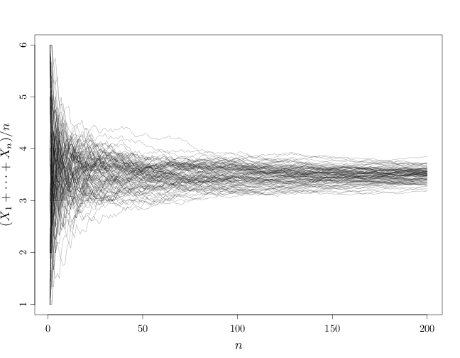{#fig-placeholder}

\*Probability Essentials, Springer (J.Jacod, P.Protter)

# Simbologia

In teoria della probabilità, la notazione matematica assume un significato specifico legato all'accadimento degli eventi. Ecco un riepilogo dei simboli più ricorrenti:

- $\Omega$ (**Spazio campionario**): L'insieme di tutti i possibili esiti elementari di un esperimento aleatorio.

- $\omega$ (**Esito elementare**): Un singolo esito specifico appartenente a $\Omega$ (indicato con $\omega \in \Omega$).

- $\mathcal{A}$ o $\mathcal{F}$ (**$\sigma$-algebra**): La famiglia di sottoinsiemi di $\Omega$ che costituiscono gli \"eventi\" ammissibili, di cui ha senso misurare la probabilità.

- $\mathbb{P}$ o $P$ (**Misura di probabilità**): La funzione $\mathbb{P}: \mathcal{A} \rightarrow [0,1]$ che quantifica la verosimiglianza di un evento.

- $\emptyset$ (**Evento impossibile**): L'insieme vuoto; rappresenta un evento che non può mai verificarsi ($\mathbb{P}(\emptyset) = 0$).

- $\cup$ (**Unione - \"OR\" logico**): $A \cup B$ rappresenta l'evento \"si verifica $A$, oppure si verifica $B$, o si verificano entrambi\".

- $\cap$ (**Intersezione - \"AND\" logico**): $A \cap B$ rappresenta l'evento \"si verificano contemporaneamente sia $A$ che $B$\". Spesso nei testi avanzati si omette il simbolo e si scrive semplicemente $AB$.

- $\sqcup$ (**Unione disgiunta**): Unione di due eventi incompatibili (tali che $A \cap B = \emptyset$). Sottolinea visivamente che la probabilità dell'unione sarà la semplice somma delle probabilità.

- $A^c$ o $\overline{A}$ (**Evento complementare - \"NOT\" logico**): Rappresenta l'evento \"non si verifica $A$\". Sappiamo che $\mathbb{P}(A^c) = 1 - \mathbb{P}(A)$.

- $\setminus$ (**Differenza**): $A \setminus B$ indica l'evento \"si verifica $A$, ma non si verifica $B$\". Equivale all'intersezione $A \cap B^c$.

- $|$ (**Condizionamento**): Si legge \"dato che\" o \"condizionato a\". $\mathbb{P}(A|B)$ è la probabilità che si verifichi $A$ sapendo che $B$ si è già verificato.

- $X, Y, Z$ (**Variabili Casuali**): Funzioni misurabili che \"trasportano\" gli esiti da $\Omega$ allo spazio dei numeri reali $\mathbb{R}$.

- $\mathbb{E}[X]$ (**Valore Atteso**): La media teorica (o speranza matematica) della variabile casuale $X$.

- $\text{Var}(X)$ o $\sigma^2_X$ (**Varianza**): Misura la dispersione dei valori assunti dalla variabile casuale $X$ attorno al suo valore atteso.

# Introduzione

Un esperimento è casuale se è impossibile prevederne l'esito ma che, se ripetuto molte volte, mostra una certa regolarità negli esiti. Per descrivere un esperimento casuale si usa la terna: $$(\Omega, \mathcal{A},\mathbb{P})$$

- $\Omega$ è lo spazio di stato, ovvero l'insieme di tutti i possibili esiti di un esperimento casuale. Per il lancio di una moneta $\Omega=\{Testa, Croce\}$; per il lancio di due dadi $\Omega=\{(i,j):1\leq i \leq 6, 1\leq j \leq 6\}$; per la durata di vita di una lampadina $\Omega=\mathbb{R_+}$.

  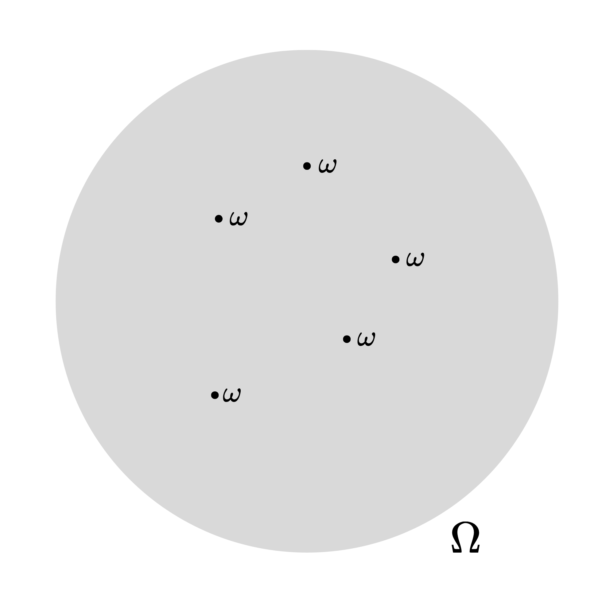{#fig-placeholderx}

- $\mathcal{A}$ è l'insieme degli eventi a cui vogliamo assegnare una probabilità. un evento è un sottoinsieme di $\Omega$. Per esempio, nel lancio di un dado un evento potrebbe essere $A=\{esce \,6\}$, con $A\in \mathcal{A}$.

  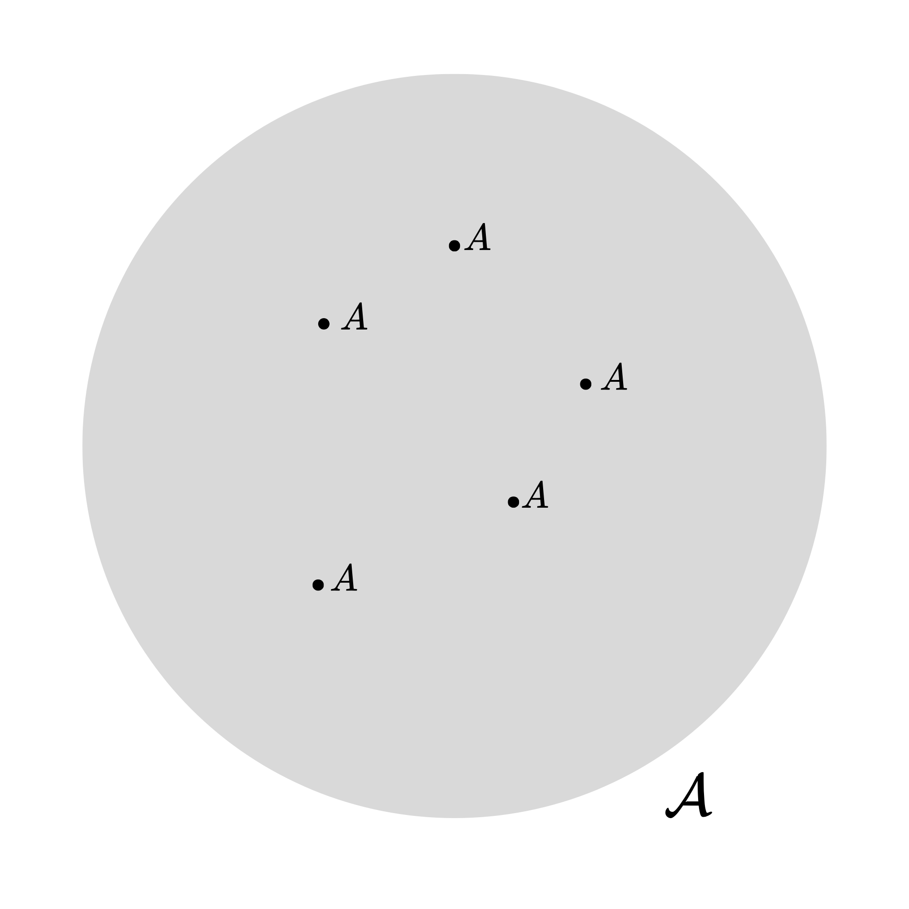{#fig-placeholder}

- $\mathbb{P}$ è la misura di probabilità, ovvero una funzione che mappa ogni evento $A\in\mathcal{A}$ in un numero $\mathbb{P}(A)$ compreso tra 0 e 1, che misura quanto è verosimile che l'evento accada. $$\mathbb{P}:\mathcal{A}\rightarrow[0,1]$$

  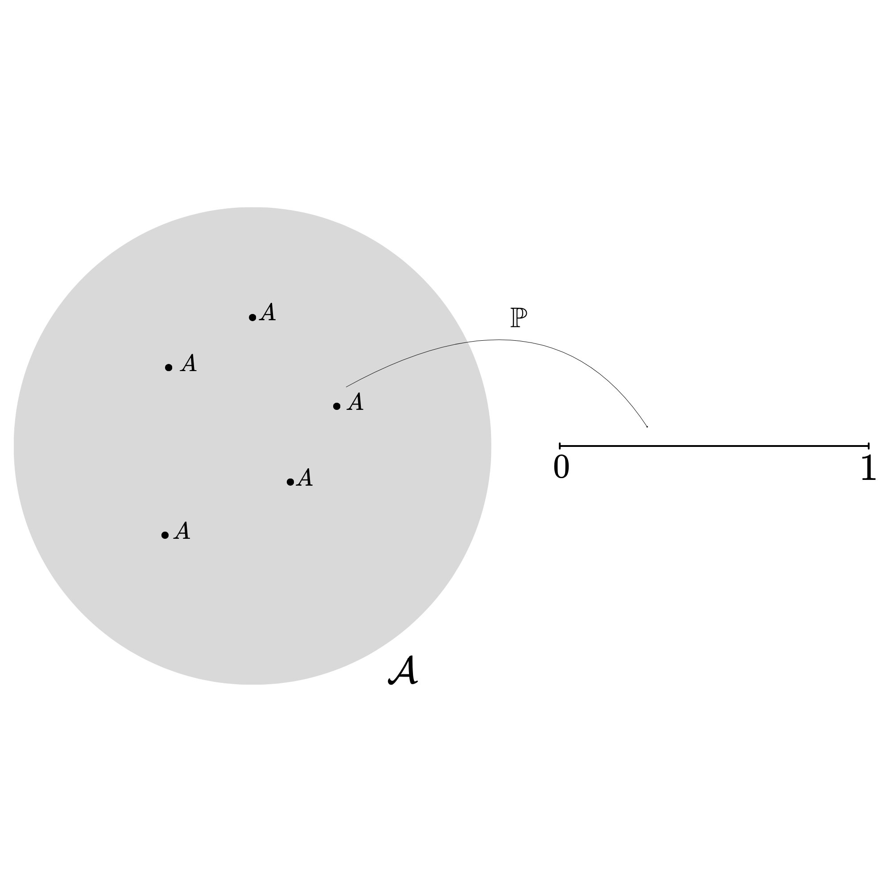{#fig-placeholderx}

- $X$ è una variabile casuale, ovvero una funzione definita in $\Omega$ a uno spazio $E$. Tramite $X$ si \"trasporta\" la probabilità dallo spazio astratto $\Omega$ al nuovo spazio, più semplice, $E$ (ad esempio $\mathbb{R}$). $$X: \Omega \rightarrow E$$

  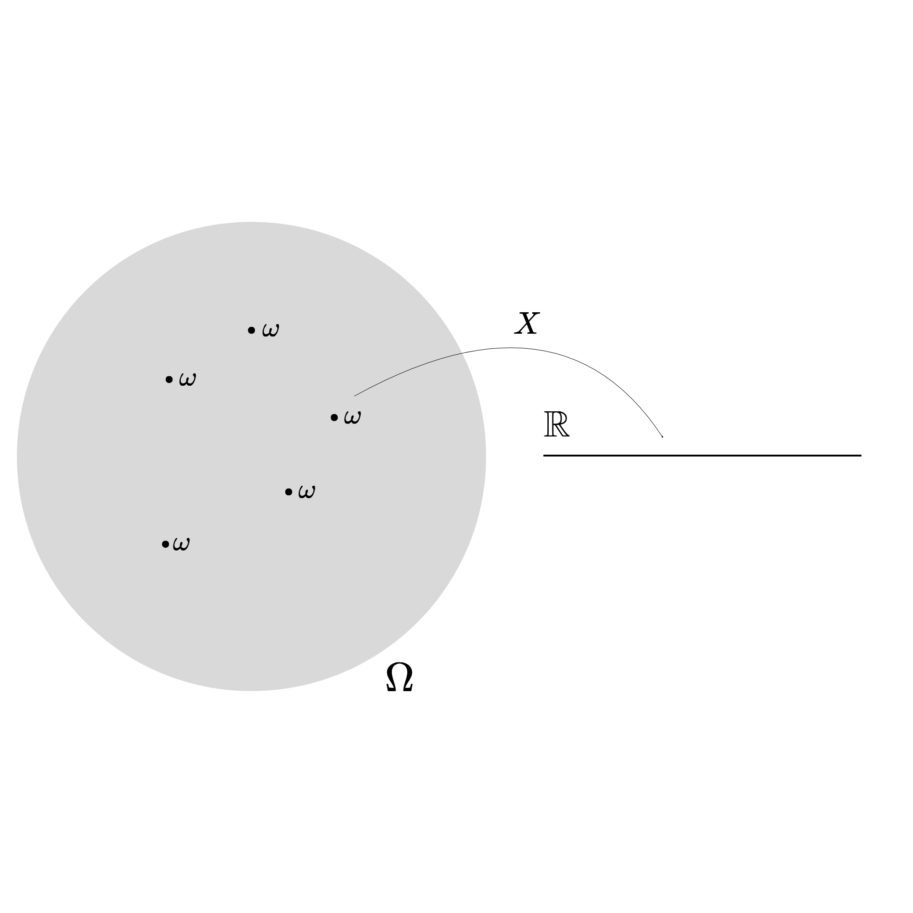{#fig-placeholder}

per poter calcolare rigorosamente le probabilità, ci serve sapere cosa può succedere ($\Omega$), quali combinazioni di risultati vogliamo misurare ($\mathcal{A}$) e con che regola li misuriamo ($\mathbb{P}$).

# Assiomi Delle Probabilità

## I concetti di Finito, Numerabile e Non Numerabile

Prima di addentrarci nelle proprietà degli spazi di probabilità, è fondamentale distinguere rigorosamente i tipi di insiemi in base alla loro cardinalità:

- **Finito:** un insieme è finito se i suoi elementi sono in numero limitato. È possibile contarli e, prima o poi, la conta termina. C'è una corrispondenza biunivoca solo con un sottoinsieme limitato dei numeri naturali, ad esempio $\{1, 2, \dots, n\}$.

- **Numerabile (o Infinito Numerabile):** un insieme è numerabile se i suoi elementi sono infiniti, ma è possibile \"metterli in fila\" assegnando a ciascuno di essi un'etichetta numerica senza tralasciarne nessuno. Esiste, in altre parole, una corrispondenza biunivoca (uno a uno) con l'intero insieme dei numeri naturali $\mathbb{N}$. Possiamo elencarli ordinatamente come $A_1, A_2, A_3, \dots$ all'infinito.

- **Non numerabile (o Più che numerabile):** un insieme è non numerabile quando rappresenta un infinito \"troppo grande\" e denso per poter essere messo in una lista. Non è possibile stabilire una corrispondenza uno a uno con i numeri naturali $\mathbb{N}$. Qualsiasi tentativo di elencarli lascerebbe fuori infiniti elementi (un classico esempio è l'insieme dei numeri reali $\mathbb{R}$).

Per comprendere appieno cosa significhi \"corrispondenza uno a uno con i numeri naturali\", è utilissimo il celebre paradosso del Grand Hotel, ideato dal matematico David Hilbert nel 1924.

Immaginiamo un hotel dotato di infinite stanze, numerate progressivamente con i numeri naturali ($1, 2, 3, \dots, n, \dots$). Una sera l'hotel è completamente pieno: in ogni singola stanza c'è un cliente.

Arriva un nuovo viaggiatore e chiede una stanza alla reception. In un hotel con un numero finito di stanze ($n$), non ci sarebbe più posto. Ma essendo un hotel con infinite stanze numerabili, il direttore può accoglierlo. Come fa?

1.  Chiede al cliente della stanza $1$ di spostarsi nella stanza $2$.

2.  Chiede al cliente della stanza $2$ di spostarsi nella stanza $3$.

3.  In generale, chiede al cliente della stanza $n$ di prendere le valigie e spostarsi nella stanza $n+1$.

Poiché le stanze sono numerabili, c'è sempre una stanza $n+1$ disponibile per chi stava nella stanza $n$. Nessun cliente viene mandato via, ma la stanza numero 1 si è liberata e il nuovo viaggiatore può accomodarsi.

Questo dimostra che in un insieme infinito numerabile è sempre possibile \"fare spazio\" traslando gli elementi, pur mantenendo la perfetta corrispondenza uno a uno con $\mathbb{N}$.

## $\sigma$-algebra

Sia $\Omega$ lo spazio degli stati e sia $2^\Omega$ l'insieme di tutti quanti i sottoinsiemi di $\Omega$. Essendo anche $\mathcal{A}$ costituito da sottoinsiemi di $\Omega$ abbiamo che $\mathcal{A}$ è un sottoinsieme di $2^\Omega$. Ci interessa conoscere le proprieta di $\mathcal{A}$:

1.  $\emptyset \in \mathcal{A}$ e $\Omega \in \mathcal{A}$;

2.  se un evento $A \in \mathcal{A}$, allora anche il suo complemento $A^c \in\mathcal{A}$ (chiusura rispetto al complemento);

3.  se una sequenza di eventi $A_1,A_2, ...,A_n\in\mathcal{A}$, allora $\mathcal{A}$ è chiusa rispetto ad unioni e intersezioni finite. $$\bigcup_{i=1}^nA_i\in\mathcal{A},\quad \bigcap_{i=1}^nA_i\in\mathcal{A}$$

4.  se una sequenza di eventi $A_1,A_2, ...,A_n\in\mathcal{A}$, allora $\mathcal{A}$ è chiusa rispetto ad unioni e intersezioni numerabili. $$\bigcup_{i=1}^ {\infty}A_i\in\mathcal{A},\quad \bigcap_{i=1}^{\infty}A_i\in\mathcal{A}$$

Se $\mathcal{A}$ soddisfa le proprietà (1), (2), (3) allora è un'algebra; se soddisfa le proprietà (1),(2),(4) allora è una $\sigma$-algebra. Segue che tutte le $\sigma$-algebra sono anche algebra ma non è vero il contrario. Concludiamo che un'algebra è chiusa rispetto alle operazioni finite, mentra una $\sigma$-algebra è chiusa rispetto ad operazioni numerabili.

### *Esempio* {#sec-esempio .unnumbered}

Ipotizziamo che $\Omega = \{1,2,3\}$. Una possibile $\sigma$-algebra è $\mathcal{A}=\{\emptyset, \Omega, \{1\}, \{2,3\}\}$, poiché:

- $\emptyset \in \mathcal{A}$ e $\Omega \in \mathcal{A}$;

- (chiusura rispetto al complementare) ogni elemento ha il suo complemento in $\mathcal{A}$: $$\{1\}^c=\{2,3\}\in\mathcal{A}, \quad \{2,3\}^c=\{1\}\in\mathcal{A}, \quad \Omega^c=\emptyset\in\mathcal{A}, \quad \emptyset^c=\Omega\in\mathcal{A};$$

- (chiusura rispetto all'unione) elencando tutte le possibili unioni a due a due tra gli elementi distinti di $\mathcal{A}$, otteniamo sempre insiemi che appartengono già ad $\mathcal{A}$:

  - $\{1\} \cup \{2,3\} = \{1,2,3\} = \Omega \in \mathcal{A}$

  - $\{1\} \cup \emptyset = \{1\} \in \mathcal{A}$

  - $\{2,3\} \cup \emptyset = \{2,3\} \in \mathcal{A}$

  - $\{1\} \cup \Omega = \Omega \in \mathcal{A}$

  - $\{2,3\} \cup \Omega = \Omega \in \mathcal{A}$

  - $\emptyset \cup \Omega = \Omega \in \mathcal{A}$

La più grande $\sigma$-algebra possibile è costituita da $|2^{\Omega}|=2^3=8$ sottoinsiemi.

### $\sigma$-algebra Generata

Se $\mathcal{C}$ è un sottoinsieme di $2^{\Omega}$, la $\sigma$-algebra generata da $\mathcal{C}$ è la più piccola $\sigma$-algebra che contiene $\mathcal{C}$. La $\sigma$-algebra generata, $\sigma(\mathcal{C})$ si ottiene prendendo l'intersezione di tutte le $\sigma$-algebra che contengono $\mathcal{C}$.: $$\sigma(\mathcal{C})=\bigcap\{\mathcal{A}_i:\mathcal{C}\in\mathcal{A}_i\}$$ Per i nostri scopi, ossia assegnare probabilità agli eventi, la $\sigma$-algebra più piccola è quella più efficiente, poichè include solo gli insiemi a cui vogliamo assegnare una probabilità ed esclude quelli \"patologici\". Nota che più una $\sigma$-algebra è grande, maggiore è l'informazione in essa contenuta, ma anche la sua complessità.

### $\sigma$-algebra di Borel

La $\sigma$-algebra di Borel (su $\mathbb{R}$), indicata con $\mathcal{B}$, è solitamente definita come la $\sigma$-algebra generata dagli insiemi aperti, ovvero da tutti gli intervalli aperti del tipo $(a,b)$. Tuttavia, si dimostra che qualsiasi intervallo può essere ricostruito utilizzando un insieme molto più piccolo di \"mattoncini\" fondamentali: gli intervalli della forma $(-\infty, x]$, con $x \in \mathbb{Q}$. Questo è possibile proprio perché l'insieme dei numeri razionali $\mathbb{Q}$ è **numerabile** e denso nei reali (tra due qualsiasi numeri reali $x$ e $y$ con $x<y$, esiste sempre almeno un numero razionale $q$ tale che $x<q<y$). Sfruttando le operazioni elementari della $\sigma$-algebra (unioni e intersezioni numerabili, e passaggio al complementare) applicate alla famiglia numerabile di insiemi $(-\infty, x]$, siamo in grado di generare l'intera $\sigma$-algebra di Borel.

Le $\sigma$-algebra sono il linguaggio matematico per descrivere cosa possiamo misurare (ovvero a quali eventi possiamo assegnare una probabilità); quanta informazione abbiamo disponibile (più grande è una $\sigma$-algebra, maggiore è l'informazione che contiene); come l'informazione si accumula nel tempo.

### $\sigma$-algebre indipendenti e sub$\sigma$-algebre

Sia $(\Omega, \mathcal{A}, \mathbb{P})$ uno spazio di probabilità e siano $\mathcal{F}$ e $\mathcal{G}$ due $\sigma$-algebre definite su $\Omega$.

- Se $\mathcal{F}\subset\mathcal{A}$ e $\mathcal{G}\subset\mathcal{A}$ allora $\mathcal{F}$ e $\mathcal{G}$ sono due sub$\sigma$-algebre di $\mathcal{A}$

- $\mathcal{F}$ e $\mathcal{G}$ sono indipendenti se dati due qualsiasi eventi $F\subset\mathcal{F}$ e $G\subset\mathcal{G}$ allora $\mathbb{P}(F\cup G)=\mathbb{P}(F)\mathbb{P}(G)$.

## Misurà di Probabilità

Una misura di probabilità definita su una $\sigma$-algebra è una funzione $$\mathbb{P}:\mathcal{A}\rightarrow[0,1]$$ che soddisfa i seguenti assiomi:

1.  $\mathbb{P}(\Omega)=1$, $\mathbb{P}(\emptyset)=0$;

2.  per ogni successione numerabile di eventi $\{A_n\}_{n\geq 1}\in\mathcal{A}$, che sono a due a due disgiunti ($A_i\bigcap A_j=\emptyset \quad  \forall i\neq j$) si ha: $$\mathbb{P}\left(\bigcup_{n=1}^{\infty}A_n\right)=\sum_{n=1}^{\infty}\mathbb{P}(A_n)$$ (additività numerabile della misura di probabilità)

Un risultato implicito della definizione di misura di probabilità è che $1\geq\mathbb{P}(A)\geq0$. Questo risultato è omesso in quanto descritto dallo spazio di arrivo della funzione. Inoltre, a partire dall'assioma (2) si possono \"rilassare\" le condizioni e vedere che l'additività numerabile: $$\mathbb{P}\left(\bigcup_{n=1}^k A_n\right)=\sum_{n=1}^k\mathbb{P}(A_n)$$ implica semplicemente l'additività finita. Nel caso di due soli eventi: $$A,B\in\mathcal{A}, \quad A\cap B = \emptyset \quad \Rightarrow \quad \mathbb{P}(A\cup B)=\mathbb{P}(A)+\mathbb{P}(B)$$

Un'altra conseguenza fondamentale degli assiomi che si ricava da questa proprietà è la **monotonicità** della misura di probabilità. Se un evento $A$ implica un evento $B$, ovvero se $A$ è un sottoinsieme di $B$ ($A \subseteq B$), allora la probabilità di $A$ non può superare quella di $B$. Essendo $A \subseteq B$, possiamo infatti scomporre l'evento $B$ come l'unione disgiunta di $A$ e della differenza $B \setminus A$ (ovvero gli elementi di $B$ che non stanno in $A$): $$B = A \cup (B \setminus A) \quad \text{con} \quad A \cap (B \setminus A) = \emptyset$$ Applicando la regola dell'additività finita appena ricavata, otteniamo: $$\mathbb{P}(B) = \mathbb{P}(A) + \mathbb{P}(B \setminus A)$$ Poiché il codominio della funzione di probabilità impone che $\mathbb{P}(B \setminus A) \geq 0$, ne consegue necessariamente che: $$A \subseteq B \quad \Rightarrow \quad \mathbb{P}(A) \leq \mathbb{P}(B)$$

## Additività della misura di probabilità

Abbiamo visto che se due eventi (o più) $A$ e $B$ non si sovrappongono ($A\cap B=\emptyset$) allora la probabilità dell'unione è semplicemente la somma delle singole probabilità. Ma cosa succede se gli eventi $A$ e $B$ si sovrappongono? Se gli eventi $A$ e $B$ si sovrappongono, significa che la loro intersezione non è vuota ($A \cap B \neq \emptyset$). In termini pratici, c'è una probabilità maggiore di zero che entrambi gli eventi si verifichino contemporaneamente.

Se provassimo a calcolare la probabilità dell'unione sommando semplicemente le singole probabilità, commetteremmo un errore di "doppio conteggio". Immaginando gli eventi come insiemi in un diagramma di Venn, calcoleremmo l'area centrale dell'intersezione esattamente due volte: la prima volta quando calcoliamo l'intero evento $A$, e la seconda volta quando calcoliamo l'intero evento $B$.

Per correggere questa sovrapposizione e trovare la probabilità corretta dell'unione, dobbiamo sottrarre l'intersezione "in eccesso" esattamente una volta.

Ecco la formula risolutiva formale: $$\mathbb{P}(A \cup B) = \mathbb{P}(A) + \mathbb{P}(B) - \mathbb{P}(A \cap B)$$ che si generalizza in:

::: mybox
Principio di inclusione-esclusione La formula generale del principio di inclusione-esclusione può essere scritta come: $$\mathbb{P}\left(\bigcup_{i=1}^n A_i\right) = \sum_i \mathbb{P}(A_i) - \sum_{i<j} \mathbb{P}(A_i \cap A_j) + \sum_{i<j<k} \mathbb{P}(A_i \cap A_j \cap A_k) - \dots + (-1)^{n+1} \mathbb{P}(A_1 \cap A_2 \cap \dots \cap A_n)$$ dove (ad esempio) $i<j$ significa sommare su tutte le coppie ordinate $(i,j)$ con $i<j$.
:::

Un'interessante proprietà del principio di inclusione-esclusione è che, se tronchiamo la somma a un certo passo $k$, otteniamo un'approssimazione che oscilla alternativamente tra una sovrastima e una sottostima della probabilità reale. Queste approssimazioni sono note come **disuguaglianze di Bonferroni**.

Nello specifico:

- **Al 1° ordine (Sovrastima):** Fermandoci alla semplice somma delle probabilità singole, contiamo le intersezioni più volte del dovuto. Otteniamo quindi un limite superiore (noto anche come disuguaglianza di Boole): $$\mathbb{P}\left(\bigcup_{i=1}^n A_i\right) \le \sum_{i=1}^n \mathbb{P}(A_i)$$

- **Al 2° ordine (Sottostima):** Sottraendo le intersezioni a due a due, togliamo \"troppo\" (abbiamo sottratto le intersezioni triple più volte del necessario). Otteniamo un limite inferiore: $$\mathbb{P}\left(\bigcup_{i=1}^n A_i\right) \ge \sum_{i=1}^n \mathbb{P}(A_i) - \sum_{i<j} \mathbb{P}(A_i \cap A_j)$$

- **Al 3° ordine (Sovrastima):** Aggiungendo di nuovo le intersezioni a tre a tre, compensiamo l'errore precedente ma torniamo a sovrastimare: $$\mathbb{P}\left(\bigcup_{i=1}^n A_i\right) \le \sum_{i=1}^n \mathbb{P}(A_i) - \sum_{i<j} \mathbb{P}(A_i \cap A_j) + \sum_{i<j<k} \mathbb{P}(A_i \cap A_j \cap A_k)$$

In generale, fermarsi a un termine con segno positivo (dispari) fornisce un limite superiore (sovrastima), mentre fermarsi a un termine con segno negativo (pari) fornisce un limite inferiore (sottostima). Man mano che si aggiungono termini, l'oscillazione si smorza, \"stringendo\" sempre di più il valore reale fino a raggiungerlo esattamente all'n-esimo passo.

## La funzione indicatrice

La funzione indicatrice è definita da: $$\mathbb {1}_A(\omega) = 
\begin{cases} 
1 & \text{se } \omega \in A \\
0 & \text{se } \omega \notin A
\end{cases}$$

Diciamo che una sequenza di eventi $\{A_n\}_{n\geq 1}\in \mathcal{A}$ converge all'evento $A$ se, per ogni $\omega\in\Omega$: $$\lim_{n\rightarrow\infty}\mathbb {1}_{A_n}(\omega)=\mathbb {1}_A(\omega)$$ Il che significa che per ogni possibile risultato dell'esperimento, la sequenza di 0 e 1 generata da $\mathbb {1}_{A_n}(\omega)$ si stabilizza a $\mathbb {1}_A(\omega)$.\

## Convergenza degli eventi

::: mybox
Continuità della misura di probabilità Sia $\mathbb{P}$ una misura di probabilità e sia $\{A_n\}_{n\geq1} \subseteq \mathcal{A}$ una successione di eventi che converge ad $A$. Allora $A \in \mathcal{A}$ e: $$\lim_{n\to\infty} \mathbb{P}(A_n) =\mathbb{P}(\lim_{n\to\infty}A_n)= \mathbb{P}(A)$$
:::

Nella teoria degli insiemi, dire che una successione di eventi $A_n$ \"converge\" a un evento limite $A$ significa solitamente che siamo di fronte a una successione monotona (stile matrioska). Ci sono due casi classici:

- **Successione Crescente (Continuità dal basso $A_n\uparrow A$):** Ogni evento è contenuto nel successivo ($A_1 \subseteq A_2 \subseteq A_3 \subseteq \dots$). L'evento \"limite\" $A$ è semplicemente l'unione di tutti gli eventi della successione: $$A = \bigcup_{n=1}^\infty A_n$$ Man mano che $n$ cresce, l'evento si \"gonfia\" sempre di più fino a diventare $A$. La probabilità segue questa crescita in modo continuo, per cui: $$\lim_{n \to \infty} \mathbb{P}(A_n) = \mathbb{P}\left(\bigcup_{n=1}^\infty A_n\right) = \mathbb{P}(A)$$

- **Successione Decrescente (Continuità dall'alto $A_n\downarrow A$):** Ogni evento contiene il successivo ($A_1 \supseteq A_2 \supseteq A_3 \supseteq \dots$). L'evento \"limite\" $A$ in questo caso è l'intersezione di tutti gli eventi della successione: $$A = \bigcap_{n=1}^\infty A_n$$ Man mano che $n$ cresce, l'evento si \"restringe\" scartando pezzi, fino a ridursi al nocciolo $A$. Anche in questo caso, la probabilità si restringe in modo continuo, per cui: $$\lim_{n \to \infty} \mathbb{P}(A_n) = \mathbb{P}\left(\bigcap_{n=1}^\infty A_n\right) = \mathbb{P}(A)$$

Per dimostrare la convergenza definiamo: $$\limsup_{n\rightarrow\infty}{A_n}=\bigcap_{n=1}^\infty\bigcup_{m\geq n}A_m$$ Come l'insieme degli eventi che accadono infinitamente spesso (i.o, infinitely often). Prendi un punto $n$ e unisci tutti gli elementi da $n$ in poi. Questo significa che l'evento accade almeno una volta dal momento $n$ in poi. L'intersezione esterna impone che questa cosa sia vera per qualsiasi punto di partenza $n$ scelto. E

$$\liminf_{n\rightarrow\infty}{A_n}=\bigcup_{n=1}^\infty\bigcap_{m\geq n}A_m$$ Come l'insieme degli eventi che accadono definitivamente. Prendi un punto di partenza $n$ e interseca tutti gli eventi da lì in poi. Questo crea un insieme di cose che accadono per tutti gli $A_n$ dal quel punto di partenza $n$ in poi. L'unione esterna fissa il punto di partenza $n$. Quindi sono gli eventi che da un certo $n$ in poi succedono sempre.\
poichè $\mathcal{A}$ è una $\sigma$-algebra, abbiamo che $\limsup_{n\rightarrow\infty}{A_n} \in\mathcal{A}$ e $\liminf_{n\rightarrow\infty}{A_n}\in \mathcal{A}$. Se ipotizziamo che $A_n\rightarrow A$, il che significa che $\lim_{n\rightarrow\infty}\mathbb {1}_{A_n}(\omega)=\mathbb {1}_A(\omega)$, questo è equivalente a dire che $A=\limsup_{n\rightarrow\infty}{A_n}=\liminf_{n\rightarrow\infty}{A_n}$. Pertanto $A\in\mathcal{A}$. Ora siano $B_n = \bigcap_{m\geq n} A_m$ e $C_n = \bigcup_{m\geq n} A_m$. Allora $B_n \uparrow A$[^1] e $C_n \downarrow A$[^2]. $$\lim_{n\rightarrow \infty}\mathbb{P}(B_n)=\lim_{n\rightarrow \infty}\mathbb{P}(C_n)=\mathbb{P}(A)$$ Tuttavia $B_n\subset A_n \subset C_n$ pertanto, per la monotonia della misura di probabilità: $\mathbb{P}(B_n)\leq \mathbb{P}(A_n) \leq \mathbb{P}(C_n)$ e per il Teorema dei Carabinieri: $$\lim_{n\to\infty} \mathbb{P}(A_n) =\mathbb{P}(A)$$ Esattamente come con i numeri, dove il limite esiste se limite destro e sinistro esistono, per gli insiemi diciamo che il limite esiste se e solo se $A=\limsup_{n\rightarrow\infty}{A_n}=\liminf_{n\rightarrow\infty}{A_n}$. Ovvero se gli eventi che accadono i.o. sono esattamente gli eventi che accadono definitivamente.

# Probabilità condizionata ed Indipendenza

Siano $A$ e $B$ due eventi definiti su uno spazio di probabilità $(\Omega,\mathcal{A},\mathbb{P)}$ e sia $f_n(A)$ la frequenza relativa dell'evento $A$, ovvero il numero di volte in cui $A$ si verfifica, diviso per $n$ (numero totale di prove). Intuitivamente: $$\lim_{n\rightarrow\infty}f_n(A)=\mathbb{P}(A)$$

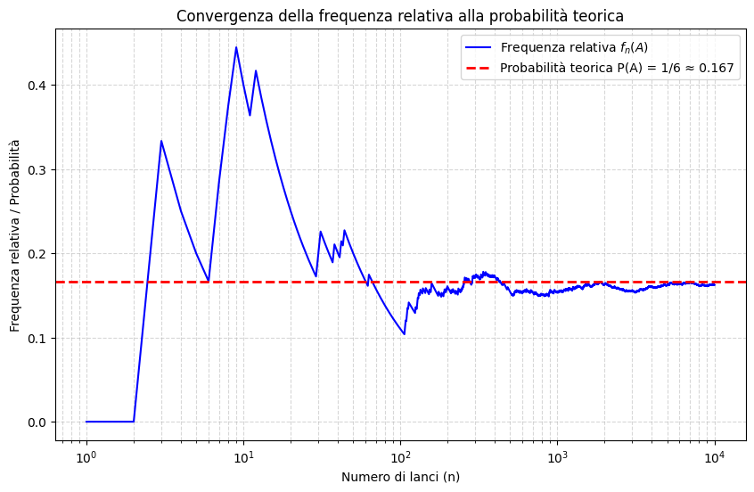{#fig-placeholderx}

Ora supponiamo di sapere che l'evento $B$ si è verificato e indichiamo con $\mathbb{P}(A|B)$ la probabilità che $A$ si verifichi dato che $B$ si è verificato. Ora dal lato delle frequenze relative, ci interessa contare solo le prove in cui $A$ e $B$ si sono verificati. Queste sono date da $nf_n(A\cap B)$. Inoltre, stiamo restringendo lo spazio al vincolo che $B$ si sia verificato. Dunque: $$\lim_{n\rightarrow\infty} \frac{nf_n(A\cap B)}{nf_n(B)}=\frac{\mathbb{P}(A\cap B)}{\mathbb{P}(B)}=\mathbb{P}(A|B)$$

## Eventi Indipendenti

Due eventi sono indipendenti se: $$\mathbb{P}(A\cap B)=\mathbb{P}(A)\mathbb{P}(B)$$ Più in generale, una collezione (eventualmente infinita) di eventi $\{A_i\}_{i\in I}$ è una collezione di eventi indipendenti se per ogni sottoinsieme finito $J\in I$, si ha: $$\mathbb{P}(\bigcap_{i\in J}A_i)=\prod_{i\in J}\mathbb{P}(A_i)$$ Si noti che se gli eventi $\{A_i\}_{i\in I}$ sono indipendenti, allora sono anche indipendenti a due a due, ma il contrario non è sempre vero.

### *Esempio* {#sec-esempio-1 .unnumbered}

Sia $\Omega=\{1,2,3,4\}$ e $\mathcal{A}=2^{\Omega}$. siano $i=1,2,3,4$ i singoli es. Definiamo gli eventi $A=\{1,2\}$, $B=\{1,3\}$, $C=\{2,3\}$. Allora $A,B,C$ sono indipendenti a due a due ma non lo sono globalmente, poichè: $$\mathbb{P}(A\cap B)=\mathbb{P}(\{1\})=1/4=\mathbb{P}(A)\mathbb{P}(B)$$ $$\mathbb{P}(A\cap C)=\mathbb{P}(\{2\})=1/4=\mathbb{P}(A)\mathbb{P}(C)$$ $$\mathbb{P}(B\cap C)=\mathbb{P}(\{3\})=1/4=\mathbb{P}(B)\mathbb{P}(C)$$ ma $$\mathbb{P}(A\cap B\cap C)=\mathbb{P}(\emptyset)=0\neq \mathbb{P}(A)\mathbb{P}(B)\mathbb{P}(C)=1/8$$

::: mybox
Proprietà di indipendenza Se $A$ e $B$ sono eventi indipendenti, allora lo sono anche $A^c$ e $B$; $A$ e $B^c$: $A^c$ e $B^c$
:::

## Probabilità Condizionata

Siano $A$ e $B$ due eventi, con $\mathbb{P}(B)>0$. La probabilità condizionata dell'evento $A$, dato che l'evento $B$ si è verificato è: $$\mathbb{P}(A|B)=\frac{\mathbb{P}(A\cap B)}{\mathbb{P}(B)}$$

Se i due eventi sono indipendenti, otteniamo: $$\mathbb{P}(A|B)=\frac{\mathbb{P}(A\cap B)}{\mathbb{P}(B)}=\frac{\mathbb{P}(A)\mathbb{P}(B)}{\mathbb{P}(B)}=\mathbb{P}(A)$$

::: mybox
Regola della catena Se gli eventi $A_1,A_2,...,A_n\in\mathcal{A}$ e se $\mathbb{P}(A_1\cap ...\cap A_{n-1})>0$ allora: $$\mathbb{P}(A_1\cap ...\cap A_n)=\mathbb{P}(A_1)\mathbb{P}(A_2|A_1)\mathbb{P}(A_3|A_1\cap A_2)...\mathbb{P}(A_n|A_1\cap ...\cap A_{n-1})$$
:::

La regola della catena ci dice che la probabilità di una \"storia\" è il prodotto delle probabilità di ogni singolo passo, dato tutto il passato fino a quel momento.

## *Esempio* {#sec-esempio-2 .unnumbered}

Immagina di pescare 3 carte da un mazzo di 52, senza reinserimento. Vogliamo conoscere la probabilità di pescare esattamente 3 assi: $\mathbb{P}(A_1\cap A_2\cap A_3)$. Definiamo gli eventi $A_1$ \"pescare il primo asso\", $A_2$ \"pescare il secondo asso\", $A_3$ \"pescare il terzo asso\". La probabilità di pescare il primo asso è $\mathbb{P}(A_1)$. Ora, la probabilità del secondo asso è condizionata al fatto che il mazzo è composto ora da 51 carte, di cui 3 assi. $\mathbb{P}(A_2|A_1)$. La probabilità di pescare il terzo asso è condizionata al fatto che i primi due assi sono già stati pescati: $\mathbb{P}(A_3|A_1\cap A_2)$

## Partizione dello spazio degli eventi

Una collezione di eventi $\{E_n\}_{n\geq 1}$ è una partizione di $\Omega$ se:

- $E_n\in \mathcal{A}$ per ogni n

- gli $E_n$ sono a due a due disgiunti ($E_i\cap E_j=\emptyset \quad \forall i \neq j$)

- la probabilità del singolo elemento di partizione è non negativa $\mathbb{P}(E_n)\geq 0$

- l'unione dei singoli elementi di partizione restituisce lo spazio degli eventi $\bigcup_nE_n=\Omega$

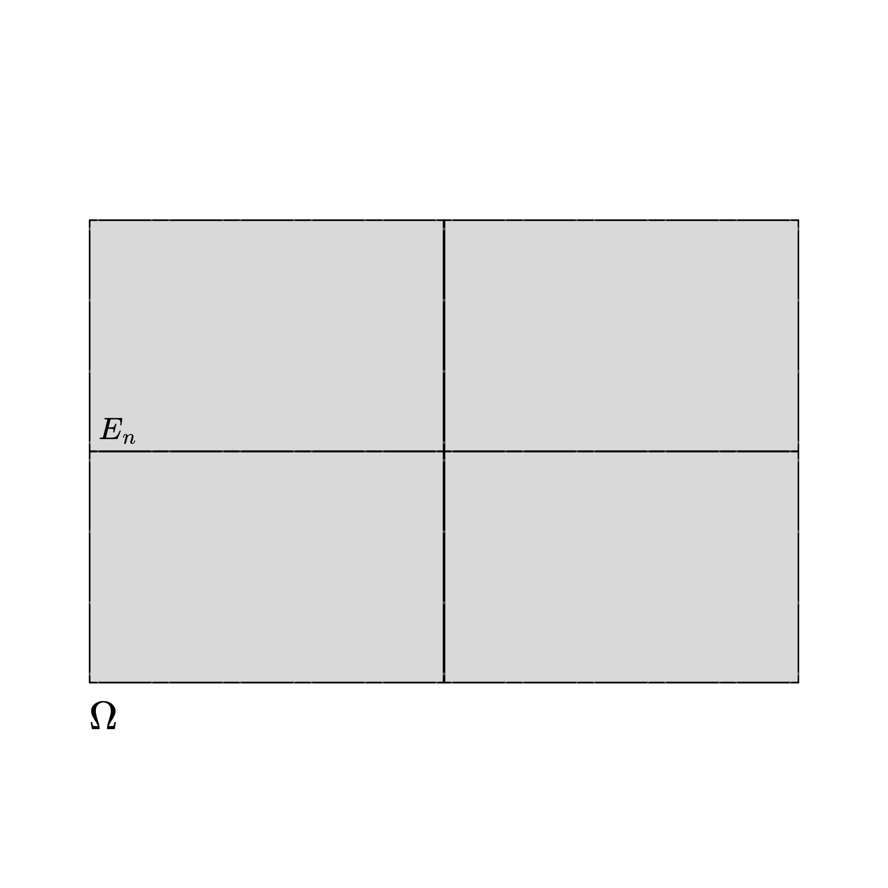{#fig-placeholder}

::: mybox
Equazione della partizione o Teorema della probabilità totale Sia $\{E_n\}_{n\geq 1}$ una partizione finita o numerabile di $\Omega$. Allora, se $A\in \mathcal{A}$: $$\mathbb{P}(A)=\sum_n\mathbb{P}(A|E_n)\mathbb{P}(E_n)$$
:::

Questa formula ci fornisce un metodo per calcolare la probabilità di un evento $A$, quanto non sappiamo calcolarla direttamente, ma conosciamo il comportamento di $A$ all'interno di scenari specifici (gli $E_i$). Immaginiamo ora che $A$ sia l'evento \"la persona ha gli occhi azzurri\". Sarebbe difficile calcolare $\mathbb{P}(A)$ senza avere altri dati. Tuttavia potremmo sapere la probabilità che una persona abbia gli occhi azzurri dato che viene da Svezia, Italia, Giappone o Russia ($\mathbb{P}(A|E_n)$) e anche la probabilità che una persona provenga da uno di questi quattro paesi ($\mathbb{P}(E_n)$). Il teorema ci dice che è sufficiente calcolare la probabilità dell'evento $A$ in ognuno di questi quattro scenari, moltiplicarla per la probabilità che quello specifico scenario $E_n$ si verifichi e poi sommare il tutto. Quindi definendo:

- $A=$ \"la persona ha gli occhi azzurri\"

- $E_n=$ \"la persona viene dal paese $n$\"

- $A\cap E_n=$ \"la persona ha gli occhi azzurri e viene dal paese $n$\"

$$\mathbb{P}(A)=\mathbb{P}(A| E_1)\mathbb{P}(E_1)+...+\mathbb{P}(A| E_4)
\mathbb{P}(E_4)$$ Questo perchè, analizzando il singolo addendo e sfruttando la definizone di probabilità condizionata, ci accorgiamo che: $$\mathbb{P}(A\cap E_n)=\mathbb{P}(A|E_n)\mathbb{P}(E_n)$$

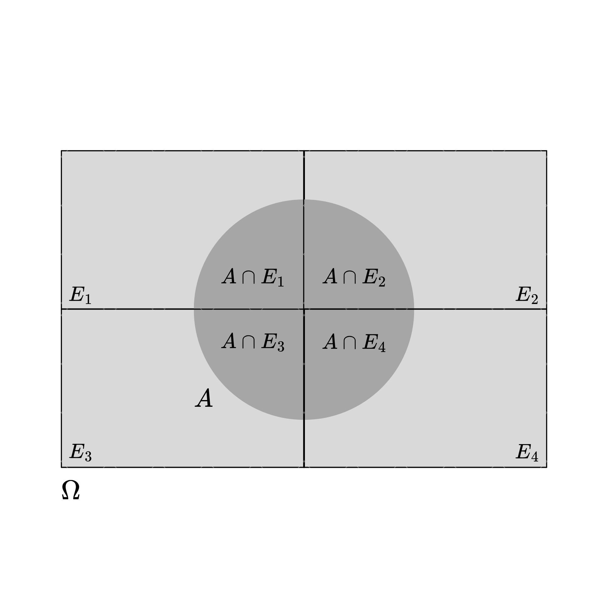{#fig-placeholderx}

## Teorema di Bayes

Sia $\{E_n\}$ una partizione finita o numerabile di $\Omega$ e supponiamo che $\mathbb{P}(A)>0$. Allora: $$\mathbb{P}(E_n|A)=\frac{\mathbb{P}(A|E_n)\mathbb{P}(E_n)}{\sum_m\mathbb{P}(A|E_m)\mathbb{P}(E_m)}$$ Notiamo che l'equazione a numeratore si ricava a partire dalla definzione di probabilità condizionata: $\mathbb{P}(A\cap E_n)=\mathbb{P}(A|E_n)\mathbb{P}(E_n)$ Mentre l'equazione a denominatore è data dal teorema della probabilità totale. Quindi: $$\mathbb{P}(E_n|A)=\frac{\mathbb{P}(A\cap E_n)}{\mathbb{P}(A)}$$ Il Teorema di Bayes non è solo una formula. Infatti si tratta di un paradigma logico per l'aggiornamento delle nostra credenze alla luce di nuove prove. Fino ad ora abbiamo calcolato le probabilità di un evento $A$ a partire da cause e scenari noti $E_n$. Possiamo pensare a $\mathbb{P}(A|E_n)$ come alla probabilità di osservare un determinato sintomo $A$ (evento $A$) dato che il paziente ha la malattia $E_n$ (evento $E_n$). Questo è facile da studiare clinicamente. Tuttavia, nella realtà ci troviamo di fronte al problema opposto: vogliamo trarre conclusioni sulla malattia osservando i sintomi, cioè vogliamo conoscere $\mathbb{P}(E_n|A)$. Il Teorema di Bayes ci consente di invertire la condizione.

- $\mathbb{P}(E_n)$ è detto **prior** e rappresenta la probabilità a priori dell'evento $E_n$ (la malattia) prima di aver osservato qualsiasi nuova prova. Può essere, ad esempio, il risultato di uno studio clinico su un campione di pazienti.

- $\mathbb{P}(A|E_n)$ è detto **likelihood** e rappresenta quanto è probabile osservare la prova $A$ (il sintomo) se lo scenario $E_n$ (la malattia) fosse effettivamente vero. Risponde alla domanda: \"Se ho la malattia $E_n$, quanto è probabile che abbia il sintomo $A$?\"

- $\sum_m\mathbb{P}(A|E_m)\mathbb{P}(E_m)$ è la probabilità totale, ovvero la probabilità di osservare il sintomo $A$ in generale, calcolata sommando tutti i modi possibili in cui $A$ può verificarsi data la malattia $E_m$. Funge da normalizzatore.

- $\mathbb{P}(E_n|A)$ è detto **posterior** e rappresenta la nostra nuova condizione aggiornata. Può essere visto come la probabilità dello scenario $E_n$ (la malattia), dopo aver incorporato l'informazione portata dalla nuova prova $A$ (il sintomo)

## Convergenza di intersezioni di eventi

::: mybox
Convergenza di intersezioni di eventi Se $A_n \to A$ e $B_n \to B$, allora le loro intersezioni convergono all'intersezione dei limiti:$A_n \cap B \to A \cap B$$A \cap B_n \to A \cap B$$A_n \cap B_n \to A \cap B$. Inoltre, se $\{A_n\}_{n\geq 1}\in \mathcal{A}$, $\{B_n\}_{n\geq 1}\in \mathcal{A}$, $A_n\rightarrow A$, $B_n\rightarrow B$, con $\mathbb{P}(B)\geq 0$ e $\mathbb{P}(B_n)\geq 0$: $$\lim_{n\rightarrow \infty}\mathbb{P}(A_n|B)=\mathbb{P}(A|B)$$ $$\lim_{n\rightarrow \infty}\mathbb{P}(A|B_n)=\mathbb{P}(A|B)$$ $$\lim_{n\rightarrow \infty}\mathbb{P}(A_n|B_m)=\mathbb{P}(A|B)$$
:::

# Probabilità discreta su uno spazio finito o numerabile

Assumiamo che lo spazio degli stati $\Omega$ sia finito o numerabile.

::: mybox
Probabilità Discreta Una probabilità su $\Omega$ è caratterizzata dai suoi valori sugli atomi: $$\mathbb{P}(\{\omega\})=p_{\omega} \quad \omega\in \Omega$$ Inoltre, sia $\{p_{\omega}\}_{\omega\in \Omega}$ una famiglia di numeri reali indicizzata da $\Omega$. Allora esiste un'unica misura di probabilità $\mathbb{P}$ tale che $\mathbb{P}(\{\omega\})=p_{\omega}$ se e solo se: $$p_ {\omega}\geq0, \quad \sum_{\omega \in \Omega}p_{\omega}=1$$ Il che significa che la probabilità di un singolo atomo (singoletto) deve comportarsi come definita nel capitolo 3.
:::

Questo teorema è il motore della probabilità discreta. Ci dice che per calcolare la probabilità di qualsiasi evento complesso $A$, ci basta conoscere le probabilità dei singoli atomi $p_{\omega}$ tali che $\omega\in A$.

## Probabilità Uniforme

Una probabilità sull'insieme finito $\Omega$ è detta uniforme se $\mathbb{P}(\{\omega\})=p_{\omega}$ non dipende dall'esito particolare $\omega$ (equiprobabilità). $$\mathbb{P}(A)=\frac{\#A}{\#\Omega}$$ dove il simbolo $\#$ indica la cardinalità dell'insieme. Quindi calcolare la probabilità di un qualsiasi evento $A$ equivale a contare il numeri di punti in $A$ (casi favorevoli) sul totale dei casi (numero di punti in $\Omega$). Se $\Omega$ è finito, esiste una e una sola probabilità uniforme.

## Distribuzione Ipergeometrica

La distribuzione Ipergeometrica è una distribuzione di probabilità discreta che descrive l'estrazione binaria senza reimmissione di due tipologie di elementi (es. vincenti e perdenti) da un insieme finito.\
In generale, la distribuzione ipergeometrica descrive una variabile aleatoria $X$ che conta il numero di successi in un campione di $n$ elementi estratti a caso (in modo equiprobabile e senza reimmissione) da una popolazione totale di $N+M$ elementi, di cui $N$ sono considerati successi e $M$ insuccessi.\
Immaginiamo che un'urna contenga $N$ palline bianche (vincenti) ed $M$ palline nere (perdenti). Si estraggono $n$ palline senza reimmissione. Si ottengono quindi $X$ palline bianche e $n-X$ palline nere. Siamo interessati alla probabilità che $X=x$, ovvero che il numero di palline vincenti estratte sia esattamente $x$. Siccome parliamo di equiprobabilità, dobbiamo definire i numeri che rappresentano i casi possibili e i casi favorevoli. Partiamo dal definire i casi possibili $\#\Omega$ utilizzando il coefficiente binomiale: $$\#\Omega=\binom{N+M}{n}=\frac{(N+M)!}{n!(N+M-n)!}$$ che rappresenta il numero di modi diversi di scegliere $n$ elementi da un insieme di $N+M$ elementi. Ora definiamo i casi favorevoli: $$\#A=\binom{N}{x}\binom{M}{n-x}=\frac{N!}{x!(N-x)!}\frac{M!}{(n-x)!(M-n+x)!}$$ che rappresenta il numero di modi di scegliere le $x$ palline bianche vincenti dal totale di $N$ palline bianche nell'urna, moltiplicato per il numero di modi di scegliere le restanti $n-x$ palline nere dal totale di $M$ palline nere.

La probabilità di ottenere esattamente $x$ palline bianche è quindi data dal rapporto tra casi favorevoli e casi possibili: $$\boldsymbol{\mathbb{P}(X=x) = \frac{\binom{N}{x}\binom{M}{n-x}}{\binom{N+M}{n}}}$$ Che equivale a dire che $\mathbb{P}(A)=\frac{\#A}{\#\Omega}$.\
Il supporto della variabile aleatoria, ovvero i valori interi che $x$ può assumere, è limitato da: $$\max(0, n-M) \leq x \leq \min(n, N)$$

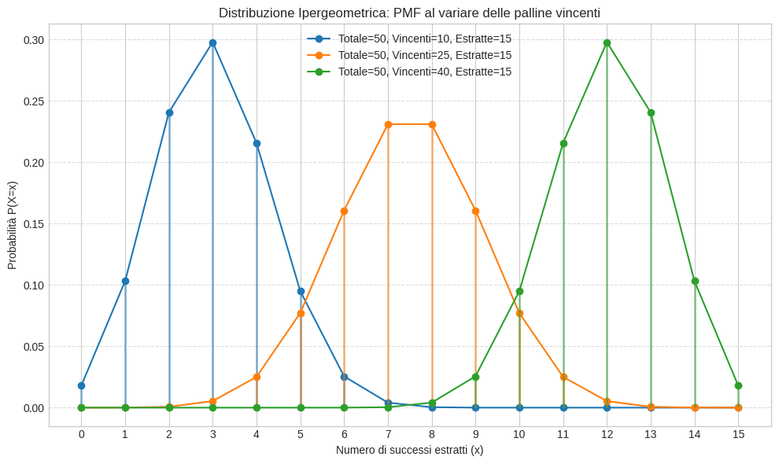{#fig-placeholder}

### *Esempio* {#sec-esempio-3 .unnumbered}

Prendi un mazzo da 52 carte. Ti vengono servite 5 carte distinte. Qual'è la probabilità di avere esattamente 2 assi in mano?

- $N=4$ è il totale dei casi vincenti, ovvero il numero di assi presenti nel mazzo;

- $M=4$ è il totale dei casi perdenti, ovvero le 48 carte nel mazzo che non sono assi;

- $N+M=52$ il totale delle carte nel mazzo;

- $n=5$ sono le carte di una mano

- $x=2$ è il numero di elementi vincenti che cerchiamo

$$\mathbb{P}(X=2) = \frac{\binom{4}{2}\binom{48}{3}}{\binom{52}{5}}$$ dove:

- $\binom{52}{5}$ è il numero di modi possibili di pescare 5 carte da un mazzo di 52;

- $\binom{4}{2}$ è il numero di modi possibili di pescare 2 assi da un totale di 4 assi presenti nel mazzo;

- $\binom{48}{3}$ è il numero di modi possibili di pescare le restanti 3 carte della mano che non sono un asso.

## Distribuzione Binomiale

### Processo Bernoulliano

Un processo Bernoulliano è un processo stocastico discreto $\{X_i\}_{i\in \mathbb{N}}$ di variabili aleatorie di Bernoulli i.i.d. $X_i\sim\mathcal{B}(p)$, dove $p$ è la probabilità di successo (che rimane costante). Un processo Bernoulliano può essere considerato come una sequenza di lanci di una moneta equa, con $p=0.5$, dove ogni singolo lancio $X_i$ è modellato come una singola variabile aleatoria di Bernoulli. Ogni singola prova può produrre due esiti: $$\mathbb{P}(X_i=1)=p=0.5$$ $$\mathbb{P}(X_i=
0)=1-p=q=0.5$$ Il numero di successi dopo $n$ prove (lanci) è dato dalla variabile aleatoria $S_n=X_1+...+X_n$ ciò che ci interessa è la distribuzione di $S_n$.\

### Distribuzione Binomiale

La distribuzione Binomiale è una distribuzione di probabilità discreta che descrive il numero di successi in un processo di Bernoulli, ovvero in una sequenza di $n$ prove indipendenti con la stessa probabilità di successo.

Torniamo a considerare l'urna contenente $N$ palline bianche (vincenti) e $M$ palline nere (perdenti), per un totale di $N+M$ palline. Questa volta, però, le $n$ estrazioni avvengono **con reimmissione**: dopo ogni estrazione, la pallina viene reinserita nell'urna. Vogliamo calcolare la probabilità dell'evento $A$, ovvero che la variabile aleatoria $X$ (numero di palline vincenti estratte) sia esattamente uguale a $x$.

Poiché rimettiamo sempre la pallina nell'urna, ad ogni pescata abbiamo a disposizione tutte le $N+M$ palline. Il numero totale di sequenze possibili (casi possibili) è quindi: $$\#\Omega = (N+M)^n$$

Per determinare il numero di casi favorevoli $\#A$, dobbiamo moltiplicare tre fattori: il numero di modi per scegliere le posizioni delle $x$ estrazioni vincenti su $n$ disponibili ($\binom{n}{x}$), le possibili combinazioni in cui pescare $x$ palline vincenti ($N^x$) e le combinazioni per le restanti $n-x$ palline perdenti ($M^{n-x}$). Otteniamo: $$\#A = \binom{n}{x} N^x M^{n-x}$$

La probabilità di ottenere esattamente $x$ successi è data dal rapporto tra casi favorevoli e casi possibili: $$\mathbb{P}(X=x) = \frac{\#A}{\#\Omega} = \frac{\binom{n}{x} N^x M^{n-x}}{(N+M)^n}$$

Distribuendo il denominatore in base agli esponenti, possiamo riscrivere la frazione in modo più elegante: $$\mathbb{P}(X=x) = \binom{n}{x} \left(\frac{N}{N+M}\right)^x \left(\frac{M}{N+M}\right)^{n-x}$$

Se a questo punto definiamo la probabilità costante di estrarre una pallina vincente in una singola prova come $p = \frac{N}{N+M}$, e conseguentemente la probabilità di estrarne una perdente come $1-p = \frac{M}{N+M}$, otteniamo la celebre formula canonica della distribuzione Binomiale $\mathcal{B}(n,p)$ dove $p$ è la probabilità di successo e $n$ è il numero di prove: $$\mathbb{P}(X=x) = \binom{n}{x} p^x (1-p)^{n-x}$$ dove il supporto della variabile aleatoria è limitato da: $$0 \leq x \leq n$$

Nella distribuzione Ipergeometrica, ogni pescata cambia la composizione dell'urna, mentre nella binomiale la struttra dell'urna si \"resetta\" dopo ogni reimmissione.

### *Esempio* {#sec-esempio-4 .unnumbered}

Affronti un test di ammissione composto da 10 domande a risposta multipla. Ogni domanda ha 4 opzioni. Decidi di tirare ad indovinare ogni singola domanda. Qual'è la probabilità di indovinare esattamente 6 risposte corrette?

- $p=0.25$ è la probabilità di successo, ovvero la probabilità di indovinare la singola risposta;

- $1-p=0.75$ è la probabilità di insuccesso, ovvero la probabilità di sbagliare la singola risposta

$$\mathbb{P}(X=6)=\binom{10}{6}(0.25)^6(0.75)^{10-6}$$

### Il ruolo del Coefficiente Binomiale: l'ordine dei successi {#sec-il-ruolo-del-coefficiente-binomiale-lordine-dei-successi .unnumbered}

È fondamentale sottolineare una distinzione cruciale: né la distribuzione Binomiale né quella Ipergeometrica descrivono la probabilità di ottenere $x$ successi **consecutivi** (di fila). Entrambe descrivono la probabilità di ottenere esattamente $x$ successi su $n$ estrazioni totali, **indipendentemente dall'ordine** in cui essi si verificano.

Per capire il perché, analizziamo la formula della Binomiale. Supponiamo di voler calcolare la probabilità di ottenere una singola e specifica sequenza, ad esempio quella in cui i primi $x$ estratti sono tutti successi e i restanti $n-x$ sono tutti insuccessi. Siccome le estrazioni con reimmissione sono indipendenti, questa probabilità è semplicemente il prodotto delle probabilità dei singoli eventi: $$\underbrace{p \cdot p \cdots p}_{x \text{ volte}} \cdot \underbrace{(1-p) \cdot (1-p) \cdots (1-p)}_{n-x \text{ volte}} = p^x(1-p)^{n-x}$$ Tuttavia, quando calcoliamo $\mathbb{P}(X=x)$, non ci interessa quando avvengono i successi. Essi potrebbero presentarsi tutti all'inizio, tutti alla fine, o mescolati agli insuccessi.

È qui che entra in gioco il coefficiente binomiale $\binom{n}{x}$. Esso serve da moltiplicatore e risponde alla domanda: *in quanti modi diversi posso disporre $x$ successi in $n$ posizioni (o estrazioni) disponibili?*

Moltiplicando la probabilità di una specifica sequenza per il numero di tutte le possibili disposizioni valide, otteniamo la probabilità totale dell'evento: $$\mathbb{P}(X=x) = \binom{n}{x} p^x (1-p)^{n-x}$$ Lo stesso identico principio logico si applica all'Ipergeometrica: il modo in cui abbiamo calcolato la cardinalità dell'evento $A$ conta tutte le possibili combinazioni in cui i successi e gli insuccessi possono essere estratti in blocco, senza mai imporre un ordine temporale preciso.

### Distribuzione Binomiale come limite dell'Ipergeometrica

Assumiamo ora che $n$ sia fissato, mentre $N$ ed $M$ crescono ad $\infty$ in modo tale che $\frac{N}{N+M}$ tenda ad un limite $p\in[0,1]$. Allora si verifica che: $$\mathbb{P}(X=x)\rightarrow\binom{n}x{p^x(1-p)^{n-x}}$$ Cioè la disitribuzione Ipergeometrica tende alla distribuzione Binomiale $\mathcal{B}(n,p)$ esattamente quando il totale di palline nell'urna $N+M$ è talmente grande da rendere irrilevante il fatto che dopo ogni pescata non viene reinserita la pallina estratta.\
Fino ad ora abbiamo considerato $\Omega$ finito, dove il numero massimo di successi era un limite fisico invalicabile. Cosa succede quando $\Omega$ diventa numerabile?

## Distribuzione Geometrica

Come anticipato, abbandoniamo l'ipotesi di un numero di prove $n$ fissato a priori e di uno spazio campionario $\Omega$ strettamente finito. Consideriamo nuovamente un Processo Bernoulliano, ovvero una sequenza di prove indipendenti in cui ogni prova ha una probabilità di successo $p$ costante.

La distribuzione Geometrica modella la variabile aleatoria $X$ che rappresenta il **numero di prove necessarie per ottenere il primo successo**. A differenza della distribuzione Binomiale, in cui contiamo i successi su un numero fisso di prove, qui le prove continuano a oltranza finché non si verifica l'evento desiderato. Di conseguenza, il supporto della variabile aleatoria (i valori interi che $x$ può assumere) diventa infinito numerabile: $$x\in\{1, 2, 3, \dots\}$$

Per calcolare la probabilità che il primo successo avvenga esattamente al tentativo $x$, dobbiamo avere una sequenza specifica formata da esattamente $x-1$ insuccessi consecutivi, seguiti da un singolo successo all'ultimo tentativo. Essendo le prove indipendenti, la probabilità di questa specifica intersezione di eventi è semplicemente il prodotto delle singole probabilità: $$\mathbb{P}(X=x)=(1-p)^{x-1}p$$

Nota come, a differenza della Binomiale e dell'Ipergeometrica, qui non compare il coefficiente binomiale. Il motivo è semplice: l'ordine degli eventi è rigidamente prestabilito. C'è un solo modo per ottenere il primo successo al tentativo $x$, ed è fallire in tutti i tentativi precedenti.

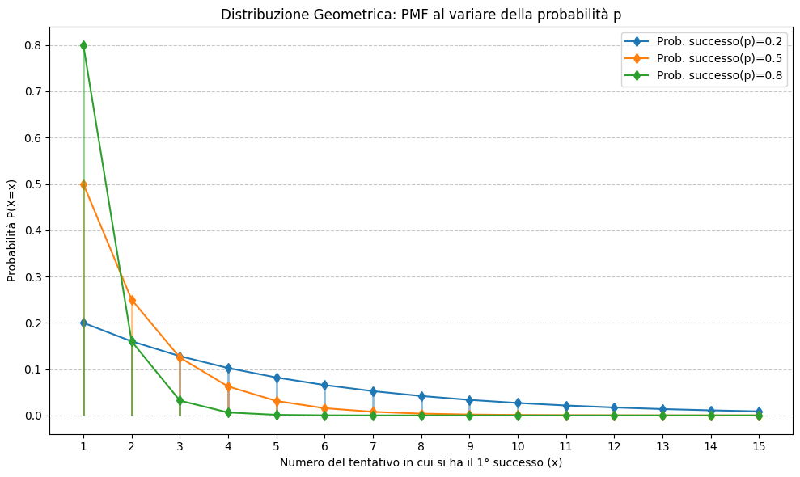

### *Esempio* {#sec-esempio-5 .unnumbered}

Lanci un dado a 6 facce non truccato in modo ripetuto. Qual è la probabilità di ottenere il primo \"6\" esattamente al quarto lancio?

- $p=1/6$ è la probabilità di successo al singolo lancio;

- $1-p=5/6$ è la probabilità di insuccesso al singolo lancio;

- $x=4$ è il numero del tentativo in cui vogliamo il primo successo.

$$\mathbb{P}(X=4)=\left(\frac{5}{6}\right)^{4-1}\left(\frac{1}{6}\right)=\left(\frac{5}{6}\right)^3\left(\frac{1}{6}\right)$$

## Distribuzione di Poisson

La distribuzione di Poisson $\mathcal{P}(\lambda)$ è una distribuzione discreta che descrive la probabilità che un certo numero di eventi si verifichi in un dato intervallo (di tempo, di spazio, di volume, ecc.), sapendo che questi eventi si verificano con un tasso medio noto $\lambda$ e indipendentemente dal tempo trascorso dall'ultimo evento.

Anche in questo caso, la variabile aleatoria $X$ conta un numero di successi e il suo supporto è l'insieme dei numeri naturali (infinito numerabile): $$x\in\{0, 1, 2, \dots\}$$

La funzione di massa di probabilità è definita dalla seguente espressione, dove $e$ è il numero di Nepero: $$\mathbb{P}(X=x)=\frac{e^{-\lambda}\lambda^x}{x!}$$

Il parametro $\lambda>0$ (spesso indicato come tasso di arrivo o intensità) ha una particolarità notevole: rappresenta sia il valore atteso (la media degli eventi nell'intervallo) sia la varianza della distribuzione.

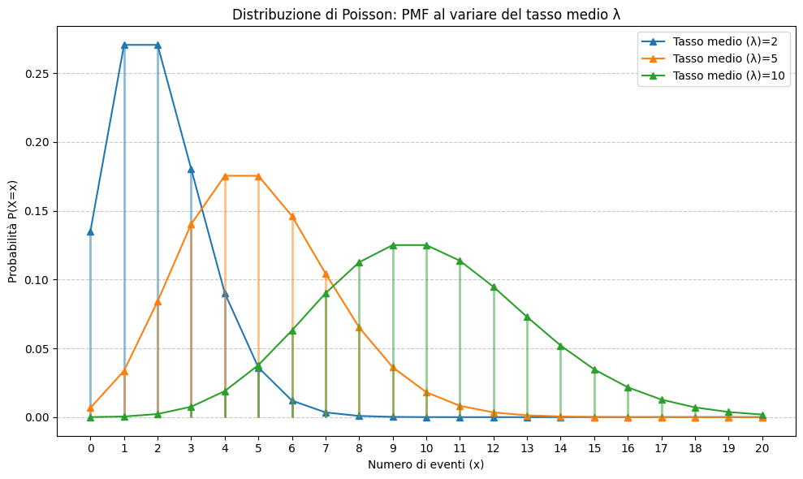

### La distribuzione di Poisson come limite della Binomiale

Il legame più affascinante della distribuzione di Poisson è la sua derivazione come caso limite della distribuzione Binomiale $\mathcal{B}(n,p)$. Immaginiamo di avere un numero di prove $n$ che diventa estremamente grande ($n\to\infty$), mentre la probabilità di successo $p$ di ogni singola prova diventa estremamente piccola ($p\to0$), ma in modo tale che il numero medio di successi attesi rimanga costante: $$n\cdot p=\lambda\implies p=\frac{\lambda}{n}$$

Sostituendo questo $p$ all'interno della formula della Binomiale e calcolando il limite per $n\to\infty$, l'espressione collassa matematicamente nella formula di Poisson: $$\lim_{n\to\infty}\binom{n}{x}\left(\frac{\lambda}{n}\right)^x\left(1-\frac{\lambda}{n}\right)^{n-x}=\frac{e^{-\lambda}\lambda^x}{x!}$$

Questo ci dice che la distribuzione di Poisson è lo strumento ideale per modellare \"eventi rari\" su una popolazione grandissima o su un numero enorme di prove.

### *Esempio* {#sec-esempio-6 .unnumbered}

Un centralino di assistenza tecnica riceve in media $\lambda=3$ chiamate ogni ora. Qual è la probabilità di ricevere esattamente 5 chiamate nella prossima ora?

- $\lambda=3$ è il tasso medio di eventi nell'intervallo specificato;    

- $x=5$ è il numero esatto di eventi di cui vogliamo calcolare la probabilità.

$$\mathbb{P}(X=5)=\frac{e^{-3}\cdot 3^5}{5!}$$

## Distribuzione Binomiale Negativa

La distribuzione Binomiale Negativa (o di Pascal) è una generalizzazione della distribuzione Geometrica. Se quest'ultima modella il numero di prove necessarie per ottenere il primo successo, la Binomiale Negativa descrive la variabile aleatoria $X$ che rappresenta il **numero di prove necessarie per ottenere l'$r$-esimo successo** all'interno di un Processo Bernoulliano.

Il supporto della variabile aleatoria è limitato inferiormente da $r$, poiché occorrono fisiologicamente almeno $r$ prove (tutte vincenti) per ottenere $r$ successi: $$x\in\{r, r+1, r+2, \dots\}$$

Per calcolare $\mathbb{P}(X=x)$, dobbiamo fissare una condizione rigida: l'ultima prova (la $x$-esima) deve essere necessariamente un successo. Nelle precedenti $x-1$ prove, invece, devono essersi verificati esattamente $r-1$ successi (non importa in quale ordine). La probabilità di questo evento è data dal prodotto tra la probabilità di ottenere $r-1$ successi in $x-1$ prove (che segue la logica combinatoria della Binomiale) e la probabilità $p$ che l'ultimo tentativo sia un successo: $$\mathbb{P}(X=x) = \binom{x-1}{r-1} p^{r-1} (1-p)^{(x-1)-(r-1)} \cdot p$$

Semplificando gli esponenti, otteniamo la formula canonica: $$\mathbb{P}(X=x) = \binom{x-1}{r-1} p^r (1-p)^{x-r}$$

{#fig-nbinom}

### *Esempio* {#sec-esempio-7 .unnumbered}

Stai tirando a canestro e hai una probabilità costante del 40% di segnare a ogni singolo tiro. Qual è la probabilità che il tuo 3° canestro avvenga esattamente al 7° tiro complessivo?

- $p=0.40$ è la probabilità di successo al singolo tiro;

- $1-p=0.60$ è la probabilità di insuccesso al singolo tiro;

- $r=3$ è il numero di successi target;

- $x=7$ è il tentativo esatto al quale vogliamo ottenere l'ultimo successo.

$$\mathbb{P}(X=7) = \binom{7-1}{3-1} (0.40)^3 (0.60)^{7-3} = \binom{6}{2} (0.40)^3 (0.60)^4$$

## Distribuzione Uniforme Discreta

La distribuzione Uniforme Discreta $\mathcal{U}(a,b)$ è la distribuzione di probabilità più intuitiva in assoluto. Descrive un esperimento in cui la variabile aleatoria $X$ può assumere un numero finito di valori interi, tutti **esattamente con la stessa probabilità** (equiprobabili).

Se il supporto è costituito da tutti gli interi compresi tra due estremi $a$ e $b$ (inclusi), il numero totale di esiti possibili nell'insieme $\Omega$ è pari a $n = b - a + 1$: $$x\in\{a, a+1, \dots, b\}$$

Essendo tutti i casi ugualmente possibili, la funzione di massa di probabilità è costante ed è semplicemente pari a 1 fratto il numero totale degli esiti: $$\mathbb{P}(X=x) = \frac{1}{n} = \frac{1}{b-a+1}$$

{#fig-unifdisc}

### *Esempio* {#sec-esempio-8 .unnumbered}

Il classico lancio di un dado non truccato a 6 facce. Qual è la probabilità di ottenere esattamente il numero 4?

- $a=1$ estremo inferiore del supporto;

- $b=6$ estremo superiore del supporto;

- $n = 6 - 1 + 1 = 6$ esiti possibili.

$$\mathbb{P}(X=4) = \frac{1}{6}$$

## Distribuzione Zeta (Pareto Discreta)

La distribuzione Zeta è una distribuzione di probabilità discreta definita sui numeri interi positivi, usata per modellare fenomeni in cui la probabilità di un evento è inversamente proporzionale alla sua grandezza o al suo rango, obbedendo alla *Legge di Zipf* (una legge di potenza). È, nella pratica, l'analogo discreto della distribuzione di Pareto.

Il supporto della variabile aleatoria $X$ è illimitato ed è pari all'insieme dei numeri interi positivi: $$x\in\{1, 2, 3, \dots\}$$

La funzione di massa di probabilità assume la forma di una legge di potenza scalata: $$\mathbb{P}(X=x) = \frac{1}{x^s \zeta(s)}$$ dove $s > 1$ è un parametro reale che determina la ripidità e la \"coda\" della distribuzione, e $\zeta(s)$ è la famosa **Funzione Zeta di Riemann**, definita come: $$\zeta(s) = \sum_{k=1}^{\infty} \frac{1}{k^s}$$

La presenza della funzione Zeta di Riemann al denominatore funge semplicemente da costante di normalizzazione: serve a garantire che la somma infinita di tutte le probabilità da $x=1$ a $x=\infty$ sia esattamente pari a 1, rispettando gli assiomi della probabilità.

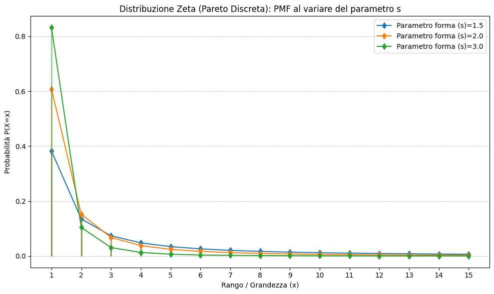{#fig-zeta}

### *Esempio* {#sec-esempio-9 .unnumbered}

Considera la frequenza d'uso delle parole in un vasto corpus testuale. La Legge di Zipf suggerisce che la $x$-esima parola più comune appare con una probabilità inversamente proporzionale al suo rango $x$. Assumendo un parametro di forma $s=2$, qual è la probabilità che una parola estratta a caso sia esattamente la terza più frequente in assoluto ($x=3$)?

- $x=3$ è il rango dell'evento (terza parola più usata);

- $s=2$ è il parametro della forma;

- Per l'analisi complessa sappiamo che il valore esatto di $\zeta(2)$ è $\frac{\pi^2}{6} \approx 1.645$.

$$\mathbb{P}(X=3) = \frac{1}{3^2 \cdot \zeta(2)} = \frac{1}{9 \cdot \frac{\pi^2}{6}} = \frac{6}{9\pi^2} \approx 0.067$$

# Variabili aleatorie su uno spazio numerabile

Assumiamo che $\Omega$ sia numerabile con la $\sigma$-algebra $2^{\Omega}$. Una variabile aleatoria è una funzione (o trasformazione): $$X:\Omega\rightarrow T$$ Essa rappresenta una quantità incognita che varia al verificarsi di un evento casuale. Prima che l'evento accada sappiamo quali valori potrebbe potenzialmente assumere $X$, ma non sappiamo il preciso valore che assumerà finchè l'evento casuale non si verifica.\
Definiamo la distribuzione di $X$, detta anche legge di $X$, sullo spazio degli stati $T$ come: $$P_X(A)=\mathbb{P}(\{\omega:X(\omega)\in A\})=\mathbb{P}(X^{-1}(A))=\mathbb{P}(X\in A)$$ Questa formula rappresenta il ponte fondamentale che collega lo spazio astratto degli esiti originari (lo spazio campionario $\Omega$) allo spazio pratico dei valori assunti dalla variabile aleatoria (lo spazio degli stati $T$). In sostanza, definisce in modo rigoroso come la misura di probabilità si \"trasferisca\" da $\Omega$ a $T$ tramite la funzione $X$.

Analizziamo nel dettaglio i quattro termini che compongono questa catena di uguaglianze:

- $P_X(A)$: È la probabilità indotta sullo spazio degli stati $T$. Rappresenta la probabilità che la variabile aleatoria $X$ assuma un valore all'interno del sottoinsieme $A$ (con $A \subseteq T$). Viene comunemente chiamata \"legge\" o \"distribuzione\" della variabile aleatoria $X$.

- $\mathbb{P}(\{\omega:X(\omega)\in A\})$: Rappresenta il cuore logico della definizione. Poiché non possediamo a priori una misura di probabilità definita su $T$, ma solo la probabilità originaria $\mathbb{P}$ definita su $\Omega$, dobbiamo procedere a ritroso. Raggruppiamo in un unico evento (sottoinsieme di $\Omega$) tutti e soli quegli esiti $\omega$ tali per cui, applicando la trasformazione $X$, il risultato $X(\omega)$ \"atterra\" esattamente dentro l'insieme $A$. Una volta individuato questo specifico gruppo di $\omega$, utilizziamo la misura $\mathbb{P}$ per valutarne la probabilità.

- $\mathbb{P}(X^{-1}(A))$: Questa è un'espressione formale che utilizza il concetto di **controimmagine** (o immagine inversa) dell'insieme $A$ tramite la funzione $X$. Non implica che $X$ sia invertibile (spesso non lo è, essendo una funzione tipicamente non iniettiva), ma è la notazione compatta della teoria degli insiemi per indicare l'insieme di partenza $\{\omega \in \Omega : X(\omega) \in A\}$.

- $\mathbb{P}(X\in A)$: Questa è la notazione abbreviata e di uso comune nella pratica statistica. Omette il formalismo delle controimmagini e degli esiti $\omega$ per una lettura più immediata: \"la probabilità che la variabile aleatoria $X$ appartenga all'insieme $A$\".

### *Esempio* {#sec-esempio-10 .unnumbered}

Consideriamo il lancio di un dado a 6 facce non truccato:

- Lo spazio campionario è $\Omega = \{\omega_1, \omega_2, \omega_3, \omega_4, \omega_5, \omega_6\}$, dove $\omega_i$ rappresenta l'uscita della faccia con $i$ punti.

- Definiamo la variabile aleatoria $X$ associata all'evento \"esce un numero pari\". Poniamo $X(\omega) = 1$ se $\omega$ è pari, e $X(\omega) = 0$ se $\omega$ è dispari.

- Lo spazio degli stati è quindi $T = \{0, 1\}$.

- Sia $A = \{1\}$ l'evento di interesse (la \"vittoria\").

Per calcolare $P_X(\{1\})$, cerchiamo la controimmagine di $A$ tramite $X$, ovvero tutti gli $\omega$ per cui $X(\omega) = 1$: $$X^{-1}(\{1\}) = \{\omega_2, \omega_4, \omega_6\}$$

La probabilità indotta sarà quindi la probabilità di questo sottoinsieme calcolata nello spazio originario $\Omega$: $$P_X(\{1\}) = \mathbb{P}(\{\omega_2, \omega_4, \omega_6\}) = \frac{3}{6} = 0.5$$

Nella notazione compatta scriveremo semplicemente $\mathbb{P}(X=1) = 0.5$.

{#fig-placeholderx}

## Valore Atteso

Sia $X$ una variabile aleatoria a valori reali sun uno spazio numerabile $\Omega$. Il valore atteso di $X$ è definito come: $$\mathbb{E}[X]=\sum_{\omega}X(\omega)p_w$$ Se lo spazio degli stati $\Omega$ è infinito, la formula diventa una somma infinita e ha senso se la convergenza è assoluta o se $X\geq0$ sempre.

::: mybox
Spazio $\mathcal{L}^1$ Definiamo $\mathcal{L}^1$ come lo spazio delle variabili aleatorie reali su $(\Omega,\mathcal{A},\mathbb{P)}$ che hanno valore atteso finito. $\mathcal{L}^1$ è uno spazio vettoriale.
:::

### Proprietà del valore atteso

- **Linearità**: date le variabili aleatorie $X$ e $Y$ $\in \mathcal{L}^1$ e $a,b\in\mathbb{R}$ allora $\mathbb{E}[aX+bY]=a\mathbb{E}[X]+b\mathbb{E}[X]$

- **Positività**: se $X\in\mathcal{L}^1$, $X\geq0$ allora $\mathbb{E}[X]\geq0$

- **Costanti**: se $X\in\mathcal{L}^1$, $X=a$ allora $\mathbb{E}[X]=a$

- **Trasporto**: invece di sommare tutti i $X(\omega)p_w$ in $\Omega$, sommiamo i $j\mathbb{P}(X=j)$ in $T$: $$\mathbb{E}[X]=\sum_{j\in T}j\mathbb{P}(X=j)$$

- **Funzione indicatrice** se $X\in\mathcal{L}^1$, $X=\mathbf{1}_A$ allora $\mathbb{E}[X]=\mathbb{E}[\mathbf{1_A}]=\mathbb{P}(A)$

::: mybox
Limiti superiori per le probabilità Sia $h:\mathbb{R}\rightarrow[0,\infty)$ una funzione non negativa e sia $X$ una variabile aleatoria a valori reali. Allora: $$\mathbb{P}(\{\omega:h(X(\omega))\geq a\})\leq \frac{\mathbb{E}[h(X)]}{a}$$ Se definiamo l'evento $A$ come: $$A=\{h(X)\geq a\}$$ allora la disuguaglianza si semplifica a: $$\mathbb{P}(A)\leq \frac{\mathbb{E}[h(X)]}{a}$$
:::

Questo teorema ci dice che la proabilità che una variabile aleatoria $X$, o una sua trasformazione non negativa $h(X)$ (che è sempre una V.A) assuma valori più grandi di un valore fissato $a$ è limitata superiormente dal valore atteso della stessa variabile diviso per il termine $a$. Questo ci dice indirettamente che se il valore atteso è piccolo, allora la probabilità che la variabile aleatoria assuma valori estremi è anch'essa piccola.

### Disuguaglianza di Markov

Se prendiamo come funzione non negativa $h$ la funzione valore assoluto $h(x)=|x|$, sostituendo nel teorema precedente otteniamo: $$\mathbb{P}(|X|\geq a)\leq \frac{\mathbb{E}[|X|]}{a}$$

### *Esempio* {#sec-esempio-11 .unnumbered}

Immagina di essere in un'azienda e l'unica cosa che sai è che lo stipendio medio è $\mathbb{E}[|X|]=2000\$$ . Non sai chi guadagna tanto, non conosci la varianza e nemmeno la distribuzione di $X$. Ci chiediamo quale sia la probabilità massima che, scegliendo un dipendente a caso, questo guadagni $a=10000\$$ o più. $$\mathbb{P}(stipendio\geq 10000)\leq \frac{2000}{10000}=0.2$$

::: mybox
Varianza Sia $X$ una variabile aleatoria a valori reali, con $X^2\in \mathcal{L}^1$. La varianza di $X$ è definita come: $$\mathbb{V}[X] = \sigma_X^2 = \mathbb{E}[(X-\mathbb{E}[X])^2]$$ La varianza è una misura di dispersione che indica quanto i valori assunti dalla variabile si discostino in media, al quadrato, dal valore atteso.
:::

### Disuguaglianze di Čebyšëv

Se $X^2\in \mathcal{L}^1$ e $a > 0$, allora:

$$\mathbb{P}(|X|\geq a)\leq\frac{\mathbb{E}[X^2]}{a^2}$$ e $$\mathbb{P}(|X-\mathbb{E}[X]|\geq a)\leq\frac{\mathbb{V}[X]}{a^2}$$

Poichè $a^2\mathbb{1}_{\{|X|\leq a\}}\leq X^2$ (sempre verà poichè $o\leq X^2$ e $a^2\leq X^2$), prendendo il valore atteso, abbiamo $a^2\mathbb{P}(|X|\geq a)\leq \mathbb{E}[X^2]$.\
Il modo migliore per capire quanto sia potente questa disuguaglianza in probabilità è sostituire il valore $a$ con un multiplo della deviazione standard $a=k\sigma$: $$\mathbb{P}(|X-\mathbb{E}[X]|\geq k\sigma)\leq\frac{\sigma^2}{k^2\sigma^2}=\frac{1}{k^2}$$ Se scegliamo $k=2$, la probabilità che un dato di allontani dalla media per più di 2 deviazioni standard è al massimo $1/2^2=1/4$. Il restante $75\%$ dei dati cadrà sempre vicino alla media.

### *Esempio* {#sec-esempio-12 .unnumbered}

Immaginiamo una fabbrica che produce scatole. Il peso medio di ogni scatola è $\mu=500g$ e la stdev è di $\sigma=10g$. Qual'è la probabilità che una scatola presa a caso pesi o meno di $480g$ o più di $520g$? La distanza dalla media (valore atteso) è di $20g$, che equivale a $2\sigma$ (quindi $k=2$). Concludiamo che al massimo $1/4$ delle scatole avrà quel difetto.

## Valore atteso nelle distribuzioni discrete

### Ipergeometrica

Calcolare il valore atteso direttamente dalla definizione combinatoria è complesso. Possiamo invece esprimere la variabile aleatoria $X$ come somma di $n$ variabili indicatrici (di Bernoulli) dipendenti. Sia $Y_i = 1$ se l'$i$-esima pallina estratta è vincente, e $Y_i = 0$ altrimenti. Anche se le estrazioni avvengono senza reimmissione e le $Y_i$ non sono indipendenti, la probabilità marginale che una qualsiasi $i$-esima pallina sia vincente è sempre pari alla proporzione iniziale di palline vincenti: $$\mathbb{P}(Y_i = 1) = \frac{N}{N+M}$$ Dato che il valore atteso gode della proprietà di linearità (che vale anche per variabili dipendenti), calcoliamo il valore atteso della somma: $$\mathbb{E}[X] = \mathbb{E}\left[\sum_{i=1}^n Y_i\right] = \sum_{i=1}^n \mathbb{E}[Y_i] = \sum_{i=1}^n \frac{N}{N+M} = n \frac{N}{N+M}$$

### Binomiale

Possiamo definire la variabile aleatoria Binomiale $X$ come la somma di $n$ variabili aleatorie di Bernoulli indipendenti $Y_1, \dots, Y_n$, dove ogni $Y_i \sim \mathcal{B}(p)$ rappresenta l'esito della singola prova (1 per successo, 0 per insuccesso). Il valore atteso di una singola variabile di Bernoulli è $\mathbb{E}[Y_i] = 1 \cdot p + 0 \cdot (1-p) = p$. Per la linearità del valore atteso, calcoliamo: $$\mathbb{E}[X] = \mathbb{E}\left[\sum_{i=1}^n Y_i\right] = \sum_{i=1}^n \mathbb{E}[Y_i] = \sum_{i=1}^n p = np$$

### Geometrica

Applicando la definizione di valore atteso per una variabile discreta, sfruttiamo le proprietà delle serie geometriche e delle loro derivate: $$\mathbb{E}[X] = \sum_{x=1}^{\infty} x \mathbb{P}(X=x) = \sum_{x=1}^{\infty} x (1-p)^{x-1} p$$ Portando fuori la costante $p$ e ponendo $q = 1-p$, riconosciamo la derivata della serie geometrica convergente (poiché $|q|<1$): $$\mathbb{E}[X] = p \sum_{x=1}^{\infty} x q^{x-1} = p \frac{d}{dq} \left( \sum_{x=0}^{\infty} q^x \right) = p \frac{d}{dq} \left( \frac{1}{1-q} \right)$$ Risolvendo la derivata: $$\mathbb{E}[X] = p \left( \frac{1}{(1-q)^2} \right) = \frac{p}{(1 - (1-p))^2} = \frac{p}{p^2} = \frac{1}{p}$$

### Poisson

Applicando la definizione di valore atteso, il primo termine della sommatoria (per $x=0$) si annulla: $$\mathbb{E}[X] = \sum_{x=0}^{\infty} x \frac{e^{-\lambda}\lambda^x}{x!} = \sum_{x=1}^{\infty} x \frac{e^{-\lambda}\lambda^x}{x!}$$ Semplificando la $x$ con il fattoriale ($x! = x(x-1)!$) e raccogliendo un $\lambda$, otteniamo: $$\mathbb{E}[X] = \lambda e^{-\lambda} \sum_{x=1}^{\infty} \frac{\lambda^{x-1}}{(x-1)!}$$ Ponendo $j = x-1$, la sommatoria diventa l'espansione in serie di Taylor della funzione esponenziale $e^\lambda$: $$\mathbb{E}[X] = \lambda e^{-\lambda} \sum_{j=0}^{\infty} \frac{\lambda^j}{j!} = \lambda e^{-\lambda} e^\lambda = \lambda$$

### Binomiale Negativa

Poiché la distribuzione Binomiale Negativa modella il numero di prove necessarie per ottenere $r$ successi, la variabile aleatoria $X$ può essere vista come la somma di $r$ variabili aleatorie Geometriche indipendenti $Z_1, Z_2, \dots, Z_r$, dove ogni $Z_i$ rappresenta il numero di tentativi necessari per passare dal successo $(i-1)$-esimo al successo $i$-esimo. Sappiamo che per una singola variabile Geometrica $\mathbb{E}[Z_i] = \frac{1}{p}$. Applicando la linearità del valore atteso: $$\mathbb{E}[X] = \mathbb{E}\left[\sum_{i=1}^r Z_i\right] = \sum_{i=1}^r \mathbb{E}[Z_i] = \sum_{i=1}^r \frac{1}{p} = \frac{r}{p}$$

### Uniforme Discreta

Applicando la definizione e ricordando che la probabilità è costante pari a $\frac{1}{b-a+1}$: $$\mathbb{E}[X] = \sum_{x=a}^{b} x \, \mathbb{P}(X=x) = \frac{1}{b-a+1} \sum_{x=a}^{b} x$$ La sommatoria è la somma dei termini di una progressione aritmetica da $a$ a $b$. La formula per la somma di questi termini è data dal numero dei termini moltiplicato per la media degli estremi: $$\sum_{x=a}^{b} x = (b-a+1) \frac{a+b}{2}$$ Sostituendo questa espressione, il termine $(b-a+1)$ si semplifica: $$\mathbb{E}[X] = \frac{1}{b-a+1} \left( (b-a+1) \frac{a+b}{2} \right) = \frac{a+b}{2}$$

### Pareto Discreta

Il valore atteso può essere facilmente calcolato esprimendolo in funzione della funzione Zeta di Riemann. Dalla definizione formale: $$\mathbb{E}[X] = \sum_{x=1}^{\infty} x \, \mathbb{P}(X=x) = \sum_{x=1}^{\infty} x \frac{1}{x^s \zeta(s)} = \frac{1}{\zeta(s)} \sum_{x=1}^{\infty} \frac{1}{x^{s-1}}$$ Riconoscendo che la sommatoria residua è per definizione $\zeta(s-1)$, otteniamo la forma chiusa: $$\mathbb{E}[X] = \frac{\zeta(s-1)}{\zeta(s)}$$ *Nota bene:* Questo valore atteso è finito e ben definito solo se la serie converge, ovvero solo per $s-1 > 1 \implies s > 2$.

# Costruzione di una Misura di Probabilità

Ora non assumiamo più che $\Omega$ sia numerabile, ma ipotizziamo che esso sia una $\sigma$-algebra $\mathcal{A}\subset2^{\Omega}$. La coppia $(\Omega,\mathcal{A})$ è chiamata spazio misutabile, su di esso vogliamo definire una misura di probabilità $\mathbb{P}$.\
Abbiamo visto che questo è relativamente semplice da fare quando $\Omega$ è numerabile. Infatti, nella probabilità discreta, per calcolare la probabilità di un evento basta sommare la probabilità dei singoli punti che compongono tale evento. Quando $\Omega$ è non-numerabile la stessa metodologia non funziona. Se $\Omega=[0,1]$ allora esso contiene infiniti punti. La probabilità di estrarre un singolo punto (caso favorevole) su infiniti punti (casi possibili) è 0. Una tipica probabilità sull'atomo $\omega$ sarebbe $\mathbb{P}(\{\omega\})=0$. Se sommassimo la probabilità di tutti i punti in $[0,1]$ otterremmo 0 e non 1. Dunque non possiamo definire la probabilità partento dai singoli punti, ma dobbiamo iniziare a misurare gli intervalli.\
Spesso è più semplice costruire una probabilità su un'algebra $\mathcal{A}_0$ che genera la $\sigma$-algebra $\mathcal{A}$. Il problema da risolvere è quindi estendere questa probabilità da $\mathcal{A}_0$ ad $\mathcal{A}$.\
Dunque supponiamo che $\mathcal{A}$ sia la $\sigma$-algebra generata da un'algebra $\mathcal{A}_0$, e supponiamo che ci sia una data misura di probabilità $\mathbb{P}$ sull'algebra: $$\mathbb{P}:\mathcal{A}_0\rightarrow[0,1]$$ che soddisfa:

- $\mathbb{P}(\Omega)=1$

- (additività numerabile) data la successione $\{A_n\}$ con $A_i\cap A_j=0$ $\forall i\neq j$ e con $\bigcup_nA_n\in\mathcal{A}_0$: $$\mathbb{P}(\bigcup_nA_n)=\sum_n\mathbb{P}(A_n)$$

::: mybox
Teorema di estensione di Carathéodory Ogni probabilità $\mathbb{P}$ definita sull'algebra $\mathcal{A}_0$ ammette un'estensione unica sulla $\sigma$-algebra $\mathcal{A}$
:::

## $\pi$ and $\lambda$ systems

1.  Una classe $\mathcal{C}$ di sottoinsiemi di $\Omega$ è chiusa rispetto alle intersezioni finite se, quando $A_1, A_2, \dots, A_n \in \mathcal{C}$, allora anche $\bigcap_{i=1}^n A_i \in \mathcal{C}$ ($n$ arbitrario ma finito).

2.  Una classe $\mathcal{C}$ di sottoinsiemi di $\Omega$ è chiusa rispetto ai limiti crescenti se, quando $A_1 \subset A_2 \subset \dots \subset A_n \subset \dots$ è una successione crescente di eventi in $\mathcal{C}$, allora $\bigcup_{n=1}^{\infty} A_n \in \mathcal{C}$.

3.  Una classe $\mathcal{C}$ di sottoinsiemi di $\Omega$ è chiusa rispetto alle differenze se, quando $A, B \in \mathcal{C}$, con $A \subset B$, allora $B \setminus A \in \mathcal{C}$.

Una classe che possiede la proprietà (1) è detta **$\pi$-system**; una classe che possiede le proprietà (2) e (3) e che contiene l'intero spazio $\Omega$ è detta **$\lambda$-system** (o sistema di Dynkin).

::: mybox
Teorema della Classe Monotòna Sia $\mathcal{C}$ un $\pi$-system e sia $\mathcal{B}$ il più piccolo $\lambda$-system contenente $\mathcal{C}$. Allora: $$\mathcal{B} = \sigma(\mathcal{C})$$ Ovvero, il $\lambda$-system generato dal $\pi$-system $\mathcal{C}$ coincide esattamente con la $\sigma$-algebra generata da $\mathcal{C}$.
:::

Quello che stiamo facendo è definire gli strumenti per concretizzare l'estensione della probabilità dall'algebra $\mathcal{A}_0$ alla $\sigma$-algebra $\mathcal{A}$. Il teorema ci dice che se prendiamo la più piccola famiglia \"ben comportata\" (il $\lambda$-system $\mathcal{B}$) che contiene gli insiemi \"facili\" (il $\pi$-system $\mathcal{C}$), ottieni automaticamente l'intera $\sigma$-algebra $\sigma(\mathcal{C})$. Ciò implica che per dimostrare che una proprietà vale per tutti i complicatissimi insiemi di una $\sigma$-algebra, non occorre \"sporcarsi le mani\" con unioni infinite arbitrarie: è sufficiente dimostrare che la proprietà vale per un $\lambda$-system.

::: mybox
Teorema della Classe Monotòna: corollario Siano $\mathbb{P}$ e $\mathbb{Q}$ due misure di probabilità definite su $\mathcal{A}$, e supponiamo che entrambe le probabilità coincidano su una classe $\mathcal{C}\in \mathcal{A}$ (dove $\mathcal{C}$ è un $\pi$-system. Se $\mathcal{A}=\sigma(\mathcal{C})$, allora: $$\mathbb{P}=\mathbb{Q}$$
:::

## Null sets

Sia $\mathbb{P}$ una probabilità definita su $\mathcal{A}$. Un null set (o insieme trascurabile) per $\mathbb{P}$ è un sottoinsieme $A$ di $\Omega$ tale che esiste $B\in \mathcal{A}$ che soddisfa $A\subset B$ e $\mathbb{P}(B)=0.$\
Diciamo che una proprietà vale **Almost Surely** (A.S. o quasi certamente) se vale al di fuori di un null set.

::: mybox
Completamento della Misura Sia $\mathbb{P}$ una probabilità su $\mathcal{A}$ e sia $\mathcal{N}$ la classe di tutti i null set (insiemi $\mathbb{P}$-trascurabili). Allora: $$\bar{\mathcal{A}} = \{A\cup N : A\in \mathcal{A}, N\in\mathcal{N}\}$$ è una $\sigma$-algebra chiamata \"completamento di $\mathcal{A}$ rispetto a $\mathbb{P}$\". Essa è la più piccola $\sigma$-algebra contenente $\mathcal{A}$ e $\mathcal{N}$, e $\mathbb{P}$ si estende in modo unico come probabilità su $\bar{\mathcal{A}}$, ponendo: $$\mathbb{P}(A\cup N) = \mathbb{P}(A)$$
:::

Il completamento serve a evitare paradossi o \"errori di calcolo\" (insiemi non misurabili) quando si fanno operazioni complesse o limiti. Se un evento $B$ ha probabilità 0, garantiamo che anche ogni suo sotto-evento $A$ (che magari originariamente non era nel \"dizionario\" della nostra $\sigma$-algebra) venga forzatamente incluso negli eventi validi con probabilità 0.

# Costruzione di una misura di probabilità su $\mathbb{R}$

Questo capitolo è un caso speciale del precedente. Assumiamo che $\Omega=\mathbb{R}$. Sia $\mathcal{B}$ la Borel $\sigma$-algebra.

## Distribution Function

La distribution function indotta da una probabilità $\mathbb{P}$ sullo spazio misurabile $(\mathbb{R},\mathcal{B})$ è la funzione: $$F(x)=\mathbb{P}((-\infty,x])$$

Essa prende in input un numero $x$ e restituisce in output la probabilità che il risultato dell'esperimento casuale (la variabile aleatoria) sia minore o uguale di $x$. L'evento \"$X\leq x$\" corrisponde all'intervallo $(-\infty,x]$ e la probabilità di questo evento è proprio $\mathbb{P}((-\infty,x]).$

::: mybox
Relazione tra misura di probabilità e distribution function La distribution function $F$ caratterizza la probabilità.
:::

Ciò significa che se noi conosciamo la distribution function $F$, allora conosciamo l'intera misura $\mathbb{P}$. Ovvero possiamno determinare, da $F$, la probabilità $\mathbb{P}(A)$, dove $A\in \mathcal{B}$ è un Borel set. $\mathbb{P}(A)$ richiede in input insiemi $A$ che possono essere molto complessi, la distribution function invece, prende in input un singolo numero reale $x$ e manda in output un numero $F(x)$ che rappresenta l'area accumulata fino a $x$.

::: mybox
Unicità Una funzione $F$ è la distribution function di un'unica probabilità su $(\mathbb{R},\mathcal{B})$ se e solo se si ha:

- $F$ è non decrescente

- $F$ è continua a destra

- $\lim_{x\rightarrow -\infty}F(x)=0$ e $\lim_{x\rightarrow +\infty}F(x)=1$
:::

::: mybox
Calcolo delle Probabilità tramite la Distribution Function Sia $F$ la funzione di ripartizione (CDF) della probabilità $\mathbb{P}$ su $\mathbb{R}$. Denotando con $F(x^-)$ il limite sinistro di $F$ in $x$ (che esiste poiché $F$ è non decrescente), per ogni $x < y$ si ha:

- $\mathbb{P}((x,y]) = F(y) - F(x) = \mathbb{P}(x < X \leq y)$

- $\mathbb{P}([x,y]) = F(y) - F(x^-) = \mathbb{P}(x \leq X \leq y)$

- $\mathbb{P}([x,y)) = F(y^-) - F(x^-) = \mathbb{P}(x \leq X < y)$

- $\mathbb{P}((x,y)) = F(y^-) - F(x) = \mathbb{P}(x < X < y)$

- $\mathbb{P}(\{x\}) = F(x) - F(x^-) = \mathbb{P}(X = x)$

In particolare, $\mathbb{P}(\{x\}) = 0$ per ogni $x$ **se e solo se** la funzione $F$ è continua.
:::

Questo corollario ci insegna a prestare estrema attenzione ai ordi degli intervalli. La formula (v) è la più importante: ci dice che la probabilità che esca un numero esatto $x$ è pari all'altezza del \"salto\" che la funzione $F$ fa in quel punto. Se la funzione è una curva continua e liscia, non ci sono salti ($F(x) = F(x^-)$), quindi la differenza è $0$. Questo dimostra perché nelle distribuzioni continue (come la Normale o l'Uniforme) la probabilità di un singolo punto è sempre e rigorosamente zero!\
Quanto abbiamo visto unifica probabilità discreta e continua:

- **Variabili Discrete**: la funzione $F(x)$ è a gradini. L'altezza di ogni salto è esattamente la probabilità di quel numero.

- **Variabili Continue**: la funzione $F(x)$ è una curva liscia che non ha salti. Se non c'è salto allora $F(x^-)=F(x)$ e la loro differenza è $0$. Quindi la probabilità di un singolo punto è $0$.

{#fig-placeholder}

## Distribution Function, CDF e PDF

Nella teoria della probabilità è fondamentale chiarire la terminologia e non confondere la probabilità accumulata con la densità puntuale, specialmente quando si passa dalle variabili discrete a quelle continue.

**1. Distribution Function (CDF)**\
Come abbiamo visto, la Distribution Function$F(x)$ descrive la probabilità accumulata fino a un certo punto $x$. Nella letteratura anglosassone, e universalmente in statistica, essa è chiamata Cumulative Distribution Function (CDF) (in italiano Funzione di Ripartizione). I termini Distribution Function, CDF e Funzione di Ripartizione sono sinonimi esatti. Tutti e tre indicano: $$F(x) = \mathbb{P}((-\infty, x]) = \mathbb{P}(X \leq x)$$

**2. Probability Density Function (PDF)**\
Quando ci troviamo nel caso di variabili aleatorie continue (ovvero quando $F(x)$ è una curva liscia senza \"salti\", e quindi assolutamente continua), si introduce la Probability Density Function (PDF), o Funzione di Densità di Probabilità, comunemente denotata con $f(x)$.

::: mybox
Relazione tra CDF e PDF La PDF non è altro che la derivata prima della CDF (laddove la derivata esiste): $$f(x) = \frac{d}{dx}F(x)$$ Di conseguenza, per il Teorema Fondamentale del Calcolo Integrale, possiamo ottenere la CDF (ovvero l'area totale accumulata) integrando la PDF su tutto il dominio fino al punto $x$: $$F(x) = \int_{-\infty}^{x} f(t) \, dt$$
:::

**Differenza Concettuale e Operativa**\
L'errore più insidioso è confondere il significato dei valori restituiti dalle due funzioni:

- **CDF ($F(x)$) restituisce una Probabilità:** L'output è a tutti gli effetti la misura $\mathbb{P}$ accumulata. Per questo motivo, il suo valore è rigorosamente limitato nell'intervallo $[0, 1]$.

- **PDF ($f(x)$) restituisce una Densità:** L'output indica quanto la probabilità sia \"concentrata\" nell'intorno del punto $x$. Non è una probabilità, bensì una probabilità per unità di lunghezza. Essendo una densità, deve essere non negativa ($f(x) \geq 0$), ma a differenza della CDF, il valore della PDF in un punto può tranquillamente essere maggiore di 1.

Per calcolare la probabilità che $X$ cada in un generico intervallo $(a,b]$, le due funzioni ci offrono due approcci matematici equivalenti: valutare una differenza sulla CDF o calcolare un'area sotto la curva della PDF. $$\mathbb{P}((a,b]) = F(b) - F(a) = \int_{a}^{b} f(x) \, dx$$

In sintesi, la CDF restituisce le probabilità esatte (ed esiste sempre, per variabili discrete, continue o miste), mentre la PDF descrive la \"forma\" della distribuzione (ed è uno strumento proprio delle variabili continue, fornendo la funzione integranda necessaria a calcolare l'area/probabilità).

## Massa di Dirac (Point Mass)

**A cosa serve:** Questa distribuzione modella una situazione deterministica piuttosto che casuale. La variabile aleatoria assume un singolo e preciso valore con probabilità $100\%$. Si utilizza spesso per rappresentare costanti all'interno del framework della probabilità o per costruire distribuzioni discrete complesse.

**Parametri:**

- $\alpha \in \mathbb{R}$: Rappresenta l'unico punto in cui è concentrata tutta la \"massa\" di probabilità.

**Formule:** Essendo una distribuzione degenere, non possiede una vera e propria funzione di densità (PDF) rispetto alla misura di Lebesgue. La sua misura di probabilità si esprime come $\mathbb{P}(A) = 1$ se $\alpha \in A$, e $0$ altrimenti. La Funzione di Ripartizione (CDF) è una funzione a gradino: $$F(x) = 
\begin{cases} 
0 & \text{se } x < \alpha \\
1 & \text{se } x \geq \alpha 
\end{cases}$$

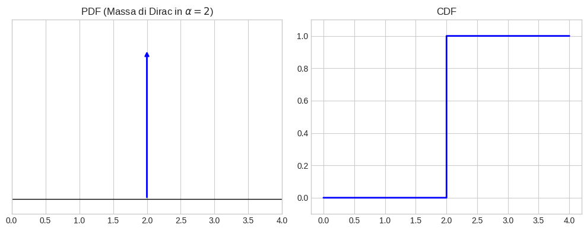{#fig-dirac}

## Distribuzione Uniforme

**A cosa serve:** La distribuzione uniforme è l'analogo continuo del concetto di \"eventi equiprobabili\". Modella situazioni in cui sappiamo che una variabile aleatoria cadrà all'interno di un certo intervallo, ma non abbiamo alcuna ragione per credere che un punto sia più probabile di un altro. La densità è letteralmente \"piatta\" lungo tutto l'intervallo.

**Parametri:**

- $a, b \in \mathbb{R}$ con $a < b$: Rappresentano gli estremi dell'intervallo entro il quale la variabile può assumere valori.

**PDF:** $$f(x) = 
\begin{cases} 
\frac{1}{b - a} & \text{se } a \leq x \leq b \\
0 & \text{altrimenti}
\end{cases}$$ **CDF:** $$F(x) = 
\begin{cases} 
0 & \text{se } x < a \\
\frac{x - a}{b - a} & \text{se } a \leq x \leq b \\
1 & \text{se } x > b
\end{cases}$$

{#fig-uniform}

**NB**: la Uniforme è una distribuzione simmetrica: è verificabile prendendo il suo punto medio $c=\frac{b-a}{2}$, considerando lo spostamento orizzontale di entità $y$ e calcolando l'uguaglianza $f(c+y)=f(c-y)$.

## Distribuzione Esponenziale

**A cosa serve:** È la distribuzione fondamentale per modellare i tempi di attesa tra eventi in un processo di Poisson, ovvero fenomeni che non invecchiano (\"assenza di memoria\"). Viene usata per modellare il tempo di vita di una lampadina o il tempo di attesa prima che decada una particella radioattiva: la probabilità di guastarsi nel prossimo istante è indipendente da quanto tempo l'oggetto ha già funzionato.

**Parametri:**

- $\beta > 0$: È il tasso (o rate) di arrivo/decadimento. Più grande è $\beta$, più rapidamente la curva decresce.

**PDF:** $$f(x) = 
\begin{cases} 
\beta e^{-\beta x} & \text{se } x \geq 0 \\
0 & \text{se } x < 0
\end{cases}$$ **CDF:** $$F(x) = 
\begin{cases} 
1 - e^{-\beta x} & \text{se } x \geq 0 \\
0 & \text{se } x < 0
\end{cases}$$

{#fig-exponential}

**N.B.** La PDF dell'esponenziale ammette sempre il massimo nel limite inferiore del dominio, ovvero in $x=0$.

## Distribuzione Gamma

**A cosa serve:** Generalizza l'Esponenziale. Mentre l'esponenziale modella il tempo di attesa per il *primo* evento, la Gamma modella il tempo di attesa necessario affinché si verifichino $\alpha$ eventi. Nella teoria dell'affidabilità, rappresenta il tempo di vita di un macchinario dotato di componenti di backup (se c'è 1 componente operativo e $n-1$ di scorta, il tempo totale di sopravvivenza è una Gamma). È intimamente legata anche al Chi-quadro usato in Statistica.

**Parametri:**

- $\alpha > 0$: Parametro di forma (shape). Indica il numero di \"eventi\" da attendere.

- $\beta > 0$: Parametro di tasso (rate). Identico a quello dell'Esponenziale.

**PDF:** $$f(x) = 
\begin{cases} 
\frac{\beta^\alpha}{\Gamma(\alpha)} x^{\alpha-1} e^{-\beta x} & \text{se } x \geq 0 \\
0 & \text{se } x < 0
\end{cases}$$ **CDF:** Non ha una forma analitica chiusa elementare e viene definita tramite la funzione Gamma incompleta[^3]: $$F(x) = \int_{0}^{x} \frac{\beta^\alpha}{\Gamma(\alpha)} t^{\alpha-1} e^{-\beta t} \, dt \quad (\text{per } x \geq 0)$$

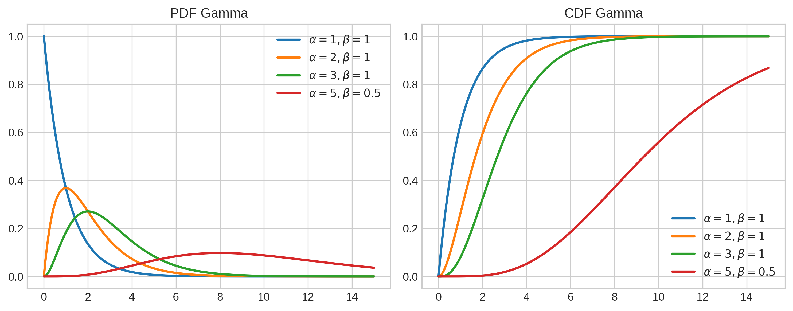{#fig-gamma}

**N.B.** Se $\alpha=1$ la PDF della Gamma collassa alla PDF dell'esponenziale.

## Distribuzione di Weibull

**A cosa serve:** È un'altra e diversa generalizzazione della distribuzione esponenziale. La Weibull rinuncia alla proprietà di \"assenza di memoria\" ed è perfetta per modellare tempi di vita in cui interviene l'usura. Permette di descrivere sistemi in cui la probabilità di rottura aumenta col tempo (invecchiamento) oppure diminuisce (fase di rodaggio iniziale).

**Parametri:**

- $\alpha > 0$: Parametro di forma. Se $\alpha < 1$ il tasso di guasto decresce; se $\alpha > 1$ cresce (usura); se $\alpha = 1$ torna a essere un'Esponenziale.

- $\beta > 0$: Parametro di scala.

**PDF:** $$f(x) = 
\begin{cases} 
\alpha \beta^\alpha x^{\alpha-1} e^{-(\beta x)^\alpha} & \text{se } x \geq 0 \\
0 & \text{se } x < 0
\end{cases}$$ **CDF:** $$F(x) = 
\begin{cases} 
1 - e^{-(\beta x)^\alpha} & \text{se } x \geq 0 \\
0 & \text{se } x < 0
\end{cases}$$

{#fig-weibull}

**N.B.** Se $\alpha=1$ la PDF della Weibull collassa alla PDF dell'esponenziale.

## Distribuzione Normale (o Gaussiana)

**A cosa serve:** È la regina indiscussa della Probabilità e della Statistica. A causa del Teorema del Limite Centrale, la somma di molteplici variabili indipendenti (o effetti casuali) tende a distribuirsi come una Normale. Pertanto modella innumerevoli fenomeni in natura: errori di misurazione, altezze fisiche, punteggi di test, ecc. La sua forma è la classica \"curva a campana\".

**Parametri:**

- $\mu \in \mathbb{R}$: Media della distribuzione (centro della campana).

- $\sigma^2 > 0$: Varianza. Definisce l'ampiezza o dispersione della curva (quanto la campana è \"larga\").

**PDF:** $$f(x) = \frac{1}{\sqrt{2\pi\sigma^2}} e^{-\frac{(x-\mu)^2}{2\sigma^2}} \quad \text{per } -\infty < x < \infty$$ **CDF:** Non ha una forma analitica elementare, si denota di solito con $\Phi$ nel caso standard, ma in generale è: $$F(x) = \int_{-\infty}^{x} \frac{1}{\sqrt{2\pi\sigma^2}} e^{-\frac{(t-\mu)^2}{2\sigma^2}} \, dt$$

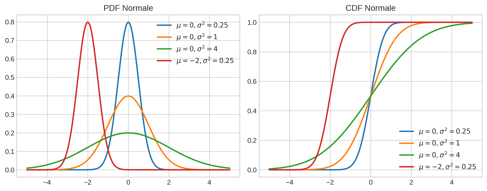{#fig-normal}

**NB**: la Normale è una distribuzione simmetrica: è verificabile prendendo il suo punto medio $c=\mu$, considerando lo spostamento orizzontale di entità $y$ e calcolando l'uguaglianza $f(\mu+y)=f(\mu-y)$.

## Distribuzione Lognormale

**A cosa serve:** Se il logaritmo naturale di una variabile si distribuisce come una Normale, allora la variabile stessa ha distribuzione Lognormale. Viene utilizzata per modellare variabili che possono assumere solo valori positivi (asimmetriche a destra) e che derivano da processi moltiplicativi anziché additivi. È onnipresente in economia (dati di produzione), in medicina (tempi di incubazione di malattie) e finanza.

**Parametri:**

- $\mu \in \mathbb{R}$: Media del logaritmo della variabile.

- $\sigma^2 > 0$: Varianza del logaritmo della variabile.

**PDF:** $$f(x) = 
\begin{cases} 
\frac{1}{x\sqrt{2\pi\sigma^2}} e^{-\frac{(\log x - \mu)^2}{2\sigma^2}} & \text{se } x > 0 \\
0 & \text{se } x \leq 0
\end{cases}$$ **CDF:** $$F(x) = 
\begin{cases} 
\int_{0}^{x} \frac{1}{t\sqrt{2\pi\sigma^2}} e^{-\frac{(\log t - \mu)^2}{2\sigma^2}} \, dt & \text{se } x > 0 \\
0 & \text{se } x \leq 0
\end{cases}$$

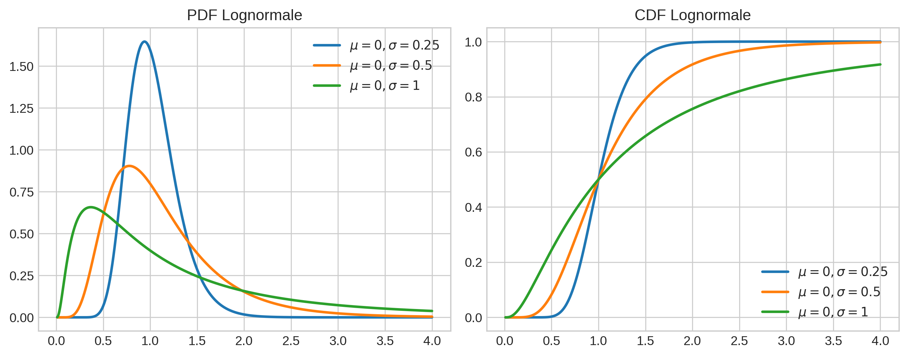{#fig-lognormal}

## Distribuzione Doppia Esponenziale (o di Laplace)

**A cosa serve:** Visivamente simile alla Normale ma con un picco molto più appuntito e \"code\" (tails) più spesse. Modella situazioni in cui ci si aspetta la presenza di valori anomali (outliers) più frequentemente di quanto predetto dalla curva Gaussiana. Spesso emerge come la distribuzione della differenza tra due variabili esponenziali indipendenti.

**Parametri:**

- $\alpha \in \mathbb{R}$: Parametro di locazione (il picco centrale).

- $\beta > 0$: Parametro di scala.

**PDF:** $$f(x) = \frac{\beta}{2} e^{-\beta|x-\alpha|} \quad \text{per } -\infty < x < \infty$$ **CDF:** $$F(x) = 
\begin{cases} 
\frac{1}{2} e^{\beta(x-\alpha)} & \text{se } x \leq \alpha \\
1 - \frac{1}{2} e^{-\beta(x-\alpha)} & \text{se } x > \alpha
\end{cases}$$

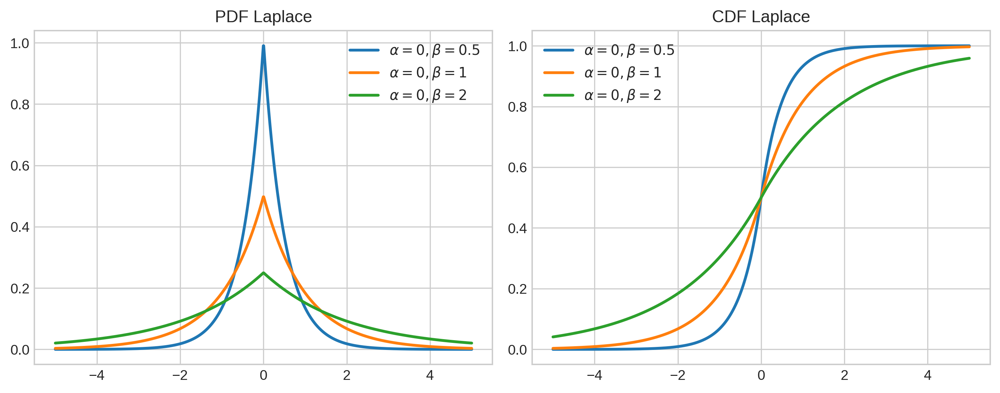{#fig-laplace}

**NB**: la Laplace è una distribuzione simmetrica: è verificabile prendendo il suo punto medio $c=\alpha$, considerando lo spostamento orizzontale di entità $y$ e calcolando l'uguaglianza $f(\alpha+y)=f(\alpha-y)$.

## Distribuzione di Cauchy

**A cosa serve:** È la distribuzione famosa per essere il controesempio \"cattivo\" della Probabilità: ha code talmente \"pesanti\" (heavy tails) che la sua media e la sua varianza teoriche **non esistono** (l'integrale non converge). È il modello per una variabile che è il rapporto di due variabili Normali indipendenti. Seppur patologica, trova uso reale in fisica teorica, in ottica e meccanica delle risonanze, o in problemi di calibrazione scientifica.

**Parametri:**

- $\alpha \in \mathbb{R}$: Parametro di locazione (che coincide con la *mediana*, visto che la media non esiste).

- $\beta > 0$: Parametro di scala (apertura della curva).

**PDF:** $$f(x) = \frac{1}{\beta\pi} \left[ \frac{1}{1 + \left(\frac{x-\alpha}{\beta}\right)^2} \right] \quad \text{per } -\infty < x < \infty$$ **CDF:** Integrando, si ottiene la funzione arcotangente: $$F(x) = \frac{1}{\pi} \arctan\left(\frac{x-\alpha}{\beta}\right) + \frac{1}{2}$$

{#fig-cauchy}

**NB**: la Cauchy è una distribuzione simmetrica: è verificabile prendendo il suo punto medio (la mediana) $c=\alpha$, considerando lo spostamento orizzontale di entità $y$ e calcolando l'uguaglianza $f(\alpha+y)=f(\alpha-y)$.

Tutte le distribuzioni vista sono **unimodali**. Per verificarlo (tranne per la Laplace, che non è derivabile) è sufficiente derivare la PDF, porla a 0 e studiarne il segno per scoprire che il punto critico è un massimo globale.

# Variabili Aleatorie e Funzioni Misurabili

Nel capitolo 6 abbiamo considerato variabili aleatorie (VA) definite su uno spazio di probabilità numerabile. Ora generalizziamo considerando uno spazio astratto arbitrario, *numerabile o meno*.\
Se $X$ mappa $\Omega$ in uno spazio $(F,\mathcal{F})$, allora ciò che vorremmo calcolare è la probabilità che $X$ assuma i suoi valori in un determinato sottoinsieme di tale spazio. Assumiamo che questi sottoinsiemi siano elementi della $\sigma$-algebra $\mathcal{F}$ dei sottoinsiemi di $F$.\
Pertanto, vogliamo calcolare: $$\mathbb{P}(\{\omega\in\Omega:X(\omega)\in A\})=\mathbb{P}(X\in A)=\mathbb{P}(X^{-1}(A))$$ Che sono 3 modi equivalenti per esprimere la stessa quantità. Ci focalizzeremo ora sul terzo modo.

## Funzioni Misurabili

Siano $(E,\mathcal{E})$ e $(F,\mathcal{F})$ due spazi misurabili. Una funzione $$X:E\rightarrow F$$ è una funzione misurabile (rispetto a $\mathcal{E},\mathcal{F}$) se: $$X^{-1}(\Lambda)\in \mathcal{E} \quad \forall \Lambda\in\mathcal{F}$$ o in modo compatto: $$X^{-1}(\mathcal{F})\subset\mathcal{E}$$ Ovvero, $X$ è una funzione misurabile se, preso un qualsiasi insieme $\Lambda$ appartenente alla $\sigma$-algebra dello spazio di arrivo, allora la sua controimmagine $X^{-1}(\Lambda)$ appartiene alla $\sigma$-algebra dello spazio di partenza $\mathcal{F}$.

{#fig-placeholderx}

: in teoria della misura e probabilità puoi calcolare integrali (o valori attesi) solo di funzioni che sono misurabili. Vedremo una serie di teoremi che ci risparmieranno il lavoro di verificare che una funzione sia misurabile usando la definizione pura appena vista.

- **Variabile Aleatoria**: Quando lo spazio di partenza è $(E,\mathcal{E})=(\Omega,\mathcal{A})$, allora la funzione misurabile $X$ è chiamata variabile aleatoria.

  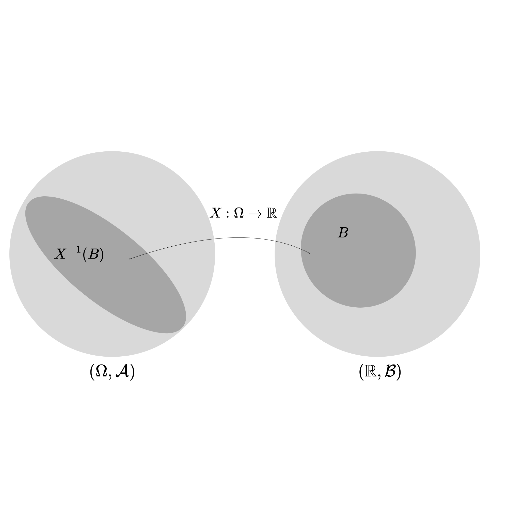{#fig-placeholder}

- **Funzione Borelliana**: una funzione $f: \mathbb{R} \rightarrow \mathbb{R}$ è detta funzione borelliana (o misurabile secondo Borel) se gli spazi di arrivo e partenza sono $(\mathbb{R}, \mathcal{B})$ e $(\mathbb{R}, \mathcal{B})$. In altre parole, $f$ è borelliana se la controimmagine di ogni insieme di Borel nello spazio di arrivo è ancora un insieme di Borel nello spazio di partenza: $$f^{-1}(B) \in \mathcal{B} \quad \forall B \in \mathcal{B}$$ In modo analogo, più in generale, se lo spazio di partenza è un generico spazio misurabile $(E, \mathcal{E})$ e quello di arrivo è $(\mathbb{R}, \mathcal{B})$, richiediamo semplicemente che $X^{-1}(B) \in \mathcal{E}$ per ogni $B \in \mathcal{B}$

  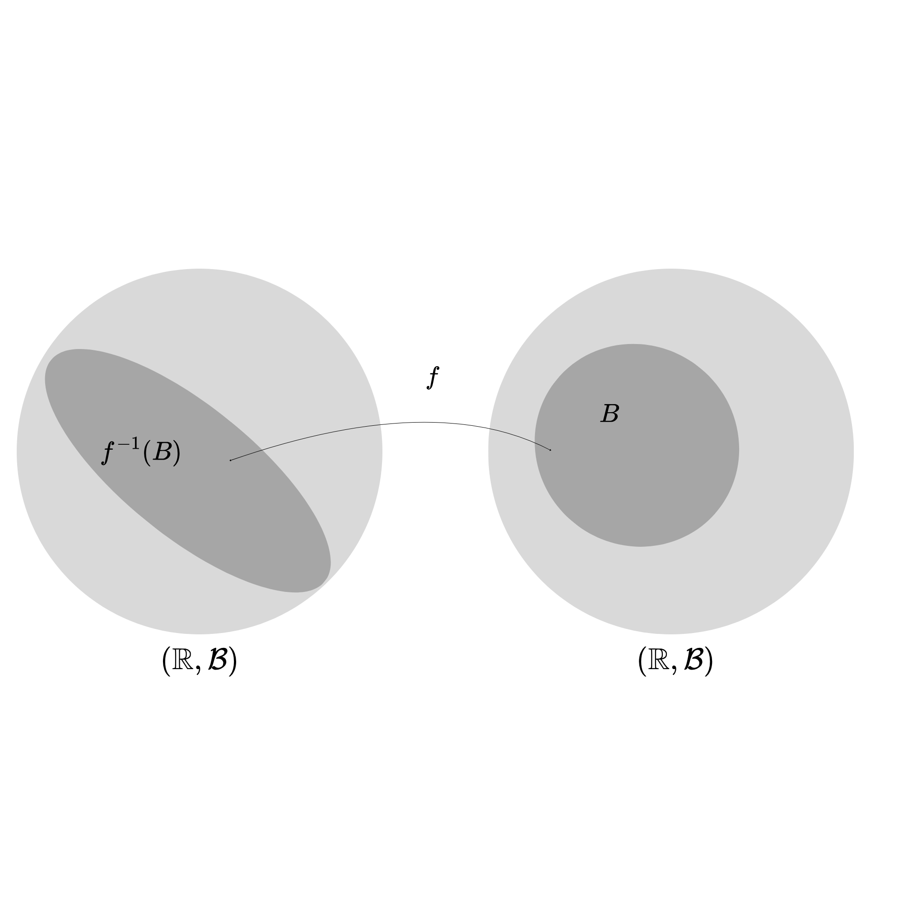{#fig-placeholderx}

In sintesi, da un punto di vista formale, l'unica differenza tra una variabile aleatoria e una funzione borelliana risiede nello **spazio di partenza**:

- **Variabile Aleatoria ($X$):** Mappa $(\Omega, \mathcal{A}) \rightarrow (\mathbb{R}, \mathcal{B})$. Lo spazio di partenza è l'insieme astratto degli esiti. Il suo compito concettuale è fare da *traduttore*: prende un fenomeno aleatorio (es. l'esito del lancio di una moneta) e lo \"traduce\" in un numero.

- **Funzione Borelliana ($f$):** Mappa $(\mathbb{R}, \mathcal{B}) \rightarrow (\mathbb{R}, \mathcal{B})$. Lo spazio di partenza è già l'insieme dei numeri reali. Il suo compito concettuale è fare da *calcolatrice*: applica una trasformazione puramente matematica (es. elevare al quadrato, estrarre la radice) a un numero già esistente.

::: mybox
Dalla Teoria della Misura alla Probabilità Una variabile aleatoria è una funzione misurabile che prende un esito grezzo $\omega \in \Omega$ e lo mappa in un numero in $\mathbb{R}$.
:::

Questa definizione rigorosa è necessaria. Quando lanci un dado, i possibili esiti $\Omega=\{1,2,3,4,5,6\}$ sono finiti e numerabili. In casi semplici come questo è possibile assegnare una probabilità a qualsiasi sottoinsieme di $\Omega$.\
Ma quando passiamo a spazi continui (numerabili o non numerabili) come $\mathbb{R}$, la matematica va in crisi e non è possibile assegnare una probabilità a tutti gli infinti sottoinsiemi senza incappare in insiemi patologici come i *Vitali Set* e in paradossi come quello di *Banach-Tarski*.

Il motivo di questa crisi è legato a un principio matematico tanto naturale quanto insidioso: l'**Assioma della Scelta**. Questo assioma afferma che, data un'infinità di insiemi non vuoti, è sempre possibile \"scegliere\" un elemento da ciascuno di essi per formare un nuovo insieme, anche in assenza di una regola costruttiva esplicita. Sfruttando questo assioma in spazi continui, è possibile costruire sottoinsiemi talmente patologici e frammentati da rendere privo di senso il concetto stesso di misura (che sia una probabilità, una lunghezza o un volume).

#### L'Insieme di Vitali

Scoperto nel 1905, l'insieme di Vitali dimostra l'impossibilità di assegnare una lunghezza (o una probabilità uniforme) a ogni sottoinsieme dei numeri reali. Immaginiamo l'intervallo $[0, 1)$ come una circonferenza di lunghezza unitaria. Possiamo raggruppare i punti di questa circonferenza in classi di equivalenza: due punti appartengono alla stessa classe se la loro distanza è un numero razionale.

Utilizzando l'Assioma della Scelta, estraiamo esattamente un singolo punto rappresentativo da ciascuna delle infinite classi per formare un nuovo insieme $V$, l'*Insieme di Vitali*. Se proviamo ad assegnare a $V$ una misura $m(V)$, andiamo incontro a un paradosso. Ruotando $V$ lungo la circonferenza per ogni possibile numero razionale, otteniamo infinite copie disgiunte di $V$ che, unite insieme, ricoprono esattamente l'intero intervallo $[0,1)$. Per l'additività numerabile, la somma delle misure di queste infinite copie dovrebbe uguagliare la misura totale dell'intervallo: $$\sum_{i=1}^{\infty} m(V) = 1$$ Tuttavia, questa equazione è impossibile da soddisfare: se $m(V) = 0$, la somma infinita fa $0$; se $m(V) > 0$, la somma diverge a $+\infty$. L'unica conclusione rigorosa è che all'insieme $V$ non può essere assegnata alcuna misura.

#### Il Paradosso di Banach-Tarski

Mentre l'insieme di Vitali evidenzia il problema su una dimensione, il *Teorema di Banach-Tarski* (1924) estende questa anomalia nello spazio tridimensionale $\mathbb{R}^3$. Il paradosso afferma che è possibile scomporre una sfera solida in un numero finito di pezzi (ne bastano cinque) e, tramite sole rotazioni e traslazioni, ricomporre questi frammenti per formare **due sfere** identiche alla sfera originale.

Come per l'insieme di Vitali, il trucco risiede nella natura non misurabile dei pezzi. Essi non sono solidi geometrici con bordi definiti, ma \"nuvole\" di punti infinitamente intrecciate, costruite grazie all'Assioma della Scelta. Poiché la misura di questi frammenti non è definibile matematicamente, la regola della conservazione del volume (l'additività della misura) salta completamente, permettendo la \"duplicazione\" dello spazio.

#### La soluzione della Teoria della Probabilità

Per fondare rigorosamente la teoria ed evitare questi paradossi, Andrey Kolmogorov introdusse negli anni '30 l'approccio assiomatico moderno. La soluzione consiste in una ritirata strategica: si accetta che in spazi continui come $\mathbb{R}$ non è possibile definire una misura sull'intero insieme delle parti $\mathcal{P}(\Omega)$. Si definisce invece la probabilità solo su una famiglia ristretta e ben strutturata di sottoinsiemi: la **$\sigma$-algebra** (tipicamente la $\sigma$-algebra di *Borel*). Questa struttura è sufficientemente ampia da includere tutti gli eventi di interesse pratico e scientifico, ma esclude chirurgicamente i sottoinsiemi patologici non misurabili.

## Il ruolo della controimmagine

Ciò che vogliamo calcolare è la probabilità di un evento $B$ nello spazio di arrivo $(\mathbb{R}, \mathcal{B})$. Ad esempio, se ci interessa conoscere la probabilità che la temperatura sia tra 20 e 30 gradi centigradi, chiamiamo questo intervallo $B$. Vogliamo calcolare $\mathbb{P}(X \in B)$.

La misura di probabilità $\mathbb{P}$, però, è definita nello spazio di partenza $(\Omega, \mathcal{A})$ degli esiti grezzi $\omega$. Per calcolare la nostra probabilità dobbiamo dunque tornare indietro: prendere l'insieme $B \in \mathcal{B}$ e guardare quali esiti $\omega$ lo hanno generato tramite la controimmagine $X^{-1}(B)$. Formalmente, scriviamo: $$\mathbb{P}(X \in B) = \mathbb{P}(\{\omega \in \Omega : X(\omega) \in B\}) = \mathbb{P}(X^{-1}(B))$$

::: mybox
Condizione di Misurabilità Sia $\mathcal{C}$ una classe di sottoinsiemi di $\mathcal{F}$ tale che $\sigma(\mathcal{C)}=\mathcal{F}$. (Teorema della classe monotona). Affinchè una funzione $X:E\rightarrow F$ sia misurabile, è necessario e sufficente che: $$X^{-1}(\mathcal{C)}\subset \mathcal{E}$$
:::

Questo teorema rappresenta una vera e propria \"scappatoia\" fondamentale nella teoria della misura e della probabilità. A parole, affronta un problema molto pratico: la definizione classica di misurabilità richiede che la controimmagine $X^{-1}(B)$ appartenga allo spazio di partenza $\mathcal{E}$ per *ogni singolo* evento $B$ nell'enorme e complessa $\sigma$-algebra di arrivo $\mathcal{F}$.

Poiché controllare l'infinità di insiemi che compongono $\mathcal{F}$ è impossibile, il teorema ci offre una potente scorciatoia. Ci dice che è sufficiente verificare la condizione solo per una famiglia molto più piccola, semplice e maneggevole di insiemi: la classe $\mathcal{C}$.

L'unico requisito è che questa classe $\mathcal{C}$ contenga i \"mattoni fondamentali\" di $\mathcal{F}$, ovvero che sia l'insieme generatore dell'intera $\sigma$-algebra (la condizione $\sigma(\mathcal{C}) = \mathcal{F}$).

#### L'analogia del DNA

Possiamo immaginare la classe $\mathcal{C}$ come il DNA di $\mathcal{F}$. Invece di analizzare le innumerevoli e complesse cellule di un intero organismo biologico (la $\sigma$-algebra $\mathcal{F}$), ci basta analizzare il suo codice genetico di base ($\mathcal{C}$). Se la nostra funzione si comporta bene quando \"tira indietro\" gli elementi del DNA (cioè $X^{-1}(\mathcal{C}) \subset \mathcal{E}$), la struttura matematica ci garantisce automaticamente che si comporterà bene con l'intero organismo generato da esso.

Nella pratica probabilistica, lo spazio di arrivo è quasi sempre l'insieme dei numeri reali $\mathbb{R}$ equipaggiato con la $\sigma$-algebra di Borel. Questa $\sigma$-algebra è immensa, ma è generata da insiemi banali: gli intervalli, come ad esempio le semirette del tipo $(-\infty, x]$.

Grazie a questo teorema, per dimostrare che una generica funzione è una valida variabile aleatoria, ci basta verificare che la controimmagine di questi semplici intervalli sia misurabile nel nostro spazio degli esiti. Possiamo così permetterci il lusso di ignorare del tutto gli insiemi più complessi e \"patologici\".

::: mybox
Condizione di Misurabilità: Corollario 1 Sia $(F,\mathcal{F})=(\mathbb{R},\mathcal{B})$ lo spazio di arrivo e sia $(E,\mathcal{E})$ uno spazio di partenza arbitrario. Siano $X$ ed $X_n$ funzioni a valori reali da $(E,\mathcal{E})$ a $(\mathbb{R},\mathcal{B})$.

- $X$ è misurabile se e solo se: $$\{X\leq a\}=\{\omega:X(\omega)\leq a\}=X^{-1}((-\infty,a])\in\mathcal{E}$$ per ogni $a$; oppure se: $$\{X<a\}\in \mathcal{E}$$ per ogni $a$

- Se le $X_n$ sono misurabili: $$SupX_n,\quad InfX_n,\quad limSupX_n,\quad limInfX_n$$ sono misurabili

- Se le $X_n$ sono misurabili e se $X_n$ converge puntualmente a $X$, allora $X$ è misurabile
:::

::: mybox
Condizione di Misurabilità: Corollario 2 Sia $X$ misurabile $(X:(E,\mathcal{E})\rightarrow(F,\mathcal{F}))$ e sia $Y$ misurabile $(Y:(F,\mathcal{F})\rightarrow(G,\mathcal{G}))$: allora $Y\circ X$ è misurabile $(Y\circ X:(E,\mathcal{E})\rightarrow(G,\mathcal{G}))$
:::

## Spazi Topologici

Uno spazio topologico è uno spazio astratto dotato di una topologia, ovvero una collezioni di insiemi aperti chiusa rispetto all'unione e all'intersezione finita.\
Dati due spazi topologici $(E,\mathcal{U})$ e $(F,\mathcal{V})$, dove $\mathcal{U}$ e $\mathcal{V}$ sono le topologie, allora una funzione $f:E\rightarrow F$ è una funzione tale che $$f^{-1}(A)\in\mathcal{U}\quad \forall A\in \mathcal{V}$$ La Borel $\sigma$-algebra di uno spazio topologico $(E,\mathcal{U)}$ è $\mathcal{B}=\sigma(\mathcal{U})$.[^4] (Una topologia non forma una $\sigma$-algebra da sola poichè essa non è chiusa rispetto a intersezioni numerabili)

::: mybox
Tutte le funzioni continue sono misurabili Siano $(E,\mathcal{U})$ e $(F,\mathcal{V})$ due spazi topologici e siano $\mathcal{E}=\sigma(\mathcal{U})$ e $\mathcal{F}=\sigma(\mathcal{V})$ le loro Borel $\sigma$-algebra.\
Ogni funzione continua $X:E\rightarrow F$ e allora misurabile.
:::

Nel teorema precedente avevamo visto che, per essere un VA, una funzione $X$ deve essere misurabile. Questo teorema ci da una notizia fantastica: tutte le funzioni continue sono automaticamente misurabili.

::: mybox
Altre condizioni di misurabilità

- Una funzione indicatrice $\mathbb {1}_A$ su $E$ è misurabile solo se $A\in E$.

- Se $X_1,...,X_n$ sono funzioni misurabili a valori reali su $(E,\mathcal{E})$ e se $f$ è borelliana su $\mathbb{R}^n$, allora $f(X_1,...,X_n)$ è misurabile.

- Se $X,Y$ sono misurabili, lo sono anche $X+Y$, $XY$, $min(X,Y)$, $max(X,Y)$, $X/Y$.
:::

## Misura Pushforward

La distribuzione di $X$ (o legge di $X$) $P_X$ è una *misura di probabilità* (che dunque rispetta i 3 assiomi) su $(E,\mathcal{E})$

### CDF e PDF {#sec-cdf-e-pdf .unnumbered}

Quando $X$ è una VA a valori reali, la sua distribuzione $P_X$ è una probabilità su $\mathbb{R}$ che è interamente caratterizzata dalla sua CDF: $$F_X(x)=P_X((-\infty,x])=\mathbb{P}(X\leq x)$$ $F_X$ è la CDF della VA $X$. Quando $F_X$ ammette una densità $f(x)$, cioè: $$F_X(x)=\int_{-\infty}^xf_X(y)dy$$ $\forall x\in\mathbb{R}$, diciamo che $f_X$ è la densità (PDF) della VA $X$.\
La distribuzione $P_X$ ci autorizza a smettere di calcolare probabilità in $\Omega$, spostando la probabilità direttamente sui numeri reali, quindi anzichè scrivere: $$\mathbb{P}(\{\omega\in\Omega:X(\omega)=1\})$$ si scirve, semplicemente: $$\mathbb{P}(X=1)$$

### Ruolo della Misura Pushforward ed equivalenza tra Legge e Misura Pushforward {#sec-ruolo-della-misura-pushforward-ed-equivalenza-tra-legge-e-misura-pushforward .unnumbered}

La misura pushforward ci assicura che questo trasferimento di probabilità da $\Omega$ (esiti grezzi) ai numeri reali $\mathbb{R}$ (esiti interpretabili) funziona perfettamente. Dunque essa è il ponte che ci permette di passare dalla teoria degli insiemi astratti al solido mondo dell'analisi reale, in cui possiamo fare derivate, limiti e integrali in modo agevole. Vedremo che questo passaggio ci permetterà di calcolare operatori come valore atteso e varianza usando i classici integrali dell'analisi (Riemann e Lebesgue), cosa che in $\Omega$ sarebbe impossibile.\
Siccome la misura pushforward $P_X$ è una vera e propria misura di probabilità, passiamo da $(\Omega,\mathcal{A},\mathbb{P})$ a $(\mathbb{R},\mathcal{B},P_X)$.

$P_X$ è chiamata misura pushforward perchè descrive perfettamente l'operazione che stiamo facendo:

1.  Abbiamo una massa di probabilità (pari a 1) distribuita sullo spazio di partenza astratto $\Omega$.

2.  La funzione $X(\omega)$ prende i punti $\omega \in \Omega$ e li proiettà sull'asse $\mathbb{R}$ ($X:\Omega \rightarrow \mathbb{R}$).

3.  Di conseguenza, la misura $P_X$ viene \"spinta avanti\" da $\Omega$ a $\mathbb{R}$, portandosi dietro le sue masse di probabilità e ridepositandolo sul nuovo spazio.

In teoria della probabilità, i termini **legge** (o distribuzione) e **misura pushforward** indicano esattamente lo stesso oggetto matematico, riflettendo semplicemente due vocabolari differenti. Il termine \"misura pushforward\" appartiene alla teoria della misura generale, mentre \"legge\" è il nome specifico che questa prende in ambito probabilistico.

Formalmente, dato uno spazio di probabilità $(\Omega, \mathcal{A}, \mathbb{P})$ e una variabile aleatoria $X: \Omega \rightarrow \mathbb{R}$, la legge di $X$ (indicata con $P_X$) è definita proprio come la misura pushforward della misura di probabilità $\mathbb{P}$ tramite la funzione misurabile $X$. In simboli: $$P_X = X_*\mathbb{P}$$ Questo significa che, per ogni insieme di arrivo $B \in \mathcal{B}(\mathbb{R})$, la probabilità misurata nel nuovo spazio è esattamente la misura della sua controimmagine nello spazio di partenza: $$P_X(B) = \mathbb{P}(X^{-1}(B)) = \mathbb{P}(\{\omega \in \Omega : X(\omega) \in B\})$$ In sintesi, dire \"legge di $X$\" è solo il modo abbreviato per dire \"la misura pushforward di $\mathbb{P}$ creata dalla variabile $X$\".

### La connessione tra Misura Pushforward, CDF e PDF {#sec-la-connessione-tra-misura-pushforward-cdf-e-pdf .unnumbered}

Per avere un quadro completo, è utile capire come si legano tra loro la misura pushforward ($P_X$), la funzione di ripartizione (CDF, $F_X$) e la densità (PDF, $f_X$). Questi tre strumenti sono essenzialmente tre lenti diverse per descrivere la stessa identica cosa: come la probabilità si distribuisce sui numeri reali. Procedendo dal generale al particolare:

- **La Misura Pushforward ($P_X$):** È lo strumento fondamentale e più generale. È una funzione di insieme che assegna una probabilità a *qualsiasi* sottoinsieme misurabile $B$ dell'asse reale (i cosiddetti insiemi di Borel).

- **La CDF ($F_X$):** È una versione più \"pratica\" della misura. Invece di calcolare la probabilità per un insieme $B$ qualsiasi e dalle forme complesse, la CDF valuta la misura pushforward solo su intervalli molto specifici, ovvero le semirette del tipo $(-\infty, x]$. La relazione formale è diretta: $$F_X(x) = P_X((-\infty, x])$$ In teoria della misura, si dimostra che conoscere la CDF per ogni $x$ è sufficiente per ricostruire l'intera misura $P_X$ su qualsiasi altro insieme.

- **La PDF ($f_X$):** È un'ulteriore specializzazione. Se la misura pushforward $P_X$ è \"liscia\" (cioè non concentra masse di probabilità in punti singoli), allora ammette una densità. La PDF è semplicemente la funzione che, se integrata su un insieme $B$, ci restituisce la misura pushforward di quell'insieme: $$P_X(B) = \int_B f_X(x) dx$$ E, collegandola alla CDF, otteniamo la nota formula del calcolo integrale: $$F_X(x) = P_X((-\infty, x]) = \int_{-\infty}^x f_X(t) dt$$

In sintesi: la **misura pushforward** è il contenitore teorico che trasporta la probabilità, la **CDF** è la sua misurazione cumulativa su intervalli standard, e la **PDF** (quando esiste) è il tasso continuo con cui questa misura si accumula sull'asse reale.

# Valore Atteso come Integrale di Lebsegue rispetto alla misura $\mathbb{P}$

Sia $(\Omega, \mathcal{A}, \mathbb{P})$ uno spazio di probabilità. Vogliamo definire il valore atteso (che vedremo essere l'integrale di Lebesgue) di VA generali. Lo abbiamo già fatto per VA definite su uno spazio più specifico, con $\Omega$ numerabile. Il caso più generale è più delicato.

## Variabili Aleatorie Semplici

Una VA è detta semplice se assume solo un numero finito di valori. $$X=\sum_{i=1}^na_i\mathbb{1}_{A_i}$$ Vediamo che in questo caso, per ogni iterazione della sommatoria, $X$ può assumere solo due valori: $0$ e $a_i$, con $a_i\in\mathbb{R}$ e $A_i\in\mathcal{A}$.\

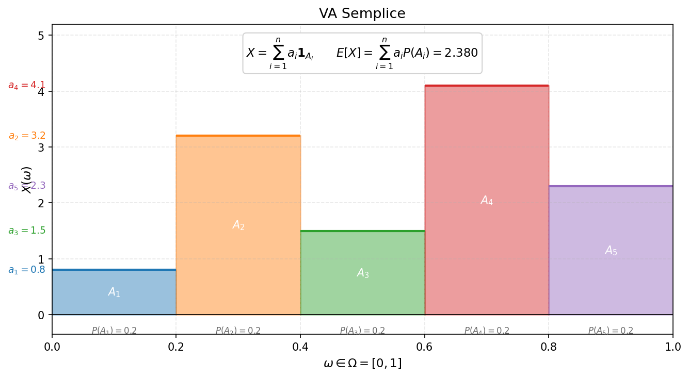{#fig-placeholder}

Se $X$ è semplice, il suo valore atteso è: $$\mathbb{E}[X]=\int_{\Omega} XdP=\mathbb{E}[\sum_{i=1}^na_i\mathbb{1}_{A_i}]=\sum_{i=1}^na_i\mathbb{P}(A_i)$$

**N.B.**: il valore atteso rimane un operatore lineare e monotono.

## Variabile Aleatorie Positive

Una VA positiva è una VA che può assumere valori in $[0,\infty]$ .

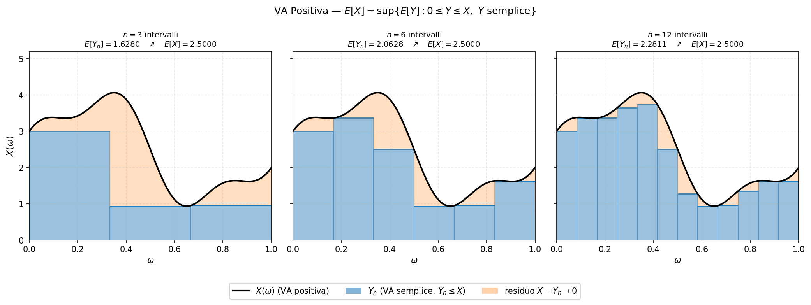{#fig-placeholderx}

Il suo valore atteso è dato da: $$\mathbb{E}[X]=Sup\{\mathbb{E}[Y]: 0\leq Y\leq X\}$$ Dove $Y$ è una VA semplice.\
Il supremum esiste sempre in $[0,\infty]$ poichè il valore atteso è un operatore positivo sull'insieme delle VA semplici. Se immaginiamo la VA positiva come una curva, e le VA semplici come i \"mattoncini\" che cercano di approssimarla, allora il valore atteso di $X$ è definito come il limite massimo a cui tende l'area dei mattoncini. Se assottigliamo sempre di più i mattoncini allora la loro area coinciderà con l'area al di sotto di $X$.

## Variabile Aleatorie Generali

Una VA generale $X$ può essere scomposta come:

$$X=X^+-X^-$$ con $X^+=max(X,0)$ e $X^-=-min(X,0)$. Sia $X^+$ che $X^-$ sono VA positive e vale $|X|=X^++X^-$.

{#fig-placeholder}

Il trucco del supremum funziona solo per funzioni $X$ positive. Come facciamo a integrare (calcolare il valore atteso) di una VA $X$ che ha sia picchi positivi che negativi? Spacchiamo $X$ nelle due parti $X^+$ e $X^-$ (che sono entrambe VA positive) e poi trattiamo i singoli casi come abbiamo visto per le VA positive: $$\mathbb{E}[X]=\mathbb{E}[X^+]-\mathbb{E}[X^-]$$

## Integrale di Lebesgue

L'approccio standard per definire l'area sotto una curva, noto come integrale di Riemann, si basa sulla suddivisione del dominio (l'asse $x$, o nel nostro caso $\Omega$) in intervalli sempre più piccoli. Si calcola poi l'area dei rettangoli formati, dove l'altezza è data dal valore della funzione in un punto dell'intervallo. Questo metodo, tuttavia, fallisce o diventa estremamente complesso quando il dominio non ha una struttura geometrica semplice (come un intervallo reale) o quando la funzione (la nostra VA $X$) è troppo \"irregolare\".

L'integrale di Lebesgue, che useremo per definire il valore atteso $\mathbb{E}[X]$, ribalta questa prospettiva. Invece di suddividere il dominio, suddividiamo il codominio (l'insieme dei valori assunti da $X$).

L'intuizione chiave risiede proprio nella struttura delle VA semplici definita nella sezione precedente. Immaginiamo di voler misurare l'altezza media di una popolazione ($\Omega$).

- **Approccio Riemann:** Mettiamo le persone in fila (ordiniamo il dominio) e calcoliamo la media dividendo la fila in piccoli gruppi. Questo richiede una struttura geometrica della fila.

- **Approccio Lebesgue:** Raggruppiamo le persone per altezza (suddividiamo il codominio). Creiamo dei \"mattoncini\" (le VA semplici) raggruppando tutte le persone alte circa $170$cm, tutte quelle alte circa $180$cm, e così via. Il valore atteso diventa quindi la somma pesata di queste altezze ($a_i$), dove il peso è dato dalla probabilità (la frazione di popolazione) che una persona appartenga a quel gruppo ($\mathbb{P}(A_i)$).

L'intera costruzione definita nei paragrafi successivi si basa su questa idea:

1.  Definiamo l'integrale per le VA semplici (i \"mattoncini\"), dove l'integrazione è una semplice somma pesata.

2.  Approssimiamo qualsiasi VA positiva dal basso utilizzando VA semplici sempre più precise (rinfittendo la suddivisione del codominio). Il valore atteso è il supremum di queste approssimazioni.

3.  Estendiamo infine la definizione alle VA generali tramite decomposizione.

Questo approccio non richiede che $\Omega$ sia numerabile o geometricamente semplice, ma necessita solo che gli insiemi $A_i$ siano \"misurabili\" (cioè appartengano alla $\sigma$-algebra $\mathcal{A}$), rendendolo lo strumento perfetto per la teoria della probabilità generale.

### Definizione Formale (Teoria della Misura) {#sec-definizione-formale-teoria-della-misura .unnumbered}

Formalmente, dato uno spazio di misura $(\Omega, \mathcal{A}, \mu)$ e una funzione misurabile $f: \Omega \to \mathbb{R}$, l'integrale di Lebesgue si costruisce in tre passi:

1.  **Funzioni semplici:** Se $s = \sum_{i=1}^n c_i \mathbb{1}_{E_i}$ è una funzione semplice (con $E_i \in \mathcal{A}$ disgiunti), il suo integrale è: $$\int_{\Omega} s \, d\mu = \sum_{i=1}^n c_i \mu(E_i)$$

2.  **Funzioni non negative:** Se $f \geq 0$ è misurabile, il suo integrale è definito tramite approssimazione dal basso: $$\int_{\Omega} f \, d\mu = \sup \left\{ \int_{\Omega} s \, d\mu : 0 \leq s \leq f, \, s \text{ è semplice} \right\}$$

3.  **Funzioni generali:** Una funzione misurabile $f$ si scompone in parte positiva e negativa, $f = f^+ - f^-$. Se gli integrali di entrambe le parti sono finiti, la funzione si dice integrabile secondo Lebesgue e vale: $$\int_{\Omega} f \, d\mu = \int_{\Omega} f^+ \, d\mu - \int_{\Omega} f^- \, d\mu$$

### Il Legame con la Teoria della Probabilità {#sec-il-legame-con-la-teoria-della-probabilit .unnumbered}

Nella teoria della probabilità, lo spazio di misura è uno *spazio di probabilità* $(\Omega, \mathcal{A}, \mathbb{P})$, dove la misura $\mu$ diventa la misura di probabilità $\mathbb{P}$ (con $\mathbb{P}(\Omega) = 1$). Una funzione misurabile $f$ è esattamente ciò che chiamiamo *Variabile Aleatoria* $X$.

Di conseguenza, il valore atteso di una V.A. generale è per definizione il suo integrale di Lebesgue rispetto alla misura di probabilità: $$\mathbb{E}[X] = \int_{\Omega} X \, d\mathbb{P}$$ Questa notazione evidenzia come l'operatore $\mathbb{E}[\cdot]$ non sia altro che una media rigorosa pesata sulle \"masse\" di probabilità assegnate agli eventi dello spazio campionario.

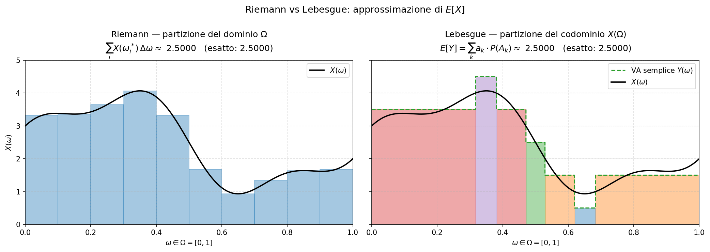{#fig-placeholderx}

## Essere integrabile vs ammettere valore atteso

- Una VA $X$ è integrabile (dunque ha valore atteso finito) se sia $\mathbb{E}[X^+]$ che $\mathbb{E}[X^-]$ sono finiti.\
  Usiamo $\mathcal{L}^1(\Omega,\mathcal{A},\mathbb{P})$ per denotare l'insieme di tutte le VA **integrabili**.

- Una VA $X$ ammette valore atteso se $\mathbb{E}[X^+]$ e $\mathbb{E}[X^-]$ non sono entrambi uguali a $\infty$, e quindi non danno come risultato una forma indeterminata $+\infty-\infty$

Notiamo che per una funzione $X$, l'essere integrabile è una condizione più stringente che ammettere valore atteso. Per essere integrabile, non solo deve ammettere valore atteso, ma esso deve anche essere finito.

## Valore Atteso in spazi $\Omega$ numerabili

Nel capitolo 6, dove lo spazio $\Omega$ era numerabile e finito, avevamo definito il valore atteso di una VA $X$ come: $$\mathbb{E}[X]_{cap6}=\sum_{\omega\in\Omega}X(\omega)\mathbb{P}(\{\omega\})$$ mentre ora, che lo spazio $\Omega$ è può essere numerabile e infinito, risulterebbe impossibile sommare per ogni indice $\omega\in\Omega$. Tuttavia le due definizioni sono identiche. Poichè il nostro spazio $\Omega$ è numerabile, qualsiasi evento $A_i\subset\Omega$ è fatto da un insieme numerabile di esiti singoli. Per l'additività numerabile abbiamo: $$\mathbb{P}(A_i)=\sum_{\omega\in A_i}\mathbb{P}(\{\omega\})$$ Ora prendiamo $\mathbb{P}(A_i)$ è sostituiamolo nella formula del valore atteso di questo capitolo: $$\mathbb{E}[X]_{cap10}=\sum_{i=1}^nx_i\big(\sum_{\omega\in A_i}\mathbb{P}(\{\omega\})\big)=\sum_{i=1}^n\big(\sum_{\omega\in A_i}x_i\mathbb{P}(\{\omega\})\big)=\sum_{i=1}^n\big(\sum_{\omega\in A_i}X(\omega)\mathbb{P}(\{\omega\})\big)$$ Ora unifichiamo le somme: per ogni gruppo $A_i$, calcoliamo $X(\omega)\mathbb{P}(\{\omega\})$ per tutti i suoi elementi. Poi sommiamo tutti i risultati di tutti i gruppi. Ma noi sappiamo che i gruppi $A_1,A_2,...,A_n$ formano una partizione di $\Omega$. Ciò significa che per ogni singolo esito $\omega\in\Omega$ si trova dentro uno e uno solo di questi gruppi e quindi sommare su tutti i gruppi separatamente equivale semplicemente a sommare sullo spazio intero $\Omega$ tutti gli elementi $\omega$: $$\sum_{i=1}^n\sum_{\omega\in A_i}=\sum_{\omega \in \Omega}$$e quindi: $$\mathbb{E}[X]_{cap10}=\sum_{\omega\in\Omega}X(\omega)\mathbb{P}(\{\omega\})=\mathbb{E}[X]_{cap6}$$ Dunque l'integrale di Lebesgue, se applicato a uno spazio $\Omega$ finito (come il lancio di un dado), collassa perfettamente nella formula della media pesata vista al capitolo 6.

::: mybox
Caratteristiche del Valore Atteso

- $\mathcal{L}^1$ è uno spazio vettoriale e il valore atteso è una mappa lineare, positiva su di esso ($X\geq0 \implies\mathbb{E}[X]\geq0$). Inoltre, se $0\leq X\leq Y$ sono due variabili aleatorie e $Y\in\mathcal{L}^1$, allora $X\in\mathcal{L}^1$ e $\mathbb{E}[X]\leq\mathbb{E}[Y]$.

- $X\in\mathcal{L}^1$ se e solo se $|X|\in\mathcal{L}^1$ e in questo caso $|\mathbb{E}[X]|\leq\mathbb{E}[|X|]$. Qualsiasi VA limitata è integrabile.

- Se $X=Y$ A.S. allora $\mathbb{E}[X]=\mathbb{E}[Y]$
:::

## Teoremi di Convergenza

Il grande problema del calcolo infinitesimale è la possibilità o meno di poter scambiare limite e integrale: $$\lim \int \stackrel{?}{=} \int \lim$$ Con l'integrale di Riemann la risposta è spesso negativa. Per tale motivo nasce l'integrale di Lebesgue.

### Teorema di Beppo-Levi

::: mybox
Teorema della Convergenza Monotona (MCT o Beppo-Levi)

#### Teoria della Misura

Dato lo spazio misurabile $(X,\mathcal{A},\mu)$ e le funzioni $\{f_n\}_{n\geq1}$ misurabili e non negative, con $f_1(x)\leq f_2(x)\leq...\leq f_n(x)$ e $\lim_{n\rightarrow\infty}f_n(x)=f(x)$ allora: $$\lim_{n\rightarrow\infty}\int_Xf_nd\mu=\int_X\lim_{n\rightarrow\infty}f_nd\mu=\int_Xfd\mu$$

#### Teoria della Probabilità

Dato lo spazio misurabile $(\Omega,\mathcal{A},\mathbb{P})$ e le VA $\{X_n\}_{n\geq1}$ positive (che sono funzioni misurabili), con $X_1\leq X_2\leq...\leq X_n$ e $\lim_{n\rightarrow\infty}X_n=X$ allora: $$\lim_{n\rightarrow\infty}\mathbb{E}[X_n]=\mathbb{E}[\lim_{n\rightarrow\infty}X_n]=\mathbb{E}[X]$$ Ovvero: $$\lim_{n\rightarrow\infty}\int_{\Omega}X_nd\mathbb{P}=\int_{\Omega}\lim_{n\rightarrow\infty}X_nd\mathbb{P}=\int_{\Omega}Xd\mathbb{P}$$
:::

Questo teorema ci dice che se abbiamo una sequenza di VA positive dove ogni VA è più grande della precedente, allora possiamo scambiare limite e integrale: l'area del limite è esattamente il limite dell'area.

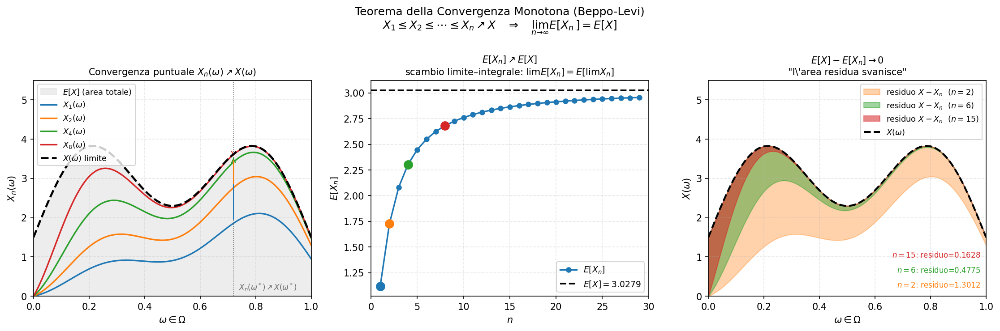{#fig-placeholder}

### Lemma di Fatou

::: mybox
Lemma di Fatou

#### Teoria della Misura

Dato lo spazio misurabile $(X,\mathcal{A},\mu)$ e le funzioni $\{f_n\}_{n\geq1}$ misurabili non-negative, allora: $$\int_X\liminf_{n\rightarrow\infty}f_nd\mu\leq\liminf_{n\rightarrow\infty}\int_Xf_nd\mu$$

#### Teoria della Probabilità

Dato lo spazio misurabile $(\Omega,\mathcal{A},\mathbb{P})$ e le VA $\{X_n\}_{n\geq1}$, dove $X_n\geq Y$ A.S., con $Y\in\mathcal{L}^1$ allora: $$\mathbb{E}[\liminf_{n\rightarrow\infty}X_n]\leq\liminf_{n\rightarrow\infty}\mathbb{E}[X_n]$$ e ciò vale in particolare se $X_n\geq0$ A.S. Ovvero: $$\int_{\Omega}\liminf_{n\rightarrow\infty}X_nd\mathbb{P}\leq\liminf_{n\rightarrow\infty}\int_{\Omega}X_nd\mathbb{P}$$
:::

Quindi integrale e limite commutano, ma con una disuguglianza: l'area del limite è sempre minore del limite dell'area.

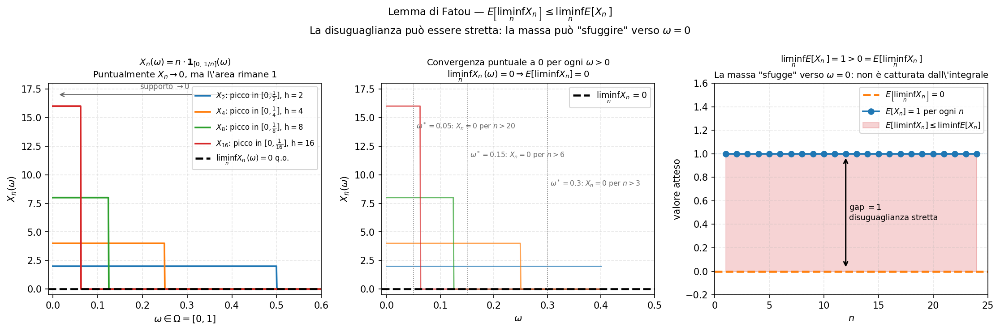{#fig-placeholderx}

- **Panel 1** --- Le curve $X_n$ per $n = 2, 4, 8, 16$: al crescere di $n$ il picco si restringe verso $\omega = 0$ mantenendo la stessa area. La linea tratteggiata $\liminf_n X_n = 0$ mostra il limite puntuale quasi ovunque.

- **Panel 2** --- Per tre valori $\omega^* = 0.05,\, 0.15,\, 0.30$ fissati, le linee verticali tratteggiate indicano dove la traiettoria $X_n(\omega^*)$ diventa definitivamente zero (per $n > 1/\omega^*$). Ogni punto del dominio "perde" la massa dopo un numero finito di passi.

- **Panel 3** --- Il confronto numerico: $E[X_n] = 1$ per ogni $n$ (cerchi blu, costanti), mentre $E[\liminf_n X_n] = 0$ (linea tratteggiata arancione). L'area gialla tra le due quantità è il *gap* della disuguaglianza di Fatou, pari a $1$ in questo esempio.

Consideriamo lo spazio di probabilità $(\Omega, \mathcal{A}, \mathbb{P}) = ([0,1], \mathcal{B}([0,1]), \lambda)$ con $\lambda$ misura di Lebesgue, e definiamo la sequenza di VA non negative: $$X_n(\omega) = n \cdot \mathbf{1}_{[0,\,1/n]}(\omega)
    \qquad n \geq 1$$ Ogni $X_n$ è un rettangolo di base $1/n$ e altezza $n$, quindi di **area costante**: $$E[X_n] = n \cdot \frac{1}{n} = 1 \qquad \forall\, n \geq 1$$

### Il fenomeno della massa che sfugge {#sec-il-fenomeno-della-massa-che-sfugge .unnumbered}

Fissato un qualsiasi $\omega^* > 0$, esiste $N = \lceil 1/\omega^* \rceil$ tale che per ogni $n > N$: $$\omega^* > \frac{1}{n} \implies \omega^* \notin \left[0, \frac{1}{n}\right]
    \implies X_n(\omega^*) = 0$$ Dunque per ogni $\omega^* > 0$ la sequenza è definitivamente nulla, il che significa: $$\liminf_{n \to \infty} X_n(\omega) = 0 \qquad \text{per q.o. } \omega \in (0,1]$$ L'unico punto in cui la sequenza non converge a zero è $\omega = 0$, che però ha misura di Lebesgue nulla: $\lambda(\{0\}) = 0$. Quindi la convergenza è quasi ovunque.

Geometricamente il rettangolo non si dissolve: si restringe e si alza, spostando tutta la sua massa verso l'unico punto $\omega = 0$. La massa non sparisce dall'integrale perché si concentra in un insieme di misura zero, che la misura di Lebesgue non riesce a "vedere".

Applicando il Lemma di Fatou: $$E\!\left[\liminf_{n \to \infty} X_n\right]
    = E[0] = 0
    \;\leq\;
    \liminf_{n \to \infty} E[X_n] = \liminf_{n \to \infty} 1 = 1$$ Il gap è esattamente $1$. Questo mostra che in generale la disuguaglianza del Lemma di Fatou non può essere sostituita da un'uguaglianza senza ipotesi aggiuntive.

### Confronto con il Teorema della Convergenza Monotona {#sec-confronto-con-il-teorema-della-convergenza-monotona .unnumbered}

Il MCT richiede $X_1 \leq X_2 \leq \cdots$, cioè monotonia crescente. In quel caso la massa non può sfuggire perché le funzioni non decrescono mai, e si ottiene l'uguaglianza $\lim E[X_n] = E[\lim X_n]$.

Nel controesempio di Fatou la sequenza non è monotona: per ogni $\omega^* \in (0,1]$ la traiettoria $n \mapsto X_n(\omega^*)$ è non nulla solo per $n \leq 1/\omega^*$ e poi cade a zero. È proprio questa non-monotonicità che permette alla massa di "scivolare" verso l'insieme di misura nulla $\{0\}$, rendendo la disuguaglianza stretta.

### Teorema della Convergenza Dominata di Lebesgue

::: mybox
Teorema della Convergenza Dominata di Lebesgue (DCT)

#### Teoria della Misura

Dato lo spazio misurabile $(X,\mathcal{A},\mu)$ e le funzioni $\{f_n\}_{n\geq1}$ Misurabili, supponiamo che:

1.  Convergenza Puntuale: $\{f_n\}_{n\geq1}$ convergano puntualmente a $f$

2.  Dominazione: $\exists y\in\mathcal{L}^1$, con $y(x)\geq0$ tale che $|f_n(x)|\leq y(x)$, $\forall n$ e quasi $\forall x$.

Allora $f_n\in \mathcal{L}^1$, $f(x)\in\mathcal{L}^1$ e: $$\lim_{n\rightarrow\infty}\int_Xf_nd\mu=\int_X\lim_{n\rightarrow\infty}f_nd\mu=\int_Xfd\mu$$

#### Teoria della Probabilità

Dato lo spazio misurabile $(\Omega,\mathcal{A},\mathbb{P})$ e le VA $\{X_n\}_{n\geq1}$ Misurabili, supponiamo che:

1.  Convergenza Puntuale: $\{X_n\}_{n\geq1}$ convergano puntualmente a $X$

2.  Dominazione: $\exists Y\in\mathcal{L}^1$, con $Y\geq0$ tale che $|X_n|\leq Y$, $\forall n$

Allora $X_n\in \mathcal{L}^1$, $X\in \mathcal{L}^1$e: $$\lim_{n\rightarrow\infty}\mathbb{E}[X_n]=\mathbb{E}[\lim_{n\rightarrow\infty}X_n]=\mathbb{E}[X]$$ Ovvero: $$\lim_{n\rightarrow\infty}\int_{\Omega}X_nd\mathbb{P}=\int_{\Omega}\lim_{n\rightarrow\infty}X_nd\mathbb{P}=\int_{\Omega}Xd\mathbb{P}$$
:::

Il teorema ci garantisce che se abbiamo una sequenza di VA che oscillano in modo caotico verso un limite $X$, con picchi sia positivi che negativi, abbiamo la garanzia che se esite un \"tetto\" integrabile (area finita) $Y$ che le domina tutte, per quanto caoticamente le $X_n$ oscillano, nessuna di essere supererà il \"tetto\": $|X_n|\leq Y$.

{#fig-placeholder}

### Confronto tra i Teoremi di Convergenza

I tre risultati appena visti affrontano lo stesso problema fondamentale (lo scambio tra l'operatore di limite e quello di integrale) ma si posizionano su livelli diversi per quanto riguarda le ipotesi richieste e la forza delle conclusioni ottenute. Il fulcro di tutti e tre è stabilire regole per gestire la *massa che sfugge* (verso l'infinito o in picchi singolari).

- **Lemma di Fatou (Il più generale, ma il più debole):**

  - **Ipotesi:** Richiede solo che le VA siano limitate dal basso (ad esempio, $X_n \geq 0$). Non c'è alcuna richiesta di monotonia o di limitazione dall'alto.

  - **Conclusione:** Fornisce solo una disuguaglianza ($\int \liminf \leq \liminf \int$).

  - **Intuizione:** È il \"paracadute\" della teoria dell'integrazione. Si applica in scenari caotici dove le variabili oscillano o non convergono bene, ma ci avverte che senza ipotesi più forti la massa dell'integrale può disperdersi nel processo di limite (come nel controesempio del rettangolo che si restringe perdendo la massa nell'origine).

- **Teorema della Convergenza Monotona / Beppo-Levi (Forte, ma rigido):**

  - **Ipotesi:** Richiede la non-negatività e una rigida *monotonia crescente* ($X_1 \leq X_2 \leq \dots \leq X_n$).

  - **Conclusione:** Garantisce l'uguaglianza ($\lim \int = \int \lim$).

  - **Intuizione:** Se la successione può solo crescere, la massa non può \"scivolare via\" lateralmente o annullarsi improvvisamente. L'area si accumula in modo inesorabile fino a coincidere esattamente con l'area della funzione limite.

- **Teorema della Convergenza Dominata / DCT (Il più flessibile e usato):**

  - **Ipotesi:** Non richiede né non-negatività né monotonia. Le VA possono oscillare e assumere valori negativi, ma a patto che esista un \"tetto\" integrabile ($|X_n| \leq Y$ con $Y \in \mathcal{L}^1$).

  - **Conclusione:** Garantisce l'uguaglianza ($\lim \int = \int \lim$).

  - **Intuizione:** La funzione dominante $Y$ agisce da \"recinto\". Impedisce alla sequenza di concentrare troppa massa all'infinito (poiché $Y$ ha code con area finita) o di formare picchi infiniti (poiché le $X_n$ non possono bucare il tetto $Y$). Bloccando le vie di fuga della massa, assicura la conservazione dell'area al limite.

In sintesi, per poter scambiare limite e integrale serve sempre un \"prezzo da pagare\" per controllare la massa: o imponiamo che la massa non possa mai diminuire (MCT), o la rinchiudiamo in un contenitore di volume finito (DCT). Se non possiamo pagare nessuno dei due prezzi, dobbiamo accontentarci di sapere che, passando al limite, l'area non potrà magicamente crearsi dal nulla, ma al massimo disperdersi (Fatou).

### Risultati dei Teoremi di Convergenza

1.  Per ogni VA positiva $X$ esiste una sequenza $\{X_n\}_{n\geq1}$ di VA positive semplici che incrementa fino a $X$ per $n\rightarrow \infty$.\
    Un esempi di questa sequenza è: $$X_n(\omega) = 
    \begin{cases} 
        k2^{-n} & \text{se } k2^{-n} \leq X(\omega) < (k+1)2^{-n} \text{ con } 0 \leq k \leq n2^n - 1 \\ 
        n & \text{se } X(\omega) \geq n 
    \end{cases}$$

    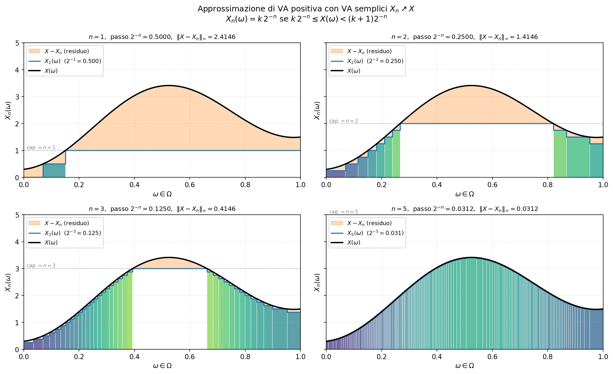{#fig-placeholderx}

2.  Se la sequenza $\{X_n\}_{n\geq1}$ di VA semplici cresce a $X$ per $n\rightarrow\infty$ allora: $$\mathbb{E}[X_n]=\mathbb{E}[X]$$

### Applicazione dei teoremi di convergenza a serie infinite

Una serie infinita è definita esattamente come un limite. Iniziamo definendo le somme parziali: $$S_N=\sum_{n=1}^N a_n = a_1+a_2+...+a_N$$ Poiché $N$ è un numero finito, questa è un'addizione normalissima. Al variare di $N$, creiamo una nuova successione fatta da queste somme parziali $(S_1, S_2, S_3, \dots)$.\
A questo punto, per capire cosa succederebbe se sommassimo tutti i termini, calcoliamo il limite della successione delle somme parziali facendo tendere $N$ a $\infty$: $$\sum_{n=1}^{\infty}a_n = \lim_{N\rightarrow\infty}S_N$$ Trattare questa serie come un limite e non come una somma lunghissima, ci permette di capire rigorosamente il suo comportamento (convergenza, divergenza, indeterminatezza).

::: mybox
Serie Infinite Sia $\{X_n\}_{n\geq1}$ una successione di VA:

- Se le $X_n$ sono tutte positive, allora: $$\mathbb{E}\left[\sum_{n=1}^{\infty}X_n\right] = \sum_{n=1}^{\infty}\mathbb{E}[X_n]$$ dove entrambi i membri sono simultaneamente finiti o infiniti.

- Se $\sum_{n=1}^{\infty}\mathbb{E}[|X_n|] < \infty$, allora $\sum_{n=1}^{\infty}X_n$ converge A.S. e la somma di questa serie è integrabile.
:::

Questo teorema risponde alla domanda: $$\sum \int \stackrel{?}{=} \int \sum$$ Se stai sommando solo VA positive, la successione delle somme parziali $S_N$ cresce sempre e non scende mai. Questa è esattamente l'ipotesi di Beppo-Levi. Dunque, il primo punto è semplicemente l'applicazione del Teorema della Convergenza Monotona, dove la successione in gioco è la successione delle somme parziali.

Ma cosa succede se la somma contiene variabili che oscillano assumendo valori sia positivi che negativi? In questo caso le somme parziali salgono e scendono, vanificando l'ipotesi di monotonia di Beppo-Levi. Serve il DCT. Per applicarlo, costruiamo una variabile aleatoria \"tetto\" $Y$ sommando i moduli di tutte le VA: $$Y = \sum_{n=1}^{\infty} |X_n|$$ Per ipotesi, il valore atteso di questo tetto è finito ($\mathbb{E}[Y] = \sum_{n=1}^{\infty}\mathbb{E}[|X_n|] < \infty$), dunque $Y \in \mathcal{L}^1$. Poiché le somme parziali sono sempre limitate in modulo da questo tetto ($|S_N| \leq Y$), il DCT ci garantisce la possibilità di scambiare limite (quindi la serie) e integrale.

## Spazi $\mathcal{L}^1$ e $L^1$: Le Classi di Equivalenza

Fino ad ora abbiamo utilizzato $\mathcal{L}^1(\Omega,\mathcal{A},\mathbb{P})$ per denotare l'insieme di tutte le variabili aleatorie $X$ integrabili (ovvero con $\mathbb{E}[|X|] < \infty$). Tuttavia, se vogliamo dotare questo insieme di una vera e propria struttura geometrica (rendendolo uno spazio normato), incontriamo un problema tecnico legato alla definizione di uguaglianza.

### Il problema della \"distanza\" in $\mathcal{L}^1$ {#sec-il-problema-della-distanza-in-mathcall1 .unnumbered}

Saremmo tentati di misurare la \"distanza\" tra due variabili aleatorie $X$ e $Y$ tramite l'integrale della loro differenza in modulo: $$d(X,Y) = \mathbb{E}[|X - Y|] = \int_{\Omega} |X - Y| \, d\mathbb{P}$$ Affinché questa sia una vera distanza metrica (e quindi definisca una norma rigorosa), deve valere una proprietà fondamentale: $d(X,Y) = 0 \iff X = Y$ *identicamente per ogni punto del dominio*.

Tuttavia, sappiamo bene (anche ripensando al fenomeno della massa che sfugge di Fatou) che un integrale di Lebesgue può essere nullo anche se la funzione non è zero ovunque, purché lo sia \"quasi ovunque\" (A.S.). Dunque, nello spazio $\mathcal{L}^1$ potremmo avere $d(X,Y) = 0$ per due variabili $X$ e $Y$ che sono diverse su un insieme di misura nulla. Questo rende la nostra operazione una semplice **seminorma**, insufficiente per costruire spazi completi.

### La soluzione: il Quoziente $L^1$ {#sec-la-soluzione-il-quoziente-l1 .unnumbered}

Per risolvere questo fastidio formale e creare uno spazio matematicamente perfetto, introduciamo una **relazione di equivalenza** ($\sim$). Diciamo che due variabili aleatorie sono equivalenti se sono uguali quasi ovunque: $$X \sim Y \iff \mathbb{P}(\{\omega \in \Omega : X(\omega) \neq Y(\omega)\}) = 0$$ A questo punto, definiamo il nuovo spazio $L^1$ (senza la \"L\" corsiva) come lo **spazio quoziente**: $$L^1(\Omega, \mathcal{A}, \mathbb{P})$$

### Cosa significa in pratica per la Probabilità? {#sec-cosa-significa-in-pratica-per-la-probabilit .unnumbered}

Significa che un elemento del nuovo spazio $L^1$ **non è più una singola funzione**, ma è un'intera *classe di equivalenza* di funzioni. In $L^1$, due variabili aleatorie che differiscono solo su un insieme di probabilità zero vengono schiacciate insieme e considerate a tutti gli effetti **lo stesso identico oggetto**.

Passando da $\mathcal{L}^1$ a $L^1$ si ottengono proprietà formidabili:

- La seminorma diventa finalmente una **norma** rigorosa, indicata con $\|X\|_1 = \mathbb{E}[|X|]$.

- Lo spazio $L^1$ dotato di questa norma risulta essere uno spazio metrico completo (più precisamente, uno **Spazio di Banach**). Questo garantisce che i limiti delle successioni di Cauchy di VA integrabili non \"escano\" mai dallo spazio.

- **Operativamente:** Nella teoria della probabilità, continuiamo a scrivere e manipolare gli elementi di $L^1$ come se fossero normali funzioni, ma tenendo sempre a mente la regola d'oro di Lebesgue: *\"modificare una variabile aleatoria su un insieme di misura nulla non ne altera in alcun modo l'identità in $L^1$\"*.

## Spazi $L^p$

::: mybox
Teorema 9.3: Proprietà dello spazio $L^2$

1.  Se $X, Y \in L^2$, allora si ha $XY \in L^1$ e vale la disuguaglianza di Cauchy-Schwarz: $$|\mathbb{E}[XY]| \leq \sqrt{\mathbb{E}[X^2]\mathbb{E}[Y^2]}$$

2.  Vale l'inclusione $L^2 \subset L^1$, e se $X \in L^2$, allora: $$(\mathbb{E}[X])^2 \leq \mathbb{E}[X^2]$$

3.  Lo spazio $L^2$ è uno spazio lineare, ovvero se $X, Y \in L^2$ e $\alpha, \beta \in \mathbb{R}$, allora $\alpha X + \beta Y \in L^2$ (vedremo nel Capitolo 23 che di fatto $L^2$ è uno spazio di Hilbert).
:::

Il primo punto del teorema ci fornisce uno strumento analitico cruciale noto come disuguaglianza di Cauchy-Schwarz. Dal punto di vista probabilistico, ci assicura che se consideriamo due variabili aleatorie dotate di momento secondo finito, il loro prodotto sarà sempre una variabile con valore atteso finito. Questa disuguaglianza è il vero motivo matematico per cui il coefficiente di correlazione tra due grandezze è sempre confinato tra $-1$ e $1$.

Il secondo punto stabilisce una gerarchia rigida tra gli spazi funzionali nella teoria della probabilità. Ci dice che lo spazio $L^2$ è un sottoinsieme dello spazio $L^1$. In termini applicati, questo garantisce che se una variabile aleatoria ha una varianza finita, allora possiede obbligatoriamente anche una media finita. Non è vero il contrario. La formula presentata è una diretta conseguenza del fatto che la varianza non può mai essere negativa, imponendo quindi che la media dei quadrati sia sempre maggiore o uguale al quadrato della media.

Il terzo punto si concentra sulla struttura algebrica dello spazio $L^2$, affermando che possiede le stesse proprietà di un normale spazio dei vettori. Se prendiamo due o più variabili in $L^2$, le moltiplichiamo per delle costanti numeriche e le sommiamo tra loro, la variabile aleatoria risultante rimarrà confinata nello spazio $L^2$. Questa stabilità rispetto alle combinazioni lineari è il primo passo per poter trattare le variabili aleatorie esattamente come facciamo con i vettori geometrici, aprendo la strada a concetti come le proiezioni ortogonali e le distanze ottimali, che sono alla base della teoria degli spazi di Hilbert.

### Cosa cambia tra gli spazi $L^1$ e $L^2$? {#sec-cosa-cambia-tra-gli-spazi-l1-e-l2 .unnumbered}

In teoria della probabilità, la differenza tra lo spazio $L^1$ e lo spazio $L^2$ riflette il passaggio dalla semplice esistenza della media all'esistenza della varianza, portando con sé una struttura geometrica molto più ricca.

- **Lo spazio $L^1$ (Le variabili con Media Finita):** Una variabile aleatoria appartiene a $L^1$ se $\mathbb{E}[|X|] < \infty$. Dal punto di vista pratico, questo garantisce solo che la variabile ammetta un valore atteso. Le variabili in $L^1$ possono avere \"code pesanti\", ovvero possono assumere valori estremi con probabilità non trascurabili, portando a oscillazioni così selvagge che la loro varianza è infinita. Geometricamente, $L^1$ è uno *Spazio di Banach*: possiamo misurare la distanza tra due variabili, ma non abbiamo il concetto di angolo.

- **Lo spazio $L^2$ (Le variabili con Varianza Finita):** Una variabile appartiene a $L^2$ se $\mathbb{E}[|X|^2] < \infty$. Elevare al quadrato penalizza enormemente i valori grandi: affinché l'integrale converga, la funzione deve schiacciarsi a zero molto più velocemente. Le variabili in $L^2$ sono quindi molto più \"tranquille\" e prevedibili (non hanno code troppo pesanti). Dal punto di vista applicato, ammettono una **varianza finita**.

- **La Magia Geometrica di $L^2$ (Prodotto Scalare):** La vera differenza matematica è che $L^2$ è l'unico spazio $L^p$ ad essere uno *Spazio di Hilbert*. Oltre a misurare le distanze, possiamo definire un **prodotto scalare**: $$\langle X, Y \rangle = \mathbb{E}[XY]$$ Avere un prodotto scalare significa poter importare tutta la geometria euclidea nel mondo astratto delle funzioni: possiamo calcolare \"l'angolo\" tra due variabili (che in statistica è la correlazione!), definire il concetto di ortogonalità (variabili incorrelate) e fare proiezioni ottimali (che sono la base teorica dell'operazione di regressione lineare e dell'attesa condizionata).

### L'Inclusione $L^2 \subset L^1$ {#sec-linclusione-l2-subset-l1 .unnumbered}

Come visto nel teorema di Cauchy-Schwarz, in uno spazio di probabilità (che ha misura totale pari a 1), ogni variabile in $L^2$ è automaticamente anche in $L^1$. L'inverso **non** è vero. Esistono funzioni (e variabili aleatorie) che decadono abbastanza in fretta da avere un'area totale finita (sono in $L^1$), ma se le eleviamo al quadrato, i loro picchi o le loro code amplificati producono un'area infinita (escono da $L^2$).

{#fig-placeholder}

## La Regola del Valore Atteso

Fino ad ora abbiamo definito rigorosamente il valore atteso di una Variabile Aleatoria $X$ come l'integrale di Lebesgue sullo spazio campionario originario $\Omega$: $$\mathbb{E}[X] = \int_{\Omega} X \, d\mathbb{P}$$ Supponiamo ora di voler calcolare il valore atteso di una trasformazione della nostra variabile aleatoria, ad esempio una nuova V.A. definita come $Y = g(X)$ (dove $g$ è una funzione misurabile, come $g(x) = x^2$ o $g(x) = e^x$).

Applicando la definizione di base, dovremmo risolvere l'integrale astratto: $$\mathbb{E}[g(X)] = \int_{\Omega} g(X(\omega)) \, d\mathbb{P}(\omega)$$ Tuttavia, nella pratica statistica questo approccio è inutilizzabile: raramente conosciamo la struttura intima dello spazio astratto $\Omega$ o la misura di probabilità originaria $\mathbb{P}$. Quello che conosciamo tipicamente è solo la *legge* (o distribuzione) della variabile $X$ sulla retta reale $\mathbb{R}$.

È qui che interviene la **Regola del Valore Atteso** (nota in letteratura come *Legge dello Statistico Inconsapevole* o LOTUS). Questo teorema fondamentale ci permette di \"trasferire\" l'integrale dallo spazio astratto $\Omega$ (difficile da manipolare) allo spazio reale $\mathbb{R}$ (facile da calcolare), utilizzando non più la misura $\mathbb{P}$, ma la distribuzione indotta ${P}_X$: $$\int_{\Omega} g(X) \, d\mathbb{P} = \int_{\mathbb{R}} g(x) \, d{P}_X$$

Questo risultato ci autorizza a calcolare i valori attesi di $g(X)$ ignorando totalmente lo spazio di partenza, semplicemente pesando i valori della funzione $g(x)$ con la densità o la funzione di massa di $X$.

::: mybox
Teorema di Trasferimento (LOTUS) Supponiamo che $X$ sia una V.A. assolutamente continua con funzione di densità $f_X(x)$. Cioè: $$F_X(x) = \mathbb{P}(X \leq x) = \int_{-\infty}^x f_X(u) \, du$$ Data una funzione misurabile $g: \mathbb{R} \to \mathbb{R}$, il valore atteso della variabile aleatoria $Y = g(X)$ si calcola come: $$\mathbb{E}[g(X)] = \int_{-\infty}^{+\infty} g(x)f_X(x) \, dx$$ L'uguaglianza è valida sotto **una** delle seguenti condizioni:

1.  $g(x) \geq 0$ per ogni $x$ (in questo caso l'integrale può valere $+\infty$).

2.  $g(X)$ è integrabile, ovvero se si verifica che $\int_{-\infty}^{+\infty} |g(x)|f_X(x) \, dx < \infty$.
:::

Il teorema del trasferimento ci regala una scorciatoia potentissima: per calcolare la media di $Y=g(X)$, non dobbiamo faticare a trovare la nuova (e spesso complessa) funzione di densità $f_Y(y)$. Ci basta integrare la funzione trasformata $g(x)$ pesata direttamente con la densità originale $f_X(x)$ che già conosciamo.\

# Variabili Aleatorie Indipendenti

Due eventi $A$ e $B$ sono indipendenti se sapere che $B$ si è verificato non modifica la probabilità che $A$ si verifichi, ovvero $\mathbb{P}(A|B)=\mathbb{P}(A)$ (assumendo $\mathbb{P}(B)>0$). Formalmente, questa condizione equivale a: $$\mathbb{P}(A\cap B)=\mathbb{P}(A)\mathbb{P}(B)$$ Generalizzando a un numero finito di eventi $A_1,\dots,A_n$, essi sono mutuamente indipendenti se, per *ogni* sottoinsieme di indici $J \subseteq \{1,\dots,n\}$, vale la seguente uguaglianza: $$\mathbb{P}\left(\bigcap_{i\in J}A_i\right)=\prod_{i\in J}\mathbb{P}(A_i)$$ Affinché due variabili aleatorie (VA) $X$ e $Y$ siano indipendenti, vogliamo che la conoscenza del valore assunto da una lasci inalterate le probabilità relative ai valori assunti dall'altra. Ciò significa che gli eventi $\{X\in A\}$ e $\{Y\in B\}$ devono essere indipendenti per qualsiasi scelta degli insiemi misurabili $A$ e $B$ negli spazi degli stati in cui sono definite $X$ e $Y$.

## $\sigma$-algebre generate da variabili aleatorie

Per formalizzare rigorosamente l'indipendenza tra due VA $X$ e $Y$, si ricorre alle $\sigma$-algebre da esse generate, denotate rispettivamente con $\sigma(X)$ e $\sigma(Y)$. Data una variabile aleatoria $X:(\Omega,\mathcal{A})\rightarrow(E,\mathcal{E})$, l'insieme $X^{-1}(\mathcal{E})$ è una sub-$\sigma$-algebra di $\mathcal{A}$, chiamata $\sigma$-algebra generata da $X$ (o semplicemente $\sigma(X)$).

Intuitivamente, $\sigma(X)$ contiene tutti gli eventi (sottoinsiemi dello spazio campionario $\Omega$) che possono essere descritti osservando esclusivamente i valori assunti da $X$. In termini formali, è costituita da tutti gli eventi del tipo $X^{-1}(A) = \{\omega \in \Omega : X(\omega) \in A\}$, per ogni possibile insieme misurabile $A \in \mathcal{E}$.

## $\sigma$-algebre indipendenti

Due $\sigma$-algebre $\sigma(X)$ e $\sigma(Y)$ si dicono indipendenti se, scegliendo un qualsiasi evento appartenente alla prima e un qualsiasi evento appartenente alla seconda, questi risultano indipendenti.

Di conseguenza, due variabili aleatorie $X$ e $Y$ sono indipendenti se e solo se le rispettive $\sigma$-algebre generate, $\sigma(X)$ e $\sigma(Y)$, sono indipendenti. Questo significa che l'evento $\{X\in A\}$ è indipendente dall'evento $\{Y\in B\}$, per ogni scelta di $A \in \mathcal{E}_X$ e $B \in \mathcal{E}_Y$.

## Indipendenza di famiglie di sub-$\sigma$-algebre e di VA

Estendendo il concetto a una famiglia di sub-$\sigma$-algebre $\{\mathcal{A}_i\}_{i\in I}$ di $\mathcal{A}$, essa si dice indipendente se, per ogni sottoinsieme finito $J \subseteq I$ e per ogni scelta di eventi $A_i\in \mathcal{A}_i$, risulta: $$\mathbb{P}\left(\bigcap_{i\in J}A_i\right)=\prod_{i\in J}\mathbb{P}(A_i)$$ Pertanto, una famiglia di variabili aleatorie $\{X_i\}_{i\in I}$, dove ciascuna $X_i$ prende valori nello spazio $(E_i,\mathcal{E}_i)$, è formata da VA mutuamente indipendenti se la famiglia delle $\sigma$-algebre da esse generate, ovvero $\{X_i^{-1}(\mathcal{E}_i)\}_{i\in I}$, risulta indipendente.

::: mybox
Condizioni equivalenti di indipendenza tra VA Affinchè $X,Y$ sinao indipendenti, basta che una delle seguenti condizioni sia verificata:

- $\mathbb{P}(X\in A,Y\in B)=\mathbb{P}(X\in A)\mathbb{P}(Y\in B)$, per ogni $A\in \mathcal{E}$, $B\in\mathcal{F}$.\

- $\mathbb{P}(X\in A,Y\in B)=\mathbb{P}(X\in A)\mathbb{P}(Y\in B)$, per ogni $A\in \mathcal{C}$, $B\in\mathcal{D}$, dove $\mathcal{C},\mathcal{D}$ sono $\lambda$-systems. (Teorema della Classe Monotona)\

- $f(X)$ e $g(Y)$ sono trasformazioni indipendenti per ogni coppia di funzioni misurabili $f,g$.\

- $\mathbb{E}[f(X)g(Y)]=\mathbb{E}[f(X)]\mathbb{E}[g(Y)]$ per ogni coppia di funzioni continue e limitate $f,g$.\

- Siano $E,F$ due spazi misurabili e siano $\mathcal{E},\mathcal{F}$ le loro Borel-$\sigma$-algebre. Allora $\mathbb{E}[f(X)g(Y)]=\mathbb{E}
      [f(X)]\mathbb{E}[g(Y)]$ per ogni coppia di funzioni continue e limitate $f,g$.
:::

Questo teorema sancisce un principio fondamentale: l'indipendenza tra due variabili aleatorie $X$ e $Y$ è una proprietà estremamente robusta che si manifesta su più livelli matematici. L'enunciato dimostra che l'indipendenza non è vincolata esclusivamente alla definizione assiomatica astratta basata sulle $\sigma$-algebre. Al contrario, essa si riflette in modo del tutto equivalente sulle \"fondamenta\" di quegli spazi (le classi generatrici), sulle trasformazioni matematiche delle variabili stesse e sui loro valori attesi. In sintesi, il teorema ci dice che se $X$ e $Y$ non si influenzano a livello degli eventi elementari, nessuna operazione matematica ammissibile potrà mai \"creare\" un legame probabilistico tra loro.\
L'utilità di questo teorema sta nel fornire un vero e proprio arsenale di metodi alternativi per dimostrare o sfruttare l'indipendenza, permettendo di scegliere la strada analitica più semplice in base al problema:

- **Riduzione della complessità (Condizione 2):** Verificare l'indipendenza su ogni singolo insieme di una $\sigma$-algebra (Condizione 1) è umanamente impossibile a causa della mostruosa complessità di questi spazi. La Condizione 2 ci salva: permette di limitare il controllo a insiemi molto più semplici (come gli intervalli $(-\infty, x]$). È esattamente il motivo per cui, negli esercizi pratici, per dimostrare l'indipendenza ci basta verificare che la funzione di ripartizione congiunta si fattorizzi.

- **Gestione delle trasformazioni (Condizione 3):** È una garanzia operativa fondamentale. Ci permette di affermare a priori che se $X$ e $Y$ sono indipendenti, allora lo saranno automaticamente anche entità come $e^X$ e $\sin(Y)$, evitandoci di dover ricalcolare l'indipendenza da zero per le nuove variabili.

- **Il ponte verso l'analisi e gli integrali (Condizioni 4 e 5):** Tradurre l'indipendenza nella fattorizzazione dei valori attesi è cruciale. Spesso è infinitamente più facile calcolare e separare degli integrali piuttosto che manipolare probabilità di insiemi astratti. Questa proprietà è la chiave di volta per lavorare con le funzioni caratteristiche e le funzioni generatrici dei momenti, trasformando convoluzioni complesse in semplici moltiplicazioni algebriche.

**N.B.**

- $X$ e $Y$ sono indipendenti $\Rightarrow$ $\mathbb{E}[XY]=0$ (la covarianza è 0), ma

- $\mathbb{E}[XY]=0$ $\nRightarrow$ $X$ e $Y$ sono indipendenti, poichè la dipendenza potrebbe essere non lineare.

## Funzioni Congiuntamente Misurabili e $\sigma$-algebra-prodotto

Se $\mathcal{E},\mathcal{F}$ sono $\sigma$-algebre sugli spazi $E,F$, allora il prodotto cartesiano $$\mathcal{E}\times \mathcal{F}=\{A\subset E\times F: A=\Lambda\times \Gamma, \quad \Lambda\in\mathcal{E}, \Gamma\in\mathcal{F}\}$$ Non è una $\sigma$-algebra su $E\times F$. Di conseguenza scriviamo la : $$\mathcal{E}\otimes \mathcal{F}=\sigma(\mathcal{E}\times \mathcal{F})$$ Per denotare la più piccola $\sigma$-algebra che su $E\times F$.\
Tutto questo ci serve per passare da VA in 1D a vetteori aleatori in più dimensioni.

Vogliamo definire una misura di probabilità su coppie di variabili $(X,Y)$, quindi abbiamo bisogno di una $\sigma$-algebra sul piano cartesiano $E\times F$. Ma prendere un evento $A$ di $X$ e un evento $B$ di $Y$ e farne il prodotto cartesiano $A\times B$ è sbagliato.\
Immagina che la VA $X$ viva sull'asse delle ascisse, mentre la VA $Y$ sull'asse delle ordinate. Un evento $\Lambda\in\mathcal{E}$ è un segmento sull'asse di $X$, mentre un evento $\Gamma\in\mathcal{F}$ è un segmento sull'asse di $Y$. Il loro prodotto cartesiano $\Lambda \times \Gamma$ è un rettangolo nel piano 2D e quindi la collezione $\mathcal{E}\times\mathcal{F}$ è l'insieme di tutti i possibili rettangoli che puoi disegnare scegliendo diversi segmenti (eventi) sui due assi (le VA), ma attenzione: se unisci due rettangoli incrociati non ottieni un rettangolo ma una forma a croce (la famigia non è chiusa rispetto all'unione); il complementare di un rettangolo non è ancora un rettangolo, bensì un foglio bucato (la famiglia non è chiusa ai complementari). Peranto $\mathcal{E}\times \mathcal{F}$ non è una $\sigma$-algebra.

{#fig-placeholderx}

Usiamo dunque l'operatore generatore $\sigma(.)$ per stabilire che $\mathcal{E}\otimes \mathcal{F}=\sigma(\mathcal{E}\times \mathcal{F})$ è la $\sigma$-algebra prodotto, che contiene tutti i rettangoli (gli eventi) di base, tutte le loro unioni infinite, tutte le loro intersezioni e complementari.

::: mybox
Funzioni misurabili a più variabili Sia $f$ una funzione misurabile $$f:(E\times F, \mathcal{E}\otimes \mathcal{F})\rightarrow(\mathbb{R},\mathcal{B})$$ Per ogni $x\in E$ $(y\in F)$, la sezione $y\rightarrow f(x,y)$ ($x\rightarrow f(x,y)$) è una funzione $\mathcal{F}$-misurabile ($\mathcal{E}$-misurabile)
:::

Questo teorema stabilisce un principio geometrico e analitico fondamentale: la \"conservazione della misurabilità sulle sezioni\". Immagina la funzione $f(x,y)$ come una superficie definita su uno spazio prodotto $E \times F$. Il teorema ci assicura che se tagliamo questa superficie con un piano fisso (ad esempio \"congelando\" la coordinata $x$), la \"fetta\" risultante (ovvero la funzione di una sola variabile $y \mapsto f(x,y)$) sarà a sua volta misurabile rispetto al suo spazio originario. In sintesi: la regolarità globale in uno spazio a più dimensioni garantisce sempre la regolarità locale nelle dimensioni inferiori.

Questo teorema è l'ingranaggio invisibile che fa funzionare gran parte dell'analisi multivariata e della teoria della probabilità:

- **Il lasciapassare per i Teoremi di Fubini e Tonelli:** Questa è l'applicazione in assoluto più importante. Per calcolare un integrale doppio o congiunto, lo strumento principe è spezzarlo in due integrali iterati (prima rispetto a una variabile e poi all'altra). Tuttavia, per poter scrivere l'integrale più interno, ad esempio $\int f(x,y) dy$, la funzione integranda deve avere senso matematico: deve cioè essere misurabile rispetto a $y$. Questo teorema ci garantisce a priori che la funzione \"affettata\" possiede questo requisito essenziale, rendendo legittima e ben definita l'operazione di integrazione iterata.

- **Condizionamento e variabili \"congelate\":** In probabilità, spesso studiamo distribuzioni congiunte di due variabili $(X, Y)$. Se osserviamo che una delle due ha assunto un valore specifico (es. $X = x$), otteniamo una nuova funzione $g(Y) = f(x, Y)$. Il teorema ci autorizza ad affermare che questa nuova $g(Y)$ è a tutti gli effetti una variabile aleatoria valida (cioè misurabile), permettendoci di calcolarne medie e varianze condizionate.

- **Sezioni di processi stocastici:** Nello studio di un processo stocastico $X(t, \omega)$ (che dipende dal tempo $t$ e dall'esito $\omega$), fissare il tempo ci restituisce una variabile aleatoria $\omega \mapsto X_t(\omega)$, mentre fissare l'esito ci restituisce una traiettoria temporale $t \mapsto X_\omega(t)$. Questo teorema (e le sue generalizzazioni) assicura che queste \"sezioni\" mantengano le proprietà di misurabilità necessarie per essere studiate singolarmente.

{#fig-placeholder}

## Teorema di Tonelli-Fubini e Misure-Prodotto

Il teorema di Tonelli-Fubini è la generalizzazione del principio di Cavalieri, che ci dice che il volume di un solido è la \"summa\" (integrale) delle aree di tutte le sue sezioni 2D. (integrale doppio: quello interno che calcola l'area di ogni singola sezione, quello esterno somma tutte le aree). Il problema è che non tutte le sezioni potrebbero essere misurabili. Il teorema precedente ci garantisce però che se la funzione di partenza è misurabile, allora lo saranno anche le sue sezioni.

::: mybox
Teorema di Tonelli-Fubini Siano $\mathbb{P}$ e $\mathbb{Q}$ due misure di probabilità su $(E,\mathcal{E})$ e $(F,\mathcal{F})$.

- Definiamo misura-prodotto $$\mathbb{D}(A\times B)=\mathbb{P}(A)\mathbb{Q}(B)=\mathbb{P}\otimes\mathbb{Q}$$ Allora $\mathbb{D}$ si estende in modo unico a una probabilità su $(E\times F, \mathcal{E}\otimes\mathcal{F})$.\

- Per ogni funzione $f$ $\mathcal{E}\otimes\mathcal{F}$-misurabile, positiva o integrabile rispetto a $\mathbb{P}\otimes\mathbb{Q}$, la funzione (sezione) $$x\rightarrow\int f(x,y)\mathbb{Q}(dy)$$ è $\mathcal{E}$-misurabile e la funzione (sezione) $$y\rightarrow\int f(x,y)\mathbb{P}(dx)$$ è $\mathcal{F}$-misurabile, e quindi vale: $$\int f \, d(\mathbb{P}\otimes\mathbb{Q}) = \int \left[ \int f(x,y)\mathbb{Q}(dy) \right] \mathbb{P}(dx) = \int \left[ \int f(x,y)\mathbb{P}(dx) \right] \mathbb{Q}(dy)$$
:::

Questo è senza dubbio uno dei risultati più potenti e operativi di tutta la teoria dell'integrazione e della probabilità. Nella sua essenza, il Teorema di Tonelli-Fubini ci assicura che l'integrale su uno spazio a più dimensioni può essere calcolato \"a fette\", risolvendolo iterativamente prima su una variabile e poi sull'altra. Ancora più importante: ci garantisce che, finché la funzione è positiva (Tonelli) o assolutamente integrabile (Fubini), l'ordine con cui scegliamo di integrare è del tutto ininfluente sul risultato finale.

- **Il fondamento dell'indipendenza:** In probabilità, la misura prodotto $\mathbb{P} \otimes \mathbb{Q}$ modella esattamente la legge congiunta di due variabili aleatorie indipendenti. Questo teorema è il vero e proprio motore di calcolo che usiamo per dimostrare che il valore atteso di una funzione di variabili indipendenti si può calcolare separandone i pezzi.

- **Inversione dell'ordine di integrazione:** Molto spesso, un integrale doppio risulta analiticamente impossibile da risolvere se attaccato nell'ordine $dx dy$, ma diventa elementare invertendo in $dy dx$. Tonelli-Fubini è il \"lasciapassare\" formale che ci autorizza a scambiare i differenziali senza alterare il risultato.

- **Calcolo delle distribuzioni marginali:** Gli integrali \"interni\" (ovvero le funzioni sezione che il teorema garantisce essere misurabili) rappresentano, dal punto di vista probabilistico, il processo di marginalizzazione. Integrare via la dipendenza da $y$ ci restituisce una funzione della sola $x$, che descrive il comportamento marginale (o il valore atteso condizionato) del nostro sistema probabilistico.

![Rappresentazione del Teorema di Tonelli-Fubini. <strong>In alto a sinistra:</strong> heatmap di $f(x,y)$ su $E \times F$, con evidenziate le due sezioni (orizzontale e verticale). <strong>In alto al centro/destra:</strong> le due sezioni $f(x_0, y)$ e $f(x, y_0)$ pesate rispettivamente da $\mathbb{Q}$ e $\mathbb{P}$, con l’area integrata evidenziata. <strong>In basso a sinistra/centro:</strong> le funzioni iterate $x \mapsto \int f(x,y)\,\mathbb{Q}(dy)$ e $y \mapsto \int f(x,y)\,\mathbb{P}(dx)$, con i valori numerici dell’integrale doppio (che coincidono, verificando il teorema). <strong>In basso a destra:</strong> la formula con l’uguaglianza dei tre integrali: $\int f \, d(\mathbb{P}\otimes\mathbb{Q}) = \int \left[ \int f(x,y)\mathbb{Q}(dy) \right] \mathbb{P}(dx) = \int \left[ \int f(x,y)\mathbb{P}(dx) \right] \mathbb{Q}(dy)$.](figures/tonelli-fubini-1.png){#fig-placeholderx}

::: mybox
Indipendenza di VA come fattorizzazione della distribuzione congiunta Siano $X,Y$ due VA su $(\Omega,\mathcal{A}, \mathbb{P)}$ a valori rispettivamente in $(E,\mathcal{E})$ e $(F,\mathcal{F})$. La coppia $Z=(X,Y)$ è una VA in 2D a valori in $(E\times F, \mathcal{E}\otimes \mathcal{F})$ e le VA $X,Y$ sono indipendenti se e solo se la loro distribuzione congiunta $P_{(X,Y)}$ è uguale al prodotto $P_X\otimes P_Y$ delle loro distribuzioni marginali.
:::

## Teorema di Estensione di Kolmogorov

Consideriamo ora la misura di probabilità $\mu$ su $(E,\mathcal{E})$. è facile costruire una VA $X$ a valori in $E$, la cui distribution measure è $\mu$. Basta prendere $\Omega=E$, $\mathcal{A}=\mathcal{E}$, $\mathbb{P}=\mu$ e porre che $X$ sia la funzione identità $X(x)=x$.\
Più complessa è la costruzione di due VA indipendenti $X,Y$ a valori in $(E,\mathcal{E})$ e $(F,\mathcal{F})$ e con distribution measure $\mu,\nu$. Possiamo farlo nel seguente modo: prendiamo $\Omega=E\times F$, $\mathcal{A}=\mathcal{E}\otimes \mathcal{F}$, $\mathbb{P}=\mu\otimes\nu$, e $X(x,y)=x$, $Y(x,y)=y$, dove $(x,y)\in E\times F$.\
Siginificativamente più complicato è costruire una successione infinita di VA indipendenti con distribuzione date. Per ogni $n$, sia $X_n$ definita su $(\Omega_n, \mathcal{A}_n,\mathbb{P}_n)$ e poniamo: $$\Omega=\prod_{n=1}^{\infty}\Omega_n$$ $$\mathcal{A}=\bigotimes_{n=1}^{\infty}\mathcal{A}_n$$ dove $\bigotimes_{n=1}^{\infty}\mathcal{A}_n$ denota la più piccola $\sigma$-algebra su $\Omega$ generata da tutti gli insiemi della forma: $$A_1\times A_2\times ...\times A_k\times\Omega_{k+1}\times \Omega_{k+2}\times...$$ Gli insiemi della forma appena descritta prendono il nome formale di insiemi cilindrici, o cilindri a base finita. Essi rappresentano il concetto cardine per poter definire rigorosamente la probabilità su successioni infinite, come nello studio dei processi stocastici.\
In uno spazio di probabilità infinito, un singolo esito è una successione infinita di eventi. Un insieme cilindrico modella un evento in cui si impongono delle restrizioni solamente sui primi $k$ istanti di tempo, ignorando del tutto ciò che accade da $k+1$ in poi.

- La base del cilindro ($A_1 \times \dots \times A_k$) richiede che il primo risultato sia in $A_1$, il secondo in $A_2$, fino al $k$-esimo.

- Lo stelo del cilindro ($\Omega_{k+1} \times \Omega_{k+2} \times \dots$) indica che per le variabili successive è ammissibile qualsiasi esito, essendo $\Omega_n$ l'intero spazio campionario per l'$n$-esimo esperimento.

Per fare un esempio pratico, lanciando una moneta infinite volte, l'evento \"i primi due lanci sono Testa\" corrisponde esattamente all'insieme cilindrico $\{T\} \times \{T\} \times \Omega_3 \times \Omega_4 \times \dots$, dove solo le prime due posizioni sono vincolate.\
Il problema teorico di fondo è che non si può definire la probabilità direttamente su prodotti infiniti arbitrari di insiemi misurabili, perché l'estensione all'infinito senza precauzioni porta a contraddizioni matematiche. I cilindri aggirano l'ostacolo fungendo da mattoni fondamentali.

Poiché un cilindro dipende solo da un numero finito $k$ di variabili, calcolarne la probabilità è semplice e si basa sulla regola dei prodotti finiti: $$\mathbb{P}(\text{cilindro}) = \mathbb{P}_1(A_1) \mathbb{P}_2(A_2) \dots \mathbb{P}_k(A_k)$$ Una volta definita questa probabilità elementare e calcolabile sui cilindri, interviene il Teorema di Estensione di Kolmogorov. Questo teorema garantisce che, partendo da questa base coerente, la misura di probabilità si estenda in modo del tutto unico a tutta la immensa $\sigma$-algebra infinita $\mathcal{A}$ generata da questi insiemi.

::: mybox
Teorema di Estensione di Kolmogorov Dati gli spazi di probabilità $(\Omega_n, \mathcal{A}_n,\mathbb{P}_n)$, $\Omega=\prod_{n=1}^{\infty}\Omega_n$ e $\mathcal{A}=\bigotimes_{n=1}^{\infty}\mathcal{A}_n$, allora esiste una misura di probabilità $\mathbb{P}$ su $(\Omega,\mathcal{A})$ unica tale che: $$\mathbb{P}(A_1\times A_2\times ...\times A_k\times\Omega_{k+1}\times \Omega_{k+2}\times...)=\prod_{i=1}^{k}\mathbb{P}_i(A_i)$$ Per la successione $X_n$ definita su $(\Omega_n, \mathcal{A}_n,\mathbb{P}_n)$ denotiamo con $\widetilde{X}_n$ la sua estensione a $\Omega$ nel modo seguente: sia $\omega=[\omega_1,...,\omega_n,...]$ con $\omega_i\in\Omega_i$ per ogni $i$. Allora: $$\widetilde{X}_n(\omega)=X_n(\omega_n)$$
:::

Il Teorema di Estensione di Kolmogorov è il naturale punto di arrivo del discorso fatto in precedenza sugli insiemi cilindrici. È il teorema che \"salva\" la teoria della probabilità quando si passa da un orizzonte finito a uno infinito.\
Il teorema afferma un principio di coerenza formidabile: se sei in grado di assegnare una probabilità ben definita agli eventi che si verificano in un numero finito di passi (i famosi insiemi cilindrici), allora la matematica ti garantisce che esiste una, e una sola, misura di probabilità \"globale\" $\mathbb{P}$ capace di abbracciare l'intero spazio infinito senza creare paradossi. In altre parole, le informazioni locali e finite sono sufficienti a determinare in modo univoco la legge probabilistica di tutta la successione infinita.\
Senza questo teorema, l'intera struttura della probabilità avanzata crollerebbe:

- Esistenza di successioni infinite: Quando in un esercizio diciamo \"sia data una successione infinita di variabili aleatorie indipendenti\", stiamo dando per scontato che esista uno spazio matematico in grado di contenerle. Questo teorema è la prova formale che un tale spazio esiste ed è ben definito.

- Fondamento dei processi stocastici: Che si tratti del moto browniano, del random walk o delle catene di Markov, ogni processo stocastico che evolve nel tempo necessita di uno spazio prodotto infinito. Kolmogorov fornisce l'infrastruttura rigorosa su cui costruire l'intera teoria.

La successione delle variabili estese $\widetilde{X}_n$ costituisce la definizione stessa di un processo stocastico a tempo discreto. Avere un unico spazio $\Omega$ per tutte le variabili è ciò che ci permette di studiare il processo secondo due prospettive complementari:

- Fissando il tempo ($n$ costante): Se blocchiamo l'indice temporale $n$ e lasciamo variare $\omega$, la funzione $\omega \mapsto \widetilde{X}_n(\omega)$ è una classica variabile aleatoria. Essa descrive l'incertezza sul valore che il processo assumerà in quel preciso istante $n$, considerando tutti i possibili scenari futuri.

- Fissando la realizzazione ($\omega$ costante): Se selezioniamo un singolo, specifico esito infinito $\omega \in \Omega$, il caso sparisce. Otteniamo una successione numerica deterministica $n \mapsto \widetilde{X}_n(\omega)$. Questa sequenza prende il nome di \"traiettoria\", \"cammino\" o \"realizzazione\" (sample path) del processo, e rappresenta l'intera storia temporale del sistema dall'inizio alla fine, in quell'unico \"universo\" in cui si è verificato l'esito $\omega$.

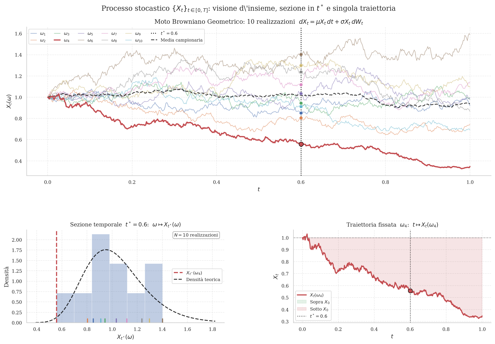{#fig-placeholder}

## Lemmi di Borel-Cantelli

::: mybox
Teorema di Estensione di Kolmogorov: corollario Sia la succesione $X_n$ definita su $(\Omega_n, \mathcal{A}_n,\mathbb{P}_n)$ e sia $\widetilde{X}_n$ la sua estensione naturale a $(\Omega,\mathcal{A}, \mathbb{P})$. Allora le $\widetilde{X}_n$ sono tutte indipendenti e la distribuzione di $\widetilde{X}_n$ su $(\Omega,\mathcal{A}, \mathbb{P})$ è identica alla distribuzione di $X_n$ su $(\Omega_n, \mathcal{A}_n,\mathbb{P}_n)$.
:::

### Il concetto di \"Infinitely Often\"

Sia $A_n$ una successione di eventi in $\mathcal{A}$. Definiamo: $$\limsup_{n\rightarrow\infty}A_n=\bigcap_{n=1}^{\infty}\left(\bigcup_{m\geq n}A_m   \right)=\lim_{n\rightarrow\infty}\left(\bigcup_{m\geq n}A_m   \right)$$ Questo evento può essere interpretato come:

::: center
$\limsup_{n\rightarrow \infty}A_n=$ \"$A_n$ si verifica infinite volte\"
:::

Il che significa che $A_n$ si verifica per un numero infinito di indici $n$, ovvero: $$\limsup_{n\rightarrow\infty} A_n=\{A_n \text{ i.o.}\}$$ Dove i.o. significa che l'evento accade \"Infinitely Often\".\
Fissiamo ora $B_n = \bigcup_{m\geq n}A_m$, in modo che $\limsup_{n\rightarrow\infty}A_n=\bigcap_{n=1}^{\infty}\left(\bigcup_{m\geq n}A_m   \right)=\bigcap_{n=1}^{\infty}B_n$. La successione $B_n$ è decrescente ($B_1\supseteq B_2 \supseteq B_3 \supseteq \dots$) perché man mano che $n$ cresce togliamo sempre più insiemi dall'unione. Il limite di questa successione decrescente è esattamente l'intersezione infinita, ovvero $\{A_n \text{ i.o.}\}$. $$\mathbb{P}(A_n \text{ i.o.})=\mathbb{P}\left(\bigcap_{n=1}^{\infty}B_n\right)=\lim_{n \rightarrow \infty}\mathbb{P}(B_n)$$

**N.B.**: La formulazione $\limsup_{n\to\infty}A_n=\bigcap_{n=1}^{\infty}\left(\bigcup_{m\geq n}A_m\right)$ va letta dall'interno verso l'esterno.

- $B_n=\bigcup_{m\geq n}A_m$: facciamo l'unione di tutti gli eventi $A$ dall'indice $n$ in poi. L'unione in probabilità corrisponde a un \"OR\" logico. Quindi questa scrittura significa: \"l'evento $A_m$ si verificherà almeno una volta dall'istante $n$ fino alla fine dei tempi\".

- Se prendiamo l'intersezione infinita di questi eventi $B_n$, otteniamo $\bigcap_{n=1}^{\infty}B_n$. Siccome l'intersezione corrisponde a un \"AND\" logico, stiamo dicendo che:

  1.  deve essere vero l'evento $B_1$: l'evento accadrà dal tempo $1$ in poi;

  2.  deve essere vero l'evento $B_{100}$: l'evento accadrà dal tempo $100$ in poi;

  3.  deve essere vero l'evento $B_{100000}$: l'evento accadrà dal tempo $100000$ in poi;

  4.  e così via, per ogni $n$.

  L'unica spiegazione logica per soddisfare questa condizione è che l'evento non smetta mai di accadere. In gergo probabilistico, si dice che l'evento $A_n$ **si verifica infinitamente spesso** (*infinitely often*, o *i.o.*).

::: mybox
Lemmi di Borel-Cantelli Sia $A_n$ una successione di eventi in $(\Omega,\mathcal{A},\mathbb{P})$:\

- Se $\sum_{n=1}^{\infty}\mathbb{P}(A_n)<\infty$ allora $\mathbb{P}(A_n\space i.o.)=0$\

- Se $\mathbb{P}(A_n\space i.o.)=0$ e se gli eventi $A_n$ sono mutualmente indipendenti, allora $\sum_{n=1}^{\infty}\mathbb{P}(A_n)\leq\infty$.\
  Una formulazione alternativa e più intuitiva del secondo lemma è:

- Se $\sum_{n=1}^{\infty}\mathbb{P}(A_n)=\infty$ e se gli eventi $A_n$ sono mutualmente indipendenti, allora $\mathbb{P}(A_n\space i.o.)=1$
:::

I Lemmi di Borel-Cantelli rispondono in modo definitivo a una domanda cruciale: \"Se ho una sequenza infinita di eventi, qual è la probabilità che essi continuino a verificarsi per sempre?\". I due lemmi dividono il mondo in due scenari:

- Il Primo Lemma (caso convergente): Se la somma di tutte le probabilità è un numero finito, significa che gli eventi diventano \"rari\" talmente in fretta che, prima o poi, si esauriranno. La probabilità che continuino ad accadere all'infinito è rigorosamente zero. La cosa straordinaria di questo primo lemma è che vale sempre, senza richiedere che gli eventi siano indipendenti tra loro.

- Il Secondo Lemma (caso divergente): Se la somma delle probabilità è infinita, le probabilità non si rimpiccioliscono abbastanza in fretta. Se aggiungiamo l'ipotesi fondamentale che gli eventi siano indipendenti (cioè che il \"caso\" non abbia memoria dei fallimenti passati), allora siamo matematicamente certi (probabilità 1) che l'evento continuerà a verificarsi infinite volte.

\
Questi lemmi sono lo strumento principe per dimostrare quasi tutti i teoremi di convergenza asintotica in probabilità (come la Legge Forte dei Grandi Numeri). Nella pratica, trasformano un problema probabilistico complesso (calcolare la probabilità di un'intersezione infinita di unioni infinite) in un banale problema di Analisi 1: studiare il carattere (convergenza o divergenza) di una serie numerica $\sum \mathbb{P}(A_n)$.

### Paradosso della scimmia instancabile {#sec-paradosso-della-scimmia-instancabile .unnumbered}

Nonostante a livello umano sembri un'assurdità controintuitiva, la dimostrazione probabilistica è disarmante nella sua semplicità.\
Supponiamo che la tastiera abbia $K$ tasti (includendo lettere, spazi e punteggiatura) e che il capolavoro da scrivere sia composto in totale da $N$ battute. Invece di guardare alle singole lettere, dividiamo l'infinita sequenza di tasti premuti dalla scimmia in \"blocchi\" separati, ciascuno di lunghezza esattamente pari a $N$.

Sia $A_n$ l'evento: \"*la scimmia digita il testo perfettamente corretto all'$n$-esimo blocco*\".

Poiché la scimmia digita in modo puramente casuale, la probabilità di scrivere l'opera esatta al primo tentativo è piccola, ma è comunque un numero fisso e strettamente maggiore di zero: $$\mathbb{P}(A_n) = p = \left(\frac{1}{K}\right)^N > 0$$ Per sapere se la scimmia ci riuscirà mai, studiamo la serie delle probabilità per applicare Borel-Cantelli: $$\sum_{n=1}^{\infty}\mathbb{P}(A_n) = \sum_{n=1}^{\infty} p = \infty$$ Poiché stiamo sommando infinite volte una costante $p$ maggiore di zero, la serie diverge a infinito. Inoltre, i tentativi (i blocchi) sono eventi **mutuamente indipendenti**, poiché la scimmia preme i tasti a caso, non ha memoria e le lettere digitate in precedenza non influenzano le successive.

Avendo una serie divergente ($\sum \mathbb{P}(A_n) = \infty$) e l'indipendenza degli eventi, ricadiamo esattamente nelle ipotesi del **Secondo Lemma di Borel-Cantelli**. La conclusione matematica è inequivocabile: $$\mathbb{P}(A_n \space i.o.) = 1$$ Questo significa che la scimmia non solo riuscirà a scrivere il capolavoro ma, avendo a disposizione un tempo infinito, lo scriverà un **numero infinito di volte**. Per darti un'idea pratica di come il caso produca risultati strutturati se gli si dà abbastanza tempo, ho creato un simulatore interattivo. Puoi usarlo per vedere la logica della scimmia

## Legge zero-uno di Kolmogorov

### Tail-$\sigma$-algebre

Siano $X_n$ VA definite su $(\Omega, \mathcal{A}, \mathbb{P})$. Definiamo le seguenti $\sigma$-algebre: $$\mathcal{B}_n=\sigma(X_n)$$ $$\mathcal{C}_n=\sigma\left(\bigcup_{p\geq n}\mathcal{B}_p     \right)$$ $$\mathcal{C}_{\infty}=\bigcap_{n=1}^{\infty}\mathcal{C}_n$$ $\mathcal{C}_{\infty}$ è la tail-$\sigma$-algebra, che contiene i cosiddetti \"eventi di coda\"

**La prima equazione: l'informazione all'istante presente**\
La $\sigma$-algebra $\mathcal{B}_n$ è quella generata dalla singola variabile $X_n$. Intuitivamente, essa contiene tutti e soli gli eventi di cui possiamo stabilire con assoluta certezza se si sono verificati oppure no guardando esclusivamente l'esito dell'osservazione al tempo $n$, ignorando completamente tutto il passato e tutto il futuro.

**La seconda equazione: l'informazione sul futuro**\
La $\sigma$-algebra $\mathcal{C}_n$ raggruppa (tramite l'unione) tutte le $\sigma$-algebre dal tempo $n$ in poi, generando uno spazio misurabile più grande. Essa rappresenta tutta l'informazione contenuta nel \"futuro\" del processo a partire dall'istante $n$. Un evento appartiene a $\mathcal{C}_n$ se, per sapere se si è avverato, ci basta osservare la sequenza $X_n, X_{n+1}, X_{n+2}, \dots$, senza avere alcun bisogno di conoscere cosa sia successo nei primi $n-1$ istanti temporali.

**La terza equazione: la tail-$\sigma$-algebra**\
La $\sigma$-algebra $\mathcal{C}_\infty$ si ottiene intersecando infiniti futuri. Affinché un evento appartenga a questo insieme estremo, deve appartenere a $\mathcal{C}_1$, ma anche a $\mathcal{C}_{100}$, e anche a $\mathcal{C}_{1000000}$, per ogni $n$. Questo ha un significato logico potentissimo: un \"evento di coda\" è un evento che dipende dall'intera successione infinita, ma la cui realizzazione *non è minimamente influenzata da alcun numero finito di osservazioni iniziali*. Puoi alterare, cancellare o ignorare i primi mille miliardi di valori della successione $X_n$, e questo non cambierà in alcun modo il verificarsi o meno di un evento in $\mathcal{C}_\infty$.\
Un classico evento che appartiene alla $\sigma$-algebra coda è l'evento \"la serie $\sum X_n$ converge\", oppure l'evento \"$A_n$ accade infinitamente spesso\" ad esempio \"testa esce ifinite volte\" (esattamente il $\limsup$ che abbiamo analizzato prima). Infatti, se modifichi i primi $100$ termini di una serie, non ne alteri il carattere (se convergeva, continuerà a convergere).

::: mybox
Legge zero-uno di Kolmogorov Siano $X_n$ VA indipendenti, tutte definite su $(\Omega, \mathcal{A}, \mathbb{P})$ e sia $\mathcal{C}_{\infty}$ la corrispondente tail-$\sigma$-algebra. Se l'evento $C\in \mathcal{C}_{\infty}$, allora: $$\mathbb{P}(C)=0$$ oppure $$\mathbb{P}(C)=1$$
:::

La Legge zero-uno di Kolmogorov risponde a una domanda fondamentale: cosa succede se un evento dipende da una sequenza infinita di lanci, ma non dipende da nessun lancio specifico iniziale?. Sappiamo che un evento di coda $C\in \mathcal{C}_{\infty}$ è un'evento il cui esito non cambia se si modificano i primi $n$ lanci. L'evento di coda è quindi indipendente dai primi $n$ eventi, ma l'evento stesso è costruito a partire dagli $n$ eventi precedenti! Paradossalmente esso è indipendente da se stesso, quindi: $$\mathbb{P}(C)=\mathbb{P}(C)\mathbb{P}(C)=\mathbb{P}(C)^2$$ E gli unici numeri che soddisfano l'equazione $x=x^2$ sono $0$ e $1$.\
Le conseguenze della legge zero-uno di Kolmogorov sono le seguenti:

- $\{\omega:\lim_{n\rightarrow\infty}X_n(\omega)=l\}\in\mathcal{C}_{\infty}$, pertanto $X_n$ converge A.S. o diverge A.S.

- Ogni VA $\mathcal{C}_{\infty}$-misurabile è A.S. costante. In partiocolare:

  1.  $\limsup X_n$

  2.  $\liminf X_n$

  3.  $\limsup\frac{1}{n}\sum_{p\leq n}X_p$

  4.  $\liminf\frac{1}{n}\sum_{p\leq n}X_p$

  Sono tutte A.S. costanti.

Una variabile di coda deve essere A.S. una costante. All'infinito la casualità sparisce e vedremo dalle leggi dei grandi numeri che questa costante sarà la media di una distribuzione normale $\mu$.

{#fig-placeholderx}

# Distribuzioni di Probabilità su $\mathbb{R}$

Abbiamo visto che una misura di probabilità $\mathbb{P}$ su $(\mathbb{R},\mathcal{B})$ è caratterizzata dalla sua CDF $F(x)=\mathbb{P}((-\infty,x])=\mathbb{P}(X\leq x)$.

## Misura di Lebesgue

La misura di Lebesgue è una funzione $m:\mathcal{B}\rightarrow[0,\infty]$ che soddisfa:

- Additività numerabile: se $B_1, B_2, \dots \in \mathcal{B}$ sono a due a due disgiunti, cioè $B_i\cap B_j=\emptyset$ per ogni $i\neq j$, allora: $$m\left(\bigcup_{i=1}^{\infty}B_i \right)=\sum_{i=1}^{\infty}m(B_i)$$

- se $a,b\in\mathbb{R}$ con $a<b$, allora: $$m((a,b])=b-a$$

La misura di Lebesgue è la generalizzazione del concetto di lunghezza in $\mathbb{R}$, di area in $\mathbb{R}^2$ e di volume in $\mathbb{R}^3$. Essa associa ad ogni insieme boreliano della Borel $\sigma$-algebra un numero non negativo.

::: mybox
Unicità ed Esistenza La Misura di Lebesgue esiste ed è unica.
:::

Abbiamo visto che se conosciamo la CDF, allora conosciamo automaticamente tutta la misura di probabilità $\mathbb{P}$. Ora vogliamo usare questa logica su una misura che non calcola probabilità ma lunghezze.\
Se la CDF esiste ed è valida, allora esiste anche la misura $m$ che essa caratterizza.\
La teoria dell'integrazione vista nel capitolo 10 rimane valida se sostituiamo la misura di probabilità con quella di Lebesgue. L'unica differenza è che $m(\mathbb{R})$ non è uguale a 1 come $\mathbb{P}(\Omega)$ con $\Omega=\mathbb{R}$, ma a $+\infty$. Tutti i risultati del capitolo 10 rimangono validi ad eccezione dell'affermazione secondo cui ogni funzione di Borel limitata è integrabile:

::: center
\"*Ogni VA limitata (funzione misurabile limitata) è integrabile*\"
:::

In probabilità, se abbiamo una funzione limitata come $f(x)=5$, l'integrale su tutto lo spazio è al massimo $5\times 1=5$. Con la misura di Lebesgue, l'integrale su tutto lo spazio sarebbe $5 \times \infty=\infty$.\
Inoltre è falsa anche la seguente affermazione del capitolo 10:

::: center
\"*Vale l'inclusione $L^2\subset L^1$*\"
:::

$L^2$ è lo spazio delle funzioni quadrato-integrabili, $L^1$ è lo spazio delle funzioni integrabili. In probabilità ciò significa che se il momento secondo di una VA esiste finito, allora esisterà finito anche il momento primo. Con la misura di Lebesgue su $\mathbb{R}$, invece, esistono funzioni quadrato-integrabili che non sono integrabili in $L^1$ (e viceversa).

## Probability Density Function di una misura di probabilità

La densità di una misura di probabilità $\mathbb{P}$ su $(\mathbb{R},\mathcal{B})$ è una funzione positiva e Borel-misurabile $f$ che, per ogni $x\in \mathbb{R}$ verifica: $$\mathbb{P}((-\infty,x])=\int_{-\infty}^xf(y)dy=\int f(y)\mathbb{1}_{(-\infty,x]}dy$$ se $\mathbb{P}=P_X$, allora $f$ è la densità della VA $X$.\
La PDF $f$ è la derivata della CDF e la CDF è l'integrale della PDF, a meno di punti di non derivabilità a cui assegnamo misura nulla.

**N.B.**: Non tutte le distribuzioni di probabilità ammettono una funzione di densità (PDF). Ad esempio, nel caso delle variabili discrete, la densità non esiste (rispetto alla misura di Lebesgue) poiché la funzione di ripartizione (CDF) $F$ non è continua, ma presenta dei salti.\
È fondamentale ricordare che se una variabile aleatoria ammette una densità $f$, allora la sua CDF $F$ sarà sicuramente continua, ma **non è vero il contrario**. In analisi avanzata e in teoria della misura, affinché una funzione $F$ ammetta una densità, non è sufficiente che sia semplicemente continua: deve essere **assolutamente continua**.\
Un celebre caso patologico che dimostra come la sola continuità non sia sufficiente è la distribuzione di Cantor, la cui CDF è nota come "scalinata del diavolo". Questa funzione è definita sull'intervallo $[0,1]$, cresce in modo monotono da $0$ a $1$ ed è *continua in ogni suo punto* (pertanto non descrive una variabile discreta, non essendoci salti).

Tuttavia, la sua peculiarità è di essere \"piatta\" quasi ovunque: la sua derivata è pari a zero su un insieme di misura di Lebesgue pari a $1$. Poiché la derivata è nulla quasi dappertutto, il suo integrale vale $0$, rendendo impossibile ricostruire la funzione $F$ originaria integrandone la derivata.

Di conseguenza, la scalinata del diavolo è una funzione continua ma *non* assolutamente continua, e rappresenta una distribuzione di probabilità (detta *singolare continua*) che non ammette alcuna funzione di densità.

::: mybox
Validità di una densità Una funzione positiva Borel-misurabile $f$ su $\mathbb{R}$ è la densità di una misura di probabilità su $(\mathbb{R},\mathcal{B})$ se e solo se: $$\int f(x)dx=1$$ In questo caso essa determina intermanete la misura di probabilità, e qualsiasi altra funzione positiva Borel-misurabile $g$ tale che $m(f\neq g)=0$ (cioè $f=g$ A.S.) è anch'essa una densità per la stessa misura di probabilità.\
Viceversa, una misura di probabilità su $(\mathbb{R},\mathcal{B})$ determina la sua densità (quando esiste) a meno di un insieme di misura di Lebesgue nulla (cioè se $f$ e $g$ sono due densità per questa misura di probabilità, allora $m(f\neq g)=0$.
:::

Questo teorema stabilisce due concetti fondamentali sulla relazione tra una misura di probabilità e la sua funzione di densità (PDF), basandosi sulla teoria dell'integrazione di Lebesgue:

- **Condizione di Normalizzazione:** La prima parte afferma semplicemente che affinché una funzione non negativa possa rappresentare una probabilità, l'area totale sottesa al suo grafico deve essere esattamente $1$. Questa è la traduzione analitica dell'assioma fondamentale secondo cui la probabilità dell'intero spazio campionario è il $100\%$.

- **Unicità \"Quasi Ovunque\" (A.E. o A.S.):** La seconda parte è la più profonda e chiarisce il concetto di equivalenza tra densità. In teoria della misura, ciò che accade su insiemi di \"lunghezza zero\" (cioè di misura di Lebesgue nulla, $m=0$) non altera in alcun modo il calcolo degli integrali.

- **Cosa significa all'atto pratico?** Significa che puoi prendere una densità valida $f$ e modificarne il valore in un punto singolo, in cento punti, o persino in un'infinità numerabile di punti (creando una nuova funzione $g$). Poiché l'insieme dei punti che hai modificato ha misura di Lebesgue nulla ($m(f\neq g)=0$), l'integrale non subirà variazioni: $$\int_A f(x)dx = \int_A g(x)dx \quad \text{per ogni insieme misurabile } A$$

In sintesi, la densità associata a una distribuzione di probabilità esiste ed è unica, ma solo *a meno di insiemi di misura nulla*. In probabilità continua, non ha alcun senso matematico preoccuparsi del \"valore esatto della densità in un singolo punto\", perché alterare la funzione su singoli punti non cambia la misura di probabilità globale che essa definisce.

Una funzione $f$ è una densità valida se:

::: mybox
Corollario: Expectation Rule Sia $X$ una VA a valori reali con densità $f$. Sia $g$ una funzione Borel-misurabile. Allora $g$ è integrabile rispetto a $P_X$ (la distribution measure di $X$) se e solo se il prodotto $fg$ è integrabile rispetto alla misura di Lebesgue. In questo caso si ha: $$\mathbb{E}[g(X)]=\int g(X)P_X(x)dx=\int g(X)f(x)dx$$ $g$ e una trasformazione Borel-misurabile di $X$. Per esempio, se $g:g(x)=x^2$, allora $\mathbb{E}[g(X)]=\mathbb{E}[X^2]=\int x^2f(x)$.
:::

Questo corollario è universalmente noto in letteratura come LOTUS - *Law of the Unconscious Statistician*. Stabilisce un principio di importanza pratica monumentale per il calcolo delle probabilità:

- **Il problema:** Se applichiamo una trasformazione $g$ a una variabile aleatoria $X$, otteniamo una nuova variabile aleatoria $Y = g(X)$. Per calcolare il valore atteso di $Y$ seguendo la definizione classica, dovremmo prima calcolare la nuova funzione di densità $f_Y(y)$, un processo analitico spesso lungo e complesso.

- **La soluzione (LOTUS):** Il teorema ci dice che *non è necessario conoscere la densità della nuova variabile $Y$*. Possiamo calcolare il valore atteso della trasformata usando semplicemente la densità $f(x)$ della variabile originale $X$.

- **Perché \"Inconsapevole\"?** Il nome deriva dal fatto che molti studenti (o statistici alle prime armi) calcolano $\mathbb{E}[g(X)]$ inserendo intuitivamente $g(x)$ dentro l'integrale di $f(x)$, convinti di applicare la definizione di valore atteso. In realtà stanno \"inconsapevolmente\" usando un corollario avanzato di teoria della misura che garantisce che questa scorciatoia intuitiva sia matematicamente rigorosa.

## Distributzione di una trasformazione di una VA

**N.B**. Per padroneggiare i teoremi sulle trasformazioni di variabili aleatorie, è essenziale avere chiari i seguenti concetti sulle funzioni reali:

- **Funzione Iniettiva (\"One-to-One\"):** Una funzione è iniettiva se a input diversi corrispondono *sempre* output diversi. Graficamente, tracciando una qualsiasi retta orizzontale, questa intersecherà il grafico della funzione **al massimo una volta**. In formule: se $f(x_1) = f(x_2)$, allora obbligatoriamente $x_1 = x_2$.

- **Funzione Suriettiva (\"Onto\"):** Una funzione è suriettiva se ogni possibile valore del codominio (l'asse $y$ di arrivo) viene \"colpito\" da almeno una $x$. In altre parole, l'immagine della funzione coincide con l'intero codominio.

- **Funzione Biiettiva (o Biunivoca):** È una funzione che è contemporaneamente sia iniettiva che suriettiva. Questa è la condizione perfetta: stabilisce una corrispondenza \"uno a uno\" tra le $x$ e le $y$. **Solo le funzioni biiettive ammettono una funzione inversa globale** $f^{-1}(y)$.

**Il rapporto cruciale con le Derivate (Monotonia)**

- **Derivata mai nulla (Iniettività garantita):** Se la derivata prima $f'(x)$ non cambia mai segno (è *sempre* $>0$ o *sempre* $<0$), la funzione è **strettamente monotona** (sempre crescente o sempre decrescente). Una funzione strettamente monotona non \"torna mai indietro\", quindi è automaticamente **iniettiva** e invertibile. (Questo è il motivo per cui il Corollario 1 richiede una derivata mai nulla).

- **Derivata che si annulla e cambia segno (Perdita di iniettività):** Se $f'(x)$ passa da negativa a positiva (o viceversa), significa che la funzione ha un minimo o un massimo (come la parabola $Y=X^2$ in $x=0$). La funzione \"torna indietro\", permettendo a una retta orizzontale di intersecare il grafico due o più volte. Qui **l'iniettività crolla**, e per trovare le probabilità sarai obbligato a usare il Corollario 2, spezzando il dominio esattamente nei punti in cui $f'(x) = 0$.

::: mybox
Teorema del Cambio di Variabile Sia X una VA con densità $f_X$ e sia $g$ una funzione Borel-misurabile. Sia $Y=g(X)$ una trasformazione della VA $X$. Allora: $$F_Y(y)=\mathbb{P}(Y\leq y)=\mathbb{P}(g(X)\leq y)=\int_{\{u:g(u)\leq y\}}f_X(u)du$$ Dove il dominio di integrazione è costituito dai punti in cui $g(X)\leq y$.
:::

Se $F_Y$ è differenziabile allora possiamo usare il teorema per trovare la densità.

Questo risultato, noto formalmente come **Metodo della CDF**, è lo strumento analitico più generale e potente per ricavare la distribuzione di una variabile aleatoria trasformata $Y = g(X)$.

Ecco i punti chiave per comprenderne l'utilità e il funzionamento:

- **Validità universale:** A differenza di altre formule più rapide (come il teorema del cambio di variabile che utilizza la derivata della funzione inversa), questo integrale funziona **sempre**. In particolare, è il metodo da utilizzare obbligatoriamente quando la funzione $g(x)$ *non è iniettiva* (ad esempio le parabole $Y = X^2$ o i valori assoluti $Y = |X|$), casi in cui le formule inverse falliscono.

- **Traduzione degli eventi:** Il cuore logico del teorema è un \"cambio di vocabolario\". Poiché non conosciamo nulla della nuova variabile $Y$, traduciamo l'evento $\{Y \leq y\}$ nel suo esatto equivalente basato sulla vecchia variabile: l'evento $\{g(X) \leq y\}$.

- **Determinazione del dominio:** All'atto pratico, applicare il teorema significa risolvere la disuguaglianza $g(x) \leq y$ trattando $y$ come un parametro fisso. Le soluzioni di questa disuguaglianza ti indicheranno esattamente quali intervalli di $x$ devi usare come estremi per integrare la densità originale $f_X(x)$.

- **Dalla CDF alla PDF:** Il risultato di questo calcolo integrale è la funzione di ripartizione $F_Y(y)$. Se il problema richiede la funzione di densità $f_Y(y)$ della nuova variabile, il passaggio finale consiste semplicemente nel derivare il risultato ottenuto: $$f_Y(y) = \frac{d}{dy} F_Y(y)$$

**Esempio:** Sia $X$ una variabile aleatoria con distribuzione uniforme su $[0,1]$ e sia $Y = -\frac{1}{\lambda} \log(X)$, con $\lambda > 0$.

Allora la funzione di ripartizione (CDF) di $Y$ è: $$\begin{aligned}
F_Y(y) &= \mathbb{P}\left(-\frac{1}{\lambda} \log(X) \leq y\right) \\
       &= \mathbb{P}(\log(X) \geq -\lambda y) \\
       &= \mathbb{P}(X \geq e^{-\lambda y}) \\
       &= \begin{cases} 
          1 - e^{-\lambda y} & \text{per } y \geq 0 \\
          0 & \text{altrimenti}
          \end{cases}
\end{aligned}$$

Pertanto, derivando rispetto a $y$ otteniamo la funzione di densità (PDF): $$f_Y(y) = \frac{d}{dy}F_Y(y) = 
\begin{cases} 
\lambda e^{-\lambda y} & \text{se } y > 0 \\
0 & \text{se } y \leq 0
\end{cases}$$ e vediamo chiaramente che $Y$ segue una distribuzione esponenziale di parametro $\lambda$.\
**N.B.**: L'esempio precedente è ingannevolmente semplice perché la funzione di trasformazione $g(x) = -\frac{1}{\lambda}\log(x)$ era iniettiva (o \"uno-a-uno\", cioè strettamente monotona). Il risultato generale per trasformazioni non iniettive è fornito di seguito:

::: mybox
Teorema del cambio di variabile (funzioni iniettive) Sia $X$ una VA con densità continua $f_X$. Sia $g:\mathbb{R}\rightarrow\mathbb{R}$ una funzione continuamente differenziabile[^5] con derivata mai nulla (quindi $g$ è monotona). sia $h(y)=g^{-1}(y)$ la funzione inversa (anch'essa continuamente differenziabile). Allora $Y=g(X)$ ha la densità: $$f_Y(y)=f_X(h(y))\times|h^{'}(y)|$$
:::

Questo corollario rappresenta il metodo più rapido e diretto per trovare la densità di una variabile aleatoria trasformata, poiché permette di saltare completamente il calcolo e la derivazione della Funzione di Ripartizione (CDF), fornendo la PDF in un solo passaggio.

Per comprendere intuitivamente la formula, possiamo scomporla nei suoi tre elementi fondamentali:

- **Il ritorno all'origine ($h(y)$):** Vogliamo calcolare la densità della nuova variabile $Y$ in un punto $y$. Per farlo, dobbiamo scoprire da dove \"proviene\" questa probabilità. La funzione inversa $h(y) = g^{-1}(y)$ agisce come una macchina del tempo: prende il valore $y$ e ci dice esattamente quale valore originario $x$ lo ha generato.

- **La densità di partenza ($f_X(h(y))$):** Una volta scoperto il punto originario $x$, andiamo a leggere quanta \"massa di probabilità\" c'era in quel punto valutando la densità originale $f_X$.

- **Il fattore di distorsione ($|h'(y)|$):** Questa è la componente più brillante del teorema. Applicare una funzione $g(x)$ non significa solo \"spostare\" i punti sull'asse, ma spesso li *stira* o li *comprime*. Questo significa che la densità di probabilità si diluisce o si concentra. La derivata dell'inversa (che in più dimensioni prenderà il nome di *Jacobiano*) serve esattamente a misurare e compensare questa deformazione geometrica dello spazio, garantendo che l'area totale rimanga 1.

**Perché il valore assoluto?** La densità di probabilità, per definizione, non può mai essere un numero negativo. Se la trasformazione $g(x)$ fosse strettamente decrescente, la derivata della sua inversa sarebbe negativa. Il valore assoluto assicura che il fattore di scala rimanga positivo, preservando la correttezza della PDF geometrica.

::: mybox
Teorema del Cambio di Variabile (funzioni non iniettive) Sia $X$ una VA con densità continua $f_X$. Sia $g:\mathbb{R}\rightarrow\mathbb{R}$ una funzione continuamente differenziabile e monotona a tratti. Questo significa che esistono intervalli disgiunti $I_1, I_2, \dots, I_n$ che formano una partizione di $\mathbb{R}$ tali che, su ogni intervallo $I_i$, la restrizione della funzione $g_i: I_i \rightarrow g(I_i)$ sia strettamente monotona (e quindi invertibile).

Sia $h_i(y) = g_i^{-1}(y)$ la funzione inversa definita sull'immagine dell'intervallo $I_i$. Allora la variabile trasformata $Y=g(X)$ ha densità: $$f_Y(y) = \sum_{i=1}^n f_X(h_i(y)) \cdot |h_i'(y)| \cdot \mathbb{1}_{g(I_i)}(y)$$
:::

Questo corollario generalizza il teorema precedente per gestire le **funzioni non iniettive** (come la parabola $Y=X^2$, il valore assoluto $Y=|X|$ o le funzioni trigonometriche). In questi casi, la funzione \"sale e scende\", il che significa che un singolo valore finale $y$ può essere stato generato da più valori iniziali distinti di $x$.

Ecco la logica passo-passo che si cela dietro la formula:

- **Il \"Divide et Impera\" ($I_1, I_2, \dots, I_n$):** Poiché non possiamo calcolare un'unica funzione inversa per tutta $g(x)$, spezziamo il dominio originale (l'asse $x$) in intervalli più piccoli all'interno dei quali la funzione si comporta \"bene\" (cioè o è sempre crescente, o è sempre decrescente).

- **Applicazione del caso iniettivo:** Su ciascuno di questi singoli \"pezzi\", la funzione è iniettiva. Possiamo quindi calcolare l'inversa locale $h_i(y)$ e applicare l'esatta formula che abbiamo visto per il caso iniettivo (densità originale moltiplicata per il fattore di distorsione $|h_i'(y)|$).

- **La somma delle probabilità ($\sum$):** Se un valore $y$ può provenire da tre punti diversi sull'asse $x$ (ad esempio, uno nel primo intervallo, uno nel secondo e uno nel terzo), la densità totale nel punto $y$ sarà semplicemente la somma delle densità \"trasportate\" da ciascuno di questi tre punti originari.

- **La funzione indicatrice ($\mathbb{1}_{g(I_i)}(y)$):** Questo è un \"interruttore\" matematico. Vale $1$ se il valore $y$ può effettivamente essere raggiunto partendo dall'intervallo $i$-esimo, e vale $0$ altrimenti. Serve a garantire che, nella sommatoria, non aggiungiamo probabilità da intervalli che non possono fisicamente generare quel particolare valore $y$.

**Esempio classico ($Y=X^2$):** Se vogliamo calcolare la densità di $Y=X^2$, spezziamo il dominio di $X$ in due intervalli: $I_1 = (-\infty, 0)$ dove la funzione decresce, e $I_2 = (0, \infty)$ dove cresce. Per un dato valore $y > 0$, la probabilità finale sarà la somma delle probabilità provenienti dal ramo positivo $x = +\sqrt{y}$ e dal ramo negativo $x = -\sqrt{y}$.\
Il precedente teorema con i suoi corollari spiega la tecnica per trovare la PDF quando si trasforma una VA. I metodi presentati sono 3:

- **Metodo della CDF**

  1.  Scrivi la definizione: $F_Y(y)=\mathbb{P}(Y\leq y)$

  2.  Sostituisci $Y$ con $g(X)$: $\mathbb{P}(g(X)\leq y)$

  3.  Isola $X$: $\mathbb{P}(X\leq g^{-1}(X))=\mathbb{P}(X\leq h(y))$

  4.  Deriva la CDF $F_Y$ per trovare la PDF $f_Y$

- **Formula del cambio di varibaile**:\
  se $g$ e strettamente monotona, non serve fare l'integrale ogni volta, ma si applica la formula: $$f_Y(y)=f_X(h(y))\times |h^{'}(y)|$$

- **Formula del cambio di variabile con funzioni monotone a tratti**:\
  se $g(x)$ è monotona solo in alcuni tratti, non esiste una singola funzione inversa (per risolvere $x^2=4$ hai due inverse: $x=2$ e $x=-2$). Quindi partizioniamo il dominio in intervalli $I_i$ dove la funzione è monotona e per ogni $I_i$ applichiamo la formula del cambio di variabile, poi sommiamo i singoli contributi.

**Esempio: La trasformazione $Y = X^2$**

Sia $X$ una variabile aleatoria Normale Standard, ovvero $X \sim \mathcal{N}(0,1)$, la cui funzione di densità è: $$f_X(x) = \frac{1}{\sqrt{2\pi}} e^{-x^2/2}$$ Vogliamo trovare la densità della variabile trasformata $Y = X^2$.\
**Metodo 1: Tramite il Corollario (Funzione non iniettiva)** La funzione $g(x) = x^2$ non è né monotona né iniettiva su tutto $\mathbb{R}$. Dividiamo quindi il dominio in due intervalli in cui la funzione è strettamente monotona: $I_1 = (0, \infty)$ in cui cresce, e $I_2 = (-\infty, 0)$ in cui decresce.

- Sul ramo positivo ($I_1$), la funzione inversa è $h_1(y) = \sqrt{y}$. La sua derivata è $h_1'(y) = \frac{1}{2\sqrt{y}}$.

- Sul ramo negativo ($I_2$), la funzione inversa è $h_2(y) = -\sqrt{y}$. La sua derivata è $h_2'(y) = -\frac{1}{2\sqrt{y}}$.

In entrambi i casi, il valore assoluto della derivata è $|h_i'(y)| = \frac{1}{2\sqrt{y}}$.

Applicando la formula per le funzioni monotone a tratti (per $y > 0$), sommiamo i due contributi: $$\begin{aligned}
f_Y(y) &= f_X(h_1(y))|h_1'(y)| + f_X(h_2(y))|h_2'(y)| \\
       &= \left( \frac{1}{\sqrt{2\pi}} e^{-y/2} \right) \frac{1}{2\sqrt{y}} + \left( \frac{1}{\sqrt{2\pi}} e^{-y/2} \right) \frac{1}{2\sqrt{y}} \\
       &= \frac{1}{\sqrt{2\pi}} \frac{1}{\sqrt{y}} e^{-y/2} \mathbb{1}_{(0,\infty)}(y)
\end{aligned}$$ La variabile aleatoria $Y$ così ottenuta prende il nome di **variabile aleatoria Chi-Quadro con 1 grado di libertà** (denotata con $\chi^2_1$).\
**Metodo 2: \"A mano\" (Tramite la Funzione di Ripartizione)** L'esempio precedente è sufficientemente semplice da poter essere risolto anche senza usare il teorema, applicando la definizione generale: $$\begin{aligned}
F_Y(y) &= \mathbb{P}(Y \leq y) = \mathbb{P}(X^2 \leq y) \\
       &= \mathbb{P}(-\sqrt{y} \leq X \leq \sqrt{y}) \\
       &= F_X(\sqrt{y}) - F_X(-\sqrt{y})
\end{aligned}$$

Ora deriviamo rispetto a $y$ per trovare la densità $f_Y(y)$, applicando la regola della catena. Ricordiamo che la derivata di $F_X(x)$ è $f_X(x)$ e che la normale standard è una funzione pari, per cui $f_X(-\sqrt{y}) = f_X(\sqrt{y})$: $$\begin{aligned}
f_Y(y) &= \frac{d}{dy} \left[ F_X(\sqrt{y}) - F_X(-\sqrt{y}) \right] \\
       &= f_X(\sqrt{y}) \cdot \frac{d}{dy}(\sqrt{y}) - f_X(-\sqrt{y}) \cdot \frac{d}{dy}(-\sqrt{y}) \\
       &= f_X(\sqrt{y}) \left( \frac{1}{2\sqrt{y}} \right) - f_X(\sqrt{y}) \left( -\frac{1}{2\sqrt{y}} \right) \\
       &= 2 \cdot f_X(\sqrt{y}) \left( \frac{1}{2\sqrt{y}} \right) = f_X(\sqrt{y}) \frac{1}{\sqrt{y}}
\end{aligned}$$ Sostituendo la formula della normale $f_X(\sqrt{y}) = \frac{1}{\sqrt{2\pi}} e^{-y/2}$, otteniamo esattamente lo stesso risultato del Metodo 1.\

::: mybox
Metodo Alternativo: Cambio di Variabile tramite la Derivata Originale Esiste una formulazione equivalente, e spesso più operativa, del Teorema del Cambio di Variabile per funzioni non iniettive. Invece di ricavare analiticamente le funzioni inverse $h_i(y)$ e calcolare le loro derivate, è possibile operare direttamente sulla derivata della funzione di trasformazione originale $g(x)$.

Sia $Y = g(X)$ e fissiamo un valore $y$. Se indichiamo con $x_1, x_2, \dots, x_k$ le *radici* dell'equazione $g(x) = y$ (ovvero tutti i punti di partenza nell'asse $x$ tali per cui la funzione \"colpisce\" l'altezza $y$), la densità di $Y$ è data dalla somma dei contributi di ciascuna radice: $$f_Y(y) = \sum_{x_i : g(x_i) = y} \frac{f_X(x_i)}{|g'(x_i)|}$$ Dove $g'(x_i)$ è la derivata della funzione $g(x)$ valutata in corrispondenza della radice $i$-esima.
:::

**Perché funziona e quando conviene usarlo:**

- **Il fondamento teorico (Analisi 1):** Questo metodo non è in contraddizione con la formula delle funzioni inverse, ma ne è la diretta conseguenza. Il Teorema della Derivata della Funzione Inversa stabilisce infatti che la derivata dell'inversa è l'esatto reciproco della derivata della funzione originale valutata nel punto corrispondente: $$|h_i'(y)| = \frac{1}{|g'(x_i)|}$$ Sostituendo questa identità nella formula del libro, la moltiplicazione per $|h_i'(y)|$ si trasforma magicamente in una divisione per $|g'(x_i)|$.

- **Aggirare le inverse complesse:** È il metodo d'elezione quando la funzione $g(x)$ è facilissima da derivare, ma la sua inversa $h(y)$ è scomoda o propensa a generare errori di calcolo (es. funzioni trigonometriche, dove derivare un seno è più semplice che derivare un arcoseno).

- **Il trucco della sostituzione implicita:** Il vero superpotere di questa formula risiede nel fatto che *non è necessario conoscere il valore esatto delle radici $x_i$*. Poiché sappiamo per definizione che in quei punti vale l'equazione $g(x_i) = y$, ci basta calcolare la derivata $g'(x)$ e manipolarla (spesso tramite banali identità algebriche o trigonometriche) fino a far comparire il blocco $g(x)$, che sostituiremo con $y$. In questo modo, la $x$ scompare dalla derivata prima ancora di doverla esplicitare.

::: mybox
Teorema della Trasformata Inversa

Sia $F$ una funzione di ripartizione su $\mathbb{R}$. Sia $U$ una variabile aleatoria distribuita uniformemente sull'intervallo $(0, 1)$, ovvero $U \sim \mathcal{U}(0,1)$.

Definiamo l'inversa generalizzata (o funzione quantile) di $F$ come: $$F^{-1}(u) = \inf \{ x \in \mathbb{R} : F(x) \ge u \} \quad \text{per } u \in (0,1)$$

Allora, la variabile aleatoria $X$ definita come: $$X = F^{-1}(U)$$ ha esattamente $F$ come sua funzione di ripartizione, ovvero: $$P(X \le x) = F(x) \quad \forall x \in \mathbb{R}$$

*Nota:* Se la funzione $F$ è continua e strettamente crescente, l'inversa generalizzata coincide con la funzione inversa classica, e possiamo scrivere più semplicemente che per $X = F^{-1}(U)$ vale $F_X(x) = F(x)$.
:::

::: mybox
La Distribuzione Chi-Quadro ($\chi^2$) La distribuzione Chi-Quadro gioca un ruolo importante in Statistica. Sia $p$ un numero intero positivo. Una variabile aleatoria $X$ si dice avere densità Chi-Quadro con $p$ gradi di libertà (denotata con $\chi^2_p$) se la sua PDF per $x > 0$ è: $$f(x) = \frac{1}{\Gamma(p/2)2^{p/2}} x^{p/2-1} e^{-x/2}$$ Proprietà fondamentali:

1.  **Casi Particolari:** È un caso speciale della distribuzione Gamma: $X \sim \text{Gamma}(p/2, 1/2)$. Inoltre, se $p=2$, la $\chi^2_2$ è semplicemente una variabile aleatoria Esponenziale di parametro $\lambda = 1/2$.

2.  **Relazione con la Normale:** Come dimostrato sopra, il quadrato di una singola normale standard è una $\chi^2_1$. Generalizzando, se prendiamo $p$ variabili normali standard indipendenti, la somma dei loro quadrati si distribuisce come una $\chi^2_p$. Questa distribuzione emerge in modo naturale nella statistica inferenziale quando si cerca di stimare la varianza di una popolazione normale.
:::

# Distribuzioni di Probabilità su $\mathbb{R}^n$

Nel capitolo precedente abbiamo considerato il caso semplice delle distribuzioni su $(\mathbb{R}^1,\mathcal{B})$. Ora analizziamo il caso delle distribuzioni su $(\mathbb{R}^n,\mathcal{B}^n)$, dove $\mathcal{B}^n$ denota i Borel-sets di $\mathbb{R}^n$ ed è generata dai \"quadranti\" della forma: $$\prod_{i=1}^n(-\infty,a_i]\quad a_i\in\mathbb{Q}$$ Si noti che $\mathcal{B}^n=\mathcal{B}\otimes\mathcal{B}\otimes...\otimes\mathcal{B}$, ovvero $\mathcal{B}^n=\sigma(\mathcal{B}\times\mathcal{B}\times...\times\mathcal{B})$ è la più piccola $\sigma$-algebra generata dal prodotto cartesiano n-esimo di $\mathcal{B}$.\
La CDF multidimensionale di una misura di probabilità su $(\mathbb{R}^n,\mathcal{B}^n)$ è: $$F(x_1,...,x_n)=\mathbb{P}\left(\prod_{i=1}^n(-\infty,x_i] \right)$$ Cercare di caratterizzare la probabilità $\mathbb{P}$ utilizzando $F$ per $n\geq2$ è più delicato rispetto al caso $n=1$. Di conseguenza, le CDF sono usate raramente su più dimensioni. Infatti, per calcolare la probabilità di un semplice rettangolo $\mathcal{R}$ in 2D, come $\mathbb{P}(a<X\leq b,c<Y\leq d)$, la formula diventa macchinosa per il principio di inclusione-esclusione: $$\mathbb{P}(\mathcal{R})=F(b,d)-F(a,d)-F(b,c)+F(a,c)$$ man mano che $n$ cresce, questa somma a segni alternati diventa intrattabile. In alte dimensioni si preferisce lavorare con la PDF.

## Misura di Lebesgue Multidimensionale

La misura di Lebesgue multidimensionale $m_n$ su $(\mathbb{R}^n,\mathcal{B}^n)$ è definita per gli insiemi che sono prodotti cartesiani $A_1\times A_2 \times...\times A_n$. $$m_n\left(\prod_{i=1}^nA_i  \right)=\prod_{i=1}^nm_1(A_i) \quad \quad \quad \forall A_i \in \mathcal{B}$$ Come visto nel capitolo precedente, si può estendere la misura di Lebesgue per i prodotti cartesiani (definiti come $A\times B=\{(a,b):a\in A,b\in B\}$, ovvero l'insieme di tutte le coppie ordinate $(a,b)$) in modo unico, a una misura $m_n$ su $(\mathbb{R}^n,\mathcal{B}^n)$, e $m_n$ manterrà le proprietà di additività numerabile. Tale misura $m_n$ è una misura di Lebesgue, ed è caratterizzata anche dalla seguente condizione (più debole rispetto alla prima): $$m_n\left(\prod_{i=1}^n(a_i,bi]     \right)=\prod_{i=1}^n(b_i-a_i)\quad \quad \quad \forall -\infty<a_i<b_i<\infty$$ Se $A\in \mathcal{B}^n$, si può considerare $m_n(A)$ come il volume dell'insieme $A$: $$\int f(x)d\mathbf{x}=\int f(x_1,...,x_n)dx_1...dx_n$$ dove $dx_1...dx_n=m_n$. E scriviamo anche: $$\int_Af(x)d\mathbf{x}=\int f(x)\mathbb{1}_A d\mathbf{x}$$ per indicare l'integrale sull'insieme di interesse $A\in \mathcal{B}^n$.

**N.B.**: in 1D $(\mathbb{R})$, la misura di Lebesgue $m$ è semplicemente la lunghezza di un intervallo $(a,b]$ ottenuta come $m(a,b]=b-a$. (aperto a sx e chiuso a dx per garantire che si incastrino alla perfezione rimanendo disgiunti). Se hai un rettangolo $(\mathbb{R}^2)$ di base $A_1$ e altezza $A_2$, la sua area $m_2$ si calcola come $m_2(A_1\times A_2)=m_1(A_1)\times m_1(A_2)$. E cosi via per $\mathbb{R}^{n\geq2}$.\
Calcolare il volume di una forma nota è semplice, ma come calcoliamo il volume di un insieme frastagliato in $\mathcal{B}^n$? Il teorema di estensione ci garantisce che se sappiamo come misurare il volume di una forma semplice (come un rettangolo), esiste un modo logico di risalire al calcolo del volume della forma difficile attraverso i volumi delle forme semplici.

## Densità in $(\mathbb{R}^n,\mathcal{B}^n)$

Una misura di probabilità $\mathbb{P}$ su $(\mathbb{R}^n,\mathcal{B}^n)$ ha una densità $f$ se $f$ è una funzione non-negativa, Borel-misurabile su $\mathbb{R}^n$ che verifica, $\forall A\in\mathcal{B}^n$: $$\mathbb{P}(A)=\int f(x)\mathbb{1}_Ad\mathbf{x}=\int_Af(x)d\mathbf{x}=\int f(x_1,...x_n)\mathbb{1}_A(x_1,...x_n)dx_1,...dx_n$$ **N.B.**: non tutte le probabilità su $(\mathbb{R}^n,\mathcal{B}^n)$ ammettono una densità.

::: mybox
Condizione per essere una densità Una funzione positiva e Borel-misurabile $f$ su $\mathbb{R}^n$ è la densità di una misura di probabilità su $(\mathbb{R}^n,\mathcal{B}^n)$ se e solo se soddisfa: $$\int f(x)d\mathbf{x}=1$$ In questo caso essa determina interamente la misura di probabilità, e qualsiasi altra funzione Borel-misurabile $g$ tale che $m_n(f=g)=0$ (quindi $f=g$ quasi ovunque, tranne che su insiemi di misura di Lebesgue nulla) è anch'essa una densità per la stessa misura di probabilità.\
Viceversa, una misura di probabilità su $(\mathbb{R}^n,\mathcal{B}^n)$ determina la sua densità (quando esiste) a meno di un insieme di misura di Lebesgue nulla (cioè se $f$ e $g$ sono due densità per questa probabilità, allora $m_n(f\neq g)=0$ che si scrive $f=g$ $m_n-a.e.$ almost everywhere.
:::

\
Ora per comodità, lavoriamo in $\mathbb{R}^2$. Sia $\mathbf{X}$ un vettore aleatorio con componenti $Y,Z$, ovvero $\mathbf{X}=[Y,Z]$.

::: mybox
Densità Multivariata Supponiamo che $\mathbf{X}=[Y,Z]$ abbia una densità $f$ su $\mathbb{R}^2$. Allora:

- Sia $Y$ sia $Z$ hanno densità su $(\mathbb{R}, \mathcal{B})$ date da: $$f_Y(y) = \int_{\mathbb{R}} f(y,z) \, dz \qquad \text{e} \qquad f_Z(z) = \int_{\mathbb{R}} f(y,z) \, dy$$ Queste sono le densità marginali.

- Le componenti $Y$ e $Z$ sono indipendenti se e solo se: $$f(y,z) = f_Y(y)f_Z(z) \quad dm_2\text{-a.e.}$$ Cioè se e solo se la densità congiunta di $\mathbf{X}$ può essere fattorizzata come il prodotto delle densità marginali delle componenti $Y$ e $Z$.

- La formula sottostante definisce un'altra densità su $\mathbb{R}$ in ogni punto $y\in \mathbb{R}$ tale che $f_Y(y)\neq0$: $$f_{Y=y}(z)=\frac{f(y,z)}{f_Y(y)}$$ Questa è la densità condizionale di $Z$ dato $Y=y$ (dove $y$ non è un singolo punto, poichè altrimenti la probabilità sarebbe 0, bensì un intervallo infinitesimale)
:::

Questi punti descrivono il comportamento di un **vettore aleatorio continuo** $\mathbf{X} = [Y, Z]$, dove stiamo analizzando contemporaneamente due variabili casuali per capire come interagiscono tra loro nello spazio bidimensionale $\mathbb{R}^2$.

### 1. La Densità Congiunta {#sec-la-densit-congiunta .unnumbered}

Partiamo dal presupposto che $\mathbf{X} = [Y, Z]$ abbia una densità di probabilità congiunta $f(y, z)$. In termini intuitivi, puoi immaginare $f(y, z)$ come una "montagna" tridimensionale (una superficie) che sovrasta il piano $\mathbb{R}^2$. L'altezza della montagna nel punto $(y, z)$ indica quanto è "probabile" che il vettore $\mathbf{X}$ assuma valori nell'intorno infinitesimale di quel punto.

### 2. Le Densità Marginali {#sec-le-densit-marginali .unnumbered}

Le formule fornite per le **densità marginali** sono: $$f_Y(y) = \int_{\mathbb{R}} f(y, z) \, dz$$ $$f_Z(z) = \int_{\mathbb{R}} f(y, z) \, dy$$ **Spiegazione:** Per trovare la densità della sola variabile $Y$ nel punto $y$, dobbiamo prendere la densità congiunta $f(y, z)$ e "sommarla" (tramite l'integrale) lungo tutti i possibili valori che $Z$ può assumere (da $-\infty$ a $+\infty$). Visivamente, equivale a "schiacciare" o proiettare la montagna 3D contro la parete dell'asse $Y$. Il risultato, $f_Y(y)$, descrive il comportamento di $Y$ come se $Z$ non esistesse.

### 3. Indipendenza tra Variabili {#sec-indipendenza-tra-variabili .unnumbered}

Il secondo punto definisce il concetto fondamentale di **indipendenza statistica** per variabili continue: $$f(y, z) = f_Y(y) f_Z(z) \quad dm_2\text{-q.o.}$$ **Spiegazione:** Due variabili sono indipendenti se la loro densità congiunta si può "spezzare" (fattorizzare) nel prodotto delle loro densità marginali. Intuitivamente significa che il comportamento di $Y$ non influenza in alcun modo il comportamento di $Z$, e viceversa. L'aggiunta di "quasi ovunque" ($dm_2$-q.o.) significa che l'uguaglianza può fallire su un insieme di punti di area nulla rispetto alla misura di Lebesgue, senza invalidare l'indipendenza complessiva.

### 4. La Densità Condizionale {#sec-la-densit-condizionale .unnumbered}

L'ultimo punto introduce la **probabilità condizionata** per variabili continue. La formula classica è definita come: $$f_{Z|Y}(z|y) = \frac{f(y, z)}{f_Y(y)} \quad \text{per } f_Y(y) > 0$$ **Spiegazione:** Questa formula risponde alla domanda: *"Se so di per certo che $Y$ ha assunto il valore $y$, qual è ora la distribuzione di probabilità di $Z$?"*

Come sottolinea la nota, non stiamo condizionando a un singolo punto esatto, ma a un intervallo infinitesimale. Questo perché la probabilità puntuale per variabili continue è sempre zero.

Geometricamente, ecco cosa fa quella formula:

1.  **Taglia la montagna:** Prende la funzione congiunta $f(y, z)$ e la "affetta" esattamente in corrispondenza di $Y = y$.

2.  **Normalizza la fetta:** Affinché questa fetta diventi una vera funzione di densità di probabilità (che deve integrare a 1), dobbiamo dividere ogni suo punto per l'area totale della fetta, ovvero per $f_Y(y)$.

## Distribuzioni Continue Bivariate {#sec-bivariate}

Per ciascuna delle distribuzioni continue presentate nella sezione precedente viene illustrata l'estensione bivariata della densità congiunta $f(x_1, x_2)$. Ogni figura è organizzata in due blocchi affiancati: il blocco sinistro mostra la densità come mappa cromatica nel piano $(x_1, x_2)$ con le rispettive marginali $f(x_1)$ (in alto, blu) e $f(x_2)$ (a destra, rosso); il blocco destro riporta la stessa densità come superficie tridimensionale, accompagnata dalle medesime marginali per facilitare il confronto geometrico tra la struttura congiunta e le distribuzioni unidimensionali. Nei casi in cui le due componenti sono indipendenti la densità congiunta si fattorizza come $f(x_1, x_2) = f_1(x_1)\,f_2(x_2)$; nelle distribuzioni Normale e Lognormale viene invece introdotta una struttura di correlazione tra le due variabili tramite una matrice di covarianza non diagonale.

### Normale Bivariata {#sec-biv-normale}

La distribuzione Normale bivariata è la generalizzazione vettoriale della distribuzione Gaussiana. Il vettore aleatorio $\mathbf{x} = (x_1, x_2)^\top$ ha densità: $$
  f(x_1, x_2) = \frac{1}{2\pi\,\sigma_1\sigma_2\sqrt{1-\rho^2}}
  \;\exp\!\left\{-\frac{1}{2(1-\rho^2)}\right.\\
  \left.\left[\frac{(x_1-\mu_1)^2}{\sigma_1^2}
        - \frac{2\rho(x_1-\mu_1)(x_2-\mu_2)}{\sigma_1\sigma_2}
        + \frac{(x_2-\mu_2)^2}{\sigma_2^2}
  \right]\right\},
$$ dove $\mu_i \in \mathbb{R}$ sono le medie, $\sigma_i > 0$ le deviazioni standard e $\rho \in (-1,1)$ il coefficiente di correlazione lineare. Le distribuzioni marginali sono Normali univariate: $x_i \sim \mathcal{N}(\mu_i, \sigma_i^2)$. Il parametro $\rho$ controlla la forma degli insiemi di livello della densità: per $\rho = 0$ gli ellissi hanno assi paralleli ai due assi coordinati; per $|\rho| \to 1$ la distribuzione si concentra intorno a una retta. Nella figura seguente si utilizza $\mu_1 = \mu_2 = 0$, $\sigma_1 = \sigma_2 = 1$ e $\rho = 0.6$.

###  {#sec-section .unnumbered}

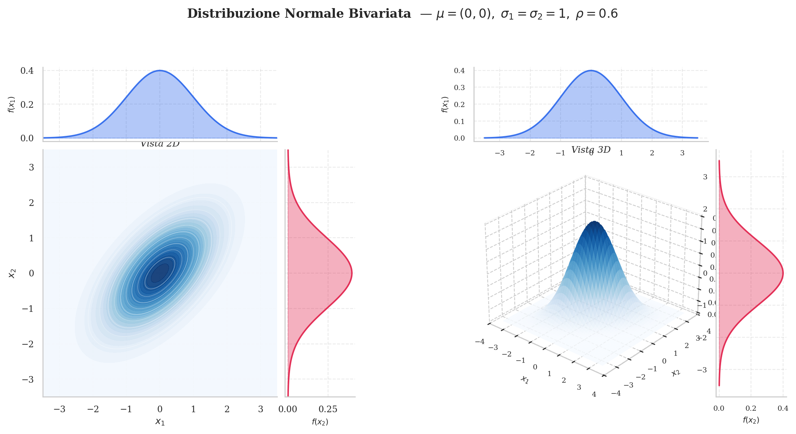{#fig-biv-normale}

### Lognormale Bivariata {#sec-biv-lognormale}

Se il vettore dei logaritmi $(\log x_1, \log x_2)^\top$ segue una Normale bivariata con parametri $(\boldsymbol{\mu}_{\log},
\boldsymbol{\Sigma}_{\log})$, allora $(x_1, x_2)$ ha distribuzione Lognormale bivariata con densità: $$
  f(x_1, x_2) = \frac{1}{2\pi\,\sigma_1\sigma_2\sqrt{1-\rho^2}\,x_1 x_2}
  \;\exp\!\left\{-\frac{1}{2(1-\rho^2)}\right.\\
  \left.\left[\frac{(\log x_1-\mu_1)^2}{\sigma_1^2}
        - \frac{2\rho(\log x_1-\mu_1)(\log x_2-\mu_2)}{\sigma_1\sigma_2}
        + \frac{(\log x_2-\mu_2)^2}{\sigma_2^2}
  \right]\right\},
$$ per $x_1, x_2 > 0$. Le marginali sono Lognormali univariate. La densità congiunta è asimmetrica a destra in entrambe le componenti e presenta un picco molto acuto vicino all'origine, con code che si estendono verso valori elevati. Nella figura si utilizza $\mu_1 = \mu_2 = 0$, $\sigma_1 = \sigma_2 = 1$ e $\rho_{\log} = 0.6$.

###  {#sec-1 .unnumbered}

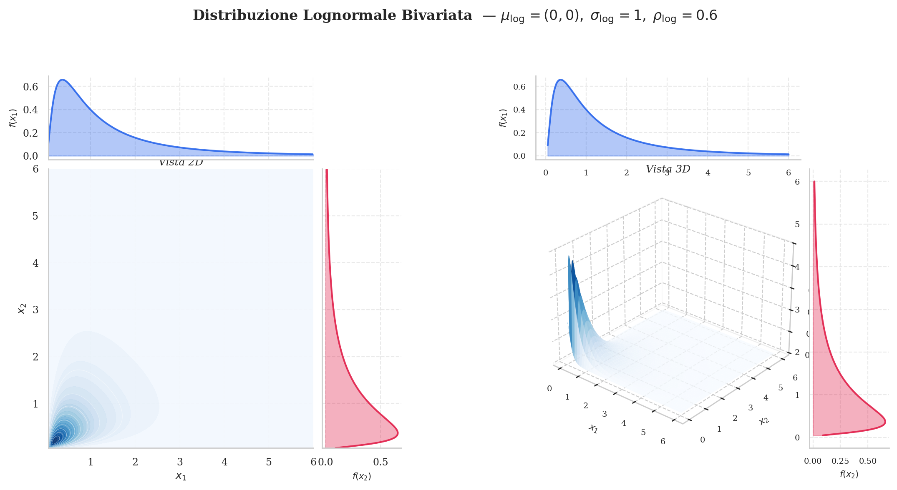{#fig-biv-lognormale}

### Uniforme Bivariata {#sec-biv-uniforme}

Il vettore $(x_1, x_2)$ ha distribuzione Uniforme bivariata sul rettangolo $[a,b]\times[c,d]$ se la sua densità congiunta è: $$f(x_1, x_2) = \frac{1}{(b-a)(d-c)},
  \qquad (x_1, x_2) \in [a,b]\times[c,d],$$ e zero altrove. Poiché la densità si fattorizza come il prodotto di due densità Uniformi univariate, $x_1$ e $x_2$ sono per costruzione indipendenti. Le marginali sono $x_1 \sim U(a,b)$ e $x_2 \sim U(c,d)$. Nella figura si utilizza $a=0$, $b=3$, $c=0$, $d=2$.

###  {#sec-2 .unnumbered}

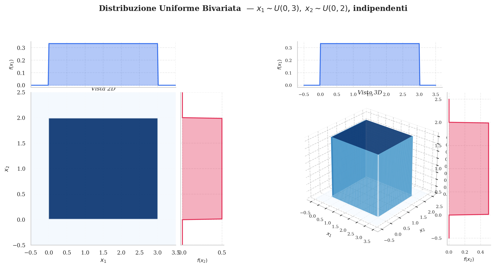{#fig-biv-uniforme}

### Esponenziale Bivariata {#sec-biv-esponenziale}

Nel caso di componenti indipendenti, il vettore $(x_1, x_2)$ ha densità congiunta: $$f(x_1, x_2) = \beta_1 e^{-\beta_1 x_1} \cdot \beta_2 e^{-\beta_2 x_2},
  \qquad x_1, x_2 \geq 0,$$ con $\beta_1, \beta_2 > 0$. La densità congiunta raggiunge il suo massimo nell'origine $(0,0)$ e decresce monotonicamente in entrambe le direzioni. Le marginali sono $x_1 \sim \mathrm{Exp}(\beta_1)$ e $x_2 \sim \mathrm{Exp}(\beta_2)$. Nella figura si utilizza $\beta_1 = 1$ e $\beta_2 = 1.5$.

###  {#sec-3 .unnumbered}

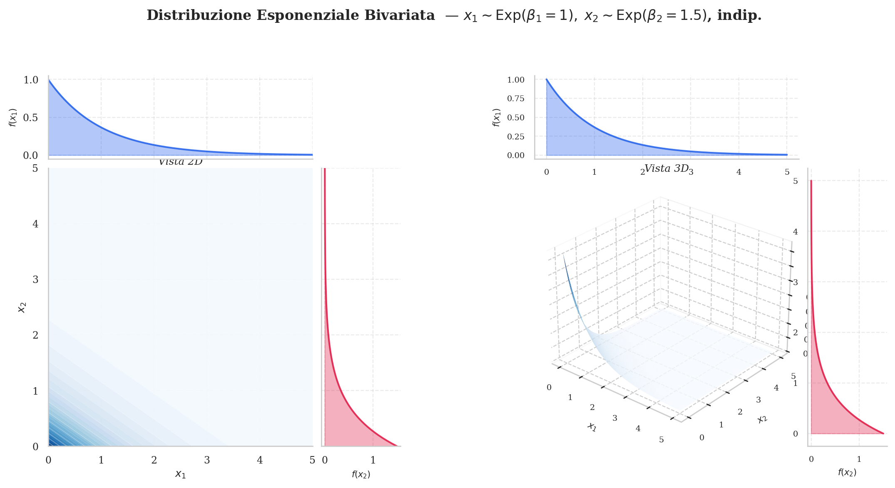{#fig-biv-esponenziale}

### Gamma Bivariata {#sec-biv-gamma}

Con componenti indipendenti la densità congiunta è: $$f(x_1, x_2) =
  \frac{\beta_1^{\alpha_1}}{\Gamma(\alpha_1)}\,x_1^{\alpha_1-1} e^{-\beta_1 x_1}
  \cdot
  \frac{\beta_2^{\alpha_2}}{\Gamma(\alpha_2)}\,x_2^{\alpha_2-1} e^{-\beta_2 x_2},
  \qquad x_1, x_2 \geq 0.$$ Per $\alpha_i > 1$ ciascuna marginale ha un massimo interno (la moda si trova in $(\alpha_i - 1)/\beta_i$), per cui la densità congiunta presenta un picco spostato dall'origine. Le marginali sono $x_1 \sim \Gamma(\alpha_1, \beta_1)$ e $x_2 \sim \Gamma(\alpha_2, \beta_2)$. Nella figura si utilizza $\alpha_1 = 2$, $\beta_1 = 1$ e $\alpha_2 = 3$, $\beta_2 = 1$.

###  {#sec-4 .unnumbered}

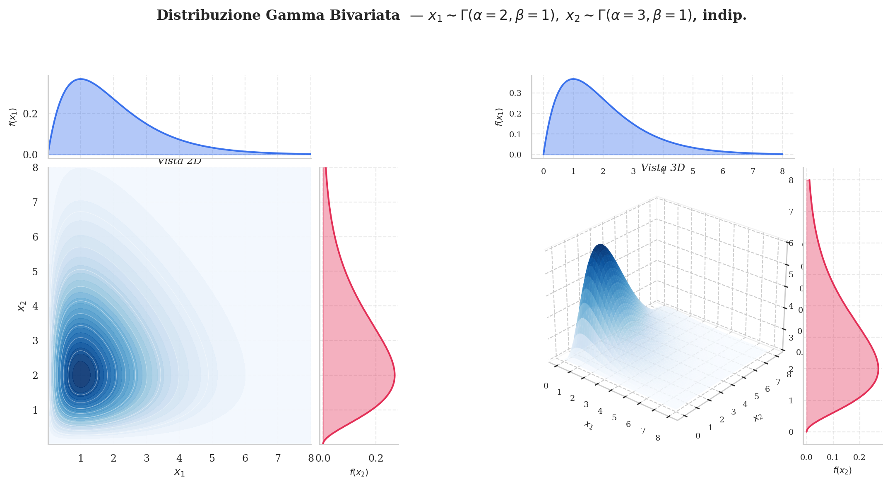{#fig-biv-gamma}

### Weibull Bivariata {#sec-biv-weibull}

Con componenti indipendenti la densità congiunta è: $$f(x_1, x_2) =
  \alpha_1 \beta_1^{\alpha_1} x_1^{\alpha_1-1} e^{-(\beta_1 x_1)^{\alpha_1}}
  \cdot
  \alpha_2 \beta_2^{\alpha_2} x_2^{\alpha_2-1} e^{-(\beta_2 x_2)^{\alpha_2}},
  \qquad x_1, x_2 \geq 0.$$ Il parametro di forma $\alpha_i$ determina il comportamento del tasso di guasto: per $\alpha_i > 1$ il tasso cresce nel tempo (usura), per $\alpha_i = 1$ torna alla distribuzione Esponenziale. Le marginali sono $x_1 \sim W(\alpha_1, \beta_1)$ e $x_2 \sim W(\alpha_2, \beta_2)$. Nella figura si utilizza $\alpha_1 = 2$, $\beta_1 = 1$ e $\alpha_2 = 3$, $\beta_2 = 1$.

###  {#sec-5 .unnumbered}

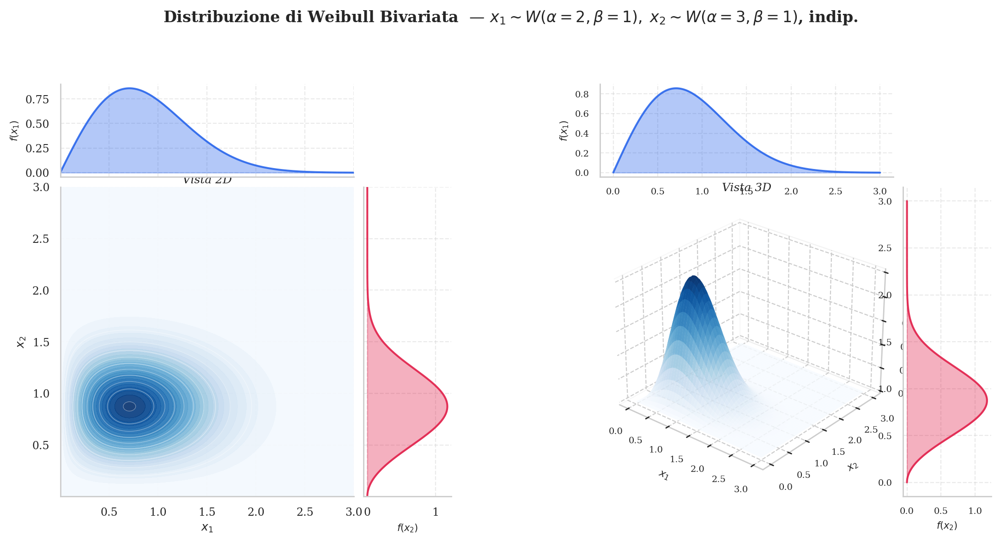{#fig-biv-weibull}

### Laplace Bivariata {#sec-biv-laplace}

Con componenti indipendenti la densità congiunta è: $$f(x_1, x_2) =
  \frac{\beta_1}{2}\,e^{-\beta_1|x_1-\alpha_1|}
  \cdot
  \frac{\beta_2}{2}\,e^{-\beta_2|x_2-\alpha_2|},
  \qquad x_1, x_2 \in \mathbb{R}.$$ Il prodotto di due densità di Laplace produce una densità congiunta con un picco a spigolo vivo nel punto $(\alpha_1, \alpha_2)$ e code esponenziali in tutte le direzioni. Le marginali sono $x_1 \sim L(\alpha_1, \beta_1)$ e $x_2 \sim L(\alpha_2, \beta_2)$. Nella figura si utilizza $\alpha_1 = \alpha_2 = 0$, $\beta_1 = 1$ e $\beta_2 = 0.7$.

###  {#sec-6 .unnumbered}

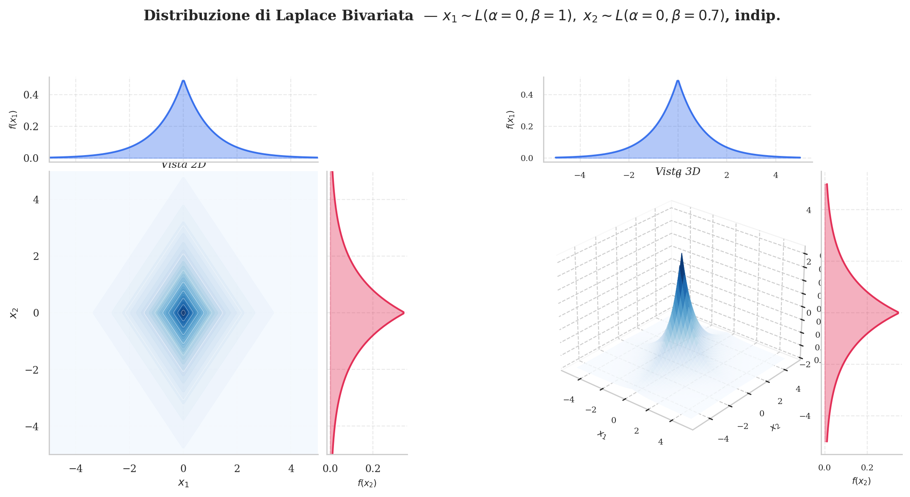{#fig-biv-laplace}

### Cauchy Bivariata {#sec-biv-cauchy}

Con componenti indipendenti la densità congiunta è: $$f(x_1, x_2) =
  \frac{1}{\pi\beta_1\!\left[1+\!\left(\frac{x_1-\alpha_1}{\beta_1}\right)^{\!2}\right]}
  \cdot
  \frac{1}{\pi\beta_2\!\left[1+\!\left(\frac{x_2-\alpha_2}{\beta_2}\right)^{\!2}\right]},
  \qquad x_1, x_2 \in \mathbb{R}.$$ La distribuzione di Cauchy ha code polinomiali (di ordine $-2$) molto più pesanti di quelle esponenziali della Laplace o della Normale. Di conseguenza la densità congiunta ha un picco acuto nel punto $(\alpha_1, \alpha_2)$ ma la massa probabilistica nelle code è non trascurabile anche per valori molto lontani dal centro. Media e varianza non esistono per nessuna delle due marginali. Nella figura si utilizza $\alpha_1 = \alpha_2 = 0$ e $\beta_1 = \beta_2 = 1$.

###  {#sec-7 .unnumbered}

{#fig-biv-cauchy}

## Covarianza

Siano $X$ e $Y$ due VA reali, ciascuna con varianza finita. La covarianza tra $X$ e $Y$ è data da: $$cov(X,Y)=\mathbb{E}[(X-\mathbb{E}[X])(Y-\mathbb{E}[Y])]=\mathbb{E}[XY]-\mathbb{E}[X]\mathbb{E}[Y]$$ Si noti che $\mathbb{E}[XY]$ esiste perchè $X$ e $Y$ hanno varianza finita (sono entrambe in $L^2$) e quindi $XY\in L^1$. Vale inoltre: $$cov(X,X)=\mathbb{V}[X]$$

::: mybox
Indipendenza e Covarianza Se $X$ e $Y$ sono indipendenti, allora: $$cov(X,Y)=0$$ poichè $\mathbb{E}[XY]=\mathbb{E}[X]\mathbb{E}[Y]$
:::

**N.B.**: se $cov(X,Y)=0$ non è detto che $X$ e $Y$ siano indipendenti.

### Matrice di Covarianza

Sia $\mathbf{X}=[X_1,...,X_n]$ un vettore aleatorio in $\mathbb{R}^n$. La matrice di covarianza di $\mathbf{X}$ è la matrice $n\times n$ il cui termine generale è $c_{i,j}=cov(X_i,X_j)$: $$C = 
\begin{bmatrix}
c_{1,1} & c_{1,2} & \dots & c_{1,n} \\
c_{2,1} & c_{2,2} & \dots & c_{2,n} \\
\vdots  & \vdots  & \ddots & \vdots  \\
c_{n,1} & c_{n,2} & \dots & c_{n,n}
\end{bmatrix}=
\begin{bmatrix}
Var(X_1) & cov(X_1, X_2) & \dots & cov(X_1, X_n) \\
cov(X_2, X_1) & Var(X_2) & \dots & cov(X_2, X_n) \\
\vdots & \vdots & \ddots & \vdots \\
cov(X_n, X_1) & cov(X_n, X_2) & \dots & Var(X_n)
\end{bmatrix}$$

::: mybox
Proprietà della matrice di covarianza

- Una matrice di covarianza $C$ è semidefinita positiva[^6], ovvero è simmetrica ($c_{ij}=c_{ji}$ e inoltre $\Sigma_{i,j}a_ia_jc_{ij}\geq0$ $\forall$$[a_1,...,a_n]\in\mathbb{R}^n$\

- Sia $\mathbf{X}$ un vettore aleatorio a valori in $\mathbb{R}^n$, con matrice di covarianza $C$. Sia $A$ una matrice $m\times n$ e poniamo $\mathbf{Y}=A\mathbf{X}$. Allora $\mathbf{Y}$ è un vettore aleatorio a valori in $\mathbb{R}^m$ e la sua matrice di covarianza è: $$G=ACA^T$$
:::

Le proprietà elencate nel riquadro descrivono il comportamento fondamentale della matrice di covarianza $C$ (spesso indicata anche con $\Sigma$) di un vettore aleatorio. Analizziamo i due punti nel dettaglio.

### 1. Simmetria e Semidefinitezza Positiva {#sec-simmetria-e-semidefinitezza-positiva .unnumbered}

**Simmetria ($c_{ij} = c_{ji}$):**\
La matrice è simmetrica rispetto alla diagonale principale. Questo è un fatto banale che deriva dalla definizione stessa di covarianza: la covarianza tra la variabile $X_i$ e la variabile $X_j$ è identica alla covarianza tra $X_j$ e $X_i$. Ovvero, $Cov(X_i, X_j) = Cov(X_j, X_i)$.

**Semidefinitezza Positiva ($\mathbf{a}^TC\mathbf{a} \geq 0$):**\
Dal punto di vista dell'algebra lineare, hai giustamente ricordato che una matrice è semidefinita positiva se la sua forma quadratica associata non è mai negativa. Ma *perché* la matrice di covarianza deve avere per forza questa proprietà?

Il motivo è squisitamente statistico. Prendiamo il nostro vettore di numeri reali $\mathbf{a} = [a_1, \dots, a_n]^T$ e usiamolo per creare una nuova singola variabile aleatoria $Z$, definita come combinazione lineare delle componenti di $\mathbf{X}$: $$Z = a_1X_1 + a_2X_2 + \dots + a_nX_n = \mathbf{a}^T\mathbf{X}$$ Per le leggi della probabilità, la **varianza** di qualsiasi variabile aleatoria (inclusa $Z$) non può mai essere negativa: $$Var(Z) \geq 0$$ Se andiamo a calcolare esplicitamente la varianza di questa combinazione lineare utilizzando le proprietà della varianza e della covarianza, scopriamo che: $$Var(Z) = Var(\mathbf{a}^T\mathbf{X}) = \sum_{i=1}^{n} \sum_{j=1}^{n} a_i a_j c_{ij} = \mathbf{a}^TC\mathbf{a}$$ Poiché la varianza deve essere $\geq 0$, ne consegue necessariamente che $\mathbf{a}^TC\mathbf{a} \geq 0$. Quindi, dire che la matrice di covarianza è semidefinita positiva equivale semplicemente a dire che **"non esistono combinazioni lineari di variabili aleatorie che abbiano varianza negativa"**.

### 2. Trasformazione Lineare ($\mathbf{Y} = A\mathbf{X}$) {#sec-trasformazione-lineare-mathbfy-amathbfx .unnumbered}

Il secondo punto del teorema ci dice come si \"aggiorna\" la matrice di covarianza se moltiplichiamo il nostro vettore aleatorio per una matrice di costanti $A$.

Per comprendere questa formula ($G = ACA^T$), è utilissimo fare un parallelo con il caso unidimensionale (scalare). Se abbiamo una singola variabile aleatoria $X$ con varianza $\sigma^2_X$, e definiamo una nuova variabile $Y = aX$ (dove $a$ è un numero), sappiamo che la varianza scala con il quadrato della costante: $$Var(Y) = a^2 Var(X) = a \cdot Var(X) \cdot a$$

Nel caso multidimensionale, $X$ diventa un vettore $\mathbf{X}$, la costante $a$ diventa una matrice $A$, e la varianza diventa la matrice di covarianza $C$. La regola di calcolo è la diretta generalizzazione del caso scalare: $$Cov(\mathbf{Y}) = A \cdot Cov(\mathbf{X}) \cdot A^T$$ Si usa $A^T$ (la trasposta di $A$) a destra invece di $A$ per far tornare le dimensioni del prodotto tra matrici.

**Dimostrazione:**\
Se indichiamo con $\mu_X$ il vettore delle medie di $\mathbf{X}$, la media di $\mathbf{Y}$ sarà $\mu_Y = A\mu_X$. Applicando la definizione di matrice di covarianza come valore atteso $\mathbb{E}[\cdot]$: $$\begin{align*}
G &= \mathbb{E}[(\mathbf{Y} - \mu_Y)(\mathbf{Y} - \mu_Y)^T] \\
  &= \mathbb{E}[(A\mathbf{X} - A\mu_X)(A\mathbf{X} - A\mu_X)^T] \\
  &= \mathbb{E}[A(\mathbf{X} - \mu_X)(\mathbf{X} - \mu_X)^T A^T]
\end{align*}$$ Poiché $A$ e $A^T$ sono matrici di costanti, possono essere portate fuori dall'operatore di valore atteso: $$\begin{align*}
G &= A \cdot \mathbb{E}[(\mathbf{X} - \mu_X)(\mathbf{X} - \mu_X)^T] \cdot A^T \\
  &= A \cdot C \cdot A^T
\end{align*}$$

## Correlazione

Siano $X$ e $Y$ due VA reali con varianza finita e strettamente positiva ($\mathbb{V}[X] > 0$ e $\mathbb{V}[Y] > 0$). Il coefficiente di correlazione (o correlazione lineare di Pearson) tra $X$ e $Y$ è definito come il rapporto tra la loro covarianza e il prodotto delle loro deviazioni standard: $$\rho_{X,Y} = \frac{cov(X,Y)}{\sigma_X \sigma_Y} = \frac{cov(X,Y)}{\sqrt{\mathbb{V}[X]\mathbb{V}[Y]}}$$ Il coefficiente di correlazione è una misura adimensionale (priva di unità di misura) che quantifica il grado di dipendenza *lineare* tra due variabili.

::: mybox
Proprietà del Coefficiente di Correlazione

- **Limitatezza:** Per la disuguaglianza di Cauchy-Schwarz, il coefficiente è sempre compreso tra $-1$ e $1$: $$-1 \leq \rho_{X,Y} \leq 1$$

- **Correlazione perfetta:** $\rho_{X,Y} = 1$ (o $-1$) se e solo se esiste una relazione lineare perfetta tra $X$ e $Y$, ovvero $Y = aX + b$ con $a > 0$ (o $a < 0$).

- Se $X$ e $Y$ sono indipendenti, allora $\rho_{X,Y} = 0$ (poiché $cov(X,Y)=0$). In questo caso le variabili si dicono **scorrelate**.
:::

**N.B.**: Come per la covarianza, se $\rho_{X,Y} = 0$ (variabili scorrelate) non è detto che $X$ e $Y$ siano indipendenti. L'assenza di correlazione implica solo l'assenza di un legame *lineare*, ma potrebbe esistere un forte legame di tipo non lineare (ad esempio $Y = X^2$).

### Matrice di Correlazione

Sia $\mathbf{X}=[X_1,...,X_n]$ un vettore aleatorio in $\mathbb{R}^n$ dove ogni componente ha varianza finita non nulla. La matrice di correlazione di $\mathbf{X}$ è la matrice quadrata $n \times n$ il cui termine generale è $\rho_{i,j} = \rho_{X_i, X_j}$: $$R = 
\begin{bmatrix}
\rho_{1,1} & \rho_{1,2} & \dots & \rho_{1,n} \\
\rho_{2,1} & \rho_{2,2} & \dots & \rho_{2,n} \\
\vdots  & \vdots  & \ddots & \vdots  \\
\rho_{n,1} & \rho_{n,2} & \dots & \rho_{n,n}
\end{bmatrix}=
\begin{bmatrix}
1 & \rho_{X_1, X_2} & \dots & \rho_{X_1, X_n} \\
\rho_{X_2, X_1} & 1 & \dots & \rho_{X_2, X_n} \\
\vdots & \vdots & \ddots & \vdots \\
\rho_{X_n, X_1} & \rho_{X_n, X_2} & \dots & 1
\end{bmatrix}$$ Poiché la correlazione di una variabile con se stessa è esattamente 1 ($\rho_{X_i, X_i} = \frac{cov(X_i,X_i)}{Var(X_i)} = 1$), la matrice di correlazione ha sempre tutti $1$ sulla diagonale principale. Inoltre, così come la matrice di covarianza, anche la matrice di correlazione è **simmetrica** (poiché $\rho_{X_i, X_j} = \rho_{X_j, X_i}$) e semidefinita positiva.

## Distribuzione di una trasformazione di un Vettore Aleatorio

Questa è la generalizzazione di quanto visto nel capitolo precedente.\
Ora focalizziamoci sulle trasformazioni di vettori aleatori a valori in $\mathbb{R}^n$. Sia $g:\mathbb{R}^n\rightarrow\mathbb{R}^n$ una funzione Borel-misurabile. Dato $\mathbf{X}=[X_1,...,X_n]$ con densità $f$, qual'è la densità di $\mathbf{Y}=g(\mathbf{X})$?\
Ricordiamo che se $g$ è una funzione differenziabile da un insieme aperto $G$ in $\mathbb{R}^n$ a $\mathbb{R}^n$, la sua matrice jacobiana $J_{g}(x)$ nel punto $x\in G$ è: $$J_g(x)=\frac{\partial g}{\partial x}(x)$$ Ovvero il termine $ij$-esimo è $J_g(x)_{ij}=\frac{\partial g_i}{\partial x_j}$, dove $g=[g_1,...,g_n]$. Lo jacobiano di $g$ nel punto $x$ è il determinante della matrice jacobiana $\det(J_g(x))$. Se lo Jacobiano $\neq$<!-- -->0 allora $g$ è invertibile in un intorno di $x$ e lo jacobiano dell'inversa $\det(J_{g^{-1}}(x))$ nel punto $y=g(x)$ è l'inverso dello jacobiano di $g$ in $x$.

::: mybox
Formula di Trasformazione di Jacobi Sia $G$ un insieme aperto in $\mathbb{R}^n$ e sia $g:G\rightarrow\mathbb{R}^n$ continuamente differenziabile. Supponiamo che $g$ sia iniettiva (one-to-one) su $G$ e che il suo Jacobiano non si annulli mai. Allora per $f$ misurabile e tale che il prodotto $f\mathbb{1}_{g(G)}$ sia positivo e integrabile rispetto alla misura di Lebesgue: $$\int_{g(G)}f(y)d\mathbf{y}=\int_Gf(g(x))|\det(J_g(x))|dx$$ dove $g(G)=\{y\in\mathbb{R}^n:\exists x \in G \space t.c.\space g(x)=y\}$
:::

Questo teorema è una componente fondamentale dell'analisi vettoriale e della probabilità continua. Ecco perché funziona e cosa significa:

- **Il significato di $d\mathbf{y}$ e $d\mathbf{x}$:** Negli integrali multipli, $d\mathbf{x} = dx_1 dx_2 \dots dx_n$ rappresenta un volume infinitesimale nello spazio di partenza, mentre $d\mathbf{y}$ è un volume infinitesimale nello spazio di arrivo.

- **Il ruolo del determinante Jacobiano:** Quando applichiamo la funzione $g$, deformiamo lo spazio. Un cubetto infinitesimale di volume $d\mathbf{x}$ nello spazio $X$ viene trasformato in un parallelepipedo nello spazio $Y$. Il volume di questo nuovo solido non è uguale a quello di partenza, ma è scalato esattamente di un fattore pari al valore assoluto del determinante Jacobiano: $$d\mathbf{y} = |\det(J_g(\mathbf{x}))| \, d\mathbf{x}$$

- **Il valore assoluto:** Il determinante della matrice Jacobiana può essere negativo (il che indica un cambio di \"orientamento\" degli assi, come una riflessione a specchio). Poiché i volumi e le probabilità non possono mai essere negativi, prendiamo sempre il valore assoluto $|\det(J_g(\mathbf{x}))|$.

::: mybox
Teorema del Cambio di Variabile Multidimensionale Sia $\mathbf{X}=[X_1,...,X_n]$ un vettore aleatorio con densità congiunta $f_{\mathbf{X}}$. Sia $g:\mathbb{R}^n\rightarrow\mathbb{R}^n$ continuamente differenziabile e iniettiva, con jacobiano mai nullo. Allora $\mathbf{Y}=g(\mathbf{X})$ ha densità: $$f_Y(\mathbf{y}) = 
\begin{cases} 
f_X(g^{-1}(\mathbf{y})) \cdot \left| \det(J_{g^{-1}}(\mathbf{y})) \right| & \text{se } \mathbf{y} \in g(G) \\
0 & \text{altrimenti}
\end{cases}$$
:::

Il testo poneva la domanda: *Dato $\mathbf{X}$ con densità $f_X$, qual è la densità di $\mathbf{Y} = g(\mathbf{X})$?*

Grazie alla formula di Jacobi appena vista, possiamo ricavare direttamente la densità del nuovo vettore aleatorio $\mathbf{Y}$. Affinché la probabilità si conservi ($P(\mathbf{X} \in G) = P(\mathbf{Y} \in g(G))$), la densità $f_Y$ nel punto $\mathbf{y}$ deve compensare la deformazione del volume.

La formula per la densità di $\mathbf{Y}$ diventa quindi: $$f_Y(\mathbf{y}) = 
\begin{cases} 
f_X(g^{-1}(\mathbf{y})) \cdot \left| \det(J_{g^{-1}}(\mathbf{y})) \right| & \text{se } \mathbf{y} \in g(G) \\
0 & \text{altrimenti}
\end{cases}$$ Oppure, equivalentemente, usando lo Jacobiano della funzione diretta valutato in $\mathbf{x} = g^{-1}(\mathbf{y})$: $$f_Y(\mathbf{y}) = f_X(\mathbf{x}) \cdot \frac{1}{\left| \det(J_g(\mathbf{x})) \right|}$$ Questa divisione per il determinante esprime esattamente il fatto che se la trasformazione $g$ \"dilata\" lo spazio (determinante grande), la probabilità si \"spalma\" su un'area maggiore, e quindi la *densità* in quel punto deve diminuire.\
Possiamo trattare anche il caso in cui $g$ non è iniettiva ma comunque regolare.

::: mybox
Teorema del Cambio di Variabile Multidimensionale (funzioni non intiettive) Sia $\mathcal{S}\in\mathcal{B}^n$ partizionato in sottoinsiemi disgiunti $S_1,...,S_m$ tali che $\bigcup_{i=0}^mS_i=\mathcal{S}$ e tali che $m_n(S_0)=0$ e che per ogni $i=1,...,m$, la funzione $g:S_i\rightarrow\mathbb{R}^n$ sia iniettiva e continuamente differenziabile con jacobiano mai nullo. Sia $\mathbf{Y}=g(\mathbf{X})$, dove $\mathbf{X}=[X_1,...,X_n]$ è un vettore aleatorio a valori in $\mathbb{R}^n$ con valori in $\mathcal{S}$ e densità $f_{\mathbf{X}}$. Allora $\mathbf{Y}$ ha una densità data da: $$f_{\mathbf{Y}}=\sum_{i=1}^mf_{\mathbf{X}}(g_i^{-1}(y))|\det J_{g_i^{-1}}(y)|$$ dove $g_i^{-1}:g(S_i)\rightarrow S_i$ denota la mappa inversa e $J_{g_i^{-1}}$ è la corrispondente matrice jacobiana.
:::

Riassumendo, se abbiamo un vettore aleatorio $\mathbf{X}$ a cui applichiamo una trasformazione $g$, ottenendo una nuovo vettore aleatorio $\mathbf{}Y=g(\mathbf{X})$, per trovare la PDF $f_{\mathbf{Y}}$:

1.  Sostituzione $f_{\mathbf{X}}(g^{-1}(y))$: prendiamo la \"vecchia\" densità $f_{\mathbf{X}}(x)$ sostituendo $x$ con la trasformazione inversa $g^{-1}(y)$. Se vuoi conoscere la massa di probabilità intorno a $Y=5$, devi andare a guardare quanta ce n'era intorno al valore di $X$ prima che gli venisse applicata la trasformazione che ha generato quel 5.

2.  Correzione $|\det(J_{g^{-1}}(y))|$: moltiplica per il valore assoluto dello jacobiano dell'inversa. Questo è il fattore di scala che assicura che la deformazione dello spazio non crei o distrugga probabilità.

Se la trasformazione non è iniettiva, il corollario ci dice che ci basta partizionare il dominio della trasformazione, applicare la formula del cambio di variabile a livello locale (dove la funzione è iniettiva) e poi sommare i contributi.

## Esempi di Trasformazione di Vettori Aleatori {#sec-esempi-di-trasformazione-di-vettori-aleatori .unnumbered}

### Esempio 1: Somma e Differenza di Normali Indipendenti {#sec-esempio-1-somma-e-differenza-di-normali-indipendenti .unnumbered}

**Problema:** Siano $X$ e $Y$ due variabili aleatorie normali standard indipendenti, ovvero ciascuna con media $\mu = 0$ e varianza $\sigma^2 = 1$. Vogliamo calcolare la densità di probabilità congiunta del nuovo vettore $(U, V) = (X+Y, X-Y)$.

**Passo 1: La densità congiunta di partenza**\
Poiché $X$ e $Y$ sono normali standard indipendenti, la loro densità congiunta è semplicemente il prodotto delle densità marginali: $$f_{X,Y}(x,y) = f_X(x)f_Y(y) = \left( \frac{1}{\sqrt{2\pi}} e^{-\frac{x^2}{2}} \right) \left( \frac{1}{\sqrt{2\pi}} e^{-\frac{y^2}{2}} \right) = \frac{1}{2\pi} e^{-\frac{x^2+y^2}{2}}$$

**Passo 2: La trasformazione e la sua inversa**\
La funzione di trasformazione è $g(x,y) = (x+y, x-y) = (u,v)$. Per applicare il Teorema di Jacobi, ci serve la trasformazione inversa $g^{-1}(u,v)$, ovvero dobbiamo esprimere $x$ e $y$ in funzione di $u$ e $v$. Risolvendo il sistema:

::: cases
u = x+y\
v = x-y
:::

::: cases
x =\
y =
:::

**Passo 3: Calcolo dello Jacobiano**\
Calcoliamo ora la matrice Jacobiana della trasformazione inversa e il suo determinante: $$J_{g^{-1}}(u,v) = 
\begin{bmatrix}
\frac{\partial x}{\partial u} & \frac{\partial x}{\partial v} \\
\frac{\partial y}{\partial u} & \frac{\partial y}{\partial v}
\end{bmatrix}
=
\begin{bmatrix}
\frac{1}{2} & \frac{1}{2} \\
\frac{1}{2} & -\frac{1}{2}
\end{bmatrix}$$ Il determinante Jacobiano è: $$\det(J) = \left(\frac{1}{2}\right)\left(-\frac{1}{2}\right) - \left(\frac{1}{2}\right)\left(\frac{1}{2}\right) = -\frac{1}{4} - \frac{1}{4} = -\frac{1}{2}$$ Il valore assoluto del determinante, che compensa la deformazione dell'area, è quindi $|J| = \frac{1}{2}$. (Nota: essendo costante, la trasformazione è lineare e deforma lo spazio uniformemente).

**Passo 4: Calcolo della nuova densità**\
Applicando la formula di trasformazione: $$f_{U,V}(u,v) = f_{X,Y}\left(\frac{u+v}{2}, \frac{u-v}{2}\right) \cdot |\det(J)|$$ Sostituiamo le espressioni di $x$ e $y$ nell'esponente della normale: $$x^2 + y^2 = \left(\frac{u+v}{2}\right)^2 + \left(\frac{u-v}{2}\right)^2 = \frac{u^2 + 2uv + v^2 + u^2 - 2uv + v^2}{4} = \frac{2u^2 + 2v^2}{4} = \frac{u^2+v^2}{2}$$ Dunque, la densità congiunta di $U$ e $V$ diventa: $$f_{U,V}(u,v) = \frac{1}{2\pi} e^{-\frac{1}{2}\left(\frac{u^2+v^2}{2}\right)} \cdot \frac{1}{2} = \frac{1}{4\pi} e^{-\frac{u^2+v^2}{4}}$$

**Passo 5: Conclusione sulla fattorizzazione**\
Notiamo che la funzione appena trovata può essere separata in due blocchi (fattorizzata): $$f_{U,V}(u,v) = \left( \frac{1}{\sqrt{4\pi}} e^{-\frac{u^2}{4}} \right) \left( \frac{1}{\sqrt{4\pi}} e^{-\frac{v^2}{4}} \right)$$ Ciascun fattore ha esattamente la forma di una distribuzione Normale con media $0$ e varianza $2$ ($\sigma^2=2 \implies \sqrt{2\pi\sigma^2} = \sqrt{4\pi}$). Poiché la densità congiunta è il prodotto di due densità marginali, possiamo concludere non solo che $U \sim \mathcal{N}(0,2)$ e $V \sim \mathcal{N}(0,2)$, ma soprattutto che **$U$ e $V$ sono indipendenti**.

### Esempio 2: Il Rapporto tra Due Normali (Distribuzione di Cauchy) {#sec-esempio-2-il-rapporto-tra-due-normali-distribuzione-di-cauchy .unnumbered}

**Problema:** Siano $X$ e $Y$ due variabili aleatorie normali indipendenti, ciascuna con media $\mu=0$ e varianza $\sigma^2$. Il testo propone una trasformazione che mappa $(X,Y)$ in $(Z,W)$, dove $Z$ è la componente radiale $Z = \sqrt{X^2+Y^2}$ e $W$ è il rapporto $W = Y/X$. Vogliamo studiare il comportamento di $W$.

**L'intuizione:**\
Attraverso un cambio di variabili (passando di fatto per le coordinate polari), il calcolo formale dello Jacobiano porta alla seguente densità congiunta per il vettore $(Z,W)$: $$f_{Z,W}(z,w) = \frac{1}{\pi\sigma^2} \frac{1}{1+w^2} z e^{-\frac{z^2}{2\sigma^2}} \mathbf{1}_{(z>0)}$$

**Analisi della densità congiunta:**\
Osserviamo attentamente la struttura di questa formula. La funzione $f_{Z,W}(z,w)$ può essere separata nel prodotto di una funzione che dipende solo da $z$ e una che dipende solo da $w$: $$f_{Z,W}(z,w) = \left[ \frac{z}{\sigma^2} e^{-\frac{z^2}{2\sigma^2}} \mathbf{1}_{(z>0)} \right] \cdot \left[ \frac{1}{\pi(1+w^2)} \right]$$

Il fatto che la densità congiunta si fattorizzi (e che il dominio sia un rettangolo cartesiano, $z>0$ e $w \in \mathbb{R}$) ci porta immediatamente a due importantissime deduzioni:

1.  **Indipendenza:** Le variabili $Z$ (la distanza dall'origine) e $W$ (il rapporto, che geometricamente rappresenta la pendenza $Y/X$) sono *completamente indipendenti*.

2.  **Le densità marginali:** Possiamo \"leggere\" le densità marginali direttamente dai due fattori, dato che entrambi sono già normalizzati (cioè integrano a 1).

**Conclusione sui risultati:** Dalla scomposizione otteniamo: $$f_Z(z) = \frac{z}{\sigma^2} e^{-\frac{z^2}{2\sigma^2}} \quad \text{per } z>0$$ Questa è la ben nota *Distribuzione di Rayleigh*, che descrive tipicamente la lunghezza di un vettore bidimensionale le cui coordinate sono normali indipendenti.

E, soprattutto, per il rapporto $W$: $$f_W(w) = \frac{1}{\pi(1+w^2)} \quad \text{per } -\infty < w < +\infty$$ Riconosciamo in questa formula la funzione di densità della **Distribuzione di Cauchy** standard (con parametri di locazione $\alpha=0$ e di scala $\beta=1$).

::: mybox
Risultato Fondamentale Questo esempio fornisce una dimostrazione elegante di un classico teorema della probabilità: **Il rapporto tra due variabili aleatorie Normali standard e indipendenti si distribuisce sempre come una variabile di Cauchy.** Questa distribuzione ha la particolarità (spesso definita \"patologica\") di avere code talmente pesanti da non possedere né varianza né valore atteso finito.
:::

# Funzioni Caratteristiche

Capita spesso di poter risolvere problemi e/o ricavare proprietà di oggetti matematici trasformandoli in un altro spazio, risolvendo il problema in quella sede, per poi antitrasformare. Le due trasformate più importanti sono quelle di Laplace e di Fourier, usate sia per le equazioni differenziali che per la probabilità.\
Scriviamo $\langle\mathbf{X},\mathbf{Y}\rangle$ per indicare il prodotto scalare tra i vettori $\mathbf{X}$ e $\mathbf{Y}$ $\in\mathbb{R}^n$.\
Se $\mathbf{X}=[X_1,...,X_n]$ e $\mathbf{Y}=[Y_1,...,Y_n]$ allora: $$\langle\mathbf{X},\mathbf{Y}\rangle=\sum_{j=1}^n X_j Y_j$$ La trasformata di Laplace di una distribuzione è la Moment Generating Function (MGF) di quella distribuzione. Una volta trasformata la funzione nel nuovo spazio, basta calcolare le sue derivate per calcolare i momenti, senza dover risolvere integrali complessi.\
La trasformata di Fourier di una distribuzione è la Funzione Caratteristica di quella distribuzione. A differenza di Laplace, Fourier esiste sempre, poiché usando numeri complessi, ruota lo spazio invece di espanderlo. Vedremo che la trasformata di Fourier e le funzioni caratteristiche ci serviranno per dimostrare il Teorema del Limite Centrale.\
L'idea centrale della trasformata di Fourier è quella di mappare una distribuzione reale in una funzione a valori complessi. Per farlo si usa la formula di Eulero: $$e^{ix}=\cos(x)+i\sin(x)$$ Anche se stiamo integrando una funzione a valori complessi, possiamo farlo tranquillamente spezzando l'integrale in parte reale (coseno) e immaginaria (seno). Poiché il modulo di questo numero complesso è sempre $1$, questi integrali non esplodono: esistono e sono finiti. $$|e^{ix}| = \sqrt{\cos^2(x) + \sin^2(x)} = 1$$

## Trasformata di Fourier

Sia $\mu$ una misura di probabilità in $\mathbb{R}^n$. La sua trasformata di Fourier $\hat{\mu}$ è una funzione in $\mathbb{R}^n$ data da: $$\hat{\mu}(u)=\int e^{i\langle u,\mathbf{x}\rangle}\mu (d\mathbf{x})$$ Dove $i=\sqrt{-1}$. Integriamo la funzione a valori complessi $\mathbf{x}\rightarrow e^{i\langle u, \mathbf{x}\rangle}$. Conoscendo l'identità trigonometrica (Eulero): $$e^{i\langle u,\mathbf{x}\rangle}=\cos(\langle u,\mathbf{x}\rangle)+i\sin(\langle u,\mathbf{x}\rangle)$$ ora entrambe le funzioni $\mathbf{x}\rightarrow \cos(\langle u, \mathbf{x}\rangle)$ e $\mathbf{x}\rightarrow \sin(\langle u, \mathbf{x}\rangle)$ sono limitate e Borel-misurabili (seno e coseno sono continue e sempre limitate), quindi integrabili e: $$\hat{\mu}(u)=\int e^{i\langle u,\mathbf{x}\rangle}\mu (d\mathbf{x})=\int \cos(\langle u,\mathbf{x}\rangle)\mu(d\mathbf{x})+i\int \sin(\langle u,\mathbf{x}\rangle)\mu(d\mathbf{x})$$

## Funzione Caratteristica

Sia $\mathbf{X}=[X_1,...,X_n]$ un vettore aleatorio a valori in $\mathbb{R}^n$, valutato in un vettore di parametri $u=[u_1,...,u_n]$. La sua funzione caratteristica $\phi_{\mathbf{X}}$, definita su $\mathbb{R}^n$ è: $$\phi_{\mathbf{X}}(u)=\mathbb{E}[e^{i\langle u,\mathbf{X} \rangle}]=\mathbb{E}[e^{i(u_1X_1+...+u_nX_n)}]$$ Notiamo che: $$\phi_{\mathbf{X}}(u) = \mathbb{E}[e^{i\langle u,\mathbf{X} \rangle}] = \int e^{i\langle u,\mathbf{x} \rangle} P_{\mathbf{X}}(d\mathbf{x}) = \hat{P}_{\mathbf{X}}(u)$$ Dove $P_{\mathbf{X}}$ è la distribuzione di $\mathbf{X}$. Pertanto le funzioni caratteristiche esistono sempre, poiché sono uguali alle trasformate di Fourier della misura di probabilità, che esistono sempre.

::: mybox
Proprietà delle funzioni caratteristiche Sia $\mu$ una misura di probabilità su $\mathbb{R}^n$.

- Allora $\hat{\mu}$ è una funzione limitata e continua con $\hat{\mu}(0)=1$. Questo significa che la curva della funzione caratteristica passa sempre per il punto $(0,1)$. $$\hat{\mu}(0) = \int e^{i\langle 0,\mathbf{x} \rangle}\mu(d\mathbf{x}) = \int 1 \, \mu(d\mathbf{x}) = 1$$

- Le funzioni caratteristiche sono sempre limitate dal cerchio unitario: $$|\hat{\mu}(u)| \leq 1$$ Questa è una diretta conseguenza della disuguaglianza triangolare per gli integrali $\left( \left| \int \dots \right| \leq \int | \dots | \right)$.

- La funzione caratteristica è una funzione continua: se varia leggermente il parametro $u$, il valore di $\hat{\mu}(u)$ cambierà solo di poco.
:::

Le proprietà appena elencate ci permettono di introdurre i due teoremi cardine che giustificano l'enorme utilità delle funzioni caratteristiche in probabilità. Il primo garantisce che non perdiamo informazioni passando nello spazio trasformato, il secondo è lo strumento principale per studiare la convergenza delle variabili aleatorie.

### Teorema di Unicità (o Inversione) {#sec-teorema-di-unicit-o-inversione .unnumbered}

La funzione caratteristica identifica in modo univoco una distribuzione di probabilità. Questo significa che se due vettori aleatori $\mathbf{X}$ e $\mathbf{Y}$ (o due misure di probabilità $\mu_1$ e $\mu_2$) hanno la stessa funzione caratteristica per ogni punto, allora hanno esattamente la stessa distribuzione. In simboli: $$\phi_{\mathbf{X}}(u) = \phi_{\mathbf{Y}}(u) \quad \forall u \in \mathbb{R}^n \iff P_{\mathbf{X}} = P_{\mathbf{Y}}$$ **Cosa ne deriva:** Questo risultato è un potente strumento di calcolo. Se, compiendo delle operazioni su una variabile incognita, calcoliamo la sua funzione caratteristica e scopriamo che coincide con quella di una distribuzione nota (ad esempio, una Gaussiana), possiamo concludere con assoluta certezza che la nostra variabile segue quella distribuzione nota.

### Teorema di Continuità di Lévy {#sec-teorema-di-continuit-di-l-vy .unnumbered}

Questo teorema stabilisce un'equivalenza perfetta tra la convergenza delle variabili aleatorie (in distribuzione) e la convergenza puntuale delle loro funzioni caratteristiche nello spazio trasformato.

Sia $\{\mathbf{X}_n\}_{n \in \mathbb{N}}$ una successione di vettori aleatori con le rispettive funzioni caratteristiche $\phi_{\mathbf{X}_n}(u)$. Se per ogni $u \in \mathbb{R}^n$ il limite: $$\lim_{n \to \infty} \phi_{\mathbf{X}_n}(u) = \phi(u)$$ esiste, e se la funzione limite $\phi(u)$ è continua in $u=0$, allora vale che:

1.  La funzione limite $\phi(u)$ è la funzione caratteristica di un qualche vettore aleatorio $\mathbf{X}$.

2.  La successione $\mathbf{X}_n$ converge in distribuzione a $\mathbf{X}$ (scritto comunemente come $\mathbf{X}_n \xrightarrow{d} \mathbf{X}$).

**Cosa ne deriva (Il Teorema del Limite Centrale):** Dimostrare la convergenza in distribuzione usando direttamente le definizioni (ovvero calcolando il limite degli integrali o delle Funzioni di Ripartizione) è spesso matematicamente intrattabile. Grazie al Teorema di Lévy, il problema si semplifica drasticamente: è sufficiente calcolare il limite algebrico delle funzioni caratteristiche $\phi_{\mathbf{X}_n}(u)$ e verificare che il risultato coincida con la funzione caratteristica della distribuzione Normale.

::: mybox
Generazione dei momenti Sia $\mathbf{X}$ un vettore aleatorio in $\mathbb{R}^n$ e supponiamo che $\mathbb{E}[|\mathbf{X}|^m]<\infty$ per un qualche intero $m$. Allora $\phi_{\mathbf{X}}$ ha derivate parziali fino all'ordine $m$ e: $$\frac{\partial^m\phi_{\mathbf{X}}}{\partial x_{j1},...,x_{jm}}=i^m\mathbb{E}[X_{j1},...,X_{jm}]$$
:::

Questa proprietà è estremamente potente dal punto di vista computazionale. Ci dice che per trovare i momenti di una variabile aleatoria (che sono alla base del calcolo di media, varianza e covarianza) non dobbiamo calcolare complessi integrali del tipo $\int x^m \mu(dx)$, ma ci basta semplicemente derivare la funzione caratteristica e valutarla nell'origine ($u=0$).

Nel caso unidimensionale (una singola variabile aleatoria $X \in \mathbb{R}$), le formule si semplificano in modo molto intuitivo:

- **Momento primo (Media):** Derivando una volta ($m=1$) e ponendo $u=0$, otteniamo $\phi_X'(0) = i\mathbb{E}[X]$. Ricordando che $1/i = -i$, ricaviamo direttamente il valore atteso: $$\mathbb{E}[X] = -i\phi_X'(0)$$

- **Momento secondo:** Derivando due volte ($m=2$), otteniamo $\phi_X''(0) = i^2\mathbb{E}[X^2]$. Poiché l'unità immaginaria al quadrato fa $-1$ ($i^2 = -1$), abbiamo: $$\mathbb{E}[X^2] = -\phi_X''(0)$$

**Cosa ne deriva (Calcolo della Varianza):** Conoscendo questi due momenti, possiamo ricavare la varianza della distribuzione usando la sua definizione standard $\text{Var}(X) = \mathbb{E}[X^2] - (\mathbb{E}[X])^2$. Sostituendo i risultati ottenuti dalle funzioni caratteristiche, la varianza diventa una semplice operazione algebrica tra derivate: $$\text{Var}(X) = -\phi_X''(0) + (\phi_X'(0))^2$$ La formula della funzione caratteristica è un integrale contenente un esponenziale complesso $e^{iux}$. Se deriviamo l'esponenziale rispetto a $u$, scende il termine $ix$. Se lo facciamo $m$ volte, scende il termine $(ix)^m$. Il teorema ci assicura che possiamo scambiare derivata e integrale, purhcè il momento $m$-esimo esista.

## Esempi di Funzioni Caratteristiche

Nei seguenti esempi calcoliamo esplicitamente la funzione caratteristica $\phi_X(u) = \mathbb{E}[e^{iuX}]$ per le principali distribuzioni di probabilità, sia discrete che continue. Ricordiamo che per la formula di Eulero $e^{i\theta}=\cos\theta + i\sin\theta$, la funzione caratteristica è sempre una funzione a valori complessi e il suo modulo soddisfa $|\phi_X(u)|\leq 1$ per ogni $u\in\mathbb{R}$.\
**N.B.**: Se la distribuzione di una VA $X$ è simmetrica, allora la sua funzione caratteristica $\phi_{X}(u)$ è pari e reale ($\phi_{X}(u)=\phi_X(-u)$. Inoltre, $\phi_X(-u)=\overline{\phi_X(u)}$ che è il complesso coniugato (se $z=a+ib$ il suo complesso coniugato è $\bar{z}=a-ib$). Se un numero complesso è uguale al suo coniugato, significa che la parte immaginaria è nulla. Quindi se $\phi_X(u)=\overline{\phi_X(u)}$ allora $\phi_X(u)$ ha valori in $\mathbb{R}$.

### Bernoulli$(p)$

Sia $X \sim \mathcal{B}(p)$, ossia $\mathbb{P}(X=1)=p$ e $\mathbb{P}(X=0)=1-p$. Applicando direttamente la definizione di valore atteso su uno spazio discreto (trasporto), otteniamo: $$\phi_X(u)
    = \mathbb{E}[e^{iuX}]
    = e^{iu \cdot 0}(1-p) + e^{iu \cdot 1}\,p
    = p\,e^{iu} + (1-p).$$ Usando la formula di Eulero possiamo separare parte reale e immaginaria: $$\phi_X(u)
    = \bigl[p\cos u + (1-p)\bigr] + i\,p\sin u.$$ **Osservazione.** Il modulo soddisfa $|\phi_X(u)|\leq 1$ per ogni $u$, con uguaglianza solo in $u=0$ (dove $\phi_X(0)=1$, come atteso). Per $p=\tfrac{1}{2}$ la parte reale è $\tfrac{1+\cos u}{2}=\cos^2\!\tfrac{u}{2}$ e la funzione caratteristica coincide con quella di un coseno smorzato.

{#fig-cf-bernoulli}

### Binomiale$\mathcal{B}(n,p)$

Sia $X \sim \mathcal{B}(n,p)$. **Metodo diretto.** Usando la formula della PMF e il teorema binomiale: $$\phi_X(u)
    = \mathbb{E}[e^{iuX}]
    = \sum_{j=0}^{n}\binom{n}{j}e^{iuj}p^j(1-p)^{n-j}
    = \bigl(p\,e^{iu}+1-p\bigr)^n.$$ **Metodo tramite indipendenza.** Poiché $X = \sum_{j=1}^n Y_j$ con $Y_1,\ldots,Y_n$ i.i.d. Bernoulli$(p)$, per indipendenza delle $\sigma$-algebre generate dalle $Y_j$: $$\phi_X(u)
    = \mathbb{E}\!\left[e^{iu\sum_{j=1}^n Y_j}\right]
    = \mathbb{E}\!\left[\prod_{j=1}^n e^{iuY_j}\right]
    = \prod_{j=1}^n \mathbb{E}[e^{iuY_j}]
    = \prod_{j=1}^n \phi_{Y_j}(u)
    = \bigl(p\,e^{iu}+1-p\bigr)^n.$$ Il secondo metodo illustra una proprietà fondamentale: *la funzione caratteristica della somma di VA indipendenti è il prodotto delle singole funzioni caratteristiche*.

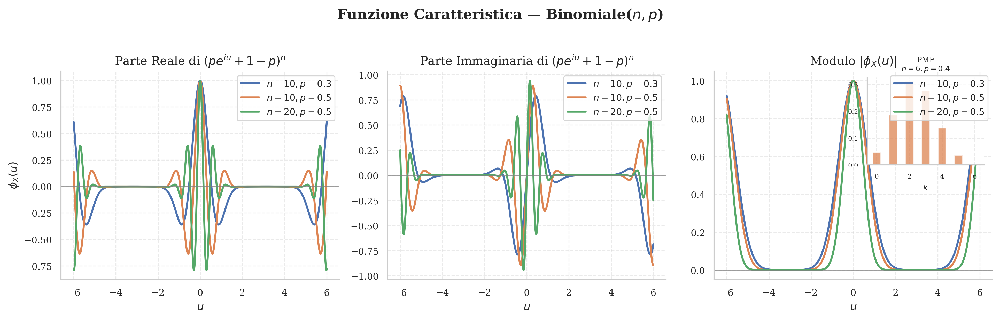{#fig-cf-binomial}

### Poisson$(\lambda)$

Sia $X \sim \mathcal{P}(\lambda)$, con $\mathbb{P}(X=k)=\frac{e^{-\lambda}\lambda^k}{k!}$. $$\phi_X(u)
    = \mathbb{E}[e^{iuX}]
    = \sum_{k=0}^{\infty} e^{iuk}\frac{e^{-\lambda}\lambda^k}{k!}
    = e^{-\lambda}\sum_{k=0}^{\infty}\frac{(\lambda e^{iu})^k}{k!}
    = e^{-\lambda}\cdot e^{\lambda e^{iu}}
    = e^{\lambda(e^{iu}-1)}.$$ Nell'ultimo passaggio abbiamo riconosciuto la serie di Taylor dell'esponenziale $e^z = \sum_{k=0}^\infty z^k/k!$ con $z=\lambda e^{iu}$.

**Osservazione.** Poiché $e^{iu}-1 = (\cos u - 1)+i\sin u$, la parte reale dell'esponente è $\lambda(\cos u -1)\leq 0$: il modulo $|\phi_X(u)| = e^{\lambda(\cos u-1)}\leq 1$ decade oscillando con $u$, senza mai superare l'unità.

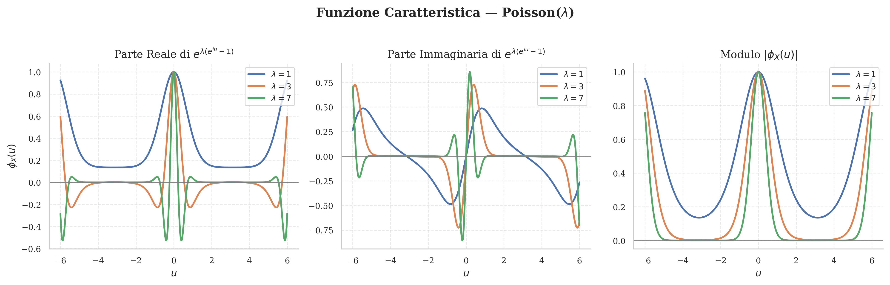{#fig-cf-poisson}

### Uniforme su $(-a,a)$

Sia $X \sim \mathcal{U}(-a,a)$ con densità $f(x)=\frac{1}{2a}\mathbf{1}_{[-a,a]}(x)$. $$\phi_X(u)
    = \frac{1}{2a}\int_{-a}^{a}e^{iux}\,dx
    = \frac{e^{iua}-e^{-iua}}{2a\cdot iu}.$$ Usando la formula di Eulero $e^{i\theta}-e^{-i\theta}=2i\sin\theta$: $$\phi_X(u)
    = \frac{2i\sin(au)}{2aiu}
    = \frac{\sin(au)}{au}
    \quad (\text{funzione sinc}).$$ Il caso $u=0$ si risolve per continuità: $\lim_{u\to 0}\frac{\sin(au)}{au}=1$.

**Perché la parte immaginaria è nulla?** L'integrando $\sin(ux)e^{-x^2/2}$ è una funzione dispari su $[-a,a]$, quindi il suo integrale su un dominio simmetrico è zero. La funzione caratteristica di una distribuzione simmetrica è sempre reale.

{#fig-cf-uniform}

### Normale$(0,1)$

Sia $X\sim\mathcal{N}(0,1)$. Il calcolo tramite integrali di contorno o continuazione analitica è standard ma non elementare. Presentiamo qui una derivazione basata su un'ODE, che ha il pregio di usare solo strumenti di Analisi 1.

**Passo 1 --- Eliminazione della parte immaginaria.** Poiché $\sin(ux)e^{-x^2/2}$ è una funzione dispari e integrabile, il suo integrale su $\mathbb{R}$ è zero, quindi: $$\phi_X(u)
    = \frac{1}{\sqrt{2\pi}}\int_{-\infty}^{+\infty}\cos(ux)\,e^{-x^2/2}\,dx.$$

**Passo 2 --- Derivazione sotto il segno di integrale.** Per il Teorema 13.2 (convergenza dominata, poiché $|x\sin(ux)e^{-x^2/2}|\leq |x|e^{-x^2/2}\in L^1$) possiamo derivare rispetto a $u$: $$\phi_X'(u)
    = \frac{1}{\sqrt{2\pi}}\int_{-\infty}^{+\infty}
      (-x\sin ux)\,e^{-x^2/2}\,dx.$$

**Passo 3 --- Integrazione per parti.** Integrando per parti con $v'=xe^{-x^2/2}$ e $w=\sin(ux)$: $$\phi_X'(u)
    = -\frac{1}{\sqrt{2\pi}}\int_{-\infty}^{+\infty}
      u\cos(ux)\,e^{-x^2/2}\,dx
    = -u\,\phi_X(u).$$

**Passo 4 --- Risoluzione dell'ODE.** Si ottiene l'equazione differenziale ordinaria $\frac{\phi_X'(u)}{\phi_X(u)} = -u$, la cui soluzione generale è: $$\ln|\phi_X(u)| = -\frac{u^2}{2} + C
    \implies
    \phi_X(u) = e^C e^{-u^2/2}.$$ La condizione iniziale $\phi_X(0)=1$ impone $e^C=1$, dunque: $$\boxed{\phi_X(u) = e^{-u^2/2}.}$$

{#fig-cf-normal-std}

### Normale$(\mu,\sigma^2)$

Sia $X\sim\mathcal{N}(\mu,\sigma^2)$. Poiché $Y = \frac{X-\mu}{\sigma}\sim\mathcal{N}(0,1)$, possiamo scrivere $X = \mu + \sigma Y$. Usando il Teorema 13.3 (shift e scala): $$\phi_X(u)
    = \mathbb{E}[e^{iu(\mu+\sigma Y)}]
    = e^{iu\mu}\,\mathbb{E}[e^{i(u\sigma)Y}]
    = e^{iu\mu}\,\phi_Y(u\sigma)
    = e^{iu\mu}\cdot e^{-(u\sigma)^2/2},$$ da cui: $$\boxed{\phi_X(u) = e^{iu\mu - u^2\sigma^2/2}.}$$ **Osservazione.** Il parametro $\mu$ agisce come un fattore di fase $e^{iu\mu}$ (rotazione nel piano complesso), che non altera il *modulo* $|\phi_X(u)|=e^{-u^2\sigma^2/2}$. Il parametro $\sigma$ controlla la *larghezza* della Gaussiana in frequenza: più $\sigma$ è grande, più $\phi_X$ decade rapidamente.

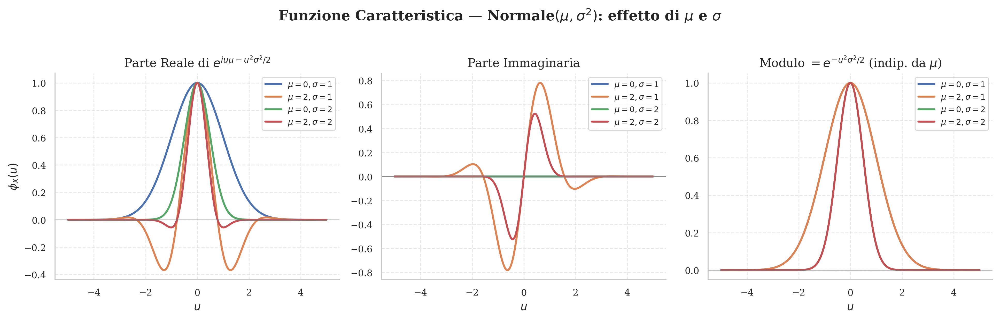{#fig-cf-normal-gen}

### Esponenziale$(\lambda)$

Sia $X\sim\mathrm{Exp}(\lambda)$ con densità $f(x)=\lambda e^{-\lambda x}\mathbf{1}_{x\geq 0}$.

**Calcolo diretto (formale).** $$\phi_X(u)
    = \int_0^{\infty}e^{iux}\lambda e^{-\lambda x}\,dx
    = \lambda\int_0^{\infty}e^{(iu-\lambda)x}\,dx
    = \frac{\lambda}{\lambda-iu}.$$ Questo passaggio è formalmente giustificato dal fatto che $\mathrm{Re}(iu-\lambda)=-\lambda<0$, quindi l'integrale converge.

**Metodo elementare (senza analisi complessa).** Si verifica per derivazione diretta che: $$\begin{align*}
    \frac{d}{dx}\!\left[
      \tfrac{\lambda}{\lambda^2+u^2}e^{-\lambda x}
      (-\lambda\cos(ux)+u\sin(ux))\right]
    &= \lambda e^{-\lambda x}\cos(ux),\\
    \frac{d}{dx}\!\left[
      \tfrac{\lambda}{\lambda^2+u^2}e^{-\lambda x}
      (-u\cos(ux)-\lambda\sin(ux))\right]
    &= \lambda e^{-\lambda x}\sin(ux).
\end{align*}$$ Integrando su $[0,+\infty)$ e raccogliendo parte reale e immaginaria: $$\phi_X(u)
    = \frac{\lambda^2}{\lambda^2+u^2}
      - i\,\frac{\lambda u}{\lambda^2+u^2}
    = \frac{\lambda}{\lambda-iu}.$$

{#fig-cf-exp}

### Gamma$(\alpha,\beta)$

Sia $X\sim\Gamma(\alpha,\beta)$ con densità $f(x)=\frac{\beta^\alpha}{\Gamma(\alpha)}x^{\alpha-1}e^{-\beta x}
\mathbf{1}_{x>0}$.

**Calcolo tramite la struttura additiva.** La distribuzione Gamma con parametro di forma *intero* $\alpha=n$ può essere scritta come somma di $n$ variabili esponenziali i.i.d.: $X = Z_1+\cdots+Z_n$, con $Z_i\sim\mathrm{Exp}(\beta)$. Per indipendenza e usando il risultato dell'Esempio 7: $$\phi_X(u)
    = \prod_{i=1}^{n}\phi_{Z_i}(u)
    = \left(\frac{\beta}{\beta-iu}\right)^n
    = \frac{\beta^n}{(\beta-iu)^n}.$$ Per $\alpha\in\mathbb{R}^+$ generico il risultato si estende per continuazione analitica o con l'integrale di contorno, dando: $$\boxed{\phi_X(u) = \left(\frac{\beta}{\beta-iu}\right)^\alpha.}$$ **Verifica: casi particolari.**

- $\alpha=1$: $\phi_X(u)=\frac{\beta}{\beta-iu}$, che è esattamente la funzione caratteristica dell'Esponenziale$(\beta)$.

- $\alpha=n/2$, $\beta=1/2$: si ottiene la distribuzione Chi-Quadro con $n$ gradi di libertà.

{#fig-cf-gamma}

::: mybox
Funzione caratteristica di una trasformazione affine Sia $\mathbf{X}$ un vettore aleatorio in $\mathbb{R}^n$ e sia $a\in\mathbb{R}^m$. Sia $\mathbf{A}^{m\times n}$ una matrice rettangolare. Allora: $$\phi_{a+\mathbf{A}\mathbf{X}}(u)=e^{i\langle u,a \rangle}\phi_{\mathbf{X}}(\mathbf{A^t}u)$$ Per tutti gli $u\in\mathbb{R}^m$.
:::

Questo teorema ci spiega come si comporta la funzione caratteristica quando applichiamo una trasformazione affine a un vettore aleatorio. Riduciamo il problema al caso scalare ($n=1$, $m=1$), $\mathbf{A}=b\in\mathbb{R}$, $a$ diventa un numero $a \in \mathbb{R}$. La nostra nuova VA trasformata sarà $Y=a+bX$. Il teorema ci dice che: $$\phi_{a+bx}(u)=e^{iua}\phi_{X}(bu)$$ Questo ci dice che geometricamente, nel dominio complesso, ci sono due effetti separati che derivano dalle proprietà dell'algebra lineare applicate al prodotto scalare:

- Effetto della moltiplicazione $bX$: moltiplicare la VA $X$ per lo scalare $b$ equivale a stirare o comprimere la sua distribuzione (cambia la varianza). Nelle funzioni caratteristiche questo corrisponde a un cambio di scala dell'argomento $u$: $$\phi_{X}(u)\rightarrow \phi_{X}(bu)$$

- Effetto della traslazione $(a+...)$: aggiungere una costante $a$ significa spostare l'intera distribuzione a destra o a sinistra (cambia la media: $$e^{iu}\rightarrow e^{iua}=\cos(ua)+i\sin(ua)$$ Moltiplicare per $\cos(ua)+i\sin(ua)$ significa ruotare la funzione caratteristica nel piano complesso di un angolo proporzionale a $u$ e ad $a$.

## Proprietà delle Funzioni Caratteristiche

Affinchè le trasformate siano utili, abbiamo bisogno di sapere che la conoscenza della trasformata caratterizza la distribuzione che le da origine.ù Il prossimo teorema ci garantisce che esiste una corrispondenza biunivoca (1 a 1): due distribuzioni diverse non possono avere la stessa funzione caratteristica. Se due VA hanno la stessa funzione caratteristica allora hanno la stessa distribuzione.\
Questo fatto è estremamente utile per dimostrare la convergenza delle VA (come nel CLT). Spesso è difficile dimostrare che una successione di distribuzioni complicate (per esempio la somma di 1000 variabili binomiali) si avvicina a una normale, ma è molto facile dimostrare che le loro funzioni caratteristiche di avvicinano a quelle di una normale.

::: mybox
Teorema di unicità o di Inversione La trasformata di Fourier $\hat{\mu}$ di una misura di probabilità $\mu$ su $\mathbb{R}^n$ caratterizza $\mu$.\
Ovvero, se due misure di probabilità su $\mathbb{R}^n$ ammettono la stessa trasformata di Fourier, esse sono uguali.
:::

Il Teorema di Unicità è uno dei risultati più potenti e rassicuranti della teoria della probabilità. Ci dice che la funzione caratteristica si comporta esattamente come un'impronta digitale (o il DNA) di una variabile aleatoria. Non ci sono ambiguità: se durante un problema calcoli la trasformata di Fourier di una variabile incognita e il risultato è identico alla trasformata di una distribuzione nota, allora la tua variabile ha esattamente quella distribuzione nota.\
Il teorema garantisce una corrispondenza biunivoca perfetta. Questo significa che la mappa che associa una misura alla sua trasformata è invertibile non solo in linea teorica, ma in modo costruttivo. Esistono infatti formule analitiche (come la *Formula di Inversione di Lévy*) per \"tornare indietro\", ovvero per ricostruire la misura originale $\mu$ conoscendo solo $\hat{\mu}$.

In particolare, se la misura $\mu$ ammette una funzione di densità $f(\mathbf{x})$ e la sua funzione caratteristica è assolutamente integrabile (cioè $\int |\hat{\mu}(u)| \, du < \infty$), possiamo trovare la densità originale calcolando l'antitrasformata di Fourier: $$f(\mathbf{x}) = \frac{1}{(2\pi)^n} \int_{\mathbb{R}^n} e^{-i\langle u,\mathbf{x} \rangle} \hat{\mu}(u) \, du$$ Notiamo come l'esponente nell'antitrasformata abbia il segno meno ($-i$) rispetto alla trasformata diretta.

**L'utilità Pratica: Somme di Variabili Indipendenti**\
La vera utilità di questo teorema si manifesta quando dobbiamo sommare variabili aleatorie indipendenti. Se $X$ e $Y$ sono variabili indipendenti, calcolare la distribuzione della loro somma $Z = X + Y$ nello spazio originale richiede la risoluzione di un integrale di convoluzione, spesso ostico.

Nello spazio di Fourier, invece, la convoluzione si trasforma in una semplice moltiplicazione algebrica: $$\phi_{Z}(u) = \phi_{X}(u) \cdot \phi_{Y}(u)$$ A questo punto, basta moltiplicare le due funzioni. Grazie al Teorema di Unicità, ci basterà guardare il risultato di questa moltiplicazione: se lo riconosciamo (ad esempio, se il prodotto ci dà la funzione caratteristica di una Gaussiana o di una Poisson), sapremo immediatamente qual è la distribuzione di $Z$, senza aver calcolato nessun integrale complesso.\
In probabilità due VA sono indipendenti se la loro densità congiunta si fattorizza nel prodotto delle densità marginali. Questa regola si trasferisce in modo identico nel campo complesso: le VA sono indipendenti se e solo se la funzione caratteristica congiunta si fattorizza nel prodotto delle sinogle funzioni caratteristiche.

::: mybox
Verifica dell'indipendenza tramite funzioni caratteristiche Sia $\mathbf{X}=[X_1,...X_n]$ un vettore aleatorio in $\mathbb{R}^n$. Allora le VA reali $\{X_j\}_{1\leq j \leq n}$ sono indipendenti se e solo se: $$\phi_{\mathbf{X}}(u_1,...,u_n)=\prod_{j=1}^n\phi_{X_j}(u_j)$$ Dove $\phi_{\mathbf{X}}(u_1,...,u_n)$ è la funzione caratteristica congiunta.
:::

Dimostrare l'indipendenza di due o più variabili usando le funzioni di densità (o ripartizione) congiunte può essere un incubo, perché richiede di risolvere integrali multipli o gestire domini complessi. Con le funzioni caratteristiche, il problema dell'indipendenza si riduce a un banale controllo algebrico: calcoli la funzione caratteristica congiunta, guardi la formula risultante e ti chiedi: *\"Posso separare tutte le $u_1$ dalle $u_2$ e dalle $u_3$ scrivendole come fattori moltiplicativi indipendenti?\"*. Se la risposta è sì, sono indipendenti. Se trovi un termine misto (es. $u_1 \cdot u_2$ in un esponente non separabile), sono dipendenti.\
Questo teorema è lo strumento principale usato per dimostrare una proprietà magica della distribuzione Normale: per le variabili aleatorie congiuntamente Gaussiane, *assenza di correlazione implica indipendenza*. Guardando la funzione caratteristica di un vettore Gaussiano, ci si accorge subito che se la covarianza (e quindi la correlazione) tra le variabili è zero, i termini misti nell'esponente della trasformata spariscono, e la funzione congiunta si spezza esattamente nel prodotto delle funzioni marginali.

**N.B.**: Avere $\phi_{\mathbf{X}}(u,...,u)=\prod \phi_{X_j}(u)$ $\forall u \in \mathbb{R}$ non è sufficiente affinchè le $X_j$ siano indipendenti.

# Somme di VA indipendenti

Se eseguiamo un esperimento ripetutamente e in modo indipendente, allora il valore medio (media campionaria) è: $$\bar{x}=\frac{1}{n}\sum_{j=1}^nX_j$$ dove $X_j$ è l'esito del j-esimo esperimento. La VA $\bar{x}$ è chiamata stimatore della media $\mu$ di ciascuna delle $X_j$. La teoria statistica studia come e quando: $$\bar{x}\rightarrow\mu$$ per $n\rightarrow \infty$. Anche una volta dimostrato, abbiamo anche bisogno di sapere quanto grande dovrebbe essere $n$ per essere ragionevolmente sicuri che $\bar{x}$ sia vicino al vero valore di $\mu$. Un'altra cosa che ci interessa è la distribuzione di $\bar{x}$.

## Prodotto di Convoluzione

::: mybox
Prodotto di convoluzione Siano $X$ e $Y$ due VA a valori reali, con $X$ indipendente da $Y$. La distribution measure $\mu_Z$ di $Z=X+Y$ è il prodotto di convoluzione delle misure di probabilità $\mu_X$ e $\mu_Y$, definito da: $$\mu_X*\mu_Y(A)=\iint\mathbb{1}_A(x+y)\mu_X(dx)\mu_Y(dy)$$
:::

A seconda della natura delle variabili aleatorie, la formula generale si specializza in due forme principali:

Se $X$ e $Y$ sono variabili continue caratterizzate dalle funzioni di densità di probabilità $f_X$ e $f_Y$, la densità della variabile somma $Z$ si calcola con l'integrale: $$f_Z(z) = \int_{-\infty}^{+\infty} f_X(x)f_Y(z-x)dx$$

Se $X$ e $Y$ sono variabili discrete (che assumono valori interi), l'operazione di convoluzione si traduce in una sommatoria: $$P(Z=z) = \sum_{x} P(X=x)P(Y=z-x)$$

::: mybox
Semplificazione con le funzioni caratteristiche Siano $X$ e $Y$ due VA a valori reali, con $X$ indipendente da $Y$ e $Z=X+Y$. Allora: $$\phi_Z(u)=\phi_X(u)\phi_Y(u)$$
:::

Questo teorema dimostra che la Trasformata di Fourier (di cui la funzione caratteristica è una variante) converte l'operazione di convoluzione tra distribuzioni di probabilità in una semplice moltiplicazione algebrica.\
**N.B.**: Se $Z=X+Y$, la proprietà che $\phi_Z(u)=\phi_X(u)\phi_Y(u)$ $\forall u\in\mathbb{R}$ non è sufficiente per garantire l'indipendenza di $X$ e $Y$. La fattorizzazione della funzione caratteristica è una condizione necessaria ma non sufficiente per l'indipendenza.

::: mybox
Prodotto di convoluzione con VA continue Siano $X$ e $Y$ VA a valori reali, con $X$ indipendente da $Y$ e con $Z=X+Y$:

- Se $X$ ha densità $f_X$, allora $Z$ ha densità $f_Z$ e: $$f_Z(z)=\int f_X(z-y)\mu_Y(dy)$$

- Se, in aggiunta $Y$ ha densità $f_Y$, allora: $$f_Z(z)=\int f_X(z-y)f_Y(y)dy)\int f_X(x)f_Y(z-x)dx$$
:::

Il primo punto ci dice che se $X$ è continua con densità $f_X$ ma $Y$ non ammette densità, oppure è discreta, la somma $Z=X+Y$ sarà comunque continua, con densità $f_Z$.\
Il secondo punto (meno interessante) ci dice che se entrambe le VA sono continue, la densità della loro somma è l'integrale del prodotto delle loro densità.

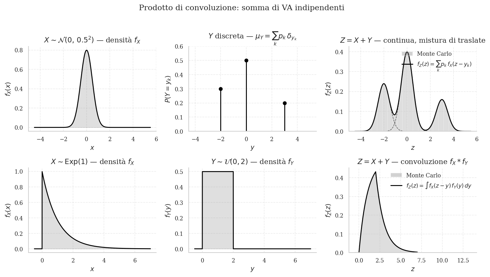{#fig-placeholder}

::: mybox
Varianza della somma Siano $X$e $Y$ due VA a valori reali, con $X$ indipendente da $Y$ ed entrambe quadrato-integrabili ($\mathbb{E}[X^2]<\infty$, $\mathbb{E}[Y^2]<\infty$). Allora: $$\sigma_{X+Y}^2=\sigma_X^2\sigma_Y^2$$
:::

**N.B.**: Quando sommi due VA indipendenti, le loro varianze si sommano ma attenzione: le deviazioni standard ($\sigma$) non si sommano linearmente.

### Esempi {#sec-esempi .unnumbered}

1.  Siano $X_1, \dots, X_n$ variabili aleatorie indipendenti e identicamente distribuite (i.i.d.) secondo una distribuzione di Bernoulli di parametro $p$. Sappiamo che la loro somma $Y = \sum_{j=1}^n X_j$ segue una distribuzione Binomiale $B(n, p)$. Il valore atteso di $Y$ si calcola facilmente sfruttando la linearità dell'operatore valore atteso: $$E[Y] = E\left[\sum_{j=1}^n X_j\right] = \sum_{j=1}^n E[X_j] = \sum_{j=1}^n p = np$$ Per calcolare la varianza, ricordiamo prima la varianza di una singola variabile di Bernoulli $X_j$. Poiché $X_j$ assume solo i valori $0$ e $1$, si ha l'identità $X_j^2 = X_j$. Di conseguenza, $E[X_j^2] = E[X_j] = p$. La varianza è quindi: $$\sigma^2_{X_j} = E[X_j^2] - (E[X_j])^2 = p - p^2 = p(1-p)$$ Essendo le variabili $X_j$ indipendenti, la varianza della loro somma è semplicemente la somma delle loro singole varianze: $$\sigma^2_Y = \sum_{j=1}^n \sigma^2_{X_j} = np(1-p)$$ Questo metodo di calcolo, basato sulle proprietà dell'additività, è di gran lunga preferibile all'uso esplicito della definizione della distribuzione di $Y$, il quale obbligherebbe a calcolare la seguente e complessa sommatoria: $$\sigma^2_Y = \sum_{j=0}^n (j-np)^2 \binom{n}{j} p^j (1-p)^{n-j}$$

2.  Siano $X$ e $Y$ due variabili aleatorie indipendenti aventi rispettivamente distribuzione di Poisson di parametri $\lambda$ e $\mu$. Definiamo la loro somma $Z = X+Y$ e dimostriamo che segue a sua volta una distribuzione di Poisson. A tale scopo utilizziamo le funzioni caratteristiche. La funzione caratteristica di una variabile di Poisson generica di parametro $\lambda$ è $\phi(u) = e^{\lambda(e^{iu}-1)}$. Grazie all'indipendenza di $X$ e $Y$, la funzione caratteristica della somma è uguale al prodotto delle funzioni caratteristiche individuali: $$\phi_Z(u) = \phi_X(u)\phi_Y(u) = e^{\lambda(e^{iu}-1)} e^{\mu(e^{iu}-1)} = e^{(\lambda+\mu)(e^{iu}-1)}$$ Il risultato finale è esattamente l'espressione analitica della funzione caratteristica di una distribuzione di Poisson il cui parametro è la somma $\lambda+\mu$. Per il teorema di unicità delle funzioni caratteristiche (a ogni funzione caratteristica corrisponde un'unica distribuzione), possiamo concludere rigorosamente che $Z$ è una variabile di Poisson di parametro $\lambda+\mu$.

3.  Consideriamo ora due variabili aleatorie Binomiali indipendenti, $X \sim B(n, p)$ e $Y \sim B(m, p)$, ponendo particolare attenzione al fatto che condividano la medesima probabilità di successo $p$. Definita la somma $Z = X+Y$, analizziamone la funzione caratteristica. Sapendo che per una $B(n, p)$ la funzione caratteristica è $(pe^{iu} + (1-p))^n$, moltiplichiamo le funzioni di $X$ e $Y$: $$\phi_Z(u) = \phi_X(u)\phi_Y(u) = (pe^{iu} + (1-p))^n (pe^{iu} + (1-p))^m = (pe^{iu} + (1-p))^{n+m}$$ L'espressione ricavata coincide con la funzione caratteristica di una Binomiale avente un numero di prove pari a $n+m$. Sempre in virtù del teorema di unicità, deduciamo che $Z \sim B(n+m, p)$. Questo risultato possiede anche una forte spiegazione intuitiva e logica che non richiede l'uso delle funzioni caratteristiche: la variabile $X$ rappresenta il numero di successi in $n$ prove, ovvero $X = \sum_{j=1}^n U_j$, e la variabile $Y$ rappresenta i successi in altre $m$ prove, $Y = \sum_{j=1}^m V_j$, dove $U_j$ e $V_j$ sono tutte variabili di Bernoulli indipendenti con parametro $p$. Sommando $X$ e $Y$, stiamo unificando i due insiemi di prove, contando i successi totali su $n+m$ prove complessive, rappresentabili come $\sum_{j=1}^{n+m} W_j$. Essendo la somma di $n+m$ prove di Bernoulli indipendenti la definizione stessa di una Binomiale $B(n+m, p)$, il risultato è convalidato.

4.  Supponiamo che $X$ e $Y$ siano due variabili normali indipendenti, dove $X \sim \mathcal{N}(\mu, \sigma^2)$ e $Y \sim \mathcal{N}(\nu, \tau^2)$. Vogliamo calcolare la distribuzione di $Z = X+Y$. La funzione caratteristica di una normale di media $\mu$ e varianza $\sigma^2$ è data da $e^{iu\mu - u^2\sigma^2/2}$. Sfruttando nuovamente l'indipendenza: $$\phi_Z(u) = \phi_X(u)\phi_Y(u) = e^{iu\mu - u^2\sigma^2/2} e^{iu\nu - u^2\tau^2/2}$$ Riordinando e sommando i termini all'esponente associati alla stessa potenza di $u$, otteniamo: $$\phi_Z(u) = e^{iu(\mu+\nu) - u^2(\sigma^2+\tau^2)/2}$$ Questa struttura esponenziale è inconfondibilmente la funzione caratteristica di una variabile aleatoria normale la cui media è la somma delle medie $(\mu+\nu)$ e la cui varianza è la somma delle varianze $(\sigma^2+\tau^2)$. Dunque, $Z \sim \mathcal{N}(\mu+\nu, \sigma^2+\tau^2)$.

5.  Analizziamo la somma di due variabili aleatorie aventi distribuzione Gamma, con $X \sim \text{Gamma}(\alpha, \beta)$ e $Y \sim \text{Gamma}(\delta, \beta)$. È fondamentale notare che assumiamo l'indipendenza e che il parametro di scala (o di tasso) $\beta$ deve essere identico per entrambe, mentre i parametri di forma $\alpha$ e $\delta$ possono variare. Calcoliamo la funzione caratteristica per la somma $Z = X+Y$: $$\phi_Z(u) = \phi_X(u)\phi_Y(u) = \left(\frac{\beta}{\beta - iu}\right)^\alpha \left(\frac{\beta}{\beta - iu}\right)^\delta = \left(\frac{\beta}{\beta - iu}\right)^{\alpha+\delta}$$ Avendo la stessa base, le potenze si sono sommate. Il risultato è la funzione caratteristica di una distribuzione Gamma con il parametro di forma aggiornato ad $\alpha+\delta$. Per il teorema di unicità delle funzioni caratteristiche, la variabile $Z$ segue una distribuzione $\text{Gamma}(\alpha+\delta, \beta)$. Questo dimostra la chiusura della famiglia Gamma rispetto all'addizione, a patto che il parametro $\beta$ rimanga fisso.

6.  Questo esempio stabilisce una cruciale connessione teorica tra la distribuzione Normale standard, la distribuzione Chi-quadro ($\chi^2$) e la distribuzione Gamma. Sappiamo che la distribuzione Chi-quadro con $p$ gradi di libertà, denotata con $\chi^2_p$, è un caso particolare della distribuzione Gamma, nello specifico una $\text{Gamma}(p/2, 1/2)$. È noto, inoltre, che se prendiamo una variabile normale standard $Z \sim \mathcal{N}(0,1)$ e la eleviamo al quadrato, otteniamo per definizione una Chi-quadro con 1 grado di libertà, ovvero $Z^2 \sim \chi^2_1$. Questo significa che $Z^2$ è distribuita come una $\text{Gamma}(1/2, 1/2)$. Consideriamo ora una nuova variabile $Y$, definita come la somma dei quadrati di $p$ variabili normali standard i.i.d. $Z_1, \dots, Z_p$, ovvero $Y = \sum_{i=1}^p Z_i^2$. Ognuno dei $p$ termini della somma è una $\text{Gamma}(1/2, 1/2)$. Applicando l'esatto ragionamento dimostrato nell'Esempio 5, la somma di $p$ distribuzioni Gamma indipendenti aventi lo stesso parametro $\beta = 1/2$ produce una nuova Gamma in cui i parametri di forma si sommano. Sommando $p$ volte il valore $1/2$, otteniamo $p/2$. Di conseguenza, la variabile somma $Y$ segue una distribuzione $\text{Gamma}(p/2, 1/2)$. Poiché questa precisa configurazione dei parametri definisce la distribuzione Chi-quadro, concludiamo che $Y \sim \chi^2_p$. In termini formali: se $X \sim \chi^2_p$, allora in distribuzione si ha $X \stackrel{d}{=} \sum_{i=1}^p Z_i^2$, confermando che una Chi-quadro a $p$ gradi di libertà è generata dalla somma dei quadrati di $p$ variabili normali standard indipendenti.

# Variabili Aleatorie Gaussiane

Ricordiamo che se $X\sim\mathcal{N}(\mu,\sigma^2)$ allora: $$f_X(x)=\frac{1}{\sqrt{2\pi}\sigma}e^{\frac{1}{2}\frac{(x-\mu)^2}{\sigma^2}}$$ e $$\phi_X(u)=e^{iu\mu-\frac{1}{2}u^2\sigma^2}$$

## Normale Multivariata

Una VA a valori in $\mathbb{R}^n$ $\mathbf{X}=[X_1,...,X_n]$ è normale multivariata se ogni combinazione lineare: $$\sum_{j=1}^na_jX_j$$ Delle sue componenti ha una distribuzione normale univariata.

::: mybox
Definizione tramite funzioni caratteristiche $\mathbf{X}$ è un vettore aleatorio gaussiano a valori in $\mathbb{R}^n$ se e solo se la sua funzione caratteristica ha la forma: $$\phi_{\mathbf{X}}(\mathbf{u})=e^{i\langle \mathbf{u},\mu\rangle -\frac{1}{2}\langle \mathbf{u}, Q_{\mathbf{u}}\rangle }=\exp\left(i\mathbf{u}^T\mu - \frac{1}{2}\mathbf{u}^TQ\mathbf{u}\right)$$ dove $\mu\in\mathbb{R}^n$ e $Q\in\mathbb{R}^{n\times n}$ è simmetrica ($cov(X_i,X_j)=cov(X_j,X_i)$) semidefinita positiva. $Q$ è quindi la matrice di covarianza di $\mathbf{X}$ e $\mathbf{\mu}$ è il vettore delle medie di $\mathbf{X}$.
:::

::: mybox
Momenti della Normale Multivariata tramite Funzione Caratteristica Quando un vettore aleatorio $\mathbf{X} \in \mathbb{R}^n$ ha legge $\mathcal{N}(\mu, Q)$, la sua funzione caratteristica è definita come: $$\phi_{\mathbf{X}}(\mathbf{u}) = \exp\left(i\mathbf{u}^T\mu - \frac{1}{2}\mathbf{u}^TQ\mathbf{u}\right)$$ Per trovare i momenti $\mu$ (vettore delle medie) e $Q$ (matrice di covarianza), sfruttiamo la proprietà per cui le derivate della funzione caratteristica valutate nell'origine generano i momenti della distribuzione. In particolare, per i momenti del secondo ordine: $$\frac{\partial^2 \phi_{\mathbf{X}}(\mathbf{u})}{\partial u_i \partial u_j}\Bigg|_{\mathbf{u}=\mathbf{0}} = i^2 \mathbb{E}[X_i X_j] = - \mathbb{E}[X_i X_j]$$ Calcolando esplicitamente le derivate parziali della nostra funzione esponenziale e valutandole in $\mathbf{u}=\mathbf{0}$, otteniamo: $$\frac{\partial^2 \phi_{\mathbf{X}}(\mathbf{u})}{\partial u_i \partial u_j}\Bigg|_{\mathbf{u}=\mathbf{0}} = -\mu_i\mu_j - Q_{i,j}$$ Uguagliando i due risultati, i segni negativi si elidono e troviamo la relazione per il momento misto: $$\mathbb{E}[X_iX_j] = \mu_i\mu_j + Q_{i,j}$$ Ricordando la definizione di covarianza, $\text{Cov}(X_i, X_j) = \mathbb{E}[X_i X_j] - \mathbb{E}[X_i]\mathbb{E}[X_j]$, e sapendo che $\mathbb{E}[X_i] = \mu_i$, sostituiamo e semplifichiamo: $$\text{Cov}(X_i, X_j) = (\mu_i\mu_j + Q_{i,j}) - \mu_i\mu_j \implies Q_{i,j} = \text{Cov}(X_i, X_j)$$ Questo dimostra che le componenti della matrice $Q$ rappresentano esattamente le covarianze tra le variabili del vettore $\mathbf{X}$.
:::

### Esempio {#sec-esempio-13 .unnumbered}

Siano $X_1,...,X_n$ VA indipendenti a valori in $\mathbb{R}$ con leggi $\mathcal{N}(\mu_j,\sigma^2_j)$. Allora $\mathbf{X}=[X_1,...,X_n]$ è gaussiana multivariata. Ciò è facile da verificare poichè: $$\phi_{\mathbf{X}}(u_1,...,u_n)=\prod_{J=1}^n\phi_{X_j}(u_j)$$ Quindi: $$\phi_{\mathbf{X}}(\mathbf{u})=\prod_{J=1}^ne^{iu_j\mu_j-\frac{1}{2}u^2_j\sigma^2_j}=e^{\sum_{j=1}^niu_j\mu_j-\sum_{j=1}^nu_j^2\sigma_j^2}=e^{i\langle\mathbf{u},\mu\rangle-\frac{1}{2}\langle\mathbf{u},Q_{\mathbf{u}}\rangle}$$ Dove: $$\mu=[\mu_1,...,\mu_n]$$ e $$Q= \begin{pmatrix}
\sigma_1^2 & 0 & \cdots & 0 \\
0 & \sigma_2^2 & \cdots & 0 \\
\vdots & \vdots & \ddots & \vdots \\
0 & 0 & \cdots & \sigma_n^2
\end{pmatrix}$$ L'esempio mostra una una proprietà fondamentale: se prendi un gruppo di VA normali indipendenti e crei un vettore aleatorio, allora tale vettore è normale multivariato e la sua matrice di covarianza $Q$ è diagonale.

::: mybox
Corollario Sia $\mathbf{X}$ un vettore aleatorio gaussiano in $\mathbb{R}^n$. Le componenti $X_j$ sono indipendenti se e solo se $Q$ è diagonale.
:::

Questo corollario sancisce una proprietà eccezionale della distribuzione Normale multivariata: per le variabili gaussiane, **l'assenza di correlazione implica l'indipendenza stocastica**.

Dire che la matrice di covarianza $Q$ è *diagonale* significa affermare che tutti gli elementi al di fuori della diagonale principale sono strettamente nulli: $$Q_{i,j} = \text{Cov}(X_i, X_j) = 0 \quad \text{per ogni } i \neq j$$ Sulla diagonale principale restano solamente le varianze individuali: $Q_{j,j} = \sigma_j^2$.\
Possiamo dimostrare elegantemente questo corollario riprendendo la funzione caratteristica del vettore gaussiano $\mathbf{X}$: $$\phi_{\mathbf{X}}(\mathbf{u}) = \exp\left(i\mathbf{u}^T\mu - \frac{1}{2}\mathbf{u}^TQ\mathbf{u}\right)$$

Se la matrice $Q$ è diagonale, non ci sono termini misti (nessun incrocio tra $u_i$ e $u_j$). Il prodotto quadratico $\mathbf{u}^TQ\mathbf{u}$ si riduce a una banale somma di termini separati: $$\mathbf{u}^TQ\mathbf{u} = \sum_{j=1}^n Q_{j,j} u_j^2$$ Allo stesso modo, il prodotto interno delle medie è semplicemente: $$\mathbf{u}^T\mu = \sum_{j=1}^n u_j \mu_j$$

Sostituendo queste somme all'interno dell'esponenziale, e sfruttando la proprietà fondamentale per cui l'esponenziale di una somma è il prodotto degli esponenziali ($e^{A+B} = e^A e^B$), la funzione caratteristica \"esplode\" in un prodotto: $$\phi_{\mathbf{X}}(\mathbf{u}) = \prod_{j=1}^n \exp\left(i u_j \mu_j - \frac{1}{2} Q_{j,j} u_j^2\right)$$

Cosa abbiamo ottenuto? L'argomento della produttoria non è altro che la funzione caratteristica di una singola variabile gaussiana unidimensionale $X_j$. Quindi: $$\phi_{\mathbf{X}}(\mathbf{u}) = \prod_{j=1}^n \phi_{X_j}(u_j)$$

Il fatto che la funzione caratteristica congiunta si possa scomporre esattamente nel prodotto delle funzioni caratteristiche marginali è la **condizione necessaria e sufficiente per l'indipendenza** nella teoria della probabilità. Dunque, le componenti $X_j$ sono indipendenti.

## Decomposizione Spettrale della matrice di covarianza

Il prossimo teorema mostra che tutti i vettori aleatori gaussiani derivano tra trasformazioni lineari di vettori di VA normali univariate indipendenti.

::: mybox
Decomposizione Spettrale della matrice di covarianza Sia $\mathbf{X}$ un vettore gaussiano a valori in $\mathbb{R}^n$ con vettore delle media $\mu=[\mu_1,...,\mu_n]$. Allora esistono variabili aleatorie normali indipendenti $Y_1,...,Y_n$ con: $$\mathcal{L}(Y_i)\sim\mathcal{N}(0,\lambda_j)$$ dove $\mathcal{L}$ indica la legge, e una matrice ortogonale $A$ tale che $$\mathbf{X}=\mu+A\mathbf{Y}$$
:::

Questo teorema sfrutta un risultato fondamentale dell'algebra lineare: il **teorema spettrale**. Poiché la matrice di covarianza $Q$ di $\mathbf{X}$ è sempre simmetrica e definita semi-positiva, può essere diagonalizzata. Ovvero, possiamo scriverla come $Q = A \Lambda A^T$, dove $A$ è una matrice ortogonale (le cui colonne sono gli autovettori di $Q$) e $\Lambda$ è una matrice diagonale (che contiene gli autovalori $\lambda_j$).

L'equazione $\mathbf{X} = \mu + A\mathbf{Y}$ scompone la generazione di un vettore gaussiano correlato in tre passaggi geometrici elementari:

1.  **Generazione indipendente ($\mathbf{Y}$):** Si parte da un vettore $\mathbf{Y}$ le cui componenti $Y_j$ sono gaussiane centrate in zero ma con varianze diverse, pari agli autovalori $\lambda_j$. Essendo la matrice di covarianza di $\mathbf{Y}$ diagonale (pari a $\Lambda$), per il corollario precedente sappiamo che le $Y_j$ sono *strettamente indipendenti*. Geometricamente, $\mathbf{Y}$ forma una \"nuvola\" di punti a forma di ellissoide allineata con gli assi cartesiani.

2.  **Rotazione ($A\mathbf{Y}$):** Moltiplicare per la matrice ortogonale $A$ equivale a eseguire una **rotazione** rigida nello spazio $\mathbb{R}^n$. Questa operazione prende l'ellissoide allineato agli assi e lo ruota, introducendo così la correlazione (le covarianze) tra le variabili. Le direzioni di questa rotazione sono date dagli autovettori della matrice $Q$.

3.  **Traslazione ($+ \mu$):** Infine, si aggiunge il vettore delle medie $\mu$. Questa è una semplice **traslazione** che sposta il centro della nuvola di punti dall'origine $(0,0,\dots,0)$ al punto finale descritto da $\mu$.

In sintesi, il teorema ci garantisce che ogni correlazione in un vettore gaussiano è semplicemente il risultato di una rotazione geometrica applicata a variabili originariamente indipendenti.

**esempio 1: Decomposizione spettrale con $\theta=30^\circ$**

**Parametri Teorici e Matrici**

- Autovalori: $\lambda_1 = 2.0000$, $\lambda_2 = 0.8000$

- Angolo di rotazione: $\theta = 30.0^\circ$

- Media: $\mu = \begin{pmatrix} 0.5 \\ -0.3 \end{pmatrix}$

- Matrice Diagonale (varianze indipendenti): $$\Lambda = \begin{pmatrix} 2.0 & 0.0 \\ 0.0 & 0.8 \end{pmatrix}$$

- Matrice Ortogonale $A$ (autovettori): $$A = \begin{pmatrix} 0.8660254 & -0.5 \\ 0.5 & 0.8660254 \end{pmatrix}$$ con $\det(A) = 1$ e $A A^T = I$.

- Matrice di Covarianza Teorica $Q = A\Lambda A^T$: $$Q = \begin{pmatrix} 1.7 & 0.51961524 \\ 0.51961524 & 1.1 \end{pmatrix}$$

**Step 1: Variabile $Y$ (indipendente)** Generazione di $n=800$ campioni da $\mathcal{N}(0, \Lambda)$.

- Covarianza empirica: $$\text{Cov}(Y)_{emp} = \begin{pmatrix} 1.93514715 & 0.02324009 \\ 0.02324009 & 0.80291945 \end{pmatrix}$$

- Media empirica: $\begin{pmatrix} -0.01116916 \\ 0.07823764 \end{pmatrix}$

**Step 2: Variabile $AY$ (ruotata)** Rotazione rigida: $AY = Y A^T$.

- Covarianza empirica: $$\text{Cov}(AY)_{emp} = \begin{pmatrix} 1.63196371 & 0.50188902 \\ 0.50188902 & 1.10610288 \end{pmatrix}$$

- Media empirica: $\begin{pmatrix} -0.0487916 \\ 0.0621712 \end{pmatrix}$

- Correlazione empirica: $0.373555$

**Step 3: Variabile $X = \mu + AY$ (traslata)**

- Covarianza empirica $\text{Cov}(X)_{emp}$ identica a $\text{Cov}(AY)_{emp}$ (la traslazione non modifica la varianza).

- Media empirica finale: $\begin{pmatrix} 0.4512084 \\ -0.2378288 \end{pmatrix}$ (approssima la media teorica $\mu$).

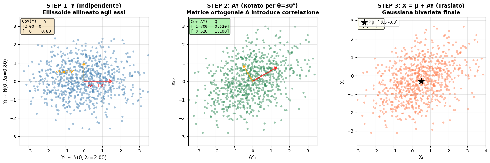{#fig-placeholderx}

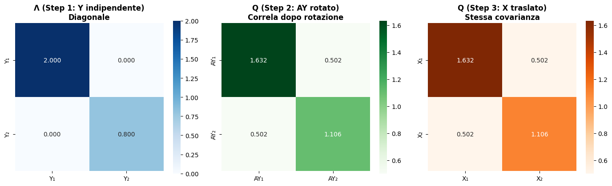{#fig-placeholder}

**Esempio 2: Decomposizione spettrale con $\theta=60^\circ$**

**Parametri Teorici e Matrici**

- Autovalori: $\lambda_1 = 1.5000$, $\lambda_2 = 0.5000$

- Angolo di rotazione: $\theta = 60.0^\circ$

- Media: $\mu = \begin{pmatrix} 0 \\ 0 \end{pmatrix}$

- Matrice Diagonale (varianze indipendenti): $$\Lambda = \begin{pmatrix} 1.5 & 0.0 \\ 0.0 & 0.5 \end{pmatrix}$$

- Matrice Ortogonale $A$ (autovettori): $$A = \begin{pmatrix} 0.5 & -0.8660254 \\ 0.8660254 & 0.5 \end{pmatrix}$$ con $\det(A) = 1$ e $A A^T = I$.

- Matrice di Covarianza Teorica $Q = A\Lambda A^T$: $$Q = \begin{pmatrix} 0.75 & 0.4330127 \\ 0.4330127 & 1.25 \end{pmatrix}$$

**Step 1: Variabile $Y$ (indipendente)** Generazione di $n=1000$ campioni da $\mathcal{N}(0, \Lambda)$.

- Covarianza empirica: $$\text{Cov}(Y)_{emp} = \begin{pmatrix} 1.50386741 & -0.02600111 \\ -0.02600111 & 0.4593505 \end{pmatrix}$$

- Media empirica: $\begin{pmatrix} -0.04845597 \\ 0.00593204 \end{pmatrix}$

**Step 2: Variabile $AY$ (ruotata)** Rotazione rigida: $AY = Y A^T$.

- Covarianza empirica: $$\text{Cov}(AY)_{emp} = \begin{pmatrix} 0.74299735 & 0.46528964 \\ 0.46528964 & 1.22022056 \end{pmatrix}$$

- Media empirica: $\begin{pmatrix} -0.02936528 \\ -0.03899808 \end{pmatrix}$

- Correlazione empirica: $0.488664$

**Step 3: Variabile $X = \mu + AY$ (traslata)**

- Covarianza empirica $\text{Cov}(X)_{emp}$ identica a $\text{Cov}(AY)_{emp}$.

- Media empirica finale: $\begin{pmatrix} -0.02936528 \\ -0.03899808 \end{pmatrix}$ (approssima la media teorica nulla).

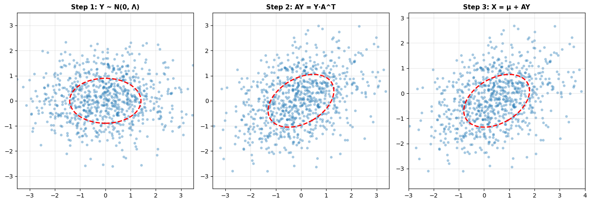{#fig-placeholderx}

Il teorema della decomposizione spettrale di $Q$ è il fondamento della PCA (Principal Component Analysis). Immagina una nuvola di punti (una gaussiana multivariata) nello spazio, a forma di sigaro inclinato. Il teorema ci dice che qualsiasi forma assuma questa nuvola gaussiana, può sempre essere decomposta in mattonicini fondamentali seguendo 3 passi:

- Le variabili indipendenti $Y_i$: prendi delle VA normali incorrelate, ma ciascuna con una sua variaza specifica $\lambda_j$. Se raggruppiamo queste variabili in un vettore $\mathbf{Y}=[Y_1,...,Y_n]$ si crea una nuvola a forma di ellissoide perfettamente allineata con gli assi principali.

- La rotazione $A$: moltiplica questa nuvola perfettamente allineata con gli assi per una matrice ortogonale $A$. Le matrici ortogonali non deformano e non stirano: si limitano a ruotare lo spazio. Ruotando l'ellissoide allineato ottieni un ellissoide inclinato (ecco come nasce la correlazione)

- La traslazione $\mu$: infine somma il vettore delle medie $\mu=[\mu_1,...,\mu_n]$ per spostare il centro della nuvola (ora ellissoide inclinato) dall'origine al punto desiderato.

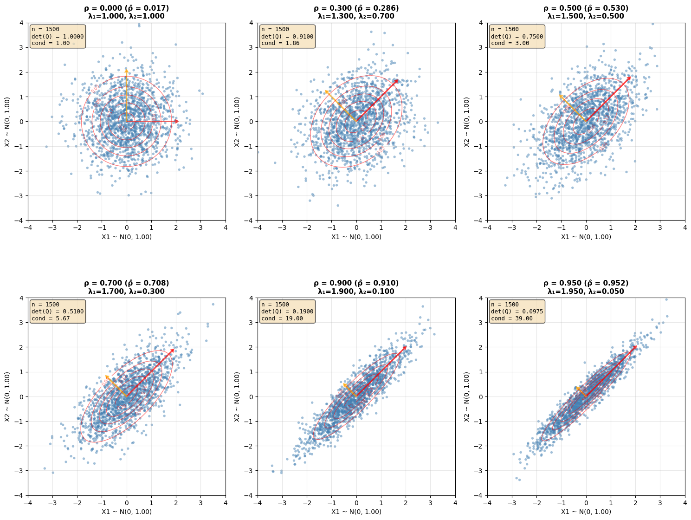{#fig-placeholder}

   **$\rho$**   **$\lambda_1$**   **$\lambda_2$**   **$\det(Q)$**  **Forma**
  ------------ ----------------- ----------------- --------------- ----------------------
      0.0            1.000             1.000            1.000      Cerchio
      0.3            1.300             0.700            0.910      Ellissoide
      0.5            1.500             0.500            0.750      Ellissoide allungato
      0.7            1.700             0.300            0.510      Ellissoide stretto
      0.9            1.900             0.100            0.190      Quasi-lineare

  : Evoluzione della forma geometrica del vettore gaussiano al variare della correlazione $\rho$.

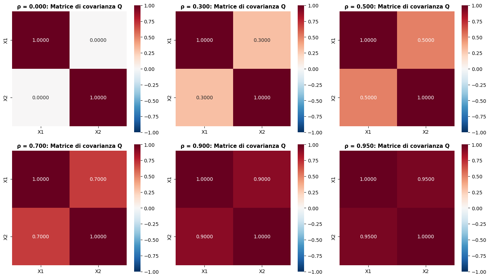{#fig-placeholderx}

::: mybox
Corollario Un vettore gaussiano $\mathbf{X}$ a valori in $\mathbb{R}^n$ possiede una densità su $\mathbb{R}^n$ se e solo se la matrice di covarianza $Q$ è non degenere, cioè se è invertibile e quindi se e solo se $\det(Q)\neq0$. In questo caso abbiamo: $$f_{\mathbf{X}}(x)=\frac{1}{(2\pi)^{n/2}\sqrt{\det(Q)}}e^{-\frac{1}{2}\langle x-\mu, Q^{-1} (x-\mu)   \rangle}$$
:::

Il corollario mostra che quando $n\geq2$ esistono VA normali non costanti senza densità (quando $n=1$ una VA normale è costante o ha una densità). Quindi esso risponde a una domanda fondamentale: La risposta è no.\
Se $Q$ è non invertibile ($\det(Q)=0$) la formula di cui sopra non è definita. Infatti, geometricamente, immaginiamo di essere in un piano in $\mathbb{R}^2$: una gaussiana con densità è una nuvola di punti che ha un'area (una misura di Lebesgue bidimensionale $>0$). Se $\det(Q)=0$, le due variabili sono perfettamente correlate (es $X_2=2X_1$). La nuvola si schiaccia e diventa una linea retta perfetta (un iperpiano $H$). Una linea retta ha lunghezza ma non ha area (la sua misura di Lebesgue bidimensionale è 0). Visto che l'integrale di probabilità calcola il volume sotto la superficie, cercare di integrare su uno spazio con area $0$ da $0$ e non $1$.

::: mybox
Il Determinante della Matrice di Correlazione Sia $R$ la matrice di correlazione di un vettore aleatorio $n$-dimensionale. A differenza della covarianza, gli elementi sulla diagonale di $R$ sono sempre tutti uguali a $1$ (poiché la correlazione di una variabile con se stessa è massima). Il determinante di $R$ è strettamente limitato in un intervallo preciso: $$0 \leq \det(R) \leq 1$$ Esso quantifica il grado complessivo di **multicollinearità** (o dipendenza lineare) del sistema.
:::

Possiamo interpretare il valore di $\det(R)$ analizzando i due casi estremi e le situazioni intermedie:

### 1. Il caso $\det(R) = 1$ (Indipendenza Totale) {#sec-il-caso-detr-1-indipendenza-totale .unnumbered}

Se tutte le variabili del vettore sono incorrelate tra loro (covarianze incrociate nulle), la matrice $R$ diventa semplicemente la matrice identità $I$. Il suo determinante è esattamente $1$.

- **Geometricamente:** In uno spazio standardizzato, la nuvola di punti ha la forma di un'ipersfera perfetta. Il volume è al suo massimo assoluto perché le variabili \"puntano\" tutte in direzioni ortogonali (a $90^\circ$ l'una dall'altra) coprendo la massima ampiezza possibile in ogni dimensione.

- **Informativamente:** Ogni variabile porta un'informazione nuova e unica al 100%. Non c'è alcuna ridondanza.

### 2. Il caso $\det(R) = 0$ (Dipendenza Lineare Perfetta) {#sec-il-caso-detr-0-dipendenza-lineare-perfetta .unnumbered}

Se il determinante è zero, la matrice è degenere. Questo accade se e solo se almeno una delle variabili è una *combinazione lineare perfetta* delle altre (es. $X_3 = 2X_1 - X_2$).

- **Geometricamente:** Il volume $n$-dimensionale della nuvola di punti è zero. La nuvola si è completamente \"appiattita\" su un sottospazio (un iperpiano, un piano o una retta).

- **Informativamente:** C'è una ridondanza totale. Almeno una variabile non aggiunge assolutamente alcuna nuova informazione, perché il suo valore può essere previsto con certezza assoluta conoscendo le altre.

### 3. Il caso $0 < \det(R) < 1$ (Correlazione Parziale) {#sec-il-caso-0-detr-1-correlazione-parziale .unnumbered}

Nella realtà pratica, ci si trova quasi sempre in questa fascia. Più il determinante è vicino a $0$, più le variabili sono fortemente correlate tra loro (\"aggrovigliate\"). Più è vicino a $1$, più sono indipendenti.

- **Analogo geometrico:** Se le variabili fossero vettori fisici, $\det(R)$ rappresenterebbe il (quadrato del) volume del parallelepipedo formato da questi vettori. Se i vettori sono perpendicolari (indipendenti), la scatola è aperta al massimo. Se iniziano a sovrapporsi (correlarsi), la scatola si schiaccia e il suo volume diminuisce verso lo zero.

Il significato geometrico di $\det(Q)$ è legato al concetto di volume. Se immaginiamo la distribuzione di un vettore gaussiano come una nuvola di punti a forma di ellissoide, il volume (o l'area in due dimensioni) di questo ellissoide è direttamente proporzionale a $\sqrt{\det(Q)}$.

- **Un determinante grande:** Significa che la nuvola di punti occupa un volume enorme. C'è molta varianza \"attiva\" in più direzioni indipendenti. Le variabili fluttuano molto e su scale molto ampie.

- **Un determinante piccolo ma $>0$:** Significa che la nuvola è molto compatta (bassa varianza) oppure molto schiacciata e sottile (alta correlazione). Il \"volume dell'incertezza\" è ridotto.

- **Un determinante nullo ($\det(Q) = 0$):** Come abbiamo visto nel teorema sull'esistenza della densità, il volume si azzera. La matrice è degenere e la nuvola si appiattisce perdendo almeno una dimensione (es. diventa un piano in uno spazio 3D).

### Covarianza ($\det(Q)$) vs Correlazione ($\det(R)$) {#sec-covarianza-detq-vs-correlazione-detr .unnumbered}

È fondamentale non confondere il determinante della matrice di covarianza ($Q$) con quello della matrice di correlazione ($R$):

1.  **Il determinante della Correlazione ($\det(R)$) è *adimensionale* e normalizzato tra $0$ e $1$.** Misura esclusivamente gli **angoli** tra le variabili, ovvero il loro grado di dipendenza lineare. Non gli importa in che unità di misura stai lavorando (metri, centimetri, o chilometri).

2.  **Il determinante della Covarianza ($\det(Q)$) dipende dalla *scala*.** Il suo valore è influenzato sia dagli angoli (la correlazione) sia dalla lunghezza dei lati (le varianze singole). Infatti, matematicamente vale la relazione: $$\det(Q) = \det(R) \times (\sigma_1^2 \cdot \sigma_2^2 \cdots \sigma_n^2)$$

**Esempio pratico:** Se misuriamo l'altezza e il peso di una popolazione prima in \"metri e tonnellate\" e poi in \"millimetri e grammi\", il determinante della correlazione $\det(R)$ rimarrà **identico** (la forma della relazione non cambia). Ma il determinante della covarianza $\det(Q)$ **esploderà** diventando un numero gigantesco, semplicemente perché le unità di misura più piccole generano varianze numericamente più grandi, gonfiando il \"volume\" della nuvola di punti.

## Distribuzione Congiunta di vettori gaussiani

::: mybox
Distribuzione Congiunta di vettori gaussiani Sia $\mathbf{X}$ un vettore gaussiano a valori in $\mathbb{R}^n$ e sia $\mathbf{Y}$ un vettore gaussiano a valori in $\mathbb{R}^m$. Se $\mathbf{X}$ e $\mathbf{Y}$ sono indipendenti, allora $\mathbf{Z}=[\mathbf{X},\mathbf{Y}]$ è un vettore gaussiano a valori in $\mathbb{R}^{n+m}$\
Ciò è dimostrabile attraverso le funzioni caratterisitche, infatti: $$\phi_{\mathbf{Z}}(\mathbf{u})= \phi_{\mathbf{X}}(\mathbf{w}) \phi_{\mathbf{Y}}(\mathbf{v})$$ dove $\mathbf{u}=[\mathbf{w},\mathbf{v}]$. $\mathbf{w}\in\mathbb{R}^n$ e $\mathbf{v}\in\mathbb{R}^m$. Poichè $\mathbf{X}$ e $\mathbf{Y}$ sono indipendenti, sfruttando le proprietà delle funzioni caratteristiche: $$\phi_{\mathbf{Z}}(\mathbf{u})=e^{i\langle\mathbf{w},\mu_{\mathbf{X}}\rangle-\frac{1}{2}\langle \mathbf{w},Q_{\mathbf{X}\mathbf{w}} \rangle}e^{i\langle\mathbf{v},\mu_{\mathbf{Y}}\rangle-\frac{1}{2}\langle \mathbf{v},Q_{\mathbf{Y}\mathbf{v}} \rangle}=e^{i\langle[\mathbf{w},\mathbf{v}],[\mu_{\mathbf{X}},\mu_{\mathbf{Y}}]\rangle -\frac{1}{2}\langle\mathbf{u},Q_{\mathbf{u}}  \rangle}$$ Che è la funzione caratteristica di una vettore gaussiano, Dove: $$Q_{\mathbf{Z}} = \begin{pmatrix}
Q_{\mathbf{X}} & \mathbf{0} \\
\mathbf{0} & Q_{\mathbf{Y}}
\end{pmatrix}$$ è una matrice diagonale a blocchi.
:::

## Indipendenza e Correlazione

Diciamo che 2 VA qualsiasi $X$ e $Y$ sono incorrelate se $cov(X,Y)=0$ poichè: $$cov(X,Y)=\mathbb{E}[XY]-E[X]\mathbb{E}[Y]$$ Che è equivalente a dire che: $$\mathbb{E}[XY]=\mathbb{E}[X]\mathbb{E}[Y]$$ Qusto è ovviamente vero se $X$ e $Y$ sono indipendenti e quindi: $$\text{indipendenza}\implies \text{incorrelazione}$$

::: mybox
Indipendenza e incorrelazione nelle gaussiane Sia $\mathbf{X}$ un vettore aleatorio gaussiano a valori in $\mathbb{R}^n$. Due componenti $X_j$ e $X_k$ di $\mathbf{X}$ sono indipendenti se e solo se sono incorrelate. Quindi nelle VA gaussiane: $$\text{indipendenza}\iff \text{incorrelazione}$$
:::

**N.B.**: perchè il teorema sopra sia valido le VA $X_j$ e $X_k$ devono essere congiuntamente gaussiane (componenti dello stesso vettore). Se prendo due VA che sono singolarmente gaussiane, e la loro covarianza è 0, il teorema non si applica.

# Convergenza di Variabili Aleatorie

In analisi matematica si parla di convergenza puntuale di una successione di funzioni quando, $\forall x \in \mathbb{R}$: $$\lim_{n \to \infty} f_n(x) = f(x)$$ Una variabile aleatoria (VA) è una funzione misurabile $X: \Omega \to \mathbb{R}$, quindi, per analogia, si potrebbe ipotizzare che $\forall \omega \in \Omega$: $$\lim_{n \to \infty} X_n(\omega) = X(\omega)$$ Tuttavia, tale definizione di convergenza si rivela poco utile nell'ambito della teoria della probabilità.

Sia $X_n$ una successione di VA indipendenti e identicamente distribuite (i.i.d.) con $\mathbb{P}(X_n=1)=p$ e $\mathbb{P}(X_n=0)=1-p$. Possiamo immaginare questo scenario come il lancio ripetuto di una moneta leggermente sbilanciata, in modo che $p > 0.5$. L'evento $\{X_n=1\}$ corrisponde a "testa al lancio $n$" e l'evento $\{X_n=0\}$ corrisponde a "croce al lancio $n$".

Nel lungo periodo ci aspettiamo che la proporzione di teste sia pari a $p$. Matematicamente vorremmo che: $$\lim_{n \to \infty} \frac{X_1(\omega) + \dots + X_n(\omega)}{n} = p \quad \forall \omega \in \Omega$$ **Ma questo semplicemente non accade.** Si consideri ad esempio l'evento $\omega_0 = (C, C, C, \dots)$, ovvero la sequenza composta da sole croci. Per questa specifica realizzazione si ha: $$\lim_{n \to \infty} \frac{1}{n} \sum_{j=1}^n X_j(\omega_0) = 0$$ Più in generale, se definiamo l'evento: $$A = \{\omega \in \Omega : \text{si verifica solo un numero finito di teste}\}$$ allora avremo che: $$\lim_{n \to \infty} \frac{1}{n} \sum_{j=1}^n X_j(\omega) = 0 \quad \forall \omega \in A$$ Questo comportamento non si verifica quindi $\forall \omega \in \Omega$. Tuttavia, l'insieme $A$ (e tutti gli altri insiemi per cui la media campionaria non converge a $p$) è estremamente "improbabile". Infatti, si può dimostrare formalmente che $\mathbb{P}(A) = 0$.

Ciò che si dimostra rigorosamente (tramite la Legge Forte dei Grandi Numeri) è che: $$\mathbb{P} \left( \left\{ \omega \in \Omega : \lim_{n \to \infty} \frac{1}{n} \sum_{j=1}^n X_j(\omega) = p \right\} \right) = 1$$ Questo tipo di convergenza di variabili aleatorie, in cui non si ha convergenza per ogni singolo elemento dell'universo $\Omega$ ma solo per *quasi tutti* gli $\omega$ (ovvero a meno di un insieme di probabilità nulla), prende il nome di **convergenza quasi certa** ed è il tipo di convergenza che tipicamente si presenta e si studia in probabilità.

## Convergenza \"Almost Sure\"

Una successione di VA $\{X_n  \}_{n\geq1}$ converge A.S. a una VA $X$ se l'insieme: $$N=\{\omega: \lim_{n\rightarrow\infty}X_n(\omega)\neq X(\omega)\}$$ Ha $\mathbb{P}(N)=0$.\
Di conseguenza, l'insieme: $$N^C=\{\omega: \lim_{n\rightarrow\infty}X_n(\omega)= X(\omega)\}$$ avrà $\mathbb{P}(N^C)=1$. E si scrive: $$\lim_{n\rightarrow\infty}X_n=X \quad A.S.$$

**N.B.** Ci sono situazioni in cui la convergenza A.S. fallisce (quando $\mathbb{P}(N)>0$). Per gestire questi casi usiamo altri 2 tipi di convergenza.

## Convergenza in $L^p$

Una successione di VA $\{X_n  \}_{n\geq1}$ converge in $L^p$ a una VA $X$ se $|X_n|$ e $|X|\in L^p$ e: $$\lim_{n\rightarrow\infty}\mathbb{E}[|X_n-X|^p]=0$$ e si scrive: $$X_n \xrightarrow{L^p} X$$ Dire che $|X|\in L^p$ significa che il suo momento assoluto di ordine $p$ è finito ($X$ è $p$-integrabile, ovvero $\mathbb{E}[|X|^p]<\infty$. Se $p=1$, la VA deve avere media finita; se $p=2$ deve avere varianza finita.\
Nella convergenza A.S. ci preoccupiamo di quanti esiti $w$ falliscono in limite. Non ci importava quanti sbagliassero, bastava che fossero pochi (contenuti in un insieme trascurabile con probabilità 0). Qui la prospettiva è ribaltata: creiamo una nuova VA che misura la disatanza (errore assoluto) $|X_n-X|$. Invece di guardare evento per evento ($\omega$), misuriamo l'entità media di questo errore, ovvero $\mathbb{E}[|X_n-X|^p]$. Se questa entità tende a 0, allora diciamo che c'è convergenza in $L^p$. Più $p$ è alto e più gli errori grandi sono penalizzati.

## Convergenza in probabilità

Una successione di VA $\{X_n  \}_{n\geq1}$ converge in probabilità a una VA $X$ se, $\forall \epsilon >0$: $$\lim_{n\rightarrow \infty}\mathbb{P}\left( \left\{ |X_n-X|>\epsilon \right\} \right) = 0$$ e si scrive: $$X_n \xrightarrow{P} X$$ Usando la convenzione $\epsilon-\delta$ di un limite, si potrebbe alternativamente dire che $X_n \xrightarrow{P} X$ se $\forall \epsilon>0$, $\forall \delta >0$ esiste un $N=N(\delta)$ tale che: $$\mathbb{P}(|X_n-X|>\epsilon)<\delta$$ Se la convergenza A.S. è il modo più severo per guardare alla convergenza, e la convergenza in $L^p$ è una prospettiva \"energetica\", la convergenza in probabilità è il concetto più flessibile e rilassato.

::: mybox
Definizione alternativa di convergenza in probabilità $X_n \xrightarrow{P} X$ se e solo se: $$\lim_{n\rightarrow\infty}\mathbb{E}\left[\frac{|X_n-X|}{1-|X_n-x|}  \right]=0$$ Dove l'errore $|X_n-X|$ ha subito la trasformazione $g(x)=\frac{x}{1+x}$ che mappa i valori in $(0,1)$.
:::

Questa definizione alternativa sfrutta un artificio matematico per "metrizzare" la convergenza in probabilità. L'idea centrale è trasformare la distanza illimitata $|X_n - X|$ in una distanza strettamente limitata tra $0$ e $1$ utilizzando la funzione monotona crescente $g(x) = \frac{x}{1+x}$. Poiché la nuova variabile aleatoria all'interno del valore atteso è ora limitata, la funzione $g(x)$ agisce da ammortizzatore: "schiaccia" gli errori estremi, impedendo che traiettorie con errori enormi (ma a bassissima probabilità) facciano esplodere il valore atteso. Grazie a questa limitatezza, richiedere che l'entità media di questo errore trasformato tenda a zero diventa equivalente a richiedere che gli scostamenti macroscopici tra $X_n$ e $X$ abbiano probabilità asintoticamente nulla, rendendo le due definizioni di convergenza in probabilità perfettamente equivalenti.

::: mybox
Gearchia delle convergenze Sia $\{X_n  \}_{n \geq 1}$ una successione di VA:

- Se $X_n \xrightarrow{L^p} X$ allora $X_n \xrightarrow{P} X$

- Se $X_n \xrightarrow{A.S.} X$ allora $X_n \xrightarrow{P} X$
:::

Questa gerarchia ci mostra che la convergenza in probabilità è la più "debole" tra quelle studiate, poiché è implicata da entrambe le altre.

Intuitivamente:

- L'implicazione $L^p \implies P$ è una diretta conseguenza della **Disuguaglianza di Markov**. Se l'energia media dell'errore (il momento $p$-esimo) tende a zero, la probabilità che l'errore superi una soglia $\epsilon > 0$ deve necessariamente svanire.

- L'implicazione a.s. $\implies P$ ci dice che se le traiettorie anomale hanno probabilità nulla (visione globale sull'intera sequenza), allora guardando a un istante $n$ sufficientemente grande, la probabilità di pescare un esito distante dal limite deve tendere a zero.

**Attenzione alle implicazioni inverse (che NON valgono):** È cruciale ricordare che le frecce non tornano indietro. La convergenza in probabilità NON implica la convergenza quasi certa, né quella in $L^p$ (a meno che non si aggiungano ipotesi forti, come l'integrabilità uniforme). Inoltre, la convergenza quasi certa e la convergenza in $L^p$ **non si implicano a vicenda**: si può avere una successione che converge quasi certamente ma la cui media esplode, così come si può avere una successione che converge in media ($L^1$) ma che oscilla infinitamente su singole traiettorie, fallendo la convergenza a.s.

L'unica \"scialuppa di salvataggio\" per tornare indietro da $P$ ad a.s. è il *Teorema di Riesz*, il quale garantisce che se $X_n \xrightarrow{P} X$, esiste sempre almeno una **sottosuccessione** $X_{n_k}$ che converge quasi certamente a $X$.

::: mybox
Teorema di Riesz Supponiamo che $X_n \xrightarrow{P} X$. Allora esiste una sottosuccessione $X_{n_k}$ tale che: $$X_{n_k} \xrightarrow{A.S.} X$$
:::

Questo teorema rappresenta una vera e propria "scialuppa di salvataggio" matematica, fornendo l'unico collegamento a ritroso dalla convergenza in probabilità verso la più stringente convergenza quasi certa.

Intuitivamente, se una successione converge in probabilità, sappiamo che la possibilità di osservare uno scostamento significativo dal limite $X$ diventa sempre più rara all'aumentare di $n$. Tuttavia, come dimostra il controesempio della "macchina da scrivere", questo non basta a garantire la convergenza puntuale: l'errore, pur rimpicciolendosi nello spazio delle probabilità, potrebbe continuare a spostarsi, colpendo ciclicamente ogni singolo evento $\omega$ all'infinito.

Il Teorema di Riesz interviene garantendoci che questi errori diventano rari *così in fretta* che è sempre possibile estrarre un sottoinsieme di "fotogrammi" (la sottosuccessione $X_{n_k}$). Saltando i passi intermedi in cui l'errore colpisce il nostro $\omega$ ed estraendo indici che crescono abbastanza velocemente, possiamo letteralmente isolare le oscillazioni, ottenendo una nuova successione che si stabilizza definitivamente, convergendo quasi certamente.\

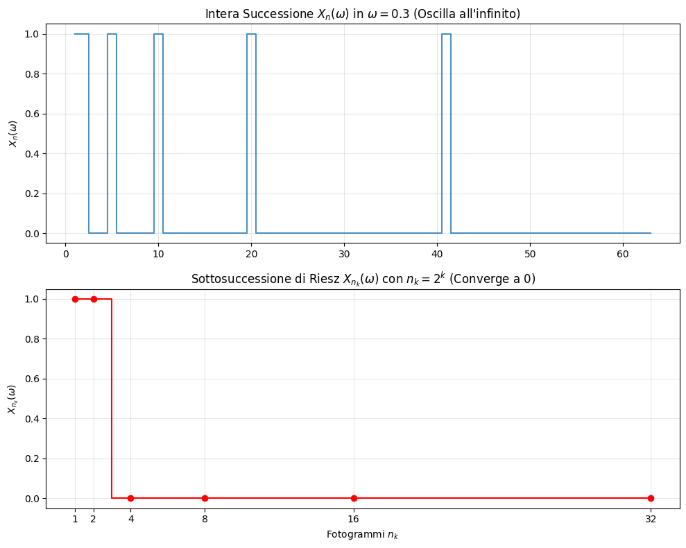{#fig-placeholder}

### Il controesempio della "Macchina da Scrivere"

Per comprendere appieno l'asimmetria geometrica tra la convergenza in probabilità e la convergenza quasi certa, si fa spesso ricorso al celebre controesempio della *macchina da scrivere* (o *successione del carrello*). Questo modello matematico dimostra in modo inoppugnabile che una successione può convergere in probabilità senza mostrare alcuna convergenza quasi certa, e contestualmente illustra il meccanismo di funzionamento del Teorema di Riesz.

Sia lo spazio campionario definito dall'intervallo unitario $\Omega = [0,1]$, equipaggiato con la misura di Lebesgue (la probabilità classica in cui la probabilità di un sotto-intervallo corrisponde alla sua lunghezza). Costruiamo una successione di variabili aleatorie $\{X_n\}_{n \geq 1}$ indicizzate da due contatori: l'altezza del frazionamento $k \geq 0$ (che determina la riga della macchina da scrivere) e la posizione orizzontale $i$, che varia da $0$ a $2^k - 1$. Ogni intero $n \geq 1$ può essere scritto univocamente come $n = 2^k + i$. Definiamo quindi la successione di intervalli $I_n = \left[ \frac{i}{2^k}, \frac{i+1}{2^k} \right]$ e le corrispondenti variabili aleatorie indicatrici: $$X_n(\omega) = \mathbb{I}_{I_n}(\omega) = 
\begin{cases} 
1 & \text{se } \omega \in I_n \\ 
0 & \text{altrimenti} 
\end{cases}$$

Analizziamo il comportamento asintotico di questa successione sotto i due diversi regimi di convergenza:

1.  **Convergenza in Probabilità ($X_n \xrightarrow{P} 0$):** Fissiamo una tolleranza arbitraria $\epsilon \in (0, 1)$. Vogliamo calcolare la probabilità che l'errore $|X_n(\omega) - 0|$ sia maggiore di $\epsilon$. Poiché $X_n$ assume solo i valori $0$ o $1$, l'evento $\{|X_n| > \epsilon\}$ coincide esattamente con l'evento $\{X_n = 1\}$, ovvero con l'intervallo $I_n$. La misura (probabilità) di questo insieme è pari alla sua ampiezza: $$\mathbb{P}\big(|X_n - 0| > \epsilon\big) = \mathbb{P}(\omega \in I_n) = \text{ampiezza}(I_n) = \frac{1}{2^k}
        \end{cases}$$ Poiché al tendere di $n$ all'infinito anche l'indice di riga $k$ tende all'infinito ($k = \lfloor \log_2 n \rfloor$), abbiamo che $\lim_{n \to \infty} \frac{1}{2^k} = 0$. Di conseguenza, la successione soddisfa perfettamente i requisiti della convergenza in probabilità verso la variabile aleatoria nulla ($X \equiv 0$).

2.  **Fallimento della Convergenza Quasi Certa ($X_n \not\xrightarrow{\text{a.s.}} 0$):** Spostiamo ora il focus microscopicamente sulle singole traiettorie. Scegliamo un qualunque punto $\omega_0 \in [0, 1]$. Poiché ad ogni riga $k$ gli intervalli $I_n$ "spazzano" interamente e ciclicamente tutto il dominio $[0,1]$ da sinistra a destra prima di passare alla riga successiva, il punto $\omega_0$ verrà inevitabilmente catturato da un intervallo in ogni singola riga. Ciò significa che la successione numerica deterministica $X_n(\omega_0)$, al crescere di $n$, continuerà a saltare indefinitamente tra $0$ e $1$. Non esiste alcun valore di $\omega \in [0,1]$ per cui il limite di $X_n(\omega)$ esista o si stabilizzi; l'insieme di fallimento del limite ha probabilità totale $\mathbb{P}(N) = \mathbb{P}([0,1]) = 1$. La convergenza quasi certa fallisce ovunque.

L'analogia con la macchina da scrivere risiede proprio in questo movimento: il supporto della variabile aleatoria simula il battito del carattere tipografico che si sposta lungo la riga ($i$ cresce); arrivato alla fine, il carrello torna a capo ($i=0$) e la dimensione del carattere si dimezza ($k$ aumenta di $1$).

#### Estrazione della Sottosuccessione di Riesz:

Il Teorema di Riesz postula che sia comunque possibile estrarre una sottosuccessione convergente quasi certamente. Nell'esempio della macchina da scrivere, questo si traduce nel campionare gli indici in modo da bloccare il carrello sul margine sinistro, impedendogli di spazzare l'intero asse. Se isoliamo gli indici corrispondenti alle potenze di due, ovvero $n_k = 2^k$ (che fissano $i=0$), la sottosuccessione risultante sarà definita dagli intervalli $I_{n_k} = \left[0, \frac{1}{2^k}\right]$. Per questa specifica sottosuccessione, se scegliamo un qualsiasi $\omega_0 > 0$, esisterà sempre un indice di riga $K$ sufficientemente grande tale che $\frac{1}{2^K} < \omega_0$. Da quell'indice in poi, gli intervalli successivi saranno troppo stretti per contenere $\omega_0$, il che implica che $X_{n_k}(\omega_0) = 0$ per ogni $k \geq K$. L'oscillazione è geometricamente spezzata e $\lim_{k \to \infty} X_{n_k}(\omega) = 0$ per tutti gli $\omega \in (0, 1]$, ovvero quasi certamente (essendo il punto $\{0\}$ un insieme di misura nulla).

### Costruzione formale tramite funzioni indicatrici

Sia $\Omega = [0,1]$, con la $\sigma$-algebra di Borel e la misura di probabilità uniforme $\mathbb{P}$ (ovvero la misura di Lebesgue ristretta a $[0,1]$). Definiamo una successione di variabili aleatorie $X_{n,j}$ come le funzioni indicatrici degli intervalli: $$X_{n,j} = \mathbb{I}_{\left[\frac{j-1}{n}, \frac{j}{n}\right]} \quad \text{per } 1 \leq j \leq n, \ n \geq 1$$ Possiamo allineare questa struttura bidimensionale in un'unica successione lineare $Y_m$, ordinando prima per $n$ crescente e, a parità di $n$, per $j$ crescente: $$Y_1 = X_{1,1}, \quad Y_2 = X_{2,1}, \quad Y_3 = X_{2,2}, \quad Y_4 = X_{3,1}, \dots$$ La successione $Y_m$ converge in probabilità a $0$ ($Y_m \xrightarrow{P} 0$), poiché la probabilità che $Y_m = 1$ è pari alla lunghezza dell'intervallo, ovvero $\frac{1}{n}$, e $\lim_{n \to \infty} \frac{1}{n} = 0$.

Tuttavia, per ogni $\omega \in [0,1]$ e per ogni $n$, esiste sempre un $j$ tale per cui l'intervallo \"copre\" quel punto, dando $X_{n,j}(\omega) = 1$. Di conseguenza: $$\limsup_{m \to \infty} Y_m = 1 \quad \text{a.s.} \quad \text{mentre} \quad \liminf_{m \to \infty} Y_m = 0 \quad \text{a.s.}$$ Essendo il limite superiore diverso dal limite inferiore, il limite puntuale non esiste quasi per nessun $\omega$. La successione $Y_m$ non converge quasi certamente.

::: mybox
Convergenza e Teorema della Convergenza Dominata di Lebesgue Supponiamo che $X_n \xrightarrow{P} X$ e anche che $|X_n|\leq Y\quad \forall n$. Allora $|X|\in\mathcal{L}^p$ e $X_n \xrightarrow{P} X$
:::

Questo celebre risultato colma la lacuna nella nostra gerarchia delle convergenze. Abbiamo visto che, in generale, la convergenza in probabilità *non* implica la convergenza in $L^p$ perché le variabili $X_n$ potrebbero avere "code" di probabilità sempre più sottili ma con valori sempre più grandi, facendo esplodere il valore atteso $\mathbb{E}[|X_n-X|^p]$.

Il Teorema della Convergenza Dominata risolve questo problema fornendo un "soffitto" (la variabile dominante $Y$). Se sappiamo a priori che la magnitudine di tutte le $X_n$ è limitata (dominata) da una variabile $Y$ che possiede energia finita (essendo in $L^p$), allora le $X_n$ non possono in alcun modo "fuggire all'infinito". Sotto questa gabbia di sicurezza imposta da $Y$, la convergenza in probabilità diventa sufficientemente forte da trascinare con sé l'intera aspettativa, garantendo la convergenza in $L^p$.\
Il Teorema della Convergenza Dominata (spesso abbreviato in DCT, *Dominated Convergence Theorem*) si basa su due pilastri fondamentali:

- **La convergenza debole ($X_n \xrightarrow{P} X$):** Garantisce che le variabili aleatorie si stiano avvicinando al limite $X$ nella quasi totalità dello spazio degli eventi. Da sola, però, non basta per garantire la convergenza dei momenti (come media o varianza).

- **La dominazione ($|X_n| \leq Y$ con $Y \in L^p$):** È la condizione chiave. Agisce come un "recinto" che impedisce alla successione di assumere valori infinitamente grandi, anche se su insiemi di probabilità infinitesima.

Per capire a fondo il DCT, è utile vedere cosa succede quando la condizione di dominazione viene meno. Consideriamo lo spazio $\Omega = [0,1]$ con misura di probabilità uniforme (misura di Lebesgue).

Definiamo la successione di variabili aleatorie: $$X_n(\omega) = 
\begin{cases}
n & \text{se } \omega \in \left(0, \frac{1}{n}\right) \\
0 & \text{altrimenti}
\end{cases}$$ Questa variabile assume un valore altissimo ($n$) su un intervallo strettissimo (di larghezza $1/n$).

Analizziamo i due comportamenti:

1.  **Convergenza in Probabilità:** Fissato $\epsilon > 0$, la probabilità che $X_n > \epsilon$ è esattamente la larghezza dell'intervallo, ovvero $1/n$. Poiché $\lim_{n \to \infty} \frac{1}{n} = 0$, la successione converge in probabilità (e anche quasi certamente) alla variabile nulla $X = 0$.

2.  **Mancata convergenza in $L^1$ (media):** Calcoliamo il valore atteso di ogni $X_n$: $$\mathbb{E}[|X_n|] = n \cdot \frac{1}{n} = 1 \quad \forall n$$ Il limite dei valori attesi è $1$, ma il valore atteso del limite (che è $0$) è $\mathbb{E}[0] = 0$. Dunque $\lim_{n \to \infty} \mathbb{E}[X_n] \neq \mathbb{E}[X]$.

Perché il limite e il valore atteso (integrale) non hanno commutato? Perché la massa di probabilità è "fuggita all'infinito". In questo caso, il Teorema della Convergenza Dominata fallisce perché **non esiste** alcuna variabile $Y \in L^1$ in grado di dominare simultaneamente tutti i picchi crescenti di $X_n$ mantenendo un integrale (un'area) finito. L'assenza del "soffitto" $Y$ ha permesso all'energia dell'errore di conservarsi pari a $1$ nonostante la base dell'errore si stesse restringendo a $0$.

::: mybox
Teorema della mappatura continua Sia $f$ una funzione continua:

- Se $\lim_{n\rightarrow\infty}X_n=X \quad A.S.$ allora: $$\lim_{n\rightarrow\infty}f(X_n)=f(X) \quad A.S.$$

- Se $X_n \xrightarrow{P} X$ allora: $$f(X_n) \xrightarrow{P} f(X)$$
:::

Il Teorema della Mappatura Continua (Continuous Mapping Theorem) è uno strumento essenziale in probabilità e statistica poiché assicura che le operazioni continue "preservano" la convergenza, sia quella quasi certa che quella in probabilità. Dal punto di vista pratico, questo significa che se abbiamo una successione di variabili aleatorie (come uno stimatore) che converge a un certo limite, qualsiasi trasformazione continua applicata a quella successione (come un'elevazione al quadrato, un logaritmo, o un esponenziale) convergerà banalmente alla funzione valutata nel limite.

**Un dettaglio insidioso:** È fondamentale notare la grande assente di questo teorema: la convergenza in $L^p$. Una funzione continua, infatti, preserva le traiettorie e le probabilità, ma *non* preserva necessariamente i momenti di una variabile aleatoria. Ad esempio, una trasformazione continua a crescita rapidissima come $f(x) = e^x$ può prendere una variabile con energia finita e farne esplodere il valore atteso all'infinito, distruggendo del tutto la convergenza in $L^p$. Per far passare il limite dentro al valore atteso servono strumenti specifici, come per l'appunto il Teorema della Convergenza Dominata.

# Convergenza Debole

Nel capitolo precedente abbiamo considerato 4 tipologie di convergenza per le VA: convergenza puntuale ovunque, convergenza puntuale quasi ovunque (A.S), convergenza in $L^p$, convergenza in probabilità.\
Esiste un'ulteriore notazione di convergenza, profondamente diversa dalle 4 già viste. Saranno infatti le distribuzioni di probabilità delle VA a convergere, non i valori delle variabili stesse.

## Convergenza Debole

Siano $\mu_n$ e $\mu$ misure di probabilità su $\mathbb{R}^d$ ($d\geq 1$). La successione $\mu_n$ converge debolmente a $\mu$ se: $$\int_{\mathbb{R}^d} f(x) \mu_n(dx) \rightarrow\int_{\mathbb{R}^d}f(x)\mu(dx)$$ Per ogni funzione $f$ a valori reali, continua e limitata su $\mathbb{R}^d$ (quindi non solo borel-misurabile). Ciò equivale alla condizione: $$\mathbb{E}[f(X_n)]\rightarrow\mathbb{E}[f(X)]$$ Perchè la funzione deve essere continua e limitata?

- **limitata**: ci assicura che il valore atteso $\mathbb{E}[f_n(X)]$ non esploda all'infinito e sia sempre ben definito.

- **continua**: è fondamentale per permettere \"piccoli scivolamenti\" della massa di probabilità senza far \"saltare\" i limiti.

Un esempio di funzioni che soddisfano queste condizion sono $\sin(x)$ e $\cos(x)$.

## Convergenza in Distribuzione

Siano $\{X_n   \}_{n\geq1}$ e $X$ VA a valori in $\mathbb{R}^d$. Diciamo che $X_n$ converge in distribuzione a $X$ se le misure di distribuzione $P_{X_n}$ convergono debolmente a $P_X$. Scriviamo: $$X_n \xrightarrow{D} X$$ Ricordiamo che $P_X(A)=\mathbb{P}(X\in A)$ e $\int_{\mathbb{R}^d}f(x)P_X(dx)=\mathbb{E}[f(X)]$.\
Notiamo anche che rispetto alla definizione di convergenza debole, ci basta imporre $\mu_n=P_{X_n}$ e $\mu=P_X$.\

::: mybox
Condizione di convergenza in distribuzione Siano $\{X_n   \}_{n\geq 1}$ e $X$ VA a valori in $\mathbb{R}^d$. Allora $X_n \xrightarrow{D} X$ se e solo se: $$\lim_{n\rightarrow \infty}\mathbb{E}[f(X_n)]=\mathbb{E}[f(X)]$$
:::

Per tutte le funzioni $f$ continue e limitate su $\mathbb{R}^d$. Notiamo che questo teorema è solo una combinazione delle definizioni precedenti: $$\mathbb{    E}[f(X_n)]=\int f(x)P_{X_n}(dx)$$ e $$\mathbb{E}[f(X)]=\int f(x)P_X(dx)$$ Questa è la forma più debole in assoluto di convergenza. A differenza delle convergenze precedenti (quasi certa, in probabilità, in $L^p$), la convergenza in distribuzione **non** richiede che le variabili aleatorie siano definite sullo stesso spazio degli eventi $\Omega$. Non confronta le singole traiettorie $\omega$, ma unicamente le *leggi di probabilità* (è, ad esempio, il tipo di convergenza usato nel Teorema del Limite Centrale).

**Nota sul passaggio al limite:** Viene spesso la tentazione di scrivere la catena di uguaglianze $\lim \mathbb{E}[f(X_n)] = \mathbb{E}[\lim f(X_n)] = \mathbb{E}[f(X)]$. È cruciale sottolineare che il termine intermedio $\mathbb{E}[\lim f(X_n)]$ **non ha senso** in questo contesto, perché nella convergenza in distribuzione il limite puntuale $\lim X_n(\omega)$ potrebbe non esistere affatto! L'uguaglianza della convergenza in distribuzione lega direttamente i valori attesi asintotici, bypassando la necessità di convergenza punto per punto. (L'idea di "portare dentro" il limite si applica solo quando si ha già la convergenza puntuale/in probabilità e si usa il Teorema della Convergenza Dominata).

::: mybox
Relazione tra convergenza in probabilità e in distribuzione Siano $\{X_n   \}_{n\geq 1}$ e $X$ VA definite su uno spazio di probabilità $(\Omega, \mathcal{A}, \mathbb{P})$ dato. Se $X_n \xrightarrow{P} X$ allora $X_n \xrightarrow{D} X$
:::

Questa implicazione completa la nostra mappa fondamentale delle convergenze, posizionando la convergenza in distribuzione come l'anello più debole dell'intera catena. Intuitivamente, se le variabili $X_n$ sono vicine a $X$ con probabilità tendente a 1 (convergenza in probabilità), allora a maggior ragione le loro distribuzioni (ovvero la "forma" statistica globale dei loro valori) dovranno assomigliarsi sempre di più.

Come sempre, è importante ricordare che **l'implicazione inversa in generale è falsa**: la convergenza in distribuzione NON implica la convergenza in probabilità (due variabili possono avere esattamente la stessa distribuzione Gaussiana pur essendo del tutto indipendenti e distanti l'una dall'altra nello spazio degli eventi).

C'è tuttavia una notevole e frequentissima **eccezione**: se $X_n \xrightarrow{D} c$, dove $c$ è una *costante* deterministica (un numero fisso, non una variabile fluttuante), allora incredibilmente vale anche l'inverso, ovvero si ha automaticamente che $X_n \xrightarrow{P} c$.

::: mybox
VA uguale a una costante Siano $\{X_n   \}_{n\geq 1}$ e $X$ VA definite su uno spazio di probabilità $(\Omega, \mathcal{A}, \mathbb{P})$ dato. Se $X_n \xrightarrow{D} X$ e se $X$ è una VA A.S. uguale a una costante $c$, allora: $$X_n \xrightarrow{P} X$$ quindi: $$X_n \xrightarrow{D} c \implies X_n \xrightarrow{P} c$$
:::

**N.B.** Si è tentati di pensare che la convergenza in distribuzione implichi che se $X_n \xrightarrow{D} X$ allora $\mathbb{P}(X_n\in A)$ converge a $\mathbb{P}(X_n \in A)$ per tutti gli insiemi di Borel $A$. Questo non è quasi mai vero. Si ha che $\mathbb{P}(X\in A)\rightarrow\mathbb{P}(X\in A)$ per alcuni insiemi $A$, ma tali insiemi sono piuttosto speciali. Questo è legato alla convergenza delle CDF. Infatti, se le $X_n$ sono a valori reali e $X_n \xrightarrow{D} X$, allora se $F_n(x)=\mathbb{P}(X_n \leq x)$ dovesse convergere a $F(x)=\mathbb{P}(X \leq x)$ dovremmo avere che $\mathbb{P}(X_n \in (-\infty,x])$ converge a $\mathbb{P}(X \in (-\infty,x])$ $\forall x \in \mathbb{R}$ e perfino questo non è sempre vero.\

### Perché le CDF non convergono ovunque? Un controesempio {#sec-perch-le-cdf-non-convergono-ovunque-un-controesempio .unnumbered}

Per comprendere intimamente questo fenomeno controintuitivo (ovvero il motivo per cui $F_n(x) \to F(x)$ possa fallire per alcuni specifici $x$), consideriamo un esempio elementare con variabili degeneri (deterministiche).

Sia $X_n = \frac{1}{n}$ per ogni $n \geq 1$, e sia $X = 0$. È evidente che la sequenza di costanti si sta stringendo verso lo zero, quindi $X_n \xrightarrow{\; D \;} X$ (e anche in probabilità e quasi certamente).

Analizziamo le loro funzioni di ripartizione (CDF). Per una variabile che assume un valore fisso $c$, la CDF è una funzione a gradino (step function) che vale $0$ prima di $c$ e salta a $1$ da $c$ in poi:

- $F_n(x) = \mathbb{P}(X_n \leq x) = \begin{cases} 0 & \text{se } x < 1/n \\ 1 & \text{se } x \geq 1/n \end{cases}$

- $F(x) = \mathbb{P}(X \leq x) = \begin{cases} 0 & \text{se } x < 0 \\ 1 & \text{se } x \geq 0 \end{cases}$

Cosa succede se studiamo il limite delle CDF **esattamente nel punto** $x = 0$?\
Per ogni $n \geq 1$, abbiamo che $X_n = 1/n > 0$. Di conseguenza: $$F_n(0) = \mathbb{P}\left(\frac{1}{n} \leq 0\right) = 0 \quad \implies \quad \lim_{n \to \infty} F_n(0) = 0$$ Tuttavia, valutando la CDF limite $F(x)$ nel medesimo punto, otteniamo: $$F(0) = \mathbb{P}(0 \leq 0) = 1$$ Il limite è clamorosamente fallito! $\lim_{n \to \infty} F_n(0) \neq F(0)$ (poiché $0 \neq 1$).

**Qual è il problema matematico?** Il problema risiede nel fatto che $x=0$ è un **punto di discontinuità** per la funzione limite $F(x)$ (c'è un "salto" perché tutta la massa di probabilità è concentrata in quello specifico punto). Il teorema della convergenza in distribuzione ci garantisce che la sequenza numerica $F_n(x)$ converge a $F(x)$ **solo e soltanto** se scegliamo un $x$ in cui $F$ è continua (ad esempio per $x = -1$ o $x = 0.5$ il limite funziona perfettamente, converge a $0$ e a $1$ rispettivamente).

Lo stesso identico principio fa crollare la convergenza per gli insiemi di Borel generici. Se prendiamo il singolo punto $A = \{0\}$: $$\mathbb{P}(X_n \in \{0\}) = \mathbb{P}(1/n = 0) = 0 \quad \implies \quad \lim_{n \to \infty} \mathbb{P}(X_n \in \{0\}) = 0$$ ma d'altro canto: $$\mathbb{P}(X \in \{0\}) = \mathbb{P}(0 = 0) = 1$$ L'insieme $A=\{0\}$ è un insieme "cattivo": la sua frontiera (che è $\{0\}$ stesso) ha una probabilità strettamente positiva per la variabile limite ($\mathbb{P}(X = 0) = 1 > 0$). Questo vìola brutalmente la condizione stabilita dal Teorema di Portmanteau, rendendo impossibile la convergenza delle probabilità per quel particolare insieme.

::: mybox
Convergenza delle CDF Siano $\{ X_ n \}_{n\geq 1}$ e $X$ VA a valori reali:

- Se $X_n \xrightarrow{D} X$ allora: $$\lim_{n\rightarrow\infty}F_n(x)=F(x) \quad \forall x \in D, \quad D=\{x:F(x^-)=F(x) \}$$ Dove $D$ è l'insieme (denso) dei punti di continuita della CDF.

- supponiamo che $\lim_{n\rightarrow\infty}F_n(x)=F(x) \quad \forall x\in N$, dove $N$ è un sottoisieme denso di $\mathbb{R}$. Allora: $$X_n \xrightarrow{D} X$$
:::

Questo teorema ci fornisce un metodo operativo per verificare la convergenza in distribuzione senza dover usare le astratte funzioni test $f$ continue e limitate. Ci dice che possiamo semplicemente calcolare i limiti delle CDF a patto di fare attenzione a dove calcoliamo il limite.\
Sappiamo che se la \"forma\" delle probabilità ($X_n$) converge alla forma limite ($X$), le loro CDF ($F_n$) dovrebbero convergere alla CDF limite ($F$). Tuttavia, come abbiamo visto, questo fallisce nei punti i cui la variabile limite $X$ concentra una massa di probabilità esatta. In un punto $X$ ha una massa di probabilità concentrata (ad esempio $\mathbb{P}(X=a)>0$), la sua CDF farà un salto alto esattamente $a$.\
La condizione $F(x^-)=F(x)$ signfica dire che la CDF è continua nel punto $x$ (non fa salti). Il teorema ci garantisce che la convergenza in distribuzione garanitsce la convergenza delle CDF in tutti quei punti (opportuamente inseriti nell'insieme denso $D$) in cui essa è continua.\
Nei punti in cui la CDF fa un salto, il limite delle $F_n$ potrebbe non esistere, o esistete ma non coincidere con $F(x)$. Ma questo non ci preoccupa poichè l'insieme $D$ è denso e il suo complementare $D^C$ (ovvero l'insieme dei punti di discontinuità) è al più numerabile.\
Il secondo punto ci dice che se riusciamo a dimostrare che le CDF convergono in un insieme denso di $\mathbb{R}$, allora $X_n \xrightarrow{D}X$.

**Esempi applicativi:**

1.  Sia data una sequenza di $n$ variabili aleatorie uniformi $U_i$ i.i.d. su $(0,1)$. Sia $X_n = \max(U_1, \dots, U_n)$. Qual è la distribuzione limite di $X_n$ per $n \to \infty$?\
    Calcoliamo la CDF $F_n(x) = \mathbb{P}(X_n \leq x)$. Il massimo di un insieme di variabili è minore o uguale a $x$ se e solo se *tutte* le variabili sono minori o uguali a $x$. Sfruttando l'indipendenza, otteniamo: $$F_n(x) = \mathbb{P}(U_1 \leq x, \dots, U_n \leq x) = \prod_{i=1}^n \mathbb{P}(U_i \leq x) = x^n \quad \text{per } x \in (0,1)$$ Passando al limite per $n \to \infty$: per $x \in (0,1)$, $\lim_{n\to\infty} x^n = 0$; per $x \geq 1$, $F_n(x)=1 \implies \lim_{n\to\infty} 1 = 1$. La funzione limite è pertanto $F(x) = 0$ per $x < 1$ e $F(x) = 1$ per $x \geq 1$, che rappresenta esattamente la CDF di una variabile costante degenere uguale a $1$. Concludiamo che $X_n \xrightarrow{D} 1$. Il fatto che in $x=1$ ci sia un salto (discontinuità) non invalida il teorema della convergenza debole, poiché la convergenza $F_n(x) \to F(x)$ avviene in tutti gli altri punti (che formano un insieme denso in $\mathbb{R}$).

2.  Supponiamo che $(\mu_n)_{n\geq 1}$ sia una successione di misure di probabilità su $\mathbb{R}$ costituite da masse puntiformi (o misure di Dirac): ovvero, per ogni $n$ esiste un punto $\alpha_n$ tale che: $$\mu_n(\{\alpha_n\}) = 1 \quad \text{e} \quad \mu_n(\mathbb{R} \setminus \{\alpha_n\}) = 0$$ (Queste misure di probabilità vengono tipicamente denotate in letteratura come $\varepsilon_{\alpha_n}$ o $\delta_{\alpha_n}$ per indicare una massa di dimensione $1$ concentrata nel punto $\alpha_n$).\
    Allora la misura $\mu_n$ converge debolmente a un limite $\mu$ se e solo se la successione $\alpha_n$ converge a un punto $\alpha$; in tal caso, $\mu$ è a sua volta la massa puntiforme $\delta_\alpha$.\
    Per dimostrarlo in termini di CDF, si noti che $F_n(x) = \mathbf{1}_{[\alpha_n, \infty)}(x)$. Se $\alpha_n \to \alpha$, la convergenza $\lim_{n \to \infty} F_n(x) = F(x)$ valutata su un sottoinsieme denso di $\mathbb{R}$ (che esclude il punto $\alpha$) implica banalmente che $F$ debba essere della forma $\mathbf{1}_{[\alpha, \infty)}(x)$.

3.  Consideriamo una successione di CDF definite nel seguente modo: $$F_n(x) = 
        \begin{cases}
        0 & \text{se } x \leq -\frac{1}{n} \\
        \frac{1}{2} + \frac{n}{2}x & \text{se } -\frac{1}{n} < x < \frac{1}{n} \\
        1 & \text{se } x \geq \frac{1}{n}
        \end{cases}$$ Calcolando il limite per $n \to \infty$, si vede facilmente che $\lim_{n \to \infty} F_n(x) = F(x) = \mathbf{1}_{[0, \infty)}(x)$ per tutti gli $x$ eccetto $x = 0$. Quindi l'insieme $D$ dei punti di continuità per la funzione limite è $D = \mathbb{R} \setminus \{0\}$.\
    Se denotiamo con $\mathcal{L}(X_n)$ la legge di probabilità data da $F_n$, allora abbiamo che $X_n \xrightarrow{D} X$, dove $X$ è costante e uguale a $0$ quasi certamente (la cui legge $\mathcal{L}(X)$ è descritta proprio da $F$). Quello che abbiamo formalmente dimostrato è che una successione di variabili aleatorie uniformi $(X_n)_{n\geq 1}$, con $X_n \sim \mathcal{U}\left(-\frac{1}{n}, \frac{1}{n}\right)$, converge debolmente a $0$.

4.  Siano $X_n, X$ variabili aleatorie dotate di funzione di densità di probabilità (PDF) rispettivamente $f_n(x), f(x)$. Poiché le variabili ammettono densità, la funzione di ripartizione $F(x) = \int_{-\infty}^x f(u) du$ è assolutamente continua, e dunque $F(x^-) = F(x)$ per ogni $x \in \mathbb{R}$.\
    Supponiamo che esista una funzione integrabile dominante, ovvero $f_n(x) \leq g(x)$ per ogni $n$ e per ogni $x$, con $\int_{-\infty}^{\infty} g(x) dx < \infty$. Se assumiamo inoltre che $\lim_{n \to \infty} f_n(x) = f(x)$ quasi ovunque, allora possiamo invocare il Teorema della Convergenza Dominata di Lebesgue: $$F_n(x) = \int_{-\infty}^x f_n(u) du \xrightarrow{n \to \infty} \int_{-\infty}^x f(u) du = F(x)$$ Poiché questo vale per ogni $x$, otteniamo direttamente che $X_n \xrightarrow{D} X$.

    In alternativa, sempre sotto le stesse ipotesi, si può dimostrare che per qualsiasi funzione test $h(x)$ continua e limitata si ha: $$\lim_{n \to \infty} \mathbb{E}[h(X_n)] = \lim_{n \to \infty} \int_{-\infty}^{\infty} h(x) f_n(x) dx = \int_{-\infty}^{\infty} h(x) \left( \lim_{n \to \infty} f_n(x) \right) dx = \int_{-\infty}^{\infty} h(x) f(x) dx = \mathbb{E}[h(X)]$$ dove lo scambio tra limite e integrale è nuovamente giustificato dal Teorema della Convergenza Dominata (poiché $|h(x)f_n(x)| \leq M \cdot g(x)$, che è integrabile). Questo ci fornisce una seconda prova rigorosa che $X_n \xrightarrow{D} X$.\
    Questo secondo approccio (tramite l'integrazione delle densità) funziona senza modifiche anche in spazi multi-dimensionali. Si noti peraltro che, grazie all'uso del Teorema di Lebesgue, qui assistiamo a una forma di convergenza debolmente più forte: ci è bastato richiedere che la funzione test $h$ fosse limitata e misurabile; la richiesta di continuità, strettamente necessaria per la convergenza debole generale, qui risulta del tutto superflua.

::: mybox
Lemma di Scheffé Siano $\{X_n \}_{n\geq1}$ e $X$ VA a valori in $\mathbb{R}^d$, con densità $f_n$ e $f$. Se la successione delle densità $f_n$ converge puntualmente alla densità limite $f$, allora $X_n\xrightarrow{D}X$.
:::

Questo risultato rappresenta proprio l'estensione sorprendente citata alla fine dell'esempio precedente. A prima vista, questo teorema sembra quasi una violazione delle regole classiche dell'analisi, poiché ci permette di dedurre la convergenza in distribuzione (e quindi lo scambio tra limite e integrale) *senza* richiedere l'esistenza di una singola funzione integrabile dominante $g(x)$.

Come è possibile aggirare il Teorema della Convergenza Dominata? Il segreto geometrico risiede nella natura stessa delle funzioni con cui stiamo operando: essendo densità di probabilità, sappiamo a priori che l'integrale su tutto lo spazio di ciascuna $f_n$ e della densità limite $f$ è rigidamente vincolato a essere pari a $1$. Questa condizione di conservazione totale della massa impedisce i comportamenti patologici tipici dei controesempi (dove l'energia dell'errore si conserva restringendo la base senza essere dominata). Il Lemma di Scheffé dimostra che, sotto questo vincolo, la convergenza puntuale implica la convergenza in norma $L^1$ delle densità ($\int |f_n - f| dx \to 0$), che a sua volta garantisce la convergenza in distribuzione in modo del tutto naturale e robusto.

## Tightness

Perchè la convergenza in distribuzione funzioni bene, dobbiamo evitare che la massa di probabilità delle $X_n$ scappi all'infinito. Se avessimo $X_n=n$ costante, la \"campana\" si sposterebbe sempre più verso destra al crescere di $n$ ($n\rightarrow \infty$), non convergendo a nulla di finito.\
La condizione di Tightness garantisce che, per quanto grandi siano le $X_n$, possiamo sempre trovare un intervallo centrale $[-K,K]$ che contiene, per esempio, il $99.9\%$ della massa di probabilità di tutte le $X_n$ contemporaneamente.

::: mybox
Teorema di Prokhorov Sia $\{\mu_n\}_{n\geq 1}$ una successione di misure di probabilità su $\mathbb{R}$ e supponiamo che: $$\lim_{m\to\infty} \sup_{n} \mu_n([-m,m]^c) = 0$$ Allora esiste una sottosuccessione $\mu_{n_k}$ tale che $\{\mu_{n_k}\}_{k\geq 1}$ converga debolmente (ovvero in distribuzione).
:::

Questa condizione fondamentale prende il nome di **tensione** (o *tightness*). Il Teorema di Prokhorov è il corrispettivo probabilistico del Teorema di Bolzano-Weierstrass: così come una successione limitata di numeri reali ammette sempre una sottosuccessione convergente, una famiglia di misure di probabilità "tesa" ammette sempre una sottosuccessione debolmente convergente.

La condizione di tensione assicura uniformemente che la massa di probabilità non "sfugga all'infinito" al variare di $n$: fissato un livello di precisione (l'errore che tende a zero nel limite formale), possiamo sempre trovare un intervallo compatto $[-m, m]$ abbastanza grande da contenere quasi tutta la massa di *tutte* le misure della successione contemporaneamente.\
Questa formula matematica è la definizione di Tightness:

- $[-m,m]^C$: l'intervallo $[-m,m]$ è una scatola centrata in 0. Facendo il complemento stiamo guardando alle code della distribuzione $(-\infty,-m]\cup[m,\infty)$.

- $\mu_n([-m,m]^C)$: questa è la probabilità che l'n-esima VA assuma un valore fuori dalla scatola (quantità di massa di probabilità che si trova sparsa a infinito)

- $\sup_n$: prendiamo il caso peggiore (estremo superiore) tra tutte le infinite misure della nostra successione

- $\lim_{n\rightarrow \infty}$: ci dice che se allarghiamo la scatola abbastanza ($m\rightarrow \infty$), la quantità di probabilità che rimane fuori, persione nel caso peggiore ($\sup_n$), può essere resa vicino a $0$ quanto vogliamo.

Perchè la massa non deve \"scappare\"?\
Immaginiamo una successione $X_n$ di VA costanti con $X_n=n$. La misura $\mu_n$ è un gradino (un Dirac point mass) posizionato sul numero $n$. Al crescere di $n$ questo gradino si sposta sempre più a destra. Questa successione non è tight. Se fissiamo un qualsiasi intervallo, come $[-10^6,10^6]$, prima o poi, il gradino ne uscirà fuori e la probabilità fuori dalla scatola diventerà 1 (il 100% della massa è \"scappato\").\
Cosa succede se cerchiamo il limite debole di questa successione? Poichè la massa scappa a infinito, il limite sarebbe una misura che vale 0 A.E. e quindi non sarebbe una misura di probabilità.

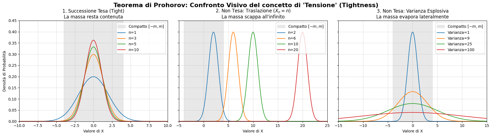{#fig-placeholderx}

## Funzioni Test

::: mybox
Funzioni Lipschitz-continue Sia $\{X_n  \}_{n\geq1}$ una successione di VA a valori in $\mathbb{R}^d$. Allora $X_n \xrightarrow{D}X$ se e solo se: $$\lim_{n\rightarrow \infty}\mathbb{E}[g(X_n)]=\mathbb{E}[g(X)]$$ Per tutte le funzioni $g$ limitate e lipschitz continue.
:::

La definizione originaria di convergenza in distribuzione diceva che per mostra che $X_n \xrightarrow{D}X$, dovevamo verificare che: $$\mathbb{E}[f(X_n)]\rightarrow \mathbb{E}[f(X)]$$ per tutte le funzioni $f$ continue e limitate. Tuttavia l'insieme delle funzioni continue e limitate è immenso e lavaorare con un insieme così vasto è complesso.\
Una funzione $g$ è Lipschitz-continua se esiste una costante $k>0$ tale che, per ogni coppia di punti $x,y$: $$|g(x)-g(y)|\leq k|x-y|$$ Ciò sigifica che la pendenza di $g$ non può mai superare il valore $k$: la funzione non può avere pendenze infinite o variazioni istantanee. Le funzioni Lipschitz continue formano un sottoinsieme molto più regolare e restrittivo delle semplici funzioni continue.

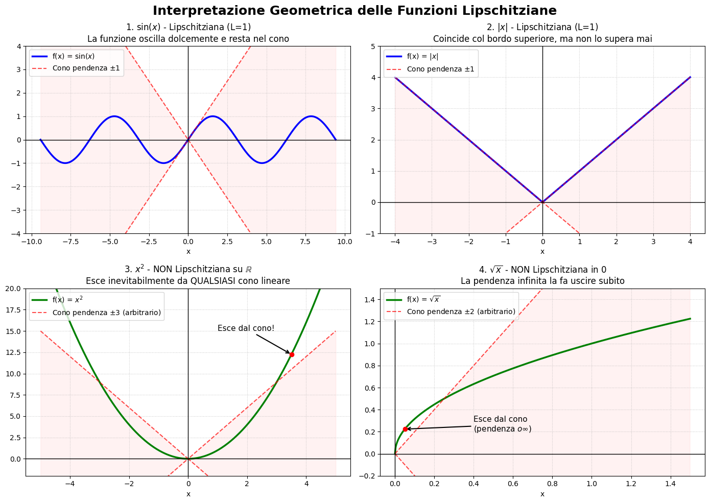{#fig-placeholder}

::: mybox
Corollario Sia $\{X_n  \}_{n\geq1}$ una successione di VA a valori in $\mathbb{R}^d$. Allora $X_n \xrightarrow{D}X$ se e solo se: $$\lim_{n\rightarrow\infty}\mathbb{E}[g(X_n)]=\mathbb{E}[g(X)]$$ per tutte le funzioni $g$ limitate e uniformemente continue.
:::

Nel toerema precedente, abbiamo ridotto la classe di funzioni test affinchè le VA a valori in $\mathbb{R}^d$ convergessero debolmente. La abbiamo ridotta dalle classe delle funzioni continue e limitate a quella delle funzioni limitate e lipschitz-continue. Possiamo affinare ulteriormente la classe riducendola alle funzioni $C^{\infty}$ a supporto compatto.\
Una funzione di classe $C^{\infty}$ è una funzione infinitamente derivabile (come $\sin x$ e $e^x$). Il supporto di una funzion è l'insieme dei punti in cui essa è diversa da 0. Dire che una funzione ha un supporto compatto significa che al di fuori di un intervallo chiuso e limitato, (es $[-5,5]$), la funzione è \"spenta\" e vale 0.\
L'esempio perfetto di funzione contemporaneamente $\in C^{\infty}$ e a supporto compatto è la bump function, fatta assemblando degli esponenziali (del tipo $e^{-\frac{1}{1-x^2}}$.\
dunque: $$C^{\infty}\space\text{a supporto compatto}\subset \text{lipschitz-continue}\subset \text{uniformemente continue}\subset\text{continue}$$

::: mybox
Teorema di Slutsky Siano $\{X_n \}_{n\geq1}$ e $\{Y_n \}_{n\geq1}$ due successioni di VA a valoro in $\mathbb{R}^d$, con $X_n \xrightarrow{D}X$ e $||X_n-Y_n||\xrightarrow{P}0$. Allora: $$Y_n\xrightarrow{D}X$$
:::

Il Teorema di Slutsky è uno dei pilastri fondamentali dell'inferenza statistica e della teoria asintotica. Esso fornisce un ponte logico formidabile tra la convergenza in distribuzione (che è la più debole e riguarda solo la \"forma\" delle probabilità) e la convergenza in probabilità (che è più forte e riguarda i valori effettivi assunti dalle variabili).\
Intuitivamente, il teorema afferma un concetto molto logico: se due successioni di variabili aleatorie diventano asintoticamente "indistinguibili" dal punto di vista macroscopico (ovvero la loro distanza $||X_n - Y_n||$ tende a zero in probabilità), e sappiamo che la prima successione si sta assestando su una certa distribuzione limite $X$, allora **necessariamente** anche la seconda successione erediterà e obbedirà alla medesima distribuzione limite.\
Nella pratica reale dell'analisi dei dati, ci troviamo quasi sempre in questa specifica situazione:

- Costruiamo una *statistica ideale* $X_n$ basata su parametri veri ma a noi **ignoti** (es. la varianza vera della popolazione). Tramite il Teorema del Limite Centrale, sappiamo calcolare esattamente la sua distribuzione asintotica (es. $X_n \xrightarrow{D} N(0,1)$).

- Nella realtà, non avendo a disposizione i parametri veri, siamo costretti a stimarli dai dati. Otteniamo così una *statistica approssimata* $Y_n$ (es. usando la varianza campionaria al posto di quella reale).

Se riusciamo a dimostrare che l'errore introdotto dalla nostra stima svanisce asintoticamente all'aumentare dei campioni (cioè l'errore di stima $\xrightarrow{P} 0$), il Teorema di Slutsky entra in gioco per \"salvarci\", garantendoci che possiamo trattare $Y_n$ esattamente come se fosse la statistica ideale $X_n$. Pertanto, anche la nostra statistica calcolata con i dati stimati convergerà alla normale standard $N(0,1)$.

### Corollari Comuni (Proprietà Algebriche di Slutsky) {#sec-corollari-comuni-propriet-algebriche-di-slutsky .unnumbered}

Nei testi di statistica, il Teorema di Slutsky viene spessissimo citato e utilizzato tramite le sue comodissime conseguenze algebriche. Supponiamo che $X_n \xrightarrow{D} X$ e che una seconda successione $Z_n \xrightarrow{P} c$ (dove $c$ è una costante deterministica). Allora valgono le seguenti proprietà di convergenza congiunta:

1.  **Somma:** $X_n + Z_n \xrightarrow{\; D \;} X + c$

2.  **Prodotto:** $X_n \cdot Z_n \xrightarrow{\; D \;} cX$

3.  **Rapporto:** $\frac{X_n}{Z_n} \xrightarrow{\; D \;} \frac{X}{c}$ (purché $c \neq 0$)

**Esempio classico:** Quando usiamo il test $t$ di Student con molti gradi di libertà, standardizziamo la media campionaria dividendo per la deviazione standard stimata ($S_n$) invece che per la deviazione standard vera ($\sigma$). Poiché la deviazione campionaria è uno stimatore consistente ($S_n \xrightarrow{P} \sigma$), il teorema di Slutsky (tramite la regola del rapporto) ci garantisce che l'intera frazione converga in distribuzione alla Normale Standard $N(0,1)$, esattamente come se avessimo usato la $\sigma$ vera.

## Convergenza di distribuzioni di VA discrete

::: mybox
Convergenza di distribuzioni di VA discrete Siano $\{X_n\}_{n\geq1}$ e $X$ VA con al più un numero numerabile di valori. Allora $X_n \xrightarrow{D}X$ se e solo se: $$\lim_{n\rightarrow\infty}\mathbb{P}(X_n=j)=\mathbb{P}(X=j)$$ $\forall j$ nello spazio di stato di $\{X_n\}_{n\geq1}$ e $X$
:::

Questo teorema offre una semplificazione straordinaria quando lavoriamo esclusivamente nel dominio discreto. Mentre per le variabili aleatorie continue (o miste) la convergenza in distribuzione richiede procedure sofisticate come la verifica delle funzioni di ripartizione (CDF) in tutti i punti di continuità o l'uso di funzioni test (Lemma di Portmanteau), per le variabili discrete tutto si riduce alla **convergenza puntuale delle funzioni di massa di probabilità (PMF)**.

Dal momento che lo spazio degli stati è, per ipotesi, al più numerabile (ad esempio i numeri naturali $\mathbb{N}$ o un insieme finito), ogni possibile evento $A$ è semplicemente un'unione di esiti singoli. Poiché in una unione numerabile di insiemi disgiunti le probabilità si sommano, se la probabilità di osservare *ogni singolo* specifico valore $j$ converge alla sua corrispondente probabilità limite, allora l'intera distribuzione convergerà.\
Questo è possibile poichè in un spazio discreto (come $\mathbb{N}$ i punti sono separati da uno spazio vuoto. Non ci sono punti infinitamente vicini. A causa di questa topologia (detta topologia discreta), qualsiasi funzione definita su questo spazio è automaticamente continua. Se tutte le funzioni sono continue, persino la funzione indicatrice del singolo punto $j$. Quindi applicare la definizione di convergenza debole all'indicatrice di $j$ ci restituisce: $$\lim_{n\to\infty} \mathbb{P}(X_n=j) = \lim_{n\to\infty} \mathbb{E}[\mathbf{1}_{\{j\}}(X_n)] = \mathbb{E}[\mathbf{1}_{\{j\}}(X)] = \mathbb{P}(X=j)$$

**Esempio classico (Approssimazione di Poisson):** Conosciuta anche come "Legge degli eventi rari". Se consideriamo una successione di variabili Binomiali $X_n \sim \text{Binomiale}(n, p_n)$ dove la probabilità di successo si contrae linearmente con $n$ (cioè $p_n = \lambda/n$), possiamo calcolare il limite puntuale della PMF: $$\lim_{n\to\infty} \mathbb{P}(X_n = k) = e^{-\lambda} \frac{\lambda^k}{k!}$$ Poiché abbiamo verificato l'identità per ogni $k \in \mathbb{N}$ e l'espressione di destra è esattamente la probabilità puntuale di una variabile di Poisson, il teorema ci autorizza a concludere rigorosamente che $X_n \xrightarrow{D} \text{Poisson}(\lambda)$.

**Esempi applicativi dettagliati:**

1.  **Convergenza di distribuzioni di Poisson (parametro variabile):**\
    Supponiamo che $\mu_{\lambda_n}$ denoti la distribuzione $\text{Poisson}(\lambda_n)$. La sua funzione di massa di probabilità è data da: $$\mu_{\lambda_n}(j) = \mathbb{P}(X_n = j) = e^{-\lambda_n} \frac{\lambda_n^j}{j!}$$ Se la successione di parametri converge a un valore limite fisso, ovvero $\lambda_n \to \lambda$, possiamo sfruttare la continuità della funzione esponenziale e delle potenze. Deduciamo immediatamente che per ogni $j \in \{0, 1, 2, \dots\}$: $$\lim_{n \to \infty} \mu_{\lambda_n}(j) = e^{-\lambda} \frac{\lambda^j}{j!} = \mu_\lambda(j)$$ Poiché il limite puntuale restituisce esattamente la PMF di una variabile di Poisson con parametro $\lambda$, il teorema ci garantisce che la successione $\mu_{\lambda_n}$ converge debolmente (in distribuzione) alla misura limite $\mu_\lambda$.

2.  **Convergenza di distribuzioni Binomiali (probabilità variabile):**\
    In modo del tutto analogo, indichiamo con $\mu_{p_k}$ la distribuzione $\text{Binomiale}(n, p_k)$ avente un numero di prove $n$ fissato e costante. La probabilità puntuale di ottenere $j$ successi è $\binom{n}{j} p_k^j (1-p_k)^{n-j}$. Se la successione delle probabilità di successo converge a un limite valido, ovvero $p_k \to p$ per $k \to \infty$, questa espressione (che è un semplice polinomio continuo in $p_k$) convergerà banalmente a $\binom{n}{j} p^j (1-p)^{n-j}$. Essendo questa la PMF esatta di una distribuzione $\text{Binomiale}(n, p)$, possiamo concludere che $\mu_{p_k} \xrightarrow{D} \mu_p$.

3.  **Approssimazione di Poisson (Legge degli eventi rari):**\
    Siano $X_n \sim \text{Binomiale}(n, p_n)$. Consideriamo il famoso caso limite in cui il numero di prove tenda all'infinito ($n \to \infty$), ma la probabilità $p_n$ si riduca verso zero in modo tale che il numero medio atteso di successi si stabilizzi a una costante positiva: $\lim_{n \to \infty} n p_n = \lambda > 0$.

    Denotiamo con $\lambda_n = n p_n$. Esplicitiamo accuratamente la PMF binomiale per un valore $k$ prefissato e raccogliamo i termini: $$\mathbb{P}(X_n = k) = \binom{n}{k} p_n^k (1-p_n)^{n-k} = \frac{n(n-1)\cdots(n-k+1)}{k!} \left(\frac{\lambda_n}{n}\right)^k \left(1 - \frac{\lambda_n}{n}\right)^{n-k}$$ Riorganizzando strategicamente i fattori in vista del limite, otteniamo: $$\mathbb{P}(X_n = k) = \frac{\lambda_n^k}{k!} \cdot \underbrace{\left( \frac{n}{n} \cdot \frac{n-1}{n} \cdots \frac{n-k+1}{n} \right)}_{k \text{ fattori}} \cdot \left(1 - \frac{\lambda_n}{n}\right)^n \cdot \left(1 - \frac{\lambda_n}{n}\right)^{-k}$$ Passiamo ora al limite per $n \to \infty$ su ogni singolo blocco:

    - $\lambda_n^k \to \lambda^k$.

    - Ogni frazione del tipo $\frac{n-i}{n} = 1 - \frac{i}{n}$ tende a $1$ (poiché $k$ è fisso al variare di $n$).

    - $\left(1 - \frac{\lambda_n}{n}\right)^n \to e^{-\lambda}$ (in base al limite notevole dell'esponenziale).

    - $\left(1 - \frac{\lambda_n}{n}\right)^{-k} \to 1^{-k} = 1$ (dato che $\lambda_n/n = p_n \to 0$).

    Mettendo tutto assieme, troviamo: $$\lim_{n \to \infty} \mathbb{P}(X_n = k) = \frac{\lambda^k}{k!} \cdot 1 \cdot e^{-\lambda} \cdot 1 = e^{-\lambda} \frac{\lambda^k}{k!}$$ Grazie al teorema della convergenza nel dominio discreto, avendo verificato che le probabilità puntuali per un qualsiasi $k$ convergono alla PMF della distribuzione di Poisson di parametro $\lambda$, siamo autorizzati a concludere rigorosamente che $X_n \xrightarrow{\; D \;} \text{Poisson}(\lambda)$.

## Approfondimento: Perché in generale $\lim_{n \to \infty} \mathbb{P}(X_n \in A) \neq \mathbb{P}(X \in A)$ {#sec-approfondimento-perch-in-generale-lim-n-to-infty-mathbbpx-n-in-a-neq-mathbbpx-in-a .unnumbered}

La convergenza in distribuzione (o convergenza debole) descrive il comportamento asintotico \"globale\" delle misure di probabilità. Tuttavia, questa convergenza può presentare delle discontinuità in corrispondenza delle **frontiere** degli insiemi.

Per comprendere il motivo per cui l'uguaglianza dei limiti delle probabilità non vale per un insieme generico $A$, analizziamo un controesempio classico e, successivamente, la condizione formale dettata dal Lemma di Portmanteau.

### 1. Un controesempio fondamentale {#sec-un-controesempio-fondamentale .unnumbered}

Si consideri una successione di variabili aleatorie degeneri $X_n$ tali che: $$\mathbb{P}\left(X_n = \frac{1}{n}\right) = 1 \quad \forall n \in \mathbb{N}$$ È intuitivo osservare che $X_n \xrightarrow{D} X$, dove la variabile limite $X$ è degenere in zero: $$\mathbb{P}(X = 0) = 1$$ Consideriamo ora l'insieme chiuso $A = (-\infty, 0]$. Calcoliamo le probabilità per la successione e per il limite:

- **Per la successione $X_n$:** Poiché $X_n = 1/n > 0$ per ogni $n$, la variabile non assume mai valori in $A$. Dunque: $$\mathbb{P}(X_n \in A) = 0 \quad \forall n \implies \lim_{n \to \infty} \mathbb{P}(X_n \in A) = 0$$

- **Per la variabile limite $X$:** Poiché $X = 0$ quasi certamente e $0 \in A$, si ha: $$\mathbb{P}(X \in A) = 1$$

Risulta evidente che $0 \neq 1$, e pertanto l'uguaglianza fallisce. Il problema risiede nel fatto che la massa di probabilità della successione si accumula esattamente sulla frontiera dell'insieme $A$.

### 2. Il Lemma di Portmanteau {#sec-il-lemma-di-portmanteau .unnumbered}

Il Lemma di Portmanteau formalizza esattamente sotto quali condizioni il limite delle probabilità coincide con la probabilità del limite. Esso stabilisce che $X_n \xrightarrow{D} X$ se e solo se: $$\lim_{n\to\infty} \mathbb{P}(X_n \in A) = \mathbb{P}(X \in A)$$ **esclusivamente per gli insiemi $A$ che sono di continuità per $X$**.

Un insieme $A$ è detto *insieme di continuità* per la variabile limite $X$ se la probabilità che $X$ assuma valori sulla frontiera $\partial A$ di $A$ è nulla: $$\mathbb{P}(X \in \partial A) = 0$$ Nel controesempio precedente, l'insieme era $A = (-\infty, 0]$, la cui frontiera è $\partial A = \{0\}$. Poiché $\mathbb{P}(X = 0) = 1 > 0$, l'insieme $A$ non era un insieme di continuità, causando il fallimento dell'uguaglianza.

### 3. Il caso particolare degli spazi discreti {#sec-il-caso-particolare-degli-spazi-discreti .unnumbered}

Perché questo problema non sussiste quando si lavora esclusivamente nel dominio discreto (es. $\mathbb{N}$ o $\mathbb{Z}$)?

La risposta risiede nella topologia dello spazio. In uno spazio munito di **topologia discreta**, ogni punto è isolato. Per definizione, in tale topologia, *ogni sottoinsieme è contemporaneamente aperto e chiuso*.

Ricordando che la frontiera di un insieme è definita come la differenza insiemistica tra la sua chiusura ($\bar{A}$) e il suo interno ($\mathring{A}$), se un insieme $A$ è sia aperto che chiuso si ha $\bar{A} = A$ e $\mathring{A} = A$. Di conseguenza: $$\partial A = \bar{A} \setminus \mathring{A} = A \setminus A = \emptyset$$ Essendo la frontiera vuota per qualsiasi insieme $A$ nello spazio discreto, la condizione di continuità è sempre banalmente soddisfatta: $$\mathbb{P}(X \in \partial A) = \mathbb{P}(X \in \emptyset) = 0 \quad \forall A$$ Questo garantisce che, nel caso puramente discreto, tutti gli insiemi siano insiemi di continuità per $X$, rendendo l'uguaglianza $\lim_{n \to \infty} \mathbb{P}(X_n \in A) = \mathbb{P}(X \in A)$ universalmente valida.

# Convergenza Debole e Funzioni Caratteristiche

Esiste una relazione profonda tra convergenza debole e funzioni caratteristiche. Infatti è più semplice calcolare il limite di una funzione caratteristica che dimostrare la covergenza debole in modo diretto-

## Teorema di Continuità di Lévy

Sia $\{\mu_k  \}_{k\geq1}$ una successione di misure di probabilità su $\mathbb{R}^d$, e siano $\{\hat{\mu_k}  \}_{k\geq1}$ le loro trasformate di Fourier, o funzioni caratteristiche.

- Se $\mu_n\rightarrow \mu$ weakly, allora $\hat{\mu_n}(u)\rightarrow\hat{\mu}(u)$. $\forall u\in\mathbb{R}^d$

- Se $\hat{\mu_n}(u)$ converge a una funzione $f(u)$ $\forall u\in\mathbb{R}^d$, e se inoltre $f$ è continua in $u=0$, allora esiste una probabilità $\mu$ su $\mathbb{R}^d$ tale che $f(u)=\hat{\mu}(u)$ e $\mu_n\rightarrow\mu$ weakly.

**N.B.**: Si può anche dimostrare che se $\mu_n$ converge debolmente a una misura di probabilità $\mu$ su $\mathbb{R}^d$, allora $\hat{\mu_n}$ converge a $\hat{\mu}$ uniformemente sui sottoinsiemi compatti di $\mathbb{R}^d$\
Il Teorema di Continuità di Lévy stabilisce una corrispondenza biunivoca rigorosa tra la convergenza debole delle misure di probabilità e la convergenza puntuale delle rispettive funzioni caratteristiche. Dal punto di vista analitico, la dimostrazione si scompone in due fasi distinte: la necessità e la sufficienza.

Per quanto concerne la condizione di necessità, supponiamo che la successione $\mu_n$ converga debolmente a $\mu$. La definizione formale di convergenza debole impone che l'integrale $\int g(x) \mu_n(dx)$ converga a $\int g(x) \mu(dx)$ per ogni funzione $g$ a valori reali che sia continua e limitata su $\mathbb{R}^d$. La funzione caratteristica è definita dall'integrale $\hat{\mu}_n(u) = \int e^{i\langle u, x\rangle} \mu_n(dx)$. Poiché $|e^{i\langle u, x\rangle}| = 1$, le sue componenti reale e immaginaria costituiscono funzioni continue e limitate. Applicando la definizione di convergenza debole alle due componenti, si ottiene direttamente che $\hat{\mu}_n(u)$ converge a $\hat{\mu}(u)$ per ogni $u \in \mathbb{R}^d$.

La dimostrazione della sufficienza, formulata qui per $d=1$, si basa sul Teorema di Helly e sul concetto di successione tesa (*tight*). Assumendo che $\lim_{n\to\infty} \hat{\mu}_n(u) = f(u)$ per ogni $u$ e che la funzione limite $f$ sia continua nell'origine ($u=0$), il primo passo consiste nel dimostrare la tensione della successione $\mu_n$. Integrando la funzione caratteristica su un intervallo simmetrico $[-\alpha, \alpha]$ e applicando il Teorema di Fubini, si ricava: $$\int_{-\alpha}^{\alpha} \hat{\mu}_n(u) du = \int_{-\infty}^{\infty} \left( \int_{-\alpha}^{\alpha} e^{iux} du \right) \mu_n(dx) = \int_{-\infty}^{\infty} \frac{2\sin(\alpha x)}{x} \mu_n(dx)$$.

Riorganizzando algebricamente i termini e dividendo per $\alpha$, la stima si trasforma in: $$\frac{1}{\alpha} \int_{-\alpha}^{\alpha} (1 - \hat{\mu}_n(u)) du = 2 \int_{-\infty}^{\infty} \left( 1 - \frac{\sin(\alpha x)}{\alpha x} \right) \mu_n(dx)$$.

Sfruttando la disuguaglianza $2(1 - \frac{\sin v}{v}) \geq 1$ valida per $|v| \geq 2$, si può limitare inferiormente l'integrale a destra considerando solo la porzione di dominio in cui $|\alpha x| \geq 2$ (ossia $|x| \geq \frac{2}{\alpha}$). Questo produce una disuguaglianza fondamentale per le code della misura: $$\mu_n\left(\left[-\frac{2}{\alpha}, \frac{2}{\alpha}\right]^c\right) \leq \frac{2}{\alpha} \int_{-\alpha}^{\alpha} (1 - \hat{\mu}_n(u)) du$$.

Poiché $f$ è continua in $0$ e $f(0) = 1$, fissato un $\epsilon > 0$ è possibile trovare un $\alpha > 0$ sufficientemente piccolo tale per cui l'integrale di $(1 - f(u))$ sia minore di una frazione di $\epsilon$. Grazie al Teorema della Convergenza Dominata di Lebesgue, per $n$ sufficientemente grande, l'integrale di $(1 - \hat{\mu}_n(u))$ diventa arbitrariamente vicino all'integrale di $(1 - f(u))$. Di conseguenza, la massa di probabilità al di fuori dell'intervallo compatto limitato da $\frac{2}{\alpha}$ risulta uniformemente maggiorata, verificando così la condizione di tensione: $$\lim_{m\to\infty} \sup_n \mu_n([-m, m]^c) = 0$$.

Avendo stabilito che la successione $\mu_n$ è tesa, il Teorema di Selezione garantisce l'esistenza di almeno una sottosuccessione $\mu_{n_k}$ che converge debolmente a una misura di probabilità $\mu$. Per la condizione di necessità, le funzioni caratteristiche $\hat{\mu}_{n_k}(u)$ devono necessariamente convergere a $\hat{\mu}(u)$. Poiché per ipotesi l'intera successione $\hat{\mu}_n(u)$ convergeva a $f(u)$, si conclude senza ambiguità che $f(u) = \hat{\mu}(u)$, dimostrando che $f$ è la funzione caratteristica associata alla probabilità $\mu$.

L'ultimo passaggio richiede di escludere che la convergenza debole sia limitata solo a tale sottosuccessione. Procedendo per assurdo, se l'intera successione $\mu_n$ non convergesse debolmente a $\mu$, esisterebbe un punto di continuità della funzione di ripartizione limite in cui la convergenza fallisce. Questo porterebbe, estraendo un'ulteriore sotto-sottosuccessione $\mu_{n_{k_j}}$, a una convergenza debole verso una misura diversa $\nu$. La funzione caratteristica di $\nu$ dovrebbe però essere identica a $f(u)$ e quindi a $\hat{\mu}(u)$. Il Teorema di Unicità stabilisce che due misure con la stessa funzione caratteristica devono coincidere ($\mu = \nu$), generando la contraddizione che chiude la dimostrazione e prova definitivamente che $\mu_n \rightarrow \mu$ debolmente.

# Laws of Large Numbers

Sia $\{X_n \}_{n\geq1}$ una successione di VA definite sullo stesso spazio di probabilità e sia: $$S_n=\sum_{j=1}^nX_j$$ Un teorema che stabilisce che $S_n/n$ converge in qualche senso è una LLN. Quando la converegenza è A.S. la chiamiamo Strong Law of Large Numbers (SLNN)

## SLLN

Siano $\{X_n \}_{n\geq1}$ VA IID e definite sullo stesso spazio di probabilità $(\Omega, \mathcal{A}, \mathbb{P})$. Sia $\mu=\mathbb{E}[X_j]$ e $\sigma^2=\sigma^2_{X_j}<\infty$. Sia $S_n=\sum_{J=1}^nX_j$. Allora: $$\lim_{n\rightarrow\infty}\frac{S_n}{n}=\lim_{n\rightarrow\infty}\frac{1}{n}\sum_{j=1}^nX_j=\mu \quad A.S.,L^2$$ **N.B.**: è facile dimostrare che $\lim_{n\rightarrow\infty}S_n/n=\mu$ in probabilità usando Chebyshev. Questa è chiamata Weak Law of Large Numbers (WLLN).\
La SLLN afferma che la media campionaria di una sequenza di VA IID si avvicina alla media teorica $\mu$ per $n\rightarrow\infty$ (aumentando il numero di osservazioni).\
Esistono altre 2 versioni di SLLN:

## Kolmogorov's SLLN

Siano $\{X_j \}$ IID e sia $\mu\in \mathbb{R}$. Sia $S_n=\sum X_j$. Allora: $$\lim_{n\rightarrow\infty}\frac{S_n}{n}=\mu \quad A.S.,L^1$$ Se e solo se $\mathbb{E}[X_j]=\mu$.\
Si noti che qua non è necessaria l'ipotesi che le $X_j\in L^1$, cioè $\mathbb{E}[|X_j|]<\infty$

## Ergodic SLLN

Sia $(\Omega, \mathcal{A}, \mathbb{P})$ uno spazio di probabilità e sia $T:\Omega \rightarrow \Omega$ una funzione 1-to-1 (iniettiva) tale che $T(A)\in\mathcal{A}$ (cioè $T$ mappa insiemi misurabili su insiemi misurabili), e se $A\in\mathcal{A}$ allora $\mathbb{P}(T(A))=\mathbb{P}(A)$, cioè $T$ preserva la misura. Sia $T^2(\omega)=T(T(\omega))$ e si definiscano analaticamente le potenze di $T$. Un insieme $\Lambda$ è invariante rispett a $T$ se $\mathbb{1_{\Lambda}(\omega)}=\mathbb{1_{\Lambda}(T(\omega))}$.\
Sia $T$ una transformazione iniettiva di $\Omega$ in se stesso ($T:\Omega \rightarrow\Omega$) che preserva la misura ($\mathbb{P}(T(A))=\mathbb{P}(A)$). Si assuma che gli unici insiemi $T$-invarianti siano insiemi di probabilità $0$ o $1$. Se $X\in L^1$, allora: $$\lim_{n\rightarrow \infty}\frac{1}{n}\sum_{j=1}^nX(T^j(\omega))=\mathbb{E}[X].$$ Il vantaggio dell'ergodic SLLN è che sostituisce l'ipotesi di indipendenza con quella di ergodicità.\
La Legge Forte dei Grandi Numeri Ergodica, spesso nota come Teorema Ergodico di Birkhoff, rappresenta un'estensione profonda della teoria classica della probabilità in quanto permette di superare l'ipotesi di indipendenza.

In questo contesto, si introduce la nozione di un *sistema dinamico che preserva la misura*, la cui evoluzione è governata da una trasformazione iniettiva $T: \Omega \rightarrow \Omega$. Partendo da uno stato iniziale $\omega \in \Omega$, le misurazioni successive del sistema sono date da $X(\omega), X(T(\omega)), \dots, X(T^n(\omega))$.

La condizione che $T$ preservi la misura, ovvero $\mathbb{P}(T(A)) = \mathbb{P}(A)$, garantisce la *stazionarietà* del processo. L'invarianza della misura assicura infatti che le variabili $X(T^j(\omega))$ mantengano tutte la stessa distribuzione marginale.

Il concetto cardine del teorema è l'*ergodicità*, che si basa sulla definizione di insieme invariante: un insieme $\Lambda$ è detto invariante se la sua funzione indicatrice non cambia applicando $T$, ossia $\mathbb{1}_{\Lambda}(\omega) = \mathbb{1}_{\Lambda}(T(\omega))$. L'ipotesi di ergodicità impone che gli unici insiemi $T$-invarianti siano banali, ovvero abbiano probabilità strettamente pari a $0$ o $1$. Questo requisito garantisce che lo spazio degli stati $\Omega$ sia indecomponibile e che il sistema non rimanga intrappolato in sotto-regioni isolate.

Sotto queste ipotesi, e assumendo che $X \in L^1$, l'Ergodic SLLN stabilisce la seguente uguaglianza asintotica: $$\lim_{n\rightarrow \infty}\frac{1}{n}\sum_{j=1}^n X(T^j(\omega)) = \mathbb{E}[X] \quad \text{quasi certamente (a.s.) e in } L^1$$

Il membro di sinistra dell'equazione rappresenta la *media temporale* (time average) calcolata lungo una singola traiettoria dell'orbita del sistema. Il membro di destra rappresenta invece la *media spaziale* (space average), ovvero il valore atteso teorico globale misurato sull'intero spazio $\Omega$.

In sintesi, il vantaggio dell'Ergodic SLLN è che sostituisce l'ipotesi di indipendenza con quella di ergodicità, stabilendo che, per un sistema stazionario ed ergodico, la media temporale di una singola osservazione prolungata all'infinito converge quasi certamente alla media spaziale del processo.

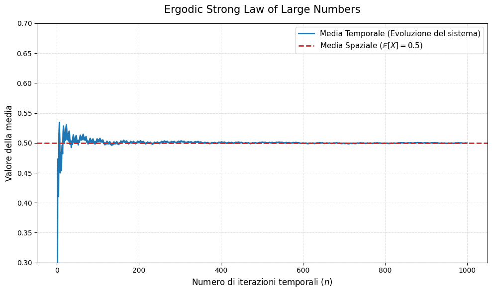

# Central Limit Theorem

Il CLT è uno dei risultati più importanti della toeria delle probabilità. Da una semplice descrizione che richiede ipotesi minime, siamo in grado di dedurre risultati precisi. L'idea è semplice: sia $X_1,X_2,...$ una successione di VA IID con varianza finita. Sia $S_n=\sum_{j=1}^nX_j$. Allora per $n$ grande, $\mathcal{L}(S_n)=\mathcal{N}(n\mu, n\sigma^2)$, dove $\mathbb{E}[X_j]=\mu$ e $\mathbb{V}[X_j]=\sigma^2$.\
L'osservazione chiave è che non si assime assolutamente nulla, tranne una varianza finita delle $X_j$.

## CLT

Sia $\{X_j  \}_{j\geq1}$ una successione IID di VA con $\mathbb{E}[X_j]=\mu$ e $\mathbb{V}[X_j]=\sigma^2<\infty$. Sia $S_n=\sum_{j=1}^nX_j$ e sia $Y_n=\frac{S_n-n\mu}{\sqrt{n\sigma^2}}$. Allora: $$Y_n\xrightarrow{D}Y \quad,\mathcal{L}(Y)=\mathcal{N}(0,1)$$ : se $\sigma^2=0$, allora $X_j=\mu$ A.S. $\forall j$. Quindi $S_n/n=\mu$.

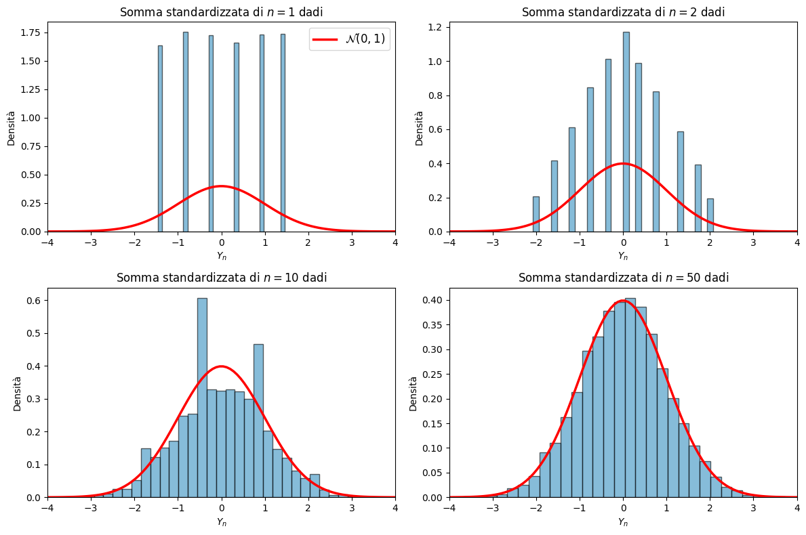

L'osservazione chiave è che non viene assunta assolutamente alcuna ipotesi sulla distribuzione di partenza delle variabili aleatorie $X_j$, ad eccezione del fatto che la loro varianza debba essere finita. Di conseguenza, se si può assumere che una data variabile aleatoria sia il risultato della somma di molte variabili I.I.D. con varianza finita, è possibile dedurre che la sua distribuzione sarà approssimativamente Gaussiana (o Normale).

La variabile standardizzata $Y_n = \frac{S_n - n\mu}{\sqrt{n\sigma^2}}$ convergerà quindi in distribuzione verso una variabile limite $Y$ avente distribuzione Normale standard, ossia $\mathcal{L}(Y) = \mathcal{N}(0,1)$.

Infine, per quanto riguarda il caso degenere menzionato nella nota: se si ha $\sigma^2 = 0$, allora le variabili $X_j$ sono quasi certamente (A.S.) uguali alla loro media $\mu$ per ogni $j$. Da ciò consegue banalmente che la media campionaria $S_n/n = \mu$ quasi certamente.

## Relazione tra CLT e LLN

Siano $X_j$ VA IID, con varianze finite. Sia $\mu$ il loro valore atteso. Allora, per la LLN, il limite per $n\rightarrow\infty$ della media $S_n/n$ è $\mu$. Ora che sappiamo che il limite è $\mu$ ci chiediamo quanto debba essere grande $n$ per essere sufficientemente vicini a $\mu$. Se riscriviamo l'equazione dicendo che la differenza tra $S_n/n$ e $\mu$ tende a $0$, allora ciò che desideriamo conoscere è il tasso di convergenza. $$\lim_{n\rightarrow\infty}|\frac{S_n}{n}-\mu|=0 \quad A.S,L^2$$ Ci chiediamo se esiste un esponente $\alpha \in \mathbb{R}$ diverso da $0$ tale che: $$\[
\lim_{n\rightarrow\infty}n^{\alpha}|\frac{S_n}{n}-\mu|=c \quad A.S$$ Ma un $\alpha$ del genere non esiste. Infatti non si può avere $n^{\alpha}(\frac{S_n}{n}-\mu)$ convergente a una costante $c$ non nulla o ad una VA A.S. non nulla, e nemmeno in probabilità. Tuttavia, grazie al CLT sappiamo che se $\alpha=1/2$, $\sqrt{n}(\frac{S_n}{n}-\mu)$ converge in distribizione a $\mathcal{N}(0,\sigma^2)$. In questo caso la velocità di convergenza della LLN è $\sqrt{n}$. Ciò significa che l'errore tra media campionaria e media teorica $|\frac{S_n}{n}-\mu|$ ha un ordine di grandezza proporzionale a $\frac{1}{\sqrt{n}}$. Per dimezzare l'errore statistico della stima occorrerebbe quadruplicare la dimesione del campipne $n$.

## Ljapunov's CLT

Siano $\{X_j \}_{j\geq1}$ VA indipendente ma non necessariamente identicamente distribuite. Sia $\mathbb{E}[X_J]=0$ $\forall j$ e sia $\sigma^2_j=\mathbb{V}[X_j]$. Assumiamo la condizione di Ljapunov dato un qualche $\epsilon>0$: $$\sup_J\mathbb{E}[|X_J|^{2+\epsilon}]<\infty$$ assumiamo inoltre che: $$\sum_{j=1}^{\infty}\sigma^2_j=\infty$$ Allora: $$\lim_{n\rightarrow \infty}\frac{S_n}{\sqrt{\sum\sigma^2_j}}=Z \quad, \mathcal{L}(Z)=\mathcal{N}(0,1)$$ $\sup_J\mathbb{E}[|X_J|^{2+\epsilon}]<\infty$ è la condizione di Ljaounov. Ci assicura che nessuna delle VA abbia code troppo pesanti, cioè impedisce che una singola VA estrema assuma valori così grandi da dominare l'intera somma $S_n$. Richiedere che un momento leggeremente superiore alla varianza ($2+\epsilon$) sia limitato serve proprio a contenere la probabilità di eventi anomali isolati.

## CLT Multidimensionale

Siano $\{\mathbf{X_j} \}_{j\geq1}$ vettori aleatori IID a valori in $\mathbb{R}^d$. Sia $\mu=\mathbb{E}[\mathbf{X}_j]$ il vettore delle medie e sia $Q=\{ q_{k,l} \}_{1\leq k, l\leq d}$, la matrice di covarianza, dove $q_{k,l}=cov(X_j^k,X_j^l)$, in cui $X_j^k$ è la k-esima componente del vettore aleatorio $\mathbf{X}_j$. Allora: $$\lim_{n\rightarrow \infty}\frac{S_n-n\mu}{\sqrt{n}}=Z \quad,\mathcal{L}(Z)=\mathcal{N}(0,Q)$$

**N.B.**: Non è richiesto che $Q$ sia invertibile. In questo modo vediamo come il CLT possa dare origine a limiti gaussiani senza densità.

### Esempi {#sec-esempi-1 .unnumbered}

- **Approssimazione Normale della Binomiale.** Sia $\{X_j\}_{j\geq1}$ una successione di variabili aleatorie indipendenti e identicamente distribuite (I.I.D.) tali che $\mathbb{P}(X_j = 1) = p$ e $\mathbb{P}(X_j = 0) = q = 1-p$. Allora la loro somma $S_n = \sum_{j=1}^n X_j$ conta il numero di successi in $n$ prove e segue una distribuzione Binomiale, ovvero $\mathcal{L}(S_n) = \mathcal{B}(n, p)$. Per ogni singola variabile di Bernoulli, il valore atteso è $\mu = \mathbb{E}[X_j] = p$ e la varianza è $\sigma^2 = \mathbb{V}[X_j] = pq = p(1-p)$.

  Applicando la Legge Forte dei Grandi Numeri (SLLN), la proporzione campionaria dei successi converge quasi certamente (a.s.) alla probabilità di successo $p$: $$\lim_{n\rightarrow\infty} \frac{S_n}{n} = p \quad \text{a.s.}$$. Questo risultato è cruciale perché giustifica in modo rigoroso l'interpretazione frequentista della probabilità. Inoltre, grazie al Teorema del Limite Centrale (CLT), possiamo descrivere le fluttuazioni di questa proporzione attorno al suo limite asintotico. Standardizzando la variabile, si ottiene che: $$\frac{S_n - np}{\sqrt{np(1-p)}} \xrightarrow{D} Z$$ dove $\mathcal{L}(Z) = \mathcal{N}(0,1)$, con la convergenza intesa in distribuzione. Questa è la nota approssimazione normale alla distribuzione Binomiale, un principio fondamentale impiegato nella statistica inferenziale per la costruzione di intervalli di confidenza per le proporzioni.

- **Funzione di Ripartizione Empirica e Teorema di Glivenko-Cantelli.** Supponiamo che $\{X_j\}_{j\geq1}$ siano variabili aleatorie I.I.D., tutte appartenenti allo spazio $L^2$, dotate di una funzione di ripartizione comune $F$. In molti contesti pratici, la funzione $F$ è ignota e l'obiettivo dello statistico è stimarla a partire dai dati campionari. A tale scopo, si introduce la funzione indicatrice $Y_j(x) = \mathbb{1}_{\{X_j \leq x\}}$. Fissato un punto $x$, le variabili $Y_j(x)$ sono a loro volta I.I.D. e appartengono a $L^2$.

  Si definisce *funzione di ripartizione empirica* la funzione a gradino $F_n(x)$ definita su $\mathbb{R}$ come: $$F_n(x) = \frac{1}{n} \sum_{j=1}^n Y_j(x)$$. Formalmente, questa andrebbe scritta come $F_n(x, \omega)$ poiché essa è una variabile aleatoria che dipende dallo specifico esito dell'esperimento $\omega$. Per la Legge Forte dei Grandi Numeri, valutando il limite puntuale per un dato $x$, otteniamo: $$\lim_{n\rightarrow\infty} F_n(x) = \lim_{n\rightarrow\infty} \frac{1}{n} \sum_{j=1}^n Y_j(x) = \mathbb{E}[Y_1(x)]$$. Essendo l'indicatrice una variabile di Bernoulli, il suo valore atteso coincide con la probabilità dell'evento stesso: $$\mathbb{E}[Y_1(x)] = \mathbb{E}[\mathbb{1}_{\{X_j \leq x\}}] = \mathbb{P}(X_j \leq x) = F(x)$$. Possiamo pertanto concludere che $\lim_{n\rightarrow\infty} F_n(x) = F(x)$ quasi certamente e in $L^2$. Questo implica che la funzione empirica converge puntualmente alla vera funzione di ripartizione.

  Con un'analisi più sofisticata si giunge a un risultato ancora più forte e globale, noto come **Teorema di Glivenko-Cantelli** (chiamato anche \"Teorema fondamentale della statistica\"): $$\lim_{n\rightarrow\infty} \sup_{x \in \mathbb{R}} |F_n(x) - F(x)| = 0 \quad \text{a.s.}$$. Oltre alla convergenza quasi certa, il Teorema del Limite Centrale ci consente di determinare il *tasso di convergenza*, che si dimostra essere pari a $\sqrt{n}$. Infatti, poiché lo scarto $F_n(x) - F(x)$ tende a zero, si ricerca un esponente $\alpha$ tale per cui $n^\alpha (F_n(x) - F(x))$ converga verso una distribuzione limite non degenere. Scegliendo $\alpha = 1/2$, si ha: $$\sqrt{n}(F_n(x) - F(x)) = \sqrt{n}\left( \frac{1}{n}\sum_{j=1}^n Y_j(x) - \mathbb{E}[Y_1(x)] \right) = \frac{\sum_{j=1}^n Y_j(x) - n\mathbb{E}[Y_1(x)]}{\sqrt{n}}$$. Per via del CLT, questa grandezza converge in distribuzione a una variabile aleatoria normale $Z \sim \mathcal{N}(0, \sigma^2(x))$. La varianza limite dipende intrinsecamente dal punto $x$ valutato ed equivale alla varianza di una variabile indicatrice (Bernoulli): $$\sigma^2(x) = \mathbb{V}[Y_1(x)] = F(x)(1 - F(x))$$.

Ma quanto deve essere grande $n$ affichè la CDF empirica sia vicina alla vera CDF?

## Teorema di Berry-Esseen

Siano $\{X_j  \}_{j\geq1}$ VA IID e supponiamo che $\mathbb{E}[|X_j|^3]<\infty$. Sia $G_n(x)$ la CDF della nostra somma standardizzata: $$G_n(x)=\mathbb{P}\left(\frac{S_n-n\mu}{\sqrt{n\sigma^2}}\leq x \right)$$ dove $\mathbb{E}[X_j]=\mu$ e $\mathbb{V}[X_j]=\sigma^2<\infty$. Sia $\Phi(x)=\mathbb{P}(Z\leq x)$, con $\mathcal{L}(Z)=\mathcal{N}(0,1)$. Allora: $$\sup_x| G_n(x)-\Phi(x)|\leq c\frac{\mathbb{E}[|X_1|^3]}{\sigma^3\sqrt{n}}$$ Dove $c\in \mathbb{}R$ è una costante empricamente $\geq0.4097$.\
Il teorema di Berry-Esseen ci fornisce l'esatta velocità di convergenza e ci dice qual'è l'errore massimo che commettiamo usando la curva normale come approssimazione. $G_n(x)$ è la distribuzione reale ed esatta della nostra somma standardizzata $\frac{S_n-n\mu}{\sqrt{n\sigma^2}}$ per uno specifico campione di dimensione $n$. $\Phi(x)$ è invece la CDF di una normale standard ideale. $\sup_j|G_n(x)-\Phi(x)|$ rappresenta la distanza massima (l'errore più grande che si possa commettere) stimando una probabilità con $\Phi(x)$ al posto di $G_n(x)$.

# Spazi $L^2$ e di Hilbert

Supponiamo che sia dato uno spazio di probabilità $(\Omega, \mathcal{A}, \mathbb{P})$. Indichiamo con $L^2$ tutte le (classi di equivalenza per l'uguaglianza A.S. di) variabili aleatorie $X$ tali che $\mathbb{E}[|X|^2]<\infty$. D'ora in poi identificheremo tutte le le VA $X,Y\in L^2$ (che sono uguali A.S.) e le considereremo come rappresentazioni della stessa VA. Questo ha come conseguenza che se $\mathbb{E}[X^2]=0$ allora $X=0$.

## Inner Product

Definiamo un inner product in $L^2$ nel seguente modo: per ogni $X,Y\in L^2$: $$\langle X,Y   \rangle=\mathbb{E}[XY]$$ Notiamo che per la disuguaglianza di Cauchy-Schwartz: $$|\mathbb{E}[XY]|\leq(\mathbb{E}[X^2])^{1/2}(\mathbb{E}[Y^2])^{1/2}<\infty$$\
Abbiamo già visto che $L^2$ è uno spazio lineare: se $X,Y\in L^2$ e $\alpha, \beta$ sono costanti, allora anche $\alpha X+\beta Y \in L^2$. Inoltre l'inner product è lineare in ogni sua componente: $$\langle \alpha X+\beta Y, Z  \rangle=\alpha \langle X,Z \rangle + \beta \langle Y,Z \rangle$$

Infine osserviamo che $\langle X,X  \rangle \geq0$ e $\langle X,X \rangle=0$ se e solo se $X=0$.

## Norma in $L^2$

Una norma in $L^2$ è definita come: $$\Vert X \Vert=\langle X,X \rangle^{1/2}=(\mathbb{E}[X^2])^{1/2}$$

Notiamo che per la bilinearità e per la disuguaglianza di Cauchy-Schwartz (per maggiorare il termine misto $\mathbb{E}[XY]\leq \Vert X\Vert \Vert Y  \Vert$ abbiamo: $$\Vert X+Y \Vert^2 = \mathbb{E}[X^2] + 2\mathbb{E}[XY] + \mathbb{E}[Y^2] \leq \Vert X \Vert^2 + 2\Vert X \Vert \Vert Y \Vert+ \Vert Y\Vert^2=(\Vert X \Vert+ \Vert Y \Vert)^2$$ Applicando la radice quadrata a entrambi i membri, i quadrati si semplificano e così otteniamo la **Disuguaglianza di Minkowski**: $$\Vert X+Y \Vert \leq \Vert X \Vert + \Vert Y \Vert$$

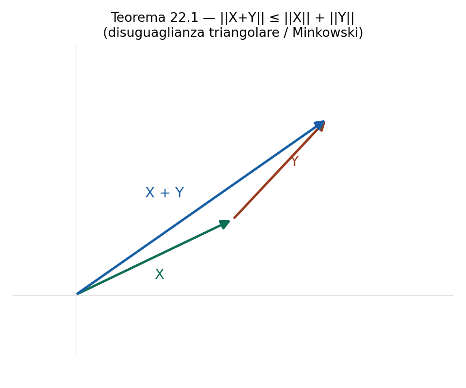{#fig-placeholderx}

::: mybox
$L^2$ è uno spazio lineare normato $L^2$ è uno spazio lineare normato dotato di inner product $\langle \cdot, \cdot \rangle$. Inoltre, si ha: $$\Vert \cdot \Vert=\langle \cdot, \cdot \rangle$$
:::

Ora vogliamo dimostrare che $L^2$ è uno spazio lineare normato completo; ovvero, se $X_n$ è una successione di VA che è di Cauchy, allora esiste un limite in $L^2$.

::: mybox
Successione di Cauchy In matematica, una **successione di Cauchy** (o successione fondamentale) è una successione in cui i termini si avvicinano arbitrariamente tra loro man mano che si procede all'infinito.

**Definizione Formale**\
Sia $X$ uno spazio vettoriale dotato di una norma $\Vert \cdot \Vert$. Una successione $\{x_n\}_{n \in \mathbb{N}}$ a valori in $X$ si dice di Cauchy se, per ogni $\epsilon > 0$, esiste un indice $N \in \mathbb{N}$ tale per cui, per ogni $n, m > N$, si ha: $$\Vert x_n - x_m \Vert < \epsilon$$

La particolarità di questa definizione è che *non richiede di conoscere il limite* a cui tende la successione. Non stiamo misurando la distanza da un punto di arrivo finale, ma stiamo verificando che la distanza tra *due termini qualsiasi* della coda della successione diventi piccola a piacere.

**Il ruolo della Completezza**\
È sempre vero che una successione convergente è di Cauchy. Tuttavia, il viceversa dipende dallo spazio in cui ci troviamo:

- Se lo spazio ha dei \"buchi\" (come l'insieme dei numeri razionali $\mathbb{Q}$), una successione di Cauchy potrebbe non convergere a un elemento di quello spazio.

- Se in uno spazio normato *tutte* le successioni di Cauchy convergono a un elemento dello spazio stesso, lo spazio si dice **completo**.

Uno spazio vettoriale normato e completo prende il nome di **Spazio di Banach**. Se la norma deriva da un prodotto scalare (come per lo spazio $L^2$ delle variabili aleatorie), prende il nome speciale di **Spazio di Hilbert**.
:::

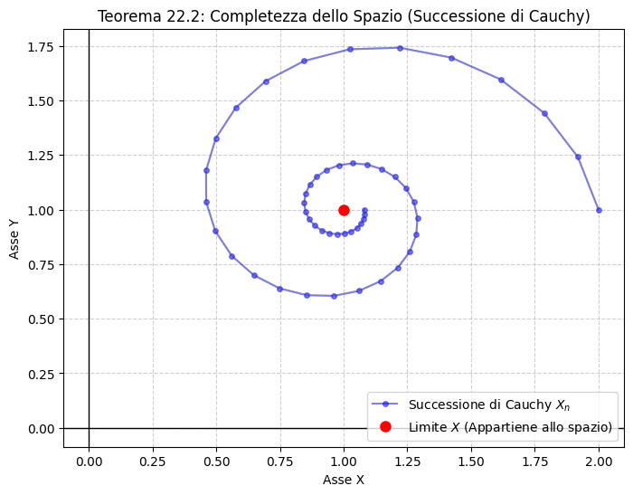{#fig-placeholder}

::: mybox
$L^2$ è uno spazio completo $L^2$ è uno spazio lineare normato completo
:::

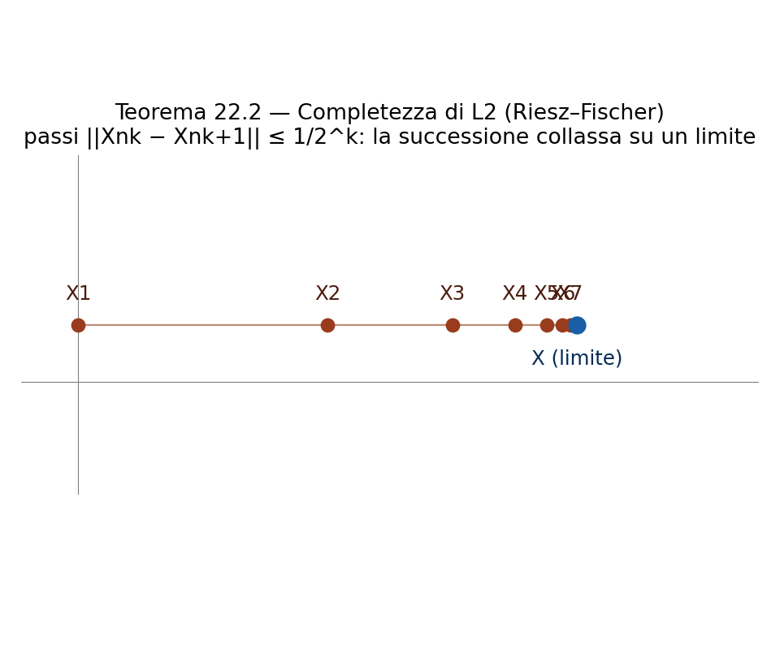{#fig-placeholderx}

# Spazi di Hilbert

Uno spazio di Hilbert $\mathcal{H}$ è uno spazio lineare normato completo con un inner product che soddisfa: $$\langle x,x\rangle^{1/2}=\Vert x\Vert \quad \forall x\in \mathcal{H}$$

::: mybox
$L^2$ e $\mathcal{H}$ $L^2$ è uno spazio di Hilbert.
:::

{#fig-placeholder}

D'ora in poi non parleremo più di VA e valori attesi, ma di vettori in un generico spazio di Hilbert $\mathcal{H}$.

## Ortogonalità

Due vettori $x,y \in \mathcal{H}$ sono ortogonali se $\langle x,y \rangle = 0$.\
Un vettore $x$ è ortogonale ad un insieme di vettori $\Gamma$ se $\langle x,y \rangle = 0 \quad \forall y \in \Gamma$.\
Osserviamo che se $\langle x,y \rangle = 0$, allora $\Vert x+y \Vert^2 = \Vert x \Vert^2 + \Vert y \Vert^2$, che è la versione di Hilbert del Teorema di Pitagora.

{#fig-placeholderx}

Nel nostro spazio probabilistico $L^2$ ciò significa che: $$\langle X,Y \rangle = 0 \implies \mathbb{E}[XY] = 0 \implies \text{le VA sono ortogonali}$$

**Ortogonalità vs Incorrelazione**\
Dire che due variabili aleatorie sono ortogonali non equivale automaticamente a dire che sono *incorrelate*. Sapendo che la covarianza è definita come: $$\text{Cov}(X,Y) = \mathbb{E}[XY] - \mathbb{E}[X]\mathbb{E}[Y]$$ se $X$ e $Y$ sono ortogonali ($\mathbb{E}[XY] = 0$), la loro covarianza diventa $\text{Cov}(X,Y) = -\mathbb{E}[X]\mathbb{E}[Y]$. Di conseguenza, due variabili ortogonali sono anche incorrelate se e solo se almeno una delle due ha valore atteso nullo ($\mathbb{E}[X]=0$ oppure $\mathbb{E}[Y]=0$).

::: mybox
Continuità dell'inner product Se $x_n\rightarrow x$ e $y_n\rightarrow y$ in $\mathcal{H}$, allora $\langle x_n,y_n \rangle \rightarrow \langle x,y \rangle$ in $\mathbb{R}$. E quindi anche $\Vert x_n\Vert\rightarrow\Vert x \Vert$.
:::

Questo teorema ci garantisce che il prodotto scalare (e di conseguenza la norma) è una **funzione continua**. In termini di calcolo, significa che l'operazione di limite e il prodotto scalare \"commutano\", ovvero possiamo portare il limite all'interno delle parentesi: $$\lim_{n \to \infty} \langle x_n, y_n \rangle = \left\langle \lim_{n \to \infty} x_n, \lim_{n \to \infty} y_n \right\rangle = \langle x, y \rangle$$

{#fig-placeholder}

## Sottospazi di $\mathcal{H}$

Un sottoinsieme $\mathcal{L}$ si $\mathcal{H}$ è un sottospazio se è lineare (se $x,y\in\mathcal{L}$ allora $\alpha x+ \beta y \in \mathcal{L}$ ) e se è chiuso (se $\{x_n \}_{n\geq1}$ converge ad $x$ in $\mathcal{H}$, allora $x\in \mathcal{L}$).

::: mybox
Complemento ortogonale Sia $\Gamma$ un insieme di vettori. Indichiamo com $\Gamma^\perp$ il complemento ortogonale, ovvero l'insieme di tutti i vettori che sono ortogonali a tutti i vettori in $\Gamma$. Abbiamo dunque che $\Gamma^\perp$ è un sottospazio di $\mathcal{H}$.
:::

Per dimostrare che è un sottospazio, dobbiamo verificare che sia chiuso rispetto alla combinazione lineare. Siano $x_1, x_2 \in \Gamma^\perp$ e siano $\alpha, \beta$ due scalari. Dobbiamo verificare che $(\alpha x_1 + \beta x_2) \in \Gamma^\perp$. Prendiamo un generico $y \in \Gamma$ e calcoliamo il prodotto scalare sfruttando la linearità: $$\langle \alpha x_1 + \beta x_2, y \rangle = \alpha \langle x_1, y \rangle + \beta \langle x_2, y \rangle$$ Poiché $x_1$ e $x_2$ appartengono a $\Gamma^\perp$, sappiamo per definizione che $\langle x_1, y \rangle = 0$ e $\langle x_2, y \rangle = 0$. Quindi: $$\alpha (0) + \beta (0) = 0$$ Dato che questo vale per ogni $y \in \Gamma$, concludiamo che la combinazione lineare $(\alpha x_1 + \beta x_2)$ appartiene a $\Gamma^\perp$.

**Perché è \"chiuso\"?**\
Il fatto che $\Gamma^\perp$ sia un sottospazio *chiuso* (cioè che contenga tutti i suoi punti di accumulazione) deriva direttamente dal teorema sulla **continuità del prodotto scalare**. Se prendiamo una successione $x_n \in \Gamma^\perp$ tale che $x_n \to x$, portando il limite dentro al prodotto scalare avremo che $\langle x, y \rangle = \lim_{n \to \infty} \langle x_n, y \rangle = 0$, garantendo che anche il limite $x$ si trovi in $\Gamma^\perp$.

{#fig-placeholderx}

## Distanza

Per un sottospazio $\mathcal{L}$ di $\mathcal{H}$, sia $$d(x,\mathcal{L})=\inf\{\Vert x-y  \Vert:y \in \mathcal{L}\}$$ la distanza da $x\in \mathcal{H}$ a $\mathcal{L}$.\

::: mybox
Distanza tra un punto e un sottospazio La formula rigorosa per definire la distanza tra un vettore $x$ e un intero sottospazio $\mathcal{L}$ è: $$d(x,\mathcal{L}) = \inf \{ \Vert x-y \Vert : y \in \mathcal{L} \}$$

**Scomposizione della formula:**

- **$d(x,\mathcal{L})$**: indica la distanza tra il punto fissato $x$ e l'insieme $\mathcal{L}$.

- **$\Vert x-y \Vert$**: è la distanza tra $x$ e un generico vettore $y$. Geometricamente, è la norma (lunghezza) del vettore differenza.

- **$\{ \dots : y \in \mathcal{L} \}$**: indica l'insieme di tutte le possibili distanze che si ottengono facendo variare $y$ in tutti i modi possibili all'interno del sottospazio $\mathcal{L}$.

- **$\inf$ (Estremo inferiore)**: l'operatore seleziona il limite inferiore di questo insieme di distanze.

**Perché si usa $\inf$ e non $\min$ (minimo)?**\
In analisi matematica, l'estremo inferiore ($\inf$) *esiste sempre* per un insieme di numeri reali limitato inferiormente (e le distanze sono sempre $\geq 0$). Il minimo ($\min$), invece, esiste solo se quel valore viene effettivamente \"toccato\" da un elemento dell'insieme.

Se un generico insieme non è chiuso (immagina un cerchio senza il bordo), le distanze possono avvicinarsi indefinitamente a un valore senza mai raggiungerlo: in quel caso avremmo un $\inf$, ma non un $\min$. Tuttavia, il **Teorema della Proiezione** ci garantisce che, poiché $\mathcal{L}$ è un sottospazio **chiuso**, questo valore minimo viene effettivamente raggiunto da un vettore unico (la proiezione ortogonale). In questo caso specifico, l'$\inf$ diventa a tutti gli effetti un $\min$.
:::

Notiamo che se $\mathcal{L}$ è un sottospazio, allora $x\in \mathcal{L}$ se e solo se $d(x,\mathcal{L})=0$, ovvero la distanza tra $x$ e $\mathcal{L}$ è $0$.

::: mybox
Teorema della Proiezione (o della Migliore Approssimazione)

Sia $\mathcal{L}$ un sottospazio **chiuso** di uno spazio di Hilbert $\mathcal{H}$ e sia $x \in \mathcal{H}$. Allora esiste un unico vettore $y \in \mathcal{L}$ (chiamato *proiezione ortogonale* di $x$ su $\mathcal{L}$) tale che minimizza la distanza da $x$: $$\Vert x-y \Vert = \inf_{z \in \mathcal{L}} \Vert x-z \Vert = d(x, \mathcal{L})$$
:::

{#fig-placeholder}

**Caratterizzazione tramite Ortogonalità**\
Il vettore $y \in \mathcal{L}$ è la proiezione ortogonale di $x$ se e solo se l'errore di approssimazione $(x - y)$ è ortogonale a tutto il sottospazio $\mathcal{L}$. Ovvero: $$\langle x - y, z \rangle = 0 \quad \forall z \in \mathcal{L}$$ Questo equivale a dire che l'errore $(x - y) \in \mathcal{L}^\perp$.

**Significato Geometrico e Pratico**\
Geometricamente, stiamo tracciando l'altezza (la perpendicolare) dal punto $x$ al \"piano\" $\mathcal{L}$. Il punto di intersezione $y$ è il punto di $\mathcal{L}$ più vicino a $x$. Questo vettore $y$ rappresenta la **migliore approssimazione** possibile dell'elemento $x$ utilizzando solo gli elementi a disposizione nel sottospazio $\mathcal{L}$.

**L'operatore di proiezione**\
Grazie a questo teorema, possiamo definire un operatore $\Pi: \mathcal{H} \to \mathcal{L}$ che associa ad ogni $x$ la sua unica proiezione $y$. Di conseguenza, ogni vettore $x \in \mathcal{H}$ può essere scomposto in modo unico come: $$x = y + (x - y) = \Pi(x) + x^{\perp}$$ dove $\Pi(x) \in \mathcal{L}$ e $x^{\perp} \in \mathcal{L}^\perp$. Questa si chiama *scomposizione ortogonale* dello spazio $\mathcal{H}$.

## Operatore di Proiezione

Fissiamo uno spazio di Hilbert $\mathcal{H}$ e un sottospazio (chiuso e lineare) $\mathcal{L}$. La proiezione di un vettore $x\in \mathcal{H}$ su $\mathcal{L}$ consiste nel prendere l'unico vettore $y\in \mathcal{L}$ che è più vicino a $x$.\
Indichiamo l'operatore di proiezione con $\Pi$.

::: mybox
Proprietà dell'operatore di proiezione L'operatore di proiezione ortogonale $\Pi$ di uno spazio di Hilbert $\mathcal{H}$ su un sottospazio chiuso $\mathcal{L}$ soddisfa le seguenti proprietà fondamentali:

1.  **$\Pi$ è idempotente: $\Pi^2=\Pi$**\
    *Significato geometrico:* Applicare la proiezione due volte equivale ad applicarla una volta sola. Se proietti un vettore sul piano $\mathcal{L}$, il nuovo vettore si trova già su quel piano; cercare di proiettarlo di nuovo non lo sposterà. In simboli: $\Pi(\Pi(x)) = \Pi(x)$.

2.  **Azione sui sottospazi chiave:**\
    $\Pi(x) = x \quad \text{per } x \in \mathcal{L}$\
    $\Pi(x) = 0 \quad \text{per } x \in \mathcal{L}^\perp$\
    *Significato geometrico:* L'operatore agisce come funzione identità per i vettori che appartengono già a $\mathcal{L}$ (sono già perfetti, non c'è nulla da approssimare). Al contrario, annulla completamente i vettori che appartengono al complemento ortogonale $\mathcal{L}^\perp$, poiché questi non hanno alcuna \"ombra\" proiettata su $\mathcal{L}$ (sono a $90^\circ$).

3.  **Ortogonalità del residuo (o errore):**\
    Per ogni $x \in \mathcal{H}$, il vettore $(x - \Pi(x))$ è ortogonale a $\mathcal{L}$.\
    *Significato geometrico:* È il cuore del Teorema della Proiezione. Il vettore originale $x$ viene diviso perfettamente in due parti ortogonali tra loro: $$x = \underbrace{\Pi(x)}_{\in \mathcal{L}} + \underbrace{(x - \Pi(x))}_{\in \mathcal{L}^\perp}$$ La prima è la migliore approssimazione, la seconda è l'errore commesso.

**Nota (Linearità):** Oltre a queste, l'operatore $\Pi$ su un sottospazio è sempre un operatore **lineare**, ovvero $\Pi(\alpha x + \beta y) = \alpha \Pi(x) + \beta \Pi(y)$.
:::

{#fig-placeholderx}

::: mybox
Corollario: Decomposizione Ortogonale Sia $\Pi_{\mathcal{L}}$ l'operatore di proiezione ortogonale di $\mathcal{H}$ su un sottospazio chiuso $\mathcal{L}$. Allora l'identità: $$x = \Pi_{\mathcal{L}}(x) + (x - \Pi_{\mathcal{L}}(x))$$ è una **rappresentazione unica** di $x$ come somma di un vettore in $\mathcal{L}$ e uno in $\mathcal{L}^\perp$.
:::

**Proiezione sul complemento ortogonale**\
Il termine residuo (l'errore di approssimazione) $(x - \Pi_{\mathcal{L}}(x))$ è esattamente la proiezione ortogonale di $x$ sul sottospazio $\mathcal{L}^\perp$. Possiamo quindi definire un nuovo operatore $\Pi_{\mathcal{L}^\perp}(x) = x - \Pi_{\mathcal{L}}(x)$, riscrivendo in modo elegante la scomposizione come: $$x = \Pi_{\mathcal{L}}(x) + \Pi_{\mathcal{L}^\perp}(x)$$

**Conseguenza (Teorema di Pitagora)**\
Poiché per definizione $\Pi_{\mathcal{L}}(x) \perp \Pi_{\mathcal{L}^\perp}(x)$, possiamo applicare il Teorema di Pitagora calcolando la norma al quadrato di entrambi i membri: $$\Vert x \Vert^2 = \Vert \Pi_{\mathcal{L}}(x) \Vert^2 + \Vert x - \Pi_{\mathcal{L}}(x) \Vert^2$$ *Significato pratico:* La \"lunghezza\" totale del vettore è la somma esatta della lunghezza della sua approssimazione e della lunghezza dell'errore commesso. In probabilità, questa è esattamente la formula della **scomposizione della varianza**.

{#fig-placeholder}

::: mybox
Corollario: Altre proprietà dell'operatore di proiezione Sia $\Pi_{\mathcal{L}}$ l'operatore di proiezione ortogonale di uno spazio di Hilbert $\mathcal{H}$ su un sottospazio chiuso $\mathcal{L}$. Allora valgono le seguenti proprietà:

1.  **Simmetria (o Operatore Autoaggiunto):**\
    $$\langle \Pi_{\mathcal{L}}(x), y \rangle = \langle x, \Pi_{\mathcal{L}}(y) \rangle = \langle \Pi_{\mathcal{L}}(x), \Pi_{\mathcal{L}}(y) \rangle$$ *Significato analitico:* L'operatore di proiezione può essere \"spostato\" da un argomento all'altro del prodotto scalare senza alterare il risultato.\
    *Perché è vero?* Ricordando la scomposizione ortogonale $y = \Pi_{\mathcal{L}}(y) + y^\perp$, se calcoliamo il prodotto scalare del primo termine otteniamo: $$\langle \Pi_{\mathcal{L}}(x), y \rangle = \langle \Pi_{\mathcal{L}}(x), \Pi_{\mathcal{L}}(y) + y^\perp \rangle = \langle \Pi_{\mathcal{L}}(x), \Pi_{\mathcal{L}}(y) \rangle + \underbrace{\langle \Pi_{\mathcal{L}}(x), y^\perp \rangle}_{=0}$$ Il termine incrociato si annulla perché $\Pi_{\mathcal{L}}(x) \in \mathcal{L}$ e $y^\perp \in \mathcal{L}^\perp$. Facendo lo stesso ragionamento per $\langle x, \Pi_{\mathcal{L}}(y) \rangle$ si arriva all'identico risultato centrale.

2.  **Linearità:**\
    Per ogni coppia di vettori $x,y \in \mathcal{H}$ e di scalari $\alpha, \beta$: $$\Pi_{\mathcal{L}}(\alpha x + \beta y) = \alpha \Pi_{\mathcal{L}}(x) + \beta \Pi_{\mathcal{L}}(y)$$ *Significato geometrico:* Proiettare prima i vettori e poi combinarli produce lo stesso risultato che combinarli prima e proiettare il vettore finale. L'ombra di una somma è la somma delle ombre.
:::

::: mybox
Applicazione lineare Sia $T$ un'applicazione da $\mathcal{H}$ su un sottospazio $\mathcal{L}$. Supponiamo che $x-T(x)$ sia ortogonale a $\mathcal{L}\quad \forall x\in \mathcal{H}$. Allora $T=\Pi_{\mathcal{L}}$, l'operatore di proiezione sul sottospazio $\mathcal{L}$.
:::

Questo teorema ci dice come \"verificare\" se abbiamo calcolato correttamente una proiezione. Se in un esercizio \"indoviniamo\" o proponiamo una certa formula $T(x)$ e vogliamo assicurarci che sia la proiezione ortogonale su $\mathcal{L}$, ci basta controllare due cose:

1.  Che il risultato $T(x)$ stia in $\mathcal{L}$.

2.  Che il residuo $(x - T(x))$ sia ortogonale a tutti gli elementi di $\mathcal{L}$.

Se entrambe le condizioni sono soddisfatte, allora $T(x)$ è senza dubbio la proiezione ortogonale.

# Valore Atteso Condizionato

Siano $X$ e $Y$ due VA. Con $Y$ a valori in $\mathbb{R}$ e $X$ che assume solo una quantitità numerabile di valori $\{x_1,...,x_n,...\}$. Supponiamo di sapere che si è verificato l'evento $\{X=x_j \}$. Il valore atteso di $Y$ può cambiare in base a questa conoscenza.

## Valore atteso condizionato di $Y$ dato l'evento $\{X=x_j \}$

Il concetto di **valore atteso condizionato** rispetto a un singolo evento è il primo passo per capire matematicamente come la scoperta di una nuova informazione aggiorni le nostre stime.

Sia $X$ una variabile aleatoria discreta, a valori in un insieme numerabile $\{x_1,\dots,x_n,\dots\}$, e sia $Y$ una variabile aleatoria a valori reali in $\mathbb{R}$. Fissiamo un evento specifico: supponiamo di aver appena osservato (o di ipotizzare) che $X$ abbia assunto esattamente il valore $x_j$. Affinché abbia senso condizionare rispetto a questo evento, dobbiamo assicurarci che non sia impossibile, richiedendo che $\mathbb{P}(X=x_j)>0$.

Sotto questa ipotesi, il valore atteso condizionato di $Y$ dato l'evento $\{X=x_j\}$ è definito rigorosamente come: $$\mathbb{E}[Y|X=x_j] = \mathbb{E}_{\mathbb{Q}}[Y]$$

**Il cambio di misura di probabilità**\
Il cuore di questa definizione risiede nell'introduzione di $\mathbb{Q}$, che rappresenta una *nuova* misura di probabilità. Per un qualsiasi evento $\Lambda$, la nuova probabilità $\mathbb{Q}(\Lambda)$ è definita tramite la probabilità condizionata classica introdotta da Kolmogorov: $$\mathbb{Q}(\Lambda) = \mathbb{P}(\Lambda|X=x_j) = \frac{\mathbb{P}(\Lambda \cap \{X=x_j\})}{\mathbb{P}(X=x_j)}$$ Intuitivamente, sapere che $X=x_j$ si è verificato cambia il nostro \"universo\" di riferimento. Tutti gli esiti dello spazio campionario in cui $X \neq x_j$ vengono immediatamente scartati: la loro probabilità sotto la nuova misura $\mathbb{Q}$ crolla a zero. Viceversa, le probabilità di tutti gli eventi compatibili con $X=x_j$ vengono \"riproporzionate\", ovvero divise per il fattore di scala $\mathbb{P}(X=x_j)$, così che la probabilità totale del nuovo universo torni a sommare a $1$.

Di conseguenza, calcolare il valore atteso condizionato $\mathbb{E}[Y|X=x_j]$ non è altro che calcolare una normalissima media di $Y$, ma utilizzando i \"nuovi pesi\" forniti dalla probabilità $\mathbb{Q}$ invece dei pesi originali dettati da $\mathbb{P}$.

**La condizione di integrabilità**\
La definizione si conclude con una postilla fondamentale: il calcolo è valido *a patto che* $\mathbb{E}_{\mathbb{Q}}[|Y|] < \infty$. Questa condizione tecnica ci assicura che il valore atteso esista finito. Non basta che $Y$ sia integrabile nell'universo originale $\mathbb{P}$; affinché la media condizionata abbia senso matematico, la variabile $Y$ (in valore assoluto) deve non divergere all'infinito quando la si valuta sotto la nuova \"lente\" della probabilità $\mathbb{Q}$.

::: mybox
Anche $Y$ è discreta Se anche $Y$ è discreta e assume una quantità numerabile di valori $\{y_1,...,y_n,... \}$, allora: $$\mathbb{E}[Y|X=x_j]=\sum_{k=1}^{\infty}y_k\mathbb{P}(Y=y_k|X=x_j)$$
:::

Questa espressione è l'esatto analogo della formula classica per il valore atteso $\mathbb{E}[Y] = \sum y_k \mathbb{P}(Y=y_k)$, ma con i \"pesi\" aggiornati. Invece di moltiplicare ogni possibile valore $y_k$ per la sua probabilità marginale (a priori), lo moltiplichiamo per la sua **probabilità condizionata** (a posteriori), sapendo con certezza che l'evento $X=x_j$ si è verificato.

**Il legame con la misura $\mathbb{Q}$**\
Riprendendo il concetto del \"cambio di universo\" visto in precedenza, le probabilità condizionate $\mathbb{P}(Y=y_k \mid X=x_j)$ non sono altro che i pesi della nuova misura $\mathbb{Q}(Y=y_k)$. Stiamo quindi eseguendo una normale media pesata dei valori di $Y$, ma utilizzando come pesi la nuova distribuzione di probabilità $\mathbb{Q}$ dettata dall'informazione su $X$.

{#fig-placeholderx}

## Valore atteso condizionato di $Y$ data $X$ discreta

Sia $X$ una variabile aleatoria a valori in un insieme numerabile $\{x_1, x_2, \dots\}$ e sia $Y$ una variabile aleatoria a valori in $\mathbb{R}$ (con $\mathbb{E}[|Y|] < \infty$).

Il **valore atteso condizionato di $Y$ data $X$**, indicato con $\mathbb{E}[Y|X]$, è definito come: $$\mathbb{E}[Y|X] = f(X)$$ dove $f(x)$ è la funzione reale definita da: $$f(x_j) = \mathbb{E}[Y|X=x_j] \quad \text{per ogni } x_j \text{ tale che } \mathbb{P}(X=x_j) > 0$$

**Il salto concettuale: Numero vs Variabile Aleatoria**\
È cruciale notare la differenza rispetto alla sezione precedente:

- Condizionare a un evento specifico, come $\{X=x_j\}$, produce un **numero fisso** (la stima di $Y$ sapendo esattamente cosa è successo).

- Condizionare rispetto all'intera variabile aleatoria $X$ produce una **nuova variabile aleatoria**.

**Perché è una variabile aleatoria?**\
L'espressione $\mathbb{E}[Y|X]$ descrive il modo in cui aggiorneremo la nostra stima di $Y$ *prima* che l'esperimento venga eseguito. Poiché il risultato dipende dal valore (ancora ignoto e governato dal caso) che assumerà $X$, la quantità $f(X)$ è anch'essa governata dal caso. Nello specifico, $\mathbb{E}[Y|X]$ è una variabile aleatoria discreta che: $$\text{assume il valore } \mathbb{E}[Y|X=x_j] \quad \text{con probabilità } \mathbb{P}(X=x_j)$$

### Esempio {#sec-esempio-14 .unnumbered}

Sia $X$ una variabile aleatoria con distribuzione di Poisson di parametro $\lambda$. Supponiamo che, dato l'evento $\{X=n\}$, eseguiamo $n$ prove indipendenti, ciascuna con probabilità di successo $p$. Sia $S$ il numero totale di successi ottenuti. Vogliamo calcolare $\mathbb{E}[S|X]$ e $\mathbb{E}[X|S]$.\
**1. Calcolo di $\mathbb{E}[S|X]$ (Il caso semplice)**\
Iniziamo fissando il valore di $X$. Se sappiamo che $X=n$, la variabile $S$ (numero di successi in $n$ prove) segue per definizione una distribuzione Binomiale di parametri $n$ e $p$. Sappiamo che il valore atteso di una Binomiale è il prodotto dei suoi parametri: $$\mathbb{E}[S|X=n] = np$$ Per la regola vista in precedenza (il passaggio da numero a variabile aleatoria), sostituendo il valore fisso $n$ con la variabile $X$, otteniamo immediatamente: $$\mathbb{E}[S|X] = pX$$

**2. Calcolo di $\mathbb{E}[X|S]$ (Il caso complesso)**\
Questo calcolo è più insidioso perché dobbiamo procedere \"a ritroso\". Per trovare $\mathbb{E}[X|S=k]$, dobbiamo prima determinare la distribuzione di probabilità condizionata $\mathbb{P}(X=n|S=k)$. Utilizziamo il Teorema di Bayes e la Legge delle Probabilità Totali: $$\mathbb{P}(X=n|S=k) = \frac{\mathbb{P}(S=k|X=n)\mathbb{P}(X=n)}{\mathbb{P}(S=k)} = \frac{\mathbb{P}(S=k|X=n)\mathbb{P}(X=n)}{\sum_{m \geq k} \mathbb{P}(S=k|X=m)\mathbb{P}(X=m)}$$ *Nota sui limiti della sommatoria:* La somma parte da $m=k$ perché è impossibile ottenere $k$ successi se il numero totale di tentativi $m$ è minore di $k$.

Sostituiamo le distribuzioni note (Binomiale per $S|X$ e Poisson per $X$): $$\text{Numeratore} = \binom{n}{k} p^k (1-p)^{n-k} \frac{\lambda^n}{n!} e^{-\lambda}$$ Esplicitando il coefficiente binomiale $\binom{n}{k} = \frac{n!}{k!(n-k)!}$, il termine $n!$ si semplifica: $$\text{Numeratore} = \frac{p^k (1-p)^{n-k} \lambda^n}{k!(n-k)!} e^{-\lambda}$$

Ora calcoliamo il **Denominatore** (che richiede un trucco algebrico). Riscriviamo la serie raggruppando i termini e portando fuori dalla sommatoria ciò che non dipende da $m$: $$\text{Denominatore} = \sum_{m \geq k} \frac{p^k (1-p)^{m-k} \lambda^m}{k!(m-k)!} e^{-\lambda} = \frac{(\lambda p)^k e^{-\lambda}}{k!} \sum_{m \geq k} \frac{(\lambda(1-p))^{m-k}}{(m-k)!}$$ Facciamo un cambio di variabile: poniamo $j = m-k$. Quando $m$ va da $k$ a $\infty$, $j$ va da $0$ a $\infty$: $$\sum_{j=0}^{\infty} \frac{(\lambda(1-p))^j}{j!}$$ Questa è esattamente l'espansione in serie di Taylor della funzione esponenziale $e^x = \sum \frac{x^j}{j!}$, con $x = \lambda(1-p)$. Quindi la somma vale $e^{\lambda(1-p)}$. Il denominatore si riduce a: $$\text{Denominatore} = \frac{(\lambda p)^k e^{-\lambda}}{k!} e^{\lambda(1-p)} = \frac{(\lambda p)^k e^{-\lambda p}}{k!}$$ *(Nota a margine: abbiamo appena dimostrato che la distribuzione marginale di $S$ è una Poisson di parametro $\lambda p$!)*

Ora possiamo finalmente scrivere la probabilità condizionata dividendo Numeratore per Denominatore. Gran parte dei termini si semplificano: $$\mathbb{P}(X=n|S=k) = \frac{ \frac{p^k (1-p)^{n-k} \lambda^n}{k!(n-k)!} e^{-\lambda} }{ \frac{(\lambda p)^k e^{-\lambda p}}{k!} } = \frac{(\lambda(1-p))^{n-k}}{(n-k)!} e^{-\lambda(1-p)}$$ Questa formula ci dice una cosa bellissima: dato $S=k$, la differenza $(X-k)$ segue una distribuzione di Poisson di parametro $\lambda(1-p)$.

Possiamo ora calcolare il valore atteso calcolando la serie: $$\mathbb{E}[X|S=k] = \sum_{n \geq k} n \cdot \mathbb{P}(X=n|S=k) = \sum_{n \geq k} n \frac{(\lambda(1-p))^{n-k}}{(n-k)!} e^{-\lambda(1-p)}$$ Usando lo stesso cambio di variabile $j = n-k$ (quindi $n = j+k$): $$\mathbb{E}[X|S=k] = \sum_{j=0}^{\infty} (j+k) \frac{(\lambda(1-p))^j}{j!} e^{-\lambda(1-p)}$$ Questa somma si spezza nel valore atteso di una Poisson di parametro $\lambda(1-p)$, che vale esattamente $\lambda(1-p)$, più la costante $k$. $$\mathbb{E}[X|S=k] = \lambda(1-p) + k$$ Sostituendo il valore fisso $k$ con la variabile aleatoria $S$, otteniamo il risultato finale: $$\mathbb{E}[X|S] = S + \lambda(1-p)$$

**3. Verifica tramite la Legge delle Aspettative Iterate**\
Come verifica finale, calcoliamo $\mathbb{E}[S]$ usando la proprietà della torre (o aspettativa iterata): $\mathbb{E}[S] = \mathbb{E}[\mathbb{E}[S|X]]$. Sostituendo il risultato trovato al punto 1: $$\mathbb{E}[S] = \mathbb{E}[pX] = p\mathbb{E}[X]$$ Poiché $X$ è una Poisson di parametro $\lambda$, il suo valore atteso è $\lambda$. Dunque: $$\mathbb{E}[S] = p\lambda$$ *Il che è coerente col fatto che $S$ sia distribuita come una Poisson di parametro $\lambda p$.*\
Cosa succede se $X$ è una VA continua?\

### $\sigma$-algebra generata da una variabile aleatoria

Sia $X:(\Omega,\mathcal{A}) \rightarrow (\mathbb{R}^n,\mathcal{B}^n)$ una funzione misurabile. La $\sigma$-algebra generata da $X$, indicata con $\sigma(X)$, è definita come la controimmagine della $\sigma$-algebra boreliana $\mathcal{B}^n$ tramite la funzione $X$: $$\sigma(X) = X^{-1}(\mathcal{B}^n)$$ Ovvero, esplicitando la definizione come avevamo già visto: $$\sigma(X) = \{ A \subseteq \Omega \mid A = X^{-1}(B) \quad \text{per qualche } B \in \mathcal{B}^n \}$$

Nella teoria moderna della probabilità, la $\sigma$-algebra $\sigma(X)$ è la traduzione matematica rigorosa del concetto di **informazione portata da $X$**. Cosa c'è dentro l'insieme $\sigma(X)$? Ci sono tutti e soli quegli eventi $A$ (sottoinsiemi di $\Omega$) per i quali possiamo stabilire con assoluta certezza se si sono verificati o meno, basandoci *unicamente* sull'osservazione del valore assunto da $X$.

È per questo motivo che nel Lemma di Doob-Dynkin diciamo che se $Y$ è $\sigma(X)$-misurabile, allora $Y$ dipende totalmente da $X$: significa che l'informazione portata da $X$ è sufficiente a determinare tutto ciò che fa $Y$.

::: mybox
Lemma di Doob-Dynkin (o Teorema di Fattorizzazione)

Sia $X$ una variabile aleatoria a valori in $\mathbb{R}^n$ e sia $Y$ una variabile aleatoria a valori in $\mathbb{R}$. $Y$ è $\sigma(X)$-misurabile se e solo se esiste una funzione Borel-misurabile $f: \mathbb{R}^n \to \mathbb{R}$ tale che: $$Y = f(X)$$

Per comprendere questo lemma, bisogna pensare alla $\sigma$-algebra $\sigma(X)$ come all'**informazione portata da $X$**.

- Dire che \"$Y$ è $\sigma(X)$-misurabile\" significa che se noi conosciamo il risultato dell'esperimento per $X$, allora conosciamo automaticamente e senza alcuna incertezza anche il risultato di $Y$.

- Il lemma ci dice che questa dipendenza totale a livello di informazione si traduce sempre in una **dipendenza funzionale deterministica**: se $Y$ non aggiunge \"nuova casualità\" rispetto a $X$, allora $Y$ deve per forza essere una funzione matematica esatta di $X$.

**Il legame con il Valore Atteso Condizionato**\
Questo lemma è il pilastro teorico su cui si poggia la definizione moderna di valore atteso condizionato. Per definizione (che si basa sul Teorema di Radon-Nikodym o sul Teorema della Proiezione), sappiamo che la variabile aleatoria $Z = \mathbb{E}[Y|X]$ deve essere $\sigma(X)$-misurabile. Applicando il Lemma di Doob-Dynkin a $Z$, otteniamo la garanzia matematica che deve esistere una funzione $f$ tale per cui: $$\mathbb{E}[Y|X] = f(X)$$ Ecco spiegato rigorosamente perché il valore atteso condizionato rispetto a una variabile aleatoria è sempre una funzione di quella variabile!
:::

## Valore atteso condizionato di $Y$ data $X$ (Caso $L^2$ e Generale)

Sia $Y \in L^2(\Omega, \mathcal{A}, \mathbb{P})$ (ovvero lo spazio di tutte le variabili aleatorie con varianza finita nell'intero universo $\Omega$). Allora il valore atteso condizionato di $Y$ data $X$ è definito come l'unico elemento $\hat{Y} \in L^2(\Omega, \sigma(X), \mathbb{P})$ tale che: $$\mathbb{E}[\hat{Y}Z] = \mathbb{E}[YZ] \quad \forall Z \in L^2(\Omega, \sigma(X), \mathbb{P})$$ Scriviamo $\mathbb{E}[Y|X]$ per indicare esplicitamente $\hat{Y}$.

**Il legame con l'Ortogonalità dell'errore (Teorema della Proiezione)**\
Questa definizione algebrica, apparentemente astratta, è l'esatta traduzione probabilistica del *Teorema della Proiezione* negli spazi di Hilbert. Sappiamo che lo spazio vettoriale limitato dall'informazione di $X$, ovvero $L^2(\Omega, \sigma(X), \mathbb{P})$, è un sottospazio chiuso di $L^2(\Omega, \mathcal{A}, \mathbb{P})$.

Il valore atteso condizionato $\hat{Y}$ è semplicemente la **proiezione ortogonale** di $Y$ su questo sottospazio. Per le proprietà dell'operatore di proiezione, il termine residuo (o errore di stima) definito come $(Y - \hat{Y})$ deve essere ortogonale a tutto il sottospazio. Nello spazio $L^2$, il prodotto scalare è definito come $\langle U, V \rangle = \mathbb{E}[UV]$. Di conseguenza, imporre l'ortogonalità dell'errore significa richiedere che, per ogni $Z$ nel sottospazio: $$\langle Y - \hat{Y}, Z \rangle = 0 \implies \mathbb{E}[(Y - \hat{Y})Z] = 0$$

- $Y$ è la variabile che vogliamo prevedere

- $\hat{Y}=\mathbb{E}[Y|X]$ è la nostra migliore stima basata solo sull'informazione di $X$ ($\sigma(X)$)

- $Y-\hat{Y}$ è il residuo, o errore

- $Z$ è un qualsiasi modo di sfruttare l'informazione $X$ (una qualsiasi funzione Borel-misurabile $g(X)$).

Sfruttando la linearità del valore atteso, otteniamo: $$\mathbb{E}[YZ] - \mathbb{E}[\hat{Y}Z] = 0 \implies \mathbb{E}[YZ] = \mathbb{E}[\hat{Y}Z]$$ Ecco da dove deriva la definizione principale! Questa proprietà ci garantisce non solo che $\mathbb{E}[Y|X]$ esiste, ma anche che è unico, proprio perché è la migliore approssimazione possibile di $Y$ date le informazioni fornite da $X$.

{#fig-placeholder}

**Applicazione del Lemma di Doob-Dynkin**\
Poiché, per definizione, la variabile $\mathbb{E}[Y|X]$ appartiene allo spazio limitato da $\sigma(X)$, essa è $\sigma(X)$-misurabile. Per il Lemma di Doob-Dynkin, deve esistere una funzione Borel-misurabile $f$ tale per cui: $$\mathbb{E}[Y|X] = f(X)$$ Allo stesso modo, il generico \"vettore di test\" $Z$ può essere scritto come $g(X)$. Pertanto, la definizione $\mathbb{E}[\hat{Y}Z] = \mathbb{E}[YZ]$ assume la sua forma operativa più utile negli esercizi: $$\mathbb{E}[f(X)g(X)] = \mathbb{E}[Yg(X)]$$ per ogni funzione $g$ Borel-misurabile tale che $g(X) \in L^2$.

**Generalizzazione a una $\sigma$-algebra generica**\
Questo potente impianto geometrico non vale solo per il condizionamento rispetto a una variabile aleatoria $X$, ma può essere esteso. Se sostituiamo $\sigma(X)$ con una qualsiasi $\sigma$-algebra $\mathcal{G} \subset \mathcal{A}$ (che rappresenta un set generico di informazioni), lo spazio $L^2(\Omega, \mathcal{G}, \mathbb{P})$ rimane un sottospazio chiuso di Hilbert. Possiamo quindi definire in modo del tutto analogo la proiezione ortogonale $\mathbb{E}[Y|\mathcal{G}]$, che rappresenta il valore atteso condizionato di $Y$ dato il bagaglio informativo $\mathcal{G}$.

::: mybox
Ma cosa rappresenta esattamente la variabile $Z$? Nella definizione $\mathbb{E}[\hat{Y}Z] = \mathbb{E}[YZ]$, la variabile aleatoria $Z$ funge da **\"vettore di test\"**. Possiamo comprenderne il significato da due prospettive complementari:

**1. La prospettiva Geometrica (Spazi di Hilbert)**\
Nel Teorema della Proiezione, abbiamo detto che l'errore di approssimazione $(Y - \hat{Y})$ deve essere ortogonale a *tutti* gli elementi del sottospazio su cui stiamo proiettando. Nello spazio $L^2$, il nostro \"piano\" (il sottospazio) è $L^2(\Omega, \sigma(X), \mathbb{P})$. La variabile $Z$ rappresenta semplicemente un **generico vettore di questo piano**. Imporre $\mathbb{E}[(Y - \hat{Y})Z] = 0$ per *ogni* $Z$ significa assicurarsi che l'errore sia a $90^\circ$ rispetto a qualsiasi direzione possibile all'interno del sottospazio delle informazioni di $X$.

**2. La prospettiva Probabilistica e dell'Informazione**\
Poiché $Z$ vive nel sottospazio limitato da $\sigma(X)$, il Lemma di Doob-Dynkin ci assicura che $Z$ non è altro che **una qualsiasi funzione di $X$** (cioè $Z = g(X)$). In questo senso, $Z$ rappresenta un qualsiasi modo in cui potremmo rielaborare l'informazione $X$ che già possediamo (ad esempio: $X^2$, $e^X$, $\sin(X)$, ecc.).

Dire che $\mathbb{E}[(Y - \hat{Y})g(X)] = 0$ per ogni funzione $g$ significa che l'errore di stima $(Y - \hat{Y})$ è **completamente scorrelato** da qualsiasi possibile rielaborazione della nostra informazione di partenza. Se ci fosse anche solo una funzione $g(X)$ per cui questo prodotto non è zero, significherebbe che l'errore contiene ancora delle tracce di $X$: vorrebbe dire che la nostra stima $\hat{Y}$ non ha \"spremuto\" e utilizzato tutta l'informazione che $X$ aveva da offrirci!
:::

## Valore atteso condizionato rispetto a una sub-$\sigma$-algebra

Sia $Y \in L^2(\Omega, \mathcal{A}, \mathbb{P})$ e sia $\mathcal{G}$ una sub-$\sigma$-algebra di $\mathcal{A}$ (ovvero $\mathcal{G} \subset \mathcal{A}$). Allora il valore atteso condizionato di $Y$ data $\mathcal{G}$ è l'unico elemento $\mathbb{E}[Y|\mathcal{G}]$ che appartiene allo spazio $L^2(\Omega, \mathcal{G}, \mathbb{P})$ tale che: $$\mathbb{E}[YZ] = \mathbb{E}[ \mathbb{E}[Y|\mathcal{G}] Z ] \quad \forall Z \in L^2(\Omega, \mathcal{G}, \mathbb{P})$$

**Cosa cambia rispetto a prima?**\
Dal punto di vista matematico, non cambia assolutamente nulla: stiamo ancora proiettando ortogonalmente. La differenza è puramente concettuale. Invece di limitare la nostra informazione a una singola variabile aleatoria $X$ (usando $\sigma(X)$), stiamo generalizzando a una *qualunque* libreria di informazioni rappresentata dalla $\sigma$-algebra $\mathcal{G}$. Questa $\mathcal{G}$ potrebbe essere generata da un intero vettore di variabili aleatorie $(X_1, X_2, \dots, X_n)$, oppure dall'intera storia passata di un processo stocastico (come avviene nelle *martingale*).

::: mybox
Proprietà del Valore Atteso Condizionato Sia $Y \in L^2(\Omega, \mathcal{A}, \mathbb{P})$ e sia $\mathcal{G}$ una sub-$\sigma$-algebra di $\mathcal{A}$. Valgono le seguenti proprietà:

- **Positività (o Monotonia)**:\
  Se $Y \geq 0$, allora $\mathbb{E}[Y|\mathcal{G}] \geq 0$.\
  *(Di conseguenza, se $Y_1 \geq Y_2$, allora $\mathbb{E}[Y_1|\mathcal{G}] \geq \mathbb{E}[Y_2|\mathcal{G}]$).*

- **Fattorizzazione di Doob-Dynkin**:\
  Se $\mathcal{G}=\sigma(X)$ per qualche variabile aleatoria $X$, allora esiste una funzione Borel-misurabile $f$ tale che: $$\mathbb{E}[Y|\sigma(X)] = f(X)$$

- **Proprietà della Torre (Aspettative Iterate)**:\
  Prendendo il valore atteso (non condizionato) del valore atteso condizionato, si recupera il valore atteso originale: $$\mathbb{E}[\mathbb{E}[Y|\mathcal{G}]] = \mathbb{E}[Y]$$ *Nota più generale:* Se abbiamo due $\sigma$-algebre annidate $\mathcal{H} \subset \mathcal{G}$, l'informazione minore \"vince\" sempre: $\mathbb{E}[\mathbb{E}[Y|\mathcal{G}]|\mathcal{H}] = \mathbb{E}[Y|\mathcal{H}]$.

- **Linearità**:\
  Siano $Y_1, Y_2$ due variabili aleatorie e $\alpha, \beta \in \mathbb{R}$ due costanti scalari: $$\mathbb{E}[\alpha Y_1 + \beta Y_2 | \mathcal{G}] = \alpha \mathbb{E}[Y_1 | \mathcal{G}] + \beta \mathbb{E}[Y_2 | \mathcal{G}]$$

- **Portar fuori ciò che è noto (Pulling out known factors)**:\
  Se una variabile aleatoria $Z$ è già $\mathcal{G}$-misurabile (ovvero il suo valore è perfettamente noto data l'informazione $\mathcal{G}$), essa si comporta come una costante rispetto al valore atteso condizionato e può \"uscire\" dall'operatore: $$\mathbb{E}[ZY | \mathcal{G}] = Z \cdot \mathbb{E}[Y | \mathcal{G}]$$
:::

{#fig-placeholderx}

\

## Il passaggio da $L^2$ a $L^1$

Fino ad ora siamo rimasti nel rassicurante spazio di Hilbert $L^2$. Qui tutto funzionava perfettamente poiché $L^2$ è dotato di un prodotto scalare, definito come $\langle X,Y \rangle = \mathbb{E}[XY]$. Tuttavia, appartengono ad $L^2$ solo le variabili aleatorie con momento secondo finito, ovvero $\mathbb{E}[|X|^2] < \infty$.

Le variabili aleatorie con varianza infinita, ma media finita ($\mathbb{E}[|X|] < \infty$), appartengono invece allo spazio $L^1$, che è uno **Spazio di Banach**.\
Se proviamo ad usare la proiezione ortogonale sulle variabili in $L^1$, la matematica va in tilt: il Teorema di Pitagora perde di significato se l'ipotenusa è infinita.

Lo spazio di Banach è completo e normato, ma è sprovvisto di prodotto scalare e, di conseguenza, del concetto stesso di \"ortogonalità\". Per definire e dimostrare che il **valore atteso condizionato** continua a esistere ed è unico anche in $L^1$, dovremo abbandonare le proiezioni geometriche e affidarci interamente alla teoria della misura: questo ci porterà al fondamentale **Teorema di Radon-Nikodym**.

::: mybox
Misurabilità e identità: quando $\mathbb{E}[Y|\mathcal{G}] = Y$

Sia $Y$ una variabile aleatoria (positiva o integrabile) definita sullo spazio $(\Omega, \mathcal{A}, \mathbb{P})$ e sia $\mathcal{G} \subset \mathcal{A}$ una sub-$\sigma$-algebra. Allora si ha che: $$\mathbb{E}[Y|\mathcal{G}] = Y \quad \text{se e solo se} \quad Y \text{ è } \mathcal{G}\text{-misurabile.}$$

**Significato Intuitivo (L'Informazione Totale)**\
Se $Y$ è $\mathcal{G}$-misurabile, significa che l'informazione contenuta in $\mathcal{G}$ è *già sufficiente* per conoscere il valore esatto di $Y$. Non c'è più nulla da stimare: se l'esito è già noto date le informazioni a disposizione, la nostra \"migliore previsione\" diventa una certezza matematica e coincide con la variabile stessa.

**Significato Geometrico (L'ombra sul pavimento)**\
Riprendendo il Teorema della Proiezione (valido nello spazio $L^2$), possiamo immaginare la $\sigma$-algebra $\mathcal{G}$ come il nostro \"pavimento\", ovvero il sottospazio lineare di tutte le variabili aleatorie che possiamo costruire con le informazioni a nostra disposizione.

Sappiamo che $\mathbb{E}[Y|\mathcal{G}]$ rappresenta la proiezione ortogonale, ovvero l'*ombra* del vettore $Y$ gettata su quel pavimento. Se $Y$ è $\mathcal{G}$-misurabile, geometricamente significa che il vettore $Y$ si trova *già interamente adagiato sul pavimento*. Di conseguenza, la sua proiezione non lo sposta di un millimetro: l'ombra e il vettore coincidono perfettamente.
:::

::: mybox
Indipendenza Sia $Y \in L^1(\Omega, \mathcal{A}, \mathbb{P}$) e supponiamo che $X$ e $Y$ siano indipendenti. Allora: $$\mathbb{E}[Y|X]=\mathbb{E}[Y]$$
:::

{#fig-placeholder}

## Disuaguaglianze Fondamentali

### Disuguaglianza di Jensen (Versione Condizionata)

Sia $\phi: \mathbb{R} \rightarrow \mathbb{R}$ una funzione convessa, e siano $X$ e $\phi(X)$ variabili aleatorie integrabili. Per ogni sub-$\sigma$-algebra $\mathcal{G}$, vale la disuguaglianza: $$\phi\left( \mathbb{E}[X|\mathcal{G}] \right) \leq \mathbb{E}[\phi(X)|\mathcal{G}]$$

**Significato Intuitivo**\
In parole povere questa disuguaglianza afferma che: *\"La funzione della media è sempre minore o uguale alla media della funzione\"*.

**Conseguenza fondamentale: La Varianza Condizionata**\
Notiamo che la funzione $\phi(x)=x^2$ è convessa. Applicando la disuguaglianza di Jensen otteniamo: $$(\mathbb{E}[X|\mathcal{G}])^2 \leq \mathbb{E}[X^2|\mathcal{G}]$$ Questa disuguaglianza ha un'implicazione importantissima. Se riordiniamo i termini portandoli tutti a destra, otteniamo: $$\mathbb{E}[X^2|\mathcal{G}] - (\mathbb{E}[X|\mathcal{G}])^2 \geq 0$$ La quantità a sinistra è l'esatta definizione della **varianza condizionata** $\text{Var}(X|\mathcal{G})$. Dunque, la disuguaglianza di Jensen ci garantisce matematicamente che, proprio come la varianza classica, anche la varianza condizionata non può mai assumere valori negativi.

{#fig-placeholderx}

### Disuguaglianza di Hölder

Siano $X$ e $Y$ due variabili aleatorie tali che $\mathbb{E}[|X|^p]<\infty$ e $\mathbb{E}[|Y|^q]<\infty$, dove $p$ e $q$ (con $p,q > 1$) sono **esponenti coniugati**, ovvero soddisfano la relazione: $$\frac{1}{p} + \frac{1}{q} = 1$$ Allora vale la seguente catena di disuguaglianze: $$|\mathbb{E}[XY]| \leq \mathbb{E}[|XY|] \leq (\mathbb{E}[|X|^p])^{1/p} (\mathbb{E}[|Y|^q])^{1/q}$$ Di conseguenza, se $X \in L^p$ e $Y \in L^q$, allora il loro prodotto appartiene allo spazio $L^1$, ovvero $XY \in L^1$ (il prodotto è integrabile e ammette valore atteso finito).

**Il significato pratico**\
La disuguaglianza di Hölder serve a stabilire un **limite superiore** rigoroso a quanto può essere grande il valore atteso del prodotto di due variabili aleatorie. Questa proprietà è uno strumento di controllo fondamentale: ci garantisce che quantità che dipendono dal prodotto di due variabili (come la covarianza o la correlazione) non \"esplodano\" all'infinito, a patto di poter controllare i momenti $p$-esimo e $q$-esimo delle singole variabili isolate.\
**Osservazione: Il legame con Cauchy-Schwarz e $L^2$**\
Nel capitolo precedente abbiamo visto che, nello spazio di Hilbert $L^2$, la finitezza e la validità dell'inner product (il prodotto scalare) sono garantite dalla disuguaglianza di Cauchy-Schwarz: $$|\mathbb{E}[XY]| \leq (\mathbb{E}[X^2])^{1/2} (\mathbb{E}[Y^2])^{1/2}$$ Possiamo ora notare che la disuguaglianza di Hölder non è altro che la sua naturale generalizzazione a spazi normati diversi. Se infatti poniamo $p=2$ e $q=2$ (che soddisfano banalmente la condizione degli esponenti coniugati poiché $1/2 + 1/2 = 1$), la disuguaglianza di Hölder collassa esattamente nella Cauchy-Schwarz.

### Disuguaglianza di Minkowski

Siano $X$ e $Y$ due variabili aleatorie e $1 \leq p < \infty$, con $\mathbb{E}[|X|^p] < \infty$ e $\mathbb{E}[|Y|^p] < \infty$ (ovvero $X, Y \in L^p$). Allora vale la seguente disuguaglianza: $$(\mathbb{E}[|X+Y|^p])^{1/p} \leq (\mathbb{E}[|X|^p])^{1/p} + (\mathbb{E}[|Y|^p])^{1/p}$$

**Significato geometrico: la Disuguaglianza Triangolare in $L^p$**\
La disuguaglianza di Minkowski è fondamentale perché ci permette di definire rigorosamente una **norma** sullo spazio $L^p$. Se definiamo la \"lunghezza\" di una variabile aleatoria $X$ come la sua norma $p$-esima, indicata con $\|X\|_p = (\mathbb{E}[|X|^p])^{1/p}$, l'equazione precedente si può riscrivere in modo molto più familiare: $$\|X+Y\|_p \leq \|X\|_p + \|Y\|_p$$ Proprio come avevamo visto che la disuguaglianza di Hölder è la generalizzazione della Cauchy-Schwarz, questa notazione rende evidente che **la disuguaglianza di Minkowski è la generalizzazione della disuguaglianza triangolare**. Essa ci garantisce, anche in spazi a infinite dimensioni, un fatto geometrico intuitivo: la distanza del cammino diretto (la somma $X+Y$) è sempre minore o uguale alla somma dei due cammini separati.

## La norma in $L^p$ e la geometria degli spazi

Per poter definire rigorosamente la \"lunghezza\" di un oggetto matematico (ovvero una **norma** $\|\cdot\|$), la funzione scelta deve rispettare tre assiomi fondamentali:

- **Omogeneità assoluta:** Deve scalare proporzionalmente. Se moltiplico una variabile per una costante $c$, la sua \"lunghezza\" viene moltiplicata per il valore assoluto della costante ($\|cX\| = |c|\|X\|$).

- **Disuguaglianza triangolare:** Il cammino diretto è sempre più breve della somma di due cammini separati ($\|X+Y\| \leq \|X\| + \|Y\|$).

- **Definitezza (o Separazione):** La norma è $0$ se e solo se l'oggetto è il vettore nullo ($\|X\| = 0 \iff X = 0$).

Per una variabile aleatoria $X \in L^p$, definiamo la norma $p$-esima come: $$\|X\|_p = \left(\mathbb{E}[|X|^p]\right)^{1/p} = \left( \int_{\Omega} |X(\omega)|^p d\mathbb{P}(\omega) \right)^{1/p}$$

**Dalla Minkowski agli Spazi di Banach**\
Il fatto che questa formula sia davvero una norma dipende interamente dalla **disuguaglianza di Minkowski**, che dimostra il rispetto della disuguaglianza triangolare. Questo risultato ci garantisce che $L^p$ è a tutti gli effetti uno spazio lineare normato.

Di fatto, è persino uno spazio normato *completo* (ovvero uno **Spazio di Banach**). Tuttavia, per $p \neq 2$ non è uno Spazio di Hilbert, poiché la sua norma non deriva da alcun prodotto scalare sottostante (viene a mancare l'identità del parallelogramma).

**Nota tecnica (Il concetto di \"Quasi Certamente\"):**\
In probabilità, la condizione di definitezza ($\|X\|_p = 0 \iff X=0$) è soddisfatta in senso debole, ovvero $X=0$ *quasi certamente* (con probabilità 1). Per questo motivo, per far funzionare la geometria, lo spazio $L^p$ non è formato da singole funzioni, ma da \"classi di equivalenza\": due variabili aleatorie che differiscono solo su un evento di probabilità nulla vengono considerate esattamente come lo stesso vettore matematico.

{#fig-palle-lp}

## MCT, Lemma di Fatou e DCT condizionati

Quando è lecito scambiare limite e integrale? Poiché il valore atteso condizionato non è altro che un integrale di Lebesgue (valutato rispetto a una nuova misura di probabilità dettata dalle informazioni), i tre teoremi fondamentali dell'integrazione continuano a valere anche sotto condizionamento.

*Nota bene:* Poiché $\mathbb{E}[\cdot|\mathcal{G}]$ produce una nuova variabile aleatoria, tutte le uguaglianze e le disuguaglianze che seguono sono da intendersi **Quasi Certamente** (A.S. - Almost Surely), ovvero sono vere con probabilità 1.

Sia $\{Y_n\}_{n\geq1}$ una successione di variabili aleatorie su $(\Omega, \mathcal{A}, \mathbb{P})$ e sia $\mathcal{G}$ una sub-$\sigma$-algebra di $\mathcal{A}$. Valgono i seguenti risultati:

- **Teorema della Convergenza Monotona (MCT)**:\
  Se $Y_n \geq 0$ e la successione cresce verso $Y$ quasi certamente ($Y_n \uparrow Y$ a.s.), allora il limite passa dentro l'aspettativa: $$\lim_{n\rightarrow \infty} \mathbb{E}[Y_n| \mathcal{G}] = \mathbb{E}[Y|\mathcal{G}] \quad \text{a.s.}$$

- **Lemma di Fatou**:\
  Se $Y_n \geq 0$, allora l'aspettativa del limite inferiore è sempre dominata dal limite inferiore delle aspettative: $$\mathbb{E}\left[ \liminf_{n \rightarrow \infty} Y_n \middle| \mathcal{G} \right] \leq \liminf_{n\rightarrow \infty} \mathbb{E}[Y_n|\mathcal{G}] \quad \text{a.s.}$$

- **Teorema della Convergenza Dominata (DCT)**:\
  Se $\lim_{n\rightarrow \infty} Y_n = Y$ quasi certamente e la successione è \"dominata\" da una variabile integrabile, ovvero esiste $Z \in L^1(\Omega, \mathcal{A}, \mathbb{P})$ tale che $|Y_n| \leq Z$ per ogni $n$, allora: $$\lim_{n\rightarrow \infty} \mathbb{E}[Y_n|\mathcal{G}] = \mathbb{E}[Y|\mathcal{G}] \quad \text{a.s.}$$

# Martingale

Ricordiamo la Legge Forte dei Grandi Numeri: se $\{X_n\}_{n\geq1}$ sono VA IID con $\mathbb{E}[X_n]=\mu$ e $\sigma^2_{X_n}<\infty$, e se $S_n=\sum_{j=1}^nX_j$, allora $\lim_{n\rightarrow\infty}\frac{S_n}{n}=\mu$ A.S. Poichè le $X_n$ sono indipendenti, il limite deve essere A.S. costante (Legge zero-uno di Kolmogorov). È però interessante studiare successioni che convergono a limiti che sono *variabili aleatorie*, e non semplici costanti.\
Riscriviamo la successione come: $$\lim_{n\rightarrow\infty}\frac{S_n-n\mu}{n}=0 \quad A.S.$$ Una proprietà chiave di questa successione è che, posto $\mathcal{F}_n=\sigma(S_k;k\leq n)$: $$\mathbb{E}[S_{n+1}-(n+1)\mu|\mathcal{F}_n]=S_n-n\mu$$ Ovvero: la migliore previsione del valore di domani, data tutta la storia fino ad oggi, è il valore di oggi. È proprio questa proprietà (e non l'indipendenza) la chiave per studiare tipi di convergenza molto più generali.

## Filtrazione

D'ora in poi assumiamo fissati uno spazio di probabilità $(\Omega,\mathcal{A},\mathbb{P})$ e una successione crescente di sub-$\sigma$-algebre $\{\mathcal{F}_n\}_{n\geq0}$: $$\mathcal{F}_0\subset\mathcal{F}_1\subset\dots\subset\mathcal{F}_n\subset\mathcal{F}_{n+1}\subset\dots\subset\mathcal{A}$$ Una tale successione prende il nome di **filtrazione**. Riprendendo l'interpretazione del capitolo precedente ($\sigma$-algebra $=$ informazione), $\mathcal{F}_n$ rappresenta tutta l'informazione disponibile fino all'istante $n$ incluso. La condizione $\mathcal{F}_n\subset\mathcal{F}_{n+1}$ traduce il fatto che l'informazione si accumula nel tempo e non viene mai dimenticata.\
Una successione di VA $\{X_n\}_{n\geq0}$ si dice **adattata** alla filtrazione se $X_n$ è $\mathcal{F}_n$-misurabile per ogni $n$: il valore di $X_n$ è noto al tempo $n$.

::: mybox
Martingala Una successione di VA $\{X_n\}_{n\geq0}$ è detta **martingala** (o $(\mathcal{F}_n)$-martingala) se:

1.  $\mathbb{E}[|X_n|]<\infty$ per ogni $n$ (integrabilità);

2.  $X_n$ è $\mathcal{F}_n$-misurabile per ogni $n$ (adattamento);

3.  $\mathbb{E}[X_n|\mathcal{F}_m]=X_m$ A.S. per ogni $m\leq n$ (proprietà di martingala).
:::

Notiamo che la (2) è \"quasi\" implicata dalla (3), la quale impone che $X_m$ sia A.S. uguale a una VA $\mathcal{F}_m$-misurabile (un valore atteso condizionato rispetto a $\mathcal{F}_m$ è, per definizione, $\mathcal{F}_m$-misurabile).\
Il termine \"martingala\" viene dal gioco d'azzardo: $X_n$ rappresenta il capitale di un giocatore dopo la $n$-esima partita di un **gioco equo**. La proprietà (3) dice che, qualunque cosa sia successa fino ad oggi, il capitale atteso in un qualsiasi momento futuro è esattamente il capitale attuale: in media non si guadagna e non si perde.\
Dal punto di vista geometrico (capitolo 23), la proprietà di martingala dice che la proiezione ortogonale del \"futuro\" $X_n$ sul sottospazio dell'informazione presente $L^2(\Omega,\mathcal{F}_m,\mathbb{P})$ è esattamente il \"presente\" $X_m$.

**N.B.**: per la proprietà della torre, è sufficiente verificare la (3) per passi unitari, ovvero $\mathbb{E}[X_{n+1}|\mathcal{F}_n]=X_n$. Infatti, se vale per un passo: $$\mathbb{E}[X_{n+2}|\mathcal{F}_n]=\mathbb{E}[\mathbb{E}[X_{n+2}|\mathcal{F}_{n+1}]|\mathcal{F}_n]=\mathbb{E}[X_{n+1}|\mathcal{F}_n]=X_n$$ e così via per induzione. Equivalentemente, $\{X_n\}$ è una martingala se e solo se gli incrementi $\Delta X_n=X_n-X_{n-1}$ soddisfano $\mathbb{E}[\Delta X_n|\mathcal{F}_{n-1}]=0$.

### *Esempio 1: Somme di VA indipendenti centrate* {#sec-esempio-1-somme-di-va-indipendenti-centrate .unnumbered}

Siano $\{X_n\}_{n\geq1}$ VA indipendenti con $\mathbb{E}[|X_n|]<\infty$ e $\mathbb{E}[X_n]=0$ per ogni $n$. Per $n\geq1$ poniamo $\mathcal{F}_n=\sigma(X_k;k\leq n)$ e $S_n=\sum_{k=1}^nX_k$. Per $n=0$ poniamo $\mathcal{F}_0=\{\emptyset,\Omega\}$ ($\sigma$-algebra banale, nessuna informazione) e $S_0=0$. Allora $\{S_n\}_{n\geq0}$ è una $(\mathcal{F}_n)$-martingala, poichè per $m\leq n$: $$\begin{align*}
\mathbb{E}[S_n|\mathcal{F}_m]&=\mathbb{E}[S_m+(S_n-S_m)|\mathcal{F}_m]\\
&=S_m+\mathbb{E}\left[\sum_{k=m+1}^nX_k\Big|\mathcal{F}_m\right]\\
&=S_m+\sum_{k=m+1}^n\mathbb{E}[X_k]\\
&=S_m
\end{align*}$$ Nel secondo passaggio abbiamo \"portato fuori ciò che è noto\" ($S_m$ è $\mathcal{F}_m$-misurabile), nel terzo abbiamo usato che $X_k$, per $k>m$, è indipendente da $\mathcal{F}_m$ e quindi $\mathbb{E}[X_k|\mathcal{F}_m]=\mathbb{E}[X_k]$.\
Se invece le $X_n$ hanno $\mathbb{E}[X_n]=\mu\neq0$, usando $X_n-\mu$ al posto di $X_n$ otteniamo che $\{S_n-n\mu\}_{n\geq0}$ è una martingala. Il caso più celebre è il cammino aleatorio semplice costruito con passi di Rademacher (vedi Appendice).

### *Esempio 2: Martingala di Doob (o martingala chiusa)* {#sec-esempio-2-martingala-di-doob-o-martingala-chiusa .unnumbered}

Sia $Y$ una VA $\mathcal{A}$-misurabile con $\mathbb{E}[|Y|]<\infty$ e definiamo: $$X_n=\mathbb{E}[Y|\mathcal{F}_n]$$ Allora $\mathbb{E}[|X_n|]\leq\mathbb{E}[|Y|]<\infty$ (per la disuguaglianza di Jensen condizionata con $\phi(x)=|x|$) e, per $m\leq n$, per la proprietà della torre: $$\mathbb{E}[X_n|\mathcal{F}_m]=\mathbb{E}[\mathbb{E}[Y|\mathcal{F}_n]|\mathcal{F}_m]=\mathbb{E}[Y|\mathcal{F}_m]=X_m$$ L'interpretazione è molto naturale: $Y$ è una quantità che verrà rivelata \"alla fine\", e $X_n$ è la nostra migliore stima di $Y$ con l'informazione disponibile al tempo $n$. Man mano che l'informazione cresce, la stima si aggiorna, ma in modo coerente. In finanza, questo è esattamente il prezzo al tempo $n$ (sotto la misura neutrale al rischio) di un titolo che paga $Y$ a scadenza.

::: mybox
Martingala chiusa Una martingala $X=\{X_n\}_{n\geq0}$ si dice **chiusa** da una VA $Y$ se $\mathbb{E}[|Y|]<\infty$ e: $$X_n=\mathbb{E}[Y|\mathcal{F}_n] \quad \forall n$$
:::

L'esempio 2 mostra che qualsiasi VA $Y\in L^1$ genera una martingala chiusa. Vedremo nel capitolo 27 che le martingale chiuse sono esattamente quelle uniformemente integrabili.

::: mybox
Una martingala ha valore atteso costante Se $\{X_n\}_{n\geq0}$ è una martingala, allora $n\rightarrow\mathbb{E}[X_n]$ è costante: $$\mathbb{E}[X_n]=\mathbb{E}[X_0]\quad\forall n\geq0$$
:::

**Dimostrazione**: $\mathbb{E}[X_n]=\mathbb{E}[\mathbb{E}[X_n|\mathcal{F}_0]]=\mathbb{E}[X_0]$.\
In un gioco equo, il capitale medio non cambia mai. Il viceversa non è vero: una successione con valore atteso costante non è necessariamente una martingala (ad esempio $X_n=(-1)^nZ$ con $\mathbb{E}[Z]=0$ ha media costante $0$, ma $\mathbb{E}[X_{n+1}|\mathcal{F}_n]=-X_n\neq X_n$). Esiste però un viceversa parziale che coinvolge i tempi d'arresto.

## Tempi d'arresto

::: mybox
Tempo d'arresto Una VA $T:\Omega\rightarrow\overline{\mathbb{N}}=\mathbb{N}\cup\{+\infty\}$ è detta **tempo d'arresto** (stopping time) se: $$\{T\leq n\}\in\mathcal{F}_n\quad\forall n$$
:::

Equivalentemente (Esercizio 24.7), $T$ è un tempo d'arresto se e solo se $\{T=n\}\in\mathcal{F}_n$ per ogni $n$.\
Un tempo d'arresto è un istante **casuale**, che rappresenta il momento in cui si verifica un determinato evento aleatorio (con la convenzione $T=+\infty$ se l'evento non si verifica mai). La condizione $\{T\leq n\}\in\mathcal{F}_n$ ha un significato preciso: al tempo $n$, usando solo l'informazione disponibile fino ad allora, siamo in grado di dire se ci siamo già fermati oppure no. Il nome viene ancora dal gioco d'azzardo: un giocatore può decidere di smettere di giocare in un momento casuale (in base, per esempio, alle vincite o perdite accumulate), ma la sua decisione di fermarsi al tempo $n$ può basarsi solo su ciò che è successo fino a $n$, e non sugli esiti futuri. **Non si può sbirciare nel futuro.**\
Qualsiasi costante intera (o $+\infty$) è banalmente un tempo d'arresto.

### *Esempio: tempo di prima entrata* {#sec-esempio-tempo-di-prima-entrata .unnumbered}

Sia $\{X_n\}_{n\geq0}$ una martingala e supponiamo di essere interessati al primo istante in cui essa raggiunge o supera il livello $12$: $$T(\omega)=
\begin{cases}
\inf\{n\geq0:X_n(\omega)\geq12\} & \text{se } X_n(\omega)\geq12 \text{ per qualche } n\\
+\infty & \text{altrimenti}
\end{cases}$$ L'evento $\{T\leq n\}$ si può esprimere come: $$\{T\leq n\}=\bigcup_{k=0}^n\{X_k\geq12\}\in\mathcal{F}_n$$ poichè $\{X_k\geq12\}\in\mathcal{F}_k\subset\mathcal{F}_n$ per $k\leq n$. Quindi $T$ è un tempo d'arresto.\
**Controesempio**: l'*ultimo* istante in cui $X_n\geq12$, cioè $L=\sup\{n:X_n\geq12\}$, **non** è in generale un tempo d'arresto: per sapere se $L=n$ dovremmo sapere che il processo non tornerà mai più sopra $12$ in futuro, e questa informazione non è contenuta in $\mathcal{F}_n$.\
Diciamo che $T$ è **limitato** se esiste una costante $c$ tale che $\mathbb{P}(T\leq c)=1$. Se $T$ è finito A.S., indichiamo con $X_T$ la VA \"processo valutato al tempo d'arresto\": $$X_T(\omega)=X_{T(\omega)}(\omega)=\sum_{n=0}^{\infty}X_n(\omega)\mathbb{1}_{\{T=n\}}(\omega)$$ cioè $X_T$ assume il valore $X_n$ sull'evento $\{T=n\}$.

::: mybox
Valore atteso a un tempo d'arresto limitato Sia $T$ un tempo d'arresto limitato da $c$ e sia $\{X_n\}_{n\geq0}$ una martingala. Allora: $$\mathbb{E}[X_T]=\mathbb{E}[X_0]$$
:::

**Dimostrazione**: supponiamo senza perdita di generalità che $c$ sia intero. Poichè $T\leq c$, la somma che definisce $X_T$ è finita e per linearità: $$\mathbb{E}[X_T]=\mathbb{E}\left[\sum_{n=0}^cX_n\mathbb{1}_{\{T=n\}}\right]=\sum_{n=0}^c\mathbb{E}[X_n\mathbb{1}_{\{T=n\}}]$$ Poichè $\{T=n\}=\{T\leq n\}\setminus\{T\leq n-1\}\in\mathcal{F}_n$, e $X_n=\mathbb{E}[X_c|\mathcal{F}_n]$, per la definizione di valore atteso condizionato: $$\mathbb{E}[X_n\mathbb{1}_{\{T=n\}}]=\mathbb{E}[\mathbb{E}[X_c|\mathcal{F}_n]\mathbb{1}_{\{T=n\}}]=\mathbb{E}[X_c\mathbb{1}_{\{T=n\}}]$$ Dunque: $$\mathbb{E}[X_T]=\sum_{n=0}^c\mathbb{E}[X_c\mathbb{1}_{\{T=n\}}]=\mathbb{E}\left[X_c\sum_{n=0}^c\mathbb{1}_{\{T=n\}}\right]=\mathbb{E}[X_c]=\mathbb{E}[X_0]$$ dove $\sum_{n=0}^c\mathbb{1}_{\{T=n\}}=1$ perchè gli eventi $\{T=n\}$, $n=0,\dots,c$, formano una partizione di $\Omega$.\
Questo teorema è il fondamento matematico dell'impossibilità di \"battere un gioco equo\": **nessuna strategia di uscita** (che non sbirci nel futuro e che termini entro un tempo limitato) permette di aumentare il guadagno atteso.

**N.B.**: l'ipotesi che $T$ sia limitato è essenziale. Consideriamo il cammino aleatorio simmetrico $S_n$ (passi $\pm1$ con probabilità $1/2$) con $S_0=0$ e $T=\inf\{n:S_n=1\}$. Si può dimostrare che $T<\infty$ A.S., ma ovviamente $S_T=1$, quindi $\mathbb{E}[S_T]=1\neq0=\mathbb{E}[S_0]$. La strategia \"gioca finchè non sei in vantaggio di 1\" funziona A.S., ma richiede un tempo non limitato e un capitale illimitato per sopportare le perdite intermedie (è la famosa strategia \"martingala\" del raddoppio della puntata).

## La $\sigma$-algebra al tempo d'arresto

La $\sigma$-algebra $\mathcal{F}_n$ rappresenta gli eventi osservabili fino al tempo $n$ incluso. Vogliamo creare una nozione analoga di \"eventi osservabili fino a un tempo d'arresto $T$\".

::: mybox
$\sigma$-algebra al tempo d'arresto Sia $T$ un tempo d'arresto. La $\sigma$-algebra al tempo d'arresto $\mathcal{F}_T$ è definita come: $$\mathcal{F}_T=\{A\in\mathcal{A}:A\cap\{T\leq n\}\in\mathcal{F}_n\quad\forall n\}$$
:::

Un evento $A$ appartiene a $\mathcal{F}_T$ se, in ogni istante $n$ in cui ci siamo già fermati ($T\leq n$), siamo in grado di stabilire se $A$ si è verificato usando solo l'informazione $\mathcal{F}_n$. In altre parole, $\mathcal{F}_T$ contiene l'informazione disponibile \"al momento dell'arresto\".

::: mybox
Proprietà di $\mathcal{F}_T$

- $\mathcal{F}_T$ è una $\sigma$-algebra.

- Se $S,T$ sono tempi d'arresto con $S\leq T$, allora $\mathcal{F}_S\subset\mathcal{F}_T$.

- Se $\{X_n\}_{n\geq0}$ è adattata e $T$ è un tempo d'arresto con $\mathbb{P}(T<\infty)=1$, allora $X_T$ è $\mathcal{F}_T$-misurabile.
:::

**Dimostrazione**:

- Chiaramente $\emptyset,\Omega\in\mathcal{F}_T$. Se $A\in\mathcal{F}_T$, allora $A^C\cap\{T\leq n\}=\{T\leq n\}\setminus(A\cap\{T\leq n\})\in\mathcal{F}_n$, quindi $A^C\in\mathcal{F}_T$. Se $\{A_i\}_{i\geq1}\subset\mathcal{F}_T$, allora $\left(\bigcup_iA_i\right)\cap\{T\leq n\}=\bigcup_i(A_i\cap\{T\leq n\})\in\mathcal{F}_n$. Dunque $\mathcal{F}_T$ è chiusa rispetto a complementi e unioni numerabili.

- Poichè $S\leq T$, si ha $\{T\leq n\}\subset\{S\leq n\}$. Quindi se $A\in\mathcal{F}_S$: $$A\cap\{T\leq n\}=\underbrace{(A\cap\{S\leq n\})}_{\in\mathcal{F}_n}\cap\underbrace{\{T\leq n\}}_{\in\mathcal{F}_n}\in\mathcal{F}_n$$ Chi si ferma più tardi possiede più informazione.

- Sia $\Lambda$ un boreliano. Allora: $$\{X_T\in\Lambda\}\cap\{T\leq n\}=\bigcup_{k=0}^n\left(\{X_k\in\Lambda\}\cap\{T=k\}\right)\in\mathcal{F}_n$$ poichè ogni $\{X_k\in\Lambda\}\cap\{T=k\}\in\mathcal{F}_k\subset\mathcal{F}_n$.

## Teorema dell'Optional Sampling

I prossimi due teoremi mostrano che la proprietà di martingala vale ai tempi d'arresto esattamente come ai tempi fissi. È un risultato sorprendentemente potente.

::: mybox
Teorema dell'Optional Sampling di Doob Sia $X=\{X_n\}_{n\geq0}$ una martingala e siano $S,T$ tempi d'arresto limitati da una costante $c$, con $S\leq T$ A.S. Allora: $$\mathbb{E}[X_T|\mathcal{F}_S]=X_S\quad A.S.$$
:::

**Dimostrazione**: Innanzitutto $|X_T|\leq\sum_{n=0}^c|X_n|$ è integrabile (e lo stesso vale per $X_S$), e $X_S$ è $\mathcal{F}_S$-misurabile per il teorema precedente. Resta da verificare che $\mathbb{E}[X_TZ]=\mathbb{E}[X_SZ]$ per ogni VA $Z$ limitata e $\mathcal{F}_S$-misurabile. Con un argomento standard è sufficiente dimostrarlo per le indicatrici $Z=\mathbb{1}_A$, con $A\in\mathcal{F}_S$ (per linearità si passa alle VA semplici, e per la convergenza dominata a tutte le VA limitate).\
Sia dunque $A\in\mathcal{F}_S$ e definiamo il nuovo tempo casuale: $$R(\omega)=S(\omega)\mathbb{1}_A(\omega)+T(\omega)\mathbb{1}_{A^C}(\omega)$$ ovvero \"fermati a $S$ se si è verificato $A$, altrimenti fermati a $T$\". $R$ è un tempo d'arresto, poichè: $$\{R\leq n\}=(A\cap\{S\leq n\})\cup(A^C\cap\{T\leq n\})$$ dove $A\cap\{S\leq n\}\in\mathcal{F}_n$ perchè $A\in\mathcal{F}_S$, e $A^C\cap\{T\leq n\}\in\mathcal{F}_n$ perchè $A^C\in\mathcal{F}_S\subset\mathcal{F}_T$. Essendo $R$ e $T$ limitati da $c$, per il teorema precedente $\mathbb{E}[X_R]=\mathbb{E}[X_T]=\mathbb{E}[X_0]$. Ma: $$\mathbb{E}[X_R]=\mathbb{E}[X_S\mathbb{1}_A+X_T\mathbb{1}_{A^C}],\qquad\mathbb{E}[X_T]=\mathbb{E}[X_T\mathbb{1}_A+X_T\mathbb{1}_{A^C}]$$ e sottraendo si ottiene $\mathbb{E}[X_S\mathbb{1}_A]=\mathbb{E}[X_T\mathbb{1}_A]$.\
In parole: se osserviamo una martingala solo in istanti casuali (ma decisi senza guardare il futuro), la successione osservata è ancora una martingala. Un gioco equo resta equo anche se decidiamo *quando* guardarlo con una regola non anticipativa.

::: mybox
Caratterizzazione delle martingale tramite tempi d'arresto Sia $\{X_n\}_{n\geq0}$ una successione di VA con $X_n$ $\mathcal{F}_n$-misurabile e $\mathbb{E}[|X_n|]<\infty$ per ogni $n$. Se: $$\mathbb{E}[X_T]=\mathbb{E}[X_0]\quad\text{per ogni tempo d'arresto limitato } T$$ allora $X$ è una martingala.
:::

**Dimostrazione**: Siano $0\leq m<n<\infty$ e $\Lambda\in\mathcal{F}_m$. Definiamo: $$T(\omega)=
\begin{cases}
m & \text{se } \omega\in\Lambda^C\\
n & \text{se } \omega\in\Lambda
\end{cases}$$ $T$ è un tempo d'arresto (limitato da $n$), quindi $\mathbb{E}[X_0]=\mathbb{E}[X_T]=\mathbb{E}[X_m\mathbb{1}_{\Lambda^C}+X_n\mathbb{1}_{\Lambda}]$. D'altra parte, usando il tempo costante $m$, anche $\mathbb{E}[X_0]=\mathbb{E}[X_m]=\mathbb{E}[X_m\mathbb{1}_{\Lambda^C}+X_m\mathbb{1}_{\Lambda}]$. Sottraendo: $\mathbb{E}[X_n\mathbb{1}_\Lambda]=\mathbb{E}[X_m\mathbb{1}_\Lambda]$ per ogni $\Lambda\in\mathcal{F}_m$, che è esattamente $\mathbb{E}[X_n|\mathcal{F}_m]=X_m$ A.S.\
Questo è il viceversa parziale annunciato: il valore atteso costante non basta, ma il valore atteso costante *a tutti i tempi d'arresto limitati* caratterizza completamente le martingale.

### *Esempio: il problema della rovina del giocatore* {#sec-esempio-il-problema-della-rovina-del-giocatore .unnumbered}

Sia $S_n$ il cammino aleatorio simmetrico con $S_0=0$ e siano $a,b>0$ interi. Sia $T=\inf\{n:S_n=-a \text{ oppure } S_n=b\}$ il primo istante in cui il giocatore va in rovina (perde $a$) o raggiunge l'obiettivo (vince $b$). Si dimostra che $T<\infty$ A.S. Applicando il teorema al tempo limitato $T\wedge n=\min(T,n)$ otteniamo $\mathbb{E}[S_{T\wedge n}]=0$ per ogni $n$. Poichè $|S_{T\wedge n}|\leq\max(a,b)$, per la convergenza dominata ($n\rightarrow\infty$) si ottiene $\mathbb{E}[S_T]=0$. Ma $S_T$ assume solo i valori $-a$ e $b$, quindi: $$-a\,\mathbb{P}(S_T=-a)+b\,\mathbb{P}(S_T=b)=0\implies\mathbb{P}(S_T=b)=\frac{a}{a+b}$$ La probabilità di vincere è proporzionale al capitale iniziale: chi parte con un capitale piccolo contro un \"banco\" molto ricco ($b\rightarrow\infty$) va in rovina con probabilità che tende a 1.

# Supermartingale e Submartingale

Nel capitolo 24 abbiamo definito le martingale tramite un'uguaglianza tra valori attesi condizionati. Se sostituiamo tale uguaglianza con una disuguaglianza otteniamo le supermartingale e le submartingale. Come sempre $(\Omega,\mathcal{A},\mathbb{P})$ è uno spazio di probabilità fissato e $\{\mathcal{F}_n\}_{n\geq0}$ è una filtrazione.

::: mybox
Submartingala e Supermartingala Una successione di VA $\{X_n\}_{n\geq0}$ è detta **submartingala** (rispettivamente **supermartingala**) se:

1.  $\mathbb{E}[|X_n|]<\infty$ per ogni $n$;

2.  $X_n$ è $\mathcal{F}_n$-misurabile per ogni $n$;

3.  $\mathbb{E}[X_n|\mathcal{F}_m]\geq X_m$ A.S. (rispettivamente $\leq X_m$ A.S.) per ogni $m\leq n$.
:::

Nell'analogia del gioco d'azzardo:

- una **submartingala** è un gioco *favorevole*: in media il capitale cresce ($\mathbb{E}[X_n]$ è non decrescente);

- una **supermartingala** è un gioco *sfavorevole* (come quelli dei casinò): in media il capitale decresce ($\mathbb{E}[X_n]$ è non crescente).

I nomi sono controintuitivi: \"super\" si riferisce al fatto che il valore presente sta *sopra* la previsione futura ($X_m\geq\mathbb{E}[X_n|\mathcal{F}_m]$), analogamente alle funzioni superarmoniche in analisi.\
Valgono le seguenti osservazioni immediate:

- $X$ è una submartingala se e solo se $-X$ è una supermartingala;

- $X$ è una martingala se e solo se è contemporaneamente una submartingala e una supermartingala;

- una successione adattata, integrabile e crescente ($X_n\leq X_{n+1}$) è una submartingala, perchè $\mathbb{E}[X_{n+1}|\mathcal{F}_n]\geq\mathbb{E}[X_n|\mathcal{F}_n]=X_n$.

::: mybox
Funzioni convesse di martingale Se $\{M_n\}_{n\geq0}$ è una martingala e $\phi$ è una funzione convessa tale che $\phi(M_n)$ è integrabile per ogni $n$, allora $\{\phi(M_n)\}_{n\geq0}$ è una submartingala.
:::

**Dimostrazione**: sia $m\leq n$. Allora $\mathbb{E}[M_n|\mathcal{F}_m]=M_m$ A.S., quindi $\phi(\mathbb{E}[M_n|\mathcal{F}_m])=\phi(M_m)$ A.S. e per la disuguaglianza di Jensen condizionata: $$\mathbb{E}[\phi(M_n)|\mathcal{F}_m]\geq\phi(\mathbb{E}[M_n|\mathcal{F}_m])=\phi(M_m)$$

::: mybox
Corollari

- Se $\{M_n\}_{n\geq0}$ è una martingala, allora $\{|M_n|\}_{n\geq0}$ è una submartingala ($\phi(x)=|x|$).

- Se $\{M_n\}_{n\geq0}$ è una martingala con $M_n\in L^2$, allora $\{M_n^2\}_{n\geq0}$ è una submartingala ($\phi(x)=x^2$).

- Se $\{X_n\}_{n\geq0}$ è una submartingala e $\phi$ è convessa e **non decrescente** con $\phi(X_n)$ integrabile, allora $\{\phi(X_n)\}_{n\geq0}$ è ancora una submartingala. In particolare $X_n^+=\max(X_n,0)$ e $(X_n-a)^+$ sono submartingale.
:::

Per l'ultimo punto: $\mathbb{E}[\phi(X_n)|\mathcal{F}_m]\geq\phi(\mathbb{E}[X_n|\mathcal{F}_m])\geq\phi(X_m)$, dove la prima disuguaglianza è Jensen e la seconda usa che $\mathbb{E}[X_n|\mathcal{F}_m]\geq X_m$ e che $\phi$ è non decrescente. Senza la monotonia di $\phi$ la seconda disuguaglianza potrebbe fallire.\
Il corollario su $M_n^2$ ha un'interpretazione chiara: anche se la martingala è un gioco equo \"in media\", la sua dispersione attorno allo zero tende ad aumentare nel tempo. Nel cammino aleatorio simmetrico, $\mathbb{E}[S_n^2]=n$ cresce linearmente.

::: mybox
Submartingale ai tempi d'arresto Sia $T$ un tempo d'arresto limitato da $C\in\mathbb{N}$ e sia $\{X_n\}_{n\geq0}$ una submartingala. Allora: $$\mathbb{E}[X_T]\leq\mathbb{E}[X_C]$$
:::

La dimostrazione è analoga a quella del caso martingala, sostituendo l'uguaglianza $\mathbb{E}[X_n\mathbb{1}_{\{T=n\}}]=\mathbb{E}[X_C\mathbb{1}_{\{T=n\}}]$ con la disuguaglianza $\leq$. Intuitivamente, in un gioco favorevole conviene giocare fino alla fine: fermarsi prima non può che ridurre il guadagno atteso.

## Decomposizione di Doob

Il prossimo teorema mostra la connessione profonda tra submartingale e martingale: ogni submartingala è una martingala a cui è stato aggiunto un \"trend\" crescente e prevedibile.

::: mybox
Decomposizione di Doob Sia $X=\{X_n\}_{n\geq0}$ una submartingala. Esistono una martingala $M=\{M_n\}_{n\geq0}$ e un processo $A=\{A_n\}_{n\geq0}$ con $A_{n+1}\geq A_n$ A.S. e $A_{n+1}$ $\mathcal{F}_n$-misurabile per ogni $n\geq0$, tali che: $$X_n=X_0+M_n+A_n,\qquad M_0=A_0=0$$ Inoltre tale decomposizione è A.S. unica.
:::

Un processo $A$ tale che $A_{n+1}$ è $\mathcal{F}_n$-misurabile si dice **prevedibile**: il suo valore al tempo $n+1$ è già noto al tempo $n$. La decomposizione separa quindi $X$ in due componenti di natura opposta:

- $M_n$: la parte di \"**rumore puro**\" o di sorpresa, imprevedibile (i suoi incrementi hanno media condizionata nulla);

- $A_n$: la parte di \"**deriva**\" o trend, crescente e completamente prevedibile un passo in anticipo.

È l'analogo a tempo discreto della scomposizione di un processo di Itô in una parte di drift $\int\mu\,dt$ e una parte martingala $\int\sigma\,dW$.\
**Dimostrazione (esistenza)**: definiamo $A_0=0$ e: $$A_n=\sum_{k=1}^n\mathbb{E}[X_k-X_{k-1}|\mathcal{F}_{k-1}]\quad\text{per } n\geq1$$ In pratica sommiamo, passo per passo, l'incremento *atteso* del processo. Poichè $X$ è una submartingala, $\mathbb{E}[X_k-X_{k-1}|\mathcal{F}_{k-1}]\geq0$, quindi $A_{k+1}\geq A_k$ A.S.; inoltre $A_{k+1}$ è $\mathcal{F}_k$-misurabile, essendo somma di termini $\mathcal{F}_j$-misurabili con $j\leq k$. Notiamo che: $$\mathbb{E}[X_n|\mathcal{F}_{n-1}]-X_{n-1}=\mathbb{E}[X_n-X_{n-1}|\mathcal{F}_{n-1}]=A_n-A_{n-1}$$ e, poichè $A_n$ è $\mathcal{F}_{n-1}$-misurabile: $$\mathbb{E}[X_n-A_n|\mathcal{F}_{n-1}]=X_{n-1}-A_{n-1}$$ Ponendo $M_n=X_n-X_0-A_n$, questa uguaglianza dice esattamente che $M$ è una martingala.\
**Dimostrazione (unicità)**: supponiamo che $X_n=X_0+M_n+A_n=X_0+L_n+C_n$ siano due decomposizioni. Sottraendo: $L_n-M_n=A_n-C_n$. Poichè $A_n,C_n$ sono $\mathcal{F}_{n-1}$-misurabili, anche $L_n-M_n$ lo è; quindi: $$L_n-M_n=\mathbb{E}[L_n-M_n|\mathcal{F}_{n-1}]=L_{n-1}-M_{n-1}\quad A.S.$$ Procedendo per induzione, $L_n-M_n=L_0-M_0=0$ A.S., dunque $L_n=M_n$ e $A_n=C_n$ A.S.\
L'idea chiave dell'unicità: **una martingala prevedibile è costante**. Se sai già oggi dove andrà domani e in media domani sarà uguale a oggi, allora domani sarà esattamente uguale a oggi.

::: mybox
Corollario: decomposizione di una supermartingala Sia $X=\{X_n\}_{n\geq0}$ una supermartingala. Esiste un'unica decomposizione: $$X_n=X_0+M_n-A_n,\qquad n\geq0$$ con $M_0=A_0=0$, $\{M_n\}_{n\geq0}$ martingala, e $A_k$ $\mathcal{F}_{k-1}$-misurabile con $A_k\geq A_{k-1}$ A.S.
:::

Basta applicare la decomposizione di Doob alla submartingala $Y_n=-X_n$: se $Y_n=Y_0+L_n+C_n$, allora $X_n=X_0-L_n-C_n$, e si pone $M_n=-L_n$, $A_n=C_n$.

### *Esempio: il compensatore di $M_n^2$ e la variazione quadratica* {#sec-esempio-il-compensatore-di-m-n2-e-la-variazione-quadratica .unnumbered}

Sia $M$ una martingala con $M_0=0$ e $M_n\in L^2$. Sappiamo che $X_n=M_n^2$ è una submartingala. Calcoliamo la sua decomposizione di Doob. Poichè $\mathbb{E}[M_kM_{k-1}|\mathcal{F}_{k-1}]=M_{k-1}^2$: $$\mathbb{E}[M_k^2-M_{k-1}^2|\mathcal{F}_{k-1}]=\mathbb{E}[(M_k-M_{k-1})^2|\mathcal{F}_{k-1}]$$ quindi: $$A_n=\langle M\rangle_n=\sum_{k=1}^n\mathbb{E}[(M_k-M_{k-1})^2|\mathcal{F}_{k-1}]$$ Il processo $\langle M\rangle_n$ prende il nome di **variazione quadratica prevedibile** (o compensatore) di $M$, ed è la somma delle varianze condizionate degli incrementi. $M_n^2-\langle M\rangle_n$ è una martingala e, prendendo il valore atteso: $$\mathbb{E}[M_n^2]=\mathbb{E}[\langle M\rangle_n]$$ Per il cammino aleatorio simmetrico, gli incrementi hanno varianza condizionata 1, quindi $\langle S\rangle_n=n$ e $S_n^2-n$ è una martingala. Questo è l'analogo discreto del fatto che, per il moto Browniano, $W_t^2-t$ è una martingala.

# Disuguaglianze delle Martingale

Uno dei motivi per cui le martingale sono diventate centrali nella teoria della probabilità è che la loro struttura dà origine a disuguaglianze molto potenti. Queste disuguaglianze permettono di controllare il comportamento dell'**intera traiettoria** del processo fino al tempo $n$ usando solo il valore finale $M_n$.\
Sia $M=\{M_n\}_{n\geq0}$ una successione di VA integrabili e adattate, e definiamo il **massimo corrente**: $$M_n^*=\sup_{j\leq n}|M_j|$$ $M_n^*$ è un processo crescente e integrabile, poichè $\mathbb{E}[M_n^*]\leq\mathbb{E}\left[\sum_{j=0}^n|M_j|\right]<\infty$, dunque è una submartingala. Per la disuguaglianza di Markov: $$\mathbb{P}(M_n^*\geq\alpha)\leq\frac{\mathbb{E}[M_n^*]}{\alpha}$$ Nel caso delle martingale possiamo fare molto meglio: possiamo sostituire $M_n^*$ con il solo $|M_n|$ a destra.

## Prima disuguaglianza di Doob

::: mybox
Prima Disuguaglianza di Doob (Disuguaglianza massimale) Sia $M=\{M_n\}_{n\geq0}$ una martingala oppure una submartingala positiva. Allora per ogni $\alpha>0$: $$\mathbb{P}(M_n^*\geq\alpha)\leq\frac{\mathbb{E}[|M_n|]}{\alpha}$$
:::

**Dimostrazione**: sia $T=\min\{j:|M_j|\geq\alpha\}$ il primo istante in cui il processo esce dalla fascia $(-\alpha,\alpha)$ (con la convenzione $\min\emptyset=+\infty$); $T$ è un tempo d'arresto. Poichè $\phi(x)=|x|$ è convessa e non decrescente su $\mathbb{R}_+$, $|M_n|$ è una submartingala (in entrambi i casi dell'ipotesi). Gli eventi $\{T\leq n,|M_T|\geq\alpha\}$ e $\{M_n^*\geq\alpha\}$ coincidono (il massimo supera $\alpha$ entro $n$ se e solo se il processo lo ha raggiunto per la prima volta entro $n$). Quindi, per Markov: $$\mathbb{P}(M_n^*\geq\alpha)=\mathbb{P}(T\leq n,|M_T|\geq\alpha)\leq\frac{1}{\alpha}\mathbb{E}[|M_T|\mathbb{1}_{\{T\leq n\}}]$$ Poichè $M_T=M_{T\wedge n}$ su $\{T\leq n\}$: $$\mathbb{P}(M_n^*\geq\alpha)\leq\frac{1}{\alpha}\mathbb{E}[|M_{T\wedge n}|\mathbb{1}_{\{T\leq n\}}]\leq\frac{1}{\alpha}\mathbb{E}[|M_{T\wedge n}|]\leq\frac{1}{\alpha}\mathbb{E}[|M_n|]$$ dove l'ultima disuguaglianza segue dal teorema sulle submartingale ai tempi d'arresto limitati ($T\wedge n\leq n$).\
Il confronto con Markov è istruttivo: la disuguaglianza di Markov applicata a $|M_n|$ controlla la probabilità che il processo sia grande *al tempo* $n$; la disuguaglianza di Doob, con lo **stesso identico** membro destro, controlla la probabilità che il processo sia stato grande *in un qualunque istante* fino a $n$. La struttura di martingala impedisce al processo di fare escursioni lontane per poi tornare indietro \"gratis\".

**N.B.**: applicando la disuguaglianza alla submartingala $M_n^2$ (quando $M\in L^2$) si ottiene la **disuguaglianza di Kolmogorov**: $$\mathbb{P}\left(\max_{j\leq n}|M_j|\geq\alpha\right)\leq\frac{\mathbb{E}[M_n^2]}{\alpha^2}$$ che è la versione \"massimale\" della disuguaglianza di Chebyshev. Per somme di VA indipendenti centrate: $\mathbb{P}(\max_{j\leq n}|S_j|\geq\alpha)\leq\frac{\sum_{j=1}^n\sigma_j^2}{\alpha^2}$.

## Disuguaglianze $L^p$ di Doob

Prima di dimostrare le disuguaglianze $L^p$ ci serve un lemma, interessante di per sè.

::: mybox
Formula dei momenti tramite le code Sia $X\geq0$ una VA, $p>0$ e $\mathbb{E}[X^p]<\infty$. Allora: $$\mathbb{E}[X^p]=\int_0^\infty p\lambda^{p-1}\mathbb{P}(X>\lambda)\,d\lambda$$
:::

**Dimostrazione**: scriviamo $\mathbb{P}(X>\lambda)=\mathbb{E}[\mathbb{1}_{\{X>\lambda\}}]$ e usiamo il Teorema di Tonelli-Fubini (l'integranda è positiva) per scambiare valore atteso e integrale: $$\int_0^\infty p\lambda^{p-1}\mathbb{E}[\mathbb{1}_{\{X>\lambda\}}]d\lambda=\mathbb{E}\left[\int_0^\infty p\lambda^{p-1}\mathbb{1}_{\{X>\lambda\}}d\lambda\right]=\mathbb{E}\left[\int_0^Xp\lambda^{p-1}d\lambda\right]=\mathbb{E}[X^p]$$ Per $p=1$ si ritrova la nota formula $\mathbb{E}[X]=\int_0^\infty\mathbb{P}(X>\lambda)d\lambda=\int_0^\infty(1-F(\lambda))d\lambda$: il valore atteso di una VA positiva è l'area sopra la sua CDF. Questo lemma è il ponte che permette di trasformare una stima sulle *probabilità delle code* (come la prima disuguaglianza di Doob) in una stima sui *momenti*.

::: mybox
Disuguaglianza $L^p$ di Doob Sia $M=\{M_n\}_{n\geq0}$ una martingala oppure una submartingala positiva, e sia $1<p<\infty$. Allora: $$\mathbb{E}[(M_n^*)^p]\leq\left(\frac{p}{p-1}\right)^p\mathbb{E}[|M_n|^p]$$ o, in notazione di norme $L^p$: $$\Vert M_n^*\Vert_p\leq\frac{p}{p-1}\Vert M_n\Vert_p$$
:::

Il numero $q=\frac{p}{p-1}$ è esattamente l'esponente coniugato di $p$ (quello della disuguaglianza di Hölder, $\frac1p+\frac1q=1$). Nel caso più importante, $p=2$, si ha $q=2$ e: $$\mathbb{E}\left[\sup_{j\leq n}M_j^2\right]\leq4\,\mathbb{E}[M_n^2]$$ Il secondo momento del massimo di una martingala è al più quattro volte il secondo momento del suo valore finale. Questa disuguaglianza è fondamentale nella costruzione dell'integrale stocastico e nella teoria delle martingale a tempo continuo.\
**Dimostrazione** (con una costante $c=\frac{2^pp}{p-1}$, non ottimale; caso martingala): $|M_n|$ è una submartingala. Fissato $\lambda>0$, poniamo $X_n=M_n\mathbb{1}_{\{|M_n|>\lambda/2\}}$ e, per $n$ fissato, $Z_j=\mathbb{E}[X_n|\mathcal{F}_j]$, $0\leq j\leq n$, che è una martingala. Notiamo che $M_n^*\leq Z_n^*+\frac{\lambda}{2}$, poichè: $$|M_j|=|\mathbb{E}[M_n|\mathcal{F}_j]|=\left|\mathbb{E}\left[X_n+M_n\mathbb{1}_{\{|M_n|\leq\lambda/2\}}\Big|\mathcal{F}_j\right]\right|\leq|\mathbb{E}[X_n|\mathcal{F}_j]|+\frac{\lambda}{2}=|Z_j|+\frac{\lambda}{2}$$ Per la prima disuguaglianza di Doob applicata a $Z$: $$\mathbb{P}(M_n^*>\lambda)\leq\mathbb{P}\left(Z_n^*>\frac{\lambda}{2}\right)\leq\frac{2}{\lambda}\mathbb{E}[|Z_n|]=\frac{2}{\lambda}\mathbb{E}[|X_n|]=\frac{2}{\lambda}\mathbb{E}\left[|M_n|\mathbb{1}_{\{|M_n|>\lambda/2\}}\right]$$ Per il lemma e per Tonelli-Fubini: $$\mathbb{E}[(M_n^*)^p]=\int_0^\infty p\lambda^{p-1}\mathbb{P}(M_n^*>\lambda)d\lambda\leq\mathbb{E}\left[|M_n|\int_0^{2|M_n|}2p\lambda^{p-2}d\lambda\right]=\frac{2^pp}{p-1}\mathbb{E}[|M_n|^p]$$ Con un argomento più fine (Esercizi 26.2--26.5, basati su Hölder) si dimostra che la costante ottimale è $c=\left(\frac{p}{p-1}\right)^p$.

**N.B.**: la disuguaglianza **fallisce** per $p=1$ (la costante $\frac{p}{p-1}$ esplode). Esistono martingale limitate in $L^1$ il cui massimo non è integrabile. Questo è uno dei tanti segnali del fatto che lo spazio $L^1$ si comporta peggio degli spazi $L^p$ con $p>1$, come vedremo di nuovo nel capitolo sulla convergenza.

## Disuguaglianza degli attraversamenti (Upcrossing)

L'ultima disuguaglianza di questo capitolo è lo strumento chiave per dimostrare il Teorema di Convergenza delle Martingale. Introduciamo il concetto di **attraversamento verso l'alto** (upcrossing) introdotto da Doob.\
Sia $\{X_n\}_{n\geq0}$ una submartingala e siano $a<b$. Il numero di attraversamenti verso l'alto dell'intervallo $[a,b]$ è il numero di volte in cui il processo passa da sotto $a$ a sopra $b$. Formalizziamo l'idea con i tempi d'arresto. Poniamo $T_0=0$ e, induttivamente per $j\geq0$: $$S_{j+1}=\min\{k>T_j:X_k\leq a\},\qquad T_{j+1}=\min\{k>S_{j+1}:X_k\geq b\}$$ con la convenzione $\min\emptyset=+\infty$. $S_{j+1}$ è il primo istante (dopo $T_j$) in cui il processo scende sotto $a$, e $T_{j+1}$ è il primo istante successivo in cui risale sopra $b$. Con la convenzione duale $\max\emptyset=0$ definiamo: $$U_n=\max\{j:T_j\leq n\}$$ $U_n$ è il numero di attraversamenti verso l'alto di $[a,b]$ completati entro il tempo $n$.

::: mybox
Disuguaglianza degli Upcrossing di Doob Sia $\{X_n\}_{n\geq0}$ una submartingala, siano $a<b$ e sia $U_n$ il numero di attraversamenti verso l'alto di $[a,b]$ entro il tempo $n$. Allora: $$\mathbb{E}[U_n]\leq\frac{1}{b-a}\mathbb{E}[(X_n-a)^+]$$ dove $(X_n-a)^+=\max(X_n-a,0)$.
:::

**Interpretazione finanziaria**: si immagini una strategia di trading che compra un titolo ogni volta che il suo prezzo scende sotto $a$ e lo rivende appena risale sopra $b$. Ogni attraversamento completato frutta almeno $b-a$. Se il prezzo è una martingala (o submartingala), il guadagno atteso di questa strategia è limitato: non si possono effettuare infiniti \"buy low, sell high\" in media, perchè il processo non oscilla abbastanza.\
**Dimostrazione**: sia $Y_n=(X_n-a)^+$. Poichè $\phi(x)=(x-a)^+$ è convessa e non decrescente, $\{Y_n\}$ è una submartingala. Poichè $S_{n+1}>n$, possiamo scrivere il valore finale come somma telescopica: $$Y_n=Y_{S_1\wedge n}+\sum_{i=1}^n\left(Y_{T_i\wedge n}-Y_{S_i\wedge n}\right)+\sum_{i=1}^n\left(Y_{S_{i+1}\wedge n}-Y_{T_i\wedge n}\right)$$ Ogni attraversamento completato entro $n$ corrisponde a un indice $i$ con $S_i<T_i\leq n$, per cui $Y_{S_i}=0$ e $Y_{T_i}\geq b-a$; inoltre $Y_{T_i\wedge n}-Y_{S_i\wedge n}\geq0$ per costruzione per ogni $i$ (i tratti \"in salita\" hanno sempre contributo non negativo). Dunque: $$\sum_{i=1}^n\left(Y_{T_i\wedge n}-Y_{S_i\wedge n}\right)\geq(b-a)U_n$$ Sostituendo e usando $Y_{S_1\wedge n}\geq0$: $$(b-a)U_n\leq Y_n-\sum_{i=1}^n\left(Y_{S_{i+1}\wedge n}-Y_{T_i\wedge n}\right)$$ Prendendo il valore atteso: poichè $\{Y_n\}$ è una submartingala e $T_i\wedge n\leq S_{i+1}\wedge n$ sono tempi d'arresto limitati, per il teorema dell'optional sampling (versione submartingala) $\mathbb{E}[Y_{S_{i+1}\wedge n}-Y_{T_i\wedge n}]\geq0$. Quindi $(b-a)\mathbb{E}[U_n]\leq\mathbb{E}[Y_n]$.\
Il messaggio profondo: i tratti \"in discesa\" di una submartingala (dove il trading perde) non possono in media più che compensare il trend, e quindi il numero atteso di oscillazioni ampie è controllato dal solo valore finale. Una traiettoria che oscilla infinite volte tra $a$ e $b$ è, per una submartingala limitata in $L^1$, un evento di probabilità nulla: è esattamente ciò che useremo per dimostrare la convergenza.

# Teoremi di Convergenza delle Martingale

Nel capitolo 17 abbiamo studiato teoremi di convergenza che erano tutti della forma: \"un certo tipo di convergenza, più eventualmente una condizione aggiuntiva, implica un altro tipo di convergenza\". I teoremi di convergenza delle martingale sono radicalmente diversi: **non si assume alcun tipo di convergenza**, ma solo una certa struttura (la proprietà di martingala) e una condizione di limitatezza, e se ne deduce la convergenza. Questo rende tali teoremi speciali in tutta l'analisi matematica; l'unica situazione simile si ha nella teoria ergodica.

## Il Teorema di Convergenza delle Martingale

::: mybox
Teorema di Convergenza delle Martingale (Doob) Sia $\{X_n\}_{n\geq1}$ una submartingala tale che: $$\sup_n\mathbb{E}[X_n^+]<\infty$$ Allora $\lim_{n\rightarrow\infty}X_n=X$ esiste A.S. (ed è finito A.S.). Inoltre $X\in L^1$.
:::

**Attenzione**: il teorema **non** afferma che $X_n$ converga a $X$ in $L^1$; in generale questo è falso.\
**N.B.**: poichè per una submartingala $\mathbb{E}[X_n]\geq\mathbb{E}[X_0]$, la condizione $\sup_n\mathbb{E}[X_n^+]<\infty$ è equivalente a $\sup_n\mathbb{E}[|X_n|]<\infty$, cioè alla **limitatezza in** $L^1$ (si veda la (\*) nella dimostrazione).\
**Dimostrazione**: sia $U_n$ il numero di attraversamenti verso l'alto di $[a,b]$ entro il tempo $n$. $U_n$ è non decrescente, quindi $U(a,b)=\lim_{n\rightarrow\infty}U_n$ esiste (eventualmente infinito): è il numero *totale* di attraversamenti. Per il Teorema della Convergenza Monotona e per la disuguaglianza degli upcrossing: $$\mathbb{E}[U(a,b)]=\lim_{n\rightarrow\infty}\mathbb{E}[U_n]\leq\frac{1}{b-a}\sup_n\mathbb{E}[(X_n-a)^+]\leq\frac{1}{b-a}\left(\sup_n\mathbb{E}[X_n^+]+|a|\right)<\infty$$ dove abbiamo usato $(x-a)^+\leq x^++|a|$. Poichè $\mathbb{E}[U(a,b)]<\infty$, si ha $\mathbb{P}(U(a,b)<\infty)=1$: A.S. il processo attraversa $[a,b]$ solo un numero finito di volte. Definiamo l'evento \"oscillazione tra $a$ e $b$\": $$\Lambda_{a,b}=\left\{\limsup_nX_n\geq b;\ \liminf_nX_n\leq a\right\}$$ Su $\Lambda_{a,b}$ il processo dovrebbe attraversare $[a,b]$ infinite volte, quindi $\mathbb{P}(\Lambda_{a,b})=0$. Sia: $$\Lambda=\bigcup_{a<b;\ a,b\in\mathbb{Q}}\Lambda_{a,b}$$ Poichè le coppie di razionali sono numerabili, $\mathbb{P}(\Lambda)=0$ (unione numerabile di insiemi di misura nulla). Ma, per la densità dei razionali: $$\Lambda=\left\{\limsup_nX_n>\liminf_nX_n\right\}$$ (se $\limsup>\liminf$ possiamo sempre infilare due razionali $a<b$ in mezzo). Dunque $\limsup_nX_n=\liminf_nX_n$ A.S., cioè $\lim_nX_n$ esiste A.S.\
Resta da escludere che il limite sia infinito. Poichè $X_n$ è una submartingala, $\mathbb{E}[X_n]\geq\mathbb{E}[X_0]$, quindi: $$\mathbb{E}[|X_n|]=\mathbb{E}[X_n^+]+\mathbb{E}[X_n^-]=2\mathbb{E}[X_n^+]-\mathbb{E}[X_n]\leq2\mathbb{E}[X_n^+]-\mathbb{E}[X_0]\qquad(*)$$ Per il Lemma di Fatou: $$\mathbb{E}\left[\lim_n|X_n|\right]\leq\liminf_n\mathbb{E}[|X_n|]\leq2\sup_n\mathbb{E}[X_n^+]-\mathbb{E}[X_0]<\infty$$ Quindi $\lim_n|X_n|$ è integrabile, dunque finito A.S., e $X\in L^1$.\
L'idea geometrica della dimostrazione è bellissima: una successione di numeri reali **non converge** se e solo se oscilla, cioè se esistono due livelli $a<b$ che vengono attraversati infinite volte. La disuguaglianza degli upcrossing dice che una submartingala limitata in $L^1$ non può farlo (se non con probabilità nulla). Non oscillando, deve convergere.

::: mybox
Corollario Se $\{X_n\}$ è una supermartingala non negativa, oppure una martingala limitata superiormente o inferiormente, allora $\lim_{n\rightarrow\infty}X_n=X$ esiste A.S. e $X\in L^1$.
:::

**Dimostrazione**: se $X_n$ è una supermartingala non negativa, $\{-X_n\}$ è una submartingala limitata superiormente da $0$, quindi $(-X_n)^+=0$ e si applica il teorema. Se $X_n$ è una martingala limitata inferiormente, $X_n\geq-c$ A.S. per una costante $c>0$: $Y_n=X_n+c$ è una martingala non negativa, quindi una supermartingala non negativa, e si applica il primo caso. Se $X_n$ è limitata superiormente, $\{-X_n\}$ è limitata inferiormente.\
Questo corollario è estremamente utile nelle applicazioni: **ogni martingala positiva converge A.S.** Senza alcuna ipotesi aggiuntiva.

### *Esempio: convergenza A.S. senza convergenza in $L^1$* {#sec-esempio-convergenza-a-s-senza-convergenza-in-l1 .unnumbered}

Siano $\{Y_n\}_{n\geq1}$ IID con $\mathbb{P}(Y_n=2)=\mathbb{P}(Y_n=0)=\frac12$, quindi $\mathbb{E}[Y_n]=1$. Il prodotto $X_n=\prod_{i=1}^nY_i$ (con $X_0=1$) è una martingala positiva rispetto a $\mathcal{F}_n=\sigma(Y_1,\dots,Y_n)$ (Esercizio 27.6), poichè: $$\mathbb{E}[X_{n+1}|\mathcal{F}_n]=X_n\mathbb{E}[Y_{n+1}]=X_n$$ È il capitale di un giocatore che punta *tutto* a ogni turno su un lancio equo \"raddoppia o perdi tutto\". Per il corollario $X_n$ converge A.S. Il limite è facile da individuare: $X_n=2^n$ se i primi $n$ lanci sono tutti vincenti (probabilità $2^{-n}$), e $X_n=0$ altrimenti. Dunque $X_n\rightarrow0$ A.S. Tuttavia: $$\mathbb{E}[X_n]=1\quad\forall n,\qquad\mathbb{E}[X]=\mathbb{E}[0]=0$$ e quindi $\mathbb{E}[|X_n-X|]=\mathbb{E}[X_n]=1\not\rightarrow0$: nessuna convergenza in $L^1$. È lo stesso fenomeno della \"massa che sfugge all'infinito\" visto nel Lemma di Fatou: una massa di probabilità sempre più piccola ($2^{-n}$) viene spinta su valori sempre più grandi ($2^n$), conservando l'area. La martingala *non* è chiusa dal suo limite: $X_n\neq\mathbb{E}[X|\mathcal{F}_n]=0$.

## Integrabilità uniforme

L'esempio precedente mostra che per ottenere la convergenza in $L^1$ serve un'ipotesi leggermente più forte, che impedisca alla massa di fuggire: l'**integrabilità uniforme**.

::: mybox
Integrabilità uniforme Un sottoinsieme $\mathcal{H}\subset L^1$ è detto una famiglia di VA **uniformemente integrabile** se: $$\lim_{c\rightarrow\infty}\sup_{X\in\mathcal{H}}\mathbb{E}\left[|X|\mathbb{1}_{\{|X|\geq c\}}\right]=0$$
:::

Per una singola VA $X\in L^1$, $\mathbb{E}[|X|\mathbb{1}_{\{|X|\geq c\}}]\rightarrow0$ per $c\rightarrow\infty$ per la convergenza dominata: il contributo delle code al valore atteso svanisce. L'integrabilità uniforme richiede che questo avvenga **uniformemente** su tutta la famiglia: esiste un'unica soglia $c$ oltre la quale le code di *tutte* le VA della famiglia hanno contributo trascurabile. È l'analogo, per i valori attesi, della condizione di tightness (Prokhorov) vista per le probabilità.\
Nell'esempio del \"raddoppia o perdi tutto\", per ogni $c$ fissato basta prendere $n$ con $2^n\geq c$ per avere $\mathbb{E}[X_n\mathbb{1}_{\{X_n\geq c\}}]=2^n\cdot2^{-n}=1$: il sup vale sempre 1 e la famiglia non è uniformemente integrabile.

::: mybox
Condizioni sufficienti per l'integrabilità uniforme Sia $\mathcal{H}$ una famiglia di VA.

1.  Se $\sup_{X\in\mathcal{H}}\mathbb{E}[|X|^p]<\infty$ per qualche $p>1$, allora $\mathcal{H}$ è uniformemente integrabile.

2.  Se esiste una VA $Y$ con $\mathbb{E}[Y]<\infty$ tale che $|X|\leq Y$ A.S. per ogni $X\in\mathcal{H}$, allora $\mathcal{H}$ è uniformemente integrabile.
:::

**Dimostrazione**:

1.  Sia $k$ tale che $\sup_{X\in\mathcal{H}}\mathbb{E}[|X|^p]<k<\infty$. Se $x\geq c>0$ allora $x^{1-p}\leq c^{1-p}$ e, moltiplicando per $x^p$, $x\leq c^{1-p}x^p$. Quindi: $$\mathbb{E}\left[|X|\mathbb{1}_{\{|X|>c\}}\right]\leq c^{1-p}\mathbb{E}\left[|X|^p\mathbb{1}_{\{|X|>c\}}\right]\leq\frac{k}{c^{p-1}}\xrightarrow{c\rightarrow\infty}0$$ uniformemente in $X\in\mathcal{H}$. Un momento di ordine superiore a 1 limitato \"schiaccia\" le code.

2.  Poichè $|X|\leq Y$, si ha $|X|\mathbb{1}_{\{|X|>c\}}\leq Y\mathbb{1}_{\{Y>c\}}$. Ma $Y\mathbb{1}_{\{Y>c\}}\rightarrow0$ A.S. per $c\rightarrow\infty$, ed è dominata da $Y\in L^1$: per la convergenza dominata: $$\lim_{c\rightarrow\infty}\sup_{X\in\mathcal{H}}\mathbb{E}\left[|X|\mathbb{1}_{\{|X|>c\}}\right]\leq\lim_{c\rightarrow\infty}\mathbb{E}\left[Y\mathbb{1}_{\{Y>c\}}\right]=0$$

Il punto b) mostra che l'integrabilità uniforme è una generalizzazione della condizione di dominazione del DCT; il punto a) (in particolare con $p=2$) mostra che le **martingale limitate in $L^2$** sono sempre uniformemente integrabili.\
**N.B.**: il punto a) è falso per $p=1$, come mostra proprio l'esempio del \"raddoppia o perdi tutto\" ($\mathbb{E}[|X_n|]=1$ per ogni $n$). Una generalizzazione (Esercizio 27.11, criterio di de la Vallée-Poussin): se $G\geq0$ è crescente con $\lim_{t\rightarrow\infty}\frac{G(t)}{t}=\infty$ e $\sup_{X\in\mathcal{H}}\mathbb{E}[G(|X|)]<\infty$, allora $\mathcal{H}$ è uniformemente integrabile (ad esempio $G(t)=t\log t$).

::: mybox
Teorema di Convergenza delle Martingale uniformemente integrabili

1.  Sia $\{M_n\}_{n\geq1}$ una martingala uniformemente integrabile. Allora $\lim_{n\rightarrow\infty}M_n=M$ esiste A.S., $M\in L^1$, e $M_n\xrightarrow{L^1}M$. Inoltre: $$M_n=\mathbb{E}[M|\mathcal{F}_n]$$

2.  Viceversa, sia $Y\in L^1$ e si consideri la martingala $M_n=\mathbb{E}[Y|\mathcal{F}_n]$. Allora $\{M_n\}_{n\geq1}$ è uniformemente integrabile.

In altre parole: una martingala è **chiusa se e solo se è uniformemente integrabile**.
:::

**Dimostrazione**:

1.  Per l'integrabilità uniforme, fissato $\epsilon>0$ esiste $c$ tale che $\sup_n\mathbb{E}[|M_n|\mathbb{1}_{\{|M_n|\geq c\}}]\leq\epsilon$. Allora: $$\mathbb{E}[|M_n|]=\mathbb{E}[|M_n|\mathbb{1}_{\{|M_n|\geq c\}}]+\mathbb{E}[|M_n|\mathbb{1}_{\{|M_n|<c\}}]\leq\epsilon+c$$ Quindi $M$ è limitata in $L^1$, $\sup_n\mathbb{E}[M_n^+]<\infty$, e per il Teorema di Convergenza delle Martingale $M_n\rightarrow M$ A.S. con $M\in L^1$.\
    Per la convergenza in $L^1$ usiamo la funzione di troncamento: $$f_c(x)=
        \begin{cases}
        c & \text{se } x>c\\
        x & \text{se } |x|\leq c\\
        -c & \text{se } x<-c
        \end{cases}$$ che è Lipschitz e limitata. Per l'integrabilità uniforme, dato $\epsilon>0$ esiste $c$ abbastanza grande tale che $\mathbb{E}[|f_c(M_n)-M_n|]<\frac{\epsilon}{3}$ per ogni $n$ e $\mathbb{E}[|f_c(M)-M|]<\frac{\epsilon}{3}$. Poichè $f_c(M_n)\rightarrow f_c(M)$ A.S. e $|f_c|\leq c$, per la convergenza dominata esiste $N$ tale che $\mathbb{E}[|f_c(M_n)-f_c(M)|]<\frac{\epsilon}{3}$ per $n\geq N$. Per la disuguaglianza triangolare $\mathbb{E}[|M_n-M|]<\epsilon$ per $n\geq N$: $M_n\xrightarrow{L^1}M$.\
    Infine, sia $\Lambda\in\mathcal{F}_m$ e $n\geq m$. Per la proprietà di martingala $\mathbb{E}[M_n\mathbb{1}_\Lambda]=\mathbb{E}[M_m\mathbb{1}_\Lambda]$, mentre: $$|\mathbb{E}[M_n\mathbb{1}_\Lambda]-\mathbb{E}[M\mathbb{1}_\Lambda]|\leq\mathbb{E}[|M_n-M|]\xrightarrow{n\rightarrow\infty}0$$ Dunque $\mathbb{E}[M_m\mathbb{1}_\Lambda]=\mathbb{E}[M\mathbb{1}_\Lambda]$ per ogni $\Lambda\in\mathcal{F}_m$, cioè $M_m=\mathbb{E}[M|\mathcal{F}_m]$.

2.  Sappiamo già che $M$ è una martingala. Poichè $\{|M_n|\geq c\}\in\mathcal{F}_n$, e $|M_n|\leq\mathbb{E}[|Y||\mathcal{F}_n]$ (Jensen), per ogni $d>0$: $$\mathbb{E}[|M_n|\mathbb{1}_{\{|M_n|\geq c\}}]\leq\mathbb{E}[|Y|\mathbb{1}_{\{|M_n|\geq c\}}]\leq\mathbb{E}[|Y|\mathbb{1}_{\{|Y|>d\}}]+d\,\mathbb{P}(|M_n|\geq c)\leq\mathbb{E}[|Y|\mathbb{1}_{\{|Y|>d\}}]+\frac{d}{c}\mathbb{E}[|Y|]$$ (l'ultima per Markov, con $\mathbb{E}[|M_n|]\leq\mathbb{E}[|Y|]$). Dato $\epsilon>0$ scegliamo prima $d$ tale che il primo termine sia $<\epsilon/2$, poi $c$ tale che il secondo sia $<\epsilon/2$, uniformemente in $n$.

::: mybox
Corollario: Teorema di Lévy \"verso l'alto\" Sia $\{\mathcal{F}_n\}_{n\geq0}$ una filtrazione e sia $\mathcal{F}_\infty=\sigma\left(\bigcup_{n\geq0}\mathcal{F}_n\right)$ la $\sigma$-algebra generata da tutta l'informazione. Se $Y\in L^1(\mathcal{F}_\infty)$ allora: $$\lim_{n\rightarrow\infty}\mathbb{E}[Y|\mathcal{F}_n]=Y\quad A.S. \text{ e in } L^1$$
:::

Il teorema formalizza un'idea molto intuitiva: se l'informazione accumulata nel tempo è sufficiente, al limite, a determinare $Y$, allora le nostre stime successive di $Y$ convergono a $Y$ stesso. **L'apprendimento funziona**: col crescere dell'informazione, la previsione diventa certezza.\
Per la dimostrazione: per la parte b) la martingala $M_n=\mathbb{E}[Y|\mathcal{F}_n]$ è uniformemente integrabile, quindi per la parte a) converge A.S. e in $L^1$ a un limite $M$ con $\mathbb{E}[M\mathbb{1}_\Lambda]=\mathbb{E}[Y\mathbb{1}_\Lambda]$ per ogni $\Lambda\in\bigcup_n\mathcal{F}_n$; per il teorema della classe monotona l'uguaglianza si estende a tutta $\mathcal{F}_\infty$, e poichè $M$ e $Y$ sono entrambe $\mathcal{F}_\infty$-misurabili, $M=Y$ A.S.

### *Esempio: una dimostrazione \"martingala\" della legge zero-uno di Kolmogorov* {#sec-esempio-una-dimostrazione-martingala-della-legge-zero-uno-di-kolmogorov .unnumbered}

Siano $X_n$ VA indipendenti, $\mathcal{F}_n=\sigma(X_j;j\leq n)$, e sia $C$ un evento della tail-$\sigma$-algebra $\mathcal{C}_\infty$. Poichè $C$ è indipendente da $\mathcal{F}_n$ per ogni $n$: $$\mathbb{E}[\mathbb{1}_C|\mathcal{F}_n]=\mathbb{P}(C)\quad\forall n$$ D'altra parte $C\in\mathcal{F}_\infty$, quindi per il teorema di Lévy $\mathbb{E}[\mathbb{1}_C|\mathcal{F}_n]\rightarrow\mathbb{1}_C$ A.S. Dunque $\mathbb{1}_C=\mathbb{P}(C)$ A.S.: una funzione indicatrice è uguale a una costante, e le uniche possibilità sono $\mathbb{P}(C)=0$ oppure $\mathbb{P}(C)=1$.

## Martingale all'indietro

La proprietà di martingala $\mathbb{E}[X_m|\mathcal{F}_n]=X_n$ per $m\geq n$ è stata finora pensata con indici interi positivi. Possiamo però considerare come insieme degli indici gli interi negativi $-\mathbb{N}$. Per evitare confusione scriviamo $X_{-n}$ con $n\geq0$. Partiamo da una famiglia di $\sigma$-algebre **decrescente** al crescere di $n$: $$\dots\subset\mathcal{F}_{-n-1}\subset\mathcal{F}_{-n}\subset\dots\subset\mathcal{F}_{-1}\subset\mathcal{F}_0$$ Una **martingala all'indietro** (backwards martingale) è una successione $\{X_{-n}\}_{n\in\mathbb{N}}$ di VA integrabili, con $X_{-n}$ $\mathcal{F}_{-n}$-misurabile e: $$\mathbb{E}[X_{-n}|\mathcal{F}_{-m}]=X_{-m}\quad A.S.,\qquad0\leq n<m$$ In una martingala all'indietro, andando verso $-\infty$ l'informazione *diminuisce*. Si pensi a $X_{-n}=\mathbb{E}[X_0|\mathcal{F}_{-n}]$: stime sempre più grossolane della stessa quantità $X_0$, basate su informazione sempre più povera.

::: mybox
Teorema di Convergenza delle Martingale all'indietro Sia $\{X_{-n},\mathcal{F}_{-n}\}_{n\in\mathbb{N}}$ una martingala all'indietro e sia $\mathcal{F}_{-\infty}=\bigcap_{n=0}^\infty\mathcal{F}_{-n}$. Allora la successione $X_{-n}$ converge A.S. e in $L^1$ a un limite $X$ per $n\rightarrow+\infty$ (in particolare $X$ è A.S. finito e integrabile).
:::

Notiamo il contrasto con il caso \"in avanti\": qui **non serve nessuna ipotesi aggiuntiva** (nè limitatezza in $L^1$, nè integrabilità uniforme). Il motivo è che una martingala all'indietro è automaticamente chiusa dal suo \"ultimo\" elemento $X_0$: $X_{-n}=\mathbb{E}[X_0|\mathcal{F}_{-n}]$, e quindi è sempre uniformemente integrabile.\
**Dimostrazione**: sia $U_{-n}$ il numero di attraversamenti verso l'alto di $[a,b]$ da parte di $(-X_{-n})$ tra i tempi $-n$ e $0$. $U_{-n}$ cresce al crescere di $n$; sia $U(a,b)=\lim_nU_{-n}$. Per la convergenza monotona e la disuguaglianza degli upcrossing: $$\mathbb{E}[U(a,b)]=\lim_n\mathbb{E}[U_{-n}]\leq\frac{1}{b-a}\mathbb{E}[(-X_0-a)^+]<\infty$$ quindi $\mathbb{P}(U(a,b)<\infty)=1$, e lo stesso argomento del caso in avanti mostra che $X=\lim_nX_{-n}$ esiste A.S. Poichè $\phi(x)=x^+$ è convessa e crescente, per Jensen $X_{-n}^+\leq\mathbb{E}[X_0^+|\mathcal{F}_{-n}]$, quindi $\mathbb{E}[X_{-n}^+]\leq\mathbb{E}[X_0^+]$. Per Fatou: $$\mathbb{E}[X^+]\leq\liminf_n\mathbb{E}[X_{-n}^+]\leq\mathbb{E}[X_0^+]<\infty$$ e lo stesso argomento applicato a $(-X_{-n})$ dà $X^-\in L^1$, dunque $X\in L^1$. Per la convergenza in $L^1$: nella dimostrazione del teorema precedente abbiamo visto che convergenza A.S. + limite in $L^1$ + integrabilità uniforme implicano convergenza in $L^1$; e la parte b) dello stesso teorema mostra che la famiglia $\{\mathbb{E}[X_0|\mathcal{G}]\}$, al variare di $\mathcal{G}$ tra tutte le sub-$\sigma$-algebre, è uniformemente integrabile. Poichè $X_{-n}=\mathbb{E}[X_0|\mathcal{F}_{-n}]$, la tesi segue.

## Applicazioni: Leggi dei Grandi Numeri e serie aleatorie

Come applicazione del teorema all'indietro dimostriamo la Legge Forte dei Grandi Numeri di Kolmogorov (capitolo 20) **con la sola ipotesi di integrabilità**.

::: mybox
Legge Forte dei Grandi Numeri (Kolmogorov) Sia $\{X_n\}_{n\geq1}$ una successione IID con $\mathbb{E}[|X_1|]<\infty$. Allora: $$\lim_{n\rightarrow\infty}\frac{X_1+\dots+X_n}{n}=\mathbb{E}[X_1]\quad A.S.$$
:::

**Dimostrazione**: sia $S_n=X_1+\dots+X_n$ e $\mathcal{F}_{-n}=\sigma(S_n,S_{n+1},S_{n+2},\dots)$. Allora $\mathcal{F}_{-n}\supset\mathcal{F}_{-m}$ se $n\leq m$ (conoscere $S_n,S_{n+1},\dots$ dà più informazione che conoscere solo $S_m,S_{m+1},\dots$), e il processo: $$M_{-n}=\mathbb{E}[X_1|\mathcal{F}_{-n}]$$ è una martingala all'indietro con $\mathbb{E}[M_{-n}]=\mathbb{E}[X_1]$. Per **simmetria** (le $X_j$ sono IID e $S_n,S_{n+1},\dots$ sono funzioni simmetriche di $X_1,\dots,X_n$), per $1\leq j\leq n$: $$\mathbb{E}[X_1|\mathcal{F}_{-n}]=\mathbb{E}[X_j|\mathcal{F}_{-n}]\quad A.S.$$ Nessuna delle prime $n$ variabili è \"privilegiata\" data l'informazione sulle somme. Quindi: $$M_{-n}=\frac{1}{n}\sum_{j=1}^n\mathbb{E}[X_j|\mathcal{F}_{-n}]=\mathbb{E}\left[\frac{S_n}{n}\Big|\mathcal{F}_{-n}\right]=\frac{S_n}{n}\quad A.S.$$ poichè $S_n$ è $\mathcal{F}_{-n}$-misurabile. La media campionaria è essa stessa una martingala all'indietro! Per il teorema all'indietro, $\frac{S_n}{n}\rightarrow X$ A.S. e in $L^1$, con $\mathbb{E}[X]=\mathbb{E}[X_1]$. Inoltre $X$ è misurabile rispetto alla tail-$\sigma$-algebra (modificare un numero finito di $X_j$ non cambia il limite di $S_n/n$), quindi per la legge zero-uno di Kolmogorov $X$ è A.S. costante, e deve coincidere con il suo valore atteso $\mathbb{E}[X_1]$.\
Questo teorema, noto come Legge Forte dei Grandi Numeri di Kolmogorov, fu pubblicato per la prima volta nel 1933, senza l'uso della teoria delle martingale, sviluppata da J.L. Doob decenni dopo. La dimostrazione tramite martingale ha il pregio di ottenere gratuitamente anche la convergenza in $L^1$.\
Un'applicazione della convergenza in avanti è la seguente.

::: mybox
Teorema delle due serie (Kolmogorov) Siano $\{Y_n\}_{n\geq1}$ VA indipendenti con $\mathbb{E}[Y_n]=0$ e $\mathbb{E}[Y_n^2]<\infty$ per ogni $n$. Supponiamo che: $$\sum_{n=1}^\infty\mathbb{E}[Y_n^2]<\infty$$ Sia $S_n=\sum_{j=1}^nY_j$. Allora $\lim_{n\rightarrow\infty}S_n=\sum_{j=1}^\infty Y_j$ esiste A.S. ed è finito A.S.
:::

**Dimostrazione**: sia $\mathcal{F}_n=\sigma(Y_1,\dots,Y_n)$. Poichè $\mathbb{E}[S_{n+1}-S_n|\mathcal{F}_n]=\mathbb{E}[Y_{n+1}|\mathcal{F}_n]=\mathbb{E}[Y_{n+1}]=0$, $\{S_n\}$ è una $\mathcal{F}_n$-martingala. Inoltre, usando $x^+\leq x^2+1$ e l'indipendenza (le varianze si sommano): $$\sup_n\mathbb{E}[S_n^+]\leq\sup_n\left(\mathbb{E}[S_n^2]+1\right)\leq\sum_{n=1}^\infty\mathbb{E}[Y_n^2]+1<\infty$$ e la tesi segue dal Teorema di Convergenza delle Martingale.

### *Esempio: la serie armonica con segni casuali* {#sec-esempio-la-serie-armonica-con-segni-casuali .unnumbered}

Siano $\{\epsilon_n\}_{n\geq1}$ variabili di Rademacher IID ($\pm1$ con probabilità $1/2$) e $\{\alpha_n\}$ una successione reale con $\sum\alpha_n^2<\infty$ (Esercizio 27.5). Applicando il teorema con $Y_n=\alpha_n\epsilon_n$ ($\mathbb{E}[Y_n^2]=\alpha_n^2$), la serie $\sum_n\alpha_n\epsilon_n$ converge A.S. In particolare, la **serie armonica con segni casuali**: $$\sum_{n=1}^\infty\frac{\epsilon_n}{n}$$ converge A.S., poichè $\sum\frac{1}{n^2}=\frac{\pi^2}{6}<\infty$. È un risultato notevole: la serie armonica $\sum\frac1n$ diverge, e con segni alternati regolari $\sum\frac{(-1)^n}{n}$ converge (a $-\log 2$); con segni scelti lanciando una moneta, converge quasi certamente (a un limite casuale).

## Teorema del Limite Centrale per Martingale

I teoremi di convergenza visti finora sono teoremi di convergenza *forte*: tutte le VA sono definite sullo stesso spazio e convergono A.S. e in $L^1$. Esistono però martingale che non soddisfano le ipotesi del teorema di convergenza (non sono limitate in $L^1$) e per le quali non vale alcuna convergenza forte. Possiamo nondimeno ottenere un risultato di convergenza *debole*, in distribuzione. Il limite è naturalmente una normale, e il risultato si chiama **Teorema del Limite Centrale per martingale**.\
Il teorema è enunciato in modo simile al CLT per VA IID: la condizione (i) garantisce che le somme parziali $S_n$ formino una martingala; viceversa, una qualsiasi martingala $S_n$ è la successione delle somme parziali dei suoi incrementi $X_n=S_n-S_{n-1}$, che soddisfano la (i).

::: mybox
Teorema del Limite Centrale per Martingale Sia $\{X_n\}_{n\geq1}$ una successione di VA (adattate a $\{\mathcal{F}_n\}$) tali che:

1.  $\mathbb{E}[X_n|\mathcal{F}_{n-1}]=0$;

2.  $\mathbb{E}[X_n^2|\mathcal{F}_{n-1}]=1$;

3.  $\mathbb{E}[|X_n|^3|\mathcal{F}_{n-1}]\leq K<\infty$.

Sia $S_n=\sum_{i=1}^nX_i$ e $S_0=0$. Allora: $$\frac{S_n}{\sqrt{n}}\xrightarrow{D}Z,\qquad\mathcal{L}(Z)=\mathcal{N}(0,1)$$
:::

Il confronto con il CLT classico è istruttivo:

- l'**indipendenza** è sostituita dalla (i): gli incrementi non devono essere indipendenti, basta che siano imprevedibili (\"differenze di martingala\");

- la **varianza costante** è sostituita dalla (ii): la varianza *condizionata* al passato deve essere costante;

- la (iii) è una condizione di tipo Ljapunov, che controlla le code in modo uniforme.

Questo teorema è fondamentale in econometria delle serie storiche, dove i dati non sono mai indipendenti ma spesso le innovazioni (gli errori di previsione) sono differenze di martingala.\
**Dimostrazione**: usiamo le funzioni caratteristiche. Per $u\in\mathbb{R}$ definiamo la funzione caratteristica condizionata del $j$-esimo incremento: $$\phi_{n,j}(u)=\mathbb{E}\left[e^{iu\frac{1}{\sqrt n}X_j}\Big|\mathcal{F}_{j-1}\right]$$ Per il Teorema di Taylor con resto di Lagrange: $$e^{iu\frac{1}{\sqrt n}X_j}=1+\frac{iu}{\sqrt n}X_j-\frac{u^2}{2n}X_j^2-\frac{iu^3}{6n^{3/2}}\bar{X}_j^3$$ dove $\bar{X}_j$ è un valore (aleatorio) compreso tra $0$ e $X_j$. Prendendo il valore atteso condizionato e usando (i) e (ii): $$\phi_{n,j}(u)-1+\frac{u^2}{2n}=-\frac{iu^3}{6n^{3/2}}\mathbb{E}[\bar{X}_j^3|\mathcal{F}_{j-1}]$$ Poichè $S_p=S_{p-1}+X_p$ e $S_{p-1}$ è $\mathcal{F}_{p-1}$-misurabile, portando fuori ciò che è noto: $$\mathbb{E}\left[e^{iu\frac{S_p}{\sqrt n}}\right]=\mathbb{E}\left[e^{iu\frac{S_{p-1}}{\sqrt n}}\mathbb{E}\left[e^{iu\frac{X_p}{\sqrt n}}\Big|\mathcal{F}_{p-1}\right]\right]=\mathbb{E}\left[e^{iu\frac{S_{p-1}}{\sqrt n}}\phi_{n,p}(u)\right]$$ Sostituendo l'espansione, prendendo il modulo e usando $|\bar{X}_p|\leq|X_p|$, $|e^{i\theta}|=1$ e l'ipotesi (iii): $$\left|\mathbb{E}\left[e^{iu\frac{S_p}{\sqrt n}}\right]-\left(1-\frac{u^2}{2n}\right)\mathbb{E}\left[e^{iu\frac{S_{p-1}}{\sqrt n}}\right]\right|\leq\frac{|u|^3}{6n^{3/2}}K$$ Fissato $u$, per $n\geq\frac{u^2}{2}$ si ha $0\leq1-\frac{u^2}{2n}\leq1$; moltiplicando per $\left(1-\frac{u^2}{2n}\right)^{n-p}$ la disuguaglianza resta valida. Scrivendo la differenza finale come somma telescopica: $$\mathbb{E}\left[e^{iu\frac{S_n}{\sqrt n}}\right]-\left(1-\frac{u^2}{2n}\right)^n=\sum_{p=1}^n\left(1-\frac{u^2}{2n}\right)^{n-p}\left(\mathbb{E}\left[e^{iu\frac{S_p}{\sqrt n}}\right]-\left(1-\frac{u^2}{2n}\right)\mathbb{E}\left[e^{iu\frac{S_{p-1}}{\sqrt n}}\right]\right)$$ e per la disuguaglianza triangolare: $$\left|\mathbb{E}\left[e^{iu\frac{S_n}{\sqrt n}}\right]-\left(1-\frac{u^2}{2n}\right)^n\right|\leq n\cdot\frac{K|u|^3}{6n^{3/2}}=\frac{K|u|^3}{6\sqrt n}\xrightarrow{n\rightarrow\infty}0$$ Poichè $\lim_{n\rightarrow\infty}\left(1-\frac{u^2}{2n}\right)^n=e^{-u^2/2}$ (limite notevole), otteniamo: $$\lim_{n\rightarrow\infty}\mathbb{E}\left[e^{iu\frac{S_n}{\sqrt n}}\right]=e^{-u^2/2}$$ che è la funzione caratteristica di una $\mathcal{N}(0,1)$. Per il Teorema di Continuità di Lévy e il Teorema di Unicità, $\frac{S_n}{\sqrt n}\xrightarrow{D}\mathcal{N}(0,1)$.

**N.B.**: per la martingala del teorema, la convergenza forte **non può** valere. Se infatti fosse $S_n\rightarrow S$ A.S. con $S\in L^1$, avremmo $\frac{S_n}{\sqrt n}\rightarrow0$ A.S. e la convergenza debole a una normale non degenere sarebbe impossibile. Ciò che impedisce la convergenza forte è il comportamento delle varianze condizionate: per l'ipotesi (ii), $\langle S\rangle_n=n\rightarrow\infty$, e la martingala non è limitata in $L^2$ (né in $L^1$).

## Un'applicazione all'analisi: il sistema di Haar

Concludiamo con un esempio dall'analisi, che illustra la versatilità delle martingale: usiamo il teorema di convergenza per dimostrare un risultato di approssimazione di funzioni.\
Sia $f\in L^p[0,1]$ rispetto alla misura di Lebesgue su $[0,1]$. Prendiamo come spazio di probabilità $\Omega=[0,1]$, con i boreliani e con $\mathbb{P}$ = misura di Lebesgue (distribuzione uniforme). Definiamo le **funzioni di Rademacher** $R_0(x)=1$ e, per $n\geq1$: $$R_n(x)=
\begin{cases}
1 & \text{se } \frac{2j-2}{2^n}\leq x<\frac{2j-1}{2^n} \text{ per qualche } j\in\{1,\dots,2^{n-1}\}\\
-1 & \text{altrimenti}
\end{cases}$$ $R_n$ vale alternativamente $+1$ e $-1$ su $2^n$ intervalli diadici consecutivi (è, in sostanza, il segno della $n$-esima cifra binaria di $x$). Si ha: $$\mathbb{E}[R_n]=\int_0^1R_n(x)dx=0,\qquad\mathbb{V}[R_n]=\int_0^1R_n(x)^2dx=1$$ e le $R_n$, $n\geq1$, sono **indipendenti** (Esercizio 27.7): sono variabili di Rademacher IID costruite sull'intervallo unitario. Le cifre binarie di un numero scelto a caso in $[0,1]$ sono lanci di moneta indipendenti.\
Definiamo poi le **funzioni di Haar**: $H_0=R_0$, $H_1=R_1$ e, per $n\geq2$, scrivendo $n=2^{r-1}-1+\ell$ con $r\geq2$ e $1\leq\ell\leq2^{r-1}$: $$H_n(x)=
\begin{cases}
\sqrt{2^{r-1}}\,R_r(x) & \text{se } \frac{2\ell-2}{2^r}\leq x<\frac{2\ell}{2^r}\\
0 & \text{altrimenti}
\end{cases}$$ Ogni $H_n$ è un'\"ondina\" localizzata su un intervallo diadico: vale $+c$ sulla prima metà e $-c$ sulla seconda metà, ed è nulla altrove. Il fattore $\sqrt{2^{r-1}}$ la normalizza. Sia $\mathcal{F}_n=\sigma(H_0,H_1,\dots,H_n)$. Si verifica che: $$\int_\Lambda H_{n+1}(x)dx=0\quad\text{se }\Lambda\in\mathcal{F}_n,\qquad\int_0^1H_n(x)dx=0,\qquad\int_0^1H_n(x)^2dx=1$$ e le $H_n$ formano un sistema ortonormale in $L^2[0,1]$.

::: mybox
Convergenza della serie di Haar Sia $\{H_n\}$ il sistema di Haar su $[0,1]$ e sia $f\in L^p[0,1]$ con $p>1$. Siano: $$\alpha_r=\int_0^1H_r(x)f(x)dx,\qquad S_n(x,f)=\sum_{r=0}^n\alpha_rH_r(x)$$ Allora $\lim_{n\rightarrow\infty}S_n(x,f)=f(x)$ quasi ovunque. Inoltre, se $S^*(x,f)=\sup_n|S_n(x,f)|$: $$\int_0^1(S^*(x,f))^pdx\leq\left(\frac{p}{p-1}\right)^p\int_0^1|f(x)|^pdx$$
:::

$\alpha_r=\langle f,H_r\rangle$ sono i \"coefficienti di Fourier\" di $f$ rispetto alla base di Haar, e $S_n$ è la somma parziale dello sviluppo, cioè la proiezione ortogonale di $f$ sullo spazio generato da $H_0,\dots,H_n$.\
**Dimostrazione**: il punto chiave è che: $$S_n(x,f)=\mathbb{E}[f|\mathcal{F}_n]$$ (Esercizio 27.9, che si dimostra verificando $\int_\Lambda f=\int_\Lambda S_n$ per $\Lambda\in\mathcal{F}_n$ grazie all'ortonormalità). Ritroviamo il messaggio del capitolo 23: **il valore atteso condizionato è una proiezione ortogonale**, e qui la proiezione sulla base di Haar coincide con la media di $f$ sugli atomi diadici di $\mathcal{F}_n$. Quindi $S_n$ è una martingala di Doob chiusa da $f$. Per Jensen, poichè $\phi(u)=|u|^p$ è convessa: $$\int_0^1|S_n(x,f)|^pdx=\mathbb{E}[|\mathbb{E}[f|\mathcal{F}_n]|^p]\leq\mathbb{E}[\mathbb{E}[|f|^p|\mathcal{F}_n]]=\mathbb{E}[|f|^p]<\infty$$ dunque $\sup_n\mathbb{E}[S_n^+]\leq\sup_n\mathbb{E}[|S_n|^p]^{1/p}<\infty$ e per il Teorema di Convergenza delle Martingale $S_n$ converge quasi ovunque; poichè le $\mathcal{F}_n$ generano tutti i boreliani, per il teorema di Lévy il limite è $f$. La disuguaglianza massimale segue direttamente dalla disuguaglianza $L^p$ di Doob.\
Risultati analoghi valgono per le serie di Fourier classiche (Teorema di Carleson-Hunt), ma sono enormemente più difficili da dimostrare. Il sistema di Haar è l'antenato delle moderne **wavelet**.

# Teorema di Radon-Nikodym

Sia $(\Omega,\mathcal{A},\mathbb{P})$ uno spazio di probabilità e sia $X\geq0$ A.S. una VA con $\mathbb{E}[X]=1$. Definiamo una funzione d'insieme $\mathbb{Q}$ su $\mathcal{A}$ come: $$\mathbb{Q}(\Lambda)=\mathbb{E}[\mathbb{1}_\Lambda X]=\int_\Lambda X\,d\mathbb{P}$$ Allora $\mathbb{Q}$ è una nuova misura di probabilità. Infatti $\mathbb{Q}(\Omega)=\mathbb{E}[X]=1$ e, se $A_1,A_2,\dots\in\mathcal{A}$ sono disgiunti: $$\mathbb{Q}\left(\bigcup_{i=1}^\infty A_i\right)=\mathbb{E}\left[\mathbb{1}_{\bigcup_iA_i}X\right]=\mathbb{E}\left[\sum_{i=1}^\infty\mathbb{1}_{A_i}X\right]=\sum_{i=1}^\infty\mathbb{E}[\mathbb{1}_{A_i}X]=\sum_{i=1}^\infty\mathbb{Q}(A_i)$$ dove lo scambio tra valore atteso e serie è giustificato dal Teorema della Convergenza Monotona (addendi positivi).\
L'interpretazione è molto concreta: $X$ è una funzione di **ripesatura**. Ogni esito $\omega$ riceve un nuovo peso proporzionale a $X(\omega)$: gli esiti in cui $X>1$ diventano più probabili sotto $\mathbb{Q}$, quelli in cui $X<1$ meno probabili, quelli in cui $X=0$ diventano impossibili. Il vincolo $\mathbb{E}[X]=1$ garantisce che la massa totale resti 1.\
Consideriamo due proprietà di cui gode $\mathbb{Q}$:

1.  Se $\mathbb{P}(\Lambda)=0$ allora $\mathbb{Q}(\Lambda)=0$. Infatti $\mathbb{1}_\Lambda$ è A.S. nulla, quindi $\mathbb{1}_\Lambda X=0$ A.S.

2.  Per ogni $\epsilon>0$ esiste $\delta>0$ tale che, se $\Lambda\in\mathcal{A}$ e $\mathbb{P}(\Lambda)<\delta$, allora $\mathbb{Q}(\Lambda)<\epsilon$.

In generale la proprietà (ii) segue dalla (i).

::: mybox
Continuità assoluta in forma $\epsilon$-$\delta$ Siano $\mathbb{P},\mathbb{Q}$ due probabilità tali che $\mathbb{P}(\Lambda)=0$ implica $\mathbb{Q}(\Lambda)=0$ per ogni $\Lambda\in\mathcal{A}$. Allora per ogni $\epsilon>0$ esiste $\delta>0$ tale che, se $\Lambda\in\mathcal{A}$ e $\mathbb{P}(\Lambda)<\delta$, allora $\mathbb{Q}(\Lambda)<\epsilon$.
:::

**Dimostrazione**: supponiamo per assurdo che la tesi sia falsa. Allora esisterebbero $\epsilon>0$ e una successione $\Lambda_n\in\mathcal{A}$ con $\mathbb{P}(\Lambda_n)<\frac{1}{2^n}$ e $\mathbb{Q}(\Lambda_n)\geq\epsilon$ per ogni $n$. Sia $\Lambda=\limsup_n\Lambda_n$. Poichè $\sum_n\mathbb{P}(\Lambda_n)<\sum_n2^{-n}<\infty$, per il primo Lemma di Borel-Cantelli $\mathbb{P}(\Lambda)=0$. D'altra parte, per la versione \"limsup\" del Lemma di Fatou (equivalentemente, per la continuità dall'alto applicata a $B_n=\bigcup_{m\geq n}\Lambda_m$): $$\mathbb{Q}(\Lambda)\geq\limsup_n\mathbb{Q}(\Lambda_n)\geq\epsilon$$ Ma per ipotesi $\mathbb{P}(\Lambda)=0\implies\mathbb{Q}(\Lambda)=0$: contraddizione.\
Le condizioni (i) e (ii) sono in realtà equivalenti. Che (ii) implichi (i) è semplice: se vale (ii) e $\mathbb{P}(\Lambda)=0$, allora $\mathbb{P}(\Lambda)<\delta$ per ogni $\delta$, quindi $\mathbb{Q}(\Lambda)<\epsilon$ per ogni $\epsilon>0$, cioè $\mathbb{Q}(\Lambda)=0$. La (ii) spiega il nome della prossima definizione: è l'esatto analogo della definizione $\epsilon$-$\delta$ di continuità (appendice), dove al posto dei punti ci sono gli insiemi e al posto della distanza c'è la probabilità.

## Continuità Assoluta

::: mybox
Continuità assoluta Siano $\mathbb{P},\mathbb{Q}$ due misure finite. Diciamo che $\mathbb{Q}$ è **assolutamente continua** rispetto a $\mathbb{P}$ se, per ogni $\Lambda\in\mathcal{A}$: $$\mathbb{P}(\Lambda)=0\implies\mathbb{Q}(\Lambda)=0$$ e scriviamo $\mathbb{Q}\ll\mathbb{P}$.
:::

$\mathbb{Q}\ll\mathbb{P}$ significa che $\mathbb{Q}$ **non può \"inventare\" eventi**: tutto ciò che è impossibile sotto $\mathbb{P}$ resta impossibile sotto $\mathbb{Q}$. Il viceversa non è richiesto: $\mathbb{Q}$ può rendere impossibili eventi che per $\mathbb{P}$ erano possibili.\
Quando valgono entrambe le relazioni $\mathbb{Q}\ll\mathbb{P}$ e $\mathbb{P}\ll\mathbb{Q}$ diciamo che le due misure sono **equivalenti** e scriviamo $\mathbb{Q}\sim\mathbb{P}$: hanno esattamente gli stessi eventi di probabilità nulla. Esse possono assegnare probabilità molto diverse agli eventi, ma concordano completamente su *cosa è possibile* e *cosa è impossibile*.

### *Esempi* {#sec-esempi-2 .unnumbered}

- Abbiamo visto che per ogni VA $X\geq0$ con $\mathbb{E}[X]=1$, $\mathbb{Q}(\Lambda)=\mathbb{E}[\mathbb{1}_\Lambda X]$ è una probabilità con $\mathbb{Q}\ll\mathbb{P}$.

- Un esempio naturale è la **probabilità condizionata** $\mathbb{Q}(\Lambda)=\mathbb{P}(\Lambda|A)$, con $\mathbb{P}(A)>0$. È banale verificare che $\mathbb{P}(\Lambda)=0$ implica $\mathbb{Q}(\Lambda)=0$. Si noti che anche questo esempio è della forma $\mathbb{Q}(\Lambda)=\mathbb{E}[\mathbb{1}_\Lambda X]$, con: $$X=\frac{1}{\mathbb{P}(A)}\mathbb{1}_A$$ È esattamente la misura $\mathbb{Q}$ del capitolo 23 (\"cambio di universo\"): gli esiti fuori da $A$ ricevono peso 0 e quelli in $A$ vengono riscalati. In questo caso $\mathbb{Q}\ll\mathbb{P}$ ma non $\mathbb{P}\ll\mathbb{Q}$ (se $\mathbb{P}(A)<1$): $A^C$ ha $\mathbb{Q}$-probabilità nulla ma $\mathbb{P}$-probabilità positiva.

- Una distribuzione continua su $\mathbb{R}$ con densità $f$ è assolutamente continua rispetto alla misura di Lebesgue $m$: se un boreliano ha lunghezza nulla, anche l'integrale della densità su di esso è nullo. Una massa di Dirac $\delta_a$ **non** lo è: $m(\{a\})=0$ ma $\delta_a(\{a\})=1$. Nemmeno la distribuzione di Cantor lo è (capitolo 12): è concentrata su un insieme di misura di Lebesgue nulla, pur non avendo atomi.

## Il Teorema di Radon-Nikodym

Il teorema di Radon-Nikodym caratterizza tutte le probabilità assolutamente continue. Esso afferma che, se $\mathbb{Q}\ll\mathbb{P}$, allora $\mathbb{Q}$ deve essere necessariamente della forma $\mathbb{Q}(\Lambda)=\mathbb{E}[\mathbb{1}_\Lambda X]$: la classe di esempi da cui siamo partiti è **tutto ciò che esiste**.\
Enunciamo prima una versione semplificata, per $\sigma$-algebre separabili, dimostrata con le martingale (seguendo P.A. Meyer).

::: mybox
$\sigma$-algebra separabile Una sub-$\sigma$-algebra $\mathcal{G}\subset\mathcal{A}$ è detta **separabile** se è generata da una successione numerabile di eventi: $$\mathcal{G}=\sigma(A_1,A_2,\dots,A_n,\dots),\qquad A_i\in\mathcal{A}$$
:::

La $\sigma$-algebra di Borel su $\mathbb{R}$ è separabile: come visto nel capitolo 3, è generata dalla famiglia numerabile delle semirette $(-\infty,q]$ con $q\in\mathbb{Q}$.

::: mybox
Teorema di Radon-Nikodym (caso separabile) Sia $(\Omega,\mathcal{A},\mathbb{P})$ uno spazio di probabilità con $\mathcal{A}$ separabile. Se $\mathbb{Q}$ è una misura finita su $\mathcal{A}$ con $\mathbb{Q}\ll\mathbb{P}$, allora esiste una VA positiva e integrabile $X$ tale che: $$\mathbb{Q}(\Lambda)=\mathbb{E}[\mathbb{1}_\Lambda X]=\int_\Lambda X\,d\mathbb{P}\quad\forall\Lambda\in\mathcal{A}$$ Scriviamo $X=\frac{d\mathbb{Q}}{d\mathbb{P}}$, detta **derivata di Radon-Nikodym** di $\mathbb{Q}$ rispetto a $\mathbb{P}$. Inoltre $X$ è unica A.S.: se $X'$ soddisfa le stesse proprietà, allora $X=X'$ $\mathbb{P}$-A.S.
:::

La notazione $\frac{d\mathbb{Q}}{d\mathbb{P}}$ è volutamente suggestiva: la relazione $d\mathbb{Q}=X\,d\mathbb{P}$ si comporta come la regola della catena per le derivate. Ad esempio: $$\mathbb{E}_\mathbb{Q}[Y]=\int Y\,d\mathbb{Q}=\int Y\frac{d\mathbb{Q}}{d\mathbb{P}}d\mathbb{P}=\mathbb{E}_\mathbb{P}\left[Y\frac{d\mathbb{Q}}{d\mathbb{P}}\right]$$ che è la formula fondamentale del **cambio di misura**: un valore atteso sotto $\mathbb{Q}$ si calcola come valore atteso sotto $\mathbb{P}$ di una quantità ripesata.\
**Dimostrazione**: se $\mathbb{Q}=0$ la tesi è ovvia. Altrimenti $\mathbb{Q}(\Omega)>0$ e possiamo normalizzare $\tilde{\mathbb{Q}}=\frac{1}{\mathbb{Q}(\Omega)}\mathbb{Q}$, quindi supponiamo senza perdita di generalità che $\mathbb{Q}$ sia una probabilità.\
*Passo 1 (la filtrazione)*: siano $A_1,A_2,\dots$ gli eventi che generano $\mathcal{A}$ e definiamo la filtrazione $\mathcal{F}_n=\sigma(A_1,\dots,A_n)$. Ogni $\mathcal{F}_n$ è finita: esiste una partizione finita di $\Omega$ in insiemi $\mathcal{F}_n$-misurabili $A_{n,1},\dots,A_{n,k_n}$ (detti **atomi**) tali che ogni elemento di $\mathcal{F}_n$ è unione (finita) di alcuni di essi.\
*Passo 2 (le derivate \"discrete\")*: definiamo: $$X_n(\omega)=\sum_{i=1}^{k_n}\frac{\mathbb{Q}(A_{n,i})}{\mathbb{P}(A_{n,i})}\mathbb{1}_{A_{n,i}}(\omega)$$ con la convenzione $\frac00=0$ (poichè $\mathbb{Q}\ll\mathbb{P}$, il numeratore è nullo ogni volta che lo è il denominatore). $X_n$ è la versione \"a risoluzione finita\" della derivata: su ogni atomo, è il rapporto tra le masse assegnate da $\mathbb{Q}$ e da $\mathbb{P}$ (\"massa $\mathbb{Q}$ per unità di massa $\mathbb{P}$\"). È l'esatto analogo del rapporto incrementale $\frac{F(x+h)-F(x)}{h}$.\
*Passo 3 ($X_n$ è una martingala)*: $X_n$ è chiaramente $\mathcal{F}_n$-misurabile. Sia $\Lambda\in\mathcal{F}_n$: esso è unione di alcuni atomi, $\Lambda=\bigcup_{i\in I}A_{n,i}$ con $I\subset\{1,\dots,k_n\}$. Allora: $$\int_\Lambda X_nd\mathbb{P}=\sum_{i=1}^{k_n}\frac{\mathbb{Q}(A_{n,i})}{\mathbb{P}(A_{n,i})}\mathbb{P}(A_{n,i}\cap\Lambda)=\sum_{i\in I}\frac{\mathbb{Q}(A_{n,i})}{\mathbb{P}(A_{n,i})}\mathbb{P}(A_{n,i})=\sum_{i\in I}\mathbb{Q}(A_{n,i})=\mathbb{Q}(\Lambda)$$ Dunque $\int_\Lambda X_nd\mathbb{P}=\mathbb{Q}(\Lambda)$ per ogni $\Lambda\in\mathcal{F}_n$. Se $m\leq n$ e $\Lambda\in\mathcal{F}_m\subset\mathcal{F}_n$, anche $\int_\Lambda X_md\mathbb{P}=\mathbb{Q}(\Lambda)$, quindi $\int_\Lambda X_nd\mathbb{P}=\int_\Lambda X_md\mathbb{P}$, cioè $\mathbb{E}[X_n|\mathcal{F}_m]=X_m$. Con $\Lambda=\Omega$ si ha $\int X_nd\mathbb{P}=1<\infty$: $\{X_n\}$ è una martingala positiva.\
*Passo 4 (integrabilità uniforme)*: si ha $\int_{\{X_n\geq c\}}X_nd\mathbb{P}=\mathbb{Q}(X_n\geq c)$ e, per Markov, $\mathbb{P}(X_n\geq c)\leq\frac{\mathbb{E}[X_n]}{c}=\frac1c$. Dato $\epsilon>0$, sia $\delta$ associato a $\epsilon$ dal teorema $\epsilon$-$\delta$ (vale perchè $\mathbb{Q}\ll\mathbb{P}$). Se $c>\frac1\delta$ allora $\mathbb{P}(X_n\geq c)<\delta$, dunque $\mathbb{Q}(X_n\geq c)<\epsilon$, cioè $\int_{\{X_n\geq c\}}X_nd\mathbb{P}<\epsilon$ per ogni $n$: la martingala è uniformemente integrabile.\
*Passo 5 (passaggio al limite)*: per il Teorema di Convergenza delle martingale uniformemente integrabili, esiste $X\in L^1$ tale che $X_n\rightarrow X$ A.S. e in $L^1$, con $\mathbb{E}[X|\mathcal{F}_n]=X_n$. Definiamo $\nu(\Lambda)=\mathbb{E}[\mathbb{1}_\Lambda X]$ per $\Lambda\in\mathcal{A}$. Allora $\nu$ coincide con $\mathbb{Q}$ su ogni $\mathcal{F}_n$, perchè per $\Lambda\in\mathcal{F}_n$: $$\nu(\Lambda)=\mathbb{E}[\mathbb{1}_\Lambda X]=\mathbb{E}[\mathbb{1}_\Lambda X_n]=\mathbb{Q}(\Lambda)$$ Poichè $\bigcup_n\mathcal{F}_n$ è un $\pi$-system che genera $\mathcal{A}$, per il corollario del Teorema della Classe Monotona $\nu=\mathbb{Q}$ su tutta $\mathcal{A}$.\
La dimostrazione mostra la vera natura della derivata di Radon-Nikodym: è il **limite dei rapporti di masse su una griglia sempre più fine**, esattamente come la derivata classica è il limite dei rapporti incrementali. La teoria delle martingale garantisce che questo limite esista.

::: mybox
Teorema di Radon-Nikodym (caso generale) Sia $\mathbb{P}$ una probabilità su $(\Omega,\mathcal{A})$ e sia $\mathbb{Q}$ una misura finita su $(\Omega,\mathcal{A})$. Se $\mathbb{Q}\ll\mathbb{P}$, allora esiste una VA non negativa $X$ tale che: $$\mathbb{Q}(\Lambda)=\mathbb{E}[\mathbb{1}_\Lambda X]\quad\forall\Lambda\in\mathcal{A}$$ Inoltre $X$ è $\mathbb{P}$-unica A.S. Scriviamo $X=\frac{d\mathbb{Q}}{d\mathbb{P}}$.
:::

Il caso generale (senza ipotesi di separabilità) si può ricavare dal caso separabile; per la dimostrazione si veda Williams, *Probability with Martingales*, pp.147-149. Il teorema vale anche quando $\mathbb{P}$ è una misura $\sigma$-finita, come la misura di Lebesgue su $\mathbb{R}$.

## Radon-Nikodym, densità e valore atteso condizionato

### Le densità sono derivate di Radon-Nikodym {#sec-le-densit-sono-derivate-di-radon-nikodym .unnumbered}

Se $\mathbb{P}$ è una probabilità su $\mathbb{R}$ con densità $f$, poichè $\mathbb{P}(A)=\int_Af(x)dx$, allora $\mathbb{P}$ è assolutamente continua rispetto alla misura di Lebesgue $m$ e: $$f=\frac{d\mathbb{P}}{dm}$$ Questo chiude un cerchio aperto nel capitolo 12: la PDF di una VA continua **è** la derivata di Radon-Nikodym della sua legge rispetto alla misura di Lebesgue. Il teorema spiega anche *quando* una densità esiste: se e solo se la legge è assolutamente continua rispetto a $m$. È esattamente ciò che fallisce per la scalinata del diavolo (Cantor), che è continua ma non assolutamente continua. Inoltre l'unicità A.S. della derivata di Radon-Nikodym è esattamente il fatto, visto nel capitolo 12, che la densità è definita solo a meno di insiemi di misura di Lebesgue nulla.\
Allo stesso modo, per una VA discreta a valori in $\mathbb{N}$, la PMF $p(k)=\mathbb{P}(X=k)$ è la derivata di Radon-Nikodym della legge rispetto alla misura di conteggio. Il teorema di Radon-Nikodym **unifica** PDF e PMF come due casi dello stesso oggetto.

### Il valore atteso condizionato come derivata di Radon-Nikodym {#sec-il-valore-atteso-condizionato-come-derivata-di-radon-nikodym .unnumbered}

Il teorema di Radon-Nikodym è direttamente legato al valore atteso condizionato. Sia $\mathcal{G}\subset\mathcal{A}$ una sub-$\sigma$-algebra e sia $X\geq0$ una VA con $\mathbb{E}[X]<\infty$. Allora: $$\mathbb{Q}(\Lambda)=\mathbb{E}[X\mathbb{1}_\Lambda],\qquad\Lambda\in\mathcal{G}$$ definisce una misura finita sullo spazio ristretto $(\Omega,\mathcal{G})$, e $\mathbb{P}(\Lambda)=0$ implica $\mathbb{Q}(\Lambda)=0$. Dunque $\frac{d\mathbb{Q}}{d\mathbb{P}}$ esiste **sullo spazio** $(\Omega,\mathcal{G})$; definiamo $Y=\frac{d\mathbb{Q}}{d\mathbb{P}}$, che è $\mathcal{G}$-misurabile. Per ogni $\Lambda\in\mathcal{G}$: $$\mathbb{E}[Y\mathbb{1}_\Lambda]=\mathbb{Q}(\Lambda)=\mathbb{E}[X\mathbb{1}_\Lambda]$$ Quindi $Y$ è una versione di $\mathbb{E}[X|\mathcal{G}]$.\
Questa è la risposta alla domanda lasciata aperta alla fine del capitolo 23: come si definisce il valore atteso condizionato in $L^1$, dove non abbiamo più la geometria degli spazi di Hilbert? È possibile dimostrare il teorema di Radon-Nikodym con argomenti di pura teoria della misura, senza usare le martingale (e senza usare $L^2$), e definire poi il valore atteso condizionato come sopra. Questa è una via alternativa alla costruzione tramite proiezione ortogonale.\
Riassumendo, abbiamo due costruzioni equivalenti dello stesso oggetto:

- **Via geometrica** ($L^2$, capitolo 23): $\mathbb{E}[X|\mathcal{G}]$ è la proiezione ortogonale di $X$ sul sottospazio chiuso $L^2(\Omega,\mathcal{G},\mathbb{P})$, poi estesa a $L^1$ per approssimazione;

- **Via teoria della misura** ($L^1$): $\mathbb{E}[X|\mathcal{G}]$ è la derivata di Radon-Nikodym della misura $\Lambda\mapsto\mathbb{E}[X\mathbb{1}_\Lambda]$ rispetto a $\mathbb{P}$, entrambe *ristrette* a $\mathcal{G}$.

Il ruolo della restrizione a $\mathcal{G}$ è cruciale: sull'intera $\mathcal{A}$ la derivata sarebbe $X$ stesso; restringendo la misura a $\mathcal{G}$ \"perdiamo risoluzione\", e la derivata diventa la versione di $X$ mediata sugli eventi distinguibili con l'informazione $\mathcal{G}$.

::: mybox
Proprietà della derivata di Radon-Nikodym

- Se $\mathbb{Q}\sim\mathbb{P}$ (misure equivalenti) e $X=\frac{d\mathbb{Q}}{d\mathbb{P}}$, allora $X>0$ $\mathbb{P}$-A.S., cioè $\mathbb{P}(X\leq0)=0$.

- Se $\mathbb{Q}\sim\mathbb{P}$ e $X=\frac{d\mathbb{Q}}{d\mathbb{P}}$, allora: $$\frac{d\mathbb{P}}{d\mathbb{Q}}=\frac{1}{X}$$

- (Regola della catena) Se $\nu\ll\mathbb{Q}\ll\mathbb{P}$, allora $\frac{d\nu}{d\mathbb{P}}=\frac{d\nu}{d\mathbb{Q}}\cdot\frac{d\mathbb{Q}}{d\mathbb{P}}$ $\mathbb{P}$-A.S.
:::

Per il primo punto: sia $\Lambda=\{X\leq0\}$. Allora $\mathbb{Q}(\Lambda)=\mathbb{E}[X\mathbb{1}_\Lambda]\leq0$, quindi $\mathbb{Q}(\Lambda)=0$, e poichè $\mathbb{P}\ll\mathbb{Q}$ anche $\mathbb{P}(\Lambda)=0$. Per il secondo: per ogni $\Lambda$, $\mathbb{E}_\mathbb{Q}\left[\frac1X\mathbb{1}_\Lambda\right]=\mathbb{E}_\mathbb{P}\left[\frac1XX\mathbb{1}_\Lambda\right]=\mathbb{P}(\Lambda)$.

### *Esempio: cambio di misura per la normale* {#sec-esempio-cambio-di-misura-per-la-normale .unnumbered}

Sia $\mathbb{P}$ tale che $Z\sim\mathcal{N}(0,1)$ e, per $\theta\in\mathbb{R}$, sia: $$X=\frac{d\mathbb{Q}}{d\mathbb{P}}=e^{\theta Z-\frac{\theta^2}{2}}$$ $X>0$ e $\mathbb{E}_\mathbb{P}[X]=e^{-\theta^2/2}M_Z(\theta)=e^{-\theta^2/2}e^{\theta^2/2}=1$, quindi $\mathbb{Q}$ è una probabilità equivalente a $\mathbb{P}$. Calcoliamo la funzione caratteristica di $Z$ sotto $\mathbb{Q}$: $$\mathbb{E}_\mathbb{Q}[e^{iuZ}]=\mathbb{E}_\mathbb{P}\left[e^{iuZ}e^{\theta Z-\frac{\theta^2}{2}}\right]=e^{-\frac{\theta^2}{2}}\mathbb{E}_\mathbb{P}\left[e^{(\theta+iu)Z}\right]=e^{-\frac{\theta^2}{2}}e^{\frac{(\theta+iu)^2}{2}}=e^{iu\theta-\frac{u^2}{2}}$$ che è la funzione caratteristica di una $\mathcal{N}(\theta,1)$. Per il teorema di unicità, **sotto $\mathbb{Q}$ la variabile $Z$ è una normale di media $\theta$**. Il cambio di misura ha spostato la media senza cambiare la varianza: ripesando esponenzialmente gli esiti, gli esiti con $Z$ grande sono diventati più probabili.\
Questo è il caso più semplice del **Teorema di Girsanov**, cuore della finanza matematica: il passaggio dalla misura \"reale\" (o storica) $\mathbb{P}$ alla misura **neutrale al rischio** $\mathbb{Q}$ è un cambio di misura equivalente che modifica il drift dei prezzi senza toccarne la volatilità. Sotto $\mathbb{Q}$ i prezzi scontati diventano martingale (capitolo 24), e il prezzo di un derivato che paga $Y$ a scadenza è $\mathbb{E}_\mathbb{Q}[e^{-rT}Y]$: una martingala di Doob, chiusa dal payoff. Il requisito che $\mathbb{Q}$ sia *equivalente* (e non solo assolutamente continua) ha un significato economico preciso: le due misure devono concordare su quali scenari sono possibili, altrimenti si aprirebbero opportunità di arbitraggio.

**N.B.**: una martingala sotto $\mathbb{P}$ non è in generale una martingala sotto $\mathbb{Q}$ (Esercizio 28.5). Nell'esempio sopra, con $Z_1,Z_2,\dots$ IID $\mathcal{N}(0,1)$ sotto $\mathbb{P}$ e $\frac{d\mathbb{Q}}{d\mathbb{P}}=e^{\theta Z_1-\theta^2/2}$, il processo $S_n=Z_1+\dots+Z_n$ è una $\mathbb{P}$-martingala, ma sotto $\mathbb{Q}$ si ha $\mathbb{E}_\mathbb{Q}[S_1]=\theta\neq0=\mathbb{E}_\mathbb{Q}[S_0]$. Essere una martingala è una proprietà che dipende dalla misura di probabilità scelta, non solo dal processo.

# Momenti delle distribuzioni

::: {#tbl-momenti}
  **Distribuzione**   **Parametri**                     $\boldsymbol{E[X]}$                                            $\boldsymbol{\mathrm{Var}(X)}$                                                                                               $\boldsymbol{E[X^k]}$
  ------------------- --------------------------------- -------------------------------------------------------------- ---------------------------------------------------------------------------------------------------------------------------- ----------------------------------------------------------------
  **Uniforme**        $a < b$                           $\dfrac{a+b}{2}$                                               $\dfrac{(b-a)^2}{12}$                                                                                                        $\dfrac{b^{k+1}-a^{k+1}}{(k+1)(b-a)}$
  **Esponenziale**    $\beta>0$                         $\dfrac{1}{\beta}$                                             $\dfrac{1}{\beta^2}$                                                                                                         $\dfrac{k!}{\beta^k}$
  **Gamma**           $\alpha,\beta>0$                  $\dfrac{\alpha}{\beta}$                                        $\dfrac{\alpha}{\beta^2}$                                                                                                    $\dfrac{\Gamma(\alpha+k)}{\beta^k\,\Gamma(\alpha)}$
  **Weibull**         $\alpha,\beta>0$                  $\dfrac{1}{\beta}\,\Gamma\!\left(1+\dfrac{1}{\alpha}\right)$   $\dfrac{1}{\beta^2}\!\left[\Gamma\!\left(1+\dfrac{2}{\alpha}\right)-\Gamma\!\left(1+\dfrac{1}{\alpha}\right)^{\!2}\right]$   $\dfrac{1}{\beta^k}\,\Gamma\!\left(1+\dfrac{k}{\alpha}\right)$
  **Normale**         $\mu\in\mathbb{R},\,\sigma^2>0$   $\mu$                                                          $\sigma^2$                                                                                                                   
  **Lognormale**      $\mu\in\mathbb{R},\,\sigma^2>0$   $e^{\mu+\sigma^2/2}$                                           $\left(e^{\sigma^2}-1\right)e^{2\mu+\sigma^2}$                                                                               $e^{k\mu+k^2\sigma^2/2}$
  **Laplace**         $\alpha\in\mathbb{R},\,\beta>0$   $\alpha$                                                       $\dfrac{2}{\beta^2}$                                                                                                         
  **Cauchy**          $\alpha\in\mathbb{R},\,\beta>0$                                                                                                                                                                                               

  : Media, varianza e momento $k$-esimo delle principali distribuzioni continue
:::

$^*$ **Normale:** i momenti si calcolano tramite la funzione generatrice dei momenti $M_X(t)=e^{\mu t + \sigma^2 t^2/2}$. Per $X\sim\mathcal{N}(0,1)$: $E[X^k]=0$ se $k$ dispari; $E[X^k]=(k-1)!!$ se $k$ pari (dove $(k-1)!! = 1\cdot3\cdot5\cdots(k-1)$). Nel caso generale $X\sim\mathcal{N}(\mu,\sigma^2)$ si usa la formula $E[X^k]=\sum_{j=0}^{\lfloor k/2\rfloor}\binom{k}{2j}(2j-1)!!\,\sigma^{2j}\,\mu^{k-2j}$.

$^{**}$ **Laplace:** i momenti esistono per ogni $k$. La funzione generatrice dei momenti è $M_X(t)=\dfrac{\beta^2 e^{\alpha t}}{\beta^2-t^2}$ per $|t|<\beta$. Espandendo in serie: $E[X^k]=\sum_{j=0}^{k}\binom{k}{j}\alpha^{k-j}\,\mu_j^{(0)}$ dove $\mu_j^{(0)}$ è il $j$-esimo momento centrato della Laplace standard; i momenti dispari centrati sono 0, i pari sono $E[Y^{2m}]=(2m)!/\beta^{2m}$ con $Y\sim\mathrm{Laplace}(0,\beta)$.

::: tcolorbox
  **Distribuzione**           **Parametri**                   $\boldsymbol{\phi_X(u)}$
  --------------------------- ------------------------------- -----------------------------------------------
  Bernoulli                   $p\in(0,1)$                     $pe^{iu}+(1-p)$
  Binomiale                   $n\in\mathbb{N},p$              $(pe^{iu}+1-p)^n$
  Geometrica (successi)       $p\in(0,1)$                     $\frac{pe^{iu}}{1-(1-p)e^{iu}}$
  Ipergeometrica              $N, K, n$                       (Vedi nota 1)
  Poisson                     $\lambda>0$                     $e^{\lambda(e^{iu}-1)}$
  Uniforme $(-a,a)$           $a>0$                           $\dfrac{\sin(au)}{au}$
  Normale $(\mu,\sigma^2)$    $\mu\in\mathbb{R},\sigma>0$     $e^{iu\mu-u^2\sigma^2/2}$
  $Z$ (Standard Normale)      \-                              $e^{-u^2/2}$
  Esponenziale                $\lambda>0$                     $\dfrac{\lambda}{\lambda-iu}$
  Gamma                       $\alpha,\beta>0$                $\left(\dfrac{\beta}{\beta-iu}\right)^\alpha$
  Cauchy                      $\alpha\in\mathbb{R},\beta>0$   $e^{iu\alpha-\beta|u|}$
  Chi-Quadrato ($\chi^2_k$)   $k>0$                           $(1-2iu)^{-k/2}$
  Laplace                     $\mu, b > 0$                    $\frac{e^{iu\mu}}{1+b^2u^2}$
:::

#### Nota 1:

Per la distribuzione Ipergeometrica con parametri $N$ (popolazione), $K$ (successi), $n$ (estrazioni), la funzione caratteristica non ha una forma chiusa semplice come le altre, essendo espressa tipicamente tramite funzioni ipergeometriche generalizzate ${}_2F_1$.

# Continuità in topologia e in analisi

## Continuità in topologia {#sec-continuit-in-topologia .unnumbered}

Siano $(X,\mathcal{T}_x)$ e $(Y,\mathcal{T}_y)$ due spazi topologici. Una funzione $f:X\rightarrow Y$ si dice continua se la controimmagine di ogni insieme aperto in $Y$ è un insieme aperto in $X$.

::: center
$f \text{ è continua} \quad \Leftrightarrow \quad \forall V \in \mathcal{T}_y, \quad f^{-1}(V) \in \mathcal{T}_x$
:::

{#fig-topologia}

## Continuità in analisi {#sec-continuit-in-analisi .unnumbered}

Una funzione $f(x)$ è continua in un punto $x_0$ se, per ogni tolleranza di errore $\epsilon >0$ (piccola a piacere), esiste un margine di partenza $\delta >0$ tale che se la distanza $|x-x_0|<\delta$ allora la distanza $|f(x)-f(x_0)|<\epsilon$.

::: center
$f \text{ è continua} \quad \Leftrightarrow \quad \forall\epsilon>0, \quad \exists\delta>0 \text{ tale che } |x-x_0|<\delta \implies |f(x)-f(x_0)|<\epsilon$
:::

{#fig-analisi}

- La disuguaglianza $|f(x)-f(x_0)|<\epsilon$ definisce un aperto sull'asse $y$: $$(f(x_0)-\epsilon,f(x_0)+\epsilon).$$ Questo è il \"bersaglio\" $V$ dello spazio di arrivo.

- La disuguaglianza $|x-x_0|<\delta$ definisce un aperto sull'asse $x$: $$(x_0-\delta, x_0+\delta)$$ Questo è il \"quartiere\" dello spazio di partenza.

# Scambio di limite e integrale

Il problema dello scambio tra l'operatore di limite e quello di integrale, ovvero stabilire sotto quali condizioni sia lecito scrivere $$\lim_{n \to \infty} \int_{\Omega} f_n \, d\mu = \int_{\Omega} \lim_{n \to \infty} f_n \, d\mu$$ evidenzia il principale limite storico dell'integrale di Riemann e il più grande trionfo della teoria di Lebesgue.

Nell'impostazione di **Riemann**, l'integrale è costruito suddividendo il dominio in intervalli. Questo approccio lega indissolubilmente l'integrabilità alla regolarità topologica della funzione (nello specifico, una funzione è Riemann-integrabile se e solo se è limitata e quasi ovunque continua). Di conseguenza, se consideriamo una successione di funzioni $(f_n)_{n\in\mathbb{N}}$ tutte Riemann-integrabili che converge *puntualmente* a una funzione limite $f$, non vi è alcuna garanzia che $f$ mantenga la \"buona regolarità\" necessaria per essere integrata.

L'esempio classico per mostrare questo fallimento è legato alla funzione di Dirichlet su $[0,1]$. Se consideriamo un'enumerazione dei numeri razionali $\{q_1, q_2, \dots, q_n, \dots\}$, possiamo definire $f_n$ come la funzione indicatrice dell'insieme finito dei primi $n$ razionali. Ogni $f_n$ ha solo un numero finito di discontinuità, è Riemann-integrabile e il suo integrale vale zero. Tuttavia, per $n \to \infty$, $f_n$ converge puntualmente alla funzione indicatrice di tutti i razionali in $[0,1]$ (la funzione di Dirichlet). Questa funzione limite è discontinua in ogni punto e, pertanto, non ammette integrale di Riemann. Per garantire il passaggio al limite con Riemann, si è costretti a richiedere la **convergenza uniforme**, una condizione estremamente restrittiva e raramente verificata nelle applicazioni avanzate. In termini di analisi funzionale, lo spazio delle funzioni Riemann-integrabili *non è completo* rispetto alla metrica dell'integrale.

L'integrale di **Lebesgue**, al contrario, partizionando il codominio e pesando i valori tramite una misura, si svincola dalla struttura geometrica del dominio. L'unica richiesta affinché l'integrale abbia senso è che le controimmagini degli intervalli siano insiemi *misurabili*. Poiché la classe degli insiemi misurabili (la $\sigma$-algebra $\mathcal{A}$) è per definizione chiusa rispetto alle unioni e intersezioni numerabili, il limite puntuale di funzioni misurabili è sempre matematicamente garantito essere una funzione misurabile.

Questo sposta radicalmente il problema: non dobbiamo più chiederci se la funzione limite \"esca\" dall'insieme delle funzioni integrabili, perché lo spazio costruito da Lebesgue (lo spazio $L^1$) è **completo**. Avendo questa solidità strutturale, la teoria di Lebesgue fornisce criteri formidabili per giustificare lo scambio limite/integrale basati unicamente sulla convergenza puntuale (o quasi ovunque), a patto che ci sia una condizione che impedisca alla massa di \"sfuggire all'infinito\". Questi criteri sono racchiusi in due teoremi pilastro:

- **Teorema della Convergenza Monotona (Beppo Levi):** garantisce lo scambio se la successione di funzioni $f_n \geq 0$ è non decrescente.

- **Teorema della Convergenza Dominata (Lebesgue):** garantisce lo scambio se l'intera successione è limitata in modulo da un'unica funzione \"involucro\" integrabile (cioè $|f_n| \leq g$ per ogni $n$, con $g \in L^1$).

In sintesi, Lebesgue risolve il problema del limite trasformando l'integrale da una fragile operazione topologica sul dominio a un'operazione analitica e flessibile sulle misure.

# Teorema dei Residui

Il Teorema dei Residui è uno dei risultati più eleganti, potenti e centrali di tutta l'Analisi Complessa. Esso fornisce un metodo straordinariamente semplice per calcolare integrali di linea di funzioni complesse su curve chiuse, e per estensione, permette di risolvere integrali definiti reali che sarebbero impossibili (o difficilissimi) da calcolare con i metodi tradizionali del calcolo infinitesimale.

Per spiegarlo nel \"dettaglio più assoluto\", dobbiamo costruire le fondamenta partendo dai concetti base, per poi enunciare il teorema e vedere come si applica.

## 1. I Prerequisiti Fondamentali {#sec-i-prerequisiti-fondamentali .unnumbered}

Prima di arrivare al teorema, è necessario avere chiari quattro concetti:

#### A. Funzioni Olomorfe e Singolarità Isolate {#sec-a-funzioni-olomorfe-e-singolarit-isolate .unnumbered}

Una funzione complessa $f(z)$ si dice *olomorfa* in un dominio se è derivabile in ogni punto di quel dominio (il che, in campo complesso, implica che è derivabile infinite volte). Una *singolarità isolata* è un punto $z_0$ in cui la funzione $f(z)$ non è definita (ha un \"buco\" o \"esplode\"), ma è circondato da un intorno in cui la funzione è perfettamente olomorfa. Pensa, ad esempio, a $f(z) = \frac{1}{z-3}$: il punto $z_0 = 3$ è una singolarità isolata.

#### B. La Serie di Laurent {#sec-b-la-serie-di-laurent .unnumbered}

Così come le funzioni reali possono essere sviluppate in Serie di Taylor, le funzioni complesse attorno a una singolarità isolata $z_0$ possono essere sviluppate in *Serie di Laurent*. Questa serie include sia potenze positive che negative di $(z - z_0)$: $$f(z) = \dots + \frac{c_{-2}}{(z-z_0)^2} + \frac{c_{-1}}{z-z_0} + c_0 + c_1(z-z_0) + c_2(z-z_0)^2 + \dots$$

#### C. Il \"Residuo\" (Il cuore del concetto) {#sec-c-il-residuo-il-cuore-del-concetto .unnumbered}

Guardando attentamente la Serie di Laurent qui sopra, il coefficiente $c_{-1}$ (quello che moltiplica il termine $\frac{1}{z-z_0}$) ha un'importanza monumentale. Questo coefficiente si chiama *Residuo* della funzione $f(z)$ nel punto $z_0$ e si denota con: $$\text{Res}(f, z_0) = c_{-1}$$ Perché proprio $c_{-1}$ è così speciale? Lo vediamo nel punto successivo.

#### D. L'integrale di una potenza lungo una curva chiusa {#sec-d-lintegrale-di-una-potenza-lungo-una-curva-chiusa .unnumbered}

Se prendiamo una circonferenza $\gamma$ che gira in senso antiorario attorno al punto $z_0$, e integriamo la funzione $(z-z_0)^n$ lungo questa circonferenza, accade una vera e propria \"magia\" matematica:

- Se $n \neq -1$ (es. $n=2, n=-2, n=5$), l'integrale è esattamente $0$.

- Se $n = -1$, l'integrale di $\frac{1}{z-z_0}$ è esattamente $2\pi i$.

Se integriamo tutta la Serie di Laurent termine a termine lungo $\gamma$, tutti i termini si azzerano tranne uno: quello col coefficiente $c_{-1}$. Quindi, l'integrale dell'intera funzione dipende solo dal suo Residuo!

## 2. L'Enunciato del Teorema dei Residui {#sec-lenunciato-del-teorema-dei-residui .unnumbered}

Ora siamo pronti per l'enunciato formale:

> **Teorema dei Residui.** Sia $U$ un aperto semplicemente connesso (senza \"buchi\") del piano complesso $\mathbb{C}$. Sia $f(z)$ una funzione olomorfa in $U$, tranne che in un numero finito di singolarità isolate $z_1, z_2, \dots, z_k$. Sia $\gamma$ una curva chiusa semplice (che non si intreccia), orientata in senso antiorario all'interno di $U$, che racchiude al suo interno alcune di queste singolarità.
>
> Allora, l'integrale di linea di $f(z)$ lungo la curva $\gamma$ è pari a $2\pi i$ moltiplicato per la somma dei residui della funzione nelle singolarità che cadono all'interno della curva.

In formula matematica: $$\oint_\gamma f(z) \, dz = 2\pi i \sum_{j=1}^{k} \text{Res}(f, z_j)$$ *Nota: Le singolarità che si trovano all'esterno della curva $\gamma$ non contribuiscono all'integrale e vengono ignorate.*

## 3. Come si calcolano i Residui nella pratica? {#sec-come-si-calcolano-i-residui-nella-pratica .unnumbered}

Per usare il teorema, è necessario saper calcolare il residuo $c_{-1}$ senza dover calcolare l'intera e noiosa Serie di Laurent. Fortunatamente, esistono delle formule dirette in base al tipo di singolarità (polo).

#### Caso 1: Polo semplice (ordine 1) {#sec-caso-1-polo-semplice-ordine-1 .unnumbered}

Un polo è semplice se nella serie di Laurent il termine con l'esponente negativo più alto è alla prima potenza (es. $f(z) = \frac{1}{z-z_0}$). La formula per il residuo è un semplice limite: $$\text{Res}(f, z_0) = \lim_{z \to z_0} (z - z_0) f(z)$$ *Scorciatoia utilissima:* Se la tua funzione è una frazione del tipo $f(z) = \frac{P(z)}{Q(z)}$, dove $P(z_0) \neq 0$ e $Q(z_0) = 0$ ma $Q'(z_0) \neq 0$, allora: $$\text{Res}(f, z_0) = \frac{P(z_0)}{Q'(z_0)}$$

#### Caso 2: Polo di ordine $m$ {#sec-caso-2-polo-di-ordine-m .unnumbered}

Se il denominatore ha una radice ripetuta (es. $f(z) = \frac{1}{(z-z_0)^3}$, che è un polo di ordine 3), la formula generale per un polo di ordine $m$ è: $$\text{Res}(f, z_0) = \frac{1}{(m-1)!} \lim_{z \to z_0} \frac{d^{m-1}}{dz^{m-1}} \left[ (z - z_0)^m f(z) \right]$$ (Cioè: si moltiplica per $(z-z_0)^m$, si deriva $m-1$ volte, si calcola il limite e si divide per il fattoriale di $m-1$).

## 4. Un Esempio Pratico {#sec-un-esempio-pratico .unnumbered}

Vediamo come calcolare un integrale reale che con le tecniche standard sarebbe laborioso. Calcoliamo: $$I = \int_{-\infty}^{+\infty} \frac{1}{1+x^2} \, dx$$ (Sappiamo che la primitiva è l'arcotangente e il risultato è $\pi$, ma vediamo come lo fa il Teorema dei Residui).

1.  **Passaggio al piano complesso:** Consideriamo la funzione complessa $f(z) = \frac{1}{1+z^2}$.

2.  **Trovare le singolarità:** Il denominatore si azzera quando $1+z^2 = 0$, ovvero $z^2 = -1$. Le singolarità sono $z_1 = i$ e $z_2 = -i$.

3.  **Scegliere la curva $\gamma$:** Prendiamo un semicerchio gigante nel semipiano superiore, formato da un segmento sull'asse reale da $-R$ a $+R$, e un arco di cerchio che li unisce. Per $R \to \infty$, l'integrale sull'arco curvo tende a zero.

4.  **Quali singolarità sono dentro?** Delle nostre due singolarità ($i$ e $-i$), solo $z_1 = i$ si trova nel semipiano superiore (dentro la nostra curva).

5.  **Calcolo del residuo in $z_1 = i$:** Poiché $f(z) = \frac{1}{(z-i)(z+i)}$, $i$ è un polo semplice. Usiamo il limite: $$\text{Res}(f, i) = \lim_{z \to i} (z-i) \frac{1}{(z-i)(z+i)} = \lim_{z \to i} \frac{1}{z+i} = \frac{1}{2i}$$

6.  **Applicazione del Teorema:** $$\oint_\gamma f(z) \, dz = 2\pi i \cdot \text{Res}(f, i) = 2\pi i \cdot \frac{1}{2i} = \pi$$

Poiché per $R \to \infty$ l'integrale sulla parte curva del semicerchio sparisce, rimane solo l'integrale sull'asse reale (da $-\infty$ a $+\infty$). Pertanto, l'integrale reale vale esattamente $\pi$.

## In sintesi {#sec-in-sintesi .unnumbered}

Il Teorema dei Residui afferma che per calcolare l'integrale lungo un percorso chiuso di una funzione, non occorre risolvere integrali complicati: è sufficiente individuare i \"punti critici\" (singolarità) racchiusi dal percorso, calcolare un valore algebrico/differenziale per ciascuno di essi (il residuo), sommarli e moltiplicare per $2\pi i$. È la trasformazione di un problema di integrazione globale in un problema di calcolo algebrico locale.

# Le Funzioni Lipschitz Continue

In analisi matematica e in teoria della probabilità, la **continuità lipschitziana** è una forma di continuità molto più forte della continuità classica (e persino della continuità uniforme). È una proprietà globale che impone un limite rigido a quanto velocemente una funzione possa variare.

::: mybox
Definizione di Funzione Lipschitz Continua Siano $(X, d_X)$ e $(Y, d_Y)$ due spazi metrici (ad esempio $\mathbb{R}^n$ con la consueta distanza euclidea). Una funzione $f: X \to Y$ si dice **Lipschitz continua** (o $L$-Lipschitziana) se esiste una costante reale $L \geq 0$ tale che, per ogni coppia di punti $x_1, x_2 \in X$, risulti: $$d_Y(f(x_1), f(x_2)) \leq L \cdot d_X(x_1, x_2)$$ Nel caso base di una funzione a valori reali $f: \mathbb{R} \to \mathbb{R}$, la condizione si riduce a: $$|f(x_1) - f(x_2)| \leq L |x_1 - x_2| \quad \forall x_1, x_2 \in \mathbb{R}$$
:::

La minima costante $L$ per cui vale la disuguaglianza è chiamata *costante di Lipschitz* della funzione. Intuitivamente, questa condizione garantisce che il grafico della funzione non sia mai più ripido di una retta con pendenza $L$. Geometricamente, per ogni punto del grafico di $f(x)$, possiamo disegnare un "doppio cono" di pendenza $\pm L$ con vertice in quel punto: il grafico della funzione sarà interamente contenuto all'interno di questo cono, senza mai uscirne.

## Come verificare se una funzione è Lipschitziana {#sec-come-verificare-se-una-funzione-lipschitziana .unnumbered}

Verificare la definizione tramite la disuguaglianza del valore assoluto può essere laborioso. Fortunatamente, se la funzione è sufficientemente regolare (derivabile), esiste uno strumento estremamente semplice e potente basato sul **Teorema di Lagrange** (o del valor medio).

::: mybox
Criterio della derivata limitata Se una funzione $f: \mathbb{R} \to \mathbb{R}$ è derivabile in ogni suo punto, essa è Lipschitz continua se e solo se la sua derivata prima è limitata globalmente. In altre parole, deve esistere una costante $L$ tale che: $$|f'(x)| \leq L \quad \forall x \in \mathbb{R}$$ In questo caso, il limite superiore del modulo della derivata, $\sup_{x \in \mathbb{R}} |f'(x)|$, coincide esattamente con la costante di Lipschitz.
:::

Questa proprietà deriva dal fatto che, per il Teorema del Valor Medio, per ogni $x, y$ esiste un punto $c$ compreso tra essi tale che $\frac{|f(x) - f(y)|}{|x - y|} = |f'(c)|$. Se $|f'(c)| \leq L$ ovunque, la lipschitzianità è automaticamente dimostrata.

## Esempi e Controesempi {#sec-esempi-e-controesempi .unnumbered}

Vediamo alcuni esempi classici per padroneggiare il concetto.

1.  **La funzione $\boldsymbol{f(x) = \sin(x)}$ (Lipschitziana):**\
    Calcoliamo la derivata: $f'(x) = \cos(x)$. Poiché sappiamo che $|\cos(x)| \leq 1$ per ogni $x \in \mathbb{R}$, la derivata è globalmente limitata. Concludiamo subito che la funzione seno è Lipschitz continua con costante $L=1$. In formule: $|\sin(x) - \sin(y)| \leq |x - y|$.

2.  **La funzione valore assoluto $\boldsymbol{f(x) = |x|}$ (Lipschitz ma non derivabile):**\
    Questa funzione non è derivabile nell'origine ($x=0$), quindi non possiamo usare il criterio della derivata ovunque. Tuttavia, possiamo ricorrere a una nota proprietà dei valori assoluti (la disuguaglianza triangolare inversa): $$\big| |x| - |y| \big| \leq |x - y|$$ Questo ci dice immediatamente che la funzione è Lipschitziana con costante $L=1$, a dimostrazione del fatto che una funzione può essere Lipschitz senza dover per forza essere derivabile ovunque (basta che non formi pendenze verticali, e la cuspide del valore assoluto ha pendenza limitata a $\pm 1$).

3.  **La funzione parabola $\boldsymbol{f(x) = x^2}$ (NON Lipschitziana globalmente):**\
    Consideriamo $f(x)$ su tutto l'asse reale $\mathbb{R}$. La derivata è $f'(x) = 2x$. Questa derivata cresce illimitatamente per $x \to \pm\infty$, quindi non esiste alcuna costante $L$ che possa limitare la sua pendenza globalmente. La funzione non è Lipschitz continua su $\mathbb{R}$.\
    *Nota bene:* Se però restringessimo il dominio a un intervallo limitato (compatto), ad esempio $[-5, 5]$, allora il massimo della derivata sarebbe $|2 \cdot 5| = 10$. In quell'intervallo ristretto, la parabola diventa Lipschitziana con $L=10$.

4.  **La funzione radice $\boldsymbol{f(x) = \sqrt{x}}$ (NON Lipschitziana):**\
    Consideriamo il dominio $[0, 1]$. Pur essendo su un compatto, calcoliamo la derivata: $f'(x) = \frac{1}{2\sqrt{x}}$. Per $x \to 0^+$, la pendenza della tangente diverge a $+\infty$ (diventa perfettamente verticale). Non essendoci modo di limitare la pendenza vicino allo zero, la funzione non è Lipschitziana.

# La Disuguaglianza Triangolare

La disuguaglianza triangolare stabilisce un principio geometrico intuitivo: la lunghezza di un lato di un triangolo è sempre minore o uguale alla somma delle lunghezze degli altri due. In termini matematici, generalizza il concetto di \"distanza\".

## Spazi Normati (Caso Vettoriale) {#sec-spazi-normati-caso-vettoriale .unnumbered}

Sia $V$ uno spazio vettoriale su $\mathbb{R}$ o $\mathbb{C}$. Una funzione $\|\cdot\| : V \to \mathbb{R}$ è detta *norma* se soddisfa, tra le altre, la disuguaglianza triangolare: $$\begin{equation}
    \|x + y\| \le \|x\| + \|y\| \quad \forall x, y \in V
\end{equation}$$ Da questa deriva anche la **disuguaglianza triangolare inversa**: $$\begin{equation}
    \big| \|x\| - \|y\| \big| \le \|x - y\|
\end{equation}$$

## Versione Integrale {#sec-versione-integrale .unnumbered}

Passando al continuo, l'operatore di somma viene sostituito dall'integrale. Sia $(\Omega, \mathcal{F}, \mu)$ uno spazio di misura e sia $f \in L^1(\Omega)$ una funzione integrabile. La disuguaglianza triangolare per gli integrali afferma che il valore assoluto dell'integrale è limitato dall'integrale del valore assoluto:

::: theorem
**Teorema 1** (Disuguaglianza triangolare per integrali). *$$\begin{equation}
    \left| \int_{\Omega} f(x) \, d\mu(x) \right| \le \int_{\Omega} |f(x)| \, d\mu(x)
\end{equation}$$*
:::

::: proof
*Proof.* Sia $z = \int_{\Omega} f(x) \, d\mu(x) \in \mathbb{C}$. Possiamo scrivere $z = |z| e^{i\theta}$, ovvero $|z| = e^{-i\theta} z$. Poiché $|z|$ è reale, abbiamo: $$\begin{align*}
    \left| \int_{\Omega} f(x) \, d\mu \right| &= e^{-i\theta} \int_{\Omega} f(x) \, d\mu = \int_{\Omega} e^{-i\theta} f(x) \, d\mu \\
    &= \text{Re} \left( \int_{\Omega} e^{-i\theta} f(x) \, d\mu \right) = \int_{\Omega} \text{Re}(e^{-i\theta} f(x)) \, d\mu
\end{align*}$$ Poiché per ogni numero complesso $w$, $\text{Re}(w) \le |w|$, otteniamo: $$\begin{equation}
    \int_{\Omega} \text{Re}(e^{-i\theta} f(x)) \, d\mu \le \int_{\Omega} \left| e^{-i\theta} f(x) \right| \, d\mu = \int_{\Omega} |f(x)| \, d\mu
\end{equation}$$ ◻
:::

## Versione Probabilistica (Valori Attesi) {#sec-versione-probabilistica-valori-attesi .unnumbered}

Nella teoria della probabilità, l'integrale di Lebesgue rispetto a una misura di probabilità $\mathbb{P}$ corrisponde al *valore atteso* (o speranza matematica) $\mathbb{E}$. Per una variabile aleatoria reale o complessa $X \in L^1(\Omega, \mathcal{F}, \mathbb{P})$, la disuguaglianza triangolare assume la forma di **Disuguaglianza di Jensen per la funzione convessa $\varphi(x) = |x|$**: $$\begin{equation}
    |\mathbb{E}[X]| \le \mathbb{E}[|X|]
\end{equation}$$ Se consideriamo due variabili aleatorie $X$ e $Y$, la linearità del valore atteso ci restituisce la forma classica: $$\begin{equation}
    \mathbb{E}[|X + Y|] \le \mathbb{E}[|X| + |Y|] = \mathbb{E}[|X|] + \mathbb{E}[|Y|]
\end{equation}$$ Questo significa che il \"salto\" medio previsto di due fenomeni combinati non supererà mai la somma dei salti medi assoluti dei singoli fenomeni.

# La Disuguaglianza di Cauchy-Schwarz (CS)

La disuguaglianza di Cauchy-Schwarz è considerata una delle disuguaglianze più onnipresenti della matematica. Essa lega il prodotto interno (o scalare) di due elementi con le loro rispettive norme.

## Spazi Pre-Hilbertiani (Prodotto Interno) {#sec-spazi-pre-hilbertiani-prodotto-interno .unnumbered}

Sia $V$ uno spazio vettoriale complesso con prodotto interno $\langle \cdot, \cdot \rangle$. La disuguaglianza afferma che:

::: theorem
**Teorema 2** (Cauchy-Schwarz). *$$\begin{equation}
    |\langle u, v \rangle|^2 \le \langle u, u \rangle \langle v, v \rangle = \|u\|^2 \|v\|^2 \quad \forall u, v \in V
\end{equation}$$ L'uguaglianza sussiste se e solo se $u$ e $v$ sono linearmente dipendenti.*
:::

::: proof
*Proof.* Se $v = 0$, la disuguaglianza è banalmente vera ($0 \le 0$). Assumiamo $v \ne 0$. Consideriamo il vettore $z = u - \frac{\langle u, v \rangle}{\|v\|^2}v$. Calcoliamo la norma quadrata di $z$, che per gli assiomi del prodotto interno deve essere $\ge 0$: $$\begin{align*}
    0 \le \|z\|^2 &= \left\langle u - \frac{\langle u, v \rangle}{\|v\|^2}v, \; u - \frac{\langle u, v \rangle}{\|v\|^2}v \right\rangle \\
    &= \langle u, u \rangle - \frac{\overline{\langle u, v \rangle}}{\|v\|^2}\langle u, v \rangle - \frac{\langle u, v \rangle}{\|v\|^2}\langle v, u \rangle + \frac{|\langle u, v \rangle|^2}{\|v\|^4}\langle v, v \rangle \\
    &= \|u\|^2 - \frac{|\langle u, v \rangle|^2}{\|v\|^2} - \frac{|\langle u, v \rangle|^2}{\|v\|^2} + \frac{|\langle u, v \rangle|^2}{\|v\|^2} \\
    &= \|u\|^2 - \frac{|\langle u, v \rangle|^2}{\|v\|^2}
\end{align*}$$ Riorganizzando i termini: $$\begin{equation*}
    \frac{|\langle u, v \rangle|^2}{\|v\|^2} \le \|u\|^2 \implies |\langle u, v \rangle|^2 \le \|u\|^2 \|v\|^2
\end{equation*}$$ ◻
:::

## Versione Integrale ($L^2$ spaces) {#sec-versione-integrale-l2-spaces .unnumbered}

Se consideriamo lo spazio delle funzioni a quadrato sommabile $L^2(\Omega)$, il prodotto interno standard è definito come $\langle f, g \rangle = \int_{\Omega} f(x)\overline{g(x)} \, dx$. Sostituendo nella CS otteniamo: $$\begin{equation}
    \left| \int_{\Omega} f(x)\overline{g(x)} \, d\mu \right|^2 \le \left( \int_{\Omega} |f(x)|^2 \, d\mu \right) \left( \int_{\Omega} |g(x)|^2 \, d\mu \right)
\end{equation}$$ Per funzioni a valori reali, si riduce a: $$\begin{equation}
    \left( \int_{\Omega} f(x)g(x) \, dx \right)^2 \le \left( \int_{\Omega} f(x)^2 \, dx \right) \left( \int_{\Omega} g(x)^2 \, dx \right)
\end{equation}$$

## Versione Probabilistica (Valore Atteso e Covarianza) {#sec-versione-probabilistica-valore-atteso-e-covarianza .unnumbered}

In probabilità, due variabili aleatorie $X, Y \in L^2(\Omega, \mathcal{F}, \mathbb{P})$ (cioè con momento secondo finito) definiscono un prodotto interno tramite il valore atteso del loro prodotto: $\langle X, Y \rangle = \mathbb{E}[XY]$.

Applicando CS, otteniamo una limitazione fondamentale per il momento misto: $$\begin{equation}
    (\mathbb{E}[XY])^2 \le \mathbb{E}[X^2] \mathbb{E}[Y^2]
\end{equation}$$ Ancora più interessante è l'applicazione della CS alle variabili centrate, ovvero $X - \mathbb{E}[X]$ e $Y - \mathbb{E}[Y]$. Ricordando che $\text{Cov}(X,Y) = \mathbb{E}[(X - \mathbb{E}[X])(Y - \mathbb{E}[Y])]$ e $\text{Var}(X) = \mathbb{E}[(X - \mathbb{E}[X])^2]$, la disuguaglianza diventa: $$\begin{equation}
    (\text{Cov}(X,Y))^2 \le \text{Var}(X) \text{Var}(Y)
\end{equation}$$ Da questa disuguaglianza deriva immediatamente il fatto che il coefficiente di correlazione di Pearson $\rho_{X,Y}$ è sempre limitato tra -1 e 1: $$\begin{equation}
    \rho_{X,Y} = \frac{\text{Cov}(X,Y)}{\sqrt{\text{Var}(X)\text{Var}(Y)}} \implies |\rho_{X,Y}| \le 1
\end{equation}$$

# Il Legame: Derivare la Triangolare da Cauchy-Schwarz {#sec-il-legame-derivare-la-triangolare-da-cauchy-schwarz .unnumbered}

In ogni spazio pre-Hilbertiano (spazio con prodotto interno), la disuguaglianza triangolare per la norma indotta ($\|x\| = \sqrt{\langle x, x \rangle}$) è una **conseguenza diretta** della disuguaglianza di Cauchy-Schwarz.

::: proof
*Dimostrazione della disuguaglianza triangolare via CS.* Vogliamo dimostrare che $\|x + y\| \le \|x\| + \|y\|$. Sviluppiamo il quadrato della norma della somma: $$\begin{align*}
    \|x + y\|^2 &= \langle x + y, x + y \rangle \\
    &= \langle x, x \rangle + \langle x, y \rangle + \langle y, x \rangle + \langle y, y \rangle \\
    &= \|x\|^2 + \langle x, y \rangle + \overline{\langle x, y \rangle} + \|y\|^2 \\
    &= \|x\|^2 + 2\text{Re}(\langle x, y \rangle) + \|y\|^2
\end{align*}$$ Poiché la parte reale di un numero complesso è minore o uguale al suo modulo ($\text{Re}(z) \le |z|$), abbiamo: $$\begin{equation*}
    \|x + y\|^2 \le \|x\|^2 + 2|\langle x, y \rangle| + \|y\|^2
\end{equation*}$$ Applichiamo ora la **Disuguaglianza di Cauchy-Schwarz** ($|\langle x, y \rangle| \le \|x\|\|y\|$): $$\begin{equation*}
    \|x + y\|^2 \le \|x\|^2 + 2\|x\|\|y\| + \|y\|^2 = (\|x\| + \|y\|)^2
\end{equation*}$$ Estraendo la radice quadrata su entrambi i lati (essendo le norme non negative), otteniamo il risultato finale: $$\begin{equation}
    \|x + y\| \le \|x\| + \|y\|
\end{equation}$$ ◻
:::

Questo risultato, nel caso integrale, è anche noto come Disuguaglianza di Minkowski per il caso particolare di $p=2$.

# Conclusione {#sec-conclusione .unnumbered}

La disuguaglianza triangolare ci dice che \"il percorso più breve tra due punti è la linea retta\", applicabile persino a funzioni e variabili casuali (la media della somma non devia più delle singole deviazioni assolute). La disuguaglianza di Cauchy-Schwarz fornisce una potente limitazione sulle relazioni lineari, dimostrando che l'allineamento (covarianza/prodotto interno) non può mai eccedere la scala strutturale (varianza/norma) degli oggetti coinvolti. Insieme, formano la base su cui si regge gran parte dell'analisi moderna.

# Variabili di Rademacher

::: mybox
Variabile di Rademacher Una variabile aleatoria $X$ si dice di Rademacher se assume solo i valori $+1$ e $-1$, ciascuno con probabilità $\frac{1}{2}$: $$\mathbb{P}(X=1)=\mathbb{P}(X=-1)=\frac{1}{2}$$ Si scrive $X \sim \text{Rad}(1/2)$.
:::

La variabile di Rademacher è, in un certo senso, la versione "simmetrica" e centrata della Bernoulli: mentre la Bernoulli modella un successo/insuccesso codificato come $1/0$, la Rademacher modella lo stesso esperimento (es. il lancio di una moneta equa) codificato come $+1/-1$. Questa piccola differenza di codifica è tutt'altro che cosmetica: rendere la variabile simmetrica attorno allo zero la rende lo strumento ideale per modellare segni casuali, cammini aleatori ed errori di segno nella teoria della concentrazione.

## Relazione con la Bernoulli {#sec-relazione-con-la-bernoulli .unnumbered}

Se $Y \sim \mathcal{B}(1/2)$ è una Bernoulli standard, allora la trasformazione affine $$X = 2Y - 1$$ è una variabile di Rademacher. Viceversa $Y = \frac{X+1}{2}$. Questo collegamento permette di derivare tutte le proprietà della Rademacher applicando il Teorema del Cambio di Variabile Affine (o le proprietà di linearità del valore atteso) alla Bernoulli.

## Momenti {#sec-momenti .unnumbered}

Per costruzione, $X^2 = 1$ quasi certamente (essendo $(\pm1)^2=1$), il che rende i calcoli dei momenti particolarmente semplici:

- **Valore atteso:** $\mathbb{E}[X] = (1)\cdot\frac{1}{2} + (-1)\cdot\frac{1}{2} = 0$

- **Varianza:** poiché $\mathbb{E}[X]=0$, si ha $\mathbb{V}[X] = \mathbb{E}[X^2] = 1$

- **Momenti dispari:** $\mathbb{E}[X^{2k+1}] = 0 \quad \forall k \geq 0$ (per simmetria, $X$ e $-X$ hanno la stessa legge)

- **Momenti pari:** $\mathbb{E}[X^{2k}] = 1 \quad \forall k \geq 0$ (poiché $X^{2k}=1$ sempre)

::: mybox
Funzione Generatrice dei Momenti e Funzione Caratteristica Sia $X \sim \text{Rad}(1/2)$. Allora: $$M_X(t) = \mathbb{E}[e^{tX}] = \frac{e^t+e^{-t}}{2} = \cosh(t)$$ $$\phi_X(u) = \mathbb{E}[e^{iuX}] = \frac{e^{iu}+e^{-iu}}{2} = \cos(u)$$
:::

Questi risultati si ottengono applicando direttamente la definizione di trasporto su uno spazio discreto a due punti. Si noti che $\phi_X(u)=\cos(u)$ è reale, coerentemente con il fatto che la distribuzione di $X$ è simmetrica (si veda l'osservazione sulle funzioni caratteristiche di distribuzioni simmetriche nel Capitolo 14): la parte immaginaria (che coinvolgerebbe un seno) si annulla identicamente perché $\mathbb{P}(X=x)=\mathbb{P}(X=-x)$.

## Somme di Variabili di Rademacher: il Cammino Aleatorio Semplice {#sec-somme-di-variabili-di-rademacher-il-cammino-aleatorio-semplice .unnumbered}

Siano $X_1,\dots,X_n$ Rademacher i.i.d. e sia $S_n=\sum_{j=1}^n X_j$. La successione $\{S_n\}_{n\geq1}$ è il celebre **cammino aleatorio semplice** (simple random walk): a ogni passo $S_n$ sale o scende di 1 con probabilità $1/2$ ciascuna.

Per l'indipendenza e la funzione caratteristica appena calcolata: $$\phi_{S_n}(u) = \prod_{j=1}^n \phi_{X_j}(u) = \cos^n(u)$$ Inoltre, per linearità e indipendenza dei momenti: $$\mathbb{E}[S_n] = 0, \qquad \mathbb{V}[S_n] = n$$ Applicando il CLT alla somma standardizzata otteniamo l'approssimazione gaussiana del cammino aleatorio: $$\frac{S_n}{\sqrt{n}} \xrightarrow{D} \mathcal{N}(0,1)$$ Questo è esattamente il risultato che sta alla base dell'approssimazione del moto Browniano tramite cammini aleatori (principio di invarianza di Donsker), poiché il moto Browniano non è altro che il limite di scala di un cammino aleatorio semplice fatto con passi di Rademacher sempre più fitti e piccoli.

## Disuguaglianza di Hoeffding {#sec-disuguaglianza-di-hoeffding .unnumbered}

Poiché una variabile di Rademacher è limitata (assume valori nell'intervallo $[-1,1]$), le somme di variabili di Rademacher indipendenti godono di una concentrazione attorno alla media molto più forte di quella garantita dalla disuguaglianza di Chebyshev.

::: mybox
Disuguaglianza di Hoeffding (caso Rademacher) Siano $X_1,\dots,X_n$ Rademacher indipendenti e sia $S_n=\sum_{j=1}^n X_j$. Allora per ogni $t>0$: $$\mathbb{P}(S_n \geq t) \leq e^{-t^2/2n}$$ e, per simmetria, la stessa maggiorazione vale per $\mathbb{P}(S_n \leq -t)$, dando: $$\mathbb{P}(|S_n| \geq t) \leq 2e^{-t^2/2n}$$
:::

A differenza della disuguaglianza di Chebyshev (che decade come $1/t^2$), questa maggiorazione decade **esponenzialmente** in $t$. La dimostrazione sfrutta la funzione generatrice dei momenti $M_X(t)=\cosh(t)$ e la maggiorazione elementare $\cosh(t) \leq e^{t^2/2}$, applicata poi alla tecnica del *Chernoff bound* (maggiorazione esponenziale di Markov ottimizzata sul parametro $t$).

## Disuguaglianza di Khintchine {#sec-disuguaglianza-di-khintchine .unnumbered}

::: mybox
Disuguaglianza di Khintchine Siano $X_1,\dots,X_n$ Rademacher indipendenti, sia $a=(a_1,\dots,a_n)\in\mathbb{R}^n$ un vettore di coefficienti fissati, e sia $S=\sum_{j=1}^n a_jX_j$. Allora per ogni $p\geq1$ esistono due costanti $A_p,B_p>0$ (dipendenti solo da $p$, non da $n$ né da $a$) tali che: $$A_p \Vert a \Vert_2 \leq \left(\mathbb{E}[|S|^p]\right)^{1/p} \leq B_p \Vert a \Vert_2$$ dove $\Vert a \Vert_2 = \left(\sum_{j=1}^n a_j^2\right)^{1/2}$.
:::

Questa disuguaglianza è fondamentale in analisi funzionale e in statistica ad alta dimensione (compressed sensing, teoria della concentrazione): ci garantisce che tutte le norme $L^p$ di una combinazione lineare di segni casuali sono equivalenti tra loro (a meno di costanti), e tutte proporzionali alla semplicissima norma euclidea $\Vert a \Vert_2$ dei coefficienti, indipendentemente da $n$.

### *Esempio* {#sec-esempio-15 .unnumbered}

Il metodo della **simmetrizzazione tramite Rademacher** è una tecnica standard in probabilità e statistica: data una successione di VA centrate $Y_1,\dots,Y_n$ i.i.d., si introducono variabili di Rademacher indipendenti $\varepsilon_1,\dots,\varepsilon_n$ (indipendenti anche dalle $Y_j$) e si dimostra che il comportamento della somma originale $\sum Y_j$ è controllabile tramite quello della somma "simmetrizzata" $\sum \varepsilon_j Y_j$. Questo funziona perché moltiplicare $Y_j$ per un segno $\varepsilon_j$ casuale e indipendente rende la nuova variabile $\varepsilon_jY_j$ simmetrica attorno a $0$ per costruzione, semplificando enormemente le tecniche di maggiorazione (usate ad esempio nella teoria dei processi empirici e nel controllo della complessità di Rademacher in statistica e machine learning).

# Vettori e Matrici Aleatorie

Estendiamo ora il concetto di variabile aleatoria a quello di **matrice aleatoria**: una tabella di variabili aleatorie reali, organizzata in righe e colonne, sulla quale possiamo definire valore atteso, varianza (nel senso di matrice di covarianza) e distribuzioni specifiche legate alle matrici gaussiane.

## Matrice Aleatoria {#sec-matrice-aleatoria .unnumbered}

::: mybox
Matrice Aleatoria Una matrice aleatoria $\mathbf{X}$ di dimensione $m\times n$ è una tabella di variabili aleatorie reali: $$\mathbf{X} = 
\begin{pmatrix}
X_{11} & X_{12} & \dots & X_{1n} \\
X_{21} & X_{22} & \dots & X_{2n} \\
\vdots & \vdots & \ddots & \vdots \\
X_{m1} & X_{m2} & \dots & X_{mn}
\end{pmatrix}$$ tutte definite sullo stesso spazio di probabilità $(\Omega, \mathcal{A}, \mathbb{P})$.
:::

Un vettore aleatorio, già incontrato nei capitoli precedenti, non è altro che il caso particolare $n=1$ (o $m=1$) di matrice aleatoria: una matrice-colonna (o riga) di variabili aleatorie.

## Valore Atteso di una Matrice Aleatoria {#sec-valore-atteso-di-una-matrice-aleatoria .unnumbered}

Il valore atteso di una matrice aleatoria è definito **elemento per elemento**: $$\mathbb{E}[\mathbf{X}] = 
\begin{pmatrix}
\mathbb{E}[X_{11}] & \dots & \mathbb{E}[X_{1n}] \\
\vdots & \ddots & \vdots \\
\mathbb{E}[X_{m1}] & \dots & \mathbb{E}[X_{mn}]
\end{pmatrix}$$ purché ogni singolo elemento $X_{ij}$ sia integrabile.

::: mybox
Linearità del valore atteso matriciale Siano $\mathbf{X}$ una matrice aleatoria $m\times n$, $A$ una matrice costante $p\times m$ e $B$ una matrice costante $n\times q$. Allora: $$\mathbb{E}[A\mathbf{X}B] = A\,\mathbb{E}[\mathbf{X}]\,B$$ In particolare, per una matrice costante $A$ moltiplicata a sinistra: $\mathbb{E}[A\mathbf{X}]=A\mathbb{E}[\mathbf{X}]$; e per la somma di due matrici aleatorie della stessa dimensione: $\mathbb{E}[\mathbf{X}+\mathbf{Y}]=\mathbb{E}[\mathbf{X}]+\mathbb{E}[\mathbf{Y}]$.
:::

Questa proprietà è la naturale estensione della linearità del valore atteso scalare, ed è quella che, applicata al vettore $\mathbf{Y}=A\mathbf{X}$, avevamo già sfruttato implicitamente nel Capitolo 15 per ricavare la formula di trasformazione della matrice di covarianza $G=ACA^T$.

### *Esempio* {#sec-esempio-16 .unnumbered}

Se $\mathbf{X}$ è un vettore aleatorio in $\mathbb{R}^n$ con vettore delle medie $\mu$, e $A$ è una matrice $m\times n$ costante, allora il vettore trasformato $\mathbf{Y}=A\mathbf{X}$ ha valore atteso $\mathbb{E}[\mathbf{Y}]=A\mu$, coerentemente con quanto visto per la trasformazione lineare dei vettori gaussiani.

## Traccia e Valore Atteso {#sec-traccia-e-valore-atteso .unnumbered}

Un'identità algebrica particolarmente utile nel calcolo dei momenti di forme quadratiche è la seguente:

::: mybox
Valore atteso di una forma quadratica Sia $\mathbf{X}$ un vettore aleatorio in $\mathbb{R}^n$ con vettore delle medie $\mu$ e matrice di covarianza $Q$, e sia $A$ una matrice simmetrica $n\times n$ costante. Allora: $$\mathbb{E}[\mathbf{X}^TA\mathbf{X}] = \text{tr}(AQ) + \mu^TA\mu$$ dove $\text{tr}(\cdot)$ indica la traccia (la somma degli elementi sulla diagonale principale).
:::

Questa formula è centrale in statistica multivariata (ad esempio nel calcolo del valore atteso della somma dei quadrati residui in un modello di regressione). Nel caso particolare $A=I$ (matrice identità) e $\mu=0$, si riduce a $\mathbb{E}[\Vert \mathbf{X}\Vert^2] = \text{tr}(Q) = \sum_{j=1}^n \sigma_j^2$, ovvero il valore atteso della norma euclidea al quadrato di un vettore aleatorio centrato è semplicemente la somma delle varianze delle sue componenti.

## Distribuzione di Wishart {#sec-distribuzione-di-wishart .unnumbered}

Così come la Gamma è la generalizzazione a più eventi della distribuzione Esponenziale, la distribuzione di Wishart è la generalizzazione matriciale della distribuzione Chi-Quadro, e nasce naturalmente come distribuzione della matrice di covarianza campionaria.

::: mybox
Distribuzione di Wishart Siano $\mathbf{Z}_1,\dots,\mathbf{Z}_n$ vettori aleatori i.i.d. in $\mathbb{R}^p$, con $\mathbf{Z}_i \sim \mathcal{N}(0,\Sigma)$. Definiamo la matrice aleatoria $p\times p$: $$\mathbf{W} = \sum_{i=1}^n \mathbf{Z}_i\mathbf{Z}_i^T$$ Allora $\mathbf{W}$ segue una distribuzione di Wishart con $n$ gradi di libertà e matrice di scala $\Sigma$, denotata $\mathbf{W} \sim \mathcal{W}_p(n,\Sigma)$.
:::

Ogni singolo addendo $\mathbf{Z}_i\mathbf{Z}_i^T$ è una matrice $p\times p$ di **rango 1**: se scriviamo $\mathbf{Z}_i=(Z_{i1},\dots,Z_{ip})^T$, l'elemento $(j,k)$ di $\mathbf{Z}_i\mathbf{Z}_i^T$ è semplicemente $Z_{ij}Z_{ik}$, cioè il prodotto esterno del vettore con se stesso. Sommando $n$ di queste matrici di rango 1 (generiche in posizione, cioè non allineate) si ottiene tipicamente una matrice $\mathbf{W}$ di rango pieno $p$, purché $n\ge p$ --- condizione che ritroveremo più sotto quando parleremo di stima della covarianza campionaria.

### Il caso $p=1$: riduzione alla Chi-Quadro {#sec-il-caso-p1-riduzione-alla-chi-quadro .unnumbered}

Il modo più immediato per intuire cosa sia la Wishart è guardare al caso scalare, dove torna un risultato già visto (Capitolo 14, esempio 6).

::: mybox
Wishart univariata $\equiv$ Chi-Quadro Se $p=1$ e $\Sigma=1$ (uno scalare), ogni $Z_i$ è semplicemente una normale standard scalare $Z_i\sim\mathcal{N}(0,1)$. La "matrice" $\mathbf{W}$ è allora un numero: $$\mathbf{W} = \sum_{i=1}^n Z_i^2 \sim \chi^2_n$$ cioè $\mathcal{W}_1(n,1) \equiv \chi^2_n$: la Wishart con $p=1$ collassa esattamente nella Chi-Quadro con $n$ gradi di libertà.
:::

La Wishart è dunque l'estensione multidimensionale di questo meccanismo: invece di sommare quadrati di scalari, sommiamo prodotti esterni di vettori. Il parametro $n$ gioca lo stesso ruolo dei "gradi di libertà" della Chi-Quadro: il numero di vettori indipendenti che vengono sommati.

### Un esempio numerico esplicito ($p=2$, $n=2$) {#sec-un-esempio-numerico-esplicito-p2-n2 .unnumbered}

Per rendere tangibile la struttura, supponiamo $p=2$, $\Sigma=I_2$, e di osservare (in una singola realizzazione) $\mathbf{Z}_1=(1,-1)^T$ e $\mathbf{Z}_2=(2,0)^T$. Allora: $$\mathbf{Z}_1\mathbf{Z}_1^T = \begin{pmatrix}1\\-1\end{pmatrix}\begin{pmatrix}1 & -1\end{pmatrix} = \begin{pmatrix}1 & -1\\-1 & 1\end{pmatrix}, \qquad
\mathbf{Z}_2\mathbf{Z}_2^T = \begin{pmatrix}2\\0\end{pmatrix}\begin{pmatrix}2 & 0\end{pmatrix} = \begin{pmatrix}4 & 0\\0 & 0\end{pmatrix}$$ entrambe di rango 1 (determinante nullo, come deve essere per un prodotto esterno). Sommandole: $$\mathbf{W} = \begin{pmatrix}1 & -1\\-1 & 1\end{pmatrix} + \begin{pmatrix}4 & 0\\0 & 0\end{pmatrix} = \begin{pmatrix}5 & -1\\-1 & 1\end{pmatrix}$$ Questa singola realizzazione di $\mathbf{W}$ ha ora rango pieno ($\det\mathbf{W}=5-1=4\ne0$): sommare due matrici di rango 1 in direzioni diverse ha "riempito" lo spazio. Questa è esattamente la meccanica sottostante il fatto, enunciato sopra, che serva $n\ge p$ osservazioni perché la matrice di covarianza campionaria sia invertibile: con $n<p$ i vettori sommati non bastano a generare rango pieno in $\mathbb{R}^p$, per qualunque realizzazione.

### Perché $\mathbb{E}[\mathbf{W}]=n\Sigma$ {#sec-perch-mathbbemathbfwnsigma .unnumbered}

Vale la pena vedere da dove viene questa formula, invece di prenderla solo per buona. Per linearità del valore atteso matriciale (visto sopra): $$\mathbb{E}[\mathbf{W}] = \mathbb{E}\!\left[\sum_{i=1}^n \mathbf{Z}_i\mathbf{Z}_i^T\right] = \sum_{i=1}^n \mathbb{E}[\mathbf{Z}_i\mathbf{Z}_i^T]$$ Ma per un vettore aleatorio centrato $\mathbf{Z}_i$ con $\mathbb{E}[\mathbf{Z}_i]=0$, il termine $\mathbb{E}[\mathbf{Z}_i\mathbf{Z}_i^T]$ è per definizione la matrice di covarianza di $\mathbf{Z}_i$, cioè $\Sigma$ (questa è esattamente la stessa identità $\text{Var}(X)=\mathbb{E}[X^2]-(\mathbb{E}[X])^2$ vista nel caso scalare, qui in versione matriciale con il secondo termine che si annulla perché la media è zero). Sommando $n$ copie identiche: $$\mathbb{E}[\mathbf{W}] = \sum_{i=1}^n \Sigma = n\Sigma$$

::: mybox
Proprietà della Wishart

- **Valore atteso:** $\mathbb{E}[\mathbf{W}] = n\Sigma$

- **Additività:** se $\mathbf{W}_1 \sim \mathcal{W}_p(n_1,\Sigma)$ e $\mathbf{W}_2 \sim \mathcal{W}_p(n_2,\Sigma)$ sono indipendenti, allora $\mathbf{W}_1+\mathbf{W}_2 \sim \mathcal{W}_p(n_1+n_2,\Sigma)$ (proprietà analoga a quella già vista per la somma di Gamma indipendenti con lo stesso parametro di scala)

- **Trasformazione lineare:** se $B$ è una matrice $q\times p$ costante, allora $B\mathbf{W}B^T \sim \mathcal{W}_q(n, B\Sigma B^T)$
:::

*Perché vale l'additività.* È immediata dalla definizione stessa: se $\mathbf{W}_1=\sum_{i=1}^{n_1}\mathbf{Z}_i\mathbf{Z}_i^T$ e $\mathbf{W}_2=\sum_{j=1}^{n_2}\mathbf{Y}_j\mathbf{Y}_j^T$ con tutti i $\mathbf{Z}_i,\mathbf{Y}_j$ i.i.d. $\mathcal{N}(0,\Sigma)$ e indipendenti tra i due gruppi, allora $\mathbf{W}_1+\mathbf{W}_2$ è semplicemente la somma di $n_1+n_2$ prodotti esterni dello stesso tipo --- cioè, per definizione, una Wishart con $n_1+n_2$ gradi di libertà. Non serve altro che riscrivere l'unione dei due campioni come un unico campione più grande.

*Perché vale la trasformazione lineare.* Se $\mathbf{Z}_i\sim\mathcal{N}(0,\Sigma)$, allora (per la proprietà di trasformazione lineare dei vettori gaussiani, già vista) $B\mathbf{Z}_i \sim \mathcal{N}(0, B\Sigma B^T)$. Inoltre $B\mathbf{Z}_i\mathbf{Z}_i^T B^T = (B\mathbf{Z}_i)(B\mathbf{Z}_i)^T$, quindi: $$B\mathbf{W}B^T = B\left(\sum_{i=1}^n \mathbf{Z}_i\mathbf{Z}_i^T\right)B^T = \sum_{i=1}^n (B\mathbf{Z}_i)(B\mathbf{Z}_i)^T$$ che è, per definizione, la somma di $n$ prodotti esterni di vettori gaussiani i.i.d. $\mathcal{N}(0,B\Sigma B^T)$ --- dunque una $\mathcal{W}_q(n,B\Sigma B^T)$.

### Dalla Wishart alla Covarianza Campionaria: il ruolo di $n-1$ {#sec-dalla-wishart-alla-covarianza-campionaria-il-ruolo-di-n-1 .unnumbered}

L'importanza pratica della distribuzione di Wishart risiede nel fatto che la matrice di covarianza campionaria $$\hat{\Sigma} = \frac{1}{n-1}\sum_{i=1}^n (\mathbf{Z}_i-\bar{\mathbf{Z}})(\mathbf{Z}_i-\bar{\mathbf{Z}})^T, \qquad \bar{\mathbf{Z}}=\frac1n\sum_{i=1}^n \mathbf{Z}_i$$ costruita a partire da un campione gaussiano multivariato, è (a meno del fattore di scala $\frac{1}{n-1}$) distribuita come una Wishart con $n-1$ gradi di libertà: $$(n-1)\hat\Sigma \sim \mathcal{W}_p(n-1,\Sigma)$$ Il motivo per cui compare $n-1$ e non $n$ è lo stesso motivo per cui, nel caso scalare, la varianza campionaria si divide per $n-1$: sostituendo la media vera (ignota) $\mathbf{0}$ con la media campionaria $\bar{\mathbf{Z}}$, si "consuma" un grado di libertà (i residui $\mathbf{Z}_i-\bar{\mathbf{Z}}$ soddisfano il vincolo $\sum_i(\mathbf{Z}_i-\bar{\mathbf{Z}})=0$, che riduce di uno i vettori effettivamente liberi di variare). Questo è esattamente l'analogo multivariato del risultato univariato (Capitolo 14) secondo cui $\frac{(n-1)s^2}{\sigma^2}\sim\chi^2_{n-1}$ per la varianza campionaria $s^2$.

### Applicazione: il Test di Hotelling {#sec-applicazione-il-test-di-hotelling .unnumbered}

Il caso d'uso più classico della Wishart è il **test $T^2$ di Hotelling**, l'analogo multivariato del $t$-test di Student: si vuole verificare $H_0:\mu=\mu_0$ per la media di un campione gaussiano multivariato, usando la statistica $$T^2 = n(\bar{\mathbf{Z}}-\mu_0)^T \hat\Sigma^{-1} (\bar{\mathbf{Z}}-\mu_0)$$ Il denominatore $\hat\Sigma^{-1}$ coinvolge l'inversa di una matrice (a meno di riscalamento) Wishart, ed è proprio la teoria della distribuzione di Wishart --- in particolare la sua invertibilità quando $n-1\ge p$, coerentemente con l'esempio numerico visto sopra --- a garantire che $T^2$ abbia una distribuzione nota in forma chiusa (una trasformazione della $F$ di Fisher), rendendo il test operativo.

### Rilevanza in finanza quantitativa {#sec-rilevanza-in-finanza-quantitativa .unnumbered}

In gestione del rischio ed econometria finanziaria, un campione di $n$ vettori di rendimenti su $p$ asset, se assunto (anche solo approssimativamente) gaussiano multivariato, produce una matrice di covarianza campionaria $\hat\Sigma$ la cui distribuzione esatta è (a meno di scala) una Wishart. Questo è il ponte diretto con la sezione precedente sugli autovalori: è proprio perché $\hat\Sigma$ segue una Wishart che si può derivare, nel regime $p,n\to\infty$ con $p/n\to\gamma$, la distribuzione limite dei suoi autovalori (la legge di Marchenko-Pastur), e quindi giustificare rigorosamente le correzioni di shrinkage viste in precedenza.

## Autovalori e Autovettori di Matrici Aleatorie {#sec-autovalori-e-autovettori-di-matrici-aleatorie .unnumbered}

Riprendiamo e approfondiamo il regime asintotico introdotto sopra: $n$ osservazioni, $p$ variabili, con $p,n\to\infty$ e $p/n\to\gamma\in(0,\infty)$. Questo è il cosiddetto **regime ad alta dimensione** (high-dimensional asymptotics), contrapposto al regime classico $p$ fisso, $n\to\infty$, in cui $\hat\Sigma\to\Sigma$ quasi certamente e ogni autovalore campionario converge al corrispondente autovalore vero. In alta dimensione questa convergenza puntuale **fallisce**: è lo spettro nel suo insieme, non i singoli autovalori, a convergere a un oggetto limite.

### 1. La Legge di Marchenko-Pastur {#sec-la-legge-di-marchenko-pastur .unnumbered}

Consideriamo il caso nullo più semplice: $\Sigma = I_p$ (le vere variabili sono incorrelate e omoschedastiche), con $\mathbf{Z}_i \sim \mathcal{N}(0, I_p)$ i.i.d. e matrice di covarianza campionaria $\hat\Sigma = \frac{1}{n}\sum_{i=1}^n \mathbf{Z}_i\mathbf{Z}_i^T$ (a meno di centraggio, il termine che segue la Wishart normalizzata vista sopra).

::: mybox
Legge di Marchenko-Pastur Sotto $p/n \to \gamma \in (0,\infty)$, la distribuzione empirica degli autovalori $\lambda_1,\dots,\lambda_p$ di $\hat\Sigma$ converge debolmente a una legge con densità: $$f_{MP}(\lambda) = \frac{1}{2\pi\gamma\lambda}\sqrt{(\lambda_+-\lambda)(\lambda-\lambda_-)}, \qquad \lambda \in [\lambda_-, \lambda_+]$$ dove i bordi del supporto sono: $$\lambda_\pm = (1\pm\sqrt{\gamma})^2$$ Se $\gamma>1$ (più variabili che osservazioni, $p>n$), la matrice $\hat\Sigma$ è singolare e la legge ha una massa atomica $1-1/\gamma$ concentrata in $\lambda=0$.
:::

Il punto cruciale, già osservato: anche se la vera matrice di covarianza è l'identità (tutti gli autovalori veri uguali a $1$), lo spettro campionario **non** si concentra attorno a $1$, ma si spalma su tutto l'intervallo $[\lambda_-,\lambda_+]$. Per esempio con $\gamma=1$ (tante osservazioni quante variabili) si ha $\lambda_-=0$ e $\lambda_+=4$: gli autovalori campionari possono variare di un fattore fino a $4$ pur essendo la verità perfettamente piatta. Questo è puro rumore statistico da alta dimensionalità, non segnale.

### 2. Autovalore Massimo e Legge di Tracy-Widom {#sec-autovalore-massimo-e-legge-di-tracy-widom .unnumbered}

Il bordo superiore $\lambda_+$ della legge di Marchenko-Pastur non è solo il limite del supporto: è anche il punto attorno a cui fluttua l'autovalore campionario più grande, $\lambda_{\max}(\hat\Sigma)$.

::: mybox
Fluttuazioni dell'autovalore massimo Sotto opportune condizioni di momento, esiste una successione di centraggio e scala $(\mu_{n,p},\sigma_{n,p})$ tale che: $$\frac{n^{2/3}\big(\lambda_{\max}(\hat\Sigma) - \mu_{n,p}\big)}{\sigma_{n,p}} \xrightarrow{d} \text{TW}_1$$ dove $\text{TW}_1$ è la distribuzione di **Tracy-Widom** (di indice $1$ nel caso reale/gaussiano), la stessa legge limite che governa l'autovalore più grande delle matrici Gaussian Orthogonal Ensemble (GOE) nella teoria delle matrici casuali.
:::

Il tasso di convergenza $n^{2/3}$ (anziché il classico $n^{1/2}$) è la firma caratteristica dei fenomeni di bordo spettrale, ed è imparentato con il comportamento delle statistiche d'ordine estreme (analogamente a come i massimi di variabili i.i.d. seguono le leggi di Gumbel/Fréchet/Weibull anziché il CLT gaussiano).

### 3. Segnale nel Rumore: il Modello Spiked e la Transizione BBP {#sec-segnale-nel-rumore-il-modello-spiked-e-la-transizione-bbp .unnumbered}

In pratica $\Sigma \neq I$: esistono vere componenti di varianza (fattori di rischio, componenti principali genuine) che vorremmo stimare. Il **modello spiked** isola questo caso: $\Sigma$ ha $k$ autovalori \"spike\" $\theta_1>\dots>\theta_k>1$ ben separati dal resto, e i restanti $p-k$ autovalori tutti uguali a $1$ (rumore isotropo).

::: mybox
Transizione di Baik-Ben Arous-Péché (BBP) Nel modello spiked, con $p/n\to\gamma$, un dato spike $\theta_j$ dà origine a un autovalore campionario separato dal bulk di Marchenko-Pastur **se e solo se**: $$\theta_j > 1+\sqrt{\gamma}$$ In tal caso, l'autovalore campionario corrispondente converge a: $$\lambda_j \;\longrightarrow\; \theta_j + \frac{\gamma\,\theta_j}{\theta_j-1}$$ Se invece $\theta_j \le 1+\sqrt{\gamma}$, lo spike viene \"inghiottito\" dal rumore: l'autovalore campionario corrispondente resta indistinguibile dal bordo $\lambda_+$ del bulk, anche quando $n,p\to\infty$.
:::

Questo è il risultato più rilevante per le applicazioni: esiste una **soglia di rilevabilità** $1+\sqrt{\gamma}$ sotto la quale nessuna quantità di dati (a $\gamma$ fisso) permette di distinguere un vero fattore di rischio dal rumore campionario. Più alta è la dimensionalità relativa $\gamma=p/n$, più alta è la soglia, e più segnale serve per emergere dal rumore.

### 4. Autovettori: Delocalizzazione e Overlap {#sec-autovettori-delocalizzazione-e-overlap .unnumbered}

Il fenomeno forse più controintuitivo riguarda non gli autovalori ma gli **autovettori** campionari.

::: mybox
Overlap tra autovettore campionario e vero autovettore Sia $v_j$ il vero autovettore associato allo spike $\theta_j$ (sopra soglia) e $\hat v_j$ il corrispondente autovettore campionario. Allora, nel limite $p,n\to\infty$ con $p/n\to\gamma$: $$|\langle v_j, \hat v_j\rangle|^2 \;\longrightarrow\; \frac{1-\gamma/(\theta_j-1)^2}{1+\gamma/(\theta_j-1)}$$ (quantità compresa tra $0$ e $1$), mentre se $\theta_j \le 1+\sqrt\gamma$ l'overlap tende a $0$: l'autovettore stimato è asintoticamente **ortogonale** a quello vero, cioè completamente non informativo, pur avendo un autovalore associato apparentemente \"grande\".
:::

In altre parole: in alta dimensione, anche quando un autovalore campionario appare isolato e \"importante\", il corrispondente autovettore può essere quasi puro rumore se lo spike sottostante non supera la soglia BBP. Questo è particolarmente insidioso nella pratica (es. PCA su rendimenti di centinaia di titoli con poche centinaia di osservazioni storiche): le prime componenti principali campionarie possono sembrare interpretabili come \"fattori di mercato\" o \"fattori settoriali\" mentre in realtà i pesi (loadings) sono in gran parte artefatti del rumore.

Per gli autovalori del *bulk* (quelli associati a rumore puro, non a spike), vale inoltre un risultato di **delocalizzazione**: i corrispondenti autovettori campionari tendono a distribuirsi in modo approssimativamente uniforme sulla sfera unitaria di $\mathbb{R}^p$, senza concentrarsi su nessuna direzione particolare --- coerentemente con l'idea che non portino alcuna informazione strutturale.

### 5. Implicazioni Pratiche: Correzione e Shrinkage {#sec-implicazioni-pratiche-correzione-e-shrinkage .unnumbered}

Questi risultati motivano rigorosamente le tecniche di correzione spettrale usate in gestione del rischio e ottimizzazione di portafoglio:

- **Shrinkage lineare (Ledoit-Wolf):** si stima $\hat\Sigma_{\text{shrink}} = \alpha \hat\Sigma + (1-\alpha) \nu I$, scegliendo $\alpha\in[0,1]$ in modo da minimizzare l'errore quadratico atteso rispetto a $\Sigma$; questo comprime sistematicamente gli autovalori estremi verso il centro dello spettro, contrastando esattamente la distorsione descritta dalla legge di Marchenko-Pastur.

- **Pulizia spettrale (eigenvalue cleaning):** si confrontano gli autovalori campionari con la soglia teorica $\lambda_+=(1+\sqrt\gamma)^2$ del bulk di Marchenko-Pastur; gli autovalori sotto soglia vengono considerati rumore e sostituiti con una costante (ad es. la loro media), mentre solo quelli sopra soglia vengono trattati come segnale genuino.

- **Correzione degli autovettori:** poiché anche gli autovettori sopra soglia sono distorti (overlap $<1$), esistono correzioni esplicite (es. RIE, Rotationally Invariant Estimators, di Bun-Bouchaud-Potters) che ottimizzano lo stimatore non solo sugli autovalori ma anche tenendo conto della distorsione sistematica degli autovettori.

Questi strumenti sono oggi standard nella costruzione di stimatori di covarianza robusti per portafogli ad alta dimensionalità (centinaia di titoli, poche centinaia di osservazioni storiche), dove l'uso ingenuo di $\hat\Sigma$ porterebbe a un'ottimizzazione di portafoglio (es. minima varianza, Markowitz) sistematicamente ingannata dal rumore campionario, tipicamente sovrappesando le direzioni in cui il rumore ha, per puro caso, sottostimato la varianza.

## 5.2 Matrici Aleatorie: Determinante di Rademacher {#sec-matrici-aleatorie-determinante-di-rademacher .unnumbered}

Un esempio elementare, ma istruttivo, di calcolo esatto (non asintotico) su una matrice aleatoria è il valore atteso del suo determinante, nel caso più semplice possibile di entrate i.i.d. di Rademacher.

::: mybox
Determinante di una matrice di Rademacher Sia $\mathbf{M}_n$ una matrice aleatoria $n\times n$ le cui entrate $M_{ij}$ sono i.i.d. con distribuzione di Rademacher, cioè $M_{ij}=\pm 1$ con probabilità $\frac12$ ciascuno (in particolare $\mathbb{E}[M_{ij}]=0$). Allora, per ogni $n\ge 2$: $$\mathbb{E}[\det \mathbf{M}_n] = 0$$
:::

**Dimostrazione.**\
*Passo 0 --- la formula di Leibniz.* Per una matrice $n\times n$ qualunque (aleatoria o meno), il determinante si può scrivere sviluppando lungo tutte le possibili scelte di \"una entrata per riga e una per colonna, senza ripetizioni\". Formalmente, ogni scelta di questo tipo è codificata da una permutazione $\sigma \in S_n$ (l'insieme di tutte le $n!$ biiezioni $\{1,\dots,n\}\to\{1,\dots,n\}$): $\sigma(i)$ indica in quale colonna si \"pesca\" l'entrata della riga $i$. La formula di Leibniz somma su tutte queste scelte, pesando ciascuna con il segno $\text{sgn}(\sigma)\in\{-1,+1\}$ della permutazione (che dipende solo dal numero di scambi necessari per ottenere $\sigma$, quindi è una costante puramente combinatoria): $$\det \mathbf{M}_n = \sum_{\sigma \in S_n} \text{sgn}(\sigma) \prod_{i=1}^n M_{i,\sigma(i)}$$ Si noti che questa è una somma **finita** di $n!$ termini: per $n=2$ sono $2!=2$ termini, per $n=3$ sono $3!=6$, e così via. Ogni termine è un prodotto di $n$ entrate della matrice, ciascuna moltiplicata per $\pm1$.

*Passo 1 --- linearità del valore atteso.* Poiché il valore atteso è un operatore lineare e la somma sopra è finita, possiamo scambiare $\mathbb{E}[\cdot]$ con $\sum_\sigma$, portando fuori anche la costante $\text{sgn}(\sigma)$: $$\mathbb{E}[\det \mathbf{M}_n] = \mathbb{E}\!\left[\sum_{\sigma \in S_n} \text{sgn}(\sigma) \prod_{i=1}^n M_{i,\sigma(i)}\right] = \sum_{\sigma \in S_n} \text{sgn}(\sigma)\, \mathbb{E}\!\left[\prod_{i=1}^n M_{i,\sigma(i)}\right]$$ A questo punto il problema si riduce a calcolare, per ciascuna delle $n!$ permutazioni $\sigma$, il valore atteso di un singolo prodotto $\mathbb{E}\big[\prod_{i=1}^n M_{i,\sigma(i)}\big]$.

*Passo 2 --- perché le entrate coinvolte sono indipendenti.* Fissiamo una permutazione $\sigma$ e guardiamo alle $n$ entrate che compaiono nel prodotto: $M_{1,\sigma(1)}, M_{2,\sigma(2)}, \dots, M_{n,\sigma(n)}$. Le righe coinvolte sono $1,2,\dots,n$: tutte diverse per costruzione. Le colonne coinvolte sono $\sigma(1),\sigma(2),\dots,\sigma(n)$: siccome $\sigma$ è una **biiezione** (ogni permutazione lo è, per definizione), anche queste sono tutte diverse tra loro --- sono semplicemente $1,\dots,n$ in un ordine diverso. Quindi le $n$ coppie di indici $(i,\sigma(i))$ sono tutte distinte: nessuna cella della matrice viene usata due volte nello stesso prodotto. Poiché per ipotesi **tutte** le $n^2$ entrate $M_{ij}$ sono i.i.d. (indipendenti tra loro, cella per cella), in particolare queste $n$ entrate specifiche --- pur essendo solo un sottoinsieme delle $n^2$ --- restano indipendenti tra loro. Questo è il passaggio chiave: la struttura combinatoria della permutazione (biiezione) garantisce che il prodotto di Leibniz non \"ricicli\" mai la stessa variabile aleatoria due volte.

*Passo 3 --- fattorizzazione del valore atteso.* Per variabili aleatorie indipendenti (e qui integrabili, essendo limitate a $\pm1$), il valore atteso del prodotto è il prodotto dei valori attesi: $$\mathbb{E}\!\left[\prod_{i=1}^n M_{i,\sigma(i)}\right] = \prod_{i=1}^n \mathbb{E}[M_{i,\sigma(i)}]$$ Per la distribuzione di Rademacher, $\mathbb{E}[M_{ij}] = (+1)\cdot\tfrac12 + (-1)\cdot\tfrac12 = 0$ per ogni cella $(i,j)$. Dunque ciascuno degli $n$ fattori del prodotto vale $0$, e quindi l'intero prodotto vale $0$: $$\prod_{i=1}^n \mathbb{E}[M_{i,\sigma(i)}] = \underbrace{0\times 0\times\cdots\times 0}_{n \text{ fattori}} = 0$$ Questo accade per **ogni** permutazione $\sigma$, senza eccezioni: non importa quale $\sigma$ scegliamo, il prodotto dei valori attesi si annulla sempre, perché ogni singolo fattore è zero.

*Passo 4 --- conclusione.* Sostituendo nel Passo 1: $$\mathbb{E}[\det \mathbf{M}_n] = \sum_{\sigma \in S_n} \text{sgn}(\sigma)\cdot 0 = 0$$ La somma di $n!$ termini, ciascuno nullo, è banalmente nulla --- indipendentemente dai segni $\text{sgn}(\sigma)$, che qui non giocano alcun ruolo (il risultato sarebbe $0$ anche se si sommasse senza segni alternati). $\blacksquare$

*Esempio esplicito ($n=2$).* Per rendere concreto il meccanismo, scriviamo per esteso il caso $2\times2$. Si ha $S_2=\{\text{id}, \tau\}$ dove $\text{id}$ è l'identità (segno $+1$) e $\tau$ scambia $1$ e $2$ (segno $-1$): $$\det\mathbf{M}_2 = M_{11}M_{22} - M_{12}M_{21}$$ I due prodotti coinvolgono coppie di celle distinte: $\{(1,1),(2,2)\}$ per il primo, $\{(1,2),(2,1)\}$ per il secondo --- nessuna cella condivisa all'interno dello stesso prodotto, quindi in ciascun prodotto i due fattori sono indipendenti. Allora: $$\mathbb{E}[\det\mathbf{M}_2] = \mathbb{E}[M_{11}]\,\mathbb{E}[M_{22}] - \mathbb{E}[M_{12}]\,\mathbb{E}[M_{21}] = 0\cdot 0 - 0\cdot 0 = 0$$ esattamente come previsto dal caso generale, con i due termini della formula di Leibniz che si annullano separatamente (non per cancellazione reciproca tra loro, ma perché ciascuno è già zero per conto suo).

*Osservazione.* Il risultato non dipende dalla distribuzione specifica di Rademacher: l'unico ingrediente usato è $\mathbb{E}[M_{ij}]=0$ e l'indipendenza delle entrate. Lo stesso argomento mostra quindi che $\mathbb{E}[\det\mathbf{M}_n]=0$ per **qualsiasi** matrice aleatoria $n\times n$ ($n\ge2$) a entrate i.i.d. centrate (ad esempio $\mathcal{N}(0,1)$), semplicemente perché ogni termine della formula di Leibniz è un prodotto di $n$ variabili indipendenti a media nulla. Si noti però che questo **non** implica $\det\mathbf{M}_n=0$ quasi certamente, né $\mathbb{E}[|\det\mathbf{M}_n|]=0$: il determinante ha media nulla ma varianza in generale positiva (e crescente in $n$); la cancellazione avviene solo *in media* sulle $n!$ permutazioni, non realizzazione per realizzazione.

[^1]: Essendo $B_n$ un'intersezione di sempre meno insiemi al crescere di $n$, intersecare meno elementi restituisce un insieme via via più grande. Pertanto è una successione monotona crescente verso il limite.

[^2]: Essendo $C_n$ un'unione di sempre meno insiemi al crescere di $n$, unire meno elementi restituisce un insieme via via più piccolo. Pertanto è una successione monotona decrescente verso il limite.

[^3]: La funzione Gamma $\Gamma(\alpha)$ è una funzione matematica che estende il concetto di fattoriale ai numeri reali e complessi. Per $\alpha > 0$, è definita tramite l'integrale $\Gamma(\alpha) = \int_{0}^{+\infty} t^{\alpha-1} e^{-t} \, dt$. Dalla definizione consegue una proprietà fondamentale: se $\alpha$ è un numero intero positivo $n$, allora $\Gamma(n) = (n-1)!$ (inoltre, $\Gamma(1/2) = \sqrt{\pi}$). Nella formula della PDF, la funzione Gamma al denominatore funge da costante di normalizzazione, necessaria per garantire che l'area totale sotto la curva della densità sia esattamente pari a $1$.

[^4]: La continuità garantisce che la controimmagine di ogni aperto di $F$ sia un aperto di $E$. Poiché gli aperti sono i generatori della $\sigma$-algebra di Borel ($\mathcal{F}$) e la $\sigma$-algebra di partenza ($\mathcal{E}$) contiene per definizione tutti gli aperti di $E$, la condizione di misurabilità sui generatori è soddisfatta, estendendosi automaticamente a tutta la $\sigma$-algebra.

[^5]: Una funzione si dice *continuamente differenziabile* (o di classe $C^1$) se ammette derivata in ogni punto del suo dominio e se tale funzione derivata è a sua volta continua, garantendo così un grafico \"liscio\" e privo di punti angolosi.

[^6]: In algebra lineare, una matrice quadrata $C$ è semidefinita positiva se, preso un qualsiasi vettore di numeri reali $\mathbf{a}=[a_1,...,a_n]\in \mathbb{R}^n$, la sua forma quadratica da sempre un risultato $\geq0$: $$\mathbf{a}^TC \mathbf{a}\geq0$$

::: {.paper-download}
[Scarica il PDF](probability_theory_for_quantitative_finance-15.pdf){.btn-paper download=""}
:::
