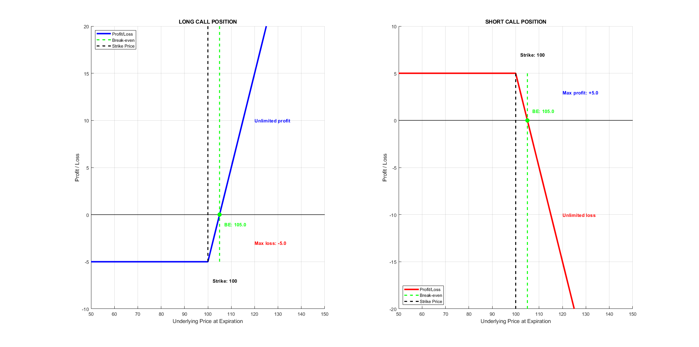
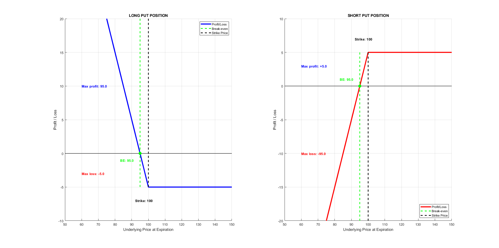
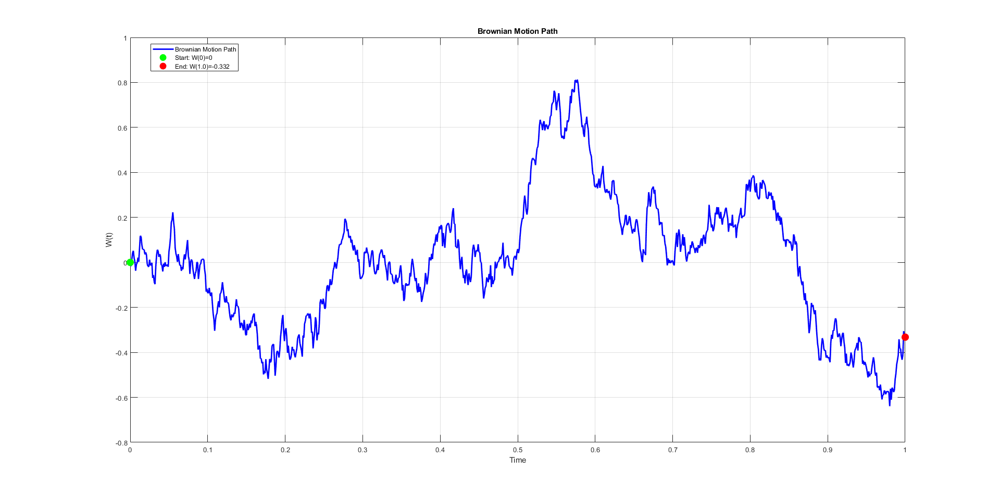
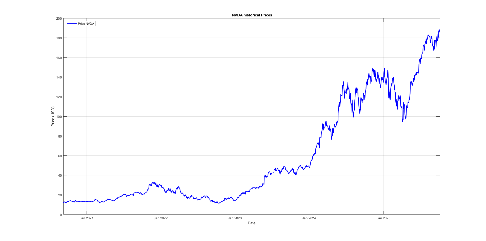
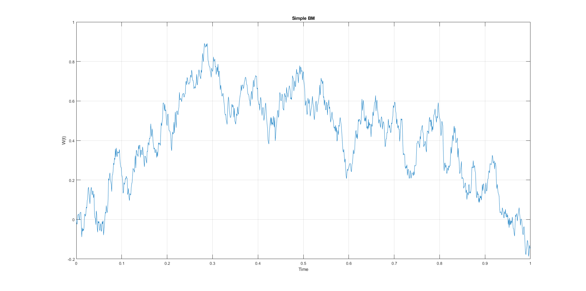
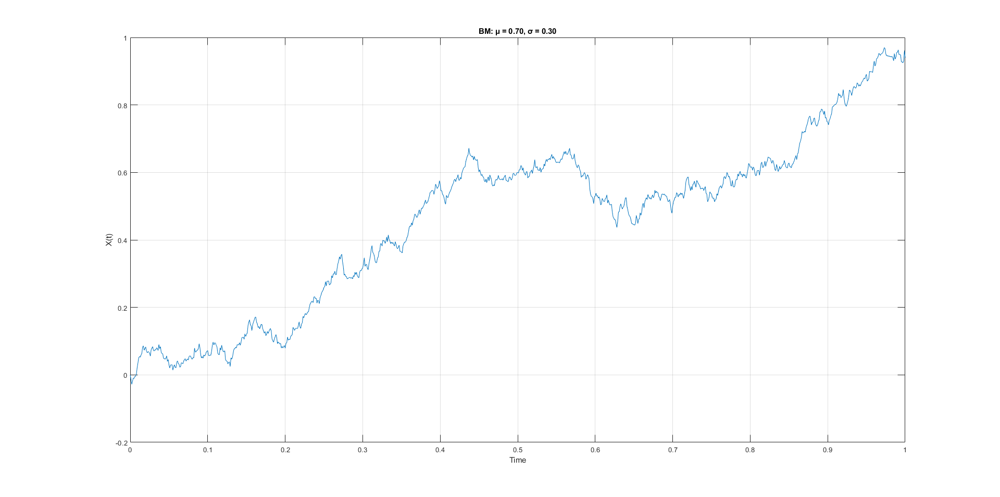
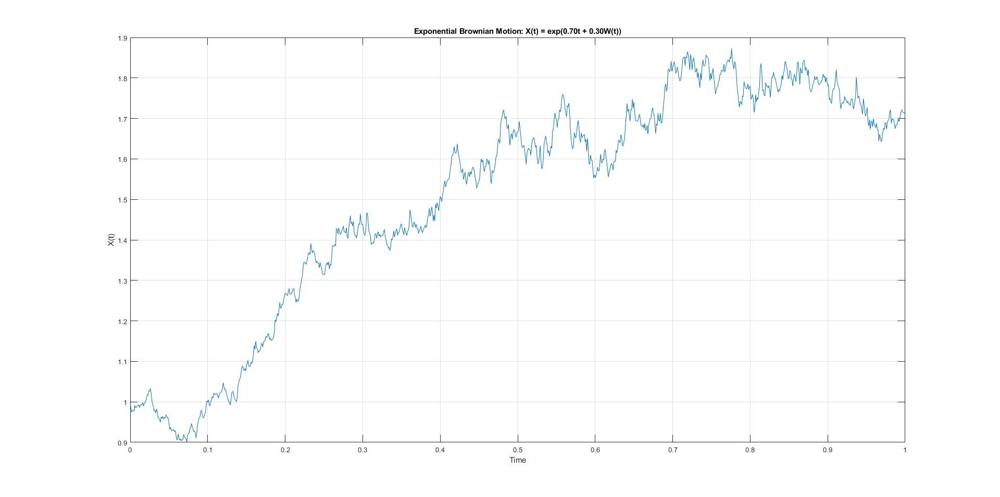
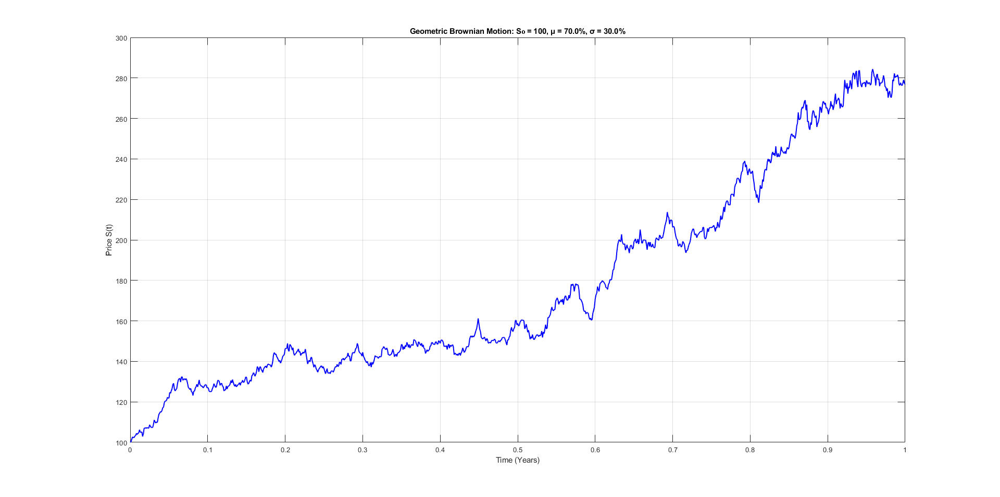
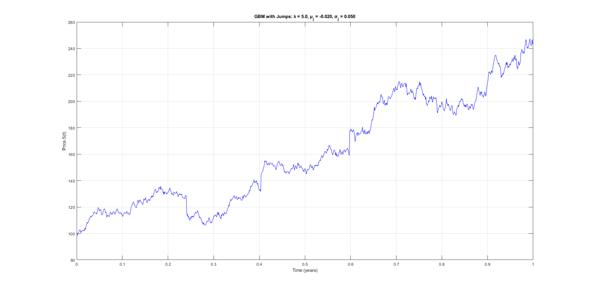
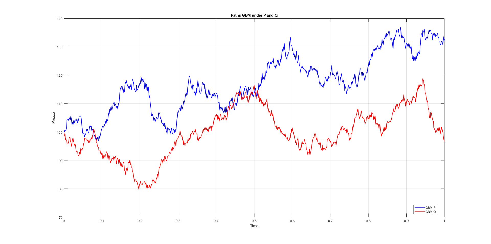

# What is an Option

Options are financial derivatives that grant their holder the right, but not the obligation, to trade an underlying asset --- such as a stock, an index, or a currency --- at a predetermined price (K), known as the strike price or exercise price, either on or before a specified expiration date (T).\
Options can be understood through a hierarchical framework that highlights their key characteristics. At the most fundamental level, an option is either a call or a put, depending on the direction of the right it grants: a call gives the holder the right to buy the underlying asset at the strike price, while a put gives the right to sell. Once the type of option is established, it can be further classified according to its structural features. Options may be plain vanilla, with a simple payoff that depends only on the final price of the underlying asset, or exotic, which introduces additional complexity through path-dependent payoffs, barriers, or other customized conditions. Finally, options can be distinguished by their exercise rules: European options can only be exercised at expiration, whereas American options can be exercised at any time up to maturity, offering greater flexibility but more complex valuation. In this hierarchical view, an option is first defined as a call or put, then categorized as vanilla or exotic, and finally distinguished by its exercise style, illustrating how the foundational and operational features combine to define its behavior and pricing.

## The Importance of Options in Financial Markets

Options play a crucial role in modern financial markets, complementing traditional equity trading. Unlike stocks, which represent ownership in a company, options are derivative contracts whose value depends on the price of an underlying asset. Despite being a secondary market instrument, the volume of options traded is substantial and has grown significantly over the past decades, reflecting their importance for both hedging and speculative strategies.

Accurate option pricing is essential for several reasons. For investors, it provides a benchmark for fair value, enabling informed trading decisions. For firms, it helps in structuring employee stock options and managing corporate risk. Furthermore, proper pricing ensures market efficiency: when options are mispriced, arbitrage opportunities arise, potentially leading to imbalances between derivative and underlying markets. In essence, understanding and correctly valuing options is fundamental to maintaining liquid, transparent, and well-functioning financial markets.

## Fundamental distinction: Call vs Put

There are two fundamental types of options: calls and puts. A call option gives the holder the right to buy the underlying asset at the strike price. Its value increases when the market price of the asset rises: if, at maturity, the market price is higher than the strike, the investor can buy the asset below market value and make a profit. Conversely, a put option gives the holder the right to sell the underlying at the strike price, and therefore gains value when the market declines: if the market price falls below the strike, the holder can sell the asset at a higher price than the current market price.

![Profit/Loss diagrams at expiration for call and put options. Panel (a) illustrates the payoff for a long call position, characterized by a loss limited to the premium paid and theoretically unlimited profit potential above the strike price. Panel (b) illustrates the payoff for a long put position, which features a loss limited to the premium and a maximum (limited) profit realized when the underlying asset’s price falls to zero. In both charts, the break-even point occurs when the underlying price exceeds (for the call) or falls below (for the put) the strike price by an amount equal to the premium paid.](figures/graficiclassici.png){#fig-placeholder}

The price paid to obtain this right is called the option premium. It is paid upfront by the buyer to the seller when the contract is initiated and depends on several factors --- the current price of the underlying, the distance from the strike, expected volatility, time to maturity, and the risk-free interest rate.

## Structural distinction: Plain Vanilla vs Exotic

Plain vanilla options are the standard, most straightforward contracts: calls and puts with a clearly defined strike price and expiration. Their payoff depends solely on the final price of the underlying asset, and they can be exercised either at maturity, in the case of European options, or anytime before expiry, in the case of American options. They are highly liquid, standardized, and their pricing is well understood, often handled using closed-form models such as Black--Scholes--Merton.

Exotic options, by contrast, introduce additional features that make them more complex and tailored to specific needs. Their payoff can depend not just on the final price of the underlying, but on the path it takes over time, or on whether certain conditions or barriers are met. Examples include barrier options, Asian options, digital options, and lookback options. Because of this added complexity, exotic options are usually customized contracts traded over-the-counter, less liquid, and often require numerical methods for pricing, such as Monte Carlo simulations or partial differential equation techniques.

In essence, the key difference lies in simplicity versus complexity. Plain vanilla options are standardized, transparent, and easy to price, providing a clear and accessible way to hedge or speculate. Exotic options, on the other hand, are flexible and customizable, designed to meet specific strategic objectives, but they come with greater complexity, lower liquidity, and more challenging valuation. this distinction is crucial, as it highlights both the foundational instruments of the options market and the sophisticated tools developed to address specialized financial needs.

![This comparison shows the fundamental difference between two option types through simulated price trajectories of the underlying asset. The left panel displays a plain vanilla call option where all paths remain active and the payoff depends solely on whether the final price exceeds the 105 strike price. The right panel shows an up-and-out barrier call option where paths are eliminated if they touch the 120 barrier level, with only 5 of 12 paths surviving without knockout. This demonstrates how barrier options introduce path dependency, requiring both favorable final pricing and no barrier breach during the option’s life, making them cheaper but riskier than plain vanilla options.](figures/vanillavsbarrier.png){#fig-placeholderx}

## Operational Distinction: European Vs American

Both types give the holder the right, but not the obligation, to buy or sell an underlying asset at a predetermined strike price, but they differ fundamentally in when this right can be exercised.

European options can only be exercised at the expiration date. This simplicity makes their pricing more straightforward and allows the use of closed-form models, such as the Black--Scholes formula, to determine their value. Because the holder cannot exercise early, the risk and payoff structure is well-defined, and these options are commonly used in situations where the underlying asset is stable or predictable.

American options, on the other hand, can be exercised at any time up to and including the expiration date. This added flexibility provides the holder with strategic advantages, such as the ability to capture dividends or respond to sudden market movements. However, this flexibility also introduces complexity: valuing American options is more challenging, often requiring numerical methods like binomial trees or finite difference methods.

In essence, the key difference lies in exercise timing. European options are simpler and easier to price, suitable for standard hedging or investment strategies, while American options offer more flexibility and strategic opportunities at the cost of more complex valuation.

## Factors Affecting Option Prices

The price of an option, also known as the option premium, is determined by several key factors that influence both its intrinsic and time value. Understanding these factors is essential for pricing and risk management in financial markets. The main determinants are described below.

### 1. Underlying Asset Price ($S$) {#sec-underlying-asset-price-s .unnumbered}

The current price of the underlying asset is the most immediate factor affecting the option's value. For a call option, the higher the asset price relative to the strike price, the more valuable the option becomes. Conversely, for a put option, a lower asset price increases its value. The relationship between the underlying price and the option's intrinsic value is direct and fundamental.

### 2. Strike Price ($K$) {#sec-strike-price-k .unnumbered}

The strike price is the predetermined price at which the option holder can buy or sell the underlying asset. Options with a strike price closer to the current market price generally have higher premiums due to their greater likelihood of ending in the money. The relative position of the strike to the underlying price also defines whether an option is in-the-money, at-the-money, or out-of-the-money.

### 3. Time to Expiration ($T-t$) {#sec-time-to-expiration-t-t .unnumbered}

The remaining time until the option's expiration affects its time value. Longer time to maturity increases the probability that the option will become profitable, leading to a higher premium. As expiration approaches, the time value decays---a phenomenon known as *theta decay*---reducing the option's price if all other factors remain constant.

### 4. Volatility ($\sigma$) {#sec-volatility-sigma .unnumbered}

Volatility measures the expected fluctuations of the underlying asset. Higher volatility increases the likelihood of significant price movements, which benefits both call and put options. Therefore, options on more volatile assets generally have higher premiums. Volatility is a crucial component in pricing models such as Black--Scholes, reflecting the risk and uncertainty in the market.

### 5. Risk-Free Interest Rate ($r$) {#sec-risk-free-interest-rate-r .unnumbered}

The risk-free interest rate impacts the present value of the option's strike price. For call options, higher interest rates tend to increase the option price, as the cost of carrying the underlying asset effectively rises. For put options, higher rates can slightly decrease the premium. Interest rates are particularly relevant for longer-dated options where the time value is more sensitive to discounting effects.

### 6. Dividends ($q$) {#sec-dividends-q .unnumbered}

Expected dividends on the underlying asset affect option pricing because they reduce the expected future price of the asset. For call options, higher anticipated dividends typically lower the option's value, as the underlying price is expected to drop by the dividend amount on the ex-dividend date. Conversely, put options generally increase in value with higher dividends. Dividend yields are thus an important factor in both European and American option valuation.

{#fig-placeholder}

## Long and Short positions

In options trading, every contract involves a long position and a short position, representing the two sides of the transaction. Taking a long call position means that the investor buys a call option, acquiring the right to purchase the underlying asset at the strike price. The holder of a long call has a bullish view on the underlying asset, expecting its price to rise above the strike price before or at expiration. The potential profit is theoretically unlimited, while the maximum loss is limited to the premium paid.

Conversely, a short call position arises when the investor sells or writes a call option. The seller of the call has an obligation to deliver the underlying asset if the option is exercised. This position is typically adopted with a neutral to bearish view, expecting the underlying price to stay below the strike price. The maximum gain for the short call is limited to the premium received, while the potential loss is theoretically unlimited if the underlying asset appreciates significantly.

Similarly, a long put position gives the holder the right to sell the underlying at the strike price. The investor takes this position with a bearish view, anticipating a decline in the underlying asset's price. Profit potential is substantial if the asset falls sharply, while the maximum loss is again limited to the premium paid. A short put position involves selling a put option, taking on the obligation to buy the underlying asset if exercised. The seller of the put generally holds a neutral to bullish view, expecting the underlying to remain above the strike price. The maximum profit is the premium received, while losses can be significant if the asset price drops sharply.

In summary, long positions on calls or puts reflect the holder's directional expectations---bullish for calls, bearish for puts---while short positions reflect the writer's willingness to assume risk in exchange for the option premium, generally expressing an opposite or more neutral view on the underlying asset.

{#fig-placeholderx}

{#fig-placeholder}

# The Mathematical model for the underlying

While options are a fundamental class of derivative contracts, their valuation and risk characteristics can be understood within the broader framework of contingent claims. A contingent claim is a financial instrument whose payoff depends on the realization of one or more uncertain future events, typically the evolution of an underlying asset. Formally, a contingent claim can be represented as a random variable $\Phi(S_T)$ defined on a probability space[^1], where $S_T$ denotes the state of the underlying asset at a future time $T$.

Options are special cases of contingent claims, with payoffs determined by simple functions of the underlying price. For instance, a European call option can be represented as $$\Phi(S_T) = (S_T - K)^+ = (S_T - K) \mathbf{1}_{\{S_T > K\}},$$ where $\mathbf{1}_{\{S_T > K\}}$ is the indicator function defining the exercise set, i.e., the set of states in which it is optimal to exercise the option. Similarly, a put option can be written as $$\Phi(S_T) = (K - S_T)^+ = (K - S_T) \mathbf{1}_{\{S_T < K\}}.$$

However, contingent claims are more general and can encompass a wide class of instruments, including exotic derivatives, structured products, and insurance contracts, where the payoff may depend on complex path-dependent features, multiple underlying assets, or the occurrence of specific events.

From a theoretical standpoint, representing payoffs as measurable functions[^2] of underlying stochastic processes allows for a unified approach to pricing and hedging. By specifying the exercise set through indicator functions and embedding the dynamics of the underlying in a probabilistic framework, one can apply expectations under a risk-neutral measure, stochastic calculus, and partial differential equations to rigorously determine the fair value of the claim.

## Continuos time stochastic processes

A continuous time stochastic process $\{X_t\}_{t \geq 0}$ is a collection of random variables defined on a common probability space $(\Omega, \mathcal{F}, P)$. The collection is indexed to the time parameter $t$ and that implies that $t\in [0,+\infty)$. From now on, we can think a continuous time stochastic process as a sequence of random variables $X_t$ that evolves in time ($X_1,X_2,...,X_T$) with each variable representing the state of the process at a certain time.\
If we consider a stochastic process $\{X_t\}_{t \geq 0}$ which represents the return over time of a stock, for each moment $t$, $X_t$ is a random variable that represent the observed return at that specific time: $$\omega \rightarrow X_t(\omega)$$ If we chose a particular scenario (for example, a specific realization of the markets conditions), the function: $$t\rightarrow X_t(\omega)$$ describes how the return changes over time for that specific scenario.

## Filtrations

A filtrarion $\{\mathcal{F}\}_{t\geq 0}$ on a probability space $(\Omega, \mathcal{F}, P)$ is an increasing collection of $\sigma algebras$[^3] contained in $\mathcal{F}$: 

$$\mathcal{F}_s\subseteq\mathcal{F}_t \subseteq \mathcal{F} \quad  \forall \,  0\leq s \leq t
$$ {#eq-five}

 A continuous time stochastic process is said to be adapted to the filtration $\{\mathcal{F}\}_{t\geq 0}$ if $X_t$ is $\mathcal{F}_t-measurable \ \forall t \geq 0$. In other words, $\{X_t\}_{t \geq 0}$ is adapted to the filtration $\{\mathcal{F}\}_{t\geq 0}$ if for each moment $t$, the information contained in the events belonging to $\mathcal{F}_t$ is sufficient to determine the value taken by $X_t$.\
The quantity of information is an increasing function of time. As $t$ increases, we have more and more information.\
For Example, if $X_t$ is the stock price at time $t$, the filtration $\mathcal{F}_t$ includes all information available up to time $t$. As time passes, more information is added, so $\mathcal{F}_s\subseteq\mathcal{F}_t$ for $s\leq t$. Moreover, if $\{X_t\}_{t \geq 0}$ is adapted to the filtration $\{\mathcal{F}\}_{t\geq 0}$, it means that the price $X_t$ can be determined using only the information up to time $t$, without referencing future events. Therefore, at time $t$, $\mathcal{F}_t$ contains all the historical and current information needed to 'explain' the value of the price $X_t$ at that moment.

## Martingales

A continuous time stochastic process $\{X_t\}_{t \geq 0}$ is an $(\{\mathcal{F}_t\}_{t\geq 0},\mathbb{P})$-Martingale if:

- It is adapted to the filtration $\{\mathcal{F}\}_{t\geq 0}$: meaning that the value of $X_t$ at a particular moment $t$ only depends on the information available up to time $t$.

- It is square integrable: meaning that $\forall t\geq0, X_t\in\mathcal{L}^2(\Omega,\mathcal{F,}\mathbb{P})$:[^4] $$\mathbb{E}[X_t^2]<\infty$$ In other words, this condition implies that $X_t$ has to have a finite variance.

- Conditional expectation property: $\forall 0\leq s \leq t:$ $$\mathbb{E}[X_t|\mathcal{F}_s]=X_s$$

We can think of the conditional expectation $\mathbb{E}[X_t|\mathcal{F}_s]$ as the best estimate of the future value of $X_t$, based on the information available up to time $s$. This means that the expected value of the process in a future moment $t$, conditional to the information available up to time $s$ is equal to the value of the process at time $s$.\
In other words, knowing everything up to time $s$, we don't expect the process to change in any particular direction --- it's like saying, *"On average, we expect it to stay the same."*

This is a key idea behind a martingale: it's a stochastic process with no \"drift\" or predictable trend --- the future is, on average, the same as the present, given all the information we currently have.\

## The Brownian Motion

Brownian motion can be imagined as the random movement of a particle in a fluid, influenced by random collisions with other particles.

{#fig-enter-label}

A stochastic process $\{{W_t\}_{t\geq0}}$ defined on a probability space $(\Omega,\mathcal{F}, \mathbb{P)}$ is a brownian motion if it satisfies the following properties:

- $\mathbb{P}(W_0=0)=1$: it starts at $t=0$ with probability 1.

- $\forall0\leq s \leq t$, $\Delta W \sim \mathcal{N}(0, t-s)$: the brownian increment $\Delta W:=Wt-Ws$ follows a normal distribution with mean zero (no systematic trend) and variance $t-s$ (the increments become increasingly dispersed as time progresses).

- $\forall\, 0 \leq t_1 \leq t_2 \leq \dots \leq t_n \leq T, \quad \Delta W_i := W(t_{i+1}) - W(t_i), \quad \text{then} \quad \Delta W_i \perp\!\!\!\perp \Delta W_j \quad \text{for all } i \neq j$: the brownian increments are independent, this means that the evolution of a brownian motion over a time interval is independent of the evolution of the process in the past or future. there is no correlation between the increments, either over time or between past and future values.

- The trajectories of Brownian motion are continuous, meaning that they have no jumps, but they are nowhere differentiable, so they do not vary smoothly.

## In simple words\...

When we want to model financial assets such as stocks, we need a mathematical framework that describes how their prices evolve over time. This framework allows us to capture uncertainty and to make fair valuations of options and other derivatives. A key component of this framework is the notion of a filtration, which can be thought of as a growing collection of information over time. At any given moment, it includes everything we know about the market up to that point, and as time progresses, more information becomes available, so our "knowledge set" expands. If a price process is adapted to this filtration, it means that the price at any time depends only on the information available up to that moment and not on future events we cannot yet observe. This feature is essential for realistic modeling. Building on this idea, the concept of a martingale captures the notion of a "fair game." A martingale is a stochastic process that, on average, does not drift up or down over time: knowing all past information, the expected future price is exactly the current price. Under the appropriate probability measure, known as the risk-neutral measure, discounted asset prices behave like martingales, which provides the theoretical foundation for computing expected payoffs and pricing derivatives consistently. To model the random fluctuations of prices, we use Brownian motion, which represents continuous but unpredictable movements, similar to the jittering of a particle suspended in a fluid. Brownian motion starts at zero, has normally distributed increments with no predictable trend, and the increments over non-overlapping intervals are independent. Its paths are continuous, without jumps, yet nowhere differentiable, reflecting the irregular behavior of real market prices. By combining these elements---filtrations to track available information, martingales to formalize the "fair game" property, and Brownian motion to model randomness---we obtain a rigorous probabilistic framework. This framework underlies modern option pricing models, such as Black--Scholes, and allows us to compute expected payoffs of derivatives in a mathematically consistent and robust way.

## Building the model for our underlying process

To price options rigorously, we first need to define a mathematical model for the evolution of the underlying asset. This model captures the random dynamics of the asset price over time and provides the foundation for calculating expected payoffs, hedging strategies, and ultimately the fair value of derivatives.\
We can begin constructing a general model for the underlying asset by examining NVIDIA's historical stock prices and identifying the key features that our model should capture:

{#fig-placeholderx}

- Price is always positive

- Some sort of overall trend with some up and downs (noise)

- A bunch of jumps over time

### First step: Simple Brownian Motion

We can start with a simple Brownian Motion: $\{{W_t\}_{t\geq0}}$

{#fig-placeholder}

However, it is evident that the time series is dominated by noise --- the random ups and downs --- with no apparent linear trend over time.\
That takes us to examine an upgraded version of our simple model.

### Second step: Brownian Motion with trend

The drift reflects the systematic part of the movement --- the "trend" around which random noise occurs. For instance, in the process $$X_t = \mu t + \sigma W_t,$$ the parameter $\mu$ determines the average slope of the trajectory: if $\mu > 0$, the process tends to grow over time; if $\mu < 0$, it tends to decline. The parameter $\sigma > 0$ instead represents the volatility of the process, that is, the intensity of the random fluctuations around the expected path. Thus, the drift $\mu$ defines the expected trajectory of the process, while the stochastic term $\sigma W_t$ governs the random variability around it (ups and downs).

{#fig-placeholderx}

However, it is evident that Brownian Motion, even with a trend, can take negative values. That's impossible for a stock price, so we have to introduce some sort of transformation to keep the process positive.

### Third step: Exponential Brownian Motion

We apply the exponential transformation to the Brownian motion because stock prices must remain strictly positive --- they cannot fall below zero. A standard Brownian motion can take negative values, which would be unrealistic for prices: $$X_t=exp \{\mu_t+\sigma W_t\}$$

{#fig-placeholder}

The Exponential Brownian Motion is not an appropriate model for asset prices because its mean and variance do not properly reflect the dynamics of a stock that grows, on average, at a given percentage rate. In particular, the correction term $-\frac{1}{2}\sigma^2 t$ is missing. This term is essential because the exponential of a Gaussian process is not centered as one might intuitively expect.

Now, for our fourth and last step we have to introduce the concept of Stochastic Differential Equations (SDEs):

### The stochastic integral

Given a Brownian motion $\{W_t\}_{t \geq 0}$ and an adapted process $\{X_t\}_{t \in [0,T]}$ that is sufficiently regular (typically belonging to $L^2_{\text{ad}}(\Omega \times [0,T])$), the Itô integral of $X$ with respect to $W$ is defined as $$\int_0^T X_t \, dW_t,$$ where the symbol $dW_t$ denotes stochastic integration.

The Itô integral generalizes the concept of integration to stochastic settings. Its domain can be extended from $L^2_{\text{ad}}(\Omega \times [0,T])$ to $L_{\text{ad}}(\Omega; L^2([0,T]))$ while preserving key properties such as continuous sample paths and the martingale structure of the integral process. These extensions are fundamental for applications in quantitative finance, stochastic control, and other fields involving random dynamics.

### SDEs

A stochastic differential equation is an identity of the form:

$$
    X_t=x+\int_0^t\mu(s,X_s)ds+\int_0^t\sigma(s,X_s)dW_s, \quad t\in[0,T]
$$ Where $X_t$ is the the stochastic process we would like to find, $x=X_0$ is the initial value of the process at $t=0$, $\mu(t,X_t)$ is the drift term in the Riemann integral and $\sigma(t,X_t)$ is the diffusion term in the stochastic integral.

The differential form of the SDE is: $$
    \begin{cases}
dX_t = \mu(t, X_t)\,dt + \sigma(t, X_t)\,dW_t, & t \in [0, T] \\
X_0 = x
\end{cases}
$$

### The final model: the Geometric Brownian Motion (GBM)

The GBM is defined by the following stochastic differential equation:

$$
dS_t = \mu S_t\,dt + \sigma S_t\,dW_t, \quad S_0 = s > 0,
$$

where $\mu \in \mathbb{R}$ is the constant drift rate, $\sigma > 0$ is the volatility parameter, and $W_t$ is a standard Brownian motion. The initial value $S_0 = s$ represents the starting price of the asset.

This equation is linear in $S_t$ and represents a process with proportional drift and diffusion. The unique strong solution to this SDE is given explicitly by:

$$
S_t = S_0 \exp\left\{ \left( \mu - \frac{1}{2} \sigma^2 \right)t + \sigma W_t \right\}, \quad t \geq 0
$$

The GBM has several key properties that make it perfect for modeling asset prices:

- The solution $S_t$ is always positive, which aligns with the real-world behavior of asset prices.

- The logarithm of the process, $\log S_t$, follows a Brownian motion with drift, making log-returns normally distributed.

- The model captures both deterministic growth (through $\mu$) and random fluctuations (through $\sigma W_t$).

{#fig-placeholderx}

For these reasons, the Geometric Brownian Motion (GBM) is preferred: The term $-\frac{1}{2}\sigma^2 t$ ensures that $$E[S_t] = S_0 e^{\mu t},$$ meaning that the expected value of the price grows exactly at the drift rate $\mu$. In other words, the GBM corrects the bias introduced by the variance of the noise, ensuring a growth path consistent with the intended average rate.\
In summary, we choose the GBM over the simple Exponential Brownian Motion because it is mathematically consistent: it preserves both the positivity of prices and the correct expected growth rate of the asset.\
In conclusion We model the price dynamics of the risky asset using a geometric Brownian motion: $$\frac{dS_t}{S_t}=\mu dt+\sigma dW_t$$ Where:

- $\frac{dS_t}{S_t}$ is the relative return of the asset for an infinitesimal time step. for example, if for an infinitesimal small time step the shift is from $100$ to $101$, the relative return will be $0.01$.

- $\mu dt$ is the drift, or the average growth rate of the asset, for example $10\%$ per year. then we multiply it for an infinitesimal time step ($dt)$.

- $\sigma dW_t$ is the diffusion, or random noise, where $\sigma$ represents the asset's variance and $dW_t$ represents the pure randomness of a brownian motion.

### Bonus: GBM with jumps

The GBM is a powerful and tractable model, one of its key limitations lies in its assumption of continuous paths. In reality, financial asset prices can exhibit sudden and significant changes---known as jumps---due to unexpected news, economic events, or market shocks. These discontinuities cannot be captured by the standard GBM model, which assumes that returns are normally distributed and that price paths are smooth.

To address this limitation, a jump component is introduced into the model, resulting in a jump-diffusion process. The modified price dynamics are given by: $$\frac{dS_t}{S_{t-}} = \mu \, dt + \sigma \, dW_t + (J_t - 1) \, dN_t$$ Where:

- $S_{t^-}$ denotes the asset price just before time $t$, ensuring proper handling of discontinuities.

- $(J_t - 1)$ represents the relative jump size at time $t$, where $J_t$ is a random variable (typically lognormally distributed) modeling the jump magnitude.

- $dN_t$ is the increment of a Poisson process with intensity $\lambda$, representing the occurrence of jump events. For example, if $\lambda = 2$, we expect two jumps per unit time on average.

The term $(J_t - 1) \, dN_t$ introduces discontinuous movements in the asset price. When $dN_t = 1$ (i.e., a jump occurs), the asset price is multiplied by $J_t$, reflecting a sudden shift. This extension allows the model to capture leptokurtic return distributions (i.e., distributions with fat tails and excess kurtosis) that are commonly observed in empirical financial data.

{#fig-placeholder}

However, pricing options under a jump--diffusion model, such as the GBM with jumps, is considerably more complex. For this reason, we will rely on the classic GBM framework in our subsequent analysis, as it provides analytical tractability while still capturing the essential features of asset price dynamics.

# the mathematical setting for pricing

## Itô's Lemma

let $W=\{W_t\}_{t\geq 0}$ be a brownian motion and $\Phi_t=\Phi(t, W_t)$ a function that is continuous and once differentiable with respect to the first variable, and twice differentiable with respect to the second variable, with bounded derivatives. Then: $$\Phi(t,W_t)=\Phi(0,W_0)+\int_0^t\frac{\partial\Phi(s,W_s)}{\partial s}ds+\int_0^t\frac{\partial\Phi(s,W_s)}{\partial W_s}dW_s+\frac{1}{2}\int_0^t\frac{\partial^2\Phi(s,W_s)}{\partial W^2}ds$$ The differential form is:

$$\mathrm{d}\Phi(t, W_t) = \frac{\partial \Phi(t, W_t)}{\partial t}\,\mathrm{d}t + \frac{\partial \Phi(t, W_t)}{\partial W} \,\mathrm{d}W_t + \frac{1}{2} \frac{\partial^2 \Phi(t, W_t)}{\partial W^2} (\mathrm{d}W_t)^2 \\
= \left( \frac{\partial \Phi(t, W_t)}{\partial t} + \frac{1}{2} \frac{\partial^2 \Phi(t, W_t)}{\partial W^2} \right) \mathrm{d}t + \frac{\partial \Phi(t, W_t)}{\partial W} \,\mathrm{d}W_t$$[^5]

Since $\Phi$ is a function of a stochastic process, it is itself a stochastic process. We are therefore interested in understanding its dynamics, that is, the equation that describes how $\Phi$ evolves over time, taking into account both the deterministic trends and the random fluctuations inherited from the original process.

Itô's lemma also holds in a more general form:\
let $Y_t:=\Phi(t,X_t)$, then:

$$
     dY_t=\frac{\partial\Phi(t,X_t)}{\partial t}dt+\frac{\partial\Phi(t,X_t)}{\partial X}dX_t+\frac{1}{2}\frac{\partial^2\Phi(t,X_t)}{\partial X^2}(dX_t)^2
$$

In simple terms, Itô's Lemma provides the rule for differentiating a function of a stochastic process. It extends the classical chain rule of calculus to the stochastic setting, where randomness is introduced by Brownian motion. Specifically, it allows us to determine how a function $\Phi(t, X_t)$ evolves over time when $X_t$ follows a stochastic differential equation (SDE).

In practical terms, Itô's Lemma tells us how both deterministic and random components of a process contribute to the total change in a function of that process. This result is essential in finance because it provides the mathematical bridge between the dynamics of the underlying asset and the price of a derivative written on it.

In option pricing, Itô's Lemma is used to derive the differential equation satisfied by the option price --- the famous Black--Scholes partial differential equation (PDE). Once this PDE is obtained, solving it under the appropriate boundary conditions yields the fair value of the option.\
In the context of option pricing, we define $\Phi(t, S_t)$ as the contingent claim function, where $S_t$ denotes the underlying asset price at time $t$. Remind that a contingent claim is a financial instrument whose payoff depends on the future evolution of the underlying asset $S_t$ . By expressing the derivative price as a function of both time and the underlying price, $\Phi(t, S_t)$ captures how the value of the option evolves as the underlying asset fluctuates and as time $t$ progresses toward maturity.

This formulation allows us to apply Itô's Lemma to $\Phi(t, S_t)$, linking the stochastic dynamics of $S_t$ to the dynamics of the derivative price. This step is crucial in deriving the partial differential equation (PDE) that the option price must satisfy, which, when solved under appropriate boundary conditions, leads to the Black--Scholes formula.

## The Itô Product Rule

Let $X_t$ and $Y_t$ be two Itô processes defined on a filtered probability space. Then the differential of their product $Z_t = X_t Y_t$ is given by:

$$d(X_t Y_t) = X_t \, dY_t + Y_t \, dX_t + dX_t \, dY_t$$

This is known as **Itô's product rule**. It extends the classical product rule of calculus by including an additional term: the differential of the cross-variation $dX_t \, dY_t$. This term is non-zero in stochastic calculus and plays a crucial role in the behavior of stochastic processes.

## Fundametal issue in option pricing

The fundamental challenge in derivative pricing is not forecasting an asset's future price, but rather determining the *current* fair value of a contract whose payoff is contingent on that future price. Consider a European call option on a non-dividend-paying stock. A naive, yet intuitive, approach would be:

1.  Model the stock price under the real-world probability measure $\mathbb{P}$. The canonical model is the Geometric Brownian Motion: $$dS_t = \mu S_t \, dt + \sigma S_t \, dW_t^{\mathbb{P}},$$ where $\mu$ is the expected return (the *drift*) and $\sigma$ is the volatility.

2.  Calculate the expected payoff of the option at maturity $T$ under this measure: $$\mathbb{E}_{\mathbb{P}} \left[ (S_T - K)^+ \right].$$

3.  Discount this expected future value to its present value using a discount rate that reflects the riskiness of the option.

This approach is fraught with insurmountable difficulties. The core issue lies in the parameters $\mu$ and the discount rate. The expected return $\mu$ embodies the market's aggregate risk premium---a subjective and notoriously difficult quantity to estimate. Furthermore, the appropriate discount rate for the option is even more elusive, as the option's risk profile is different from, and often more complex than, that of the underlying stock itself. The pricing formula becomes entangled with individual risk preferences, making it impossible to derive a universal, preference-free price.

###  A Change of perspective: the risk-neutral measure

The groundbreaking insight of financial mathematics, formalized by the **First Fundamental Theorem of Asset Pricing**, is that the problem of pricing can be separated from the problem of estimating risk premia. The theorem states:

> *A market is arbitrage-free if and only if there exists at least one equivalent martingale measure $\mathbb{Q}$.*

This statement, while seemingly abstract, provides the solution. Instead of struggling with the real-world measure $\mathbb{P}$, we construct a new, artificial probability measure $\mathbb{Q}$ that is **equivalent** to $\mathbb{P}$ (meaning they agree on which events have zero probability) but has a crucial property: it makes the discounted prices of traded assets **martingales**.

In simple terms, under $\mathbb{Q}$, no traded asset is expected to outperform any other on a risk-adjusted basis; their expected return is the risk-free rate.

### The Mechanism: The Girsanov Theorem and the Radon--Nikodym Derivative

How do we find this measure $\mathbb{Q}$? The change of measure is achieved through the *Girsanov Theorem*, which allows us to modify the drift of a stochastic process by shifting the underlying Brownian motion. We define a new process $W_t^{\mathbb{Q}}$ as follows:

$$dW_t^{\mathbb{Q}} = dW_t^{\mathbb{P}} + \frac{\mu - r}{\sigma} \, dt.$$

The term $$\lambda = \frac{\mu - r}{\sigma}$$ is called the Market Price of Risk, or risk premium. Substituting this transformation into the original stochastic differential equation produces a remarkable simplification:

$$\begin{aligned}
dS_t &= \mu S_t \, dt + \sigma S_t \, dW_t^{\mathbb{P}} \\[4pt]
&= \mu S_t \, dt + \sigma S_t \left( dW_t^{\mathbb{Q}} - \frac{\mu - r}{\sigma} \, dt \right) \\[4pt]
&= \mu S_t \, dt + \sigma S_t \, dW_t^{\mathbb{Q}} - (\mu - r) S_t \, dt \\[4pt]
&= r S_t \, dt + \sigma S_t \, dW_t^{\mathbb{Q}}.
\end{aligned}$$

The drift $\mu$ has disappeared: under $\mathbb{Q}$, the expected rate of return of the asset equals the risk-free rate $r$, while the volatility $\sigma$ remains unchanged. Economically, this means that under $\mathbb{Q}$, investors are **risk-neutral**---they demand no excess return for bearing risk, and thus the risk premium $(\mu - r)$ vanishes from the drift.

This transformation directly yields a universal pricing principle. The fair value $V_t$ of any contingent claim is the discounted expectation of its future payoff, taken under the risk-neutral measure $\mathbb{Q}$:

$$V_t = \mathbb{E}_{\mathbb{Q}} \left[ e^{-r(T-t)} \, \text{Payoff}(T) \right].$$

For a European call option, this becomes: $$C_t = \mathbb{E}_{\mathbb{Q}} \left[ e^{-r(T-t)} \, (S_T - K)^+ \right].$$

This pricing formula is entirely preference-free: it depends neither on individual risk aversion nor on the real-world expected return $\mu$. The only inputs are the risk-free rate $r$ and the volatility $\sigma$, which can often be inferred from market data.

In summary, the transition from the real-world model to the risk-neutral one involves a fundamental change in viewpoint:

- **Real World ($\mathbb{P}$):** The asset follows $$dS_t = \mu S_t \, dt + \sigma S_t \, dW_t^{\mathbb{P}},$$ or equivalently, $$dS_t = r S_t \, dt + \sigma S_t (\lambda \, dt + dW_t^{\mathbb{P}}),$$ where $\lambda$ represents the risk premium. However, $\mu$ (and therefore $\lambda$) is not directly observable.

- **Risk-Neutral World ($\mathbb{Q}$):** In a hypothetical world where investors are indifferent to risk, $$dS_t = r S_t \, dt + \sigma S_t \, dW_t^{\mathbb{Q}},$$ and derivative pricing is obtained through expectations under $\mathbb{Q}$. Under the Girsanov transformation, the Brownian motions are related by $$W_t^{\mathbb{Q}} = W_t^{\mathbb{P}} + \lambda t.$$

The equivalent measure $\mathbb{Q}$ acts as a perfect translator, enabling the computation of unique, arbitrage-free prices without reference to subjective risk preferences. This duality between $\mathbb{P}$ and $\mathbb{Q}$ forms the foundation of modern quantitative finance.

The formal mathematical connection between the real-world measure $\mathbb{P}$ and the risk-neutral measure $\mathbb{Q}$ is given by the *Radon--Nikodym derivative*. It specifies how probabilities under $\mathbb{Q}$ are reweighted relative to those under $\mathbb{P}$:

$$\frac{d\mathbb{Q}}{d\mathbb{P}} = \exp \left( -\lambda W_t^{\mathbb{P}} - \tfrac{1}{2} \lambda^2 t \right),$$ where $\lambda = \frac{\mu - r}{\sigma}$ is again the Market Price of Risk. This exponential expression, known as the *Doléans--Dade exponential*, serves as the density process that transforms $\mathbb{P}$ into $\mathbb{Q}$, ensuring that $$W_t^{\mathbb{Q}} = W_t^{\mathbb{P}} + \lambda t$$ is a standard Brownian motion under $\mathbb{Q}$.

Intuitively, the Radon--Nikodym derivative acts as a "probability corrector": it reweights the likelihood of sample paths so that, under the new measure, investors appear risk-neutral and the asset grows at the risk-free rate $r$. The volatility $\sigma$ remains unchanged, while the drift is shifted from $\mu$ to $r$, effectively removing the risk premium.

The concept of changing measure extends beyond the transformation from $\mathbb{P}$ to $\mathbb{Q}$. Within the risk-neutral framework, it is often convenient to define another equivalent measure $\widetilde{\mathbb{Q}}$, under which specific quantities or ratios become martingales.

Formally, $\widetilde{\mathbb{Q}}$ is defined with respect to $\mathbb{Q}$ through the *Radon--Nikodym derivative*: $$\frac{d\widetilde{\mathbb{Q}}}{d\mathbb{Q}} = \eta_t,$$ where $\eta_t$ is a positive, $\mathcal{F}_t$--adapted process satisfying $\mathbb{E}^{\mathbb{Q}}[\eta_t] = 1$. This process $\eta_t$ reweights the probability measure so that, under $\widetilde{\mathbb{Q}}$, the chosen quantity becomes a martingale.

By the Girsanov Theorem, this change of measure induces a shift in the underlying Brownian motion. If $W_t^{\mathbb{Q}}$ is a Brownian motion under $\mathbb{Q}$, then there exists an adapted process $\theta_t$ such that $$W_t^{\widetilde{\mathbb{Q}}} = W_t^{\mathbb{Q}} + \int_0^t \theta_s \, ds$$ is a Brownian motion under $\widetilde{\mathbb{Q}}$. Consequently, any diffusion process driven by $W_t^{\mathbb{Q}}$ acquires an additional drift adjustment when expressed under $\widetilde{\mathbb{Q}}$.

In essence, the transformation from $\mathbb{Q}$ to $\widetilde{\mathbb{Q}}$ represents a controlled and consistent shift in probability weighting and drift structure that preserves the equivalence of measures. This provides a flexible and powerful framework in continuous-time finance, allowing one to select the most convenient measure for pricing or analytical purposes while maintaining arbitrage-free consistency.

Together, the *Girsanov Theorem* and the *Radon--Nikodym derivative* form the rigorous mathematical foundation that enables the transition from the real-world dynamics to the risk-neutral world---and further to any equivalent measure---ensuring a coherent, arbitrage-free approach to derivative pricing.

{#fig-placeholderx}

# Pricing

In the context of option pricing, the Kolmogorov backward PDE provides the general mathematical framework for describing how the value of any contingent claim evolves over time. It connects the stochastic dynamics of the underlying asset to the deterministic evolution of the option price. In essence, it expresses the idea that the fair value of an option at any point in time depends on both the current state of the underlying and its expected future behavior, under the assumption that arbitrage opportunities are absent.

However, the Kolmogorov equation is a general result that applies to any Itô process, and solving it in closed form is often impossible. To obtain a tractable and explicit pricing model, we impose specific assumptions on the dynamics of the underlying asset. In particular, by assuming that the stock follows a Geometric Brownian Motion with constant drift and volatility, and by working under the risk-neutral measure, the Kolmogorov PDE simplifies to the well-known **Black--Scholes PDE**.

This simplified equation still encodes the same economic principle---the absence of arbitrage---but in a form that can be solved analytically. Solving the Black--Scholes PDE with the terminal condition given by the option's payoff leads to the celebrated **Black--Scholes formula**, which provides the theoretical fair value of a European option. Hence, the Black--Scholes model can be viewed as a specific, solvable case of the general pricing framework described by the Kolmogorov backward equation.

## Kolmogorov PDE

The Kolmogorov Backward PDE (or Pricing PDE) is a partial differential equation that describes the time evolution of a function of a stochastic process. More precisely, our contingent claim $\Phi(t,S_t)$ (our option written on the underlying $S_t$), for which we already have a model.\
So, our objective is to find a PDE that describes the evolution of the contingent claim, imposing that the discounted value of $\Phi(t,S_t)$ is a martingale $M_t$ and that the underlying $S_t$ follows a generic SDE:

$$\begin{cases}
    M_t=\Phi(t,S_t) e^{-\int_0^tr_sds} \\
    dS_t=S_t\mu_tdt+S_t\sigma_tdW_t
\end{cases}$$

We would like to find the dynamic of $M_t$ (i.e. how $M_t$ evolves in time). We first apply Itô's Lemma on $\Phi(t,S_t)$:

$$
d\Phi(t,S_t)=\frac{\partial\Phi(t,S_t)}{\partial t}dt+\frac{\partial\Phi(t,S_t)}{\partial S_t}dS_t+\frac{1}{2}\frac{\partial^2\Phi(t,S_t)}{\partial S_t^2} (dSt)^2
$$

Now, we substitute the differentials $dS_t$ and $(dS_t)^2$ with:\

- $dS_t=S_t\mu_tdt+S_t\sigma_tdW_t$

- $(dS_t)^2=S_t^2\sigma_t^2dt$

This yields:

$$d\Phi(t,S_t)=\frac{\partial\Phi(t,S_t)}{\partial t}dt+\frac{\partial\Phi(t,S_t)}{\partial S_t}S_t\mu_tdt+\frac{\partial\Phi(t,S_t)}{\partial S_t}S_t\sigma_tdW_t+\frac{1}{2}\frac{\partial^2\Phi(t,S_t)}{\partial S_t^2} S_t^2\sigma_t^2dt$$

Grouping terms in $dt$ and in $dW_t$: $$
d\Phi(t, S_t) =
\left[
\frac{\partial \Phi(t, S_t)}{\partial t}
+ \mu_t S_t \frac{\partial \Phi(t, S_t)}{\partial S_t}
+ \frac{1}{2} \sigma_t^2 S_t^2 \frac{\partial^2 \Phi(t, S_t)}{\partial S_t^2}
\right] dt
+ \sigma_t S_t \frac{\partial \Phi(t, S_t)}{\partial S_t} \, dW_t
$$

Now, we are ready to apply the Itô product rule between the processes $X_t=\Phi(t,S_t)$ and $Y_t=e^{-\int_0^tr_sds}$ to obtain $dM_t=d(X_tY_t)$, where:

- $dX_t=d\Phi(t,S_t)=$(7)

- $dY_t=de^{-\int_0^tr_sds}=-r_te^{ \int_0^tr_s ds}dt$ (Riemann integral)

$$dM_t = d(X_t Y_t) = X_t \, dY_t + Y_t \, dX_t + dX_t \, dY_t$$

Since $dY_t = -r_t e^{-\int_0^t r_s ds} dt = -r_t Y_t \, dt$, we can substitute:

$$dM_t = Y_t \, dX_t - r_t X_t Y_t \, dt + dX_t \, dY_t$$

Now, recalling that $dX_t = d\Phi(t, S_t)$ from (7):

$$dX_t =
\left[
\frac{\partial \Phi(t, S_t)}{\partial t}
+ \mu_t S_t \frac{\partial \Phi(t, S_t)}{\partial S_t}
+ \frac{1}{2} \sigma_t^2 S_t^2 \frac{\partial^2 \Phi(t, S_t)}{\partial S_t^2}
\right] dt
+ \sigma_t S_t \frac{\partial \Phi(t, S_t)}{\partial S_t} \, dW_t$$

Substituting this expression into the product rule gives:

$$\begin{aligned}
dM_t &= e^{-\int_0^t r_s ds}
\left[
\frac{\partial \Phi(t, S_t)}{\partial t}
+ \mu_t S_t \frac{\partial \Phi(t, S_t)}{\partial S_t}
+ \frac{1}{2} \sigma_t^2 S_t^2 \frac{\partial^2 \Phi(t, S_t)}{\partial S_t^2}
\right] dt \\
&\quad + e^{-\int_0^t r_s ds} \sigma_t S_t \frac{\partial \Phi(t, S_t)}{\partial S_t} \, dW_t
- r_t e^{-\int_0^t r_s ds} \Phi(t, S_t) \, dt
\end{aligned}$$

Finally, since $dX_t \, dY_t = 0$ (the product of a finite-variation process and a stochastic term has negligible order), we can omit it. Thus:

$$
dM_t = e^{-\int_0^t r_s \, ds}
\Bigg[
\textcolor{blue}{
\Big(
\frac{\partial \Phi(t, S_t)}{\partial t}
+ \mu_t S_t \frac{\partial \Phi(t, S_t)}{\partial S_t}
+ \tfrac{1}{2}\sigma_t^2 S_t^2 \frac{\partial^2 \Phi(t, S_t)}{\partial S_t^2}
- r_t \Phi(t, S_t)
\Big) dt
}
+ \textcolor{red}{
\sigma_t S_t \frac{\partial \Phi(t, S_t)}{\partial S_t} \, dW_t
}
\Bigg].
$$

Where the blue part is the deterministic part and red part is the stochastic one[^6].

Now, if we want the process $dM_t$ to be a martingale we have to impose that the drift (deterministic) part is equal to 0:

$$
   \textcolor{blue}{
\Big(
\frac{\partial \Phi(t, S_t)}{\partial t}
+ \mu_t S_t \frac{\partial \Phi(t, S_t)}{\partial S_t}
+ \tfrac{1}{2}\sigma_t^2 S_t^2 \frac{\partial^2 \Phi(t, S_t)}{\partial S_t^2}
- r_t \Phi(t, S_t)
\Big) dt=0
}
$$ This is the Kolmogorov Backward PDE, or pricing PDE, with terminal condition $\Phi(T,S_T)=$Payoff$(S_t)$.\
If $\Phi(t,S_t)$ is the price of an option witten on the underlying $S_t$, then the Kolmogorov Backward PDE assures that the discounted price of the option is a martingale.\
Moreover, if we are able to determine the solution of the PDE (which is often not possible analytically due to its complexity), we can obtain the theoretical price of the option.\
The next step is to apply the **Feynman--Kac theorem**, which provides a powerful link between partial differential equations and stochastic processes. In particular, it states that the solution of the backward Kolmogorov PDE can be represented as the expected discounted value of the terminal payoff under the dynamics of the underlying stochastic process.

This result allows us to move from the differential formulation of the problem (the PDE) to a probabilistic one, giving a clear and intuitive financial interpretation: the current value of a contingent claim is the expected value of its future payoff, properly discounted over time. In other words, rather than solving the PDE directly, we can think of pricing as averaging over all possible future paths of the underlying asset, taking into account both randomness and discounting.

$$
\Phi(t, S_t) = \mathbb{E}\!\left[e^{-\int_t^T r_s \, ds} \, \Phi(T, S_T)\right]
$$

This formulation provides a conceptual bridge between the abstract PDE framework and the practical computation of derivative prices.

## Black Scholes PDE

The backward Kolmogorov PDE provides a fully general framework for pricing contingent claims on any stochastic process. However, to obtain an explicit and tractable model for standard options (Plain Vanilla), we can introduce additional assumptions about the underlying asset. Specifically, we assume that the asset follows a Geometric Brownian Motion with constant drift and volatility, and that interest rates are constant.

Under these assumptions, many of the time- and state-dependent terms in the general Kolmogorov PDE simplify. The resulting equation retains the essential structure of the original PDE but becomes much more manageable: this is the celebrated Black--Scholes PDE.

Intuitively, what we are doing is moving from a completely general description of all possible stochastic dynamics to a simplified, idealized model that captures the main drivers of option prices while allowing for analytical solutions. This step provides a direct link between the abstract mathematical theory of the Kolmogorov PDE and the practical, widely used Black--Scholes formula for option valuation.

Keeping in mind the assumptions:

- the underlying $S_t$ follows a GBM, not a generic SDE;

- we work under the risk-neutral measure $\mathbb{Q}$;

- the drift (risk free rate under $\mathbb{Q}$) and the volatility are constant and not time-varying

We have:

$$\boldsymbol{
\frac{\partial \Phi(t,S_t)}{\partial t}
+ r S_t \frac{\partial \Phi(t,S_t)}{\partial S_t}
+ \frac{1}{2} \sigma^2 S_t^2 \frac{\partial^2 \Phi(t,S_t)}{\partial S_t^2}
- r \Phi(t,S_t) = 0
}$$

with the terminal condition at maturity $T$ given by the option's payoff: $$
\Phi(T,S_T) = (S_T-K)^+ = (S_T-K) \mathbf{1}_{\{S_T>K\}} \quad \text{for a European call,}
$$ $$
\Phi(T,S_T) = (K-S_T)^+ = (K-S_T) \mathbf{1}_{\{S_T<K\}} \quad \text{for a European put,}
$$ where $\Phi(t,S_t)$ is the price of the contingent claim at time $t$ for underlying asset price $S_t$, $r$ is the risk-free rate, $\sigma$ is the volatility, and $K$ is the strike price.\
Applying Feynman-Kac Theorem we get that the price for an European Call option is: $$C_t=\mathbb{E_Q}[(S_T-K)^+e^{-r(T-t)}]$$ While, for an European Put option: $$P_t=\mathbb{E_Q}[(K-S_T)^+e^{-r(T-t)}]$$

### Example: pricing an European call option

We consider a European call option with strike price $K$, where the underlying asset $S_t$ follows a geometric Brownian motion (GBM) under the risk-neutral measure $\mathbb{Q}$:

$$dS_t = r S_t \, dt + \sigma S_t \, dW_t^{\mathbb{Q}}.$$

The payoff of the option at maturity $T$ is $$(S_T - K)^+ = (S_T - K) \, \mathbf{1}_{\{S_T > K\}}.$$

The price of the call at time $t$ is given by the discounted expectation under $\mathbb{Q}$:

$$C_t = \mathbb{E}_{\mathbb{Q}}\big[ e^{-r(T-t)} (S_T - K)^+ \big].$$

#### Step 1: Splitting the expectation.

By linearity of expectation, we can write:

$$C_t = \mathbb{E}_{\mathbb{Q}}\big[ S_T \, 1_{\{S_T > K\}} e^{-r(T-t)} \big] - \mathbb{E}_{\mathbb{Q}}\big[ K \, 1_{\{S_T > K\}} e^{-r(T-t)} \big].$$

#### Step 2: Substituting the GBM solution.

The solution of the GBM under $\mathbb{Q}$ is

$$S_T = S_t \exp\Big( r(T-t) - \frac{1}{2} \sigma^2 (T-t) + \sigma (W_T^{\mathbb{Q}} - W_t^{\mathbb{Q}}) \Big).$$

Substituting this into the first expectation yields:

$$\begin{aligned}
\mathbb{E}_{\mathbb{Q}}\big[ S_T \, 1_{\{S_T > K\}} e^{-r(T-t)} \big]
&= \mathbb{E}_{\mathbb{Q}}\Big[ S_t \exp\big( r(T-t) - \frac{1}{2}\sigma^2 (T-t) + \sigma (W_T^{\mathbb{Q}} - W_t^{\mathbb{Q}}) \big) 1_{\{S_T > K\}} e^{-r(T-t)} \Big] \\
&= S_t \, \mathbb{E}_{\mathbb{Q}}\Big[ \exp\big( -\frac{1}{2}\sigma^2 (T-t) + \sigma (W_T^{\mathbb{Q}} - W_t^{\mathbb{Q}}) \big) 1_{\{S_T > K\}} \Big].
\end{aligned}$$

Similarly, the second expectation simplifies to

$$\mathbb{E}_{\mathbb{Q}}\big[ K \, 1_{\{S_T > K\}} e^{-r(T-t)} \big] = K e^{-r(T-t)} \, \mathbb{Q}(S_T > K).$$

#### Step 3: Introducing the Radon--Nikodym derivative.

The exponential term inside the first expectation is exactly the *Radon--Nikodym derivative* that allows us to change measure from $\mathbb{Q}$ to the *stock measure* $\widetilde{\mathbb{Q}}$:

$$\eta_T = \frac{d\widetilde{\mathbb{Q}}}{d\mathbb{Q}} = \exp\big( - \frac{1}{2} \sigma^2 (T-t) + \sigma (W_T^{\mathbb{Q}} - W_t^{\mathbb{Q}}) \big).$$

By definition, for any random variable $X_T$ measurable at $T$:

$$\mathbb{E}_{\mathbb{Q}}[ \eta_T X_T ] = \mathbb{E}_{\widetilde{\mathbb{Q}}}[ X_T ].$$

Applying this to our first expectation:

$$\mathbb{E}_{\mathbb{Q}}\Big[ \exp\big( -\frac{1}{2}\sigma^2 (T-t) + \sigma (W_T^{\mathbb{Q}} - W_t^{\mathbb{Q}}) \big) 1_{\{S_T > K\}} \Big]
= \mathbb{E}_{\widetilde{\mathbb{Q}}}[ 1_{\{S_T > K\}} ] = \widetilde{\mathbb{Q}}(S_T > K).$$

#### Step 4: Final call price.

Substituting back, the price of the European call becomes:

$$\boxed{
C_t = S_t \, \widetilde{\mathbb{Q}}(S_T > K) - K e^{-r(T-t)} \, \mathbb{Q}(S_T > K)
}.$$

This is the desired expression: the first term represents the probability of finishing in the money under the stock measure, multiplied by the current stock price, while the second term is the discounted strike multiplied by the risk-neutral probability of finishing in the money.\
The representation of the European call price in terms of probabilities under the risk-neutral measure $\mathbb{Q}$ and the stock measure $\widetilde{\mathbb{Q}}$, $$C_t = S_t \, \widetilde{\mathbb{Q}}(S_T > K) - K e^{-r(T-t)} \, \mathbb{Q}(S_T > K),$$ provides a powerful and intuitive interpretation of option pricing. Conceptually, the price is expressed as the difference between the expected payoff under two equivalent probability measures: the first term accounts for the likelihood of finishing in-the-money under the stock measure, while the second term discounts the strike multiplied by the risk-neutral probability of finishing in-the-money.

However, to obtain a numerical value, one must compute these probabilities explicitly. Since $S_T$ follows a log-normal distribution under both measures, these probabilities can be expressed in terms of the standard normal cumulative distribution function $\Phi$. This step leads directly to the closed-form Black--Scholes formula, where the probabilities $\widetilde{\mathbb{Q}}(S_T > K)$ and $\mathbb{Q}(S_T > K)$ are replaced by the familiar $d_1$ and $d_2$ terms. The measure-based representation thus serves as a conceptual bridge to the analytical, computable Black--Scholes solution.

## Black-Scholes closed formula

From the probabilistic formula: $$C_t = S_t \, \widetilde{\mathbb{Q}}(S_T > K) - K e^{-r(T-t)} \, \mathbb{Q}(S_T > K),$$ we now want to compute, explicitly, the proabilities under $\mathbb{Q}$ and $\widetilde{\mathbb{Q}}$ respectively, exploting the fact that, under both measures, the price of $S_t$ follows a log-normal distribution.\
Under the risk neutal measure $\mathbb{Q}$ the process follows: $$dS_t = r S_t \, dt + \sigma S_t \, dW_t^{\mathbb{Q}}.$$ with solution: $$S_T = S_t \exp\Big( r(T-t) - \frac{1}{2} \sigma^2 (T-t) + \sigma (W_T^{\mathbb{Q}} - W_t^{\mathbb{Q}}) \Big).$$

The cumulative distribution function of the asset price $S_t$ is derived as follows. Starting from the geometric Brownian motion model: $$S_t = S_0 \exp\left\{\left(\mu - \frac{\sigma^2}{2}\right)t + \sigma W_t\right\},$$

where $W_t$ is a standard Brownian motion, we can compute the probability $\mathbb{P}(S_t \leq y)$ by taking logarithms and rearranging terms: $$\mathbb{P}(S_t \leq y) = \mathbb{P}\left(\left(\mu - \frac{\sigma^2}{2}\right)t + \sigma W_t \leq \log\left(\frac{y}{S_0}\right)\right).$$

Normalizing by dividing through by $\sigma\sqrt{t}$ and using the fact that $W_t/\sqrt{t} \sim \mathcal{N}(0,1)$, we obtain: $$\mathbb{P}(S_t \leq y) = \mathbb{P}\left(\frac{W_t}{\sqrt{t}} \leq \frac{\log\left(\frac{y}{S_0}\right) - \left(\mu - \frac{\sigma^2}{2}\right)t}{\sigma\sqrt{t}}\right).$$

Finally, expressing this in terms of the standard normal cumulative distribution function $N(x)$, defined as $$N(x) = \int_{-\infty}^x \frac{1}{\sqrt{2\pi}} e^{-t^2/2} \, dt,$$

we arrive at the closed-form expression: $$\mathbb{P}(S_t \leq y) = N\left(\frac{\log\left(\frac{y}{S_0}\right) - \left(\mu - \frac{\sigma^2}{2}\right)t}{\sigma\sqrt{t}}\right).$$

This result shows that, under the geometric Brownian motion assumption, the asset price $S_t$ is log-normally distributed. Consequently, the logarithm of the price ratio $\ln(S_t/S_0)$ is normally distributed. This property allows us to compute option prices explicitly, since expectations involving $S_T$ reduce to integrals of lognormal variables.

From the probabilistic representation of the European call price: $$C_t = S_t \, \widetilde{\mathbb{Q}}(S_T > K) - K e^{-r(T-t)} \, \mathbb{Q}(S_T > K),$$

we now compute explicitly the probabilities under the risk--neutral measure $\mathbb{Q}$ and the stock measure $\widetilde{\mathbb{Q}}$, respectively, exploiting the fact that, under both measures, the terminal price $S_T$ follows a log-normal distribution.

Under the risk--neutral measure $\mathbb{Q}$, the process satisfies $$dS_t = r S_t \, dt+ \sigma S_t \, dW_t^{\mathbb{Q}},$$ with the solution over the interval $[t,T]$: $$S_T = S_t \exp\Big( (r - \tfrac{1}{2}\sigma^2)(T-t) + \sigma (W_T^{\mathbb{Q}} - W_t^{\mathbb{Q}}) \Big).$$

It follows that $$\ln\!\Big(\frac{S_T}{S_t}\Big) \sim \mathcal{N}\!\Big((r - \tfrac{1}{2}\sigma^2)(T-t),\, \sigma^2(T-t)\Big).$$

Therefore, the risk--neutral probability of finishing in-the-money is given by $$\mathbb{Q}(S_T > K)
= \mathbb{Q}\Big(\ln\frac{S_T}{S_t} > \ln\frac{K}{S_t}\Big)
= 1 - N\!\Big(\frac{\ln(K/S_t) - (r - \tfrac{1}{2}\sigma^2)(T-t)}{\sigma\sqrt{T-t}}\Big).$$

Defining $$d_2 = \frac{\ln(S_t/K) + (r - \tfrac{1}{2}\sigma^2)(T-t)}{\sigma\sqrt{T-t}},$$ we obtain the compact expression $$\mathbb{Q}(S_T > K) = N(d_2).$$

Under the stock measure $\widetilde{\mathbb{Q}}$, obtained via the Radon--Nikodym derivative $$\frac{d\widetilde{\mathbb{Q}}}{d\mathbb{Q}}
= \exp\!\Big(\sigma (W_T^{\mathbb{Q}}-W_t^{\mathbb{Q}}) - \tfrac{1}{2}\sigma^2(T-t)\Big),$$ the Brownian motion transforms according to Girsanov's theorem, and the process evolves as $$dS_u = (r + \sigma^2) S_u \, du + \sigma S_u \, dW_u^{\widetilde{\mathbb{Q}}}.$$

Hence, $$\ln\!\Big(\frac{S_T}{S_t}\Big) \sim \mathcal{N}\!\Big((r + \tfrac{1}{2}\sigma^2)(T-t),\, \sigma^2(T-t)\Big),$$ and the corresponding probability is $$\widetilde{\mathbb{Q}}(S_T > K)
= \widetilde{\mathbb{Q}}\Big(\ln\frac{S_T}{S_t} > \ln\frac{K}{S_t}\Big)
= 1 - N\!\Big(\frac{\ln(K/S_t) - (r + \tfrac{1}{2}\sigma^2)(T-t)}{\sigma\sqrt{T-t}}\Big).$$

Defining $$d_1 = \frac{\ln(S_t/K) + (r + \tfrac{1}{2}\sigma^2)(T-t)}{\sigma\sqrt{T-t}},$$ we obtain $$\widetilde{\mathbb{Q}}(S_T > K) = N(d_1).$$

Substituting these results into the probabilistic representation of the call price yields the celebrated Black--Scholes closed-form formula: $$\boxed{C_t = S_t N(d_1) - K e^{-r(T-t)} N(d_2)}.$$

### 4.2.4 Put--Call Parity

The Put--Call Parity establishes a fundamental relationship between the prices of European call and put options written on the same underlying asset, with the same strike price $K$ and maturity $T$. It ensures the absence of arbitrage opportunities in the options market and provides a consistency condition linking the two types of contracts.

Consider two portfolios:

- long position in a European call option $C_t$ and a discounted bond that pays $K$ at maturity, worth $K e^{-r(T-t)}$ today;

- a long position in a European put option $P_t$ and one share of the underlying asset $S_t$.

At maturity $T$, the value of each portfolio is: $$\text{(i)}:\ \ (S_T - K)^+ + K = \max(S_T, K), \qquad
\text{(ii)}:\ \ (K - S_T)^+ + S_T = \max(S_T, K).$$

Since both portfolios yield exactly the same payoff at time $T$, the absence of arbitrage implies that their values at any earlier time $t$ must also be equal. Therefore, $$C_t + K e^{-r(T-t)} = P_t + S_t.$$

Rearranging terms gives the Put--Call Parity identity: $${\, C_t - P_t = S_t - K e^{-r(T-t)} \,}.$$

This relation provides several key insights. First, it allows the price of one option (e.g., the put) to be derived directly from the other (the call), given the underlying price, the strike, and the risk-free rate. Second, it serves as a powerful *arbitrage check* for market prices: if the observed call and put prices violate the parity relation, a risk-free profit could be achieved by constructing one of the above portfolios and taking the opposite position in the other.

In the context of the Black--Scholes model, the Put--Call Parity is perfectly satisfied by the analytical formulas: $$C_t = S_t N(d_1) - K e^{-r(T-t)} N(d_2), \qquad 
P_t = K e^{-r(T-t)} N(-d_2) - S_t N(-d_1),$$

since substituting these expressions yields identically $$C_t - P_t = S_t - K e^{-r(T-t)}.$$

Therefore, the Put--Call Parity not only confirms the internal consistency of the Black--Scholes framework but also provides a simple and elegant link between the two fundamental option types.

Using the put--call parity relation $P_t = C_t - S_t + K e^{-r(T-t)}$, the price of a European put option is obtained as: $$\boxed{P_t = K e^{-r(T-t)} N(-d_2) - S_t N(-d_1)}.$$

In this representation, $N(d_2)$ corresponds to the risk--neutral probability of the option expiring in the money, while $N(d_1)$ represents the same event under the stock measure. Intuitively, $N(d_1)$ captures both the probability of exercise and the sensitivity of the option payoff to changes in the underlying asset price.\
Expressing the probabilities in terms of $N(d_1)$ and $N(d_2)$ turns an abstract expectation into a closed-form formula that can be computed directly, no simulations or integrals are needed.

### Example: pricing european options with the BS closed formula

The example demonstrates how to compute the price of a call and a put option with the same parameters (Spot stock price$=100$, $K=100$, $\sigma=0.2$, $r=5\%$, $T=1$, $t=0$):\

    import math
    import numpy as np

    def std_norm_cdf(x):
        return 0.5 * (1.0 + math.erf(x / math.sqrt(2.0)))

    def black_scholes_price(S, K, r, sigma, T, t=0.0, option="call"):
        tau = max(T - t, 0.0)
        if tau == 0:
            return max(S - K, 0.0) if option.lower() == "call" else max(K - S, 0.0), float('nan'), float('nan')
        sqrt_tau = math.sqrt(tau)
        d1 = (math.log(S / K) + (r + 0.5 * sigma**2) * tau) / (sigma * sqrt_tau)
        d2 = d1 - sigma * sqrt_tau
        if option.lower() == "call":
            price = S * std_norm_cdf(d1) - K * math.exp(-r * tau) * std_norm_cdf(d2)
        else:
            price = K * math.exp(-r * tau) * std_norm_cdf(-d2) - S * std_norm_cdf(-d1)
        return price, d1, d2

    S, K, r, sigma, T, t = 100, 100, 0.05, 0.2, 1, 0
    call_price, d1_call, d2_call = black_scholes_price(S, K, r, sigma, T, t, "call")
    put_price, d1_put, d2_put = black_scholes_price(S, K, r, sigma, T, t, "put")

    print(f"Call: {call_price:.6f}, d1: {d1_call:.6f}, d2: {d2_call:.6f}")
    print(f"Put: {put_price:.6f}, d1: {d1_put:.6f}, d2: {d2_put:.6f}")

    Call: 42.360607, d1: 1.050000, d2: 0.450000
    Put: 6.123422, d1: 1.050000, d2: 0.450000

\
The Python script provided implements a simple Black--Scholes pricer for European call and put options. The main function `black_scholes_price` takes the following inputs:

- `S`: current spot price of the underlying asset.

- `K`: strike price of the option.

- `r`: risk-free interest rate (continuously compounded).

- `sigma`: volatility of the underlying asset.

- `T`: option maturity (in years).

- `t`: current time (default is 0, i.e., today).

- `option`: type of option, either "call" or "put".

The function returns the option price together with the `d1` and `d2` terms used in the Black--Scholes formula.

## Limitations of the Black--Scholes Model

Despite its elegance and widespread use, the Black--Scholes formula has several important limitations that must be kept in mind when applying it in practice. First, the model assumes that the underlying asset follows a geometric Brownian motion with constant volatility and constant risk-free rate. In reality, both volatility and interest rates are often stochastic and can vary significantly over time, leading to discrepancies between theoretical and observed option prices.

Second, the formula does not account for market frictions such as transaction costs, liquidity constraints, or bid-ask spreads, which can affect the execution and hedging of options in practice. Third, Black--Scholes assumes continuous trading and the ability to perfectly hedge an option position at all times. In reality, trading is discrete, and perfect replication is impossible, which introduces additional risk.

Furthermore, the model assumes log-normal returns, which underestimates the probability of extreme events and large price jumps. As a result, it often misprices options far from the money or with short maturities. Finally, the formula does not incorporate features of more complex derivatives, such as early exercise in American options, dividends (in the basic version), or stochastic volatility, which limits its direct applicability to many real-world contracts.

Overall, while the Black--Scholes model provides a fundamental theoretical framework and useful intuition, its simplifying assumptions mean that traders and risk managers must adjust or complement it with more sophisticated models.

# Most important theorems in financial mathematics

## A.0.1 Girsanov's Theorem

Let $(\Omega, \mathcal{F}, \mathbb{P})$ be a probability space equipped with a filtration $\{\mathcal{F}_t\}_{t\ge 0}$ satisfying the usual conditions, and let $W_t$ be a standard Brownian motion under $\mathbb{P}$. Suppose $\theta_t$ is an $\{\mathcal{F}_t\}$-adapted process satisfying the Novikov condition: $$\mathbb{E}_{\mathbb{P}}\Bigg[\exp\Bigg(\frac{1}{2}\int_0^T \theta_s^2 \, ds \Bigg) \Bigg] < \infty.$$

Define the stochastic exponential (Radon--Nikodym derivative) process: $$Z_t = \exp\Bigg( - \int_0^t \theta_s \, dW_s - \frac{1}{2} \int_0^t \theta_s^2 \, ds \Bigg), \quad t \in [0,T].$$

Then $Z_t$ is a $\mathbb{P}$-martingale, and we can define a new probability measure $\mathbb{Q}$ on $(\Omega, \mathcal{F}_T)$ by $$\frac{d\mathbb{Q}}{d\mathbb{P}} \Big|_{\mathcal{F}_T} = Z_T.$$

Under $\mathbb{Q}$, the process $$W_t^{\mathbb{Q}} := W_t + \int_0^t \theta_s \, ds$$ is a standard Brownian motion.

#### Corollary (SDE Transformation).

If a stochastic process $X_t$ satisfies under $\mathbb{P}$ the SDE $$dX_t = \mu_t \, dt + \sigma_t \, dW_t,$$ then under $\mathbb{Q}$, the dynamics of $X_t$ become $$dX_t = (\mu_t - \sigma_t \theta_t) \, dt + \sigma_t \, dW_t^{\mathbb{Q}}.$$

In particular, by choosing $\theta_t = (\mu_t - r)/\sigma_t$ in financial modeling, the drift can be adjusted so that discounted asset prices become martingales under the new measure $\mathbb{Q}$.

---

## A.0.2 Feynman--Kac Theorem

**Theorem (Feynman--Kac).** Let $X_t$ be a stochastic process satisfying the SDE $$dX_t = \mu(X_t,t) \, dt + \sigma(X_t,t) \, dW_t,$$ and let $V(x,t)$ be a function such that $$V(X_t,t) = \mathbb{E}\Big[ e^{-\int_t^T r(X_s,s)\, ds} f(X_T) \,\big|\, X_t = x \Big],$$ where $f$ is the terminal payoff.

Then $V(x,t)$ satisfies the partial differential equation (PDE) $$\frac{\partial V}{\partial t} + \mu(x,t) \frac{\partial V}{\partial x} + \frac{1}{2} \sigma^2(x,t) \frac{\partial^2 V}{\partial x^2} - r(x,t) V = 0,$$ with terminal condition $V(x,T) = f(x)$.

#### Application.

This theorem provides a bridge between stochastic processes and PDEs, allowing one to price derivatives via expectation under the risk-neutral measure.

---

## A.0.3 Doob--Meyer Decomposition

**Theorem (Doob--Meyer).** Let $X_t$ be a càdlàg submartingale with respect to a filtration $\{\mathcal{F}_t\}$. Then there exists a unique decomposition $$X_t = M_t + A_t,$$ where

- $M_t$ is a martingale,

- $A_t$ is a predictable, increasing process with $A_0 = 0$.

#### Application.

This decomposition is fundamental in stochastic calculus and financial modeling, for example in defining predictable compensators and in risk-neutral pricing.

# References {.unnumbered}

[]{#ref-mikosch2004elementary}Mikosch, T. (2004). *Elementary Stochastic Calculus with Finance in View*. World Scientific, Singapore.

[]{#ref-baxter1996financial}Baxter, M., & Rennie, A. (1996). *Financial Calculus: An Introduction to Derivative Pricing*. Cambridge University Press, Cambridge.

[^1]: A probability space is a triple $(\Omega, \mathcal{F}, \mathbb{P})$, where $\Omega$ is the sample space containing all possible outcomes, $\mathcal{F}$ is a $\sigma$-algebra of subsets of $\Omega$ representing measurable events, and $\mathbb{P}:\mathcal{F} \to [0,1]$ is a probability measure such that $\mathbb{P}(\Omega)=1$ and, for any countable collection of disjoint events $\{A_i\}\subset \mathcal{F}$, $\mathbb{P}\left(\bigcup_{i=1}^{\infty} A_i\right) = \sum_{i=1}^{\infty} \mathbb{P}(A_i)$. Intuitively, this structure allows us to rigorously assign probabilities to all events and define expectations of random variables.

[^2]: Formally, let $(\Omega, \mathcal{F})$ be a measurable space and $(\mathbb{R}, \mathcal{B}(\mathbb{R}))$ the real numbers with the Borel $\sigma$-algebra. A function $X:\Omega \to \mathbb{R}$ is *measurable* with respect to $\mathcal{F}$ if, for every Borel set $B \in \mathcal{B}(\mathbb{R})$, the preimage $X^{-1}(B) = \{\omega \in \Omega \mid X(\omega) \in B\}$ belongs to $\mathcal{F}$. Intuitively, this ensures that all events defined by $X$ are measurable and that expectations such as $\mathbb{E}[\Phi(S_T)]$ are well-defined.

[^3]: A sigma-algebra is a collection of subsets of a set $X$ that includes $X$ is closed under complementation, and is closed under countable unions. It is used to define measurable sets in probability and measure theory.

[^4]: $\mathcal{L}^2$ is a space of functions that are \"square-integrable.\" This means that if you take the function, square it, and then add up (integrate) the values over the entire domain, the result must be a finite number.

[^5]: In Itô calculus, we assume that $(\mathrm{d}W_t)^2 = \mathrm{d}t$, while products such as $\mathrm{d}t \cdot \mathrm{d}W_t$ and $(\mathrm{d}t)^2$ are negligible (i.e., they vanish in the infinitesimal sense). Therefore, the term $(\mathrm{d}W_t)^2$ is replaced by $\mathrm{d}t$ in the simplified form of the equation.

[^6]: According to the **Doob--Meyer decomposition theorem**, any semimartingale can be uniquely decomposed into the sum of a local martingale and a predictable finite variation process. Hence, the separation between the blue (deterministic) and red (stochastic) components is unique.

::: {.paper-download}
[Download PDF](the_black_scholes_pde-2.pdf){.btn-paper download=""}
:::
