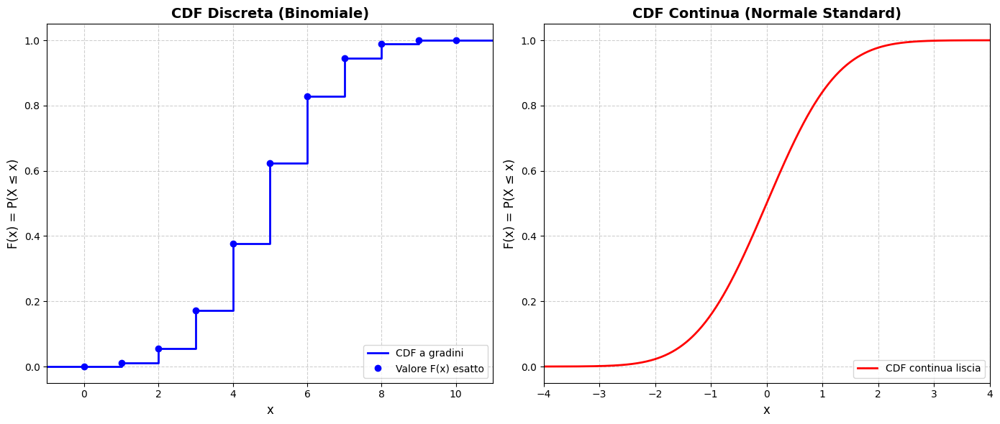
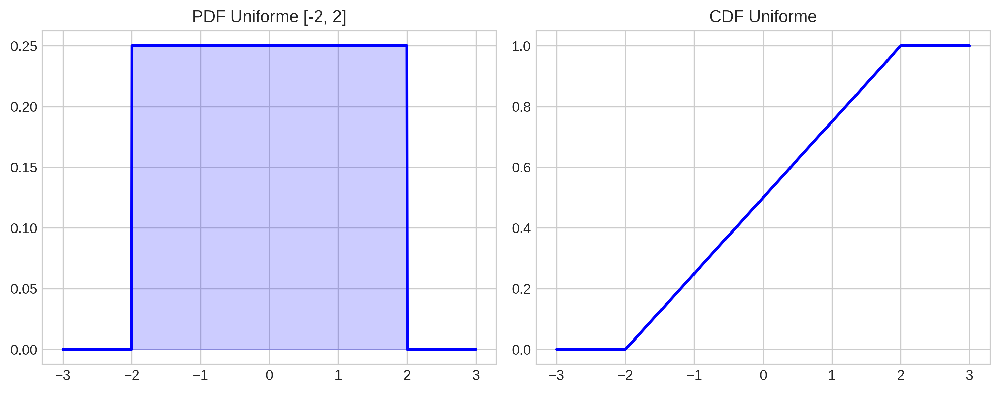
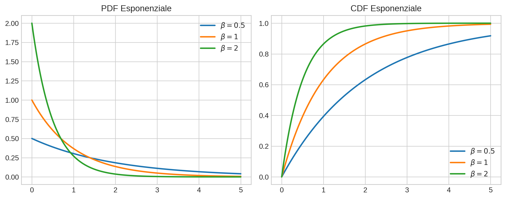
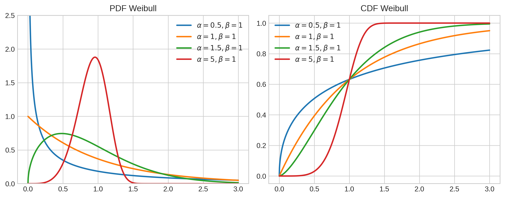
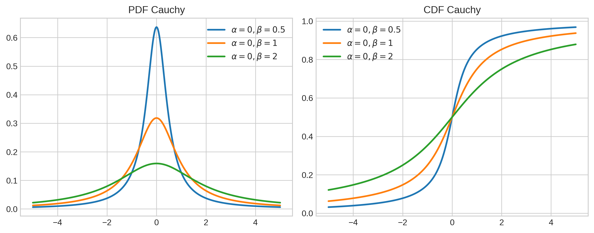

# Costruzione di una Misura di Probabilità

Ora non assumiamo più che $\Omega$ sia numerabile, ma ipotizziamo che esso sia una $\sigma$-algebra $\mathcal{A}\subset2^{\Omega}$. La coppia $(\Omega,\mathcal{A})$ è chiamata spazio misutabile, su di esso vogliamo definire una misura di probabilità $\mathbb{P}$.\
Abbiamo visto che questo è relativamente semplice da fare quando $\Omega$ è numerabile. Infatti, nella probabilità discreta, per calcolare la probabilità di un evento basta sommare la probabilità dei singoli punti che compongono tale evento. Quando $\Omega$ è non-numerabile la stessa metodologia non funziona. Se $\Omega=[0,1]$ allora esso contiene infiniti punti. La probabilità di estrarre un singolo punto (caso favorevole) su infiniti punti (casi possibili) è 0. Una tipica probabilità sull'atomo $\omega$ sarebbe $\mathbb{P}(\{\omega\})=0$. Se sommassimo la probabilità di tutti i punti in $[0,1]$ otterremmo 0 e non 1. Dunque non possiamo definire la probabilità partento dai singoli punti, ma dobbiamo iniziare a misurare gli intervalli.\
Spesso è più semplice costruire una probabilità su un'algebra $\mathcal{A}_0$ che genera la $\sigma$-algebra $\mathcal{A}$. Il problema da risolvere è quindi estendere questa probabilità da $\mathcal{A}_0$ ad $\mathcal{A}$.\
Dunque supponiamo che $\mathcal{A}$ sia la $\sigma$-algebra generata da un'algebra $\mathcal{A}_0$, e supponiamo che ci sia una data misura di probabilità $\mathbb{P}$ sull'algebra: $$\mathbb{P}:\mathcal{A}_0\rightarrow[0,1]$$ che soddisfa:

- $\mathbb{P}(\Omega)=1$

- (additività numerabile) data la successione $\{A_n\}$ con $A_i\cap A_j=0$ $\forall i\neq j$ e con $\bigcup_nA_n\in\mathcal{A}_0$: $$\mathbb{P}(\bigcup_nA_n)=\sum_n\mathbb{P}(A_n)$$

::: mybox
Teorema di estensione di Carathéodory Ogni probabilità $\mathbb{P}$ definita sull'algebra $\mathcal{A}_0$ ammette un'estensione unica sulla $\sigma$-algebra $\mathcal{A}$
:::

## $\pi$ and $\lambda$ systems

1.  Una classe $\mathcal{C}$ di sottoinsiemi di $\Omega$ è chiusa rispetto alle intersezioni finite se, quando $A_1, A_2, \dots, A_n \in \mathcal{C}$, allora anche $\bigcap_{i=1}^n A_i \in \mathcal{C}$ ($n$ arbitrario ma finito).

2.  Una classe $\mathcal{C}$ di sottoinsiemi di $\Omega$ è chiusa rispetto ai limiti crescenti se, quando $A_1 \subset A_2 \subset \dots \subset A_n \subset \dots$ è una successione crescente di eventi in $\mathcal{C}$, allora $\bigcup_{n=1}^{\infty} A_n \in \mathcal{C}$.

3.  Una classe $\mathcal{C}$ di sottoinsiemi di $\Omega$ è chiusa rispetto alle differenze se, quando $A, B \in \mathcal{C}$, con $A \subset B$, allora $B \setminus A \in \mathcal{C}$.

Una classe che possiede la proprietà (1) è detta **$\pi$-system**; una classe che possiede le proprietà (2) e (3) e che contiene l'intero spazio $\Omega$ è detta **$\lambda$-system** (o sistema di Dynkin).

::: mybox
Teorema della Classe Monotòna Sia $\mathcal{C}$ un $\pi$-system e sia $\mathcal{B}$ il più piccolo $\lambda$-system contenente $\mathcal{C}$. Allora: $$\mathcal{B} = \sigma(\mathcal{C})$$ Ovvero, il $\lambda$-system generato dal $\pi$-system $\mathcal{C}$ coincide esattamente con la $\sigma$-algebra generata da $\mathcal{C}$.
:::

Quello che stiamo facendo è definire gli strumenti per concretizzare l'estensione della probabilità dall'algebra $\mathcal{A}_0$ alla $\sigma$-algebra $\mathcal{A}$. Il teorema ci dice che se prendiamo la più piccola famiglia \"ben comportata\" (il $\lambda$-system $\mathcal{B}$) che contiene gli insiemi \"facili\" (il $\pi$-system $\mathcal{C}$), ottieni automaticamente l'intera $\sigma$-algebra $\sigma(\mathcal{C})$. Ciò implica che per dimostrare che una proprietà vale per tutti i complicatissimi insiemi di una $\sigma$-algebra, non occorre \"sporcarsi le mani\" con unioni infinite arbitrarie: è sufficiente dimostrare che la proprietà vale per un $\lambda$-system.

::: mybox
Teorema della Classe Monotòna: corollario Siano $\mathbb{P}$ e $\mathbb{Q}$ due misure di probabilità definite su $\mathcal{A}$, e supponiamo che entrambe le probabilità coincidano su una classe $\mathcal{C}\in \mathcal{A}$ (dove $\mathcal{C}$ è un $\pi$-system. Se $\mathcal{A}=\sigma(\mathcal{C})$, allora: $$\mathbb{P}=\mathbb{Q}$$
:::

## Null sets

Sia $\mathbb{P}$ una probabilità definita su $\mathcal{A}$. Un null set (o insieme trascurabile) per $\mathbb{P}$ è un sottoinsieme $A$ di $\Omega$ tale che esiste $B\in \mathcal{A}$ che soddisfa $A\subset B$ e $\mathbb{P}(B)=0.$\
Diciamo che una proprietà vale **Almost Surely** (A.S. o quasi certamente) se vale al di fuori di un null set.

::: mybox
Completamento della Misura Sia $\mathbb{P}$ una probabilità su $\mathcal{A}$ e sia $\mathcal{N}$ la classe di tutti i null set (insiemi $\mathbb{P}$-trascurabili). Allora: $$\bar{\mathcal{A}} = \{A\cup N : A\in \mathcal{A}, N\in\mathcal{N}\}$$ è una $\sigma$-algebra chiamata \"completamento di $\mathcal{A}$ rispetto a $\mathbb{P}$\". Essa è la più piccola $\sigma$-algebra contenente $\mathcal{A}$ e $\mathcal{N}$, e $\mathbb{P}$ si estende in modo unico come probabilità su $\bar{\mathcal{A}}$, ponendo: $$\mathbb{P}(A\cup N) = \mathbb{P}(A)$$
:::

Il completamento serve a evitare paradossi o \"errori di calcolo\" (insiemi non misurabili) quando si fanno operazioni complesse o limiti. Se un evento $B$ ha probabilità 0, garantiamo che anche ogni suo sotto-evento $A$ (che magari originariamente non era nel \"dizionario\" della nostra $\sigma$-algebra) venga forzatamente incluso negli eventi validi con probabilità 0.

# Costruzione di una misura di probabilità su $\mathbb{R}$

Questo capitolo è un caso speciale del precedente. Assumiamo che $\Omega=\mathbb{R}$. Sia $\mathcal{B}$ la Borel $\sigma$-algebra.

## Distribution Function

La distribution function indotta da una probabilità $\mathbb{P}$ sullo spazio misurabile $(\mathbb{R},\mathcal{B})$ è la funzione: $$F(x)=\mathbb{P}((-\infty,x])$$

Essa prende in input un numero $x$ e restituisce in output la probabilità che il risultato dell'esperimento casuale (la variabile aleatoria) sia minore o uguale di $x$. L'evento \"$X\leq x$\" corrisponde all'intervallo $(-\infty,x]$ e la probabilità di questo evento è proprio $\mathbb{P}((-\infty,x]).$

::: mybox
Relazione tra misura di probabilità e distribution function La distribution function $F$ caratterizza la probabilità.
:::

Ciò significa che se noi conosciamo la distribution function $F$, allora conosciamo l'intera misura $\mathbb{P}$. Ovvero possiamno determinare, da $F$, la probabilità $\mathbb{P}(A)$, dove $A\in \mathcal{B}$ è un Borel set. $\mathbb{P}(A)$ richiede in input insiemi $A$ che possono essere molto complessi, la distribution function invece, prende in input un singolo numero reale $x$ e manda in output un numero $F(x)$ che rappresenta l'area accumulata fino a $x$.

::: mybox
Unicità Una funzione $F$ è la distribution function di un'unica probabilità su $(\mathbb{R},\mathcal{B})$ se e solo se si ha:

- $F$ è non decrescente

- $F$ è continua a destra

- $\lim_{x\rightarrow -\infty}F(x)=0$ e $\lim_{x\rightarrow +\infty}F(x)=1$
:::

::: mybox
Calcolo delle Probabilità tramite la Distribution Function Sia $F$ la funzione di ripartizione (CDF) della probabilità $\mathbb{P}$ su $\mathbb{R}$. Denotando con $F(x^-)$ il limite sinistro di $F$ in $x$ (che esiste poiché $F$ è non decrescente), per ogni $x < y$ si ha:

- $\mathbb{P}((x,y]) = F(y) - F(x) = \mathbb{P}(x < X \leq y)$

- $\mathbb{P}([x,y]) = F(y) - F(x^-) = \mathbb{P}(x \leq X \leq y)$

- $\mathbb{P}([x,y)) = F(y^-) - F(x^-) = \mathbb{P}(x \leq X < y)$

- $\mathbb{P}((x,y)) = F(y^-) - F(x) = \mathbb{P}(x < X < y)$

- $\mathbb{P}(\{x\}) = F(x) - F(x^-) = \mathbb{P}(X = x)$

In particolare, $\mathbb{P}(\{x\}) = 0$ per ogni $x$ **se e solo se** la funzione $F$ è continua.
:::

Questo corollario ci insegna a prestare estrema attenzione ai ordi degli intervalli. La formula (v) è la più importante: ci dice che la probabilità che esca un numero esatto $x$ è pari all'altezza del \"salto\" che la funzione $F$ fa in quel punto. Se la funzione è una curva continua e liscia, non ci sono salti ($F(x) = F(x^-)$), quindi la differenza è $0$. Questo dimostra perché nelle distribuzioni continue (come la Normale o l'Uniforme) la probabilità di un singolo punto è sempre e rigorosamente zero!\
Quanto abbiamo visto unifica probabilità discreta e continua:

- **Variabili Discrete**: la funzione $F(x)$ è a gradini. L'altezza di ogni salto è esattamente la probabilità di quel numero.

- **Variabili Continue**: la funzione $F(x)$ è una curva liscia che non ha salti. Se non c'è salto allora $F(x^-)=F(x)$ e la loro differenza è $0$. Quindi la probabilità di un singolo punto è $0$.

{#fig-placeholder}

## Distribution Function, CDF e PDF

Nella teoria della probabilità è fondamentale chiarire la terminologia e non confondere la probabilità accumulata con la densità puntuale, specialmente quando si passa dalle variabili discrete a quelle continue.

**1. Distribution Function (CDF)**\
Come abbiamo visto, la Distribution Function$F(x)$ descrive la probabilità accumulata fino a un certo punto $x$. Nella letteratura anglosassone, e universalmente in statistica, essa è chiamata Cumulative Distribution Function (CDF) (in italiano Funzione di Ripartizione). I termini Distribution Function, CDF e Funzione di Ripartizione sono sinonimi esatti. Tutti e tre indicano: $$F(x) = \mathbb{P}((-\infty, x]) = \mathbb{P}(X \leq x)$$

**2. Probability Density Function (PDF)**\
Quando ci troviamo nel caso di variabili aleatorie continue (ovvero quando $F(x)$ è una curva liscia senza \"salti\", e quindi assolutamente continua), si introduce la Probability Density Function (PDF), o Funzione di Densità di Probabilità, comunemente denotata con $f(x)$.

::: mybox
Relazione tra CDF e PDF La PDF non è altro che la derivata prima della CDF (laddove la derivata esiste): $$f(x) = \frac{d}{dx}F(x)$$ Di conseguenza, per il Teorema Fondamentale del Calcolo Integrale, possiamo ottenere la CDF (ovvero l'area totale accumulata) integrando la PDF su tutto il dominio fino al punto $x$: $$F(x) = \int_{-\infty}^{x} f(t) \, dt$$
:::

**Differenza Concettuale e Operativa**\
L'errore più insidioso è confondere il significato dei valori restituiti dalle due funzioni:

- **CDF ($F(x)$) restituisce una Probabilità:** L'output è a tutti gli effetti la misura $\mathbb{P}$ accumulata. Per questo motivo, il suo valore è rigorosamente limitato nell'intervallo $[0, 1]$.

- **PDF ($f(x)$) restituisce una Densità:** L'output indica quanto la probabilità sia \"concentrata\" nell'intorno del punto $x$. Non è una probabilità, bensì una probabilità per unità di lunghezza. Essendo una densità, deve essere non negativa ($f(x) \geq 0$), ma a differenza della CDF, il valore della PDF in un punto può tranquillamente essere maggiore di 1.

Per calcolare la probabilità che $X$ cada in un generico intervallo $(a,b]$, le due funzioni ci offrono due approcci matematici equivalenti: valutare una differenza sulla CDF o calcolare un'area sotto la curva della PDF. $$\mathbb{P}((a,b]) = F(b) - F(a) = \int_{a}^{b} f(x) \, dx$$

In sintesi, la CDF restituisce le probabilità esatte (ed esiste sempre, per variabili discrete, continue o miste), mentre la PDF descrive la \"forma\" della distribuzione (ed è uno strumento proprio delle variabili continue, fornendo la funzione integranda necessaria a calcolare l'area/probabilità).

## Massa di Dirac (Point Mass)

**A cosa serve:** Questa distribuzione modella una situazione deterministica piuttosto che casuale. La variabile aleatoria assume un singolo e preciso valore con probabilità $100\%$. Si utilizza spesso per rappresentare costanti all'interno del framework della probabilità o per costruire distribuzioni discrete complesse.

**Parametri:**

- $\alpha \in \mathbb{R}$: Rappresenta l'unico punto in cui è concentrata tutta la \"massa\" di probabilità.

**Formule:** Essendo una distribuzione degenere, non possiede una vera e propria funzione di densità (PDF) rispetto alla misura di Lebesgue. La sua misura di probabilità si esprime come $\mathbb{P}(A) = 1$ se $\alpha \in A$, e $0$ altrimenti. La Funzione di Ripartizione (CDF) è una funzione a gradino: $$F(x) = 
\begin{cases} 
0 & \text{se } x < \alpha \\
1 & \text{se } x \geq \alpha 
\end{cases}$$

{#fig-dirac}

## Distribuzione Uniforme

**A cosa serve:** La distribuzione uniforme è l'analogo continuo del concetto di \"eventi equiprobabili\". Modella situazioni in cui sappiamo che una variabile aleatoria cadrà all'interno di un certo intervallo, ma non abbiamo alcuna ragione per credere che un punto sia più probabile di un altro. La densità è letteralmente \"piatta\" lungo tutto l'intervallo.

**Parametri:**

- $a, b \in \mathbb{R}$ con $a < b$: Rappresentano gli estremi dell'intervallo entro il quale la variabile può assumere valori.

**PDF:** $$f(x) = 
\begin{cases} 
\frac{1}{b - a} & \text{se } a \leq x \leq b \\
0 & \text{altrimenti}
\end{cases}$$ **CDF:** $$F(x) = 
\begin{cases} 
0 & \text{se } x < a \\
\frac{x - a}{b - a} & \text{se } a \leq x \leq b \\
1 & \text{se } x > b
\end{cases}$$

{#fig-uniform}

**NB**: la Uniforme è una distribuzione simmetrica: è verificabile prendendo il suo punto medio $c=\frac{b-a}{2}$, considerando lo spostamento orizzontale di entità $y$ e calcolando l'uguaglianza $f(c+y)=f(c-y)$.

## Distribuzione Esponenziale

**A cosa serve:** È la distribuzione fondamentale per modellare i tempi di attesa tra eventi in un processo di Poisson, ovvero fenomeni che non invecchiano (\"assenza di memoria\"). Viene usata per modellare il tempo di vita di una lampadina o il tempo di attesa prima che decada una particella radioattiva: la probabilità di guastarsi nel prossimo istante è indipendente da quanto tempo l'oggetto ha già funzionato.

**Parametri:**

- $\beta > 0$: È il tasso (o rate) di arrivo/decadimento. Più grande è $\beta$, più rapidamente la curva decresce.

**PDF:** $$f(x) = 
\begin{cases} 
\beta e^{-\beta x} & \text{se } x \geq 0 \\
0 & \text{se } x < 0
\end{cases}$$ **CDF:** $$F(x) = 
\begin{cases} 
1 - e^{-\beta x} & \text{se } x \geq 0 \\
0 & \text{se } x < 0
\end{cases}$$

{#fig-exponential}

**N.B.** La PDF dell'esponenziale ammette sempre il massimo nel limite inferiore del dominio, ovvero in $x=0$.

## Distribuzione Gamma

**A cosa serve:** Generalizza l'Esponenziale. Mentre l'esponenziale modella il tempo di attesa per il *primo* evento, la Gamma modella il tempo di attesa necessario affinché si verifichino $\alpha$ eventi. Nella teoria dell'affidabilità, rappresenta il tempo di vita di un macchinario dotato di componenti di backup (se c'è 1 componente operativo e $n-1$ di scorta, il tempo totale di sopravvivenza è una Gamma). È intimamente legata anche al Chi-quadro usato in Statistica.

**Parametri:**

- $\alpha > 0$: Parametro di forma (shape). Indica il numero di \"eventi\" da attendere.

- $\beta > 0$: Parametro di tasso (rate). Identico a quello dell'Esponenziale.

**PDF:** $$f(x) = 
\begin{cases} 
\frac{\beta^\alpha}{\Gamma(\alpha)} x^{\alpha-1} e^{-\beta x} & \text{se } x \geq 0 \\
0 & \text{se } x < 0
\end{cases}$$ **CDF:** Non ha una forma analitica chiusa elementare e viene definita tramite la funzione Gamma incompleta[^1]: $$F(x) = \int_{0}^{x} \frac{\beta^\alpha}{\Gamma(\alpha)} t^{\alpha-1} e^{-\beta t} \, dt \quad (\text{per } x \geq 0)$$

{#fig-gamma}

**N.B.** Se $\alpha=1$ la PDF della Gamma collassa alla PDF dell'esponenziale.

## Distribuzione di Weibull

**A cosa serve:** È un'altra e diversa generalizzazione della distribuzione esponenziale. La Weibull rinuncia alla proprietà di \"assenza di memoria\" ed è perfetta per modellare tempi di vita in cui interviene l'usura. Permette di descrivere sistemi in cui la probabilità di rottura aumenta col tempo (invecchiamento) oppure diminuisce (fase di rodaggio iniziale).

**Parametri:**

- $\alpha > 0$: Parametro di forma. Se $\alpha < 1$ il tasso di guasto decresce; se $\alpha > 1$ cresce (usura); se $\alpha = 1$ torna a essere un'Esponenziale.

- $\beta > 0$: Parametro di scala.

**PDF:** $$f(x) = 
\begin{cases} 
\alpha \beta^\alpha x^{\alpha-1} e^{-(\beta x)^\alpha} & \text{se } x \geq 0 \\
0 & \text{se } x < 0
\end{cases}$$ **CDF:** $$F(x) = 
\begin{cases} 
1 - e^{-(\beta x)^\alpha} & \text{se } x \geq 0 \\
0 & \text{se } x < 0
\end{cases}$$

{#fig-weibull}

**N.B.** Se $\alpha=1$ la PDF della Weibull collassa alla PDF dell'esponenziale.

## Distribuzione Normale (o Gaussiana)

**A cosa serve:** È la regina indiscussa della Probabilità e della Statistica. A causa del Teorema del Limite Centrale, la somma di molteplici variabili indipendenti (o effetti casuali) tende a distribuirsi come una Normale. Pertanto modella innumerevoli fenomeni in natura: errori di misurazione, altezze fisiche, punteggi di test, ecc. La sua forma è la classica \"curva a campana\".

**Parametri:**

- $\mu \in \mathbb{R}$: Media della distribuzione (centro della campana).

- $\sigma^2 > 0$: Varianza. Definisce l'ampiezza o dispersione della curva (quanto la campana è \"larga\").

**PDF:** $$f(x) = \frac{1}{\sqrt{2\pi\sigma^2}} e^{-\frac{(x-\mu)^2}{2\sigma^2}} \quad \text{per } -\infty < x < \infty$$ **CDF:** Non ha una forma analitica elementare, si denota di solito con $\Phi$ nel caso standard, ma in generale è: $$F(x) = \int_{-\infty}^{x} \frac{1}{\sqrt{2\pi\sigma^2}} e^{-\frac{(t-\mu)^2}{2\sigma^2}} \, dt$$

{#fig-normal}

**NB**: la Normale è una distribuzione simmetrica: è verificabile prendendo il suo punto medio $c=\mu$, considerando lo spostamento orizzontale di entità $y$ e calcolando l'uguaglianza $f(\mu+y)=f(\mu-y)$.

## Distribuzione Lognormale

**A cosa serve:** Se il logaritmo naturale di una variabile si distribuisce come una Normale, allora la variabile stessa ha distribuzione Lognormale. Viene utilizzata per modellare variabili che possono assumere solo valori positivi (asimmetriche a destra) e che derivano da processi moltiplicativi anziché additivi. È onnipresente in economia (dati di produzione), in medicina (tempi di incubazione di malattie) e finanza.

**Parametri:**

- $\mu \in \mathbb{R}$: Media del logaritmo della variabile.

- $\sigma^2 > 0$: Varianza del logaritmo della variabile.

**PDF:** $$f(x) = 
\begin{cases} 
\frac{1}{x\sqrt{2\pi\sigma^2}} e^{-\frac{(\log x - \mu)^2}{2\sigma^2}} & \text{se } x > 0 \\
0 & \text{se } x \leq 0
\end{cases}$$ **CDF:** $$F(x) = 
\begin{cases} 
\int_{0}^{x} \frac{1}{t\sqrt{2\pi\sigma^2}} e^{-\frac{(\log t - \mu)^2}{2\sigma^2}} \, dt & \text{se } x > 0 \\
0 & \text{se } x \leq 0
\end{cases}$$

{#fig-lognormal}

## Distribuzione Doppia Esponenziale (o di Laplace)

**A cosa serve:** Visivamente simile alla Normale ma con un picco molto più appuntito e \"code\" (tails) più spesse. Modella situazioni in cui ci si aspetta la presenza di valori anomali (outliers) più frequentemente di quanto predetto dalla curva Gaussiana. Spesso emerge come la distribuzione della differenza tra due variabili esponenziali indipendenti.

**Parametri:**

- $\alpha \in \mathbb{R}$: Parametro di locazione (il picco centrale).

- $\beta > 0$: Parametro di scala.

**PDF:** $$f(x) = \frac{\beta}{2} e^{-\beta|x-\alpha|} \quad \text{per } -\infty < x < \infty$$ **CDF:** $$F(x) = 
\begin{cases} 
\frac{1}{2} e^{\beta(x-\alpha)} & \text{se } x \leq \alpha \\
1 - \frac{1}{2} e^{-\beta(x-\alpha)} & \text{se } x > \alpha
\end{cases}$$

{#fig-laplace}

**NB**: la Laplace è una distribuzione simmetrica: è verificabile prendendo il suo punto medio $c=\alpha$, considerando lo spostamento orizzontale di entità $y$ e calcolando l'uguaglianza $f(\alpha+y)=f(\alpha-y)$.

## Distribuzione di Cauchy

**A cosa serve:** È la distribuzione famosa per essere il controesempio \"cattivo\" della Probabilità: ha code talmente \"pesanti\" (heavy tails) che la sua media e la sua varianza teoriche **non esistono** (l'integrale non converge). È il modello per una variabile che è il rapporto di due variabili Normali indipendenti. Seppur patologica, trova uso reale in fisica teorica, in ottica e meccanica delle risonanze, o in problemi di calibrazione scientifica.

**Parametri:**

- $\alpha \in \mathbb{R}$: Parametro di locazione (che coincide con la *mediana*, visto che la media non esiste).

- $\beta > 0$: Parametro di scala (apertura della curva).

**PDF:** $$f(x) = \frac{1}{\beta\pi} \left[ \frac{1}{1 + \left(\frac{x-\alpha}{\beta}\right)^2} \right] \quad \text{per } -\infty < x < \infty$$ **CDF:** Integrando, si ottiene la funzione arcotangente: $$F(x) = \frac{1}{\pi} \arctan\left(\frac{x-\alpha}{\beta}\right) + \frac{1}{2}$$

{#fig-cauchy}

**NB**: la Cauchy è una distribuzione simmetrica: è verificabile prendendo il suo punto medio (la mediana) $c=\alpha$, considerando lo spostamento orizzontale di entità $y$ e calcolando l'uguaglianza $f(\alpha+y)=f(\alpha-y)$.

Tutte le distribuzioni vista sono **unimodali**. Per verificarlo (tranne per la Laplace, che non è derivabile) è sufficiente derivare la PDF, porla a 0 e studiarne il segno per scoprire che il punto critico è un massimo globale.

[^1]: La funzione Gamma $\Gamma(\alpha)$ è una funzione matematica che estende il concetto di fattoriale ai numeri reali e complessi. Per $\alpha > 0$, è definita tramite l'integrale $\Gamma(\alpha) = \int_{0}^{+\infty} t^{\alpha-1} e^{-t} \, dt$. Dalla definizione consegue una proprietà fondamentale: se $\alpha$ è un numero intero positivo $n$, allora $\Gamma(n) = (n-1)!$ (inoltre, $\Gamma(1/2) = \sqrt{\pi}$). Nella formula della PDF, la funzione Gamma al denominatore funge da costante di normalizzazione, necessaria per garantire che l'area totale sotto la curva della densità sia esattamente pari a $1$.

::: {.paper-download}
[Scarica il PDF](probability_theory_for_quantitative_finance-4.pdf){.btn-paper download=""}
:::
