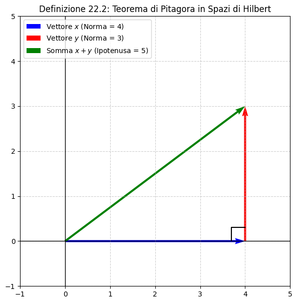
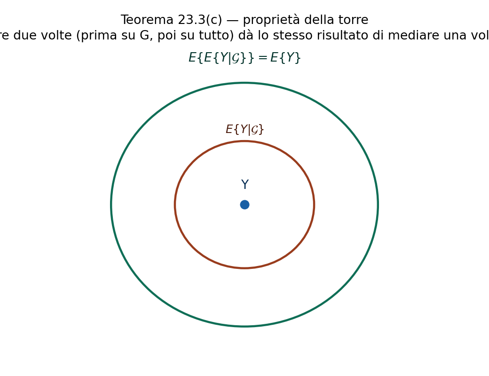

# Spazi $L^2$ e di Hilbert

Supponiamo che sia dato uno spazio di probabilità $(\Omega, \mathcal{A}, \mathbb{P})$. Indichiamo con $L^2$ tutte le (classi di equivalenza per l'uguaglianza A.S. di) variabili aleatorie $X$ tali che $\mathbb{E}[|X|^2]<\infty$. D'ora in poi identificheremo tutte le le VA $X,Y\in L^2$ (che sono uguali A.S.) e le considereremo come rappresentazioni della stessa VA. Questo ha come conseguenza che se $\mathbb{E}[X^2]=0$ allora $X=0$.

## Inner Product

Definiamo un inner product in $L^2$ nel seguente modo: per ogni $X,Y\in L^2$: $$\langle X,Y   \rangle=\mathbb{E}[XY]$$ Notiamo che per la disuguaglianza di Cauchy-Schwartz: $$|\mathbb{E}[XY]|\leq(\mathbb{E}[X^2])^{1/2}(\mathbb{E}[Y^2])^{1/2}<\infty$$\
Abbiamo già visto che $L^2$ è uno spazio lineare: se $X,Y\in L^2$ e $\alpha, \beta$ sono costanti, allora anche $\alpha X+\beta Y \in L^2$. Inoltre l'inner product è lineare in ogni sua componente: $$\langle \alpha X+\beta Y, Z  \rangle=\alpha \langle X,Z \rangle + \beta \langle Y,Z \rangle$$

Infine osserviamo che $\langle X,X  \rangle \geq0$ e $\langle X,X \rangle=0$ se e solo se $X=0$.

## Norma in $L^2$

Una norma in $L^2$ è definita come: $$\Vert X \Vert=\langle X,X \rangle^{1/2}=(\mathbb{E}[X^2])^{1/2}$$

Notiamo che per la bilinearità e per la disuguaglianza di Cauchy-Schwartz (per maggiorare il termine misto $\mathbb{E}[XY]\leq \Vert X\Vert \Vert Y  \Vert$ abbiamo: $$\Vert X+Y \Vert^2 = \mathbb{E}[X^2] + 2\mathbb{E}[XY] + \mathbb{E}[Y^2] \leq \Vert X \Vert^2 + 2\Vert X \Vert \Vert Y \Vert+ \Vert Y\Vert^2=(\Vert X \Vert+ \Vert Y \Vert)^2$$ Applicando la radice quadrata a entrambi i membri, i quadrati si semplificano e così otteniamo la **Disuguaglianza di Minkowski**: $$\Vert X+Y \Vert \leq \Vert X \Vert + \Vert Y \Vert$$

{#fig-placeholder}

::: mybox
$L^2$ è uno spazio lineare normato $L^2$ è uno spazio lineare normato dotato di inner product $\langle \cdot, \cdot \rangle$. Inoltre, si ha: $$\Vert \cdot \Vert=\langle \cdot, \cdot \rangle$$
:::

Ora vogliamo dimostrare che $L^2$ è uno spazio lineare normato completo; ovvero, se $X_n$ è una successione di VA che è di Cauchy, allora esiste un limite in $L^2$.

::: mybox
Successione di Cauchy In matematica, una **successione di Cauchy** (o successione fondamentale) è una successione in cui i termini si avvicinano arbitrariamente tra loro man mano che si procede all'infinito.

**Definizione Formale**\
Sia $X$ uno spazio vettoriale dotato di una norma $\Vert \cdot \Vert$. Una successione $\{x_n\}_{n \in \mathbb{N}}$ a valori in $X$ si dice di Cauchy se, per ogni $\epsilon > 0$, esiste un indice $N \in \mathbb{N}$ tale per cui, per ogni $n, m > N$, si ha: $$\Vert x_n - x_m \Vert < \epsilon$$

La particolarità di questa definizione è che *non richiede di conoscere il limite* a cui tende la successione. Non stiamo misurando la distanza da un punto di arrivo finale, ma stiamo verificando che la distanza tra *due termini qualsiasi* della coda della successione diventi piccola a piacere.

**Il ruolo della Completezza**\
È sempre vero che una successione convergente è di Cauchy. Tuttavia, il viceversa dipende dallo spazio in cui ci troviamo:

- Se lo spazio ha dei \"buchi\" (come l'insieme dei numeri razionali $\mathbb{Q}$), una successione di Cauchy potrebbe non convergere a un elemento di quello spazio.

- Se in uno spazio normato *tutte* le successioni di Cauchy convergono a un elemento dello spazio stesso, lo spazio si dice **completo**.

Uno spazio vettoriale normato e completo prende il nome di **Spazio di Banach**. Se la norma deriva da un prodotto scalare (come per lo spazio $L^2$ delle variabili aleatorie), prende il nome speciale di **Spazio di Hilbert**.
:::

{#fig-placeholderx}

::: mybox
$L^2$ è uno spazio completo $L^2$ è uno spazio lineare normato completo
:::

{#fig-placeholder}

# Spazi di Hilbert

Uno spazio di Hilbert $\mathcal{H}$ è uno spazio lineare normato completo con un inner product che soddisfa: $$\langle x,x\rangle^{1/2}=\Vert x\Vert \quad \forall x\in \mathcal{H}$$

::: mybox
$L^2$ e $\mathcal{H}$ $L^2$ è uno spazio di Hilbert.
:::

{#fig-placeholderx}

D'ora in poi non parleremo più di VA e valori attesi, ma di vettori in un generico spazio di Hilbert $\mathcal{H}$.

## Ortogonalità

Due vettori $x,y \in \mathcal{H}$ sono ortogonali se $\langle x,y \rangle = 0$.\
Un vettore $x$ è ortogonale ad un insieme di vettori $\Gamma$ se $\langle x,y \rangle = 0 \quad \forall y \in \Gamma$.\
Osserviamo che se $\langle x,y \rangle = 0$, allora $\Vert x+y \Vert^2 = \Vert x \Vert^2 + \Vert y \Vert^2$, che è la versione di Hilbert del Teorema di Pitagora.

{#fig-placeholder}

Nel nostro spazio probabilistico $L^2$ ciò significa che: $$\langle X,Y \rangle = 0 \implies \mathbb{E}[XY] = 0 \implies \text{le VA sono ortogonali}$$

**Ortogonalità vs Incorrelazione**\
Dire che due variabili aleatorie sono ortogonali non equivale automaticamente a dire che sono *incorrelate*. Sapendo che la covarianza è definita come: $$\text{Cov}(X,Y) = \mathbb{E}[XY] - \mathbb{E}[X]\mathbb{E}[Y]$$ se $X$ e $Y$ sono ortogonali ($\mathbb{E}[XY] = 0$), la loro covarianza diventa $\text{Cov}(X,Y) = -\mathbb{E}[X]\mathbb{E}[Y]$. Di conseguenza, due variabili ortogonali sono anche incorrelate se e solo se almeno una delle due ha valore atteso nullo ($\mathbb{E}[X]=0$ oppure $\mathbb{E}[Y]=0$).

::: mybox
Continuità dell'inner product Se $x_n\rightarrow x$ e $y_n\rightarrow y$ in $\mathcal{H}$, allora $\langle x_n,y_n \rangle \rightarrow \langle x,y \rangle$ in $\mathbb{R}$. E quindi anche $\Vert x_n\Vert\rightarrow\Vert x \Vert$.
:::

Questo teorema ci garantisce che il prodotto scalare (e di conseguenza la norma) è una **funzione continua**. In termini di calcolo, significa che l'operazione di limite e il prodotto scalare \"commutano\", ovvero possiamo portare il limite all'interno delle parentesi: $$\lim_{n \to \infty} \langle x_n, y_n \rangle = \left\langle \lim_{n \to \infty} x_n, \lim_{n \to \infty} y_n \right\rangle = \langle x, y \rangle$$

{#fig-placeholderx}

## Sottospazi di $\mathcal{H}$

Un sottoinsieme $\mathcal{L}$ si $\mathcal{H}$ è un sottospazio se è lineare (se $x,y\in\mathcal{L}$ allora $\alpha x+ \beta y \in \mathcal{L}$ ) e se è chiuso (se $\{x_n \}_{n\geq1}$ converge ad $x$ in $\mathcal{H}$, allora $x\in \mathcal{L}$).

::: mybox
Complemento ortogonale Sia $\Gamma$ un insieme di vettori. Indichiamo com $\Gamma^\perp$ il complemento ortogonale, ovvero l'insieme di tutti i vettori che sono ortogonali a tutti i vettori in $\Gamma$. Abbiamo dunque che $\Gamma^\perp$ è un sottospazio di $\mathcal{H}$.
:::

Per dimostrare che è un sottospazio, dobbiamo verificare che sia chiuso rispetto alla combinazione lineare. Siano $x_1, x_2 \in \Gamma^\perp$ e siano $\alpha, \beta$ due scalari. Dobbiamo verificare che $(\alpha x_1 + \beta x_2) \in \Gamma^\perp$. Prendiamo un generico $y \in \Gamma$ e calcoliamo il prodotto scalare sfruttando la linearità: $$\langle \alpha x_1 + \beta x_2, y \rangle = \alpha \langle x_1, y \rangle + \beta \langle x_2, y \rangle$$ Poiché $x_1$ e $x_2$ appartengono a $\Gamma^\perp$, sappiamo per definizione che $\langle x_1, y \rangle = 0$ e $\langle x_2, y \rangle = 0$. Quindi: $$\alpha (0) + \beta (0) = 0$$ Dato che questo vale per ogni $y \in \Gamma$, concludiamo che la combinazione lineare $(\alpha x_1 + \beta x_2)$ appartiene a $\Gamma^\perp$.

**Perché è \"chiuso\"?**\
Il fatto che $\Gamma^\perp$ sia un sottospazio *chiuso* (cioè che contenga tutti i suoi punti di accumulazione) deriva direttamente dal teorema sulla **continuità del prodotto scalare**. Se prendiamo una successione $x_n \in \Gamma^\perp$ tale che $x_n \to x$, portando il limite dentro al prodotto scalare avremo che $\langle x, y \rangle = \lim_{n \to \infty} \langle x_n, y \rangle = 0$, garantendo che anche il limite $x$ si trovi in $\Gamma^\perp$.

{#fig-placeholder}

## Distanza

Per un sottospazio $\mathcal{L}$ di $\mathcal{H}$, sia $$d(x,\mathcal{L})=\inf\{\Vert x-y  \Vert:y \in \mathcal{L}\}$$ la distanza da $x\in \mathcal{H}$ a $\mathcal{L}$.\

::: mybox
Distanza tra un punto e un sottospazio La formula rigorosa per definire la distanza tra un vettore $x$ e un intero sottospazio $\mathcal{L}$ è: $$d(x,\mathcal{L}) = \inf \{ \Vert x-y \Vert : y \in \mathcal{L} \}$$

**Scomposizione della formula:**

- **$d(x,\mathcal{L})$**: indica la distanza tra il punto fissato $x$ e l'insieme $\mathcal{L}$.

- **$\Vert x-y \Vert$**: è la distanza tra $x$ e un generico vettore $y$. Geometricamente, è la norma (lunghezza) del vettore differenza.

- **$\{ \dots : y \in \mathcal{L} \}$**: indica l'insieme di tutte le possibili distanze che si ottengono facendo variare $y$ in tutti i modi possibili all'interno del sottospazio $\mathcal{L}$.

- **$\inf$ (Estremo inferiore)**: l'operatore seleziona il limite inferiore di questo insieme di distanze.

**Perché si usa $\inf$ e non $\min$ (minimo)?**\
In analisi matematica, l'estremo inferiore ($\inf$) *esiste sempre* per un insieme di numeri reali limitato inferiormente (e le distanze sono sempre $\geq 0$). Il minimo ($\min$), invece, esiste solo se quel valore viene effettivamente \"toccato\" da un elemento dell'insieme.

Se un generico insieme non è chiuso (immagina un cerchio senza il bordo), le distanze possono avvicinarsi indefinitamente a un valore senza mai raggiungerlo: in quel caso avremmo un $\inf$, ma non un $\min$. Tuttavia, il **Teorema della Proiezione** ci garantisce che, poiché $\mathcal{L}$ è un sottospazio **chiuso**, questo valore minimo viene effettivamente raggiunto da un vettore unico (la proiezione ortogonale). In questo caso specifico, l'$\inf$ diventa a tutti gli effetti un $\min$.
:::

Notiamo che se $\mathcal{L}$ è un sottospazio, allora $x\in \mathcal{L}$ se e solo se $d(x,\mathcal{L})=0$, ovvero la distanza tra $x$ e $\mathcal{L}$ è $0$.

::: mybox
Teorema della Proiezione (o della Migliore Approssimazione)

Sia $\mathcal{L}$ un sottospazio **chiuso** di uno spazio di Hilbert $\mathcal{H}$ e sia $x \in \mathcal{H}$. Allora esiste un unico vettore $y \in \mathcal{L}$ (chiamato *proiezione ortogonale* di $x$ su $\mathcal{L}$) tale che minimizza la distanza da $x$: $$\Vert x-y \Vert = \inf_{z \in \mathcal{L}} \Vert x-z \Vert = d(x, \mathcal{L})$$
:::

{#fig-placeholderx}

**Caratterizzazione tramite Ortogonalità**\
Il vettore $y \in \mathcal{L}$ è la proiezione ortogonale di $x$ se e solo se l'errore di approssimazione $(x - y)$ è ortogonale a tutto il sottospazio $\mathcal{L}$. Ovvero: $$\langle x - y, z \rangle = 0 \quad \forall z \in \mathcal{L}$$ Questo equivale a dire che l'errore $(x - y) \in \mathcal{L}^\perp$.

**Significato Geometrico e Pratico**\
Geometricamente, stiamo tracciando l'altezza (la perpendicolare) dal punto $x$ al \"piano\" $\mathcal{L}$. Il punto di intersezione $y$ è il punto di $\mathcal{L}$ più vicino a $x$. Questo vettore $y$ rappresenta la **migliore approssimazione** possibile dell'elemento $x$ utilizzando solo gli elementi a disposizione nel sottospazio $\mathcal{L}$.

**L'operatore di proiezione**\
Grazie a questo teorema, possiamo definire un operatore $\Pi: \mathcal{H} \to \mathcal{L}$ che associa ad ogni $x$ la sua unica proiezione $y$. Di conseguenza, ogni vettore $x \in \mathcal{H}$ può essere scomposto in modo unico come: $$x = y + (x - y) = \Pi(x) + x^{\perp}$$ dove $\Pi(x) \in \mathcal{L}$ e $x^{\perp} \in \mathcal{L}^\perp$. Questa si chiama *scomposizione ortogonale* dello spazio $\mathcal{H}$.

## Operatore di Proiezione

Fissiamo uno spazio di Hilbert $\mathcal{H}$ e un sottospazio (chiuso e lineare) $\mathcal{L}$. La proiezione di un vettore $x\in \mathcal{H}$ su $\mathcal{L}$ consiste nel prendere l'unico vettore $y\in \mathcal{L}$ che è più vicino a $x$.\
Indichiamo l'operatore di proiezione con $\Pi$.

::: mybox
Proprietà dell'operatore di proiezione L'operatore di proiezione ortogonale $\Pi$ di uno spazio di Hilbert $\mathcal{H}$ su un sottospazio chiuso $\mathcal{L}$ soddisfa le seguenti proprietà fondamentali:

1.  **$\Pi$ è idempotente: $\Pi^2=\Pi$**\
    *Significato geometrico:* Applicare la proiezione due volte equivale ad applicarla una volta sola. Se proietti un vettore sul piano $\mathcal{L}$, il nuovo vettore si trova già su quel piano; cercare di proiettarlo di nuovo non lo sposterà. In simboli: $\Pi(\Pi(x)) = \Pi(x)$.

2.  **Azione sui sottospazi chiave:**\
    $\Pi(x) = x \quad \text{per } x \in \mathcal{L}$\
    $\Pi(x) = 0 \quad \text{per } x \in \mathcal{L}^\perp$\
    *Significato geometrico:* L'operatore agisce come funzione identità per i vettori che appartengono già a $\mathcal{L}$ (sono già perfetti, non c'è nulla da approssimare). Al contrario, annulla completamente i vettori che appartengono al complemento ortogonale $\mathcal{L}^\perp$, poiché questi non hanno alcuna \"ombra\" proiettata su $\mathcal{L}$ (sono a $90^\circ$).

3.  **Ortogonalità del residuo (o errore):**\
    Per ogni $x \in \mathcal{H}$, il vettore $(x - \Pi(x))$ è ortogonale a $\mathcal{L}$.\
    *Significato geometrico:* È il cuore del Teorema della Proiezione. Il vettore originale $x$ viene diviso perfettamente in due parti ortogonali tra loro: $$x = \underbrace{\Pi(x)}_{\in \mathcal{L}} + \underbrace{(x - \Pi(x))}_{\in \mathcal{L}^\perp}$$ La prima è la migliore approssimazione, la seconda è l'errore commesso.

**Nota (Linearità):** Oltre a queste, l'operatore $\Pi$ su un sottospazio è sempre un operatore **lineare**, ovvero $\Pi(\alpha x + \beta y) = \alpha \Pi(x) + \beta \Pi(y)$.
:::

{#fig-placeholder}

::: mybox
Corollario: Decomposizione Ortogonale Sia $\Pi_{\mathcal{L}}$ l'operatore di proiezione ortogonale di $\mathcal{H}$ su un sottospazio chiuso $\mathcal{L}$. Allora l'identità: $$x = \Pi_{\mathcal{L}}(x) + (x - \Pi_{\mathcal{L}}(x))$$ è una **rappresentazione unica** di $x$ come somma di un vettore in $\mathcal{L}$ e uno in $\mathcal{L}^\perp$.
:::

**Proiezione sul complemento ortogonale**\
Il termine residuo (l'errore di approssimazione) $(x - \Pi_{\mathcal{L}}(x))$ è esattamente la proiezione ortogonale di $x$ sul sottospazio $\mathcal{L}^\perp$. Possiamo quindi definire un nuovo operatore $\Pi_{\mathcal{L}^\perp}(x) = x - \Pi_{\mathcal{L}}(x)$, riscrivendo in modo elegante la scomposizione come: $$x = \Pi_{\mathcal{L}}(x) + \Pi_{\mathcal{L}^\perp}(x)$$

**Conseguenza (Teorema di Pitagora)**\
Poiché per definizione $\Pi_{\mathcal{L}}(x) \perp \Pi_{\mathcal{L}^\perp}(x)$, possiamo applicare il Teorema di Pitagora calcolando la norma al quadrato di entrambi i membri: $$\Vert x \Vert^2 = \Vert \Pi_{\mathcal{L}}(x) \Vert^2 + \Vert x - \Pi_{\mathcal{L}}(x) \Vert^2$$ *Significato pratico:* La \"lunghezza\" totale del vettore è la somma esatta della lunghezza della sua approssimazione e della lunghezza dell'errore commesso. In probabilità, questa è esattamente la formula della **scomposizione della varianza**.

{#fig-placeholderx}

::: mybox
Corollario: Altre proprietà dell'operatore di proiezione Sia $\Pi_{\mathcal{L}}$ l'operatore di proiezione ortogonale di uno spazio di Hilbert $\mathcal{H}$ su un sottospazio chiuso $\mathcal{L}$. Allora valgono le seguenti proprietà:

1.  **Simmetria (o Operatore Autoaggiunto):**\
    $$\langle \Pi_{\mathcal{L}}(x), y \rangle = \langle x, \Pi_{\mathcal{L}}(y) \rangle = \langle \Pi_{\mathcal{L}}(x), \Pi_{\mathcal{L}}(y) \rangle$$ *Significato analitico:* L'operatore di proiezione può essere \"spostato\" da un argomento all'altro del prodotto scalare senza alterare il risultato.\
    *Perché è vero?* Ricordando la scomposizione ortogonale $y = \Pi_{\mathcal{L}}(y) + y^\perp$, se calcoliamo il prodotto scalare del primo termine otteniamo: $$\langle \Pi_{\mathcal{L}}(x), y \rangle = \langle \Pi_{\mathcal{L}}(x), \Pi_{\mathcal{L}}(y) + y^\perp \rangle = \langle \Pi_{\mathcal{L}}(x), \Pi_{\mathcal{L}}(y) \rangle + \underbrace{\langle \Pi_{\mathcal{L}}(x), y^\perp \rangle}_{=0}$$ Il termine incrociato si annulla perché $\Pi_{\mathcal{L}}(x) \in \mathcal{L}$ e $y^\perp \in \mathcal{L}^\perp$. Facendo lo stesso ragionamento per $\langle x, \Pi_{\mathcal{L}}(y) \rangle$ si arriva all'identico risultato centrale.

2.  **Linearità:**\
    Per ogni coppia di vettori $x,y \in \mathcal{H}$ e di scalari $\alpha, \beta$: $$\Pi_{\mathcal{L}}(\alpha x + \beta y) = \alpha \Pi_{\mathcal{L}}(x) + \beta \Pi_{\mathcal{L}}(y)$$ *Significato geometrico:* Proiettare prima i vettori e poi combinarli produce lo stesso risultato che combinarli prima e proiettare il vettore finale. L'ombra di una somma è la somma delle ombre.
:::

::: mybox
Applicazione lineare Sia $T$ un'applicazione da $\mathcal{H}$ su un sottospazio $\mathcal{L}$. Supponiamo che $x-T(x)$ sia ortogonale a $\mathcal{L}\quad \forall x\in \mathcal{H}$. Allora $T=\Pi_{\mathcal{L}}$, l'operatore di proiezione sul sottospazio $\mathcal{L}$.
:::

Questo teorema ci dice come \"verificare\" se abbiamo calcolato correttamente una proiezione. Se in un esercizio \"indoviniamo\" o proponiamo una certa formula $T(x)$ e vogliamo assicurarci che sia la proiezione ortogonale su $\mathcal{L}$, ci basta controllare due cose:

1.  Che il risultato $T(x)$ stia in $\mathcal{L}$.

2.  Che il residuo $(x - T(x))$ sia ortogonale a tutti gli elementi di $\mathcal{L}$.

Se entrambe le condizioni sono soddisfatte, allora $T(x)$ è senza dubbio la proiezione ortogonale.

# Valore Atteso Condizionato

Siano $X$ e $Y$ due VA. Con $Y$ a valori in $\mathbb{R}$ e $X$ che assume solo una quantitità numerabile di valori $\{x_1,...,x_n,...\}$. Supponiamo di sapere che si è verificato l'evento $\{X=x_j \}$. Il valore atteso di $Y$ può cambiare in base a questa conoscenza.

## Valore atteso condizionato di $Y$ dato l'evento $\{X=x_j \}$

Il concetto di **valore atteso condizionato** rispetto a un singolo evento è il primo passo per capire matematicamente come la scoperta di una nuova informazione aggiorni le nostre stime.

Sia $X$ una variabile aleatoria discreta, a valori in un insieme numerabile $\{x_1,\dots,x_n,\dots\}$, e sia $Y$ una variabile aleatoria a valori reali in $\mathbb{R}$. Fissiamo un evento specifico: supponiamo di aver appena osservato (o di ipotizzare) che $X$ abbia assunto esattamente il valore $x_j$. Affinché abbia senso condizionare rispetto a questo evento, dobbiamo assicurarci che non sia impossibile, richiedendo che $\mathbb{P}(X=x_j)>0$.

Sotto questa ipotesi, il valore atteso condizionato di $Y$ dato l'evento $\{X=x_j\}$ è definito rigorosamente come: $$\mathbb{E}[Y|X=x_j] = \mathbb{E}_{\mathbb{Q}}[Y]$$

**Il cambio di misura di probabilità**\
Il cuore di questa definizione risiede nell'introduzione di $\mathbb{Q}$, che rappresenta una *nuova* misura di probabilità. Per un qualsiasi evento $\Lambda$, la nuova probabilità $\mathbb{Q}(\Lambda)$ è definita tramite la probabilità condizionata classica introdotta da Kolmogorov: $$\mathbb{Q}(\Lambda) = \mathbb{P}(\Lambda|X=x_j) = \frac{\mathbb{P}(\Lambda \cap \{X=x_j\})}{\mathbb{P}(X=x_j)}$$ Intuitivamente, sapere che $X=x_j$ si è verificato cambia il nostro \"universo\" di riferimento. Tutti gli esiti dello spazio campionario in cui $X \neq x_j$ vengono immediatamente scartati: la loro probabilità sotto la nuova misura $\mathbb{Q}$ crolla a zero. Viceversa, le probabilità di tutti gli eventi compatibili con $X=x_j$ vengono \"riproporzionate\", ovvero divise per il fattore di scala $\mathbb{P}(X=x_j)$, così che la probabilità totale del nuovo universo torni a sommare a $1$.

Di conseguenza, calcolare il valore atteso condizionato $\mathbb{E}[Y|X=x_j]$ non è altro che calcolare una normalissima media di $Y$, ma utilizzando i \"nuovi pesi\" forniti dalla probabilità $\mathbb{Q}$ invece dei pesi originali dettati da $\mathbb{P}$.

**La condizione di integrabilità**\
La definizione si conclude con una postilla fondamentale: il calcolo è valido *a patto che* $\mathbb{E}_{\mathbb{Q}}[|Y|] < \infty$. Questa condizione tecnica ci assicura che il valore atteso esista finito. Non basta che $Y$ sia integrabile nell'universo originale $\mathbb{P}$; affinché la media condizionata abbia senso matematico, la variabile $Y$ (in valore assoluto) deve non divergere all'infinito quando la si valuta sotto la nuova \"lente\" della probabilità $\mathbb{Q}$.

::: mybox
Anche $Y$ è discreta Se anche $Y$ è discreta e assume una quantità numerabile di valori $\{y_1,...,y_n,... \}$, allora: $$\mathbb{E}[Y|X=x_j]=\sum_{k=1}^{\infty}y_k\mathbb{P}(Y=y_k|X=x_j)$$
:::

Questa espressione è l'esatto analogo della formula classica per il valore atteso $\mathbb{E}[Y] = \sum y_k \mathbb{P}(Y=y_k)$, ma con i \"pesi\" aggiornati. Invece di moltiplicare ogni possibile valore $y_k$ per la sua probabilità marginale (a priori), lo moltiplichiamo per la sua **probabilità condizionata** (a posteriori), sapendo con certezza che l'evento $X=x_j$ si è verificato.

**Il legame con la misura $\mathbb{Q}$**\
Riprendendo il concetto del \"cambio di universo\" visto in precedenza, le probabilità condizionate $\mathbb{P}(Y=y_k \mid X=x_j)$ non sono altro che i pesi della nuova misura $\mathbb{Q}(Y=y_k)$. Stiamo quindi eseguendo una normale media pesata dei valori di $Y$, ma utilizzando come pesi la nuova distribuzione di probabilità $\mathbb{Q}$ dettata dall'informazione su $X$.

{#fig-placeholder}

## Valore atteso condizionato di $Y$ data $X$ discreta

Sia $X$ una variabile aleatoria a valori in un insieme numerabile $\{x_1, x_2, \dots\}$ e sia $Y$ una variabile aleatoria a valori in $\mathbb{R}$ (con $\mathbb{E}[|Y|] < \infty$).

Il **valore atteso condizionato di $Y$ data $X$**, indicato con $\mathbb{E}[Y|X]$, è definito come: $$\mathbb{E}[Y|X] = f(X)$$ dove $f(x)$ è la funzione reale definita da: $$f(x_j) = \mathbb{E}[Y|X=x_j] \quad \text{per ogni } x_j \text{ tale che } \mathbb{P}(X=x_j) > 0$$

**Il salto concettuale: Numero vs Variabile Aleatoria**\
È cruciale notare la differenza rispetto alla sezione precedente:

- Condizionare a un evento specifico, come $\{X=x_j\}$, produce un **numero fisso** (la stima di $Y$ sapendo esattamente cosa è successo).

- Condizionare rispetto all'intera variabile aleatoria $X$ produce una **nuova variabile aleatoria**.

**Perché è una variabile aleatoria?**\
L'espressione $\mathbb{E}[Y|X]$ descrive il modo in cui aggiorneremo la nostra stima di $Y$ *prima* che l'esperimento venga eseguito. Poiché il risultato dipende dal valore (ancora ignoto e governato dal caso) che assumerà $X$, la quantità $f(X)$ è anch'essa governata dal caso. Nello specifico, $\mathbb{E}[Y|X]$ è una variabile aleatoria discreta che: $$\text{assume il valore } \mathbb{E}[Y|X=x_j] \quad \text{con probabilità } \mathbb{P}(X=x_j)$$

### Esempio {#sec-esempio .unnumbered}

Sia $X$ una variabile aleatoria con distribuzione di Poisson di parametro $\lambda$. Supponiamo che, dato l'evento $\{X=n\}$, eseguiamo $n$ prove indipendenti, ciascuna con probabilità di successo $p$. Sia $S$ il numero totale di successi ottenuti. Vogliamo calcolare $\mathbb{E}[S|X]$ e $\mathbb{E}[X|S]$.\
**1. Calcolo di $\mathbb{E}[S|X]$ (Il caso semplice)**\
Iniziamo fissando il valore di $X$. Se sappiamo che $X=n$, la variabile $S$ (numero di successi in $n$ prove) segue per definizione una distribuzione Binomiale di parametri $n$ e $p$. Sappiamo che il valore atteso di una Binomiale è il prodotto dei suoi parametri: $$\mathbb{E}[S|X=n] = np$$ Per la regola vista in precedenza (il passaggio da numero a variabile aleatoria), sostituendo il valore fisso $n$ con la variabile $X$, otteniamo immediatamente: $$\mathbb{E}[S|X] = pX$$

**2. Calcolo di $\mathbb{E}[X|S]$ (Il caso complesso)**\
Questo calcolo è più insidioso perché dobbiamo procedere \"a ritroso\". Per trovare $\mathbb{E}[X|S=k]$, dobbiamo prima determinare la distribuzione di probabilità condizionata $\mathbb{P}(X=n|S=k)$. Utilizziamo il Teorema di Bayes e la Legge delle Probabilità Totali: $$\mathbb{P}(X=n|S=k) = \frac{\mathbb{P}(S=k|X=n)\mathbb{P}(X=n)}{\mathbb{P}(S=k)} = \frac{\mathbb{P}(S=k|X=n)\mathbb{P}(X=n)}{\sum_{m \geq k} \mathbb{P}(S=k|X=m)\mathbb{P}(X=m)}$$ *Nota sui limiti della sommatoria:* La somma parte da $m=k$ perché è impossibile ottenere $k$ successi se il numero totale di tentativi $m$ è minore di $k$.

Sostituiamo le distribuzioni note (Binomiale per $S|X$ e Poisson per $X$): $$\text{Numeratore} = \binom{n}{k} p^k (1-p)^{n-k} \frac{\lambda^n}{n!} e^{-\lambda}$$ Esplicitando il coefficiente binomiale $\binom{n}{k} = \frac{n!}{k!(n-k)!}$, il termine $n!$ si semplifica: $$\text{Numeratore} = \frac{p^k (1-p)^{n-k} \lambda^n}{k!(n-k)!} e^{-\lambda}$$

Ora calcoliamo il **Denominatore** (che richiede un trucco algebrico). Riscriviamo la serie raggruppando i termini e portando fuori dalla sommatoria ciò che non dipende da $m$: $$\text{Denominatore} = \sum_{m \geq k} \frac{p^k (1-p)^{m-k} \lambda^m}{k!(m-k)!} e^{-\lambda} = \frac{(\lambda p)^k e^{-\lambda}}{k!} \sum_{m \geq k} \frac{(\lambda(1-p))^{m-k}}{(m-k)!}$$ Facciamo un cambio di variabile: poniamo $j = m-k$. Quando $m$ va da $k$ a $\infty$, $j$ va da $0$ a $\infty$: $$\sum_{j=0}^{\infty} \frac{(\lambda(1-p))^j}{j!}$$ Questa è esattamente l'espansione in serie di Taylor della funzione esponenziale $e^x = \sum \frac{x^j}{j!}$, con $x = \lambda(1-p)$. Quindi la somma vale $e^{\lambda(1-p)}$. Il denominatore si riduce a: $$\text{Denominatore} = \frac{(\lambda p)^k e^{-\lambda}}{k!} e^{\lambda(1-p)} = \frac{(\lambda p)^k e^{-\lambda p}}{k!}$$ *(Nota a margine: abbiamo appena dimostrato che la distribuzione marginale di $S$ è una Poisson di parametro $\lambda p$!)*

Ora possiamo finalmente scrivere la probabilità condizionata dividendo Numeratore per Denominatore. Gran parte dei termini si semplificano: $$\mathbb{P}(X=n|S=k) = \frac{ \frac{p^k (1-p)^{n-k} \lambda^n}{k!(n-k)!} e^{-\lambda} }{ \frac{(\lambda p)^k e^{-\lambda p}}{k!} } = \frac{(\lambda(1-p))^{n-k}}{(n-k)!} e^{-\lambda(1-p)}$$ Questa formula ci dice una cosa bellissima: dato $S=k$, la differenza $(X-k)$ segue una distribuzione di Poisson di parametro $\lambda(1-p)$.

Possiamo ora calcolare il valore atteso calcolando la serie: $$\mathbb{E}[X|S=k] = \sum_{n \geq k} n \cdot \mathbb{P}(X=n|S=k) = \sum_{n \geq k} n \frac{(\lambda(1-p))^{n-k}}{(n-k)!} e^{-\lambda(1-p)}$$ Usando lo stesso cambio di variabile $j = n-k$ (quindi $n = j+k$): $$\mathbb{E}[X|S=k] = \sum_{j=0}^{\infty} (j+k) \frac{(\lambda(1-p))^j}{j!} e^{-\lambda(1-p)}$$ Questa somma si spezza nel valore atteso di una Poisson di parametro $\lambda(1-p)$, che vale esattamente $\lambda(1-p)$, più la costante $k$. $$\mathbb{E}[X|S=k] = \lambda(1-p) + k$$ Sostituendo il valore fisso $k$ con la variabile aleatoria $S$, otteniamo il risultato finale: $$\mathbb{E}[X|S] = S + \lambda(1-p)$$

**3. Verifica tramite la Legge delle Aspettative Iterate**\
Come verifica finale, calcoliamo $\mathbb{E}[S]$ usando la proprietà della torre (o aspettativa iterata): $\mathbb{E}[S] = \mathbb{E}[\mathbb{E}[S|X]]$. Sostituendo il risultato trovato al punto 1: $$\mathbb{E}[S] = \mathbb{E}[pX] = p\mathbb{E}[X]$$ Poiché $X$ è una Poisson di parametro $\lambda$, il suo valore atteso è $\lambda$. Dunque: $$\mathbb{E}[S] = p\lambda$$ *Il che è coerente col fatto che $S$ sia distribuita come una Poisson di parametro $\lambda p$.*\
Cosa succede se $X$ è una VA continua?\

### $\sigma$-algebra generata da una variabile aleatoria

Sia $X:(\Omega,\mathcal{A}) \rightarrow (\mathbb{R}^n,\mathcal{B}^n)$ una funzione misurabile. La $\sigma$-algebra generata da $X$, indicata con $\sigma(X)$, è definita come la controimmagine della $\sigma$-algebra boreliana $\mathcal{B}^n$ tramite la funzione $X$: $$\sigma(X) = X^{-1}(\mathcal{B}^n)$$ Ovvero, esplicitando la definizione come avevamo già visto: $$\sigma(X) = \{ A \subseteq \Omega \mid A = X^{-1}(B) \quad \text{per qualche } B \in \mathcal{B}^n \}$$

Nella teoria moderna della probabilità, la $\sigma$-algebra $\sigma(X)$ è la traduzione matematica rigorosa del concetto di **informazione portata da $X$**. Cosa c'è dentro l'insieme $\sigma(X)$? Ci sono tutti e soli quegli eventi $A$ (sottoinsiemi di $\Omega$) per i quali possiamo stabilire con assoluta certezza se si sono verificati o meno, basandoci *unicamente* sull'osservazione del valore assunto da $X$.

È per questo motivo che nel Lemma di Doob-Dynkin diciamo che se $Y$ è $\sigma(X)$-misurabile, allora $Y$ dipende totalmente da $X$: significa che l'informazione portata da $X$ è sufficiente a determinare tutto ciò che fa $Y$.

::: mybox
Lemma di Doob-Dynkin (o Teorema di Fattorizzazione)

Sia $X$ una variabile aleatoria a valori in $\mathbb{R}^n$ e sia $Y$ una variabile aleatoria a valori in $\mathbb{R}$. $Y$ è $\sigma(X)$-misurabile se e solo se esiste una funzione Borel-misurabile $f: \mathbb{R}^n \to \mathbb{R}$ tale che: $$Y = f(X)$$

Per comprendere questo lemma, bisogna pensare alla $\sigma$-algebra $\sigma(X)$ come all'**informazione portata da $X$**.

- Dire che \"$Y$ è $\sigma(X)$-misurabile\" significa che se noi conosciamo il risultato dell'esperimento per $X$, allora conosciamo automaticamente e senza alcuna incertezza anche il risultato di $Y$.

- Il lemma ci dice che questa dipendenza totale a livello di informazione si traduce sempre in una **dipendenza funzionale deterministica**: se $Y$ non aggiunge \"nuova casualità\" rispetto a $X$, allora $Y$ deve per forza essere una funzione matematica esatta di $X$.

**Il legame con il Valore Atteso Condizionato**\
Questo lemma è il pilastro teorico su cui si poggia la definizione moderna di valore atteso condizionato. Per definizione (che si basa sul Teorema di Radon-Nikodym o sul Teorema della Proiezione), sappiamo che la variabile aleatoria $Z = \mathbb{E}[Y|X]$ deve essere $\sigma(X)$-misurabile. Applicando il Lemma di Doob-Dynkin a $Z$, otteniamo la garanzia matematica che deve esistere una funzione $f$ tale per cui: $$\mathbb{E}[Y|X] = f(X)$$ Ecco spiegato rigorosamente perché il valore atteso condizionato rispetto a una variabile aleatoria è sempre una funzione di quella variabile!
:::

## Valore atteso condizionato di $Y$ data $X$ (Caso $L^2$ e Generale)

Sia $Y \in L^2(\Omega, \mathcal{A}, \mathbb{P})$ (ovvero lo spazio di tutte le variabili aleatorie con varianza finita nell'intero universo $\Omega$). Allora il valore atteso condizionato di $Y$ data $X$ è definito come l'unico elemento $\hat{Y} \in L^2(\Omega, \sigma(X), \mathbb{P})$ tale che: $$\mathbb{E}[\hat{Y}Z] = \mathbb{E}[YZ] \quad \forall Z \in L^2(\Omega, \sigma(X), \mathbb{P})$$ Scriviamo $\mathbb{E}[Y|X]$ per indicare esplicitamente $\hat{Y}$.

**Il legame con l'Ortogonalità dell'errore (Teorema della Proiezione)**\
Questa definizione algebrica, apparentemente astratta, è l'esatta traduzione probabilistica del *Teorema della Proiezione* negli spazi di Hilbert. Sappiamo che lo spazio vettoriale limitato dall'informazione di $X$, ovvero $L^2(\Omega, \sigma(X), \mathbb{P})$, è un sottospazio chiuso di $L^2(\Omega, \mathcal{A}, \mathbb{P})$.

Il valore atteso condizionato $\hat{Y}$ è semplicemente la **proiezione ortogonale** di $Y$ su questo sottospazio. Per le proprietà dell'operatore di proiezione, il termine residuo (o errore di stima) definito come $(Y - \hat{Y})$ deve essere ortogonale a tutto il sottospazio. Nello spazio $L^2$, il prodotto scalare è definito come $\langle U, V \rangle = \mathbb{E}[UV]$. Di conseguenza, imporre l'ortogonalità dell'errore significa richiedere che, per ogni $Z$ nel sottospazio: $$\langle Y - \hat{Y}, Z \rangle = 0 \implies \mathbb{E}[(Y - \hat{Y})Z] = 0$$

- $Y$ è la variabile che vogliamo prevedere

- $\hat{Y}=\mathbb{E}[Y|X]$ è la nostra migliore stima basata solo sull'informazione di $X$ ($\sigma(X)$)

- $Y-\hat{Y}$ è il residuo, o errore

- $Z$ è un qualsiasi modo di sfruttare l'informazione $X$ (una qualsiasi funzione Borel-misurabile $g(X)$).

Sfruttando la linearità del valore atteso, otteniamo: $$\mathbb{E}[YZ] - \mathbb{E}[\hat{Y}Z] = 0 \implies \mathbb{E}[YZ] = \mathbb{E}[\hat{Y}Z]$$ Ecco da dove deriva la definizione principale! Questa proprietà ci garantisce non solo che $\mathbb{E}[Y|X]$ esiste, ma anche che è unico, proprio perché è la migliore approssimazione possibile di $Y$ date le informazioni fornite da $X$.

{#fig-placeholderx}

**Applicazione del Lemma di Doob-Dynkin**\
Poiché, per definizione, la variabile $\mathbb{E}[Y|X]$ appartiene allo spazio limitato da $\sigma(X)$, essa è $\sigma(X)$-misurabile. Per il Lemma di Doob-Dynkin, deve esistere una funzione Borel-misurabile $f$ tale per cui: $$\mathbb{E}[Y|X] = f(X)$$ Allo stesso modo, il generico \"vettore di test\" $Z$ può essere scritto come $g(X)$. Pertanto, la definizione $\mathbb{E}[\hat{Y}Z] = \mathbb{E}[YZ]$ assume la sua forma operativa più utile negli esercizi: $$\mathbb{E}[f(X)g(X)] = \mathbb{E}[Yg(X)]$$ per ogni funzione $g$ Borel-misurabile tale che $g(X) \in L^2$.

**Generalizzazione a una $\sigma$-algebra generica**\
Questo potente impianto geometrico non vale solo per il condizionamento rispetto a una variabile aleatoria $X$, ma può essere esteso. Se sostituiamo $\sigma(X)$ con una qualsiasi $\sigma$-algebra $\mathcal{G} \subset \mathcal{A}$ (che rappresenta un set generico di informazioni), lo spazio $L^2(\Omega, \mathcal{G}, \mathbb{P})$ rimane un sottospazio chiuso di Hilbert. Possiamo quindi definire in modo del tutto analogo la proiezione ortogonale $\mathbb{E}[Y|\mathcal{G}]$, che rappresenta il valore atteso condizionato di $Y$ dato il bagaglio informativo $\mathcal{G}$.

::: mybox
Ma cosa rappresenta esattamente la variabile $Z$? Nella definizione $\mathbb{E}[\hat{Y}Z] = \mathbb{E}[YZ]$, la variabile aleatoria $Z$ funge da **\"vettore di test\"**. Possiamo comprenderne il significato da due prospettive complementari:

**1. La prospettiva Geometrica (Spazi di Hilbert)**\
Nel Teorema della Proiezione, abbiamo detto che l'errore di approssimazione $(Y - \hat{Y})$ deve essere ortogonale a *tutti* gli elementi del sottospazio su cui stiamo proiettando. Nello spazio $L^2$, il nostro \"piano\" (il sottospazio) è $L^2(\Omega, \sigma(X), \mathbb{P})$. La variabile $Z$ rappresenta semplicemente un **generico vettore di questo piano**. Imporre $\mathbb{E}[(Y - \hat{Y})Z] = 0$ per *ogni* $Z$ significa assicurarsi che l'errore sia a $90^\circ$ rispetto a qualsiasi direzione possibile all'interno del sottospazio delle informazioni di $X$.

**2. La prospettiva Probabilistica e dell'Informazione**\
Poiché $Z$ vive nel sottospazio limitato da $\sigma(X)$, il Lemma di Doob-Dynkin ci assicura che $Z$ non è altro che **una qualsiasi funzione di $X$** (cioè $Z = g(X)$). In questo senso, $Z$ rappresenta un qualsiasi modo in cui potremmo rielaborare l'informazione $X$ che già possediamo (ad esempio: $X^2$, $e^X$, $\sin(X)$, ecc.).

Dire che $\mathbb{E}[(Y - \hat{Y})g(X)] = 0$ per ogni funzione $g$ significa che l'errore di stima $(Y - \hat{Y})$ è **completamente scorrelato** da qualsiasi possibile rielaborazione della nostra informazione di partenza. Se ci fosse anche solo una funzione $g(X)$ per cui questo prodotto non è zero, significherebbe che l'errore contiene ancora delle tracce di $X$: vorrebbe dire che la nostra stima $\hat{Y}$ non ha \"spremuto\" e utilizzato tutta l'informazione che $X$ aveva da offrirci!
:::

## Valore atteso condizionato rispetto a una sub-$\sigma$-algebra

Sia $Y \in L^2(\Omega, \mathcal{A}, \mathbb{P})$ e sia $\mathcal{G}$ una sub-$\sigma$-algebra di $\mathcal{A}$ (ovvero $\mathcal{G} \subset \mathcal{A}$). Allora il valore atteso condizionato di $Y$ data $\mathcal{G}$ è l'unico elemento $\mathbb{E}[Y|\mathcal{G}]$ che appartiene allo spazio $L^2(\Omega, \mathcal{G}, \mathbb{P})$ tale che: $$\mathbb{E}[YZ] = \mathbb{E}[ \mathbb{E}[Y|\mathcal{G}] Z ] \quad \forall Z \in L^2(\Omega, \mathcal{G}, \mathbb{P})$$

**Cosa cambia rispetto a prima?**\
Dal punto di vista matematico, non cambia assolutamente nulla: stiamo ancora proiettando ortogonalmente. La differenza è puramente concettuale. Invece di limitare la nostra informazione a una singola variabile aleatoria $X$ (usando $\sigma(X)$), stiamo generalizzando a una *qualunque* libreria di informazioni rappresentata dalla $\sigma$-algebra $\mathcal{G}$. Questa $\mathcal{G}$ potrebbe essere generata da un intero vettore di variabili aleatorie $(X_1, X_2, \dots, X_n)$, oppure dall'intera storia passata di un processo stocastico (come avviene nelle *martingale*).

::: mybox
Proprietà del Valore Atteso Condizionato Sia $Y \in L^2(\Omega, \mathcal{A}, \mathbb{P})$ e sia $\mathcal{G}$ una sub-$\sigma$-algebra di $\mathcal{A}$. Valgono le seguenti proprietà:

- **Positività (o Monotonia)**:\
  Se $Y \geq 0$, allora $\mathbb{E}[Y|\mathcal{G}] \geq 0$.\
  *(Di conseguenza, se $Y_1 \geq Y_2$, allora $\mathbb{E}[Y_1|\mathcal{G}] \geq \mathbb{E}[Y_2|\mathcal{G}]$).*

- **Fattorizzazione di Doob-Dynkin**:\
  Se $\mathcal{G}=\sigma(X)$ per qualche variabile aleatoria $X$, allora esiste una funzione Borel-misurabile $f$ tale che: $$\mathbb{E}[Y|\sigma(X)] = f(X)$$

- **Proprietà della Torre (Aspettative Iterate)**:\
  Prendendo il valore atteso (non condizionato) del valore atteso condizionato, si recupera il valore atteso originale: $$\mathbb{E}[\mathbb{E}[Y|\mathcal{G}]] = \mathbb{E}[Y]$$ *Nota più generale:* Se abbiamo due $\sigma$-algebre annidate $\mathcal{H} \subset \mathcal{G}$, l'informazione minore \"vince\" sempre: $\mathbb{E}[\mathbb{E}[Y|\mathcal{G}]|\mathcal{H}] = \mathbb{E}[Y|\mathcal{H}]$.

- **Linearità**:\
  Siano $Y_1, Y_2$ due variabili aleatorie e $\alpha, \beta \in \mathbb{R}$ due costanti scalari: $$\mathbb{E}[\alpha Y_1 + \beta Y_2 | \mathcal{G}] = \alpha \mathbb{E}[Y_1 | \mathcal{G}] + \beta \mathbb{E}[Y_2 | \mathcal{G}]$$

- **Portar fuori ciò che è noto (Pulling out known factors)**:\
  Se una variabile aleatoria $Z$ è già $\mathcal{G}$-misurabile (ovvero il suo valore è perfettamente noto data l'informazione $\mathcal{G}$), essa si comporta come una costante rispetto al valore atteso condizionato e può \"uscire\" dall'operatore: $$\mathbb{E}[ZY | \mathcal{G}] = Z \cdot \mathbb{E}[Y | \mathcal{G}]$$
:::

{#fig-placeholder}

\

## Il passaggio da $L^2$ a $L^1$

Fino ad ora siamo rimasti nel rassicurante spazio di Hilbert $L^2$. Qui tutto funzionava perfettamente poiché $L^2$ è dotato di un prodotto scalare, definito come $\langle X,Y \rangle = \mathbb{E}[XY]$. Tuttavia, appartengono ad $L^2$ solo le variabili aleatorie con momento secondo finito, ovvero $\mathbb{E}[|X|^2] < \infty$.

Le variabili aleatorie con varianza infinita, ma media finita ($\mathbb{E}[|X|] < \infty$), appartengono invece allo spazio $L^1$, che è uno **Spazio di Banach**.\
Se proviamo ad usare la proiezione ortogonale sulle variabili in $L^1$, la matematica va in tilt: il Teorema di Pitagora perde di significato se l'ipotenusa è infinita.

Lo spazio di Banach è completo e normato, ma è sprovvisto di prodotto scalare e, di conseguenza, del concetto stesso di \"ortogonalità\". Per definire e dimostrare che il **valore atteso condizionato** continua a esistere ed è unico anche in $L^1$, dovremo abbandonare le proiezioni geometriche e affidarci interamente alla teoria della misura: questo ci porterà al fondamentale **Teorema di Radon-Nikodym**.

::: mybox
Misurabilità e identità: quando $\mathbb{E}[Y|\mathcal{G}] = Y$

Sia $Y$ una variabile aleatoria (positiva o integrabile) definita sullo spazio $(\Omega, \mathcal{A}, \mathbb{P})$ e sia $\mathcal{G} \subset \mathcal{A}$ una sub-$\sigma$-algebra. Allora si ha che: $$\mathbb{E}[Y|\mathcal{G}] = Y \quad \text{se e solo se} \quad Y \text{ è } \mathcal{G}\text{-misurabile.}$$

**Significato Intuitivo (L'Informazione Totale)**\
Se $Y$ è $\mathcal{G}$-misurabile, significa che l'informazione contenuta in $\mathcal{G}$ è *già sufficiente* per conoscere il valore esatto di $Y$. Non c'è più nulla da stimare: se l'esito è già noto date le informazioni a disposizione, la nostra \"migliore previsione\" diventa una certezza matematica e coincide con la variabile stessa.

**Significato Geometrico (L'ombra sul pavimento)**\
Riprendendo il Teorema della Proiezione (valido nello spazio $L^2$), possiamo immaginare la $\sigma$-algebra $\mathcal{G}$ come il nostro \"pavimento\", ovvero il sottospazio lineare di tutte le variabili aleatorie che possiamo costruire con le informazioni a nostra disposizione.

Sappiamo che $\mathbb{E}[Y|\mathcal{G}]$ rappresenta la proiezione ortogonale, ovvero l'*ombra* del vettore $Y$ gettata su quel pavimento. Se $Y$ è $\mathcal{G}$-misurabile, geometricamente significa che il vettore $Y$ si trova *già interamente adagiato sul pavimento*. Di conseguenza, la sua proiezione non lo sposta di un millimetro: l'ombra e il vettore coincidono perfettamente.
:::

::: mybox
Indipendenza Sia $Y \in L^1(\Omega, \mathcal{A}, \mathbb{P}$) e supponiamo che $X$ e $Y$ siano indipendenti. Allora: $$\mathbb{E}[Y|X]=\mathbb{E}[Y]$$
:::

{#fig-placeholderx}

## Disuaguaglianze Fondamentali

### Disuguaglianza di Jensen (Versione Condizionata)

Sia $\phi: \mathbb{R} \rightarrow \mathbb{R}$ una funzione convessa, e siano $X$ e $\phi(X)$ variabili aleatorie integrabili. Per ogni sub-$\sigma$-algebra $\mathcal{G}$, vale la disuguaglianza: $$\phi\left( \mathbb{E}[X|\mathcal{G}] \right) \leq \mathbb{E}[\phi(X)|\mathcal{G}]$$

**Significato Intuitivo**\
In parole povere questa disuguaglianza afferma che: *\"La funzione della media è sempre minore o uguale alla media della funzione\"*.

**Conseguenza fondamentale: La Varianza Condizionata**\
Notiamo che la funzione $\phi(x)=x^2$ è convessa. Applicando la disuguaglianza di Jensen otteniamo: $$(\mathbb{E}[X|\mathcal{G}])^2 \leq \mathbb{E}[X^2|\mathcal{G}]$$ Questa disuguaglianza ha un'implicazione importantissima. Se riordiniamo i termini portandoli tutti a destra, otteniamo: $$\mathbb{E}[X^2|\mathcal{G}] - (\mathbb{E}[X|\mathcal{G}])^2 \geq 0$$ La quantità a sinistra è l'esatta definizione della **varianza condizionata** $\text{Var}(X|\mathcal{G})$. Dunque, la disuguaglianza di Jensen ci garantisce matematicamente che, proprio come la varianza classica, anche la varianza condizionata non può mai assumere valori negativi.

{#fig-placeholder}

### Disuguaglianza di Hölder

Siano $X$ e $Y$ due variabili aleatorie tali che $\mathbb{E}[|X|^p]<\infty$ e $\mathbb{E}[|Y|^q]<\infty$, dove $p$ e $q$ (con $p,q > 1$) sono **esponenti coniugati**, ovvero soddisfano la relazione: $$\frac{1}{p} + \frac{1}{q} = 1$$ Allora vale la seguente catena di disuguaglianze: $$|\mathbb{E}[XY]| \leq \mathbb{E}[|XY|] \leq (\mathbb{E}[|X|^p])^{1/p} (\mathbb{E}[|Y|^q])^{1/q}$$ Di conseguenza, se $X \in L^p$ e $Y \in L^q$, allora il loro prodotto appartiene allo spazio $L^1$, ovvero $XY \in L^1$ (il prodotto è integrabile e ammette valore atteso finito).

**Il significato pratico**\
La disuguaglianza di Hölder serve a stabilire un **limite superiore** rigoroso a quanto può essere grande il valore atteso del prodotto di due variabili aleatorie. Questa proprietà è uno strumento di controllo fondamentale: ci garantisce che quantità che dipendono dal prodotto di due variabili (come la covarianza o la correlazione) non \"esplodano\" all'infinito, a patto di poter controllare i momenti $p$-esimo e $q$-esimo delle singole variabili isolate.\
**Osservazione: Il legame con Cauchy-Schwarz e $L^2$**\
Nel capitolo precedente abbiamo visto che, nello spazio di Hilbert $L^2$, la finitezza e la validità dell'inner product (il prodotto scalare) sono garantite dalla disuguaglianza di Cauchy-Schwarz: $$|\mathbb{E}[XY]| \leq (\mathbb{E}[X^2])^{1/2} (\mathbb{E}[Y^2])^{1/2}$$ Possiamo ora notare che la disuguaglianza di Hölder non è altro che la sua naturale generalizzazione a spazi normati diversi. Se infatti poniamo $p=2$ e $q=2$ (che soddisfano banalmente la condizione degli esponenti coniugati poiché $1/2 + 1/2 = 1$), la disuguaglianza di Hölder collassa esattamente nella Cauchy-Schwarz.

### Disuguaglianza di Minkowski

Siano $X$ e $Y$ due variabili aleatorie e $1 \leq p < \infty$, con $\mathbb{E}[|X|^p] < \infty$ e $\mathbb{E}[|Y|^p] < \infty$ (ovvero $X, Y \in L^p$). Allora vale la seguente disuguaglianza: $$(\mathbb{E}[|X+Y|^p])^{1/p} \leq (\mathbb{E}[|X|^p])^{1/p} + (\mathbb{E}[|Y|^p])^{1/p}$$

**Significato geometrico: la Disuguaglianza Triangolare in $L^p$**\
La disuguaglianza di Minkowski è fondamentale perché ci permette di definire rigorosamente una **norma** sullo spazio $L^p$. Se definiamo la \"lunghezza\" di una variabile aleatoria $X$ come la sua norma $p$-esima, indicata con $\|X\|_p = (\mathbb{E}[|X|^p])^{1/p}$, l'equazione precedente si può riscrivere in modo molto più familiare: $$\|X+Y\|_p \leq \|X\|_p + \|Y\|_p$$ Proprio come avevamo visto che la disuguaglianza di Hölder è la generalizzazione della Cauchy-Schwarz, questa notazione rende evidente che **la disuguaglianza di Minkowski è la generalizzazione della disuguaglianza triangolare**. Essa ci garantisce, anche in spazi a infinite dimensioni, un fatto geometrico intuitivo: la distanza del cammino diretto (la somma $X+Y$) è sempre minore o uguale alla somma dei due cammini separati.

## La norma in $L^p$ e la geometria degli spazi

Per poter definire rigorosamente la \"lunghezza\" di un oggetto matematico (ovvero una **norma** $\|\cdot\|$), la funzione scelta deve rispettare tre assiomi fondamentali:

- **Omogeneità assoluta:** Deve scalare proporzionalmente. Se moltiplico una variabile per una costante $c$, la sua \"lunghezza\" viene moltiplicata per il valore assoluto della costante ($\|cX\| = |c|\|X\|$).

- **Disuguaglianza triangolare:** Il cammino diretto è sempre più breve della somma di due cammini separati ($\|X+Y\| \leq \|X\| + \|Y\|$).

- **Definitezza (o Separazione):** La norma è $0$ se e solo se l'oggetto è il vettore nullo ($\|X\| = 0 \iff X = 0$).

Per una variabile aleatoria $X \in L^p$, definiamo la norma $p$-esima come: $$\|X\|_p = \left(\mathbb{E}[|X|^p]\right)^{1/p} = \left( \int_{\Omega} |X(\omega)|^p d\mathbb{P}(\omega) \right)^{1/p}$$

**Dalla Minkowski agli Spazi di Banach**\
Il fatto che questa formula sia davvero una norma dipende interamente dalla **disuguaglianza di Minkowski**, che dimostra il rispetto della disuguaglianza triangolare. Questo risultato ci garantisce che $L^p$ è a tutti gli effetti uno spazio lineare normato.

Di fatto, è persino uno spazio normato *completo* (ovvero uno **Spazio di Banach**). Tuttavia, per $p \neq 2$ non è uno Spazio di Hilbert, poiché la sua norma non deriva da alcun prodotto scalare sottostante (viene a mancare l'identità del parallelogramma).

**Nota tecnica (Il concetto di \"Quasi Certamente\"):**\
In probabilità, la condizione di definitezza ($\|X\|_p = 0 \iff X=0$) è soddisfatta in senso debole, ovvero $X=0$ *quasi certamente* (con probabilità 1). Per questo motivo, per far funzionare la geometria, lo spazio $L^p$ non è formato da singole funzioni, ma da \"classi di equivalenza\": due variabili aleatorie che differiscono solo su un evento di probabilità nulla vengono considerate esattamente come lo stesso vettore matematico.

{#fig-palle-lp}

## MCT, Lemma di Fatou e DCT condizionati

Quando è lecito scambiare limite e integrale? Poiché il valore atteso condizionato non è altro che un integrale di Lebesgue (valutato rispetto a una nuova misura di probabilità dettata dalle informazioni), i tre teoremi fondamentali dell'integrazione continuano a valere anche sotto condizionamento.

*Nota bene:* Poiché $\mathbb{E}[\cdot|\mathcal{G}]$ produce una nuova variabile aleatoria, tutte le uguaglianze e le disuguaglianze che seguono sono da intendersi **Quasi Certamente** (A.S. - Almost Surely), ovvero sono vere con probabilità 1.

Sia $\{Y_n\}_{n\geq1}$ una successione di variabili aleatorie su $(\Omega, \mathcal{A}, \mathbb{P})$ e sia $\mathcal{G}$ una sub-$\sigma$-algebra di $\mathcal{A}$. Valgono i seguenti risultati:

- **Teorema della Convergenza Monotona (MCT)**:\
  Se $Y_n \geq 0$ e la successione cresce verso $Y$ quasi certamente ($Y_n \uparrow Y$ a.s.), allora il limite passa dentro l'aspettativa: $$\lim_{n\rightarrow \infty} \mathbb{E}[Y_n| \mathcal{G}] = \mathbb{E}[Y|\mathcal{G}] \quad \text{a.s.}$$

- **Lemma di Fatou**:\
  Se $Y_n \geq 0$, allora l'aspettativa del limite inferiore è sempre dominata dal limite inferiore delle aspettative: $$\mathbb{E}\left[ \liminf_{n \rightarrow \infty} Y_n \middle| \mathcal{G} \right] \leq \liminf_{n\rightarrow \infty} \mathbb{E}[Y_n|\mathcal{G}] \quad \text{a.s.}$$

- **Teorema della Convergenza Dominata (DCT)**:\
  Se $\lim_{n\rightarrow \infty} Y_n = Y$ quasi certamente e la successione è \"dominata\" da una variabile integrabile, ovvero esiste $Z \in L^1(\Omega, \mathcal{A}, \mathbb{P})$ tale che $|Y_n| \leq Z$ per ogni $n$, allora: $$\lim_{n\rightarrow \infty} \mathbb{E}[Y_n|\mathcal{G}] = \mathbb{E}[Y|\mathcal{G}] \quad \text{a.s.}$$

::: {.paper-download}
[Scarica il PDF](probability_theory_for_quantitative_finance-12-1.pdf){.btn-paper download=""}
:::
