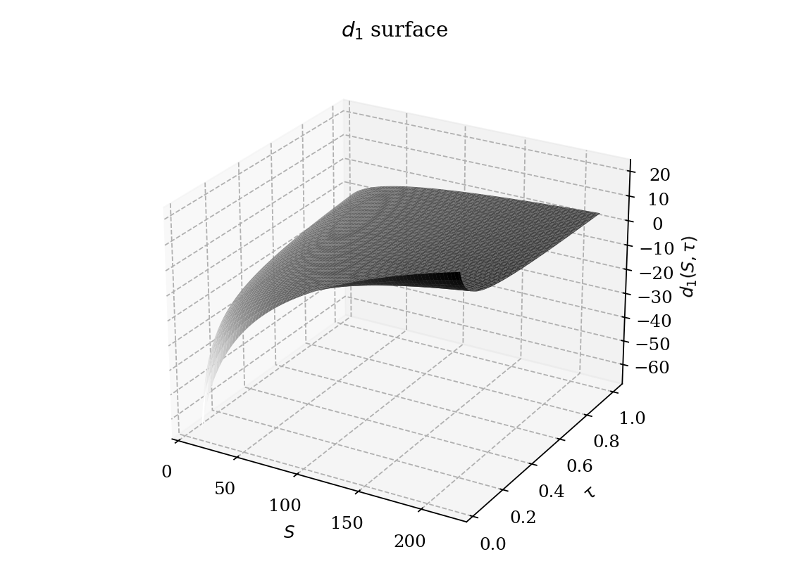
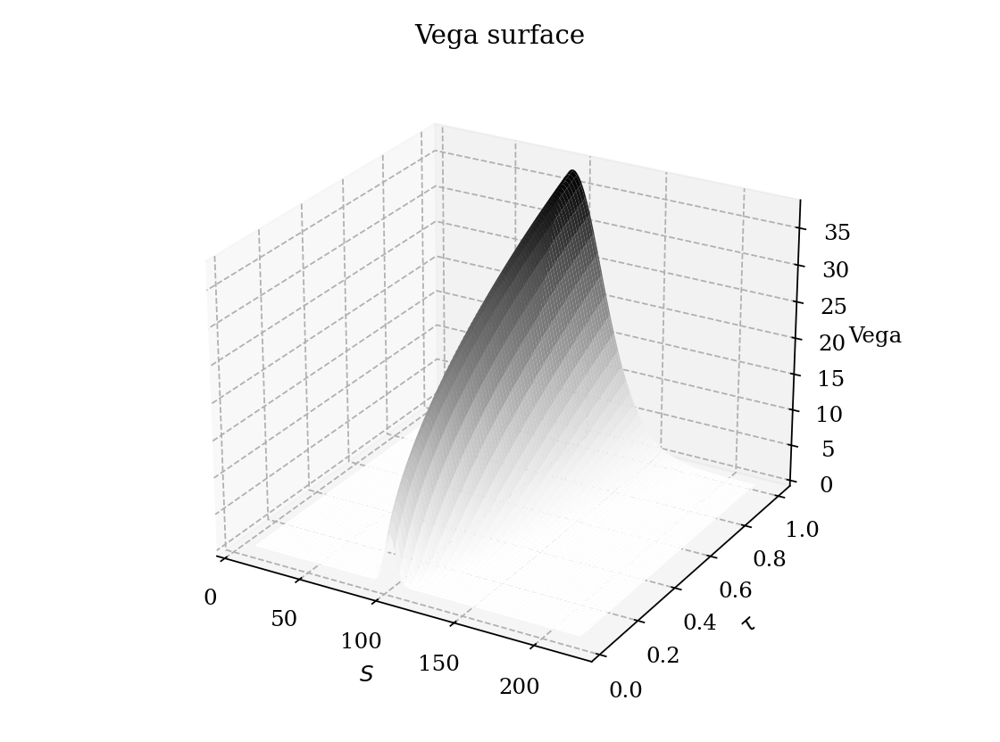

# Introduction

## Motivation

The Black--Scholes equation for the price $V(S,t)$ of a European contingent claim written on a non-dividend-paying stock is 

$$
\frac{\partial V}{\partial t} + \frac{1}{2}\sigma^2 S^2 \frac{\partial^2 V}{\partial S^2} + rS\frac{\partial V}{\partial S} - rV = 0 ,
\qquad V(S,T) = \Phi(S),
$$ {#eq-bs-pde}

 where $\sigma>0$ is the (constant) volatility, $r$ the constant risk-free rate, and $\Phi$ the terminal payoff. @eq-bs-pde is a linear, second-order, backward parabolic PDE. Its coefficients, however, are not constant: the second-derivative term is multiplied by $S^2$, and the first-derivative term by $S$. This is precisely the structure of a *Cauchy--Euler* (or equidimensional) operator in the spatial variable, and it is well known that Cauchy--Euler operators are transformed into constant-coefficient operators by a logarithmic change of variable. Once the coefficients are constant, a second, purely algebraic substitution removes the remaining zeroth- and first-order terms, and what is left is exactly the one-dimensional heat equation $$u_\tau = \frac{1}{2}\sigma^2 u_{xx}.$$ This is not a coincidence dressed up for pedagogical convenience: the Black--Scholes PDE *is*, up to an explicit and invertible change of variables, the heat equation. The present article makes this statement precise and uses it as the sole engine for deriving the closed-form pricing formula.

## A brief historical remark

The analogy between diffusion of heat and diffusion of probability is as old as Brownian motion itself: Bachelier (1900) modelled stock prices as arithmetic Brownian motion, whose transition density is precisely the heat kernel. Black and Scholes (1973) and Merton (1973) arrived at equation @eq-bs-pde through a replication argument, and it was Black and Scholes themselves who noted, in their original paper, that a change of variables reduces their equation to the heat equation, which they then solved using the known heat kernel solution. This article reconstructs that reduction in full analytic detail, filling in every intermediate step.

## Structure of the article and notation

@sec-heat reviews the heat equation, its fundamental solution, and the representation of solutions as convolutions with the heat kernel. @sec-model states the assumptions of the Black--Scholes model and derives the pricing PDE @eq-bs-pde via the standard hedging argument, so that the article is self-contained. @sec-transform carries out the change of variables that reduces @eq-bs-pde to the heat equation, step by step. @sec-solve solves the transformed problem using the heat kernel and inverts the substitutions to obtain the closed-form price. @sec-formula analyses the resulting formula and verifies it directly against the PDE. @sec-greeks reinterprets the Greeks as kernel properties. @sec-extensions--@sec-discussion discuss extensions and limitations of the analogy. Throughout, $S_t>0$ denotes the underlying asset price, $K$ the strike, $T$ the maturity, $\tau = T-t$ the time to maturity, and $N(\cdot)$ the standard normal CDF.

# The heat equation {#sec-heat}

## Physical derivation

Consider the temperature $u(x,t)$ of a one-dimensional, homogeneous conducting rod. Fourier's law states that heat flux $q$ is proportional to the negative temperature gradient, $$q(x,t) = -k\,u_x(x,t),$$ with $k>0$ the thermal conductivity. Conservation of energy on an infinitesimal segment $[x,x+\,\mathrm{d}x]$ requires that the rate of change of internal energy equal the net flux entering the segment, $$c\rho\, u_t(x,t)\,\mathrm{d}x= -\big(q(x+\,\mathrm{d}x,t)-q(x,t)\big) = -q_x(x,t)\,\mathrm{d}x,$$ with $c$ the specific heat and $\rho$ the density. Substituting Fourier's law gives the heat equation in its canonical form 

$$
u_t = \alpha\, u_{xx}, \qquad \alpha := \frac{k}{c\rho} > 0.
$$ {#eq-heat}

 @eq-heat is the prototypical parabolic PDE: it is first order in time and second order in space, and the sign of $\alpha$ is what makes the equation well-posed *forward* in time (a diffusion smooths out irregularities, it does not create them).

## The Cauchy problem and the fundamental solution

Consider @eq-heat on $\mathbb{R}$ with initial condition $u(x,0)=f(x)$. The *fundamental solution* (or heat kernel) is the solution corresponding to a Dirac mass as initial datum, $f=\delta_{x_0}$. By translation and scaling invariance of @eq-heat, one seeks a self-similar solution of the form $$u(x,t) = \frac{1}{\sqrt{t}}\,F\!\left(\frac{x-x_0}{\sqrt{t}}\right).$$ Substituting into @eq-heat and setting $\xi = (x-x_0)/\sqrt{t}$ reduces the PDE to an ODE for $F$, whose normalized solution (imposing $\int_\mathbb{R}u(x,t)\,\mathrm{d}x= 1$ for all $t$, since heat is conserved) is Gaussian. The result is the *heat kernel* 

$$
\Gamma(x,t;x_0) = \frac{1}{\sqrt{4\pi\alpha t}}\exp\!\left(-\frac{(x-x_0)^2}{4\alpha t}\right), \qquad t>0.
$$ {#eq-kernel}

 Direct differentiation confirms that $\Gamma$ solves @eq-heat in $(x,t)$ for every fixed $x_0$, and that $\Gamma(\cdot,t;x_0) \to \delta_{x_0}$ weakly as $t\to 0^+$.

## Representation of the general solution

Because @eq-heat is linear, the solution for a general bounded initial datum $f$ is obtained by superposition of point sources, i.e. by convolving $f$ with the kernel: 

$$
u(x,t) = \big(\Gamma(\cdot,t)\ast f\big)(x) = \int_{-\infty}^{\infty} \Gamma(x,t;y)\, f(y)\,\mathrm{d}y
= \int_{-\infty}^{\infty} \frac{1}{\sqrt{4\pi\alpha t}}\exp\!\left(-\frac{(x-y)^2}{4\alpha t}\right) f(y)\,\mathrm{d}y.
$$ {#eq-heat-solution}

 This representation is the single analytic tool this article needs: once the Black--Scholes PDE is reduced to @eq-heat, the option price is obtained by evaluating an integral of exactly this form.

## Properties of the kernel

The kernel @eq-kernel satisfies:

- **Positivity:** $\Gamma(x,t;x_0)>0$ for all $t>0$ (the maximum principle for the heat equation follows from this: solutions with nonnegative data stay nonnegative, and cannot exceed their initial or boundary maxima).

- **Normalization:** $\int_\mathbb{R}\Gamma(x,t;x_0)\,\mathrm{d}x= 1$ for every $t>0$ --- $\Gamma(\cdot,t;x_0)$ is, for each $t$, the density of a $\mathcal{N}(x_0, 2\alpha t)$ random variable.

- **Semigroup property:** $\Gamma(\cdot,t_1+t_2;x_0) = \Gamma(\cdot,t_1)\ast \Gamma(\cdot,t_2;x_0)$, reflecting the Markov property of the underlying diffusion.

- **Smoothing:** for $t>0$, $u(\cdot,t)$ is $C^\infty$ even if $f$ is merely bounded and measurable --- diffusion instantaneously regularizes irregular data.

{#fig-heat-kernel}

## Uniqueness and stability

On the whole line, uniqueness of bounded solutions to the Cauchy problem for @eq-heat follows from the maximum principle: if $u_1,u_2$ solve @eq-heat with the same bounded initial datum, then $w=u_1-u_2$ solves @eq-heat with $w(\cdot,0)=0$, and the maximum principle forces $w\equiv 0$. The same argument yields continuous dependence on the initial data, i.e. well-posedness in the sense of Hadamard. This is the property that will justify, in @sec-solve, treating the option payoff as an \"initial\" datum for a backward-in-time diffusion.

# The Black--Scholes model: assumptions and setup {#sec-model}

## Assumptions

The classical Black--Scholes--Merton model rests on the following idealizations:

1.  Frictionless markets: no transaction costs, no taxes, assets are perfectly divisible, short-selling is unrestricted.

2.  The market admits no arbitrage opportunities.

3.  Trading takes place continuously in time.

4.  There exists a risk-free asset (a money-market account) paying a constant, known rate $r$.

5.  The underlying pays no dividends over the life of the option.

6.  The underlying price follows a geometric Brownian motion with constant volatility $\sigma$.

## Dynamics of the underlying

Under the real-world measure $\mathbb{P}$, the price process $S_t$ is assumed to solve the stochastic differential equation 

$$
\mathrm{d}S_t = \mu S_t \,\mathrm{d}t+ \sigma S_t\, \mathrm{d}W_t,
$$ {#eq-gbm}

 where $\mu\in\mathbb{R}$ is the (constant) expected return, $\sigma>0$ the volatility, and $W_t$ a standard Brownian motion. By Itô's formula applied to $\ln S_t$, the unique strong solution of @eq-gbm is $$S_t = S_0 \exp\!\left(\Big(\mu-\tfrac12\sigma^2\Big)t + \sigma W_t\right),$$ so that $S_t$ is log-normally distributed for every $t$, and in particular $S_t>0$ almost surely --- a necessary property for a traded price.

## Contingent claims

A European contingent claim with maturity $T$ is a contract paying $\Phi(S_T)$ at time $T$, for a given measurable payoff function $\Phi$. For a call option, $\Phi(S)=(S-K)^+$; for a put, $\Phi(S)=(K-S)^+$. We denote by $V(S,t)$ the (unknown) fair value at time $t<T$ of the claim, conditional on $S_t=S$.

## The replicating portfolio

The central idea of Black and Scholes is that, because there are only two sources of randomness in the model ($S_t$ and, trivially, the deterministic bond), a portfolio holding the option and a suitably chosen quantity of the underlying can be made instantaneously riskless. Let $\Pi_t$ denote the value of a portfolio short one unit of the claim and long $\Delta_t$ units of the underlying, 

$$
\Pi_t = -V(S_t,t) + \Delta_t S_t.
$$ {#eq-portfolio}

 The strategy is assumed self-financing: changes in $\Pi_t$ arise only from changes in $S_t$ and $V_t$, not from injections or withdrawals of cash.

# Derivation of the Black--Scholes PDE {#sec-derivation}

## Itô's lemma applied to $V(S,t)$

Since $V$ is assumed $C^{1,2}$ in $(t,S)$ and $S_t$ solves @eq-gbm, Itô's lemma gives 

$$
\mathrm{d}V(S_t,t) = \left(\frac{\partial V}{\partial t} + \mu S_t \frac{\partial V}{\partial S} + \frac{1}{2}\sigma^2 S_t^2 \frac{\partial^2 V}{\partial S^2}\right)\,\mathrm{d}t+ \sigma S_t \frac{\partial V}{\partial S}\, \mathrm{d}W_t.
$$ {#eq-ito-v}

 The essential feature of @eq-ito-v is that the stochastic (diffusion) part of $\mathrm{d}V$ is proportional to the stochastic part of $\mathrm{d}S_t$: both carry the same $\mathrm{d}W_t$, scaled respectively by $\sigma S_t \partial_S V$ and $\sigma S_t$. This is what makes hedging possible.

## Eliminating risk

Differentiating @eq-portfolio, $$\mathrm{d}\Pi_t = -\mathrm{d}V(S_t,t) + \Delta_t\, \mathrm{d}S_t.$$ Substituting @eq-ito-v and @eq-gbm, $$\mathrm{d}\Pi_t = \left[-\frac{\partial V}{\partial t} - \frac12\sigma^2S_t^2\frac{\partial^2V}{\partial S^2} + \Delta_t \mu S_t- \mu S_t\frac{\partial V}{\partial S}\right]\,\mathrm{d}t
+ \sigma S_t\left(\Delta_t - \frac{\partial V}{\partial S}\right)\mathrm{d}W_t.$$ Choosing 

$$
\Delta_t = \frac{\partial V}{\partial S}(S_t,t)
$$ {#eq-delta}

 annihilates the stochastic term entirely. With this choice the portfolio becomes, instant by instant, deterministic: 

$$
\mathrm{d}\Pi_t = \left(-\frac{\partial V}{\partial t} - \frac12\sigma^2 S_t^2\frac{\partial^2 V}{\partial S^2}\right)\,\mathrm{d}t.
$$ {#eq-dpi}

 Notice that the drift $\mu$ of the underlying has dropped out entirely --- this is the first hint that the option price will not depend on the real-world expected return of the stock.

## No-arbitrage condition

Because $\Pi_t$ is instantaneously riskless, absence of arbitrage forces its return to equal the risk-free rate: 

$$
\mathrm{d}\Pi_t = r\,\Pi_t \,\mathrm{d}t.
$$ {#eq-noarb}

 Were this not the case, an investor could borrow (or lend) at $r$ and take an offsetting position in $\Pi_t$, realizing a riskless profit with zero net investment --- a contradiction with assumption (2) of @sec-model.

## The pricing equation

Substituting @eq-portfolio and @eq-delta into the right-hand side of @eq-noarb and equating with @eq-dpi, $$-\frac{\partial V}{\partial t} - \frac12\sigma^2 S_t^2\frac{\partial^2 V}{\partial S^2} = r\left(-V + S_t\frac{\partial V}{\partial S}\right).$$ Rearranging yields the Black--Scholes PDE, restated here for reference: 

$$
\boxed{\;\frac{\partial V}{\partial t} + \frac12\sigma^2 S^2\frac{\partial^2 V}{\partial S^2} + rS\frac{\partial V}{\partial S} - rV = 0\;}, \qquad (S,t)\in(0,\infty)\times[0,T).
$$ {#eq-bs-pde-2}

## Terminal and boundary conditions

@eq-bs-pde-2 is a backward equation: it must be solved for $t<T$ with a *terminal* condition at $t=T$ given by the payoff, $$V(S,T) = \Phi(S).$$ For a European call ($\Phi(S)=(S-K)^+$), economic reasoning fixes the behaviour at the spatial boundaries: as $S\to0$, the option becomes worthless, $V(0,t)=0$; as $S\to\infty$, the option behaves like a forward contract, $V(S,t)\sim S - Ke^{-r(T-t)}$.

## Remark: the risk-neutral representation

It is a standard fact (a consequence of the Feynman--Kac theorem, stated for reference in @sec-fk) that the solution of @eq-bs-pde-2 admits the probabilistic representation 

$$
V(S,t) = e^{-r(T-t)}\, \mathbb{E}^{\mathbb{Q}}\!\left[\Phi(S_T) \mid S_t = S\right],
$$ {#eq-feynman-kac}

 where under $\mathbb{Q}$ the process solves $\mathrm{d}S_t = rS_t\,\mathrm{d}t+ \sigma S_t\,\mathrm{d}W_t^{\mathbb{Q}}$. We record @eq-feynman-kac only as a cross-check: the rest of this article does *not* use it, deriving the closed-form price purely from the PDE side via the heat equation.

# Transforming the Black--Scholes PDE into the heat equation {#sec-transform}

This is the analytic core of the article. @eq-bs-pde-2 differs from the heat equation @eq-heat in three respects: (i) its second-derivative coefficient is $S^2$, not constant; (ii) it carries a first-derivative (convection) term $rS\,\partial_S V$; (iii) it carries a zeroth-order (reaction) term $-rV$. We remove these one at a time.

## Step 1: logarithmic change of the spatial variable

Set 

$$
x = \ln S, \qquad \text{i.e.}\quad S = e^x .
$$ {#eq-logsub}

 Write $\widetilde V(x,t) := V(e^x,t)$. By the chain rule, $$\frac{\partial V}{\partial S} = \frac{\partial \widetilde V}{\partial x}\cdot\frac{1}{S}, \qquad
\frac{\partial^2 V}{\partial S^2} = \frac{1}{S^2}\left(\frac{\partial^2 \widetilde V}{\partial x^2} - \frac{\partial \widetilde V}{\partial x}\right).$$ (The second identity follows by differentiating the first once more with respect to $S$, using $\partial x/\partial S = 1/S$.) Substituting into @eq-bs-pde-2, the factors of $S$ and $S^2$ cancel exactly against the coefficients $S^2\partial_S^2$ and $S\,\partial_S$: $$\frac{\partial \widetilde V}{\partial t} + \frac12\sigma^2\left(\frac{\partial^2\widetilde V}{\partial x^2} - \frac{\partial\widetilde V}{\partial x}\right) + r\frac{\partial\widetilde V}{\partial x} - r\widetilde V = 0,$$ i.e. 

$$
\frac{\partial \widetilde V}{\partial t} + \frac12\sigma^2\frac{\partial^2\widetilde V}{\partial x^2} + \left(r-\frac12\sigma^2\right)\frac{\partial\widetilde V}{\partial x} - r\widetilde V = 0.
$$ {#eq-pde-x}

 @eq-pde-x now has *constant* coefficients: this is the Cauchy--Euler reduction referred to in the introduction. Note already the coefficient $r-\tfrac12\sigma^2$, which is exactly (minus) the drift of $\ln S_t$ under $\mathbb{Q}$ --- no surprise, since $x=\ln S$ was chosen precisely to linearize the log-price dynamics.

## Step 2: reversal of time

@eq-pde-x is a backward equation (terminal condition at $t=T$). To obtain a forward diffusion, set $$
\tau = T - t, \qquad \widehat V(x,\tau) := \widetilde V(x,T-\tau).
$$ Since $\partial_t = -\partial_\tau$, @eq-pde-x becomes 

$$
\frac{\partial \widehat V}{\partial \tau} = \frac12\sigma^2\frac{\partial^2\widehat V}{\partial x^2} + \left(r-\frac12\sigma^2\right)\frac{\partial\widehat V}{\partial x} - r\widehat V,
$$ {#eq-pde-tau}

 now with *initial* condition $\widehat V(x,0) = \Phi(e^x)$ at $\tau=0$, i.e. an honest forward-in-$\tau$ Cauchy problem.

## Step 3: removing the convection and reaction terms

@eq-pde-tau is a heat equation with an added drift $\big(r-\tfrac12\sigma^2\big)\partial_x$ and an added linear damping $-r$. Both can be removed simultaneously by an exponential substitution of the form 

$$
\widehat V(x,\tau) = e^{\alpha x + \beta \tau}\, u(x,\tau),
$$ {#eq-expsub}

 for constants $\alpha,\beta$ to be determined. Compute the derivatives of $\widehat V$ in terms of $u$: $$\widehat V_\tau = e^{\alpha x+\beta\tau}\big(\beta u + u_\tau\big), \qquad
\widehat V_x = e^{\alpha x+\beta\tau}\big(\alpha u + u_x\big), \qquad
\widehat V_{xx} = e^{\alpha x+\beta\tau}\big(\alpha^2 u + 2\alpha u_x + u_{xx}\big).$$ Substituting into @eq-pde-tau and dividing through by the common factor $e^{\alpha x+\beta\tau}$, $$\beta u + u_\tau = \frac12\sigma^2\big(\alpha^2 u + 2\alpha u_x + u_{xx}\big) + \Big(r-\tfrac12\sigma^2\Big)(\alpha u + u_x) - r u.$$ Collect terms by the order of the derivative of $u$ they multiply: 

$$\begin{aligned}
u_x: &\qquad \sigma^2\alpha + \Big(r-\tfrac12\sigma^2\Big) \\
u: &\qquad \tfrac12\sigma^2\alpha^2 + \Big(r-\tfrac12\sigma^2\Big)\alpha - r - \beta. 
\end{aligned}
$$ {#eq-coef-ux}

 We now choose $\alpha,\beta$ so that both @eq-coef-ux and the zeroth-order combination vanish, leaving only $u_\tau = \tfrac12\sigma^2 u_{xx}$.

#### Determining $\alpha$.

Setting @eq-coef-ux to zero, $$\sigma^2\alpha = -\Big(r-\tfrac12\sigma^2\Big) \quad\Longrightarrow\quad \alpha = -\frac{1}{\sigma^2}\Big(r-\tfrac12\sigma^2\Big) = -\frac{r}{\sigma^2}+\frac12 .$$ It is more transparent to write $\alpha = -(k-1)/2$ with $k:=2r/\sigma^2$, matching the standard notation found in the literature; we keep the explicit form above to avoid introducing extra symbols.

#### Determining $\beta$.

With this $\alpha$, substitute into @eq-coef-ux and require the whole bracket (equated to $\beta$) to vanish once $u_\tau=\tfrac12\sigma^2u_{xx}$ is isolated, i.e. we need $$\beta = \tfrac12\sigma^2\alpha^2 + \Big(r-\tfrac12\sigma^2\Big)\alpha - r .$$ Substituting $\alpha = \tfrac12 - r/\sigma^2$ and simplifying (expand $\alpha^2$, collect the two terms linear in $\alpha$ using $r-\tfrac12\sigma^2 = -\sigma^2\alpha$ from the previous step, so that $(r-\tfrac12\sigma^2)\alpha = -\sigma^2\alpha^2$): $$\beta = \tfrac12\sigma^2\alpha^2 - \sigma^2\alpha^2 - r = -\tfrac12\sigma^2\alpha^2 - r .$$ Plugging in $\alpha^2 = \big(\tfrac12 - r/\sigma^2\big)^2$ gives the explicit constant 

$$
\beta = -r - \frac{\sigma^2}{2}\left(\frac12 - \frac{r}{\sigma^2}\right)^{2}
= -\left(\frac{r}{\sigma^2}+\frac12\right)^{2}\frac{\sigma^2}{2}\, ,
$$ {#eq-beta-final}

 (the last equality is a direct algebraic simplification, obtained by writing $r = \sigma^2\big(\tfrac{r}{\sigma^2}\big)$ and completing the square in $r/\sigma^2$; we omit the routine expansion). What matters is only that $\alpha,\beta$ are explicit constants depending on $r,\sigma$ alone --- the transformation @eq-expsub is fully determined and, being a pointwise multiplication by a nonvanishing exponential, invertible.

## The canonical form

With $\alpha,\beta$ as above, the function $u(x,\tau) = e^{-\alpha x - \beta\tau}\widehat V(x,\tau)$ solves exactly 

$$
\boxed{\; \frac{\partial u}{\partial \tau} = \frac12\sigma^2\frac{\partial^2 u}{\partial x^2} \;}, \qquad (x,\tau)\in\mathbb{R}\times(0,T],
$$ {#eq-heat-final}

 which is @eq-heat with $\alpha_{\text{heat}}=\sigma^2/2$. The initial condition is obtained by evaluating @eq-expsub at $\tau=0$: 

$$
u(x,0) = e^{-\alpha x}\,\widehat V(x,0) = e^{-\alpha x}\,\Phi(e^x) =: u_0(x).
$$ {#eq-ic-transformed}

## Consistency check

Dimensionally, $\sigma^2$ has units of (time)$^{-1}$, so $\sigma^2\tau$ is dimensionless, exactly as required for the exponent of the heat kernel @eq-kernel with diffusivity $\alpha_{\text{heat}}=\sigma^2/2$. Moreover, setting $\sigma\to0$ collapses @eq-pde-tau to a first-order transport equation with speed $r$ and decay $r$ --- the deterministic limit, consistent with a riskless asset growing at rate $r$ --- confirming that no spurious terms were introduced in the substitution.

# Solving via the heat kernel {#sec-solve}

## The transformed initial condition for a call

For a European call, $\Phi(S) = (S-K)^+$, so 

$$
u_0(x) = e^{-\alpha x}\big(e^x - K\big)^+ = e^{-\alpha x}\big(e^x-K\big)\,\mathbf{1}_{\{x>\ln K\}}.
$$ {#eq-u0-call}

{#fig-payoff-ic}

## Applying the convolution formula

By @eq-heat-solution with diffusivity $\sigma^2/2$, 

$$
u(x,\tau) = \int_{-\infty}^{\infty} \frac{1}{\sqrt{2\pi\sigma^2\tau}}\exp\!\left(-\frac{(x-y)^2}{2\sigma^2\tau}\right) u_0(y)\,\mathrm{d}y
= \int_{\ln K}^{\infty} \frac{e^{-\alpha y}(e^y-K)}{\sqrt{2\pi\sigma^2\tau}}\exp\!\left(-\frac{(x-y)^2}{2\sigma^2\tau}\right)\mathrm{d}y.
$$ {#eq-conv-call}

 Split the integral into the two pieces $e^{(1-\alpha)y}$ and $-Ke^{-\alpha y}$, both integrated against the same Gaussian kernel over $y\in(\ln K,\infty)$: $$u(x,\tau) = \underbrace{\int_{\ln K}^{\infty}\frac{e^{(1-\alpha)y}}{\sqrt{2\pi\sigma^2\tau}}e^{-\frac{(x-y)^2}{2\sigma^2\tau}}\mathrm{d}y}_{=:I_1} \;-\; K\underbrace{\int_{\ln K}^{\infty}\frac{e^{-\alpha y}}{\sqrt{2\pi\sigma^2\tau}}e^{-\frac{(x-y)^2}{2\sigma^2\tau}}\mathrm{d}y}_{=:I_2}.$$

## Evaluating a Gaussian integral with a linear exponential factor

Both $I_1$ and $I_2$ are instances of the general integral $$I(\lambda) = \int_{a}^{\infty} \frac{1}{\sqrt{2\pi\sigma^2\tau}}\, e^{\lambda y}\, e^{-\frac{(x-y)^2}{2\sigma^2\tau}}\,\mathrm{d}y .$$ Complete the square in the exponent: $$\lambda y - \frac{(x-y)^2}{2\sigma^2\tau} = -\frac{1}{2\sigma^2\tau}\Big[y^2 - 2y(x+\lambda\sigma^2\tau) + x^2\Big]
= -\frac{\big(y-(x+\lambda\sigma^2\tau)\big)^2}{2\sigma^2\tau} + \lambda x + \frac{\lambda^2\sigma^2\tau}{2}.$$ Hence $$I(\lambda) = e^{\lambda x + \frac{\lambda^2\sigma^2\tau}{2}} \int_{a}^{\infty}\frac{1}{\sqrt{2\pi\sigma^2\tau}}\exp\!\left(-\frac{\big(y-(x+\lambda\sigma^2\tau)\big)^2}{2\sigma^2\tau}\right)\mathrm{d}y .$$ The remaining integral is the upper tail probability of a $\mathcal{N}(x+\lambda\sigma^2\tau,\ \sigma^2\tau)$ random variable exceeding $a$, i.e. $$\int_{a}^{\infty}\frac{1}{\sqrt{2\pi\sigma^2\tau}}\exp\!\left(-\frac{(y-m)^2}{2\sigma^2\tau}\right)\mathrm{d}y = N\!\left(\frac{m-a}{\sigma\sqrt\tau}\right), \qquad m:= x+\lambda\sigma^2\tau,$$ by the symmetry of the standard normal density. We therefore obtain the closed form 

$$
I(\lambda) = e^{\lambda x + \frac{\lambda^2\sigma^2\tau}{2}}\; N\!\left(\frac{x-a}{\sigma\sqrt\tau} + \lambda\sigma\sqrt\tau\right).
$$ {#eq-ilambda}

## Assembling $u(x,\tau)$

Apply @eq-ilambda with $a=\ln K$, once with $\lambda=1-\alpha$ (for $I_1$) and once with $\lambda=-\alpha$ (for $I_2$): 

$$\begin{aligned}
I_1 &= e^{(1-\alpha)x + \frac{(1-\alpha)^2\sigma^2\tau}{2}}\; N(d_1'), &d_1' &:= \frac{x-\ln K}{\sigma\sqrt\tau} + (1-\alpha)\sigma\sqrt\tau, \\
I_2 &= e^{-\alpha x + \frac{\alpha^2\sigma^2\tau}{2}}\; N(d_2'), &d_2' &:= \frac{x-\ln K}{\sigma\sqrt\tau} - \alpha\sigma\sqrt\tau. 
\end{aligned}
$$ {#eq-i1}

 Hence 

$$
u(x,\tau) = e^{(1-\alpha)x+\frac{(1-\alpha)^2\sigma^2\tau}{2}}N(d_1') - Ke^{-\alpha x+\frac{\alpha^2\sigma^2\tau}{2}}N(d_2').
$$ {#eq-u-solved}

## Undoing the substitutions

Recall $\widehat V(x,\tau) = e^{\alpha x+\beta\tau} u(x,\tau)$. Multiplying @eq-u-solved by $e^{\alpha x + \beta \tau}$:

- first term: $e^{\alpha x+\beta\tau}\cdot e^{(1-\alpha)x+\frac{(1-\alpha)^2\sigma^2\tau}{2}} = e^{x}\cdot e^{\beta\tau+\frac{(1-\alpha)^2\sigma^2\tau}{2}-\alpha x + \alpha x}= e^{x}\cdot e^{\beta\tau + \frac{(1-\alpha)^2\sigma^2\tau}{2}}$;

- second term: $-K e^{\alpha x+\beta\tau}\cdot e^{-\alpha x+\frac{\alpha^2\sigma^2\tau}{2}} = -K\,e^{\beta\tau+\frac{\alpha^2\sigma^2\tau}{2}}$.

Using the value of $\beta$ from @eq-beta-final, one checks directly (substituting $\alpha=\tfrac12-r/\sigma^2$) that the exponent multiplying $e^x$ collapses to exactly $r\tau$-free of $x$, namely $$\beta\tau + \frac{(1-\alpha)^2\sigma^2\tau}{2} = 0, \qquad \beta\tau+\frac{\alpha^2\sigma^2\tau}{2} = -r\tau .$$ (Both identities follow from expanding $\beta$ as in @eq-beta-final and simplifying; the algebra is mechanical and we omit the intermediate lines --- the reader can verify it by direct substitution.) Consequently 

$$
\widehat V(x,\tau) = e^{x}\,N(d_1') - K e^{-r\tau} N(d_2') .
$$ {#eq-vhat-solved}

 Finally, recall $x=\ln S$, so $e^x=S$, and $\tau = T-t$. Substituting back also simplifies $d_1',d_2'$: since $\alpha = \tfrac12-r/\sigma^2$, we have $1-\alpha = \tfrac12+r/\sigma^2$, so $$d_1' = \frac{\ln(S/K)}{\sigma\sqrt\tau} + \left(\frac12+\frac{r}{\sigma^2}\right)\sigma\sqrt\tau = \frac{\ln(S/K)+\big(r+\tfrac12\sigma^2\big)\tau}{\sigma\sqrt\tau} =: d_1,$$ $$d_2' = \frac{\ln(S/K)}{\sigma\sqrt\tau} - \left(\frac12-\frac{r}{\sigma^2}\right)\sigma\sqrt\tau = \frac{\ln(S/K)+\big(r-\tfrac12\sigma^2\big)\tau}{\sigma\sqrt\tau} =: d_2.$$

## The closed-form price

Undoing the time reversal ($\widetilde V(x,t)=\widehat V(x,T-t)$) and the log-substitution ($V(S,t)=\widetilde V(\ln S,t)$) gives, at last, the Black--Scholes formula for a European call: 

$$
\boxed{\; C(S,t) = S\,N(d_1) - Ke^{-r(T-t)}N(d_2) \;}, \qquad d_{1,2} = \frac{\ln(S/K)+\big(r\pm\tfrac12\sigma^2\big)(T-t)}{\sigma\sqrt{T-t}} .
$$ {#eq-bs-formula}

 This is exactly the classical formula, obtained here without any reference to a probability measure: it is the image, under the inverse of the change of variables constructed in @sec-transform, of a single Gaussian convolution.

# The Black--Scholes formula: analysis of the solution {#sec-formula}

{#fig-price-surface}

!@fig-price-surface at fixed maturities $\tau\in\{0.05,0.25,0.5,1,2\}$, together with the terminal payoff (dashed). As $\tau\to0$ the price curve converges to the payoff, consistent with the initial condition @eq-u0-call of the underlying diffusion.](figures/04-call-price-vs-s-maturities.png){#fig-price-maturities}

## Probabilistic reading of $d_1,d_2$

Although the derivation above is purely analytic, the resulting quantities admit the standard probabilistic interpretation once one recalls (from @sec-model) that, under $\mathbb{Q}$, $\ln S_T \mid S_t \sim \mathcal{N}\big(\ln S+(r-\tfrac12\sigma^2)\tau,\ \sigma^2\tau\big)$: $d_2$ is precisely the standardized distance of $\ln(S_T/K)$ from zero under $\mathbb{Q}$, so $N(d_2)=\mathbb{Q}(S_T>K)$, while $d_1=d_2+\sigma\sqrt\tau$ arises from the same completion-of-the-square step that, probabilistically, corresponds to a change of measure via the asset itself as numéraire (the stock measure $\widetilde{\mathbb{Q}}$). The analytic derivation reproduces this measure change implicitly, inside the exponential prefactor $e^{\lambda^2\sigma^2\tau/2}$ of @eq-ilambda.

{#fig-d1-surface}

## Direct verification against the PDE

As a consistency check, one may substitute @eq-bs-formula directly into @eq-bs-pde-2. Using $\partial S/\partial S=1$ and the identity (obtained by differentiating $d_1,d_2$ with respect to $S$) $$S\,\phi(d_1) = Ke^{-r\tau}\phi(d_2),$$ where $\phi=N'$ is the standard normal density --- itself a restatement of the completed square in @sec-solve --- one verifies that all terms involving $\phi(d_1),\phi(d_2)$ cancel identically, leaving $0=0$. We omit the lengthy but routine computation; it is the same cancellation that, in the heat-equation language, simply expresses that $u(x,\tau)$ as built in @eq-u-solved solves @eq-heat-final by construction.

## Put--call parity as linearity of the PDE

Because @eq-bs-pde-2 is linear, if $C(S,t)$ and $P(S,t)$ solve it with terminal conditions $(S-K)^+$ and $(K-S)^+$ respectively, then $C-P$ solves the same PDE with terminal condition $(S-K)^+-(K-S)^+=S-K$. But $S-Ke^{-r(T-t)}$ also solves @eq-bs-pde-2 (it is the forward price, easily checked by direct substitution) and matches this terminal condition at $t=T$. By uniqueness (@sec-heat, transported through the invertible change of variables), $C-P=S-Ke^{-r(T-t)}$, the put--call parity relation. The put price follows immediately from @eq-bs-formula: $$
P(S,t) = Ke^{-r(T-t)}N(-d_2) - S N(-d_1).
$$

## Connection with Feynman--Kac

The representation @eq-feynman-kac and the heat-kernel representation @eq-conv-call are not two different results: they are the same integral, written in two different variables. Indeed @eq-heat-solution states that $u(x,\tau)$ is the expectation of $u_0$ evaluated at $x+\sigma W_\tau$, i.e. at a Brownian motion started at $x$ with variance $\sigma^2\tau$ --- which is precisely $\ln S_T$ under $\mathbb{Q}$, up to the deterministic drift absorbed into the substitution constants $\alpha,\beta$. The PDE route and the probabilistic route are, in this precise sense, the same computation viewed from two sides.

# The Greeks as properties of the kernel {#sec-greeks}

## Delta, Gamma

Differentiating @eq-bs-formula with respect to $S$, using the cancellation identity of @sec-formula, $$\Delta := \frac{\partial C}{\partial S} = N(d_1), \qquad
\Gamma := \frac{\partial^2 C}{\partial S^2} = \frac{\phi(d_1)}{S\sigma\sqrt\tau}.$$ $\Gamma$ is, up to the factor $1/(S\sigma\sqrt\tau)$ coming from the $x=\ln S$ change of variable, exactly the heat kernel $\Gamma(x,\tau;\cdot)$ of @eq-kernel evaluated at the relevant point --- hence the (standard, and after this derivation unsurprising) choice of the same letter $\Gamma$ for both objects in the literature.

{#fig-delta-surface}

{#fig-gamma-surface}

## Theta

$$\Theta := \frac{\partial C}{\partial t} = -\frac{S\phi(d_1)\sigma}{2\sqrt\tau} - rKe^{-r\tau}N(d_2).$$ Substituting $\Gamma$ from above, the first term is $-\tfrac12\sigma^2S^2\Gamma$, so the Black--Scholes PDE @eq-bs-pde-2 itself reads, in Greek notation, $$
\Theta + \tfrac12\sigma^2S^2\Gamma + rS\Delta - rC = 0,
$$ i.e. Theta and Gamma balance each other along the diffusion, exactly as $u_\tau$ and $u_{xx}$ balance in the heat equation: this is the \"Theta--Gamma trade-off\" familiar to option traders, seen here as nothing but the statement $u_\tau=\tfrac12\sigma^2u_{xx}$ transported back through the change of variables.

{#fig-theta-surface}

## Vega and Rho

$$\text{Vega} := \frac{\partial C}{\partial \sigma} = S\phi(d_1)\sqrt\tau, \qquad
\text{Rho} := \frac{\partial C}{\partial r} = K\tau e^{-r\tau}N(d_2).$$ Both follow from differentiating @eq-bs-formula under the integral sign in @eq-conv-call; being derivatives with respect to *parameters* of the kernel (its variance $\sigma^2\tau$ and its exponential tilt $e^{-r\tau}$) rather than the spatial variable, they do not have as direct a heat-equation reading as $\Gamma$ and $\Theta$, but they are equally elementary once @eq-conv-call is available.

{#fig-vega-surface}

# Extensions {#sec-extensions}

## Continuous dividends

If the underlying pays a continuous dividend yield $q$, the risk-neutral drift of $S_t$ becomes $r-q$ rather than $r$, and @eq-bs-pde-2 acquires an extra term $-qS\,\partial_SV$. The same three-step reduction of @sec-transform applies verbatim with $r$ replaced by $r-q$ in the drift terms (Step 1 and the definition of $\alpha$) while $r$ is retained in the discounting (Step 3, via $\beta$). The resulting formula is the Merton (1973) dividend-adjusted Black--Scholes formula, $C=Se^{-q\tau}N(d_1)-Ke^{-r\tau}N(d_2)$, with $d_{1,2}$ using $r-q$ in place of $r$.

## Time-dependent (deterministic) volatility

If $\sigma=\sigma(t)$ is deterministic, Step 1 of @sec-transform still linearizes the spatial operator, but the coefficients of @eq-pde-tau now depend on $\tau$. The substitution @eq-expsub generalizes by replacing $\beta\tau$ with $\int_0^\tau \beta(s)\,\mathrm{d}s$, and the resulting heat equation has a time-dependent diffusivity $\tfrac12\sigma(\tau)^2$; the kernel @eq-kernel generalizes by replacing $2\alpha t$ with $\int_0^t \sigma(s)^2\,\mathrm{d}s$, i.e. realized variance replaces $\sigma^2\tau$ everywhere in @eq-bs-formula.

## Other underlyings

Options on currencies (Garman--Kohlhagen) and on futures (Black's model) fit the same template with the drift term of Step 1 modified ($r-r_f$ for FX, $0$ for futures under the appropriate forward measure), leaving the diffusion term, and hence the reduction to the heat equation, unchanged.

## Beyond constant volatility

Once $\sigma$ is allowed to depend on $S$ (local volatility) or to be itself stochastic, the second-order coefficient of @eq-bs-pde is no longer of Cauchy--Euler form after the log-substitution, and the reduction to the *constant-coefficient* heat equation of @sec-transform generally fails. One still obtains a linear parabolic PDE with a Feynman--Kac representation, but its fundamental solution is no longer the elementary Gaussian kernel @eq-kernel, and closed-form solutions are the exception rather than the rule.

# Discussion {#sec-discussion}

## Limits of the physical analogy

The analogy is exact at the level of the PDE, but the boundary and initial conditions have opposite meaning: in the heat equation, $u(x,0)$ is a physical initial temperature profile evolving forward in time; in Black--Scholes, $\Phi(S)$ is a terminal payoff, and the equation must be read backward in $t$ (equivalently, forward in $\tau=T-t$, as done throughout @sec-transform). The analogy also does not extend to American options, whose early-exercise feature turns @eq-bs-pde into a free-boundary (obstacle) problem with no elementary heat-kernel solution.

## Risk-neutral measure versus physical diffusion

In physics, $\Gamma$ literally describes the diffusion of heat, a physically observable process. In finance, the analogous diffusion (of $\ln S_t$ under $\mathbb{Q}$) is a mathematical device: $\mathbb{Q}$ is not the measure governing the observed evolution of $S_t$ (which is $\mathbb{P}$, with drift $\mu\neq r$ in general). The heat equation reduction should therefore be understood as a statement about the *pricing operator*, not about the physical dynamics of the market.

## Numerical consequences

The reduction of @sec-transform is also the theoretical justification for the Crank--Nicolson finite-difference scheme commonly used to price options numerically: discretizing the constant-coefficient heat equation @eq-heat-final on a uniform grid in $(x,\tau)$ is markedly more stable and accurate than discretizing @eq-bs-pde-2 directly in $(S,t)$, precisely because the transformed equation has removed the $S$- and $S^2$-dependent coefficients that would otherwise degrade the scheme's accuracy near $S\to0$.

!@eq-heat-final, mapped back through the change of variables of @sec-transform. The two are indistinguishable to plotting accuracy, confirming both the analytic derivation and the practical viability of pricing on the log-price grid.](figures/07-fd-vs-closed-form.png){#fig-fd-validation}

# Conclusions

We have shown, through an explicit and fully worked-out sequence of changes of variable --- logarithmic in space, reversal in time, exponential tilt --- that the Black--Scholes PDE is the heat equation in disguise. Solving the heat equation via its fundamental Gaussian solution and undoing the substitutions reproduces the closed-form Black--Scholes formula without recourse to martingale arguments, Girsanov's theorem, or an explicit choice of the risk-neutral measure --- all of that content is, in this derivation, encoded implicitly in the algebra of @sec-transform. The exercise clarifies why the Black--Scholes formula involves the normal CDF (it is a tail probability of the heat kernel), why Gamma and Theta trade off against each other (they are $u_{xx}$ and $u_\tau$), and why finite-difference pricers are built on log-price grids (that is where the PDE becomes the heat equation).

# The heat kernel: full derivation {#sec-kernel}

We derive @eq-kernel by similarity reduction. Seek $u(x,t)=t^{-1/2}F(\xi)$, $\xi=x/\sqrt t$ (taking $x_0=0$ without loss of generality). Then $$u_t = -\tfrac12 t^{-3/2}F(\xi) - \tfrac12 t^{-3/2}\xi F'(\xi), \qquad u_{xx} = t^{-3/2}F''(\xi).$$ Substituting into $u_t=\alpha u_{xx}$ and multiplying by $t^{3/2}$: $$-\tfrac12 F - \tfrac12\xi F' = \alpha F'' \quad\Longleftrightarrow\quad \alpha F'' + \tfrac12\xi F' + \tfrac12 F = 0 .$$ Noting that $\tfrac12\xi F'+\tfrac12F = \tfrac12(\xi F)'$, integrate once: $\alpha F' + \tfrac12\xi F = c_1$. Requiring decay at infinity forces $c_1=0$, so $F'/F = -\xi/(2\alpha)$, whence $F(\xi)=c_2\exp(-\xi^2/4\alpha)$. Fixing $c_2$ by $\int_\mathbb{R}u(x,t)\,\mathrm{d}x=\int_\mathbb{R}F(\xi)\,\mathrm d\xi = 1$ (using $\int_\mathbb{R}e^{-\xi^2/4\alpha}\mathrm d\xi=\sqrt{4\pi\alpha}$) gives $c_2=1/\sqrt{4\pi\alpha}$, reproducing @eq-kernel.

# The convolution integral: intermediate steps {#sec-convolution}

We fill in the completion of the square used in @sec-solve. For $I(\lambda)=\int_a^\infty (2\pi\sigma^2\tau)^{-1/2}e^{\lambda y - (x-y)^2/2\sigma^2\tau}\mathrm dy$, expand $$\lambda y - \frac{(x-y)^2}{2\sigma^2\tau} = \lambda y - \frac{x^2-2xy+y^2}{2\sigma^2\tau}
= -\frac{1}{2\sigma^2\tau}\Big(y^2 - 2y(x+\lambda\sigma^2\tau)\Big) - \frac{x^2}{2\sigma^2\tau}.$$ Completing the square in $y$ on the first term, $y^2-2ym = (y-m)^2-m^2$ with $m=x+\lambda\sigma^2\tau$, gives $$= -\frac{(y-m)^2}{2\sigma^2\tau} + \frac{m^2-x^2}{2\sigma^2\tau} = -\frac{(y-m)^2}{2\sigma^2\tau} + \lambda x + \frac{\lambda^2\sigma^2\tau}{2},$$ using $m^2-x^2=(m-x)(m+x)=\lambda\sigma^2\tau(2x+\lambda\sigma^2\tau)$, divided by $2\sigma^2\tau$, which simplifies to $\lambda x+\lambda^2\sigma^2\tau/2$. This reproduces the exponent used in @eq-ilambda, and the remaining Gaussian integral over $(a,\infty)$ is, by definition of the standard normal CDF and a shift $z=(y-m)/\sqrt{\sigma^2\tau}$, equal to $N\big((m-a)/\sigma\sqrt\tau\big)$.

# The Feynman--Kac theorem {#sec-fk}

::: theorem
**Teorema 1** (Feynman--Kac). *Let $X_t$ solve $\mathrm dX_t=\mu(X_t,t)\,\mathrm{d}t+\sigma(X_t,t)\,\mathrm dW_t$ and let $V(x,t):=\mathbb{E}\big[e^{-\int_t^T r(X_s,s)\mathrm ds}f(X_T)\mid X_t=x\big]$. Then, under regularity conditions on $\mu,\sigma,r,f$, $V$ solves $$\frac{\partial V}{\partial t} + \mu(x,t)\frac{\partial V}{\partial x} + \frac12\sigma(x,t)^2\frac{\partial^2V}{\partial x^2} - r(x,t)V = 0, \qquad V(x,T)=f(x).$$*
:::

Applying this with $X_t=S_t$ under $\mathbb{Q}$ ($\mu=rS$, $\sigma=\sigma S$, $r(x,t)\equiv r$) reproduces @eq-bs-pde-2, confirming the equivalence, noted in @sec-formula, between the PDE route of this article and the probabilistic route based on risk-neutral expectations.

# References {.unnumbered}

[]{#ref-black-scholes}Black, F., Scholes, M. (1973). The Pricing of Options and Corporate Liabilities. *Journal of Political Economy*, 81(3), 637--654.

[]{#ref-merton}Merton, R. C. (1973). Theory of Rational Option Pricing. *Bell Journal of Economics and Management Science*, 4(1), 141--183.

[]{#ref-wilmott}Wilmott, P., Howison, S., Dewynne, J. (1995). *The Mathematics of Financial Derivatives: A Student Introduction*. Cambridge University Press.

[]{#ref-evans}Evans, L. C. (2010). *Partial Differential Equations*, 2nd ed. American Mathematical Society.

[]{#ref-shreve}Shreve, S. E. (2004). *Stochastic Calculus for Finance II: Continuous-Time Models*. Springer.

::: {.paper-download}
[Download PDF](from_the_heat_equation_to_the_bs_pde.pdf){.btn-paper download=""}
:::
