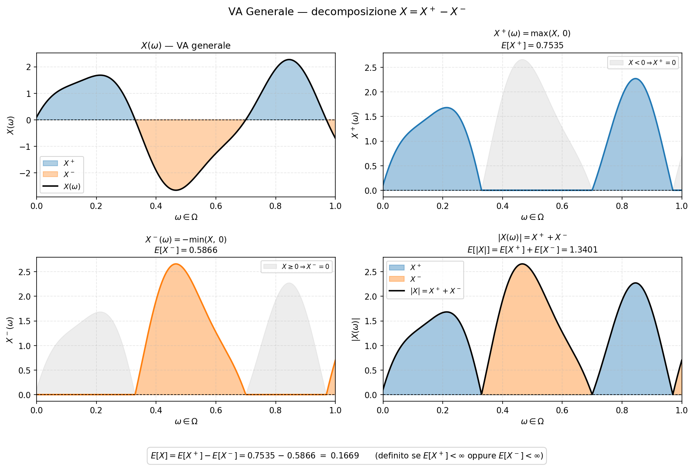
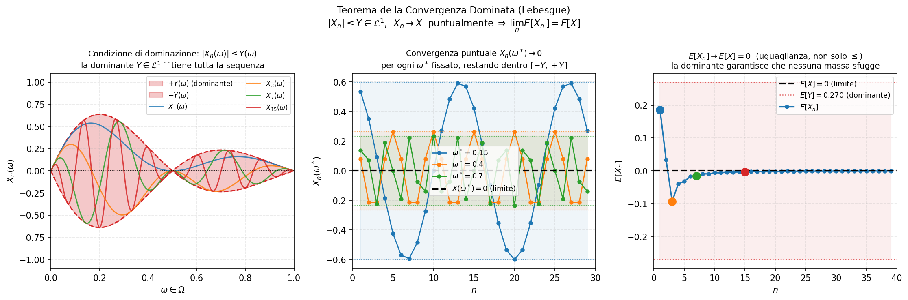
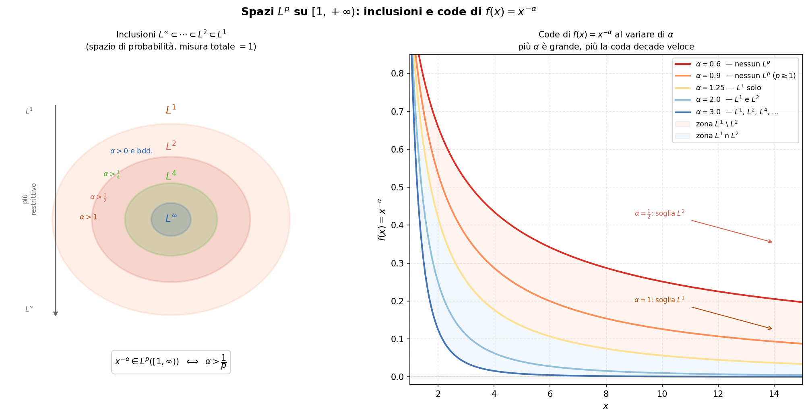

# Valore Atteso come Integrale di Lebsegue rispetto alla misura $\mathbb{P}$

Sia $(\Omega, \mathcal{A}, \mathbb{P})$ uno spazio di probabilità. Vogliamo definire il valore atteso (che vedremo essere l'integrale di Lebesgue) di VA generali. Lo abbiamo già fatto per VA definite su uno spazio più specifico, con $\Omega$ numerabile. Il caso più generale è più delicato.

## Variabili Aleatorie Semplici

Una VA è detta semplice se assume solo un numero finito di valori. $$X=\sum_{i=1}^na_i\mathbb{1}_{A_i}$$ Vediamo che in questo caso, per ogni iterazione della sommatoria, $X$ può assumere solo due valori: $0$ e $a_i$, con $a_i\in\mathbb{R}$ e $A_i\in\mathcal{A}$.\

{#fig-placeholder}

Se $X$ è semplice, il suo valore atteso è: $$\mathbb{E}[X]=\int_{\Omega} XdP=\mathbb{E}[\sum_{i=1}^na_i\mathbb{1}_{A_i}]=\sum_{i=1}^na_i\mathbb{P}(A_i)$$

**N.B.**: il valore atteso rimane un operatore lineare e monotono.

## Variabile Aleatorie Positive

Una VA positiva è una VA che può assumere valori in $[0,\infty]$ .

{#fig-placeholderx}

Il suo valore atteso è dato da: $$\mathbb{E}[X]=Sup\{\mathbb{E}[Y]: 0\leq Y\leq X\}$$ Dove $Y$ è una VA semplice.\
Il supremum esiste sempre in $[0,\infty]$ poichè il valore atteso è un operatore positivo sull'insieme delle VA semplici. Se immaginiamo la VA positiva come una curva, e le VA semplici come i \"mattoncini\" che cercano di approssimarla, allora il valore atteso di $X$ è definito come il limite massimo a cui tende l'area dei mattoncini. Se assottigliamo sempre di più i mattoncini allora la loro area coinciderà con l'area al di sotto di $X$.

## Variabile Aleatorie Generali

Una VA generale $X$ può essere scomposta come:

$$X=X^+-X^-$$ con $X^+=max(X,0)$ e $X^-=-min(X,0)$. Sia $X^+$ che $X^-$ sono VA positive e vale $|X|=X^++X^-$.

{#fig-placeholder}

Il trucco del supremum funziona solo per funzioni $X$ positive. Come facciamo a integrare (calcolare il valore atteso) di una VA $X$ che ha sia picchi positivi che negativi? Spacchiamo $X$ nelle due parti $X^+$ e $X^-$ (che sono entrambe VA positive) e poi trattiamo i singoli casi come abbiamo visto per le VA positive: $$\mathbb{E}[X]=\mathbb{E}[X^+]-\mathbb{E}[X^-]$$

## Integrale di Lebesgue

L'approccio standard per definire l'area sotto una curva, noto come integrale di Riemann, si basa sulla suddivisione del dominio (l'asse $x$, o nel nostro caso $\Omega$) in intervalli sempre più piccoli. Si calcola poi l'area dei rettangoli formati, dove l'altezza è data dal valore della funzione in un punto dell'intervallo. Questo metodo, tuttavia, fallisce o diventa estremamente complesso quando il dominio non ha una struttura geometrica semplice (come un intervallo reale) o quando la funzione (la nostra VA $X$) è troppo \"irregolare\".

L'integrale di Lebesgue, che useremo per definire il valore atteso $\mathbb{E}[X]$, ribalta questa prospettiva. Invece di suddividere il dominio, suddividiamo il codominio (l'insieme dei valori assunti da $X$).

L'intuizione chiave risiede proprio nella struttura delle VA semplici definita nella sezione precedente. Immaginiamo di voler misurare l'altezza media di una popolazione ($\Omega$).

- **Approccio Riemann:** Mettiamo le persone in fila (ordiniamo il dominio) e calcoliamo la media dividendo la fila in piccoli gruppi. Questo richiede una struttura geometrica della fila.

- **Approccio Lebesgue:** Raggruppiamo le persone per altezza (suddividiamo il codominio). Creiamo dei \"mattoncini\" (le VA semplici) raggruppando tutte le persone alte circa $170$cm, tutte quelle alte circa $180$cm, e così via. Il valore atteso diventa quindi la somma pesata di queste altezze ($a_i$), dove il peso è dato dalla probabilità (la frazione di popolazione) che una persona appartenga a quel gruppo ($\mathbb{P}(A_i)$).

L'intera costruzione definita nei paragrafi successivi si basa su questa idea:

1.  Definiamo l'integrale per le VA semplici (i \"mattoncini\"), dove l'integrazione è una semplice somma pesata.

2.  Approssimiamo qualsiasi VA positiva dal basso utilizzando VA semplici sempre più precise (rinfittendo la suddivisione del codominio). Il valore atteso è il supremum di queste approssimazioni.

3.  Estendiamo infine la definizione alle VA generali tramite decomposizione.

Questo approccio non richiede che $\Omega$ sia numerabile o geometricamente semplice, ma necessita solo che gli insiemi $A_i$ siano \"misurabili\" (cioè appartengano alla $\sigma$-algebra $\mathcal{A}$), rendendolo lo strumento perfetto per la teoria della probabilità generale.

### Definizione Formale (Teoria della Misura) {#sec-definizione-formale-teoria-della-misura .unnumbered}

Formalmente, dato uno spazio di misura $(\Omega, \mathcal{A}, \mu)$ e una funzione misurabile $f: \Omega \to \mathbb{R}$, l'integrale di Lebesgue si costruisce in tre passi:

1.  **Funzioni semplici:** Se $s = \sum_{i=1}^n c_i \mathbb{1}_{E_i}$ è una funzione semplice (con $E_i \in \mathcal{A}$ disgiunti), il suo integrale è: $$\int_{\Omega} s \, d\mu = \sum_{i=1}^n c_i \mu(E_i)$$

2.  **Funzioni non negative:** Se $f \geq 0$ è misurabile, il suo integrale è definito tramite approssimazione dal basso: $$\int_{\Omega} f \, d\mu = \sup \left\{ \int_{\Omega} s \, d\mu : 0 \leq s \leq f, \, s \text{ è semplice} \right\}$$

3.  **Funzioni generali:** Una funzione misurabile $f$ si scompone in parte positiva e negativa, $f = f^+ - f^-$. Se gli integrali di entrambe le parti sono finiti, la funzione si dice integrabile secondo Lebesgue e vale: $$\int_{\Omega} f \, d\mu = \int_{\Omega} f^+ \, d\mu - \int_{\Omega} f^- \, d\mu$$

### Il Legame con la Teoria della Probabilità {#sec-il-legame-con-la-teoria-della-probabilit .unnumbered}

Nella teoria della probabilità, lo spazio di misura è uno *spazio di probabilità* $(\Omega, \mathcal{A}, \mathbb{P})$, dove la misura $\mu$ diventa la misura di probabilità $\mathbb{P}$ (con $\mathbb{P}(\Omega) = 1$). Una funzione misurabile $f$ è esattamente ciò che chiamiamo *Variabile Aleatoria* $X$.

Di conseguenza, il valore atteso di una V.A. generale è per definizione il suo integrale di Lebesgue rispetto alla misura di probabilità: $$\mathbb{E}[X] = \int_{\Omega} X \, d\mathbb{P}$$ Questa notazione evidenzia come l'operatore $\mathbb{E}[\cdot]$ non sia altro che una media rigorosa pesata sulle \"masse\" di probabilità assegnate agli eventi dello spazio campionario.

{#fig-placeholderx}

## Essere integrabile vs ammettere valore atteso

- Una VA $X$ è integrabile (dunque ha valore atteso finito) se sia $\mathbb{E}[X^+]$ che $\mathbb{E}[X^-]$ sono finiti.\
  Usiamo $\mathcal{L}^1(\Omega,\mathcal{A},\mathbb{P})$ per denotare l'insieme di tutte le VA **integrabili**.

- Una VA $X$ ammette valore atteso se $\mathbb{E}[X^+]$ e $\mathbb{E}[X^-]$ non sono entrambi uguali a $\infty$, e quindi non danno come risultato una forma indeterminata $+\infty-\infty$

Notiamo che per una funzione $X$, l'essere integrabile è una condizione più stringente che ammettere valore atteso. Per essere integrabile, non solo deve ammettere valore atteso, ma esso deve anche essere finito.

## Valore Atteso in spazi $\Omega$ numerabili

Nel capitolo 6, dove lo spazio $\Omega$ era numerabile e finito, avevamo definito il valore atteso di una VA $X$ come: $$\mathbb{E}[X]_{cap6}=\sum_{\omega\in\Omega}X(\omega)\mathbb{P}(\{\omega\})$$ mentre ora, che lo spazio $\Omega$ è può essere numerabile e infinito, risulterebbe impossibile sommare per ogni indice $\omega\in\Omega$. Tuttavia le due definizioni sono identiche. Poichè il nostro spazio $\Omega$ è numerabile, qualsiasi evento $A_i\subset\Omega$ è fatto da un insieme numerabile di esiti singoli. Per l'additività numerabile abbiamo: $$\mathbb{P}(A_i)=\sum_{\omega\in A_i}\mathbb{P}(\{\omega\})$$ Ora prendiamo $\mathbb{P}(A_i)$ è sostituiamolo nella formula del valore atteso di questo capitolo: $$\mathbb{E}[X]_{cap10}=\sum_{i=1}^nx_i\big(\sum_{\omega\in A_i}\mathbb{P}(\{\omega\})\big)=\sum_{i=1}^n\big(\sum_{\omega\in A_i}x_i\mathbb{P}(\{\omega\})\big)=\sum_{i=1}^n\big(\sum_{\omega\in A_i}X(\omega)\mathbb{P}(\{\omega\})\big)$$ Ora unifichiamo le somme: per ogni gruppo $A_i$, calcoliamo $X(\omega)\mathbb{P}(\{\omega\})$ per tutti i suoi elementi. Poi sommiamo tutti i risultati di tutti i gruppi. Ma noi sappiamo che i gruppi $A_1,A_2,...,A_n$ formano una partizione di $\Omega$. Ciò significa che per ogni singolo esito $\omega\in\Omega$ si trova dentro uno e uno solo di questi gruppi e quindi sommare su tutti i gruppi separatamente equivale semplicemente a sommare sullo spazio intero $\Omega$ tutti gli elementi $\omega$: $$\sum_{i=1}^n\sum_{\omega\in A_i}=\sum_{\omega \in \Omega}$$e quindi: $$\mathbb{E}[X]_{cap10}=\sum_{\omega\in\Omega}X(\omega)\mathbb{P}(\{\omega\})=\mathbb{E}[X]_{cap6}$$ Dunque l'integrale di Lebesgue, se applicato a uno spazio $\Omega$ finito (come il lancio di un dado), collassa perfettamente nella formula della media pesata vista al capitolo 6.

::: mybox
Caratteristiche del Valore Atteso

- $\mathcal{L}^1$ è uno spazio vettoriale e il valore atteso è una mappa lineare, positiva su di esso ($X\geq0 \implies\mathbb{E}[X]\geq0$). Inoltre, se $0\leq X\leq Y$ sono due variabili aleatorie e $Y\in\mathcal{L}^1$, allora $X\in\mathcal{L}^1$ e $\mathbb{E}[X]\leq\mathbb{E}[Y]$.

- $X\in\mathcal{L}^1$ se e solo se $|X|\in\mathcal{L}^1$ e in questo caso $|\mathbb{E}[X]|\leq\mathbb{E}[|X|]$. Qualsiasi VA limitata è integrabile.

- Se $X=Y$ A.S. allora $\mathbb{E}[X]=\mathbb{E}[Y]$
:::

## Teoremi di Convergenza

Il grande problema del calcolo infinitesimale è la possibilità o meno di poter scambiare limite e integrale: $$\lim \int \stackrel{?}{=} \int \lim$$ Con l'integrale di Riemann la risposta è spesso negativa. Per tale motivo nasce l'integrale di Lebesgue.

### Teorema di Beppo-Levi

::: mybox
Teorema della Convergenza Monotona (MCT o Beppo-Levi)

#### Teoria della Misura

Dato lo spazio misurabile $(X,\mathcal{A},\mu)$ e le funzioni $\{f_n\}_{n\geq1}$ misurabili e non negative, con $f_1(x)\leq f_2(x)\leq...\leq f_n(x)$ e $\lim_{n\rightarrow\infty}f_n(x)=f(x)$ allora: $$\lim_{n\rightarrow\infty}\int_Xf_nd\mu=\int_X\lim_{n\rightarrow\infty}f_nd\mu=\int_Xfd\mu$$

#### Teoria della Probabilità

Dato lo spazio misurabile $(\Omega,\mathcal{A},\mathbb{P})$ e le VA $\{X_n\}_{n\geq1}$ positive (che sono funzioni misurabili), con $X_1\leq X_2\leq...\leq X_n$ e $\lim_{n\rightarrow\infty}X_n=X$ allora: $$\lim_{n\rightarrow\infty}\mathbb{E}[X_n]=\mathbb{E}[\lim_{n\rightarrow\infty}X_n]=\mathbb{E}[X]$$ Ovvero: $$\lim_{n\rightarrow\infty}\int_{\Omega}X_nd\mathbb{P}=\int_{\Omega}\lim_{n\rightarrow\infty}X_nd\mathbb{P}=\int_{\Omega}Xd\mathbb{P}$$
:::

Questo teorema ci dice che se abbiamo una sequenza di VA positive dove ogni VA è più grande della precedente, allora possiamo scambiare limite e integrale: l'area del limite è esattamente il limite dell'area.

{#fig-placeholder}

### Lemma di Fatou

::: mybox
Lemma di Fatou

#### Teoria della Misura

Dato lo spazio misurabile $(X,\mathcal{A},\mu)$ e le funzioni $\{f_n\}_{n\geq1}$ misurabili non-negative, allora: $$\int_X\liminf_{n\rightarrow\infty}f_nd\mu\leq\liminf_{n\rightarrow\infty}\int_Xf_nd\mu$$

#### Teoria della Probabilità

Dato lo spazio misurabile $(\Omega,\mathcal{A},\mathbb{P})$ e le VA $\{X_n\}_{n\geq1}$, dove $X_n\geq Y$ A.S., con $Y\in\mathcal{L}^1$ allora: $$\mathbb{E}[\liminf_{n\rightarrow\infty}X_n]\leq\liminf_{n\rightarrow\infty}\mathbb{E}[X_n]$$ e ciò vale in particolare se $X_n\geq0$ A.S. Ovvero: $$\int_{\Omega}\liminf_{n\rightarrow\infty}X_nd\mathbb{P}\leq\liminf_{n\rightarrow\infty}\int_{\Omega}X_nd\mathbb{P}$$
:::

Quindi integrale e limite commutano, ma con una disuguglianza: l'area del limite è sempre minore del limite dell'area.

{#fig-placeholderx}

- **Panel 1** --- Le curve $X_n$ per $n = 2, 4, 8, 16$: al crescere di $n$ il picco si restringe verso $\omega = 0$ mantenendo la stessa area. La linea tratteggiata $\liminf_n X_n = 0$ mostra il limite puntuale quasi ovunque.

- **Panel 2** --- Per tre valori $\omega^* = 0.05,\, 0.15,\, 0.30$ fissati, le linee verticali tratteggiate indicano dove la traiettoria $X_n(\omega^*)$ diventa definitivamente zero (per $n > 1/\omega^*$). Ogni punto del dominio "perde" la massa dopo un numero finito di passi.

- **Panel 3** --- Il confronto numerico: $E[X_n] = 1$ per ogni $n$ (cerchi blu, costanti), mentre $E[\liminf_n X_n] = 0$ (linea tratteggiata arancione). L'area gialla tra le due quantità è il *gap* della disuguaglianza di Fatou, pari a $1$ in questo esempio.

Consideriamo lo spazio di probabilità $(\Omega, \mathcal{A}, \mathbb{P}) = ([0,1], \mathcal{B}([0,1]), \lambda)$ con $\lambda$ misura di Lebesgue, e definiamo la sequenza di VA non negative: $$X_n(\omega) = n \cdot \mathbf{1}_{[0,\,1/n]}(\omega)
    \qquad n \geq 1$$ Ogni $X_n$ è un rettangolo di base $1/n$ e altezza $n$, quindi di **area costante**: $$E[X_n] = n \cdot \frac{1}{n} = 1 \qquad \forall\, n \geq 1$$

### Il fenomeno della massa che sfugge {#sec-il-fenomeno-della-massa-che-sfugge .unnumbered}

Fissato un qualsiasi $\omega^* > 0$, esiste $N = \lceil 1/\omega^* \rceil$ tale che per ogni $n > N$: $$\omega^* > \frac{1}{n} \implies \omega^* \notin \left[0, \frac{1}{n}\right]
    \implies X_n(\omega^*) = 0$$ Dunque per ogni $\omega^* > 0$ la sequenza è definitivamente nulla, il che significa: $$\liminf_{n \to \infty} X_n(\omega) = 0 \qquad \text{per q.o. } \omega \in (0,1]$$ L'unico punto in cui la sequenza non converge a zero è $\omega = 0$, che però ha misura di Lebesgue nulla: $\lambda(\{0\}) = 0$. Quindi la convergenza è quasi ovunque.

Geometricamente il rettangolo non si dissolve: si restringe e si alza, spostando tutta la sua massa verso l'unico punto $\omega = 0$. La massa non sparisce dall'integrale perché si concentra in un insieme di misura zero, che la misura di Lebesgue non riesce a "vedere".

Applicando il Lemma di Fatou: $$E\!\left[\liminf_{n \to \infty} X_n\right]
    = E[0] = 0
    \;\leq\;
    \liminf_{n \to \infty} E[X_n] = \liminf_{n \to \infty} 1 = 1$$ Il gap è esattamente $1$. Questo mostra che in generale la disuguaglianza del Lemma di Fatou non può essere sostituita da un'uguaglianza senza ipotesi aggiuntive.

### Confronto con il Teorema della Convergenza Monotona {#sec-confronto-con-il-teorema-della-convergenza-monotona .unnumbered}

Il MCT richiede $X_1 \leq X_2 \leq \cdots$, cioè monotonia crescente. In quel caso la massa non può sfuggire perché le funzioni non decrescono mai, e si ottiene l'uguaglianza $\lim E[X_n] = E[\lim X_n]$.

Nel controesempio di Fatou la sequenza non è monotona: per ogni $\omega^* \in (0,1]$ la traiettoria $n \mapsto X_n(\omega^*)$ è non nulla solo per $n \leq 1/\omega^*$ e poi cade a zero. È proprio questa non-monotonicità che permette alla massa di "scivolare" verso l'insieme di misura nulla $\{0\}$, rendendo la disuguaglianza stretta.

### Teorema della Convergenza Dominata di Lebesgue

::: mybox
Teorema della Convergenza Dominata di Lebesgue (DCT)

#### Teoria della Misura

Dato lo spazio misurabile $(X,\mathcal{A},\mu)$ e le funzioni $\{f_n\}_{n\geq1}$ Misurabili, supponiamo che:

1.  Convergenza Puntuale: $\{f_n\}_{n\geq1}$ convergano puntualmente a $f$

2.  Dominazione: $\exists y\in\mathcal{L}^1$, con $y(x)\geq0$ tale che $|f_n(x)|\leq y(x)$, $\forall n$ e quasi $\forall x$.

Allora $f_n\in \mathcal{L}^1$, $f(x)\in\mathcal{L}^1$ e: $$\lim_{n\rightarrow\infty}\int_Xf_nd\mu=\int_X\lim_{n\rightarrow\infty}f_nd\mu=\int_Xfd\mu$$

#### Teoria della Probabilità

Dato lo spazio misurabile $(\Omega,\mathcal{A},\mathbb{P})$ e le VA $\{X_n\}_{n\geq1}$ Misurabili, supponiamo che:

1.  Convergenza Puntuale: $\{X_n\}_{n\geq1}$ convergano puntualmente a $X$

2.  Dominazione: $\exists Y\in\mathcal{L}^1$, con $Y\geq0$ tale che $|X_n|\leq Y$, $\forall n$

Allora $X_n\in \mathcal{L}^1$, $X\in \mathcal{L}^1$e: $$\lim_{n\rightarrow\infty}\mathbb{E}[X_n]=\mathbb{E}[\lim_{n\rightarrow\infty}X_n]=\mathbb{E}[X]$$ Ovvero: $$\lim_{n\rightarrow\infty}\int_{\Omega}X_nd\mathbb{P}=\int_{\Omega}\lim_{n\rightarrow\infty}X_nd\mathbb{P}=\int_{\Omega}Xd\mathbb{P}$$
:::

Il teorema ci garantisce che se abbiamo una sequenza di VA che oscillano in modo caotico verso un limite $X$, con picchi sia positivi che negativi, abbiamo la garanzia che se esite un \"tetto\" integrabile (area finita) $Y$ che le domina tutte, per quanto caoticamente le $X_n$ oscillano, nessuna di essere supererà il \"tetto\": $|X_n|\leq Y$.

{#fig-placeholder}

### Confronto tra i Teoremi di Convergenza

I tre risultati appena visti affrontano lo stesso problema fondamentale (lo scambio tra l'operatore di limite e quello di integrale) ma si posizionano su livelli diversi per quanto riguarda le ipotesi richieste e la forza delle conclusioni ottenute. Il fulcro di tutti e tre è stabilire regole per gestire la *massa che sfugge* (verso l'infinito o in picchi singolari).

- **Lemma di Fatou (Il più generale, ma il più debole):**

  - **Ipotesi:** Richiede solo che le VA siano limitate dal basso (ad esempio, $X_n \geq 0$). Non c'è alcuna richiesta di monotonia o di limitazione dall'alto.

  - **Conclusione:** Fornisce solo una disuguaglianza ($\int \liminf \leq \liminf \int$).

  - **Intuizione:** È il \"paracadute\" della teoria dell'integrazione. Si applica in scenari caotici dove le variabili oscillano o non convergono bene, ma ci avverte che senza ipotesi più forti la massa dell'integrale può disperdersi nel processo di limite (come nel controesempio del rettangolo che si restringe perdendo la massa nell'origine).

- **Teorema della Convergenza Monotona / Beppo-Levi (Forte, ma rigido):**

  - **Ipotesi:** Richiede la non-negatività e una rigida *monotonia crescente* ($X_1 \leq X_2 \leq \dots \leq X_n$).

  - **Conclusione:** Garantisce l'uguaglianza ($\lim \int = \int \lim$).

  - **Intuizione:** Se la successione può solo crescere, la massa non può \"scivolare via\" lateralmente o annullarsi improvvisamente. L'area si accumula in modo inesorabile fino a coincidere esattamente con l'area della funzione limite.

- **Teorema della Convergenza Dominata / DCT (Il più flessibile e usato):**

  - **Ipotesi:** Non richiede né non-negatività né monotonia. Le VA possono oscillare e assumere valori negativi, ma a patto che esista un \"tetto\" integrabile ($|X_n| \leq Y$ con $Y \in \mathcal{L}^1$).

  - **Conclusione:** Garantisce l'uguaglianza ($\lim \int = \int \lim$).

  - **Intuizione:** La funzione dominante $Y$ agisce da \"recinto\". Impedisce alla sequenza di concentrare troppa massa all'infinito (poiché $Y$ ha code con area finita) o di formare picchi infiniti (poiché le $X_n$ non possono bucare il tetto $Y$). Bloccando le vie di fuga della massa, assicura la conservazione dell'area al limite.

In sintesi, per poter scambiare limite e integrale serve sempre un \"prezzo da pagare\" per controllare la massa: o imponiamo che la massa non possa mai diminuire (MCT), o la rinchiudiamo in un contenitore di volume finito (DCT). Se non possiamo pagare nessuno dei due prezzi, dobbiamo accontentarci di sapere che, passando al limite, l'area non potrà magicamente crearsi dal nulla, ma al massimo disperdersi (Fatou).

### Risultati dei Teoremi di Convergenza

1.  Per ogni VA positiva $X$ esiste una sequenza $\{X_n\}_{n\geq1}$ di VA positive semplici che incrementa fino a $X$ per $n\rightarrow \infty$.\
    Un esempi di questa sequenza è: $$X_n(\omega) = 
    \begin{cases} 
        k2^{-n} & \text{se } k2^{-n} \leq X(\omega) < (k+1)2^{-n} \text{ con } 0 \leq k \leq n2^n - 1 \\ 
        n & \text{se } X(\omega) \geq n 
    \end{cases}$$

    {#fig-placeholderx}

2.  Se la sequenza $\{X_n\}_{n\geq1}$ di VA semplici cresce a $X$ per $n\rightarrow\infty$ allora: $$\mathbb{E}[X_n]=\mathbb{E}[X]$$

### Applicazione dei teoremi di convergenza a serie infinite

Una serie infinita è definita esattamente come un limite. Iniziamo definendo le somme parziali: $$S_N=\sum_{n=1}^N a_n = a_1+a_2+...+a_N$$ Poiché $N$ è un numero finito, questa è un'addizione normalissima. Al variare di $N$, creiamo una nuova successione fatta da queste somme parziali $(S_1, S_2, S_3, \dots)$.\
A questo punto, per capire cosa succederebbe se sommassimo tutti i termini, calcoliamo il limite della successione delle somme parziali facendo tendere $N$ a $\infty$: $$\sum_{n=1}^{\infty}a_n = \lim_{N\rightarrow\infty}S_N$$ Trattare questa serie come un limite e non come una somma lunghissima, ci permette di capire rigorosamente il suo comportamento (convergenza, divergenza, indeterminatezza).

::: mybox
Serie Infinite Sia $\{X_n\}_{n\geq1}$ una successione di VA:

- Se le $X_n$ sono tutte positive, allora: $$\mathbb{E}\left[\sum_{n=1}^{\infty}X_n\right] = \sum_{n=1}^{\infty}\mathbb{E}[X_n]$$ dove entrambi i membri sono simultaneamente finiti o infiniti.

- Se $\sum_{n=1}^{\infty}\mathbb{E}[|X_n|] < \infty$, allora $\sum_{n=1}^{\infty}X_n$ converge A.S. e la somma di questa serie è integrabile.
:::

Questo teorema risponde alla domanda: $$\sum \int \stackrel{?}{=} \int \sum$$ Se stai sommando solo VA positive, la successione delle somme parziali $S_N$ cresce sempre e non scende mai. Questa è esattamente l'ipotesi di Beppo-Levi. Dunque, il primo punto è semplicemente l'applicazione del Teorema della Convergenza Monotona, dove la successione in gioco è la successione delle somme parziali.

Ma cosa succede se la somma contiene variabili che oscillano assumendo valori sia positivi che negativi? In questo caso le somme parziali salgono e scendono, vanificando l'ipotesi di monotonia di Beppo-Levi. Serve il DCT. Per applicarlo, costruiamo una variabile aleatoria \"tetto\" $Y$ sommando i moduli di tutte le VA: $$Y = \sum_{n=1}^{\infty} |X_n|$$ Per ipotesi, il valore atteso di questo tetto è finito ($\mathbb{E}[Y] = \sum_{n=1}^{\infty}\mathbb{E}[|X_n|] < \infty$), dunque $Y \in \mathcal{L}^1$. Poiché le somme parziali sono sempre limitate in modulo da questo tetto ($|S_N| \leq Y$), il DCT ci garantisce la possibilità di scambiare limite (quindi la serie) e integrale.

## Spazi $\mathcal{L}^1$ e $L^1$: Le Classi di Equivalenza

Fino ad ora abbiamo utilizzato $\mathcal{L}^1(\Omega,\mathcal{A},\mathbb{P})$ per denotare l'insieme di tutte le variabili aleatorie $X$ integrabili (ovvero con $\mathbb{E}[|X|] < \infty$). Tuttavia, se vogliamo dotare questo insieme di una vera e propria struttura geometrica (rendendolo uno spazio normato), incontriamo un problema tecnico legato alla definizione di uguaglianza.

### Il problema della \"distanza\" in $\mathcal{L}^1$ {#sec-il-problema-della-distanza-in-mathcall1 .unnumbered}

Saremmo tentati di misurare la \"distanza\" tra due variabili aleatorie $X$ e $Y$ tramite l'integrale della loro differenza in modulo: $$d(X,Y) = \mathbb{E}[|X - Y|] = \int_{\Omega} |X - Y| \, d\mathbb{P}$$ Affinché questa sia una vera distanza metrica (e quindi definisca una norma rigorosa), deve valere una proprietà fondamentale: $d(X,Y) = 0 \iff X = Y$ *identicamente per ogni punto del dominio*.

Tuttavia, sappiamo bene (anche ripensando al fenomeno della massa che sfugge di Fatou) che un integrale di Lebesgue può essere nullo anche se la funzione non è zero ovunque, purché lo sia \"quasi ovunque\" (A.S.). Dunque, nello spazio $\mathcal{L}^1$ potremmo avere $d(X,Y) = 0$ per due variabili $X$ e $Y$ che sono diverse su un insieme di misura nulla. Questo rende la nostra operazione una semplice **seminorma**, insufficiente per costruire spazi completi.

### La soluzione: il Quoziente $L^1$ {#sec-la-soluzione-il-quoziente-l1 .unnumbered}

Per risolvere questo fastidio formale e creare uno spazio matematicamente perfetto, introduciamo una **relazione di equivalenza** ($\sim$). Diciamo che due variabili aleatorie sono equivalenti se sono uguali quasi ovunque: $$X \sim Y \iff \mathbb{P}(\{\omega \in \Omega : X(\omega) \neq Y(\omega)\}) = 0$$ A questo punto, definiamo il nuovo spazio $L^1$ (senza la \"L\" corsiva) come lo **spazio quoziente**: $$L^1(\Omega, \mathcal{A}, \mathbb{P})$$

### Cosa significa in pratica per la Probabilità? {#sec-cosa-significa-in-pratica-per-la-probabilit .unnumbered}

Significa che un elemento del nuovo spazio $L^1$ **non è più una singola funzione**, ma è un'intera *classe di equivalenza* di funzioni. In $L^1$, due variabili aleatorie che differiscono solo su un insieme di probabilità zero vengono schiacciate insieme e considerate a tutti gli effetti **lo stesso identico oggetto**.

Passando da $\mathcal{L}^1$ a $L^1$ si ottengono proprietà formidabili:

- La seminorma diventa finalmente una **norma** rigorosa, indicata con $\|X\|_1 = \mathbb{E}[|X|]$.

- Lo spazio $L^1$ dotato di questa norma risulta essere uno spazio metrico completo (più precisamente, uno **Spazio di Banach**). Questo garantisce che i limiti delle successioni di Cauchy di VA integrabili non \"escano\" mai dallo spazio.

- **Operativamente:** Nella teoria della probabilità, continuiamo a scrivere e manipolare gli elementi di $L^1$ come se fossero normali funzioni, ma tenendo sempre a mente la regola d'oro di Lebesgue: *\"modificare una variabile aleatoria su un insieme di misura nulla non ne altera in alcun modo l'identità in $L^1$\"*.

## Spazi $L^p$

::: mybox
Teorema 9.3: Proprietà dello spazio $L^2$

1.  Se $X, Y \in L^2$, allora si ha $XY \in L^1$ e vale la disuguaglianza di Cauchy-Schwarz: $$|\mathbb{E}[XY]| \leq \sqrt{\mathbb{E}[X^2]\mathbb{E}[Y^2]}$$

2.  Vale l'inclusione $L^2 \subset L^1$, e se $X \in L^2$, allora: $$(\mathbb{E}[X])^2 \leq \mathbb{E}[X^2]$$

3.  Lo spazio $L^2$ è uno spazio lineare, ovvero se $X, Y \in L^2$ e $\alpha, \beta \in \mathbb{R}$, allora $\alpha X + \beta Y \in L^2$ (vedremo nel Capitolo 23 che di fatto $L^2$ è uno spazio di Hilbert).
:::

Il primo punto del teorema ci fornisce uno strumento analitico cruciale noto come disuguaglianza di Cauchy-Schwarz. Dal punto di vista probabilistico, ci assicura che se consideriamo due variabili aleatorie dotate di momento secondo finito, il loro prodotto sarà sempre una variabile con valore atteso finito. Questa disuguaglianza è il vero motivo matematico per cui il coefficiente di correlazione tra due grandezze è sempre confinato tra $-1$ e $1$.

Il secondo punto stabilisce una gerarchia rigida tra gli spazi funzionali nella teoria della probabilità. Ci dice che lo spazio $L^2$ è un sottoinsieme dello spazio $L^1$. In termini applicati, questo garantisce che se una variabile aleatoria ha una varianza finita, allora possiede obbligatoriamente anche una media finita. Non è vero il contrario. La formula presentata è una diretta conseguenza del fatto che la varianza non può mai essere negativa, imponendo quindi che la media dei quadrati sia sempre maggiore o uguale al quadrato della media.

Il terzo punto si concentra sulla struttura algebrica dello spazio $L^2$, affermando che possiede le stesse proprietà di un normale spazio dei vettori. Se prendiamo due o più variabili in $L^2$, le moltiplichiamo per delle costanti numeriche e le sommiamo tra loro, la variabile aleatoria risultante rimarrà confinata nello spazio $L^2$. Questa stabilità rispetto alle combinazioni lineari è il primo passo per poter trattare le variabili aleatorie esattamente come facciamo con i vettori geometrici, aprendo la strada a concetti come le proiezioni ortogonali e le distanze ottimali, che sono alla base della teoria degli spazi di Hilbert.

### Cosa cambia tra gli spazi $L^1$ e $L^2$? {#sec-cosa-cambia-tra-gli-spazi-l1-e-l2 .unnumbered}

In teoria della probabilità, la differenza tra lo spazio $L^1$ e lo spazio $L^2$ riflette il passaggio dalla semplice esistenza della media all'esistenza della varianza, portando con sé una struttura geometrica molto più ricca.

- **Lo spazio $L^1$ (Le variabili con Media Finita):** Una variabile aleatoria appartiene a $L^1$ se $\mathbb{E}[|X|] < \infty$. Dal punto di vista pratico, questo garantisce solo che la variabile ammetta un valore atteso. Le variabili in $L^1$ possono avere \"code pesanti\", ovvero possono assumere valori estremi con probabilità non trascurabili, portando a oscillazioni così selvagge che la loro varianza è infinita. Geometricamente, $L^1$ è uno *Spazio di Banach*: possiamo misurare la distanza tra due variabili, ma non abbiamo il concetto di angolo.

- **Lo spazio $L^2$ (Le variabili con Varianza Finita):** Una variabile appartiene a $L^2$ se $\mathbb{E}[|X|^2] < \infty$. Elevare al quadrato penalizza enormemente i valori grandi: affinché l'integrale converga, la funzione deve schiacciarsi a zero molto più velocemente. Le variabili in $L^2$ sono quindi molto più \"tranquille\" e prevedibili (non hanno code troppo pesanti). Dal punto di vista applicato, ammettono una **varianza finita**.

- **La Magia Geometrica di $L^2$ (Prodotto Scalare):** La vera differenza matematica è che $L^2$ è l'unico spazio $L^p$ ad essere uno *Spazio di Hilbert*. Oltre a misurare le distanze, possiamo definire un **prodotto scalare**: $$\langle X, Y \rangle = \mathbb{E}[XY]$$ Avere un prodotto scalare significa poter importare tutta la geometria euclidea nel mondo astratto delle funzioni: possiamo calcolare \"l'angolo\" tra due variabili (che in statistica è la correlazione!), definire il concetto di ortogonalità (variabili incorrelate) e fare proiezioni ottimali (che sono la base teorica dell'operazione di regressione lineare e dell'attesa condizionata).

### L'Inclusione $L^2 \subset L^1$ {#sec-linclusione-l2-subset-l1 .unnumbered}

Come visto nel teorema di Cauchy-Schwarz, in uno spazio di probabilità (che ha misura totale pari a 1), ogni variabile in $L^2$ è automaticamente anche in $L^1$. L'inverso **non** è vero. Esistono funzioni (e variabili aleatorie) che decadono abbastanza in fretta da avere un'area totale finita (sono in $L^1$), ma se le eleviamo al quadrato, i loro picchi o le loro code amplificati producono un'area infinita (escono da $L^2$).

{#fig-placeholder}

## La Regola del Valore Atteso

Fino ad ora abbiamo definito rigorosamente il valore atteso di una Variabile Aleatoria $X$ come l'integrale di Lebesgue sullo spazio campionario originario $\Omega$: $$\mathbb{E}[X] = \int_{\Omega} X \, d\mathbb{P}$$ Supponiamo ora di voler calcolare il valore atteso di una trasformazione della nostra variabile aleatoria, ad esempio una nuova V.A. definita come $Y = g(X)$ (dove $g$ è una funzione misurabile, come $g(x) = x^2$ o $g(x) = e^x$).

Applicando la definizione di base, dovremmo risolvere l'integrale astratto: $$\mathbb{E}[g(X)] = \int_{\Omega} g(X(\omega)) \, d\mathbb{P}(\omega)$$ Tuttavia, nella pratica statistica questo approccio è inutilizzabile: raramente conosciamo la struttura intima dello spazio astratto $\Omega$ o la misura di probabilità originaria $\mathbb{P}$. Quello che conosciamo tipicamente è solo la *legge* (o distribuzione) della variabile $X$ sulla retta reale $\mathbb{R}$.

È qui che interviene la **Regola del Valore Atteso** (nota in letteratura come *Legge dello Statistico Inconsapevole* o LOTUS). Questo teorema fondamentale ci permette di \"trasferire\" l'integrale dallo spazio astratto $\Omega$ (difficile da manipolare) allo spazio reale $\mathbb{R}$ (facile da calcolare), utilizzando non più la misura $\mathbb{P}$, ma la distribuzione indotta ${P}_X$: $$\int_{\Omega} g(X) \, d\mathbb{P} = \int_{\mathbb{R}} g(x) \, d{P}_X$$

Questo risultato ci autorizza a calcolare i valori attesi di $g(X)$ ignorando totalmente lo spazio di partenza, semplicemente pesando i valori della funzione $g(x)$ con la densità o la funzione di massa di $X$.

::: mybox
Teorema di Trasferimento (LOTUS) Supponiamo che $X$ sia una V.A. assolutamente continua con funzione di densità $f_X(x)$. Cioè: $$F_X(x) = \mathbb{P}(X \leq x) = \int_{-\infty}^x f_X(u) \, du$$ Data una funzione misurabile $g: \mathbb{R} \to \mathbb{R}$, il valore atteso della variabile aleatoria $Y = g(X)$ si calcola come: $$\mathbb{E}[g(X)] = \int_{-\infty}^{+\infty} g(x)f_X(x) \, dx$$ L'uguaglianza è valida sotto **una** delle seguenti condizioni:

1.  $g(x) \geq 0$ per ogni $x$ (in questo caso l'integrale può valere $+\infty$).

2.  $g(X)$ è integrabile, ovvero se si verifica che $\int_{-\infty}^{+\infty} |g(x)|f_X(x) \, dx < \infty$.
:::

Il teorema del trasferimento ci regala una scorciatoia potentissima: per calcolare la media di $Y=g(X)$, non dobbiamo faticare a trovare la nuova (e spesso complessa) funzione di densità $f_Y(y)$. Ci basta integrare la funzione trasformata $g(x)$ pesata direttamente con la densità originale $f_X(x)$ che già conosciamo.

::: {.paper-download}
[Scarica il PDF](probability_theory_for_quantitative_finance-6.pdf){.btn-paper download=""}
:::
