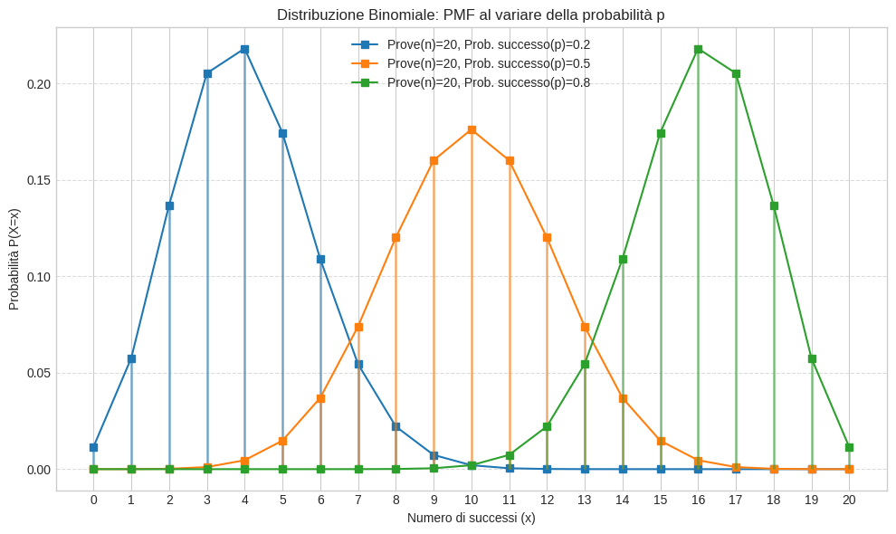
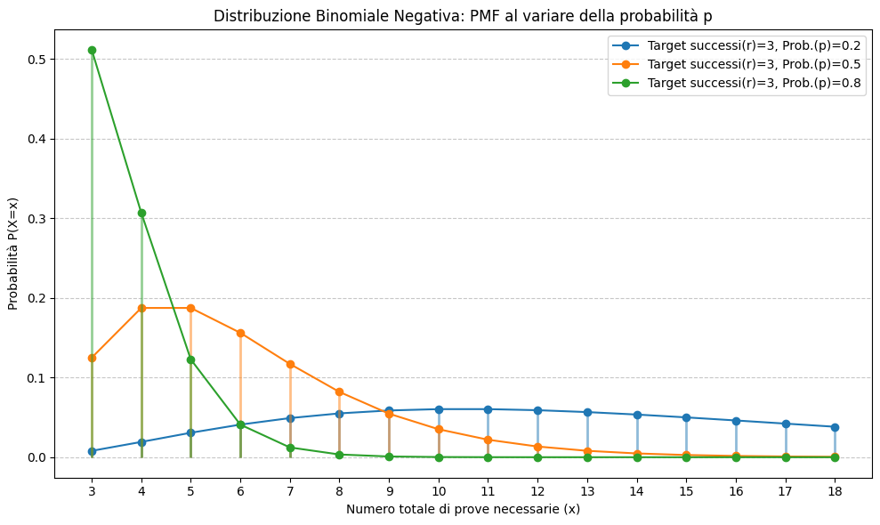
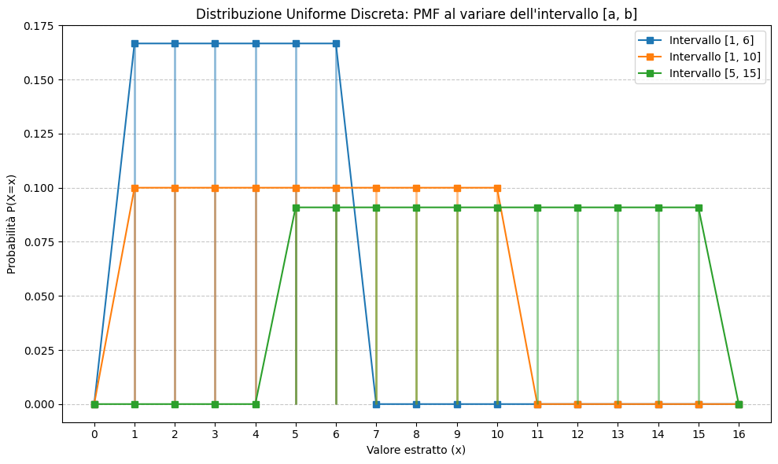

# Probabilità discreta su uno spazio finito o numerabile

Assumiamo che lo spazio degli stati $\Omega$ sia finito o numerabile.

::: mybox
Probabilità Discreta Una probabilità su $\Omega$ è caratterizzata dai suoi valori sugli atomi: $$\mathbb{P}(\{\omega\})=p_{\omega} \quad \omega\in \Omega$$ Inoltre, sia $\{p_{\omega}\}_{\omega\in \Omega}$ una famiglia di numeri reali indicizzata da $\Omega$. Allora esiste un'unica misura di probabilità $\mathbb{P}$ tale che $\mathbb{P}(\{\omega\})=p_{\omega}$ se e solo se: $$p_ {\omega}\geq0, \quad \sum_{\omega \in \Omega}p_{\omega}=1$$ Il che significa che la probabilità di un singolo atomo (singoletto) deve comportarsi come definita nel capitolo 3.
:::

Questo teorema è il motore della probabilità discreta. Ci dice che per calcolare la probabilità di qualsiasi evento complesso $A$, ci basta conoscere le probabilità dei singoli atomi $p_{\omega}$ tali che $\omega\in A$.

## Probabilità Uniforme

Una probabilità sull'insieme finito $\Omega$ è detta uniforme se $\mathbb{P}(\{\omega\})=p_{\omega}$ non dipende dall'esito particolare $\omega$ (equiprobabilità). $$\mathbb{P}(A)=\frac{\#A}{\#\Omega}$$ dove il simbolo $\#$ indica la cardinalità dell'insieme. Quindi calcolare la probabilità di un qualsiasi evento $A$ equivale a contare il numeri di punti in $A$ (casi favorevoli) sul totale dei casi (numero di punti in $\Omega$). Se $\Omega$ è finito, esiste una e una sola probabilità uniforme.

## Distribuzione Ipergeometrica

La distribuzione Ipergeometrica è una distribuzione di probabilità discreta che descrive l'estrazione binaria senza reimmissione di due tipologie di elementi (es. vincenti e perdenti) da un insieme finito.\
In generale, la distribuzione ipergeometrica descrive una variabile aleatoria $X$ che conta il numero di successi in un campione di $n$ elementi estratti a caso (in modo equiprobabile e senza reimmissione) da una popolazione totale di $N+M$ elementi, di cui $N$ sono considerati successi e $M$ insuccessi.\
Immaginiamo che un'urna contenga $N$ palline bianche (vincenti) ed $M$ palline nere (perdenti). Si estraggono $n$ palline senza reimmissione. Si ottengono quindi $X$ palline bianche e $n-X$ palline nere. Siamo interessati alla probabilità che $X=x$, ovvero che il numero di palline vincenti estratte sia esattamente $x$. Siccome parliamo di equiprobabilità, dobbiamo definire i numeri che rappresentano i casi possibili e i casi favorevoli. Partiamo dal definire i casi possibili $\#\Omega$ utilizzando il coefficiente binomiale: $$\#\Omega=\binom{N+M}{n}=\frac{(N+M)!}{n!(N+M-n)!}$$ che rappresenta il numero di modi diversi di scegliere $n$ elementi da un insieme di $N+M$ elementi. Ora definiamo i casi favorevoli: $$\#A=\binom{N}{x}\binom{M}{n-x}=\frac{N!}{x!(N-x)!}\frac{M!}{(n-x)!(M-n+x)!}$$ che rappresenta il numero di modi di scegliere le $x$ palline bianche vincenti dal totale di $N$ palline bianche nell'urna, moltiplicato per il numero di modi di scegliere le restanti $n-x$ palline nere dal totale di $M$ palline nere.

La probabilità di ottenere esattamente $x$ palline bianche è quindi data dal rapporto tra casi favorevoli e casi possibili: $$\boldsymbol{\mathbb{P}(X=x) = \frac{\binom{N}{x}\binom{M}{n-x}}{\binom{N+M}{n}}}$$ Che equivale a dire che $\mathbb{P}(A)=\frac{\#A}{\#\Omega}$.\
Il supporto della variabile aleatoria, ovvero i valori interi che $x$ può assumere, è limitato da: $$\max(0, n-M) \leq x \leq \min(n, N)$$

{#fig-placeholder}

### *Esempio* {#sec-esempio .unnumbered}

Prendi un mazzo da 52 carte. Ti vengono servite 5 carte distinte. Qual'è la probabilità di avere esattamente 2 assi in mano?

- $N=4$ è il totale dei casi vincenti, ovvero il numero di assi presenti nel mazzo;

- $M=4$ è il totale dei casi perdenti, ovvero le 48 carte nel mazzo che non sono assi;

- $N+M=52$ il totale delle carte nel mazzo;

- $n=5$ sono le carte di una mano

- $x=2$ è il numero di elementi vincenti che cerchiamo

$$\mathbb{P}(X=2) = \frac{\binom{4}{2}\binom{48}{3}}{\binom{52}{5}}$$ dove:

- $\binom{52}{5}$ è il numero di modi possibili di pescare 5 carte da un mazzo di 52;

- $\binom{4}{2}$ è il numero di modi possibili di pescare 2 assi da un totale di 4 assi presenti nel mazzo;

- $\binom{48}{3}$ è il numero di modi possibili di pescare le restanti 3 carte della mano che non sono un asso.

## Distribuzione Binomiale

### Processo Bernoulliano

Un processo Bernoulliano è un processo stocastico discreto $\{X_i\}_{i\in \mathbb{N}}$ di variabili aleatorie di Bernoulli i.i.d. $X_i\sim\mathcal{B}(p)$, dove $p$ è la probabilità di successo (che rimane costante). Un processo Bernoulliano può essere considerato come una sequenza di lanci di una moneta equa, con $p=0.5$, dove ogni singolo lancio $X_i$ è modellato come una singola variabile aleatoria di Bernoulli. Ogni singola prova può produrre due esiti: $$\mathbb{P}(X_i=1)=p=0.5$$ $$\mathbb{P}(X_i=
0)=1-p=q=0.5$$ Il numero di successi dopo $n$ prove (lanci) è dato dalla variabile aleatoria $S_n=X_1+...+X_n$ ciò che ci interessa è la distribuzione di $S_n$.\

### Distribuzione Binomiale

La distribuzione Binomiale è una distribuzione di probabilità discreta che descrive il numero di successi in un processo di Bernoulli, ovvero in una sequenza di $n$ prove indipendenti con la stessa probabilità di successo.

Torniamo a considerare l'urna contenente $N$ palline bianche (vincenti) e $M$ palline nere (perdenti), per un totale di $N+M$ palline. Questa volta, però, le $n$ estrazioni avvengono **con reimmissione**: dopo ogni estrazione, la pallina viene reinserita nell'urna. Vogliamo calcolare la probabilità dell'evento $A$, ovvero che la variabile aleatoria $X$ (numero di palline vincenti estratte) sia esattamente uguale a $x$.

Poiché rimettiamo sempre la pallina nell'urna, ad ogni pescata abbiamo a disposizione tutte le $N+M$ palline. Il numero totale di sequenze possibili (casi possibili) è quindi: $$\#\Omega = (N+M)^n$$

Per determinare il numero di casi favorevoli $\#A$, dobbiamo moltiplicare tre fattori: il numero di modi per scegliere le posizioni delle $x$ estrazioni vincenti su $n$ disponibili ($\binom{n}{x}$), le possibili combinazioni in cui pescare $x$ palline vincenti ($N^x$) e le combinazioni per le restanti $n-x$ palline perdenti ($M^{n-x}$). Otteniamo: $$\#A = \binom{n}{x} N^x M^{n-x}$$

La probabilità di ottenere esattamente $x$ successi è data dal rapporto tra casi favorevoli e casi possibili: $$\mathbb{P}(X=x) = \frac{\#A}{\#\Omega} = \frac{\binom{n}{x} N^x M^{n-x}}{(N+M)^n}$$

Distribuendo il denominatore in base agli esponenti, possiamo riscrivere la frazione in modo più elegante: $$\mathbb{P}(X=x) = \binom{n}{x} \left(\frac{N}{N+M}\right)^x \left(\frac{M}{N+M}\right)^{n-x}$$

Se a questo punto definiamo la probabilità costante di estrarre una pallina vincente in una singola prova come $p = \frac{N}{N+M}$, e conseguentemente la probabilità di estrarne una perdente come $1-p = \frac{M}{N+M}$, otteniamo la celebre formula canonica della distribuzione Binomiale $\mathcal{B}(n,p)$ dove $p$ è la probabilità di successo e $n$ è il numero di prove: $$\mathbb{P}(X=x) = \binom{n}{x} p^x (1-p)^{n-x}$$ dove il supporto della variabile aleatoria è limitato da: $$0 \leq x \leq n$$

Nella distribuzione Ipergeometrica, ogni pescata cambia la composizione dell'urna, mentre nella binomiale la struttra dell'urna si \"resetta\" dopo ogni reimmissione.

### *Esempio* {#sec-esempio-1 .unnumbered}

Affronti un test di ammissione composto da 10 domande a risposta multipla. Ogni domanda ha 4 opzioni. Decidi di tirare ad indovinare ogni singola domanda. Qual'è la probabilità di indovinare esattamente 6 risposte corrette?

- $p=0.25$ è la probabilità di successo, ovvero la probabilità di indovinare la singola risposta;

- $1-p=0.75$ è la probabilità di insuccesso, ovvero la probabilità di sbagliare la singola risposta

$$\mathbb{P}(X=6)=\binom{10}{6}(0.25)^6(0.75)^{10-6}$$

### Il ruolo del Coefficiente Binomiale: l'ordine dei successi {#sec-il-ruolo-del-coefficiente-binomiale-lordine-dei-successi .unnumbered}

È fondamentale sottolineare una distinzione cruciale: né la distribuzione Binomiale né quella Ipergeometrica descrivono la probabilità di ottenere $x$ successi **consecutivi** (di fila). Entrambe descrivono la probabilità di ottenere esattamente $x$ successi su $n$ estrazioni totali, **indipendentemente dall'ordine** in cui essi si verificano.

Per capire il perché, analizziamo la formula della Binomiale. Supponiamo di voler calcolare la probabilità di ottenere una singola e specifica sequenza, ad esempio quella in cui i primi $x$ estratti sono tutti successi e i restanti $n-x$ sono tutti insuccessi. Siccome le estrazioni con reimmissione sono indipendenti, questa probabilità è semplicemente il prodotto delle probabilità dei singoli eventi: $$\underbrace{p \cdot p \cdots p}_{x \text{ volte}} \cdot \underbrace{(1-p) \cdot (1-p) \cdots (1-p)}_{n-x \text{ volte}} = p^x(1-p)^{n-x}$$ Tuttavia, quando calcoliamo $\mathbb{P}(X=x)$, non ci interessa quando avvengono i successi. Essi potrebbero presentarsi tutti all'inizio, tutti alla fine, o mescolati agli insuccessi.

È qui che entra in gioco il coefficiente binomiale $\binom{n}{x}$. Esso serve da moltiplicatore e risponde alla domanda: *in quanti modi diversi posso disporre $x$ successi in $n$ posizioni (o estrazioni) disponibili?*

Moltiplicando la probabilità di una specifica sequenza per il numero di tutte le possibili disposizioni valide, otteniamo la probabilità totale dell'evento: $$\mathbb{P}(X=x) = \binom{n}{x} p^x (1-p)^{n-x}$$ Lo stesso identico principio logico si applica all'Ipergeometrica: il modo in cui abbiamo calcolato la cardinalità dell'evento $A$ conta tutte le possibili combinazioni in cui i successi e gli insuccessi possono essere estratti in blocco, senza mai imporre un ordine temporale preciso.

### Distribuzione Binomiale come limite dell'Ipergeometrica

Assumiamo ora che $n$ sia fissato, mentre $N$ ed $M$ crescono ad $\infty$ in modo tale che $\frac{N}{N+M}$ tenda ad un limite $p\in[0,1]$. Allora si verifica che: $$\mathbb{P}(X=x)\rightarrow\binom{n}x{p^x(1-p)^{n-x}}$$ Cioè la disitribuzione Ipergeometrica tende alla distribuzione Binomiale $\mathcal{B}(n,p)$ esattamente quando il totale di palline nell'urna $N+M$ è talmente grande da rendere irrilevante il fatto che dopo ogni pescata non viene reinserita la pallina estratta.\
Fino ad ora abbiamo considerato $\Omega$ finito, dove il numero massimo di successi era un limite fisico invalicabile. Cosa succede quando $\Omega$ diventa numerabile?

## Distribuzione Geometrica

Come anticipato, abbandoniamo l'ipotesi di un numero di prove $n$ fissato a priori e di uno spazio campionario $\Omega$ strettamente finito. Consideriamo nuovamente un Processo Bernoulliano, ovvero una sequenza di prove indipendenti in cui ogni prova ha una probabilità di successo $p$ costante.

La distribuzione Geometrica modella la variabile aleatoria $X$ che rappresenta il **numero di prove necessarie per ottenere il primo successo**. A differenza della distribuzione Binomiale, in cui contiamo i successi su un numero fisso di prove, qui le prove continuano a oltranza finché non si verifica l'evento desiderato. Di conseguenza, il supporto della variabile aleatoria (i valori interi che $x$ può assumere) diventa infinito numerabile: $$x\in\{1, 2, 3, \dots\}$$

Per calcolare la probabilità che il primo successo avvenga esattamente al tentativo $x$, dobbiamo avere una sequenza specifica formata da esattamente $x-1$ insuccessi consecutivi, seguiti da un singolo successo all'ultimo tentativo. Essendo le prove indipendenti, la probabilità di questa specifica intersezione di eventi è semplicemente il prodotto delle singole probabilità: $$\mathbb{P}(X=x)=(1-p)^{x-1}p$$

Nota come, a differenza della Binomiale e dell'Ipergeometrica, qui non compare il coefficiente binomiale. Il motivo è semplice: l'ordine degli eventi è rigidamente prestabilito. C'è un solo modo per ottenere il primo successo al tentativo $x$, ed è fallire in tutti i tentativi precedenti.

### *Esempio* {#sec-esempio-2 .unnumbered}

Lanci un dado a 6 facce non truccato in modo ripetuto. Qual è la probabilità di ottenere il primo \"6\" esattamente al quarto lancio?

- $p=1/6$ è la probabilità di successo al singolo lancio;

- $1-p=5/6$ è la probabilità di insuccesso al singolo lancio;

- $x=4$ è il numero del tentativo in cui vogliamo il primo successo.

$$\mathbb{P}(X=4)=\left(\frac{5}{6}\right)^{4-1}\left(\frac{1}{6}\right)=\left(\frac{5}{6}\right)^3\left(\frac{1}{6}\right)$$

## Distribuzione di Poisson

La distribuzione di Poisson $\mathcal{P}(\lambda)$ è una distribuzione discreta che descrive la probabilità che un certo numero di eventi si verifichi in un dato intervallo (di tempo, di spazio, di volume, ecc.), sapendo che questi eventi si verificano con un tasso medio noto $\lambda$ e indipendentemente dal tempo trascorso dall'ultimo evento.

Anche in questo caso, la variabile aleatoria $X$ conta un numero di successi e il suo supporto è l'insieme dei numeri naturali (infinito numerabile): $$x\in\{0, 1, 2, \dots\}$$

La funzione di massa di probabilità è definita dalla seguente espressione, dove $e$ è il numero di Nepero: $$\mathbb{P}(X=x)=\frac{e^{-\lambda}\lambda^x}{x!}$$

Il parametro $\lambda>0$ (spesso indicato come tasso di arrivo o intensità) ha una particolarità notevole: rappresenta sia il valore atteso (la media degli eventi nell'intervallo) sia la varianza della distribuzione.

### La distribuzione di Poisson come limite della Binomiale

Il legame più affascinante della distribuzione di Poisson è la sua derivazione come caso limite della distribuzione Binomiale $\mathcal{B}(n,p)$. Immaginiamo di avere un numero di prove $n$ che diventa estremamente grande ($n\to\infty$), mentre la probabilità di successo $p$ di ogni singola prova diventa estremamente piccola ($p\to0$), ma in modo tale che il numero medio di successi attesi rimanga costante: $$n\cdot p=\lambda\implies p=\frac{\lambda}{n}$$

Sostituendo questo $p$ all'interno della formula della Binomiale e calcolando il limite per $n\to\infty$, l'espressione collassa matematicamente nella formula di Poisson: $$\lim_{n\to\infty}\binom{n}{x}\left(\frac{\lambda}{n}\right)^x\left(1-\frac{\lambda}{n}\right)^{n-x}=\frac{e^{-\lambda}\lambda^x}{x!}$$

Questo ci dice che la distribuzione di Poisson è lo strumento ideale per modellare \"eventi rari\" su una popolazione grandissima o su un numero enorme di prove.

### *Esempio* {#sec-esempio-3 .unnumbered}

Un centralino di assistenza tecnica riceve in media $\lambda=3$ chiamate ogni ora. Qual è la probabilità di ricevere esattamente 5 chiamate nella prossima ora?

- $\lambda=3$ è il tasso medio di eventi nell'intervallo specificato;    

- $x=5$ è il numero esatto di eventi di cui vogliamo calcolare la probabilità.

$$\mathbb{P}(X=5)=\frac{e^{-3}\cdot 3^5}{5!}$$

## Distribuzione Binomiale Negativa

La distribuzione Binomiale Negativa (o di Pascal) è una generalizzazione della distribuzione Geometrica. Se quest'ultima modella il numero di prove necessarie per ottenere il primo successo, la Binomiale Negativa descrive la variabile aleatoria $X$ che rappresenta il **numero di prove necessarie per ottenere l'$r$-esimo successo** all'interno di un Processo Bernoulliano.

Il supporto della variabile aleatoria è limitato inferiormente da $r$, poiché occorrono fisiologicamente almeno $r$ prove (tutte vincenti) per ottenere $r$ successi: $$x\in\{r, r+1, r+2, \dots\}$$

Per calcolare $\mathbb{P}(X=x)$, dobbiamo fissare una condizione rigida: l'ultima prova (la $x$-esima) deve essere necessariamente un successo. Nelle precedenti $x-1$ prove, invece, devono essersi verificati esattamente $r-1$ successi (non importa in quale ordine). La probabilità di questo evento è data dal prodotto tra la probabilità di ottenere $r-1$ successi in $x-1$ prove (che segue la logica combinatoria della Binomiale) e la probabilità $p$ che l'ultimo tentativo sia un successo: $$\mathbb{P}(X=x) = \binom{x-1}{r-1} p^{r-1} (1-p)^{(x-1)-(r-1)} \cdot p$$

Semplificando gli esponenti, otteniamo la formula canonica: $$\mathbb{P}(X=x) = \binom{x-1}{r-1} p^r (1-p)^{x-r}$$

{#fig-nbinom}

### *Esempio* {#sec-esempio-4 .unnumbered}

Stai tirando a canestro e hai una probabilità costante del 40% di segnare a ogni singolo tiro. Qual è la probabilità che il tuo 3° canestro avvenga esattamente al 7° tiro complessivo?

- $p=0.40$ è la probabilità di successo al singolo tiro;

- $1-p=0.60$ è la probabilità di insuccesso al singolo tiro;

- $r=3$ è il numero di successi target;

- $x=7$ è il tentativo esatto al quale vogliamo ottenere l'ultimo successo.

$$\mathbb{P}(X=7) = \binom{7-1}{3-1} (0.40)^3 (0.60)^{7-3} = \binom{6}{2} (0.40)^3 (0.60)^4$$

## Distribuzione Uniforme Discreta

La distribuzione Uniforme Discreta $\mathcal{U}(a,b)$ è la distribuzione di probabilità più intuitiva in assoluto. Descrive un esperimento in cui la variabile aleatoria $X$ può assumere un numero finito di valori interi, tutti **esattamente con la stessa probabilità** (equiprobabili).

Se il supporto è costituito da tutti gli interi compresi tra due estremi $a$ e $b$ (inclusi), il numero totale di esiti possibili nell'insieme $\Omega$ è pari a $n = b - a + 1$: $$x\in\{a, a+1, \dots, b\}$$

Essendo tutti i casi ugualmente possibili, la funzione di massa di probabilità è costante ed è semplicemente pari a 1 fratto il numero totale degli esiti: $$\mathbb{P}(X=x) = \frac{1}{n} = \frac{1}{b-a+1}$$

{#fig-unifdisc}

### *Esempio* {#sec-esempio-5 .unnumbered}

Il classico lancio di un dado non truccato a 6 facce. Qual è la probabilità di ottenere esattamente il numero 4?

- $a=1$ estremo inferiore del supporto;

- $b=6$ estremo superiore del supporto;

- $n = 6 - 1 + 1 = 6$ esiti possibili.

$$\mathbb{P}(X=4) = \frac{1}{6}$$

## Distribuzione Zeta (Pareto Discreta)

La distribuzione Zeta è una distribuzione di probabilità discreta definita sui numeri interi positivi, usata per modellare fenomeni in cui la probabilità di un evento è inversamente proporzionale alla sua grandezza o al suo rango, obbedendo alla *Legge di Zipf* (una legge di potenza). È, nella pratica, l'analogo discreto della distribuzione di Pareto.

Il supporto della variabile aleatoria $X$ è illimitato ed è pari all'insieme dei numeri interi positivi: $$x\in\{1, 2, 3, \dots\}$$

La funzione di massa di probabilità assume la forma di una legge di potenza scalata: $$\mathbb{P}(X=x) = \frac{1}{x^s \zeta(s)}$$ dove $s > 1$ è un parametro reale che determina la ripidità e la \"coda\" della distribuzione, e $\zeta(s)$ è la famosa **Funzione Zeta di Riemann**, definita come: $$\zeta(s) = \sum_{k=1}^{\infty} \frac{1}{k^s}$$

La presenza della funzione Zeta di Riemann al denominatore funge semplicemente da costante di normalizzazione: serve a garantire che la somma infinita di tutte le probabilità da $x=1$ a $x=\infty$ sia esattamente pari a 1, rispettando gli assiomi della probabilità.

{#fig-zeta}

### *Esempio* {#sec-esempio-6 .unnumbered}

Considera la frequenza d'uso delle parole in un vasto corpus testuale. La Legge di Zipf suggerisce che la $x$-esima parola più comune appare con una probabilità inversamente proporzionale al suo rango $x$. Assumendo un parametro di forma $s=2$, qual è la probabilità che una parola estratta a caso sia esattamente la terza più frequente in assoluto ($x=3$)?

- $x=3$ è il rango dell'evento (terza parola più usata);

- $s=2$ è il parametro della forma;

- Per l'analisi complessa sappiamo che il valore esatto di $\zeta(2)$ è $\frac{\pi^2}{6} \approx 1.645$.

$$\mathbb{P}(X=3) = \frac{1}{3^2 \cdot \zeta(2)} = \frac{1}{9 \cdot \frac{\pi^2}{6}} = \frac{6}{9\pi^2} \approx 0.067$$

::: {.paper-download}
[Scarica il PDF](probability_theory_for_quantitative_finance.pdf){.btn-paper download=""}
:::
