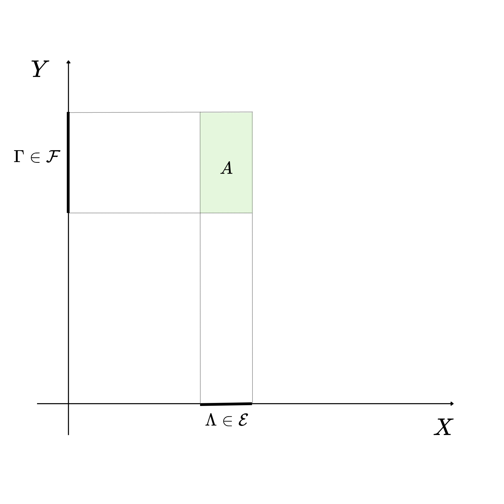
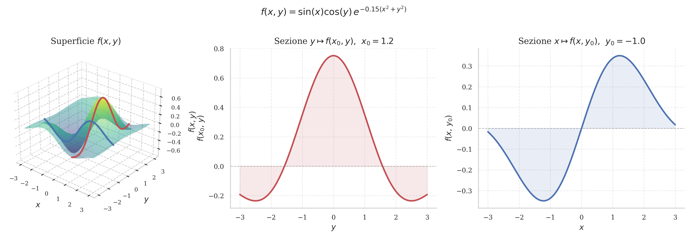
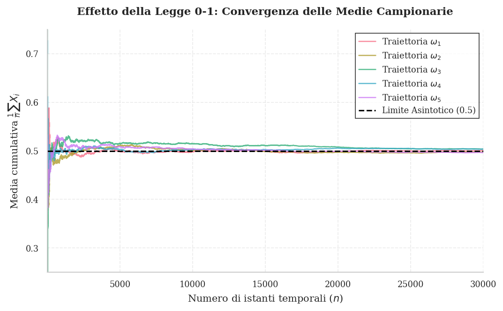

# Variabili Aleatorie Indipendenti

Due eventi $A$ e $B$ sono indipendenti se sapere che $B$ si è verificato non modifica la probabilità che $A$ si verifichi, ovvero $\mathbb{P}(A|B)=\mathbb{P}(A)$ (assumendo $\mathbb{P}(B)>0$). Formalmente, questa condizione equivale a: $$\mathbb{P}(A\cap B)=\mathbb{P}(A)\mathbb{P}(B)$$ Generalizzando a un numero finito di eventi $A_1,\dots,A_n$, essi sono mutuamente indipendenti se, per *ogni* sottoinsieme di indici $J \subseteq \{1,\dots,n\}$, vale la seguente uguaglianza: $$\mathbb{P}\left(\bigcap_{i\in J}A_i\right)=\prod_{i\in J}\mathbb{P}(A_i)$$ Affinché due variabili aleatorie (VA) $X$ e $Y$ siano indipendenti, vogliamo che la conoscenza del valore assunto da una lasci inalterate le probabilità relative ai valori assunti dall'altra. Ciò significa che gli eventi $\{X\in A\}$ e $\{Y\in B\}$ devono essere indipendenti per qualsiasi scelta degli insiemi misurabili $A$ e $B$ negli spazi degli stati in cui sono definite $X$ e $Y$.

## $\sigma$-algebre generate da variabili aleatorie

Per formalizzare rigorosamente l'indipendenza tra due VA $X$ e $Y$, si ricorre alle $\sigma$-algebre da esse generate, denotate rispettivamente con $\sigma(X)$ e $\sigma(Y)$. Data una variabile aleatoria $X:(\Omega,\mathcal{A})\rightarrow(E,\mathcal{E})$, l'insieme $X^{-1}(\mathcal{E})$ è una sub-$\sigma$-algebra di $\mathcal{A}$, chiamata $\sigma$-algebra generata da $X$ (o semplicemente $\sigma(X)$).

Intuitivamente, $\sigma(X)$ contiene tutti gli eventi (sottoinsiemi dello spazio campionario $\Omega$) che possono essere descritti osservando esclusivamente i valori assunti da $X$. In termini formali, è costituita da tutti gli eventi del tipo $X^{-1}(A) = \{\omega \in \Omega : X(\omega) \in A\}$, per ogni possibile insieme misurabile $A \in \mathcal{E}$.

## $\sigma$-algebre indipendenti

Due $\sigma$-algebre $\sigma(X)$ e $\sigma(Y)$ si dicono indipendenti se, scegliendo un qualsiasi evento appartenente alla prima e un qualsiasi evento appartenente alla seconda, questi risultano indipendenti.

Di conseguenza, due variabili aleatorie $X$ e $Y$ sono indipendenti se e solo se le rispettive $\sigma$-algebre generate, $\sigma(X)$ e $\sigma(Y)$, sono indipendenti. Questo significa che l'evento $\{X\in A\}$ è indipendente dall'evento $\{Y\in B\}$, per ogni scelta di $A \in \mathcal{E}_X$ e $B \in \mathcal{E}_Y$.

## Indipendenza di famiglie di sub-$\sigma$-algebre e di VA

Estendendo il concetto a una famiglia di sub-$\sigma$-algebre $\{\mathcal{A}_i\}_{i\in I}$ di $\mathcal{A}$, essa si dice indipendente se, per ogni sottoinsieme finito $J \subseteq I$ e per ogni scelta di eventi $A_i\in \mathcal{A}_i$, risulta: $$\mathbb{P}\left(\bigcap_{i\in J}A_i\right)=\prod_{i\in J}\mathbb{P}(A_i)$$ Pertanto, una famiglia di variabili aleatorie $\{X_i\}_{i\in I}$, dove ciascuna $X_i$ prende valori nello spazio $(E_i,\mathcal{E}_i)$, è formata da VA mutuamente indipendenti se la famiglia delle $\sigma$-algebre da esse generate, ovvero $\{X_i^{-1}(\mathcal{E}_i)\}_{i\in I}$, risulta indipendente.

::: mybox
Condizioni equivalenti di indipendenza tra VA Affinchè $X,Y$ sinao indipendenti, basta che una delle seguenti condizioni sia verificata:

- $\mathbb{P}(X\in A,Y\in B)=\mathbb{P}(X\in A)\mathbb{P}(Y\in B)$, per ogni $A\in \mathcal{E}$, $B\in\mathcal{F}$.\

- $\mathbb{P}(X\in A,Y\in B)=\mathbb{P}(X\in A)\mathbb{P}(Y\in B)$, per ogni $A\in \mathcal{C}$, $B\in\mathcal{D}$, dove $\mathcal{C},\mathcal{D}$ sono $\lambda$-systems. (Teorema della Classe Monotona)\

- $f(X)$ e $g(Y)$ sono trasformazioni indipendenti per ogni coppia di funzioni misurabili $f,g$.\

- $\mathbb{E}[f(X)g(Y)]=\mathbb{E}[f(X)]\mathbb{E}[g(Y)]$ per ogni coppia di funzioni continue e limitate $f,g$.\

- Siano $E,F$ due spazi misurabili e siano $\mathcal{E},\mathcal{F}$ le loro Borel-$\sigma$-algebre. Allora $\mathbb{E}[f(X)g(Y)]=\mathbb{E}
      [f(X)]\mathbb{E}[g(Y)]$ per ogni coppia di funzioni continue e limitate $f,g$.
:::

Questo teorema sancisce un principio fondamentale: l'indipendenza tra due variabili aleatorie $X$ e $Y$ è una proprietà estremamente robusta che si manifesta su più livelli matematici. L'enunciato dimostra che l'indipendenza non è vincolata esclusivamente alla definizione assiomatica astratta basata sulle $\sigma$-algebre. Al contrario, essa si riflette in modo del tutto equivalente sulle \"fondamenta\" di quegli spazi (le classi generatrici), sulle trasformazioni matematiche delle variabili stesse e sui loro valori attesi. In sintesi, il teorema ci dice che se $X$ e $Y$ non si influenzano a livello degli eventi elementari, nessuna operazione matematica ammissibile potrà mai \"creare\" un legame probabilistico tra loro.\
L'utilità di questo teorema sta nel fornire un vero e proprio arsenale di metodi alternativi per dimostrare o sfruttare l'indipendenza, permettendo di scegliere la strada analitica più semplice in base al problema:

- **Riduzione della complessità (Condizione 2):** Verificare l'indipendenza su ogni singolo insieme di una $\sigma$-algebra (Condizione 1) è umanamente impossibile a causa della mostruosa complessità di questi spazi. La Condizione 2 ci salva: permette di limitare il controllo a insiemi molto più semplici (come gli intervalli $(-\infty, x]$). È esattamente il motivo per cui, negli esercizi pratici, per dimostrare l'indipendenza ci basta verificare che la funzione di ripartizione congiunta si fattorizzi.

- **Gestione delle trasformazioni (Condizione 3):** È una garanzia operativa fondamentale. Ci permette di affermare a priori che se $X$ e $Y$ sono indipendenti, allora lo saranno automaticamente anche entità come $e^X$ e $\sin(Y)$, evitandoci di dover ricalcolare l'indipendenza da zero per le nuove variabili.

- **Il ponte verso l'analisi e gli integrali (Condizioni 4 e 5):** Tradurre l'indipendenza nella fattorizzazione dei valori attesi è cruciale. Spesso è infinitamente più facile calcolare e separare degli integrali piuttosto che manipolare probabilità di insiemi astratti. Questa proprietà è la chiave di volta per lavorare con le funzioni caratteristiche e le funzioni generatrici dei momenti, trasformando convoluzioni complesse in semplici moltiplicazioni algebriche.

**N.B.**

- $X$ e $Y$ sono indipendenti $\Rightarrow$ $\mathbb{E}[XY]=0$ (la covarianza è 0), ma

- $\mathbb{E}[XY]=0$ $\nRightarrow$ $X$ e $Y$ sono indipendenti, poichè la dipendenza potrebbe essere non lineare.

## Funzioni Congiuntamente Misurabili e $\sigma$-algebra-prodotto

Se $\mathcal{E},\mathcal{F}$ sono $\sigma$-algebre sugli spazi $E,F$, allora il prodotto cartesiano $$\mathcal{E}\times \mathcal{F}=\{A\subset E\times F: A=\Lambda\times \Gamma, \quad \Lambda\in\mathcal{E}, \Gamma\in\mathcal{F}\}$$ Non è una $\sigma$-algebra su $E\times F$. Di conseguenza scriviamo la : $$\mathcal{E}\otimes \mathcal{F}=\sigma(\mathcal{E}\times \mathcal{F})$$ Per denotare la più piccola $\sigma$-algebra che su $E\times F$.\
Tutto questo ci serve per passare da VA in 1D a vetteori aleatori in più dimensioni.

Vogliamo definire una misura di probabilità su coppie di variabili $(X,Y)$, quindi abbiamo bisogno di una $\sigma$-algebra sul piano cartesiano $E\times F$. Ma prendere un evento $A$ di $X$ e un evento $B$ di $Y$ e farne il prodotto cartesiano $A\times B$ è sbagliato.\
Immagina che la VA $X$ viva sull'asse delle ascisse, mentre la VA $Y$ sull'asse delle ordinate. Un evento $\Lambda\in\mathcal{E}$ è un segmento sull'asse di $X$, mentre un evento $\Gamma\in\mathcal{F}$ è un segmento sull'asse di $Y$. Il loro prodotto cartesiano $\Lambda \times \Gamma$ è un rettangolo nel piano 2D e quindi la collezione $\mathcal{E}\times\mathcal{F}$ è l'insieme di tutti i possibili rettangoli che puoi disegnare scegliendo diversi segmenti (eventi) sui due assi (le VA), ma attenzione: se unisci due rettangoli incrociati non ottieni un rettangolo ma una forma a croce (la famigia non è chiusa rispetto all'unione); il complementare di un rettangolo non è ancora un rettangolo, bensì un foglio bucato (la famiglia non è chiusa ai complementari). Peranto $\mathcal{E}\times \mathcal{F}$ non è una $\sigma$-algebra.

{#fig-placeholder}

Usiamo dunque l'operatore generatore $\sigma(.)$ per stabilire che $\mathcal{E}\otimes \mathcal{F}=\sigma(\mathcal{E}\times \mathcal{F})$ è la $\sigma$-algebra prodotto, che contiene tutti i rettangoli (gli eventi) di base, tutte le loro unioni infinite, tutte le loro intersezioni e complementari.

::: mybox
Funzioni misurabili a più variabili Sia $f$ una funzione misurabile $$f:(E\times F, \mathcal{E}\otimes \mathcal{F})\rightarrow(\mathbb{R},\mathcal{B})$$ Per ogni $x\in E$ $(y\in F)$, la sezione $y\rightarrow f(x,y)$ ($x\rightarrow f(x,y)$) è una funzione $\mathcal{F}$-misurabile ($\mathcal{E}$-misurabile)
:::

Questo teorema stabilisce un principio geometrico e analitico fondamentale: la \"conservazione della misurabilità sulle sezioni\". Immagina la funzione $f(x,y)$ come una superficie definita su uno spazio prodotto $E \times F$. Il teorema ci assicura che se tagliamo questa superficie con un piano fisso (ad esempio \"congelando\" la coordinata $x$), la \"fetta\" risultante (ovvero la funzione di una sola variabile $y \mapsto f(x,y)$) sarà a sua volta misurabile rispetto al suo spazio originario. In sintesi: la regolarità globale in uno spazio a più dimensioni garantisce sempre la regolarità locale nelle dimensioni inferiori.

Questo teorema è l'ingranaggio invisibile che fa funzionare gran parte dell'analisi multivariata e della teoria della probabilità:

- **Il lasciapassare per i Teoremi di Fubini e Tonelli:** Questa è l'applicazione in assoluto più importante. Per calcolare un integrale doppio o congiunto, lo strumento principe è spezzarlo in due integrali iterati (prima rispetto a una variabile e poi all'altra). Tuttavia, per poter scrivere l'integrale più interno, ad esempio $\int f(x,y) dy$, la funzione integranda deve avere senso matematico: deve cioè essere misurabile rispetto a $y$. Questo teorema ci garantisce a priori che la funzione \"affettata\" possiede questo requisito essenziale, rendendo legittima e ben definita l'operazione di integrazione iterata.

- **Condizionamento e variabili \"congelate\":** In probabilità, spesso studiamo distribuzioni congiunte di due variabili $(X, Y)$. Se osserviamo che una delle due ha assunto un valore specifico (es. $X = x$), otteniamo una nuova funzione $g(Y) = f(x, Y)$. Il teorema ci autorizza ad affermare che questa nuova $g(Y)$ è a tutti gli effetti una variabile aleatoria valida (cioè misurabile), permettendoci di calcolarne medie e varianze condizionate.

- **Sezioni di processi stocastici:** Nello studio di un processo stocastico $X(t, \omega)$ (che dipende dal tempo $t$ e dall'esito $\omega$), fissare il tempo ci restituisce una variabile aleatoria $\omega \mapsto X_t(\omega)$, mentre fissare l'esito ci restituisce una traiettoria temporale $t \mapsto X_\omega(t)$. Questo teorema (e le sue generalizzazioni) assicura che queste \"sezioni\" mantengano le proprietà di misurabilità necessarie per essere studiate singolarmente.

{#fig-placeholderx}

## Teorema di Tonelli-Fubini e Misure-Prodotto

Il teorema di Tonelli-Fubini è la generalizzazione del principio di Cavalieri, che ci dice che il volume di un solido è la \"summa\" (integrale) delle aree di tutte le sue sezioni 2D. (integrale doppio: quello interno che calcola l'area di ogni singola sezione, quello esterno somma tutte le aree). Il problema è che non tutte le sezioni potrebbero essere misurabili. Il teorema precedente ci garantisce però che se la funzione di partenza è misurabile, allora lo saranno anche le sue sezioni.

::: mybox
Teorema di Tonelli-Fubini Siano $\mathbb{P}$ e $\mathbb{Q}$ due misure di probabilità su $(E,\mathcal{E})$ e $(F,\mathcal{F})$.

- Definiamo misura-prodotto $$\mathbb{D}(A\times B)=\mathbb{P}(A)\mathbb{Q}(B)=\mathbb{P}\otimes\mathbb{Q}$$ Allora $\mathbb{D}$ si estende in modo unico a una probabilità su $(E\times F, \mathcal{E}\otimes\mathcal{F})$.\

- Per ogni funzione $f$ $\mathcal{E}\otimes\mathcal{F}$-misurabile, positiva o integrabile rispetto a $\mathbb{P}\otimes\mathbb{Q}$, la funzione (sezione) $$x\rightarrow\int f(x,y)\mathbb{Q}(dy)$$ è $\mathcal{E}$-misurabile e la funzione (sezione) $$y\rightarrow\int f(x,y)\mathbb{P}(dx)$$ è $\mathcal{F}$-misurabile, e quindi vale: $$\int f \, d(\mathbb{P}\otimes\mathbb{Q}) = \int \left[ \int f(x,y)\mathbb{Q}(dy) \right] \mathbb{P}(dx) = \int \left[ \int f(x,y)\mathbb{P}(dx) \right] \mathbb{Q}(dy)$$
:::

Questo è senza dubbio uno dei risultati più potenti e operativi di tutta la teoria dell'integrazione e della probabilità. Nella sua essenza, il Teorema di Tonelli-Fubini ci assicura che l'integrale su uno spazio a più dimensioni può essere calcolato \"a fette\", risolvendolo iterativamente prima su una variabile e poi sull'altra. Ancora più importante: ci garantisce che, finché la funzione è positiva (Tonelli) o assolutamente integrabile (Fubini), l'ordine con cui scegliamo di integrare è del tutto ininfluente sul risultato finale.

- **Il fondamento dell'indipendenza:** In probabilità, la misura prodotto $\mathbb{P} \otimes \mathbb{Q}$ modella esattamente la legge congiunta di due variabili aleatorie indipendenti. Questo teorema è il vero e proprio motore di calcolo che usiamo per dimostrare che il valore atteso di una funzione di variabili indipendenti si può calcolare separandone i pezzi.

- **Inversione dell'ordine di integrazione:** Molto spesso, un integrale doppio risulta analiticamente impossibile da risolvere se attaccato nell'ordine $dx dy$, ma diventa elementare invertendo in $dy dx$. Tonelli-Fubini è il \"lasciapassare\" formale che ci autorizza a scambiare i differenziali senza alterare il risultato.

- **Calcolo delle distribuzioni marginali:** Gli integrali \"interni\" (ovvero le funzioni sezione che il teorema garantisce essere misurabili) rappresentano, dal punto di vista probabilistico, il processo di marginalizzazione. Integrare via la dipendenza da $y$ ci restituisce una funzione della sola $x$, che descrive il comportamento marginale (o il valore atteso condizionato) del nostro sistema probabilistico.

![Rappresentazione del Teorema di Tonelli-Fubini. <strong>In alto a sinistra:</strong> heatmap di $f(x,y)$ su $E \times F$, con evidenziate le due sezioni (orizzontale e verticale). <strong>In alto al centro/destra:</strong> le due sezioni $f(x_0, y)$ e $f(x, y_0)$ pesate rispettivamente da $\mathbb{Q}$ e $\mathbb{P}$, con l’area integrata evidenziata. <strong>In basso a sinistra/centro:</strong> le funzioni iterate $x \mapsto \int f(x,y)\,\mathbb{Q}(dy)$ e $y \mapsto \int f(x,y)\,\mathbb{P}(dx)$, con i valori numerici dell’integrale doppio (che coincidono, verificando il teorema). <strong>In basso a destra:</strong> la formula con l’uguaglianza dei tre integrali: $\int f \, d(\mathbb{P}\otimes\mathbb{Q}) = \int \left[ \int f(x,y)\mathbb{Q}(dy) \right] \mathbb{P}(dx) = \int \left[ \int f(x,y)\mathbb{P}(dx) \right] \mathbb{Q}(dy)$.](figures/tonelli-fubini-1.png){#fig-placeholder}

::: mybox
Indipendenza di VA come fattorizzazione della distribuzione congiunta Siano $X,Y$ due VA su $(\Omega,\mathcal{A}, \mathbb{P)}$ a valori rispettivamente in $(E,\mathcal{E})$ e $(F,\mathcal{F})$. La coppia $Z=(X,Y)$ è una VA in 2D a valori in $(E\times F, \mathcal{E}\otimes \mathcal{F})$ e le VA $X,Y$ sono indipendenti se e solo se la loro distribuzione congiunta $P_{(X,Y)}$ è uguale al prodotto $P_X\otimes P_Y$ delle loro distribuzioni marginali.
:::

## Teorema di Estensione di Kolmogorov

Consideriamo ora la misura di probabilità $\mu$ su $(E,\mathcal{E})$. è facile costruire una VA $X$ a valori in $E$, la cui distribution measure è $\mu$. Basta prendere $\Omega=E$, $\mathcal{A}=\mathcal{E}$, $\mathbb{P}=\mu$ e porre che $X$ sia la funzione identità $X(x)=x$.\
Più complessa è la costruzione di due VA indipendenti $X,Y$ a valori in $(E,\mathcal{E})$ e $(F,\mathcal{F})$ e con distribution measure $\mu,\nu$. Possiamo farlo nel seguente modo: prendiamo $\Omega=E\times F$, $\mathcal{A}=\mathcal{E}\otimes \mathcal{F}$, $\mathbb{P}=\mu\otimes\nu$, e $X(x,y)=x$, $Y(x,y)=y$, dove $(x,y)\in E\times F$.\
Siginificativamente più complicato è costruire una successione infinita di VA indipendenti con distribuzione date. Per ogni $n$, sia $X_n$ definita su $(\Omega_n, \mathcal{A}_n,\mathbb{P}_n)$ e poniamo: $$\Omega=\prod_{n=1}^{\infty}\Omega_n$$ $$\mathcal{A}=\bigotimes_{n=1}^{\infty}\mathcal{A}_n$$ dove $\bigotimes_{n=1}^{\infty}\mathcal{A}_n$ denota la più piccola $\sigma$-algebra su $\Omega$ generata da tutti gli insiemi della forma: $$A_1\times A_2\times ...\times A_k\times\Omega_{k+1}\times \Omega_{k+2}\times...$$ Gli insiemi della forma appena descritta prendono il nome formale di insiemi cilindrici, o cilindri a base finita. Essi rappresentano il concetto cardine per poter definire rigorosamente la probabilità su successioni infinite, come nello studio dei processi stocastici.\
In uno spazio di probabilità infinito, un singolo esito è una successione infinita di eventi. Un insieme cilindrico modella un evento in cui si impongono delle restrizioni solamente sui primi $k$ istanti di tempo, ignorando del tutto ciò che accade da $k+1$ in poi.

- La base del cilindro ($A_1 \times \dots \times A_k$) richiede che il primo risultato sia in $A_1$, il secondo in $A_2$, fino al $k$-esimo.

- Lo stelo del cilindro ($\Omega_{k+1} \times \Omega_{k+2} \times \dots$) indica che per le variabili successive è ammissibile qualsiasi esito, essendo $\Omega_n$ l'intero spazio campionario per l'$n$-esimo esperimento.

Per fare un esempio pratico, lanciando una moneta infinite volte, l'evento \"i primi due lanci sono Testa\" corrisponde esattamente all'insieme cilindrico $\{T\} \times \{T\} \times \Omega_3 \times \Omega_4 \times \dots$, dove solo le prime due posizioni sono vincolate.\
Il problema teorico di fondo è che non si può definire la probabilità direttamente su prodotti infiniti arbitrari di insiemi misurabili, perché l'estensione all'infinito senza precauzioni porta a contraddizioni matematiche. I cilindri aggirano l'ostacolo fungendo da mattoni fondamentali.

Poiché un cilindro dipende solo da un numero finito $k$ di variabili, calcolarne la probabilità è semplice e si basa sulla regola dei prodotti finiti: $$\mathbb{P}(\text{cilindro}) = \mathbb{P}_1(A_1) \mathbb{P}_2(A_2) \dots \mathbb{P}_k(A_k)$$ Una volta definita questa probabilità elementare e calcolabile sui cilindri, interviene il Teorema di Estensione di Kolmogorov. Questo teorema garantisce che, partendo da questa base coerente, la misura di probabilità si estenda in modo del tutto unico a tutta la immensa $\sigma$-algebra infinita $\mathcal{A}$ generata da questi insiemi.

::: mybox
Teorema di Estensione di Kolmogorov Dati gli spazi di probabilità $(\Omega_n, \mathcal{A}_n,\mathbb{P}_n)$, $\Omega=\prod_{n=1}^{\infty}\Omega_n$ e $\mathcal{A}=\bigotimes_{n=1}^{\infty}\mathcal{A}_n$, allora esiste una misura di probabilità $\mathbb{P}$ su $(\Omega,\mathcal{A})$ unica tale che: $$\mathbb{P}(A_1\times A_2\times ...\times A_k\times\Omega_{k+1}\times \Omega_{k+2}\times...)=\prod_{i=1}^{k}\mathbb{P}_i(A_i)$$ Per la successione $X_n$ definita su $(\Omega_n, \mathcal{A}_n,\mathbb{P}_n)$ denotiamo con $\widetilde{X}_n$ la sua estensione a $\Omega$ nel modo seguente: sia $\omega=[\omega_1,...,\omega_n,...]$ con $\omega_i\in\Omega_i$ per ogni $i$. Allora: $$\widetilde{X}_n(\omega)=X_n(\omega_n)$$
:::

Il Teorema di Estensione di Kolmogorov è il naturale punto di arrivo del discorso fatto in precedenza sugli insiemi cilindrici. È il teorema che \"salva\" la teoria della probabilità quando si passa da un orizzonte finito a uno infinito.\
Il teorema afferma un principio di coerenza formidabile: se sei in grado di assegnare una probabilità ben definita agli eventi che si verificano in un numero finito di passi (i famosi insiemi cilindrici), allora la matematica ti garantisce che esiste una, e una sola, misura di probabilità \"globale\" $\mathbb{P}$ capace di abbracciare l'intero spazio infinito senza creare paradossi. In altre parole, le informazioni locali e finite sono sufficienti a determinare in modo univoco la legge probabilistica di tutta la successione infinita.\
Senza questo teorema, l'intera struttura della probabilità avanzata crollerebbe:

- Esistenza di successioni infinite: Quando in un esercizio diciamo \"sia data una successione infinita di variabili aleatorie indipendenti\", stiamo dando per scontato che esista uno spazio matematico in grado di contenerle. Questo teorema è la prova formale che un tale spazio esiste ed è ben definito.

- Fondamento dei processi stocastici: Che si tratti del moto browniano, del random walk o delle catene di Markov, ogni processo stocastico che evolve nel tempo necessita di uno spazio prodotto infinito. Kolmogorov fornisce l'infrastruttura rigorosa su cui costruire l'intera teoria.

La successione delle variabili estese $\widetilde{X}_n$ costituisce la definizione stessa di un processo stocastico a tempo discreto. Avere un unico spazio $\Omega$ per tutte le variabili è ciò che ci permette di studiare il processo secondo due prospettive complementari:

- Fissando il tempo ($n$ costante): Se blocchiamo l'indice temporale $n$ e lasciamo variare $\omega$, la funzione $\omega \mapsto \widetilde{X}_n(\omega)$ è una classica variabile aleatoria. Essa descrive l'incertezza sul valore che il processo assumerà in quel preciso istante $n$, considerando tutti i possibili scenari futuri.

- Fissando la realizzazione ($\omega$ costante): Se selezioniamo un singolo, specifico esito infinito $\omega \in \Omega$, il caso sparisce. Otteniamo una successione numerica deterministica $n \mapsto \widetilde{X}_n(\omega)$. Questa sequenza prende il nome di \"traiettoria\", \"cammino\" o \"realizzazione\" (sample path) del processo, e rappresenta l'intera storia temporale del sistema dall'inizio alla fine, in quell'unico \"universo\" in cui si è verificato l'esito $\omega$.

{#fig-placeholderx}

## Lemmi di Borel-Cantelli

::: mybox
Teorema di Estensione di Kolmogorov: corollario Sia la succesione $X_n$ definita su $(\Omega_n, \mathcal{A}_n,\mathbb{P}_n)$ e sia $\widetilde{X}_n$ la sua estensione naturale a $(\Omega,\mathcal{A}, \mathbb{P})$. Allora le $\widetilde{X}_n$ sono tutte indipendenti e la distribuzione di $\widetilde{X}_n$ su $(\Omega,\mathcal{A}, \mathbb{P})$ è identica alla distribuzione di $X_n$ su $(\Omega_n, \mathcal{A}_n,\mathbb{P}_n)$.
:::

### Il concetto di \"Infinitely Often\"

Sia $A_n$ una successione di eventi in $\mathcal{A}$. Definiamo: $$\limsup_{n\rightarrow\infty}A_n=\bigcap_{n=1}^{\infty}\left(\bigcup_{m\geq n}A_m   \right)=\lim_{n\rightarrow\infty}\left(\bigcup_{m\geq n}A_m   \right)$$ Questo evento può essere interpretato come:

::: center
$\limsup_{n\rightarrow \infty}A_n=$ \"$A_n$ si verifica infinite volte\"
:::

Il che significa che $A_n$ si verifica per un numero infinito di indici $n$, ovvero: $$\limsup_{n\rightarrow\infty} A_n=\{A_n \text{ i.o.}\}$$ Dove i.o. significa che l'evento accade \"Infinitely Often\".\
Fissiamo ora $B_n = \bigcup_{m\geq n}A_m$, in modo che $\limsup_{n\rightarrow\infty}A_n=\bigcap_{n=1}^{\infty}\left(\bigcup_{m\geq n}A_m   \right)=\bigcap_{n=1}^{\infty}B_n$. La successione $B_n$ è decrescente ($B_1\supseteq B_2 \supseteq B_3 \supseteq \dots$) perché man mano che $n$ cresce togliamo sempre più insiemi dall'unione. Il limite di questa successione decrescente è esattamente l'intersezione infinita, ovvero $\{A_n \text{ i.o.}\}$. $$\mathbb{P}(A_n \text{ i.o.})=\mathbb{P}\left(\bigcap_{n=1}^{\infty}B_n\right)=\lim_{n \rightarrow \infty}\mathbb{P}(B_n)$$

**N.B.**: La formulazione $\limsup_{n\to\infty}A_n=\bigcap_{n=1}^{\infty}\left(\bigcup_{m\geq n}A_m\right)$ va letta dall'interno verso l'esterno.

- $B_n=\bigcup_{m\geq n}A_m$: facciamo l'unione di tutti gli eventi $A$ dall'indice $n$ in poi. L'unione in probabilità corrisponde a un \"OR\" logico. Quindi questa scrittura significa: \"l'evento $A_m$ si verificherà almeno una volta dall'istante $n$ fino alla fine dei tempi\".

- Se prendiamo l'intersezione infinita di questi eventi $B_n$, otteniamo $\bigcap_{n=1}^{\infty}B_n$. Siccome l'intersezione corrisponde a un \"AND\" logico, stiamo dicendo che:

  1.  deve essere vero l'evento $B_1$: l'evento accadrà dal tempo $1$ in poi;

  2.  deve essere vero l'evento $B_{100}$: l'evento accadrà dal tempo $100$ in poi;

  3.  deve essere vero l'evento $B_{100000}$: l'evento accadrà dal tempo $100000$ in poi;

  4.  e così via, per ogni $n$.

  L'unica spiegazione logica per soddisfare questa condizione è che l'evento non smetta mai di accadere. In gergo probabilistico, si dice che l'evento $A_n$ **si verifica infinitamente spesso** (*infinitely often*, o *i.o.*).

::: mybox
Lemmi di Borel-Cantelli Sia $A_n$ una successione di eventi in $(\Omega,\mathcal{A},\mathbb{P})$:\

- Se $\sum_{n=1}^{\infty}\mathbb{P}(A_n)<\infty$ allora $\mathbb{P}(A_n\space i.o.)=0$\

- Se $\mathbb{P}(A_n\space i.o.)=0$ e se gli eventi $A_n$ sono mutualmente indipendenti, allora $\sum_{n=1}^{\infty}\mathbb{P}(A_n)\leq\infty$.\
  Una formulazione alternativa e più intuitiva del secondo lemma è:

- Se $\sum_{n=1}^{\infty}\mathbb{P}(A_n)=\infty$ e se gli eventi $A_n$ sono mutualmente indipendenti, allora $\mathbb{P}(A_n\space i.o.)=1$
:::

I Lemmi di Borel-Cantelli rispondono in modo definitivo a una domanda cruciale: \"Se ho una sequenza infinita di eventi, qual è la probabilità che essi continuino a verificarsi per sempre?\". I due lemmi dividono il mondo in due scenari:

- Il Primo Lemma (caso convergente): Se la somma di tutte le probabilità è un numero finito, significa che gli eventi diventano \"rari\" talmente in fretta che, prima o poi, si esauriranno. La probabilità che continuino ad accadere all'infinito è rigorosamente zero. La cosa straordinaria di questo primo lemma è che vale sempre, senza richiedere che gli eventi siano indipendenti tra loro.

- Il Secondo Lemma (caso divergente): Se la somma delle probabilità è infinita, le probabilità non si rimpiccioliscono abbastanza in fretta. Se aggiungiamo l'ipotesi fondamentale che gli eventi siano indipendenti (cioè che il \"caso\" non abbia memoria dei fallimenti passati), allora siamo matematicamente certi (probabilità 1) che l'evento continuerà a verificarsi infinite volte.

\
Questi lemmi sono lo strumento principe per dimostrare quasi tutti i teoremi di convergenza asintotica in probabilità (come la Legge Forte dei Grandi Numeri). Nella pratica, trasformano un problema probabilistico complesso (calcolare la probabilità di un'intersezione infinita di unioni infinite) in un banale problema di Analisi 1: studiare il carattere (convergenza o divergenza) di una serie numerica $\sum \mathbb{P}(A_n)$.

### Paradosso della scimmia instancabile {#sec-paradosso-della-scimmia-instancabile .unnumbered}

Nonostante a livello umano sembri un'assurdità controintuitiva, la dimostrazione probabilistica è disarmante nella sua semplicità.\
Supponiamo che la tastiera abbia $K$ tasti (includendo lettere, spazi e punteggiatura) e che il capolavoro da scrivere sia composto in totale da $N$ battute. Invece di guardare alle singole lettere, dividiamo l'infinita sequenza di tasti premuti dalla scimmia in \"blocchi\" separati, ciascuno di lunghezza esattamente pari a $N$.

Sia $A_n$ l'evento: \"*la scimmia digita il testo perfettamente corretto all'$n$-esimo blocco*\".

Poiché la scimmia digita in modo puramente casuale, la probabilità di scrivere l'opera esatta al primo tentativo è piccola, ma è comunque un numero fisso e strettamente maggiore di zero: $$\mathbb{P}(A_n) = p = \left(\frac{1}{K}\right)^N > 0$$ Per sapere se la scimmia ci riuscirà mai, studiamo la serie delle probabilità per applicare Borel-Cantelli: $$\sum_{n=1}^{\infty}\mathbb{P}(A_n) = \sum_{n=1}^{\infty} p = \infty$$ Poiché stiamo sommando infinite volte una costante $p$ maggiore di zero, la serie diverge a infinito. Inoltre, i tentativi (i blocchi) sono eventi **mutuamente indipendenti**, poiché la scimmia preme i tasti a caso, non ha memoria e le lettere digitate in precedenza non influenzano le successive.

Avendo una serie divergente ($\sum \mathbb{P}(A_n) = \infty$) e l'indipendenza degli eventi, ricadiamo esattamente nelle ipotesi del **Secondo Lemma di Borel-Cantelli**. La conclusione matematica è inequivocabile: $$\mathbb{P}(A_n \space i.o.) = 1$$ Questo significa che la scimmia non solo riuscirà a scrivere il capolavoro ma, avendo a disposizione un tempo infinito, lo scriverà un **numero infinito di volte**. Per darti un'idea pratica di come il caso produca risultati strutturati se gli si dà abbastanza tempo, ho creato un simulatore interattivo. Puoi usarlo per vedere la logica della scimmia

## Legge zero-uno di Kolmogorov

### Tail-$\sigma$-algebre

Siano $X_n$ VA definite su $(\Omega, \mathcal{A}, \mathbb{P})$. Definiamo le seguenti $\sigma$-algebre: $$\mathcal{B}_n=\sigma(X_n)$$ $$\mathcal{C}_n=\sigma\left(\bigcup_{p\geq n}\mathcal{B}_p     \right)$$ $$\mathcal{C}_{\infty}=\bigcap_{n=1}^{\infty}\mathcal{C}_n$$ $\mathcal{C}_{\infty}$ è la tail-$\sigma$-algebra, che contiene i cosiddetti \"eventi di coda\"

**La prima equazione: l'informazione all'istante presente**\
La $\sigma$-algebra $\mathcal{B}_n$ è quella generata dalla singola variabile $X_n$. Intuitivamente, essa contiene tutti e soli gli eventi di cui possiamo stabilire con assoluta certezza se si sono verificati oppure no guardando esclusivamente l'esito dell'osservazione al tempo $n$, ignorando completamente tutto il passato e tutto il futuro.

**La seconda equazione: l'informazione sul futuro**\
La $\sigma$-algebra $\mathcal{C}_n$ raggruppa (tramite l'unione) tutte le $\sigma$-algebre dal tempo $n$ in poi, generando uno spazio misurabile più grande. Essa rappresenta tutta l'informazione contenuta nel \"futuro\" del processo a partire dall'istante $n$. Un evento appartiene a $\mathcal{C}_n$ se, per sapere se si è avverato, ci basta osservare la sequenza $X_n, X_{n+1}, X_{n+2}, \dots$, senza avere alcun bisogno di conoscere cosa sia successo nei primi $n-1$ istanti temporali.

**La terza equazione: la tail-$\sigma$-algebra**\
La $\sigma$-algebra $\mathcal{C}_\infty$ si ottiene intersecando infiniti futuri. Affinché un evento appartenga a questo insieme estremo, deve appartenere a $\mathcal{C}_1$, ma anche a $\mathcal{C}_{100}$, e anche a $\mathcal{C}_{1000000}$, per ogni $n$. Questo ha un significato logico potentissimo: un \"evento di coda\" è un evento che dipende dall'intera successione infinita, ma la cui realizzazione *non è minimamente influenzata da alcun numero finito di osservazioni iniziali*. Puoi alterare, cancellare o ignorare i primi mille miliardi di valori della successione $X_n$, e questo non cambierà in alcun modo il verificarsi o meno di un evento in $\mathcal{C}_\infty$.\
Un classico evento che appartiene alla $\sigma$-algebra coda è l'evento \"la serie $\sum X_n$ converge\", oppure l'evento \"$A_n$ accade infinitamente spesso\" ad esempio \"testa esce ifinite volte\" (esattamente il $\limsup$ che abbiamo analizzato prima). Infatti, se modifichi i primi $100$ termini di una serie, non ne alteri il carattere (se convergeva, continuerà a convergere).

::: mybox
Legge zero-uno di Kolmogorov Siano $X_n$ VA indipendenti, tutte definite su $(\Omega, \mathcal{A}, \mathbb{P})$ e sia $\mathcal{C}_{\infty}$ la corrispondente tail-$\sigma$-algebra. Se l'evento $C\in \mathcal{C}_{\infty}$, allora: $$\mathbb{P}(C)=0$$ oppure $$\mathbb{P}(C)=1$$
:::

La Legge zero-uno di Kolmogorov risponde a una domanda fondamentale: cosa succede se un evento dipende da una sequenza infinita di lanci, ma non dipende da nessun lancio specifico iniziale?. Sappiamo che un evento di coda $C\in \mathcal{C}_{\infty}$ è un'evento il cui esito non cambia se si modificano i primi $n$ lanci. L'evento di coda è quindi indipendente dai primi $n$ eventi, ma l'evento stesso è costruito a partire dagli $n$ eventi precedenti! Paradossalmente esso è indipendente da se stesso, quindi: $$\mathbb{P}(C)=\mathbb{P}(C)\mathbb{P}(C)=\mathbb{P}(C)^2$$ E gli unici numeri che soddisfano l'equazione $x=x^2$ sono $0$ e $1$.\
Le conseguenze della legge zero-uno di Kolmogorov sono le seguenti:

- $\{\omega:\lim_{n\rightarrow\infty}X_n(\omega)=l\}\in\mathcal{C}_{\infty}$, pertanto $X_n$ converge A.S. o diverge A.S.

- Ogni VA $\mathcal{C}_{\infty}$-misurabile è A.S. costante. In partiocolare:

  1.  $\limsup X_n$

  2.  $\liminf X_n$

  3.  $\limsup\frac{1}{n}\sum_{p\leq n}X_p$

  4.  $\liminf\frac{1}{n}\sum_{p\leq n}X_p$

  Sono tutte A.S. costanti.

Una variabile di coda deve essere A.S. una costante. All'infinito la casualità sparisce e vedremo dalle leggi dei grandi numeri che questa costante sarà la media di una distribuzione normale $\mu$.

{#fig-placeholder}

::: {.paper-download}
[Scarica il PDF](probability_theory_for_quantitative_finance-7.pdf){.btn-paper download=""}
:::
