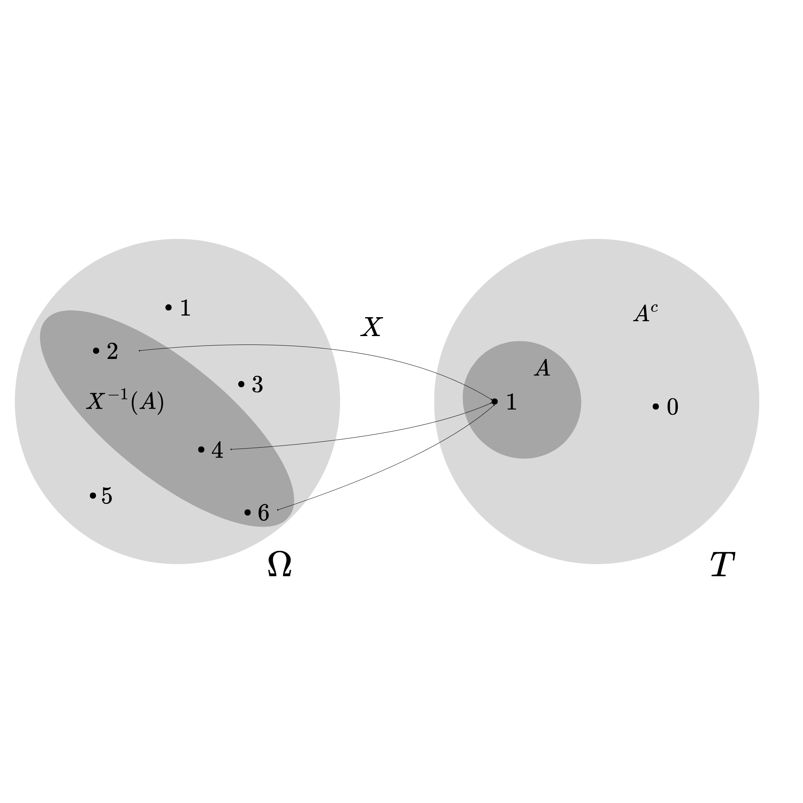

# Variabili aleatorie su uno spazio numerabile

Assumiamo che $\Omega$ sia numerabile con la $\sigma$-algebra $2^{\Omega}$. Una variabile aleatoria è una funzione (o trasformazione): $$X:\Omega\rightarrow T$$ Essa rappresenta una quantità incognita che varia al verificarsi di un evento casuale. Prima che l'evento accada sappiamo quali valori potrebbe potenzialmente assumere $X$, ma non sappiamo il preciso valore che assumerà finchè l'evento casuale non si verifica.\
Definiamo la distribuzione di $X$, detta anche legge di $X$, sullo spazio degli stati $T$ come: $$P_X(A)=\mathbb{P}(\{\omega:X(\omega)\in A\})=\mathbb{P}(X^{-1}(A))=\mathbb{P}(X\in A)$$ Questa formula rappresenta il ponte fondamentale che collega lo spazio astratto degli esiti originari (lo spazio campionario $\Omega$) allo spazio pratico dei valori assunti dalla variabile aleatoria (lo spazio degli stati $T$). In sostanza, definisce in modo rigoroso come la misura di probabilità si \"trasferisca\" da $\Omega$ a $T$ tramite la funzione $X$.

Analizziamo nel dettaglio i quattro termini che compongono questa catena di uguaglianze:

- $P_X(A)$: È la probabilità indotta sullo spazio degli stati $T$. Rappresenta la probabilità che la variabile aleatoria $X$ assuma un valore all'interno del sottoinsieme $A$ (con $A \subseteq T$). Viene comunemente chiamata \"legge\" o \"distribuzione\" della variabile aleatoria $X$.

- $\mathbb{P}(\{\omega:X(\omega)\in A\})$: Rappresenta il cuore logico della definizione. Poiché non possediamo a priori una misura di probabilità definita su $T$, ma solo la probabilità originaria $\mathbb{P}$ definita su $\Omega$, dobbiamo procedere a ritroso. Raggruppiamo in un unico evento (sottoinsieme di $\Omega$) tutti e soli quegli esiti $\omega$ tali per cui, applicando la trasformazione $X$, il risultato $X(\omega)$ \"atterra\" esattamente dentro l'insieme $A$. Una volta individuato questo specifico gruppo di $\omega$, utilizziamo la misura $\mathbb{P}$ per valutarne la probabilità.

- $\mathbb{P}(X^{-1}(A))$: Questa è un'espressione formale che utilizza il concetto di **controimmagine** (o immagine inversa) dell'insieme $A$ tramite la funzione $X$. Non implica che $X$ sia invertibile (spesso non lo è, essendo una funzione tipicamente non iniettiva), ma è la notazione compatta della teoria degli insiemi per indicare l'insieme di partenza $\{\omega \in \Omega : X(\omega) \in A\}$.

- $\mathbb{P}(X\in A)$: Questa è la notazione abbreviata e di uso comune nella pratica statistica. Omette il formalismo delle controimmagini e degli esiti $\omega$ per una lettura più immediata: \"la probabilità che la variabile aleatoria $X$ appartenga all'insieme $A$\".

### *Esempio* {#sec-esempio .unnumbered}

Consideriamo il lancio di un dado a 6 facce non truccato:

- Lo spazio campionario è $\Omega = \{\omega_1, \omega_2, \omega_3, \omega_4, \omega_5, \omega_6\}$, dove $\omega_i$ rappresenta l'uscita della faccia con $i$ punti.

- Definiamo la variabile aleatoria $X$ associata all'evento \"esce un numero pari\". Poniamo $X(\omega) = 1$ se $\omega$ è pari, e $X(\omega) = 0$ se $\omega$ è dispari.

- Lo spazio degli stati è quindi $T = \{0, 1\}$.

- Sia $A = \{1\}$ l'evento di interesse (la \"vittoria\").

Per calcolare $P_X(\{1\})$, cerchiamo la controimmagine di $A$ tramite $X$, ovvero tutti gli $\omega$ per cui $X(\omega) = 1$: $$X^{-1}(\{1\}) = \{\omega_2, \omega_4, \omega_6\}$$

La probabilità indotta sarà quindi la probabilità di questo sottoinsieme calcolata nello spazio originario $\Omega$: $$P_X(\{1\}) = \mathbb{P}(\{\omega_2, \omega_4, \omega_6\}) = \frac{3}{6} = 0.5$$

Nella notazione compatta scriveremo semplicemente $\mathbb{P}(X=1) = 0.5$.

{#fig-placeholder}

## Valore Atteso

Sia $X$ una variabile aleatoria a valori reali sun uno spazio numerabile $\Omega$. Il valore atteso di $X$ è definito come: $$\mathbb{E}[X]=\sum_{\omega}X(\omega)p_w$$ Se lo spazio degli stati $\Omega$ è infinito, la formula diventa una somma infinita e ha senso se la convergenza è assoluta o se $X\geq0$ sempre.

::: mybox
Spazio $\mathcal{L}^1$ Definiamo $\mathcal{L}^1$ come lo spazio delle variabili aleatorie reali su $(\Omega,\mathcal{A},\mathbb{P)}$ che hanno valore atteso finito. $\mathcal{L}^1$ è uno spazio vettoriale.
:::

### Proprietà del valore atteso

- **Linearità**: date le variabili aleatorie $X$ e $Y$ $\in \mathcal{L}^1$ e $a,b\in\mathbb{R}$ allora $\mathbb{E}[aX+bY]=a\mathbb{E}[X]+b\mathbb{E}[X]$

- **Positività**: se $X\in\mathcal{L}^1$, $X\geq0$ allora $\mathbb{E}[X]\geq0$

- **Costanti**: se $X\in\mathcal{L}^1$, $X=a$ allora $\mathbb{E}[X]=a$

- **Trasporto**: invece di sommare tutti i $X(\omega)p_w$ in $\Omega$, sommiamo i $j\mathbb{P}(X=j)$ in $T$: $$\mathbb{E}[X]=\sum_{j\in T}j\mathbb{P}(X=j)$$

- **Funzione indicatrice** se $X\in\mathcal{L}^1$, $X=\mathbf{1}_A$ allora $\mathbb{E}[X]=\mathbb{E}[\mathbf{1_A}]=\mathbb{P}(A)$

::: mybox
Limiti superiori per le probabilità Sia $h:\mathbb{R}\rightarrow[0,\infty)$ una funzione non negativa e sia $X$ una variabile aleatoria a valori reali. Allora: $$\mathbb{P}(\{\omega:h(X(\omega))\geq a\})\leq \frac{\mathbb{E}[h(X)]}{a}$$ Se definiamo l'evento $A$ come: $$A=\{h(X)\geq a\}$$ allora la disuguaglianza si semplifica a: $$\mathbb{P}(A)\leq \frac{\mathbb{E}[h(X)]}{a}$$
:::

Questo teorema ci dice che la proabilità che una variabile aleatoria $X$, o una sua trasformazione non negativa $h(X)$ (che è sempre una V.A) assuma valori più grandi di un valore fissato $a$ è limitata superiormente dal valore atteso della stessa variabile diviso per il termine $a$. Questo ci dice indirettamente che se il valore atteso è piccolo, allora la probabilità che la variabile aleatoria assuma valori estremi è anch'essa piccola.

### Disuguaglianza di Markov

Se prendiamo come funzione non negativa $h$ la funzione valore assoluto $h(x)=|x|$, sostituendo nel teorema precedente otteniamo: $$\mathbb{P}(|X|\geq a)\leq \frac{\mathbb{E}[|X|]}{a}$$

### *Esempio* {#sec-esempio-1 .unnumbered}

Immagina di essere in un'azienda e l'unica cosa che sai è che lo stipendio medio è $\mathbb{E}[|X|]=2000\$$ . Non sai chi guadagna tanto, non conosci la varianza e nemmeno la distribuzione di $X$. Ci chiediamo quale sia la probabilità massima che, scegliendo un dipendente a caso, questo guadagni $a=10000\$$ o più. $$\mathbb{P}(stipendio\geq 10000)\leq \frac{2000}{10000}=0.2$$

::: mybox
Varianza Sia $X$ una variabile aleatoria a valori reali, con $X^2\in \mathcal{L}^1$. La varianza di $X$ è definita come: $$\mathbb{V}[X] = \sigma_X^2 = \mathbb{E}[(X-\mathbb{E}[X])^2]$$ La varianza è una misura di dispersione che indica quanto i valori assunti dalla variabile si discostino in media, al quadrato, dal valore atteso.
:::

### Disuguaglianze di Čebyšëv

Se $X^2\in \mathcal{L}^1$ e $a > 0$, allora:

$$\mathbb{P}(|X|\geq a)\leq\frac{\mathbb{E}[X^2]}{a^2}$$ e $$\mathbb{P}(|X-\mathbb{E}[X]|\geq a)\leq\frac{\mathbb{V}[X]}{a^2}$$

Poichè $a^2\mathbb{1}_{\{|X|\leq a\}}\leq X^2$ (sempre verà poichè $o\leq X^2$ e $a^2\leq X^2$), prendendo il valore atteso, abbiamo $a^2\mathbb{P}(|X|\geq a)\leq \mathbb{E}[X^2]$.\
Il modo migliore per capire quanto sia potente questa disuguaglianza in probabilità è sostituire il valore $a$ con un multiplo della deviazione standard $a=k\sigma$: $$\mathbb{P}(|X-\mathbb{E}[X]|\geq k\sigma)\leq\frac{\sigma^2}{k^2\sigma^2}=\frac{1}{k^2}$$ Se scegliamo $k=2$, la probabilità che un dato di allontani dalla media per più di 2 deviazioni standard è al massimo $1/2^2=1/4$. Il restante $75\%$ dei dati cadrà sempre vicino alla media.

### *Esempio* {#sec-esempio-2 .unnumbered}

Immaginiamo una fabbrica che produce scatole. Il peso medio di ogni scatola è $\mu=500g$ e la stdev è di $\sigma=10g$. Qual'è la probabilità che una scatola presa a caso pesi o meno di $480g$ o più di $520g$? La distanza dalla media (valore atteso) è di $20g$, che equivale a $2\sigma$ (quindi $k=2$). Concludiamo che al massimo $1/4$ delle scatole avrà quel difetto.

## Valore atteso nelle distribuzioni discrete

### Ipergeometrica

Calcolare il valore atteso direttamente dalla definizione combinatoria è complesso. Possiamo invece esprimere la variabile aleatoria $X$ come somma di $n$ variabili indicatrici (di Bernoulli) dipendenti. Sia $Y_i = 1$ se l'$i$-esima pallina estratta è vincente, e $Y_i = 0$ altrimenti. Anche se le estrazioni avvengono senza reimmissione e le $Y_i$ non sono indipendenti, la probabilità marginale che una qualsiasi $i$-esima pallina sia vincente è sempre pari alla proporzione iniziale di palline vincenti: $$\mathbb{P}(Y_i = 1) = \frac{N}{N+M}$$ Dato che il valore atteso gode della proprietà di linearità (che vale anche per variabili dipendenti), calcoliamo il valore atteso della somma: $$\mathbb{E}[X] = \mathbb{E}\left[\sum_{i=1}^n Y_i\right] = \sum_{i=1}^n \mathbb{E}[Y_i] = \sum_{i=1}^n \frac{N}{N+M} = n \frac{N}{N+M}$$

### Binomiale

Possiamo definire la variabile aleatoria Binomiale $X$ come la somma di $n$ variabili aleatorie di Bernoulli indipendenti $Y_1, \dots, Y_n$, dove ogni $Y_i \sim \mathcal{B}(p)$ rappresenta l'esito della singola prova (1 per successo, 0 per insuccesso). Il valore atteso di una singola variabile di Bernoulli è $\mathbb{E}[Y_i] = 1 \cdot p + 0 \cdot (1-p) = p$. Per la linearità del valore atteso, calcoliamo: $$\mathbb{E}[X] = \mathbb{E}\left[\sum_{i=1}^n Y_i\right] = \sum_{i=1}^n \mathbb{E}[Y_i] = \sum_{i=1}^n p = np$$

### Geometrica

Applicando la definizione di valore atteso per una variabile discreta, sfruttiamo le proprietà delle serie geometriche e delle loro derivate: $$\mathbb{E}[X] = \sum_{x=1}^{\infty} x \mathbb{P}(X=x) = \sum_{x=1}^{\infty} x (1-p)^{x-1} p$$ Portando fuori la costante $p$ e ponendo $q = 1-p$, riconosciamo la derivata della serie geometrica convergente (poiché $|q|<1$): $$\mathbb{E}[X] = p \sum_{x=1}^{\infty} x q^{x-1} = p \frac{d}{dq} \left( \sum_{x=0}^{\infty} q^x \right) = p \frac{d}{dq} \left( \frac{1}{1-q} \right)$$ Risolvendo la derivata: $$\mathbb{E}[X] = p \left( \frac{1}{(1-q)^2} \right) = \frac{p}{(1 - (1-p))^2} = \frac{p}{p^2} = \frac{1}{p}$$

### Poisson

Applicando la definizione di valore atteso, il primo termine della sommatoria (per $x=0$) si annulla: $$\mathbb{E}[X] = \sum_{x=0}^{\infty} x \frac{e^{-\lambda}\lambda^x}{x!} = \sum_{x=1}^{\infty} x \frac{e^{-\lambda}\lambda^x}{x!}$$ Semplificando la $x$ con il fattoriale ($x! = x(x-1)!$) e raccogliendo un $\lambda$, otteniamo: $$\mathbb{E}[X] = \lambda e^{-\lambda} \sum_{x=1}^{\infty} \frac{\lambda^{x-1}}{(x-1)!}$$ Ponendo $j = x-1$, la sommatoria diventa l'espansione in serie di Taylor della funzione esponenziale $e^\lambda$: $$\mathbb{E}[X] = \lambda e^{-\lambda} \sum_{j=0}^{\infty} \frac{\lambda^j}{j!} = \lambda e^{-\lambda} e^\lambda = \lambda$$

### Binomiale Negativa

Poiché la distribuzione Binomiale Negativa modella il numero di prove necessarie per ottenere $r$ successi, la variabile aleatoria $X$ può essere vista come la somma di $r$ variabili aleatorie Geometriche indipendenti $Z_1, Z_2, \dots, Z_r$, dove ogni $Z_i$ rappresenta il numero di tentativi necessari per passare dal successo $(i-1)$-esimo al successo $i$-esimo. Sappiamo che per una singola variabile Geometrica $\mathbb{E}[Z_i] = \frac{1}{p}$. Applicando la linearità del valore atteso: $$\mathbb{E}[X] = \mathbb{E}\left[\sum_{i=1}^r Z_i\right] = \sum_{i=1}^r \mathbb{E}[Z_i] = \sum_{i=1}^r \frac{1}{p} = \frac{r}{p}$$

### Uniforme Discreta

Applicando la definizione e ricordando che la probabilità è costante pari a $\frac{1}{b-a+1}$: $$\mathbb{E}[X] = \sum_{x=a}^{b} x \, \mathbb{P}(X=x) = \frac{1}{b-a+1} \sum_{x=a}^{b} x$$ La sommatoria è la somma dei termini di una progressione aritmetica da $a$ a $b$. La formula per la somma di questi termini è data dal numero dei termini moltiplicato per la media degli estremi: $$\sum_{x=a}^{b} x = (b-a+1) \frac{a+b}{2}$$ Sostituendo questa espressione, il termine $(b-a+1)$ si semplifica: $$\mathbb{E}[X] = \frac{1}{b-a+1} \left( (b-a+1) \frac{a+b}{2} \right) = \frac{a+b}{2}$$

### Pareto Discreta

Il valore atteso può essere facilmente calcolato esprimendolo in funzione della funzione Zeta di Riemann. Dalla definizione formale: $$\mathbb{E}[X] = \sum_{x=1}^{\infty} x \, \mathbb{P}(X=x) = \sum_{x=1}^{\infty} x \frac{1}{x^s \zeta(s)} = \frac{1}{\zeta(s)} \sum_{x=1}^{\infty} \frac{1}{x^{s-1}}$$ Riconoscendo che la sommatoria residua è per definizione $\zeta(s-1)$, otteniamo la forma chiusa: $$\mathbb{E}[X] = \frac{\zeta(s-1)}{\zeta(s)}$$ *Nota bene:* Questo valore atteso è finito e ben definito solo se la serie converge, ovvero solo per $s-1 > 1 \implies s > 2$.

::: {.paper-download}
[Scarica il PDF](probability_theory_for_quantitative_finance-3.pdf){.btn-paper download=""}
:::
