{#fig-placeholder}

# Introduction

Forecasting the price of Bitcoin presents significant challenges due to the inherent characteristics of its time series, including strong non-stationarity driven by multiple market cycles, regime shifts, and the presence of fat tails and extreme events. Traditional modeling approaches often struggle to adequately capture the complex dynamics of daily logarithmic returns, which exhibit changing volatility and volatility clustering over time.

In the context of quantitative finance, a fundamental research question is whether the inclusion of off-chain data genuinely improves predictive models. While the efficient market hypothesis suggests that asset prices already reflect all publicly available external information, alternative theoretical frameworks argue that Bitcoin is influenced by complex global risk factors, such as macroeconomic conditions, systemic liquidity, and broad market sentiment, which are not immediately or comprehensively captured by on-chain metrics alone.

To address this problem, this study employs deep neural networks to forecast the three-day-ahead daily log-return of the Bitcoin to United States dollar exchange rate. The research methodology is structured as a rigorous ablation study comparing two distinct frameworks: a baseline model trained exclusively on internal blockchain data, and an enhanced multi-source model incorporating market, macroeconomic, sentiment, and open interest features. Various recurrent architectures, specifically long short-term memory, gated recurrent unit, and bidirectional long short-term memory networks, are evaluated.

Finally, the predictive performance of these network architectures is measured not only through standard statistical evaluation metrics but also via the implementation of a directional trading strategy. This dual evaluation approach ensures that the marginal contribution of multidimensional external data is assessed for both its theoretical predictive accuracy and its practical financial utility through a long and flat position system.

### Hardware {#sec-hardware .unnumbered}

All experiments, deep learning models, and Optuna hyperparameter tuning sweeps were executed on the Google Colab platform, utilizing the following cloud hardware configuration:

- **GPU:** NVIDIA A100 Tensor Core (80 GB VRAM) -- *CUDA Accelerated*

- **CPU:** Intel^®^ Xeon^®^ CPU @ 2.20 GHz (12 vCPUs)

- **RAM:** 83 GB System Memory

- **Environment:** Google Colab / Ubuntu LTS

# Research Objective

The primary objective of this research is to investigate whether the incorporation of off-chain data significantly enhances the predictive accuracy of Bitcoin forecasting models. To address this question rigorously, the methodology is structured around a comparative analysis between a baseline model and an enhanced model.

The **baseline model** (RUN B) is fundamentally grounded in the Efficient Market Hypothesis. Under this theoretical framework, financial markets are considered forward-looking, efficiently discounting all publicly available external information into the current asset price. The direct implication of this theory is that the inclusion of external predictors should be analytically redundant. If the market is perfectly efficient, historical price action and native on-chain data, such as transaction volumes and network activity, should inherently reflect all macroeconomic and external factors. Consequently, the baseline is constructed using exclusively on-chain metrics to serve as a strict, internal network benchmark.

The **enhanced model** (RUN A) addresses the potential limitations of a purely closed-network approach. As Bitcoin has increasingly integrated into the broader global financial ecosystem, it has become susceptible to complex global risk factors, including macroeconomic shifts, systemic liquidity cycles, and broader market sentiment. The theoretical premise here is that such external variables are not instantaneously or comprehensively captured by on-chain metrics alone. A shift in macroeconomic policy, for instance, may impact pricing dynamics prior to manifesting in on-chain transaction behavior.

Therefore, the enhanced model seeks to rigorously evaluate the marginal contribution of external features. Specifically, this approach incorporates broader market data, macroeconomic indicators, sentiment indices, and derivatives data such as open interest.

The ultimate aim of this comparative framework is to isolate and quantify the exact added value of these off-chain variables relative to the strictly on-chain baseline. By doing so, the study determines whether the integration of multidimensional external data yields a statistically significant improvement in forecasting performance.

# Objective and Target Variable

Moving forward to the methodological core of the framework, this section outlines the primary objective and the formal definition of the target variable. The overarching goal of the model is to forecast the three-day-ahead daily log-return of the Bitcoin to United States Dollar exchange rate. This specific forecasting horizon was deliberately chosen to mitigate high-frequency market noise, thereby enhancing the signal-to-noise ratio which is critical for the robustness of the downstream trading strategy. $$y_{t,smooth}=\frac{l_{R_t}+l_{R_{t+1}}+l_{R_{t+2}}}{3}$$ Where: $$l_{R_t}=log \left(\frac{MKPRU_t}{MKPRU_{t-1}} \right)$$ The target variable is mathematically defined using the daily closing price in United States Dollars. The methodological decision to forecast logarithmic returns, rather than raw asset prices, is fundamental. This transformation ensures mathematical stationarity within the time series, maintains distributional symmetry, and guarantees that the predictive modeling remains entirely independent of the absolute price scale, which is subject to significant drift over time.

Given the inherent volatility and extreme stochastic noise associated with single daily log-returns in cryptocurrency markets, a smoothing technique is applied to the target. Specifically, the model utilizes a three-day forward moving average of the log-returns. This transformation yields a more stable and predictable signal for the regression task.

It is crucial to emphasize that the architecture is trained strictly as a regressor. The objective function minimizes the Mean Squared Error against this continuous, smoothed target, meaning the network learns to estimate a real, continuous number rather than a categorical class.

# BTC Time Series Analysis

## Out-of-Sample Period Characteristics {#sec-out-of-sample-period-characteristics .unnumbered}

The out-of-sample test window spans from September 1, 2025 to January 30, 2026 (110 trading days), a period characterised by an unusually severe regime change in the Bitcoin market. Following a prolonged consolidation phase during the gap period (June--September 2025), the market experienced a sharp drawdown of approximately 20% in October 2025, driven by macroeconomic uncertainty and liquidation cascades in the derivatives market. This was immediately followed by an equally abrupt recovery and sustained rally of approximately 40% between November 2025 and January 2026, fuelled by renewed institutional inflows and favourable regulatory developments in the United States.

This sequence of events constitutes a double regime shift (from consolidation to bear, and from bear to bull) within a single five-month window, a pattern that lies well outside the distributional support of the training set (January 2017--June 2025). Under such conditions, any autoregressive model trained on historical log-returns is expected to produce negative out-of-sample $R^2$ values, as the forecast variance is dominated by the structural break rather than by learnable signal. This behaviour is well-documented in the financial forecasting literature: Goyal (2008) show that even sophisticated predictive models regularly fail to beat a zero-return benchmark during regime transitions, and Gu (2020) note that negative $R^2_{OOS}$ is common in equity return prediction even for state-of-the-art machine learning models.

Consequently, we argue that pointwise accuracy metrics such as $R^2$ and Theil's $U$ are not the primary evaluation criterion in this setting. The economically relevant question is whether the models retain sufficient directional signal to support a profitable trading strategy even under adverse market conditions. We therefore place greater emphasis on the Directional Accuracy (DA) metric and on the risk-adjusted performance of the simulated trading strategies reported in Section.

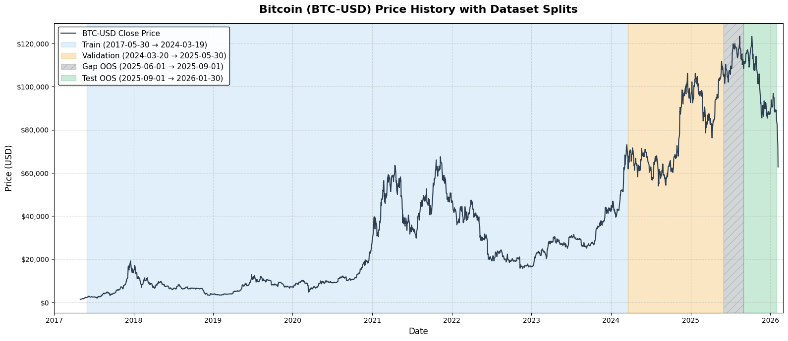{#fig-placeholderx}

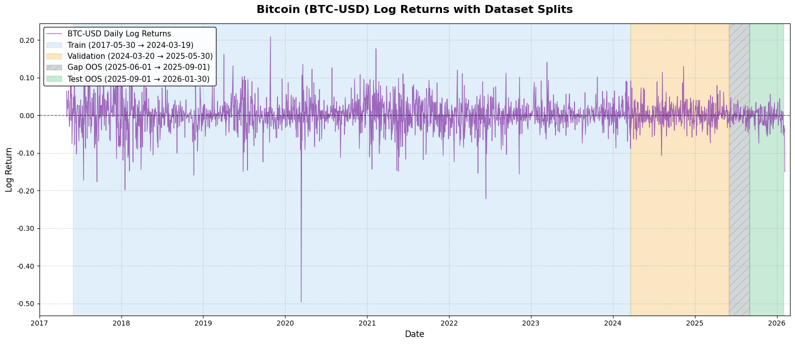{#fig-placeholder}

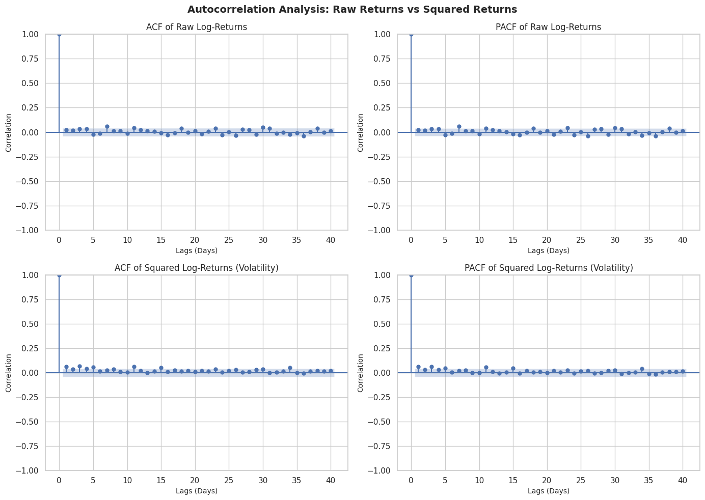{#fig-placeholderx}

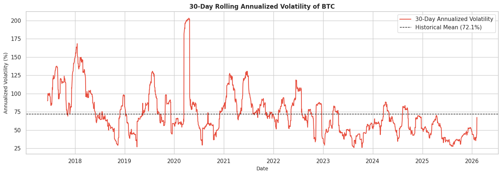{#fig-placeholder}

# Dataset and Feature Engineering

The primary dataset is derived from `ip26_btconchain.xlsx`, which contains over 3,000 daily observations spanning from 2010 to 2026. To ensure robustness and exclude the highly volatile, illiquid blockchain bootstrapping phase, the working sample is strictly filtered to the period between January 1, 2017, and December 31, 2025.

The experimental design supports two distinct configurations: **Run A** incorporates the full spectrum of 148 active features divided into 8 categories (each controlled by independent boolean flags), whereas **Run B** acts as a specialized baseline utilizing only the 16 purely on-chain features. All feature engineering pipelines are strictly designed to prevent data leakage, utilizing lagging and backward-looking rolling windows.

## On-Chain Features 

On-chain features are sourced directly from the Bitcoin blockchain via the blockchain.com API. To minimize multicollinearity, highly correlated or redundant features were excluded (`flag_FREM = ’Y’`: `MKTCP, BLCHS, MWNUS, NTRAT, TOTBC`). This leaves 16 active columns representing network utility, miner behavior, and blockchain activity.

To address the heavy-tailed and skewed distributions inherent to blockchain data, heavily skewed metrics first undergo a logarithmic transformation. Subsequently, all features are normalized using a look-ahead-free 180-day rolling Z-score window.

::: {#tbl-onchain-features}
  **Feature**   **Description**                       **Preprocessing**
  ------------- ------------------------------------- ----------------------------
  `NTRAN`       Total daily transactions              Log + Z-score rolling 180d
  `NTRBL`       Transactions per block                Log + Z-score rolling 180d
  `NTREP`       Estimated transaction output          Log + Z-score rolling 180d
  `TRFEE`       Total miner fees (BTC)                Log + Z-score rolling 180d
  `TRFUS`       Fee per transaction (USD)             Log + Z-score rolling 180d
  `TRVOU`       On-chain transaction volume           Log + Z-score rolling 180d
  `TOUTV`       Transaction output value              Log + Z-score rolling 180d
  `ETRAV`       Estimated average transaction value   Log + Z-score rolling 180d
  `ETRVU`       Estimated average output value        Log + Z-score rolling 180d
  `CPTRA`       Cost per transaction                  Z-score rolling 180d
  `CPTRV`       Cost per transaction volume           Z-score rolling 180d
  `DIFF`        Mining difficulty                     Log + Z-score rolling 180d
  `HRATE`       Network hash rate                     Log + Z-score rolling 180d
  `MIREV`       Total miner revenue (USD)             Z-score rolling 180d
  `AVBLS`       Average block size (KB)               Z-score rolling 180d
  `NADDU`       Daily unique new addresses            Z-score rolling 180d

  : Summary of Active On-Chain Features
:::

## Market Features

External market data (19 columns) was retrieved using the `yfinance` API for the period 2016-01-01 to 2026-03-01. For each asset, the daily log-return along with rolling statistics (5-day moving average, 20-day moving average, and 20-day rolling volatility) were computed. All market features are shifted by one day (`shift(1)`) to enforce a strict no-look-ahead policy.

::: {#tbl-market-features}
  **Asset**         **Ticker**   **Derived Columns**
  ----------------- ------------ ------------------------------------------------
  S&P 500           `^GSPC`      `SP500_LR, SP500_MA5, SP500_MA20, SP500_VOL20`
  Gold Futures      `GC=F`       `GOLD_LR, GOLD_MA5, GOLD_MA20, GOLD_VOL20`
  US Dollar Index   `DX-Y.NYB`   `DXY_LR, DXY_MA5, DXY_MA20, DXY_VOL20`
  Ethereum          `ETH-USD`    `ETH_LR, ETH_MA5, ETH_MA20, ETH_VOL20`
  VIX               `^VIX`       `VIX, VIX_CHG, VIX_MA5`

  : External Market Features Integration
:::

## Macroeconomic Features

To capture the broader economic environment, 10 columns are derived from the Federal Reserve Economic Data (FRED) API. Because macroeconomic data is released monthly or weekly, it is forward-filled to a daily frequency (up to a maximum of 3 days) to account for weekends and holidays without inducing look-ahead bias.

::: {#tbl-macro-features}
  **Feature**      **FRED Series**   **Transformation**
  ---------------- ----------------- -------------------------------------
  `FED_RATE`       `FEDFUNDS`        Level + daily change (`CHG`)
  `CPI_YOY`        `CPIAUCSL`        YoY % change (252-day `pct_change`)
  `M2_YOY`         `M2SL`            YoY % change (252-day `pct_change`)
  `YIELD_10Y`      `DGS10`           Level + daily change (`CHG`)
  `YIELD_2Y`       `DGS2`            Level + daily change (`CHG`)
  `YIELD_SPREAD`   `T10Y2Y`          Level + daily change (`CHG`)

  : Macroeconomic Features from FRED
:::

## Sentiment, Derivatives, and Technical Features

- **Sentiment Features:** Contributes 8 columns capturing retail and market sentiment. Data includes the Fear & Greed Index (via Alternative.me API) and Google Trends search volumes (via `pytrends`). Google Trends data was downloaded in two separate blocks to bypass rate limits and upsampled from weekly to daily frequency using cubic interpolation. All variables are lagged by one day ($t-1$).

- **Open Interest & Funding Rate:** Generates 3 to 6 columns reflecting derivatives market positioning. Data collection employs a fallback cascade mechanism: prioritizing the Bybit API v5, falling back to the CoinGlass API, and utilizing `yfinance` BTC volume as a proxy if necessary. Extracted features include `OI, OI_CHG, OI_MA7, FUNDING, FUNDING_MA7`, and `FUNDING_HIGH`.

- **Technical Features:** Adds 24 columns computed strictly on the endogenous price variable (`MKPRU`) without external data dependency. Features include RSI (14), MACD components (12-26-9), Bollinger Bands (`BB_PCT, BB_WIDTH`), ATR (14), Stochastic Oscillator (`STOCH_K/D`), varying Log-Returns (`LR_5D/10D/20D`), Volatilities (`VOL_5D/10D/20D`), historical Log-Return lags (`LR_LAG1/2/3`), and moving average distances (`DIST_MA7/21/50`).

## Regime, Seasonal, and Halving Features

- **Regime Features:** Provides 5 columns designed to classify the current market phase. These include `ATH_DIST` (percentage distance from the All-Time High, capped at $\leq 0$), `ATH_DIST_MA` (30-day rolling mean of ATH distance), `VOL_REGIME` (ratio of 30-day to 90-day volatility), `TREND_60D` (60-day cumulative log-return), and `ABOVE_MA200` (a binary indicator for bull/bear regimes).

- **Seasonal and Halving Features:** Introduces approximately 65 categorical and deterministic features. This includes one-hot encoded dummy variables for the month of the year (11 columns to avoid the dummy variable trap) and the week of the year (51 columns). It also incorporates `days_since_halving`, referencing the deterministic supply shocks of May 11, 2020, and April 19, 2024. Day-of-week seasonality was intentionally disabled (`flag_SEAS_D = ’N’`) during this run.

# Pre-Processing and Data Leakage Prevention

The preprocessing pipeline is governed by a single principle: no information available at time $t$ or later may influence any feature used to predict the target at time $t$. The steps are applied in strict sequential order and are identical across Run A and Run B, with the exception that Run B skips the external feature alignment step.

#### Raw data and redundant feature removal.

The dataset is loaded from `ip26_btconchain.xlsx` and indexed by date. Four OHLCV columns (`BTC_CLOSE`, `BTC_HIGH`, `BTC_LOW`, `BTC_VOLUME`) are removed unconditionally, as `MKPRU` serves as the sole price reference. Five on-chain columns (`MKTCP`, `BLCHS`, `MWNUS`, `NTRAT`, `TOTBC`) are subsequently dropped due to near-perfect multicollinearity with surviving features, leaving 16 active on-chain columns. The working sample is then restricted to the period 2017-01-01 to 2026-01-30 .

#### External feature alignment.

In Run A, the external feature matrix `df_ext` is joined onto the on-chain frame via a date-index left-join. Macroeconomic series from FRED are published at monthly or weekly frequency and are forward-filled to daily resolution with a maximum of 3 days, sufficient to bridge weekends and holidays without propagating stale values across genuine data gaps. Market and sentiment features are all constructed with a one-day lag (`shift(1)`) to enforce the no-look-ahead policy.

#### Feature engineering.

Technical features (24 columns), regime features (5 columns), and seasonal/halving features ($\approx$<!-- -->65 columns) are appended to the frame. All rolling windows, exponential moving averages, and lag operations are strictly backward-looking, anchored at or before time $t$.

#### Numerical cleaning.

After feature engineering, four sequential operations clean the assembled matrix: (i) `Inf` and `-Inf` values are replaced with `NaN`; (ii) `NaN` values are forward-filled and then backward-filled (up to 5 steps each); (iii) any row still containing `NaN` is dropped, in practice removing the first $\max(w_{\text{roll}}) = 200$ rows; and (iv) each numerical column (excluding `MKPRU`) is clipped to $[\mu_c - 5\sigma_c,\; \mu_c + 5\sigma_c]$ to prevent outliers from destabilising gradient updates.

#### Leakage-free target removal.

The column `MKPRU_logreturns` $= \ell r_t$ is the exact quantity the network is trained to predict. Retaining it in the input matrix would constitute direct data leakage, as the model would have access to the precise value of its own target at prediction time. It is therefore removed from the input frame `data_model` before window construction. Lagged log-returns (`LR_LAG1/2/3`), which encode $\ell r_{t-1}, \ell r_{t-2}, \ell r_{t-3}$, are retained as they represent legitimately observable information at time $t$.

#### Sliding-window tensor construction.

The cleaned feature matrix of shape $(N, F)$ is transformed into a three-dimensional input tensor $\mathbf{X} \in \mathbb{R}^{(N - n_{\text{lags}}) \times n_{\text{lags}} \times F}$. Each sample $\mathbf{X}_{i}$ contains the feature values for the $n_{\text{lags}}$ days immediately preceding observation $i$. The corresponding label $y_i$ is the smoothed three-day-ahead log-return $\hat{y}_i^{\,\text{smooth}} = \frac{1}{3}(\ell r_i + \ell
r_{i+1} + \ell r_{i+2})$. The lookback window $n_{\text{lags}}$ is treated as a hyperparameter and optimised jointly with the network architecture via Optuna.

#### Temporal split.

A strict chronological split is applied to $\mathbf{X}$; no random shuffling is performed at any stage. The structure is reported in @tbl-split.

::: {#tbl-split}
  **Partition**        **Period**                         **Approx. samples**          **Role**
  -------------------- --------------------------------- --------------------- -------------------------
  Training             2017-01-01 $\to$ 2025-06-01        $\sim$<!-- -->1,700     Weight optimisation
  Validation           Last 15% of training                $\sim$<!-- -->255      Early stopping only
  **Gap (excluded)**   **2025-06-01 $\to$ 2025-09-01**          **---**         **Anti-leakage buffer**
  Test OOS             2025-09-01 $\to$ 2026-01-30         $\sim$<!-- -->109      Held-out evaluation

  : Temporal Split Structure
:::

The three-month gap is a deliberate design choice: rolling features with long lookback windows (MA-200, 90-day volatility, 180-day Z-score normalisation) computed at the last training observation could otherwise bleed information forward into the test set through overlapping windows. The gap period is neither used for training nor for evaluation. The validation set is carved from the tail of the training sample, ensuring that the scaler fitted on $\mathcal{T}$ is never exposed to validation data before being applied to it.

#### Feature scaling.

Both the input tensor and the target vector are scaled using Min-Max normalisation. The scaler is fitted exclusively on the training partition $\mathcal{T}$ and applied without refitting to $\mathcal{V}$ and $\mathcal{S}$. Fitting on the full dataset would leak the global minimum and maximum of the test set into the training normalisation, a classical form of preprocessing leakage. Two independent scalers, one for $\mathbf{X}$ and one for $y$, allow separate inverse-transformation of the predicted log-returns to recover price-space predictions.

#### Walk-forward cross-validation with anti-leakage gap.

An expanding-window walk-forward scheme with five folds is constructed from the training-validation pool for hyperparameter tuning and ensemble weight computation. A 7-day gap $\delta$ is inserted between the end of the training window and the start of the validation window in every fold. This mirrors the logic of the three-month OOS gap: rolling features computed at the last day of the training segment overlap temporally with the first days of the validation segment, and the gap breaks this overlap. Formally, for fold $k$ with training-end index $T_k$: $$
    \mathcal{T}_k = [0,\; T_k), \qquad
    \mathcal{V}_k = [T_k + \delta,\; T_k + \delta + \text{step}), \qquad \delta = 7\text{ days.}
$$ Within each fold the Min-Max scalers for $\mathbf{X}$ and $y$ are re-fitted exclusively on $\mathcal{T}_k$, eliminating fold-level leakage through normalisation.

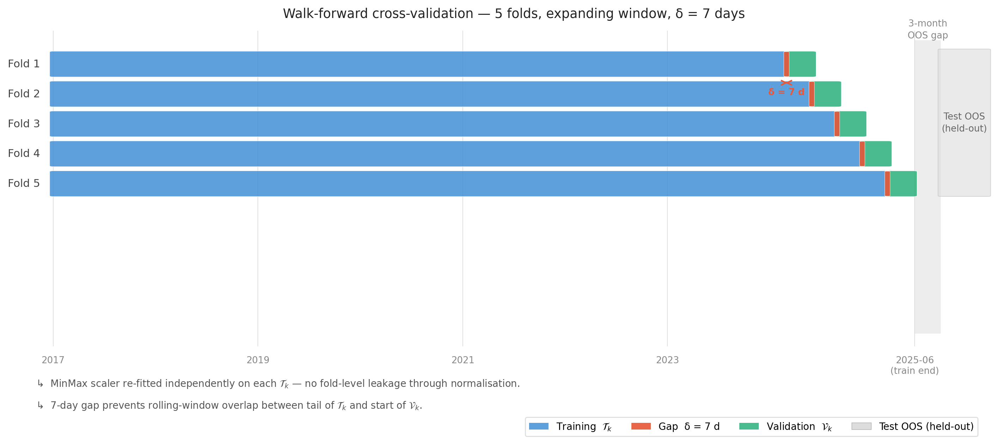{#fig-placeholderx}

# DNN Models and Architectures

This section details the seven neural network architectures evaluated in this study.

## Long Short-Term Memory (LSTM)

The LSTM network addresses the vanishing gradient problem of standard RNNs by introducing a gated cell state that regulates the flow of information across time steps. Three gates (forget, input, and output) control what the network retains, updates, and exposes at each step, allowing it to capture long-range dependencies in sequential data. For this reason, LSTMs have become a standard baseline in financial time-series forecasting.

## Gated Recurrent Unit (GRU)

The GRU is a streamlined variant of the LSTM that merges the cell state and hidden state into a single representation, and combines the forget and input gates into an update gate alongside a reset gate. This reduces the number of parameters without substantially compromising the ability to model temporal dynamics, making the GRU faster to train and less prone to overfitting on smaller datasets.

## Bidirectional LSTM (BI-LSTM)

A standard LSTM processes sequences strictly in chronological order. The BI-LSTM extends this by running two parallel LSTM layers over the same input sequence (one forward, one backward) and concatenating their hidden states at each time step. This allows the model to condition its representation on both past and future context within the input window, which can be beneficial when the predictive signal is distributed non-uniformly across the sequence.

## Temporal Attention Mechanism

A recurring limitation of RNN-based architectures is that the entire input sequence is compressed into a single fixed-size hidden state before prediction. The Bahdanau additive attention mechanism addresses this by computing a weighted average over all hidden states in the sequence, where the weights are learned end-to-end. Formally, given hidden states $H = [h_1, \dots, h_T]$, alignment scores are computed as: $$
e_t = v^\top \tanh(W h_t + b)
$$ normalised via softmax into attention weights $\alpha_t$, and aggregated into a context vector: $$
c = \sum_{t=1}^{T} \alpha_t h_t
$$ This context vector $c$ selectively emphasises the time steps deemed most relevant for the prediction, rather than treating all steps equally.

## LSTM with Attention (LSTM-ATT)

This architecture augments the standard LSTM with the Bahdanau attention mechanism applied over the full sequence of hidden states. Rather than using only the final hidden state, the attention block produces a context vector that aggregates information from all time steps, potentially improving sensitivity to relevant historical patterns that would otherwise be attenuated by the recurrent bottleneck.

## GRU with Attention (GRU-ATT)

The GRU-ATT follows the same design principle as LSTM-ATT, replacing the recurrent backbone with a GRU. The attention mechanism operates identically over the sequence of GRU hidden states. This combination retains the computational efficiency of the GRU while adding the capacity to selectively weight different time steps in the input window.

## Bidirectional LSTM with Attention (BI-LSTM-ATT)

The BI-LSTM-ATT is the most structurally complex recurrent architecture considered here. It applies the Bahdanau attention mechanism over the concatenated bidirectional hidden states, combining temporal context from both directions with selective weighting. The increased representational capacity comes at the cost of a higher risk of overfitting, which is managed through dropout regularisation.

## Self-Attention Network (SELF-ATT)

The SELF-ATT model departs from the recurrent paradigm entirely, adopting a Transformer-style architecture based on scaled dot-product attention. The input sequence is projected into queries, keys, and values, and attention scores are computed between all pairs of time steps simultaneously: $$
\text{Attention}(Q, K, V) = \text{softmax}\!\left(\frac{QK^\top}{\sqrt{d_k}}\right)V
$$ Unlike recurrent models, self-attention has no notion of order by default and processes the entire sequence in parallel. The output is collapsed into a single vector via global average pooling before the final prediction layer. This architecture is particularly suited to capturing non-local dependencies that recurrent inductive biases may suppress.

# Regularisation Techniques

Three regularisation mechanisms are applied in combination to all architectures:

- **Dropout**: Applied sequentially after the recurrent or attention blocks, immediately preceding the dense output layer. The dropout probability is jointly optimized via Optuna within the range $[0.1, 0.6]$.

- **Directional Auxiliary Loss**: The primary Mean Squared Error (MSE) objective is augmented with a sign-penalizing auxiliary term. Governed by a coefficient ($\alpha_{\text{dir}}$) tuned between $[0.05, 0.5]$, this explicit penalty incentivizes the model to accurately forecast the direction of the target variable.

- **Weight Decay (AdamW)**: $L_2$ regularization is enforced on all trainable parameters through the AdamW optimizer, with the weight decay hyperparameter optimized in the range $[10^{-6}, 5 \times 10^{-4}]$.

- **EMA-Smoothed Early Stopping**: The training procedure is halted if the Exponential Moving Average (EMA) of the validation loss exhibits no improvement for 20 consecutive epochs. The EMA smoothing provides a stable loss trajectory, effectively preventing premature termination caused by transient stochastic spikes.

- **Learning Rate Scheduling**: A hybrid scheduling strategy is employed, integrating Cosine Annealing with Warm Restarts ($T_{\text{max}}=50$, $\eta_{\text{min}}=10^{-6}$) alongside a ReduceLROnPlateau mechanism ($\text{patience}=20$, $\text{factor}=0.5$) for adaptive decay during plateau phases.

# Hyperparameter Tuning

## Optuna Hyperparameter Search

Each architecture undergoes a 3-fold walk-forward Optuna sweep. Base architectures (LSTM, GRU, BI-LSTM) are allocated 40 trials while attention architectures receive 60 trials to account for their larger search space. The objective metric is the average validation MSE across the three walk-forward folds.

::: {#tbl-hyperparameter-search}
  **Hyperparameter**   **Search Range**                              **Rationale**
  -------------------- --------------------------------------------- -------------------------------------------------
  units (hidden)       $\{32, 64, 80, 96, 112, 128\}$                Capacity vs. overfitting trade-off
  dropout              $[0.1, 0.6]$                                  Continuous uniform; prevents co-adaptation
  learning_rate        $[10^{-5}, 5 \times 10^{-4}]$ (log-uniform)   Covers slow convergence and instability regimes
  weight_decay         $[10^{-6}, 5 \times 10^{-4}]$ (log-uniform)   $L_2$ strength relative to gradient magnitude
  n_lags               $[14, 90]$                                    Lookback horizon; key inductive bias choice
  dir_alpha            $[0.05, 0.50]$                                Directional loss auxiliary weight

  : Hyperparameter Search Space and Optimization Rationale
:::

## RUN B Optimal Hyperparameters

::: {#tbl-model-results}
  **Model**      **Units**   **Dropout**          **LR**                  **WD**           **n_lags**   **dir\_$\alpha$**   **WF-MSE**
  ------------- ----------- ------------- ----------------------- ----------------------- ------------ ------------------- ------------
  LSTM              48          0.341      $4.92 \times 10^{-4}$   $9.75 \times 10^{-6}$       66             0.10           0.001675
  GRU               80          0.193      $3.82 \times 10^{-4}$   $1.84 \times 10^{-6}$       40             0.42           0.001884
  BI-LSTM           80          0.500      $4.97 \times 10^{-4}$   $8.76 \times 10^{-6}$       17             0.27           0.001743
  LSTM-ATT          32          0.342      $3.01 \times 10^{-4}$   $3.26 \times 10^{-4}$       90             0.26           0.001739
  GRU-ATT           64          0.540      $4.34 \times 10^{-4}$   $1.00 \times 10^{-5}$       22             0.48           0.001787
  BI-LSTM-ATT       48          0.248      $3.30 \times 10^{-4}$   $3.02 \times 10^{-4}$       90             0.21           0.001757
  SELF-ATT          64          0.346      $3.08 \times 10^{-4}$   $1.28 \times 10^{-5}$       32             0.30           0.001675

  : Optimal Hyperparameters and Performance Metrics per Architecture
:::

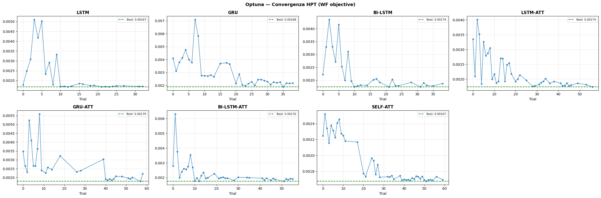{#fig-placeholder}

## RUN A Optimal Hyperparameters

::: {#tbl-model-results-updated}
  **Model**      **Units**   **Dropout**          **LR**                  **WD**           **n_lags**   **dir\_$\alpha$**   **WF-MSE**
  ------------- ----------- ------------- ----------------------- ----------------------- ------------ ------------------- ------------
  LSTM              80          0.428      $2.08 \times 10^{-4}$   $1.69 \times 10^{-4}$       24             0.11           0.001895
  GRU               128         0.263      $2.31 \times 10^{-4}$   $2.19 \times 10^{-5}$       21             0.42           0.002062
  BI-LSTM           32          0.491      $4.58 \times 10^{-4}$   $7.64 \times 10^{-5}$       31             0.28           0.001841
  LSTM-ATT          64          0.336      $3.70 \times 10^{-4}$   $5.10 \times 10^{-4}$       90             0.40           0.001663
  GRU-ATT           32          0.276      $3.29 \times 10^{-4}$   $1.03 \times 10^{-5}$       86             0.14           0.001725
  BI-LSTM-ATT       48          0.358      $3.73 \times 10^{-4}$   $6.01 \times 10^{-5}$       90             0.23           0.001640
  SELF-ATT          48          0.407      $2.82 \times 10^{-4}$   $1.10 \times 10^{-5}$       62             0.18           0.001686

  : Optimal Hyperparameters and Performance Metrics per Architecture
:::

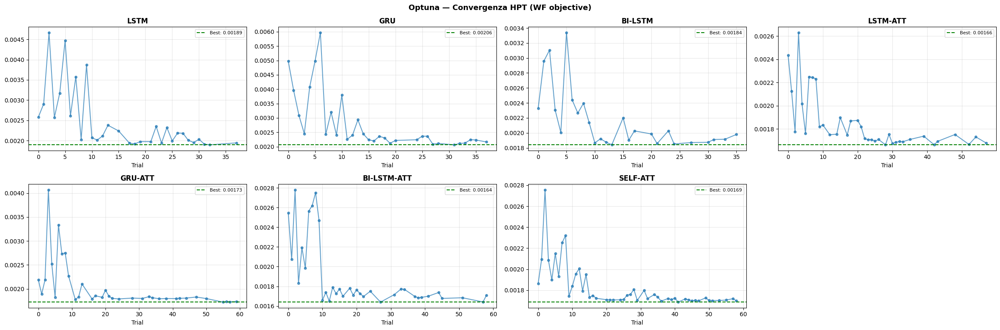{#fig-placeholderx}

# Evaluation Metrics

## Statistical Metrics

Model quality is assessed through five complementary statistics computed on the inverse-transformed log-return predictions:

- **RMSE (Root Mean Squared Error)**: A scale-sensitive measure of average prediction error in log-return units.

- **MAE (Mean Absolute Error)**: Robust to outliers; provides the average absolute deviation from the target.

- **Theil's U**: The ratio of the forecast RMSE to that of a no-change naïve benchmark. $U < 1$ indicates the model outperforms the naive baseline, whereas $U = 1.0$ represents the break-even point.

- **$R^2$ (Out-of-Sample)**: The proportion of variance in the target explained by the model. Negative values, which are common in financial time-series under regime shifts, indicate that the model's predictions are worse than a simple mean predictor.

- **DA (Directional Accuracy)**: The fraction of observations for which the model correctly predicts the sign of the three-day forward return. A threshold of 50% represents random guessing.

# Results

## RUN B (on-chain only)

::: {#tbl-test-metrics}
  **Model**      **RMSE**   **MSE**   **MAE**   **Theil's U**   **$R^2$**   **DA (%)**
  ------------- ---------- --------- --------- --------------- ----------- ------------
  LSTM            0.0294    0.0009    0.0240       1.2931        -0.6943      54.55
  GRU             0.0384    0.0015    0.0315       1.6894        -1.8919      48.18
  BI-LSTM         0.0246    0.0006    0.0202       1.0839        -0.1905      52.73
  LSTM-ATT        0.0241    0.0006    0.0199       1.0604        -0.1393      51.82
  GRU-ATT         0.0241    0.0006    0.0188       1.0601        -0.1388      51.82
  BI-LSTM-ATT     0.0242    0.0006    0.0201       1.0654        -0.1502      46.36
  SELF-ATT        0.0265    0.0007    0.0216       1.1660        -0.3775      51.82

  : Out-of-Sample (Test) Performance Metrics
:::

::: {#tbl-train-metrics}
  **Model**      **RMSE**   **MSE**   **MAE**   **Theil's U**   **$R^2$**   **DA (%)**
  ------------- ---------- --------- --------- --------------- ----------- ------------
  LSTM            0.0492    0.0024    0.0351       1.1189        -0.2554      48.29
  GRU             0.0616    0.0038    0.0458       1.3927        -0.9446      49.34
  BI-LSTM         0.0443    0.0020    0.0305       1.0058        -0.0144      53.56
  LSTM-ATT        0.0487    0.0024    0.0350       1.1032        -0.2199      48.44
  GRU-ATT         0.0450    0.0020    0.0306       1.0217        -0.0465      51.46
  BI-LSTM-ATT     0.0565    0.0032    0.0428       1.2786        -0.6388      50.78
  SELF-ATT        0.0445    0.0020    0.0299       1.0092        -0.0212      50.63

  : In-Sample (Training) Performance Metrics
:::

The lower OOS error metrics are not a methodological artefact. The training set spans six years of Bitcoin history across multiple regime shifts; walk-forward cross-validation forces each fold to generalise across all of them, inflating average errors. The test window, by contrast, is a single double regime shift (sharp and directional). A market that moves decisively in one direction produces lower absolute errors than one oscillating across regimes, regardless of model quality.

Negative $R^2$ and Theil's $U > 1$ are the expected outcome under structural breaks of this magnitude (Goyal 2008; Gu 2020), and say little about whether the models retain directional signal. That is the relevant question here. Pointwise accuracy metrics are reported for completeness; the evaluation criterion we rely on is whether the models support a profitable trading strategy under adverse market conditions.

### LSTM {#sec-lstm .unnumbered}

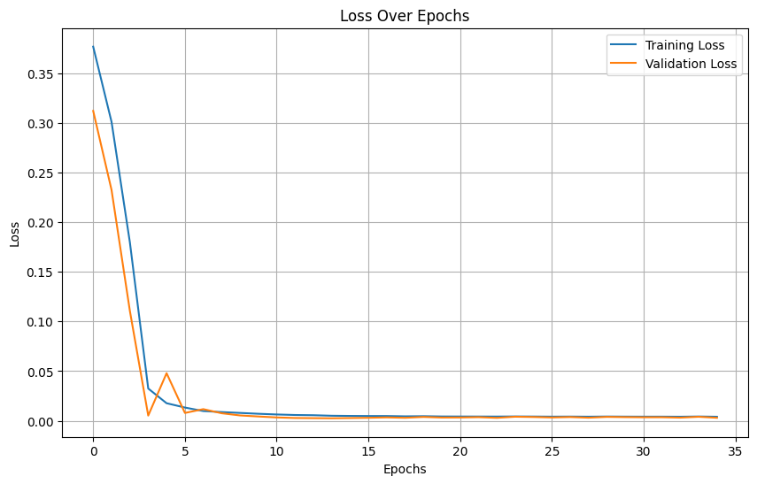{#fig-placeholder}

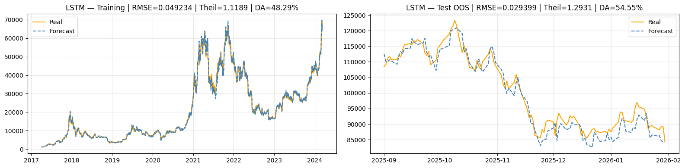{#fig-placeholderx}

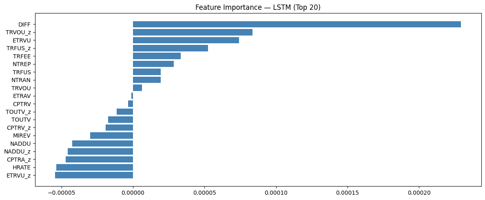{#fig-placeholder}

### GRU {#sec-gru .unnumbered}

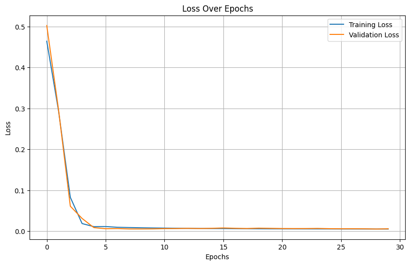{#fig-placeholderx}

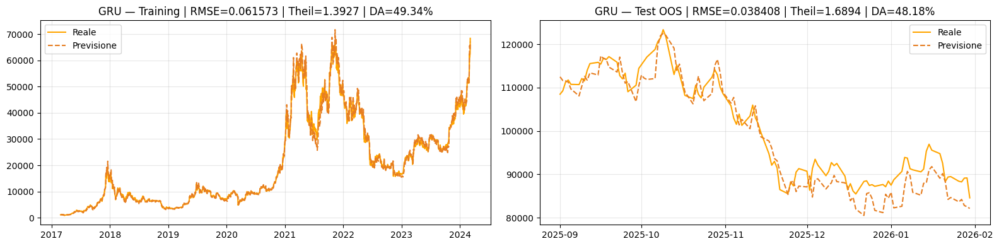{#fig-placeholder}

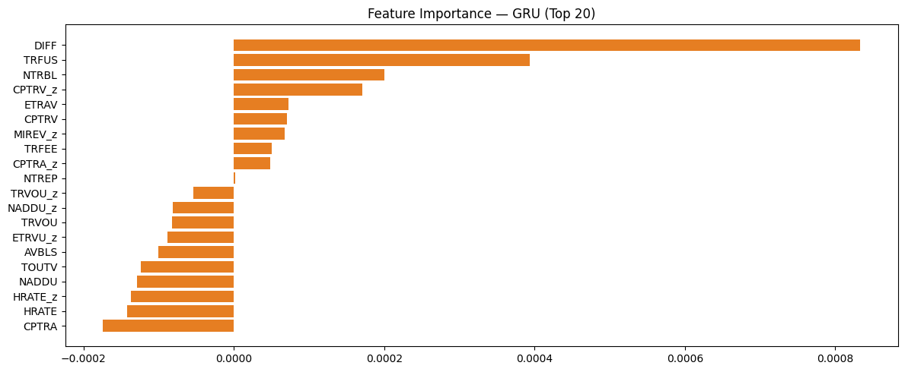{#fig-placeholderx}

### BI-LSTM {#sec-bi-lstm .unnumbered}

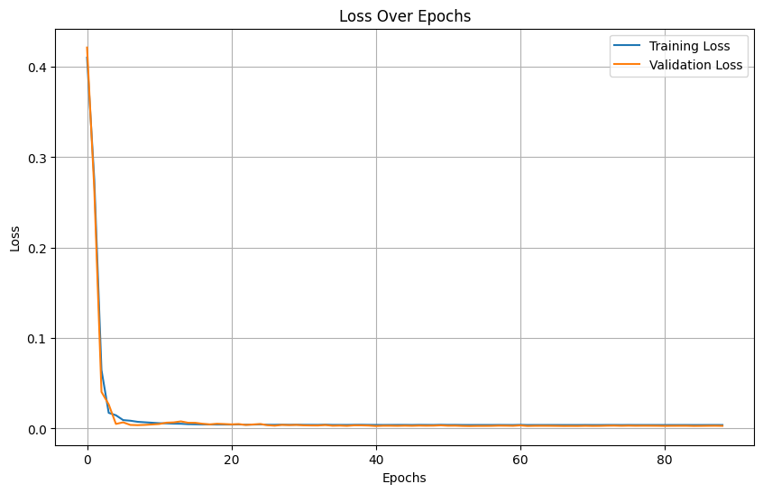{#fig-placeholder}

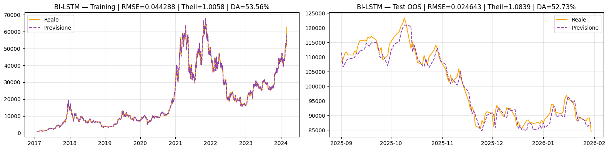{#fig-placeholderx}

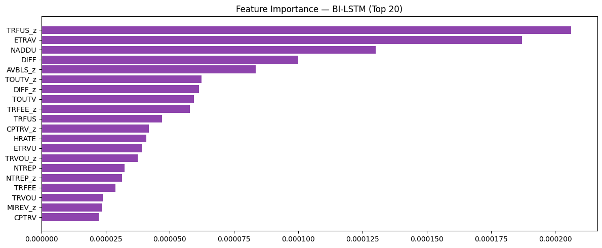{#fig-placeholder}

### LSTM-ATT {#sec-lstm-att .unnumbered}

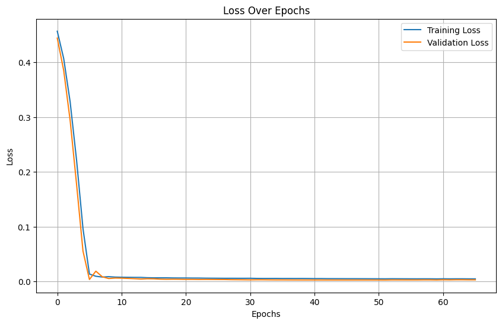{#fig-placeholderx}

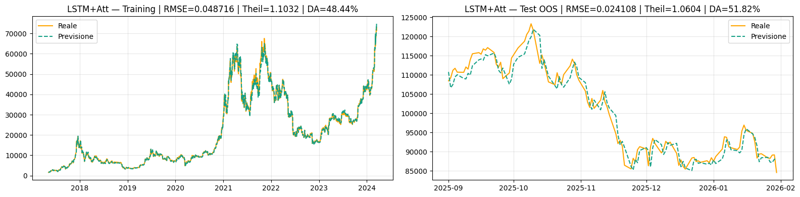{#fig-placeholder}

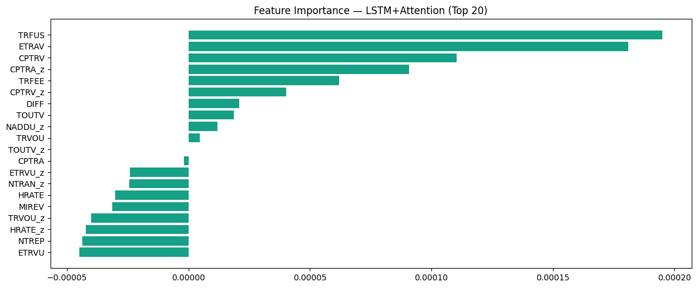{#fig-placeholderx}

### GRU-ATT {#sec-gru-att .unnumbered}

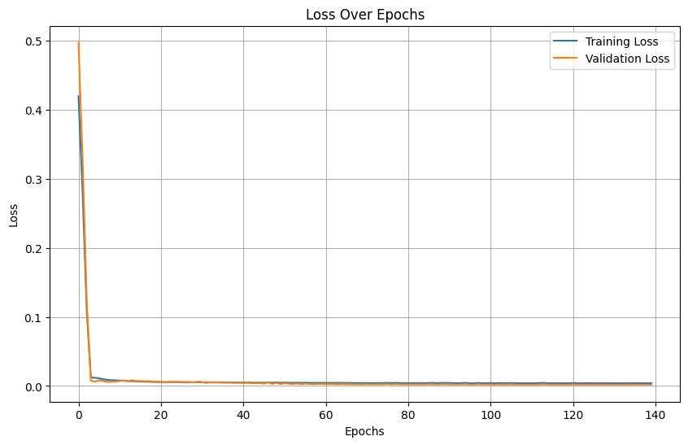{#fig-placeholder}

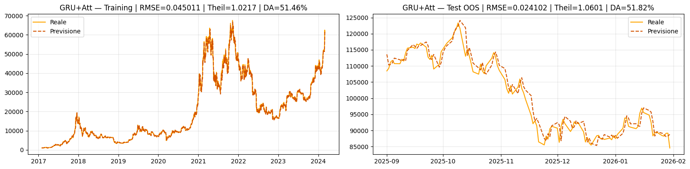{#fig-placeholderx}

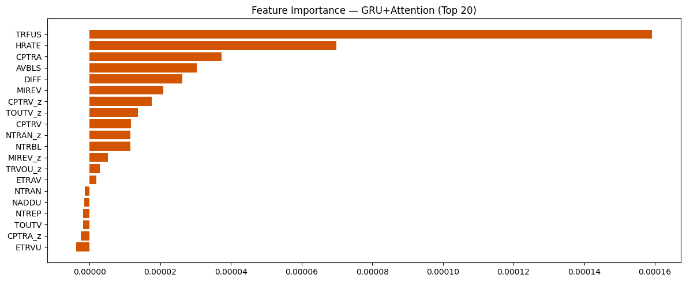{#fig-placeholder}

### BI-LSTM-ATT {#sec-bi-lstm-att .unnumbered}

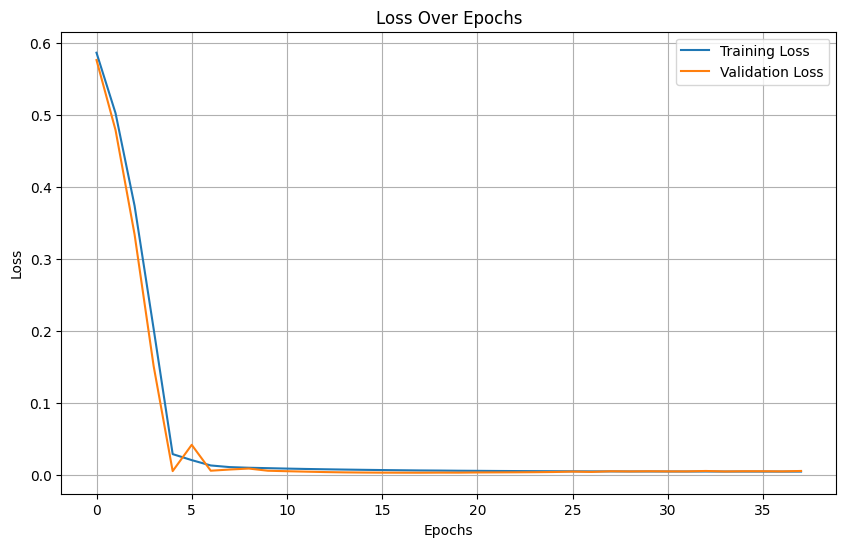{#fig-placeholderx}

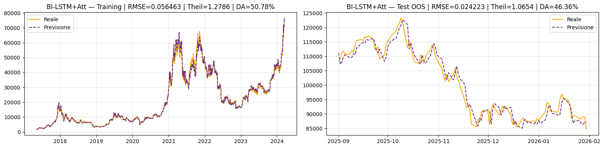{#fig-placeholder}

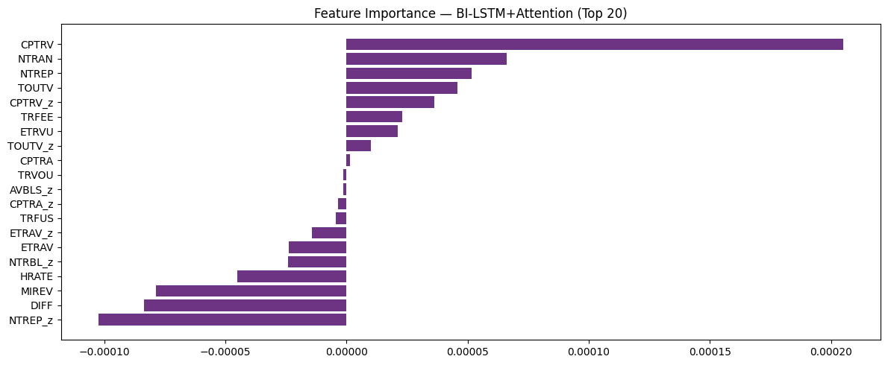{#fig-placeholderx}

### SELF-ATT {#sec-self-att .unnumbered}

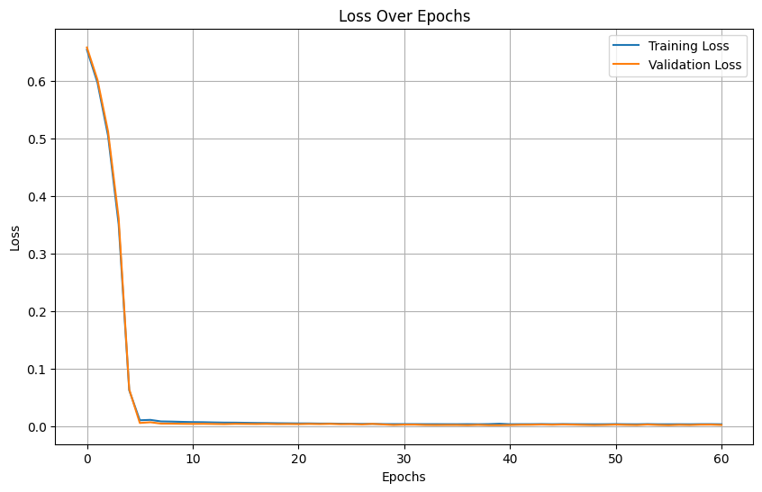{#fig-placeholder}

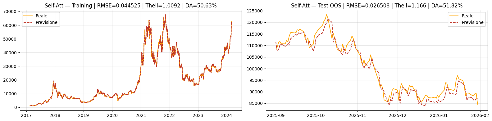{#fig-placeholderx}

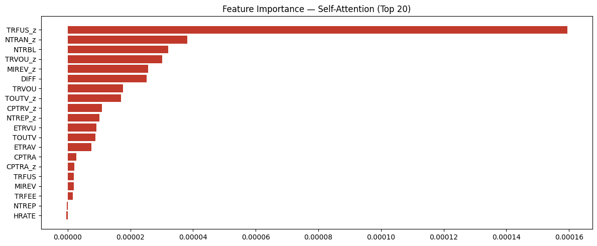{#fig-placeholder}

## RUN A (all Feats)

::: {#tbl-test-metrics-updated}
  **Model**      **RMSE**   **MSE**   **MAE**   **Theil's U**   **$R^2$**   **DA (%)**
  ------------- ---------- --------- --------- --------------- ----------- ------------
  LSTM            0.0294    0.0009    0.0228       1.2947        -0.6985      48.18
  GRU             0.0241    0.0006    0.0188       1.0618        -0.1424      53.64
  BI-LSTM         0.0263    0.0007    0.0207       1.1562        -0.3545      52.73
  LSTM-ATT        0.0277    0.0008    0.0224       1.2162        -0.4989      44.55
  GRU-ATT         0.0270    0.0007    0.0211       1.1887        -0.4318      41.82
  BI-LSTM-ATT     0.0238    0.0006    0.0186       1.0459        -0.1084      48.18
  SELF-ATT        0.0230    0.0005    0.0178       1.0099        -0.0335      54.55

  : Out-of-Sample (Test) Performance Metrics
:::

::: {#tbl-train-metrics-updated}
  **Model**      **RMSE**   **MSE**   **MAE**   **Theil's U**   **$R^2$**   **DA (%)**
  ------------- ---------- --------- --------- --------------- ----------- ------------
  LSTM            0.0445    0.0020    0.0311       1.0093        -0.0213      52.55
  GRU             0.0434    0.0019    0.0302       0.9854        0.0264       57.90
  BI-LSTM         0.0438    0.0019    0.0303       0.9935        0.0103       56.96
  LSTM-ATT        0.0495    0.0024    0.0359       1.1201        -0.2576      50.34
  GRU-ATT         0.0448    0.0020    0.0308       1.0135        -0.0298      51.65
  BI-LSTM-ATT     0.0468    0.0022    0.0331       1.0606        -0.1275      50.22
  SELF-ATT        0.0441    0.0019    0.0297       1.0036        -0.0100      53.69

  : In-Sample (Training) Performance Metrics
:::

The same reasoning applied to RUN B holds here. Lower OOS absolute errors reflect the lower volatility of the test window relative to the full training history, not a genuine generalisation advantage.

What changes in RUN A is the IS picture. GRU and BI-LSTM are the only two architectures to achieve Theil's $U < 1$ in training ($0.985$ and $0.994$ respectively), suggesting that the richer feature set does provide some learnable signal during normal market conditions. This advantage does not survive the OOS regime shift (both models revert to $U > 1$ in the test period) but it is consistent with the hypothesis that macroeconomic and sentiment variables carry incremental information beyond on-chain data alone, at least within the distributional support of the training set.

Attention-based architectures tell the opposite story. LSTM-ATT and GRU-ATT post the weakest OOS DA figures of the entire experiment ($44.55\%$ and $41.82\%$), below random, suggesting that attention over 164 input features amplifies noise rather than signal under distribution shift. SELF-ATT is the notable exception: its OOS Theil's $U$ of $1.010$ is the closest any model comes to the random walk benchmark across both runs, and its DA of $54.55\%$ is the highest in RUN A.

### LSTM {#sec-lstm-1 .unnumbered}

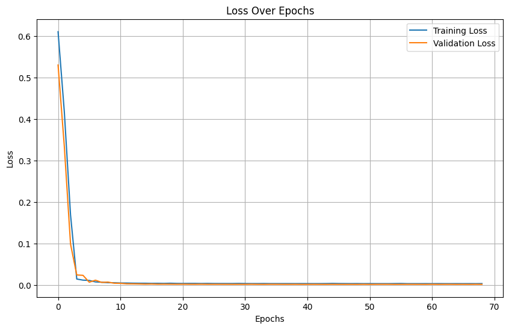{#fig-placeholderx}

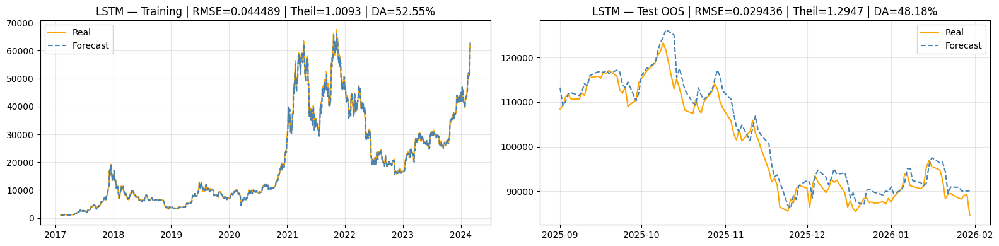{#fig-placeholder}

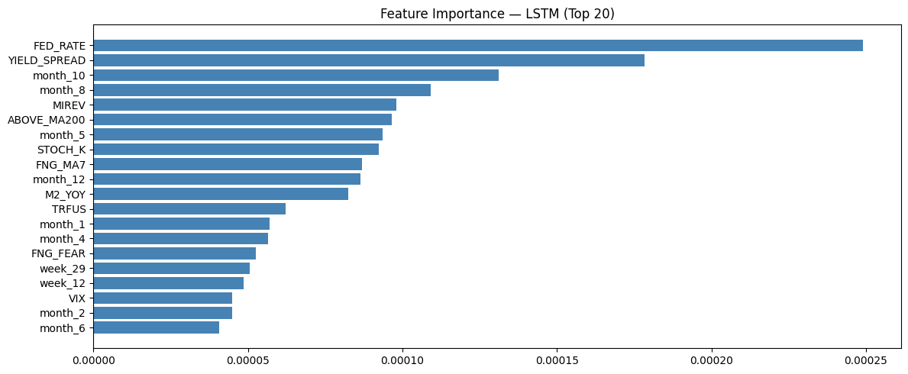{#fig-placeholderx}

### GRU {#sec-gru-1 .unnumbered}

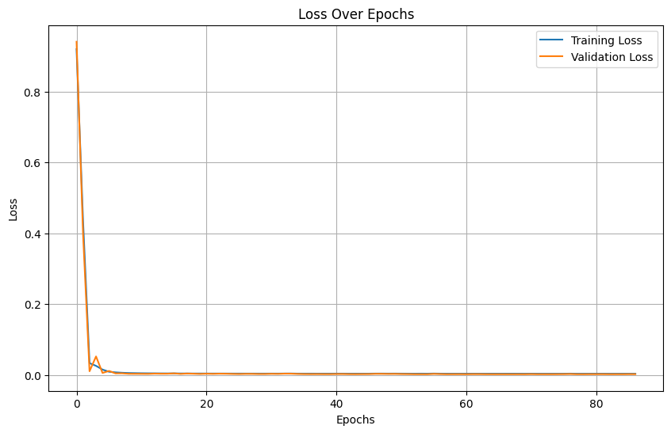{#fig-placeholder}

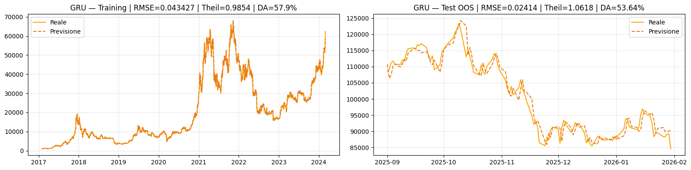{#fig-placeholderx}

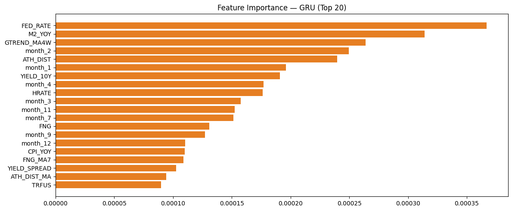{#fig-placeholder}

### BI-LSTM {#sec-bi-lstm-1 .unnumbered}

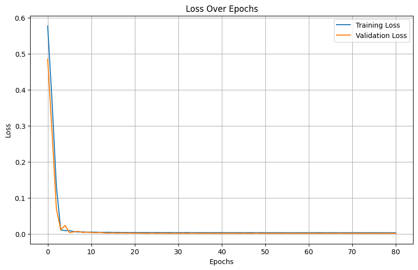{#fig-placeholderx}

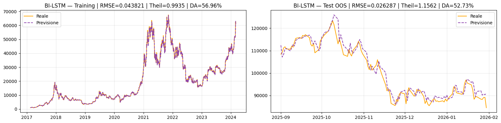{#fig-placeholder}

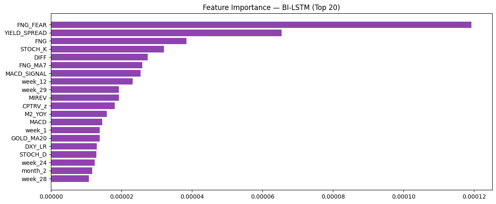{#fig-placeholderx}

### LSTM-ATT {#sec-lstm-att-1 .unnumbered}

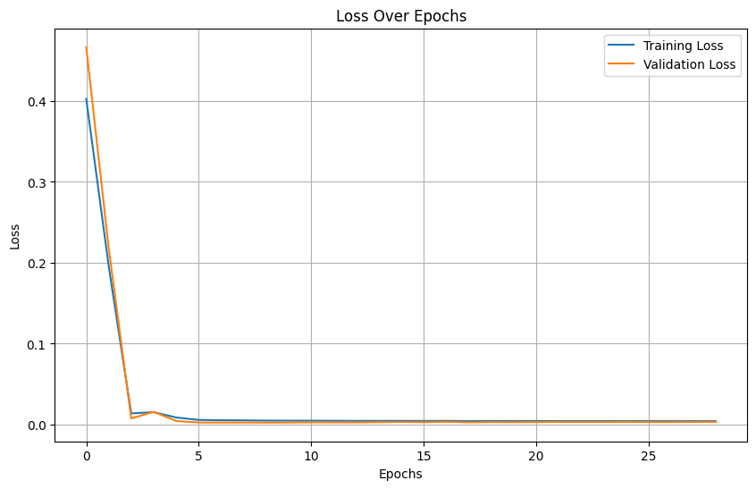{#fig-placeholder}

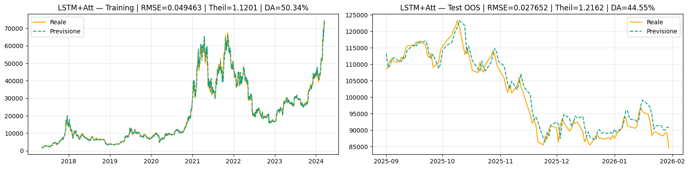{#fig-placeholderx}

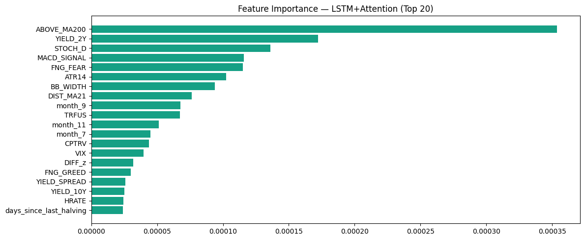{#fig-placeholder}

### GRU-ATT {#sec-gru-att-1 .unnumbered}

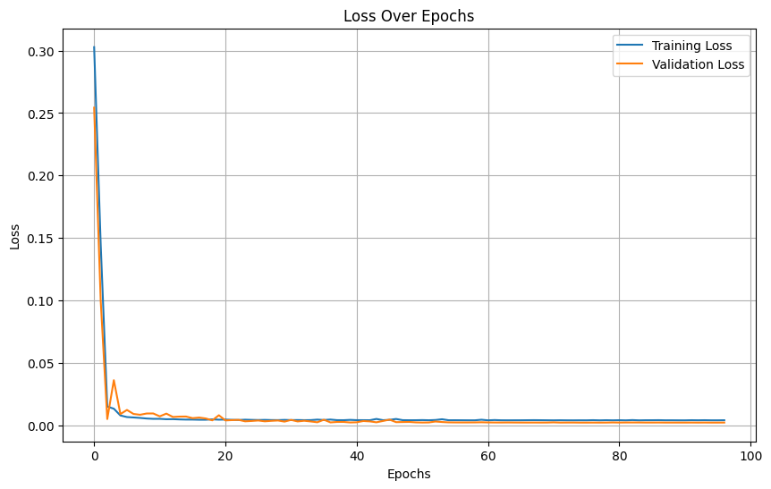{#fig-placeholderx}

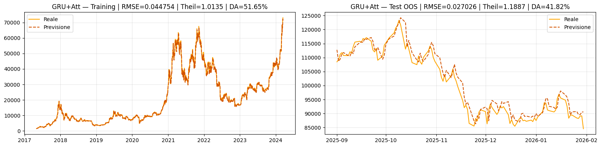{#fig-placeholder}

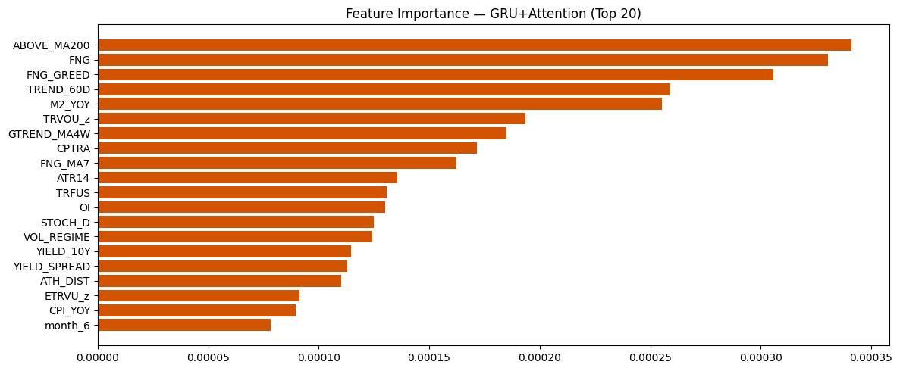{#fig-placeholderx}

### BI-LSTM-ATT {#sec-bi-lstm-att-1 .unnumbered}

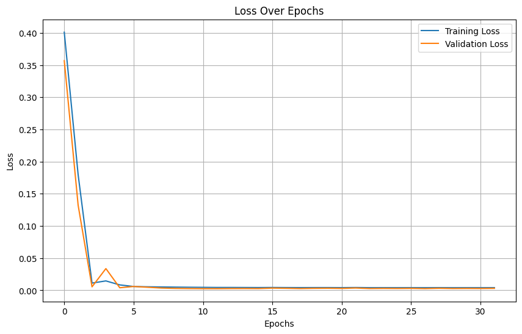{#fig-placeholder}

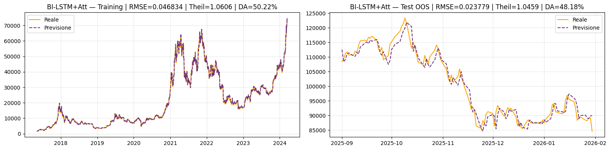{#fig-placeholderx}

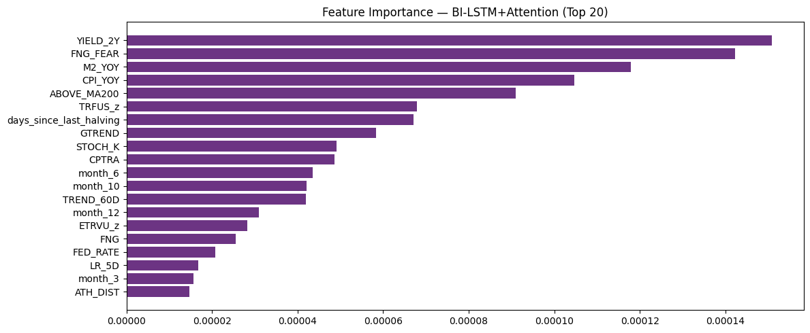{#fig-placeholder}

### SELF-ATT {#sec-self-att-1 .unnumbered}

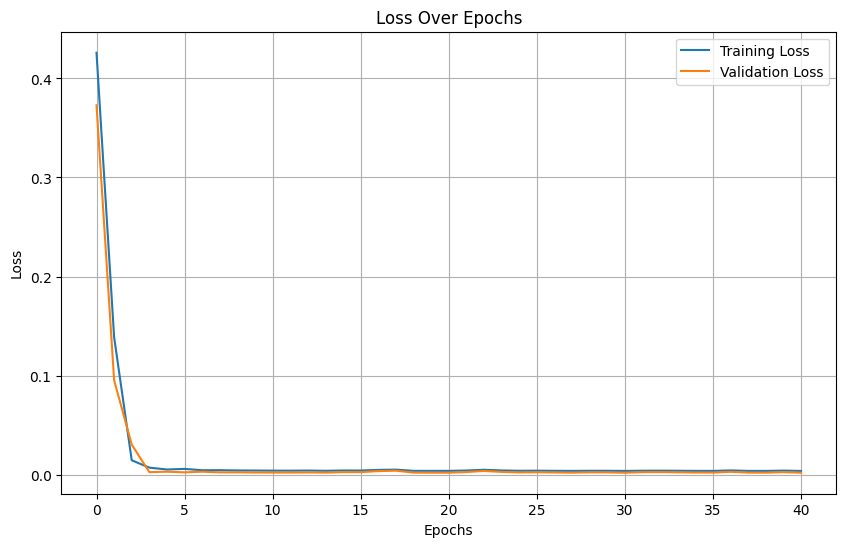{#fig-placeholderx}

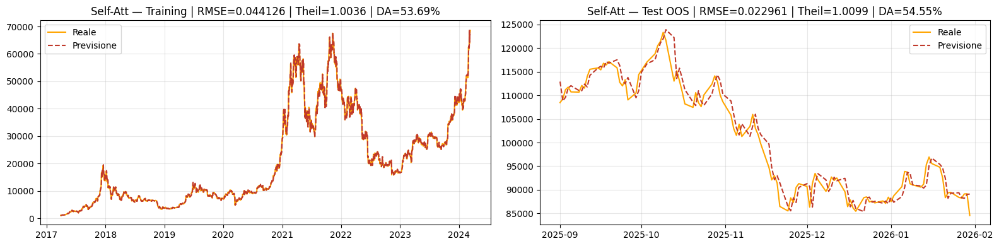{#fig-placeholder}

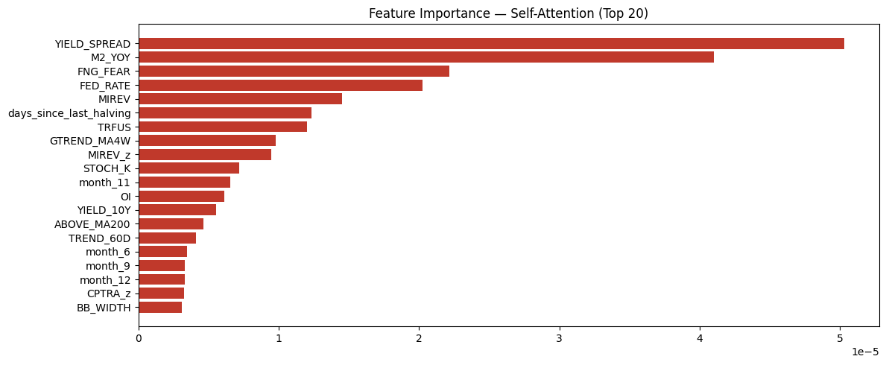{#fig-placeholderx}

## RUN A vs RUN B Comparison

::: {#tbl-model-comparison-deltas}
  **Model**      **DA% (B)**   **DA% (A)**   **$\Delta$DA**   **RMSE (B)**   **RMSE (A)**   **$\Delta$RMSE**
  ------------- ------------- ------------- ---------------- -------------- -------------- ------------------
  LSTM              54.55         48.18         $-6.37$          0.0294         0.0294          $0.0000$
  GRU               48.18         53.64         $+5.46$          0.0384         0.0241         $-0.0143$
  BI-LSTM           52.73         52.73          $0.00$          0.0246         0.0263         $+0.0017$
  LSTM-ATT          51.82         44.55         $-7.27$          0.0241         0.0277         $+0.0036$
  GRU-ATT           51.82         41.82         $-10.00$         0.0241         0.0270         $+0.0029$
  BI-LSTM-ATT       46.36         48.18         $+1.82$          0.0242         0.0238         $-0.0004$
  SELF-ATT          51.82         54.55         $+2.73$          0.0265         0.0230         $-0.0035$

  : Comparison of Model Performance: On-Chain Only (B) vs. All Features (A)
:::

## Effect of Feature Expansion on Model Performance {#sec-effect-of-feature-expansion-on-model-performance .unnumbered}

The comparison in @tbl-model-comparison-deltas reveals that adding macroeconomic, sentiment, and derivatives features to the on-chain baseline does not uniformly improve performance (the direction of the effect depends heavily on architecture).

The clearest beneficiary is GRU, which gains $5.46$ percentage points in DA and reduces RMSE by $0.0143$, the largest absolute improvement across both metrics. SELF-ATT also improves on both dimensions ($+2.73$ pp DA, $-0.0035$ RMSE). Together, these two suggest that gated recurrent and self-attention mechanisms can extract useful signal from the expanded feature set, provided there is no explicit cross-feature attention layer adding complexity on top.

The attention-augmented architectures tell the opposite story. LSTM-ATT and GRU-ATT suffer the steepest DA losses ($-7.27$ and $-10.00$ pp respectively) while also degrading in RMSE (a double deterioration consistent with attention over 164 heterogeneous features amplifying noise rather than resolving it). Under distribution shift, this is compounding: interactions learned in-sample become actively harmful out-of-sample.

LSTM is a notable edge case: RMSE is identical across both runs to four decimal places, while DA drops by $6.37$ pp. The model converges to a similar magnitude forecast regardless of feature set, but loses directional calibration in the higher-dimensional input space, suggesting the optimizer settles in a qualitatively different basin without meaningfully changing the error profile.

BI-LSTM is the most stable architecture across both runs: DA is unchanged and RMSE increases by only $0.0017$, indicating that the bidirectional structure is largely indifferent to the additional features (neither helped nor harmed by them).

# First Conclusions

The results presented so far allow a first reading of the ablation, before the trading strategy provides the final economic verdict.

On the statistical front, the evidence is humbling but not surprising. No architecture beats the random walk in the OOS period. The double regime shift of autumn 2025 dominates the forecast variance to a degree that no amount of feature engineering or architectural complexity could plausibly offset. This is not a failure of the methodology, it is the methodology working correctly, exposing the limits of what autoregressive models can do when the data-generating process shifts abruptly outside the training distribution.

What the statistical results do offer is a cleaner picture of architecture behaviour under stress. The central finding of the ablation is that feature expansion is not uniformly beneficial: its effect is mediated almost entirely by architecture. GRU and SELF-ATT absorb the additional information constructively, improving on both DA and RMSE. LSTM-ATT and GRU-ATT degrade sharply, suggesting that explicit cross-temporal attention over a high-dimensional feature space amplifies noise rather than signal when the distribution shifts. LSTM and BI-LSTM occupy the middle ground: stable, but largely indifferent to the richer input.

A secondary finding concerns the on-chain baseline itself. RUN B produces competitive results with only 16 blockchain features, and in several architectures outperforms RUN A directionally. This is consistent with a weak form of the efficient market hypothesis: on-chain data, being endogenous to the Bitcoin network, may carry a more stable and regime-robust signal than the heterogeneous macroeconomic and sentiment variables introduced in RUN A, which are themselves subject to structural breaks.

None of this settles the question of practical utility. A model that achieves $54\%$ DA on 110 days could still be economically valuable if that directional edge is concentrated in high-magnitude moves and translated into a disciplined trading strategy. Conversely, a model with better pointwise metrics could generate inferior risk-adjusted returns if its signal is noisy at the entry and exit points that matter. The gap between statistical and economic performance is the subject of the following section.

# Trading Strategy

Two trading strategies are evaluated for each model. Strategy A (Long/Flat) takes a long position when the model predicts a three-day forward return above a threshold $\tau^+ = +0.05\%$ and moves to cash when the prediction falls below $\tau^- = -0.05\%$. Strategy B (Long/Short) follows the same entry rules but takes a short position instead of moving to cash on negative signals. Predictions falling in the dead zone $[\tau^-, \tau^+]$ leave the current position unchanged.

Both strategies are simulated on the 110-day OOS window with an initial capital of \$100,000, a transaction cost of $0.1\%$ per trade, and daily rebalancing. The benchmark is a passive Buy & Hold position over the same period, which returned $-24.88\%$ (Sharpe $-1.658$, MaxDD $-31.44\%$).

A consequence of the dead zone mechanism is that models with a systematic directional bias (persistently predicting values below $\tau^-$ or above $\tau^+$) will enter a position at the first signal and hold it for the entire OOS window without further switching. Cases with very few trades (1--2) should therefore be interpreted as evidence of a degenerate bias rather than selective forecasting: the model is not being disciplined, it is simply stuck.

## RUN B - On-Chain Features Only

::: {#tbl-strat-a-b}
  **Model**      **Return**   **Sharpe**   **MaxDD**    **N.Tr**   **WinR**   **PF**   **AvgTr**   
  ------------- ------------ ------------ ------------ ---------- ---------- -------- ------------ --
  LSTM           $+5.33\%$      2.001      $-7.01\%$       10       70.0%      1.78    $+0.65\%$   
  GRU            $-1.49\%$      -0.278     $-10.34\%$      12       58.3%      1.01    $+0.01\%$   
  BI-LSTM        $-4.25\%$      -4.221     $-7.52\%$       3        33.3%      0.48    $-1.27\%$   
  LSTM-ATT       $+0.00\%$      0.000      $+0.00\%$       0         ---       ---     $+0.00\%$   
  GRU-ATT        $-23.68\%$     -1.752     $-30.20\%$      10       40.0%      0.27    $-2.32\%$   
  BI-LSTM-ATT    $-15.96\%$     -2.903     $-25.06\%$      1         0.0%      0.00    $-15.87\%$  
  SELF-ATT       $+0.00\%$      0.000      $+0.00\%$       0         ---       ---     $+0.00\%$   
  Buy & Hold     $-24.88\%$     -1.658     $-31.44\%$     ---        ---       ---        ---      

  : RUN B --- Strategy A (Long/Flat) vs Buy & Hold
:::

::: {#tbl-strat-b-b}
  **Model**      **Return**   **Sharpe**   **MaxDD**    **N.Tr**   **WinR**   **PF**   **AvgTr**   
  ------------- ------------ ------------ ------------ ---------- ---------- -------- ------------ --
  LSTM           $+43.31\%$     2.515      $-13.54\%$      21       71.4%      3.37    $+1.83\%$   
  GRU            $+26.12\%$     1.674      $-12.64\%$      25       60.0%      1.91    $+1.02\%$   
  BI-LSTM        $+16.47\%$     1.156      $-17.17\%$      7        42.9%      2.06    $+2.74\%$   
  LSTM-ATT       $+25.74\%$     1.652      $-13.54\%$      1        100.0%     ---     $+25.86\%$  
  GRU-ATT        $-21.39\%$     -1.362     $-29.54\%$      20       35.0%      0.43    $-1.05\%$   
  BI-LSTM-ATT    $-8.86\%$      -0.416     $-25.06\%$      3        66.7%      0.53    $-2.49\%$   
  SELF-ATT       $+25.74\%$     1.652      $-13.54\%$      1        100.0%     ---     $+25.86\%$  
  Buy & Hold     $-24.88\%$     -1.658     $-31.44\%$     ---        ---       ---        ---      

  : RUN B --- Strategy B (Long/Short) vs Buy & Hold
:::

RUN B produces the strongest trading results of the entire experiment. The on-chain baseline, despite its statistical limitations, translates into economically meaningful signals for five out of seven architectures under Strategy B.

LSTM is the standout performer: $+43.31\%$ total return, Sharpe $2.515$, MaxDD $-13.54\%$, across 21 trades with a $71.4\%$ win rate. This is particularly striking given that the same model produced the highest DA in RUN B ($54.55\%$) while posting a Theil's $U$ well above unity. The result illustrates cleanly the disconnect between pointwise accuracy and economic utility: the model mispredicts magnitude systematically but captures direction consistently enough to generate a profitable long/short strategy across the full OOS period, including the October drawdown. Crucially, the 21 trades confirm that LSTM is switching position actively throughout the window (this is genuine directional signal, not a degenerate bias).

GRU and BI-LSTM follow with $+26.12\%$ (Sharpe $1.674$) and $+16.47\%$ (Sharpe $1.156$) respectively under Strategy B, both comfortably beating the benchmark. LSTM-ATT and SELF-ATT each execute a single trade (a full-period short) and both return $+25.74\%$. As discussed in (see the PDF), this is a degenerate outcome produced by a persistent bearish bias interacting with the dead zone: both models predict returns below $\tau^- = -0.05\%$ for virtually the entire window, enter short on day one, and never generate a signal strong enough to exit. The $+25.74\%$ return is therefore a byproduct of the October drawdown coinciding with an always-short position, not evidence of forecasting skill.

Strategy A results are markedly weaker. Only LSTM achieves a positive return ($+5.33\%$, Sharpe $2.001$), confirming that the long/flat structure sacrifices too much of the directional signal that Strategy B exploits. LSTM-ATT and SELF-ATT generate zero trades under Strategy A for the same reason: their predictions never exceed $\tau^+$, so the long entry condition is never triggered across the full 110-day window.

GRU-ATT and BI-LSTM-ATT are the clear underperformers in both strategies, losing more than Buy & Hold in several configurations. Their failure is consistent with the statistical results: low DA, high Theil's $U$, and a directional signal that is net negative over the OOS period.

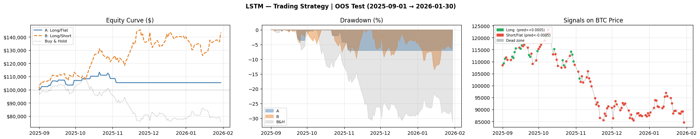{#fig-placeholder}

{#fig-placeholderx}

{#fig-placeholder}

{#fig-placeholderx}

{#fig-placeholder}

{#fig-placeholderx}

{#fig-placeholder}

## RUN A - All Features

::: {#tbl-strat-a-a}
  **Model**      **Return**   **Sharpe**   **MaxDD**    **N.Tr**   **WinR**   **PF**   **AvgTr**   
  ------------- ------------ ------------ ------------ ---------- ---------- -------- ------------ --
  LSTM           $-24.96\%$     -1.663     $-31.44\%$      1         0.0%      0.00    $-24.88\%$  
  GRU            $-16.44\%$     -1.597     $-28.23\%$      8        50.0%      0.33    $-2.00\%$   
  BI-LSTM        $-10.24\%$     -0.686     $-22.53\%$      8        62.5%      0.67    $-1.04\%$   
  LSTM-ATT       $-28.71\%$     -2.243     $-31.41\%$      2        50.0%      0.09    $-13.86\%$  
  GRU-ATT        $-28.43\%$     -2.085     $-31.44\%$      2         0.0%      0.00    $-14.39\%$  
  BI-LSTM-ATT    $-3.15\%$      -0.782     $-12.76\%$      1         0.0%      0.00    $-3.05\%$   
  SELF-ATT       $-17.81\%$     -1.623     $-30.66\%$      1         0.0%      0.00    $-17.73\%$  
  Buy & Hold     $-24.88\%$     -1.658     $-31.44\%$     ---        ---       ---        ---      

  : RUN A --- Strategy A (Long/Flat) vs Buy & Hold
:::

::: {#tbl-strat-b-a}
  **Model**      **Return**   **Sharpe**   **MaxDD**    **N.Tr**   **WinR**   **PF**   **AvgTr**   
  ------------- ------------ ------------ ------------ ---------- ---------- -------- ------------ --
  LSTM           $-24.96\%$     -1.663     $-31.44\%$      1         0.0%      0.00    $-24.88\%$  
  GRU            $-7.50\%$      -0.318     $-26.24\%$      16       56.2%      0.84    $-0.35\%$   
  BI-LSTM        $+7.50\%$      0.643      $-20.48\%$      16       75.0%      1.36    $+0.59\%$   
  LSTM-ATT       $-32.46\%$     -2.351     $-37.95\%$      3        33.3%      0.08    $-11.02\%$  
  GRU-ATT        $-31.70\%$     -2.276     $-31.44\%$      3         0.0%      0.00    $-11.14\%$  
  BI-LSTM-ATT    $+15.22\%$     1.100      $-12.76\%$      2        50.0%      6.22    $+7.96\%$   
  SELF-ATT       $-11.31\%$     -0.587     $-30.66\%$      2        50.0%      0.45    $-4.91\%$   
  Buy & Hold     $-24.88\%$     -1.658     $-31.44\%$     ---        ---       ---        ---      

  : RUN A --- Strategy B (Long/Short) vs Buy & Hold
:::

RUN A trading results are substantially weaker than RUN B across the board, and Strategy A produces no positive returns whatsoever. The richer feature set, which offered some statistical improvement for GRU and SELF-ATT, does not translate into better trading performance (in most cases it actively degrades it).

LSTM is the starkest example. In RUN B it was the best-performing model with $+43.31\%$ under Strategy B; in RUN A it mirrors Buy & Hold almost exactly ($-24.96\%$, Sharpe $-1.663$), executing a single long trade that it never exits. The dead zone mechanism exposes this clearly: the model's predictions remain above $\tau^+$ from day one and never fall below $\tau^-$, producing a degenerate always-long position that is indistinguishable from passive Buy & Hold. This is consistent with the DA drop from $54.55\%$ to $48.18\%$ (the model has lost directional discrimination entirely when exposed to 164 input features).

LSTM-ATT and GRU-ATT perform worst in both strategies, losing more than the passive benchmark in every configuration. Their 2--3 trades each again reflect biased rather than selective behaviour: both models generate predominantly negative predictions, enter positions early and hold them, and happen to be on the wrong side of the November--January rally. Their negative DA translates directly into negative trading outcomes.

BI-LSTM-ATT produces the best risk-adjusted result in RUN A under Strategy B: $+15.22\%$ return, Sharpe $1.100$, MaxDD $-12.76\%$, and a profit factor of $6.22$ on two trades. With 84 of 110 days spent short, this is again a concentrated, bias-driven outcome rather than active forecasting (the model correctly anticipates the October drawdown by virtue of a persistent bearish lean, then switches once). It is worth distinguishing this from LSTM in RUN B: the latter earns its return through 21 switches with a $71.4\%$ win rate, a pattern consistent with genuine signal extraction.

BI-LSTM is the only model in RUN A to generate a credibly active profitable result: $+7.50\%$ under Strategy B (Sharpe $0.643$, WinR $75\%$, 16 trades). The trade count confirms that the result is not a bias artefact.

{#fig-placeholderx}

{#fig-placeholder}

{#fig-placeholderx}

{#fig-placeholder}

{#fig-placeholderx}

{#fig-placeholder}

{#fig-placeholderx}

## RUN A vs RUN B

The trading results reinforce and extend the statistical findings. In RUN B, on-chain features alone support profitable strategies for the majority of architectures under Strategy B. In RUN A, only BI-LSTM and BI-LSTM-ATT manage positive returns, and only BI-LSTM does so through active trading rather than a degenerate positional bias.

The correspondence between DA and trading performance is tight and consistent across both runs. Architectures whose DA degrades with feature expansion (LSTM, LSTM-ATT, GRU-ATT) show proportional deterioration in trading results. The dead zone mechanism makes this relationship explicit: a model whose predictions cluster on one side of the thresholds is not trading, it is drifting, and any return it generates is regime-dependent luck rather than skill.

The broader takeaway is that feature richness is not a free lunch. Adding 148 variables to a 16-variable baseline improves in-sample fit for some architectures but introduces fragility that materialises as directional bias under the OOS regime shift. For practical deployment, the on-chain baseline with a well-tuned LSTM or GRU under Strategy B offers the most robust risk-adjusted profile of any configuration tested.

::: {.paper-download}
[Download PDF](bitcoin_forecasting_using_deep_neural_networks-3.pdf){.btn-paper download=""} [Code](https://github.com/tommasozeri/BTC-Forecasting-using-RNNs){.btn-paper}
:::
