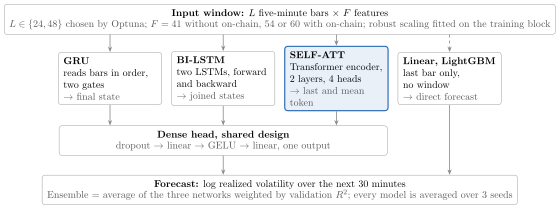
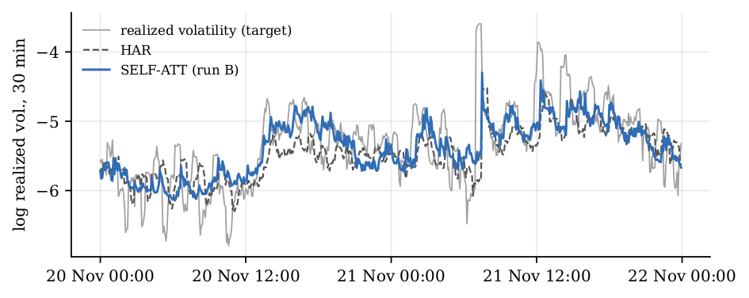
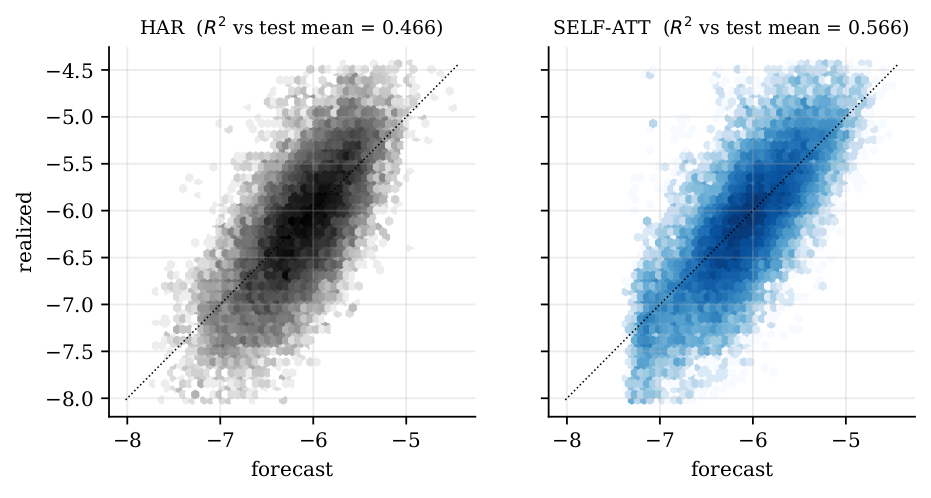
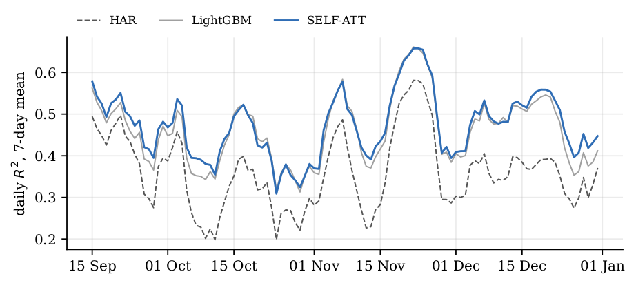
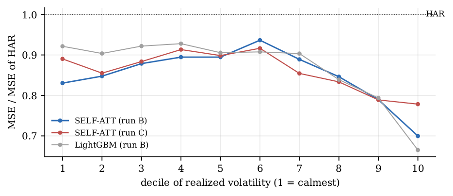
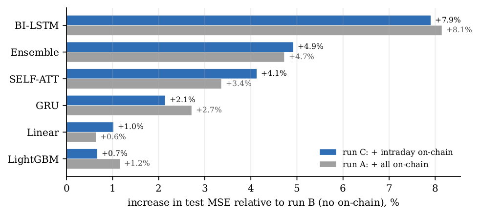
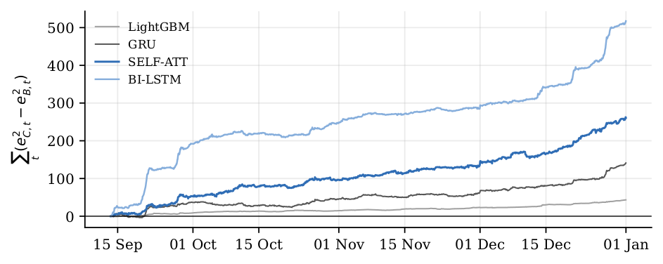
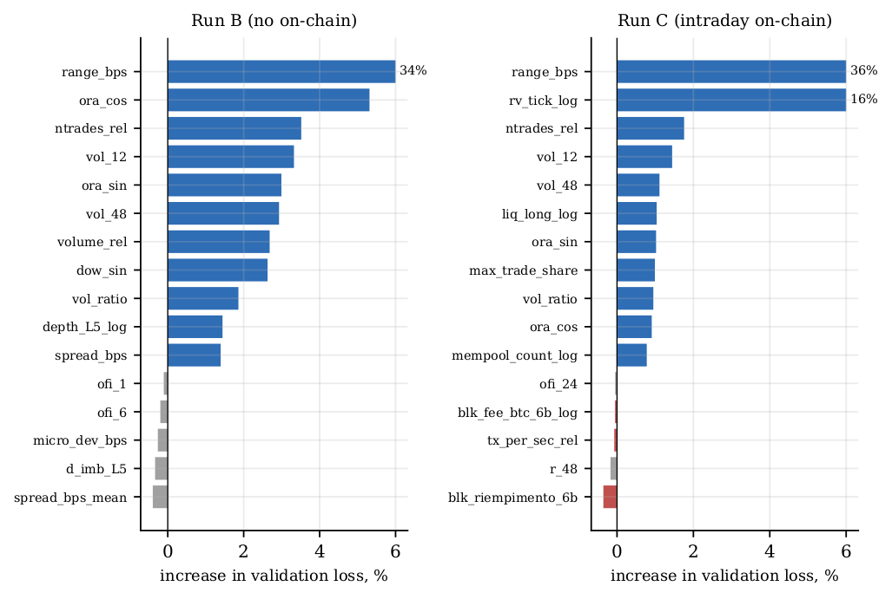
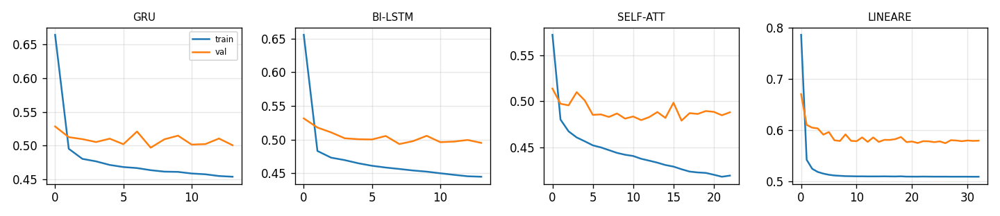

# Introduction

Bitcoin returns over a few minutes are close to unpredictable, but their volatility is not. In earlier work on the same data, no model beat the zero forecast of 30-minute returns; a weak but significant directional signal did not survive transaction costs. Volatility, by contrast, is strongly persistent [@andersen1998], which makes it the natural target on which to test whether complex models add value.

This paper asks three questions:

1.  Do recurrent and attention-based networks beat HAR [@corsi2009], the standard benchmark for realized volatility, and a gradient-boosted tree model [@ke2017] that uses the same features?

2.  Do public on-chain data (mempool, blocks, daily network statistics) improve the forecast beyond microstructure and derivatives data?

3.  If on-chain data matter, is it the intraday block or the daily block?

The contributions are threefold. First, a look-ahead-free pipeline that aligns minute-level market data with on-chain data at the moment each value becomes known. Second, a comparison of seven forecasts with separate hyperparameter tuning and multi-seed averaging. Third, a feature-group ablation evaluated with Diebold--Mariano tests that are robust to the overlap of the forecast targets.

The main findings are that non-linear models beat HAR by about 0.08 in $R^2$ and by 25--30% in QLIKE, that networks and LightGBM perform almost equally well, and that on-chain data consistently worsen the forecasts.

# Data

The sample covers two years, January 2024 to December 2025, on the BTC-USDT perpetual future of Binance Futures. All sources are aggregated to one minute and then to five-minute bars, about 210,000 bars in total. @tbl-data lists the sources.

::: {#tbl-data}
  Source                         Table                                  Derived quantities                                                                           Frequency
  ------------------------------ -------------------------------------- -------------------------------------------------------------------------------------------- ----------------
  Crypto Lake, Binance Futures   trades                                 OHLC, VWAP, buy and sell volume, number of trades, largest trade, tick realized variance     tick
  Crypto Lake, Binance Futures   book_1m                                spread, microprice, imbalance at 1/5/10/20 levels, depth, book slope                         1-min snapshot
  Crypto Lake, Binance Futures   funding, open interest, liquidations   funding rate, change in open interest, long and short liquidations                           event
  Blockchain.com                 charts API                             mempool size in bytes, pending transactions, transactions per second                         15 min
  mempool.space                  blocks                                 block interval, fullness, fee rate, total fees, output value, UTXO change (111,155 blocks)   per block
  Blockchain.com                 charts API                             transactions, fees in USD, hash rate, unique addresses, estimated volume, block size         daily

  : Data sources.
:::

#### Look-ahead-free alignment.

Each on-chain value enters a bar only from the moment it is known, through an as-of merge on the bar's closing time. The 15-minute mempool series is an average over the quarter hour, so it becomes known at the end of that quarter hour; values older than one hour are discarded. Block timestamps are set by miners and can be inaccurate, so a block is treated as known 20 minutes after the running maximum of previous timestamps. The daily value of day $D$ is known only from 00:00 of day $D+1$.

#### Missing data.

Crypto Lake lacks about 7 days of order book out of 731 and 8 hours on 13 November 2024. A value is carried forward for at most one hour; beyond that it is set to the training median, and a flag `book_ok` tells the model whether the book is observed.

# Features and target

Each bar carries up to 60 features in seven groups (@tbl-features). Every feature uses only information available at the close of the bar.

::: {#tbl-features}
  Group                Code   N.  Features
  ------------------- ------ ---- --------------------------------------------------------------------------------------------------------------------------------------------------------------------------------------------------------------------------------------------------------------------
  Price                 P     10  returns over 1, 3, 6, 12, 48 bars; volatility over 12 and 48 bars and their ratio; high--low range in bps; log tick realized volatility
  Flow                  F     8   order-flow imbalance over 1, 6, 24 bars; volume and trade count relative to the daily mean; average trade size; share of the largest trade; distance from VWAP
  Book                  B     12  spread at bar end and on average; microprice deviation; imbalance L1/L5/L10/L20 and change in L5; depth L5; USD imbalance at L20; bid and ask slope; `book_ok`
  Derivatives           D     6   funding rate; change in open interest over 1 hour and 1 day; long, short and net liquidations
  Intraday on-chain     Oi    13  mempool size relative to the daily mean, its 1-hour change, pending transactions, arrival rate; means over the last 6 blocks of interval, fullness, fee rate, fees, output value, UTXO change, transactions; blocks in the last hour; minutes since the last block
  Daily on-chain        Og    6   30-day z-scores of log transactions, fees in USD, hash rate, unique addresses, estimated volume, block size
  Calendar              C     4   sine and cosine of time of day and day of week

  : Feature groups. The code is used to name the feature sets of the ablation.
:::

#### Target.

The target is the log realized volatility over the next $H = 6$ bars (30 minutes), computed on the order-book mid-price $m_t$ to remove bid--ask bounce: $$
y_t = \tfrac{1}{2}\log \sum_{j=1}^{H} \left(\log m_{t+j} - \log m_{t+j-1}\right)^2 .
$$ The logarithm makes the distribution nearly symmetric and stabilizes its variance; the loss is the squared error on the standardized target.

#### Preprocessing.

Features are scaled robustly with statistics estimated on the training block only (median, interquartile range, clipping at $\pm 10$); remaining missing values are set to the median. The target is standardized with the training mean and standard deviation.

# Models

Three neural networks are compared with three benchmarks of increasing complexity (@fig-arch). The networks read a window of the last $L$ bars ($L = 24$ or 48, i.e. 2 or 4 hours); the linear model and LightGBM use the last bar only.

::: {#fig-arch layout-ncol=1}

Model architecture. The highlighted network is the best model in the test set. HAR is estimated separately on past realized volatility only.

:::

## Benchmarks

#### HAR.

The heterogeneous autoregressive model of @corsi2009 regresses future log volatility on three averages of past realized volatility over different horizons, estimated by OLS: $$
y_t = \beta_0 + \beta_1 \log RV^{(30\,\mathrm{min})}_t + \beta_2 \log RV^{(1\,\mathrm{day})}_t + \beta_3 \log RV^{(1\,\mathrm{week})}_t + \varepsilon_t .
$$ It captures the persistence of volatility with four parameters and is the standard benchmark in the literature.

#### Linear.

A linear combination of all features of the last bar, trained with weight decay, i.e. a ridge regression. It measures the value of the additional information without non-linearity.

#### LightGBM.

Gradient-boosted regression trees [@ke2017] on the same last-bar features; each tree fits the residual of the previous ones and early stopping on the validation block selects the number of trees. It is the strongest non-linear benchmark on tabular data.

## Neural networks

#### GRU.

A gated recurrent unit [@cho2014] reads the window one bar at a time and updates a hidden state $h_t$. An update gate $z_t$ decides how much of the old state to keep and a reset gate $r_t$ how much to use when computing the candidate: $$
z_t = \sigma(W_z x_t + U_z h_{t-1}),\qquad r_t = \sigma(W_r x_t + U_r h_{t-1}),\\
h_t = (1 - z_t)\odot h_{t-1} + z_t \odot \tanh\!\big(W x_t + U (r_t \odot h_{t-1})\big).
$$ The final state is passed to the dense head.

#### BI-LSTM.

Two long short-term memory networks [@hochreiter1997] read the window forward and backward, and their final states are concatenated. The LSTM has a separate memory cell and three gates (input, forget, output). Reading backward uses no future data: the window still ends at time $t$.

#### SELF-ATT.

A two-layer Transformer encoder [@vaswani2017] with four heads and pre-layer normalization. Each bar is linearly projected and added to a learned positional embedding; each layer computes the attention of every bar on all the others, $$
\mathrm{Attention}(Q, K, V) = \mathrm{softmax}\!\left(\frac{QK^\top}{\sqrt{d}}\right)V .
$$ Unlike a recurrent network, the model can directly relate two distant bars of the window, such as a volume spike two hours earlier. The head receives the last token concatenated with the mean of all tokens.

#### Ensemble.

The average of the three networks with weights proportional to their validation $R^2$ (about one third each in all runs).

## Training

Networks are trained with AdamW [@loshchilov2019], batches of 512 samples and every second training sample (stride 2), which reduces the overlap of input windows. Regularization combines dropout, weight decay, Gaussian noise on the inputs during training and gradient clipping at 1. The learning rate is halved when the validation loss stops improving, and early stopping with a patience of 6 epochs (maximum 40) keeps the best weights. Every model is trained with three seeds (42, 43, 44) and the forecasts are averaged.

# Experimental design

{#fig-split}

#### Split, purging and embargo.

The sample is divided into three consecutive blocks (@fig-split). A training sample is dropped if its target, which extends to $t + H$, crosses into the next block (purging), and an additional embargo of $H = 6$ bars separates the blocks [@lopezdeprado2018]. The training block has 146,925 samples (2 January 2024 -- 26 May 2025), the validation block 31,524 (27 May -- 13 September 2025) and the test block 31,524 (13 September -- 31 December 2025).

#### Tuning.

Each network and LightGBM receive 20 Optuna trials [@akiba2019] with a TPE sampler and a median pruner (10 epochs per trial), i.e. 80 configurations per run. The search space favours small, heavily regularized networks: 8--48 units, dropout 0.2--0.6, learning rate $3\cdot10^{-5}$--$5\cdot10^{-4}$, weight decay $10^{-4}$--$10^{-1}$, input noise 0--0.2, window of 24, 48 or 96 bars. The criterion is the validation loss, and every feature set is tuned from scratch with the same budget.

#### Metrics.

On the test block we report (i) $R^2$ relative to the training mean, the only mean known at forecast time; (ii) the QLIKE loss, robust to noise in the volatility proxy [@patton2011]; (iii) Spearman's rank correlation $\rho$; and (iv) the Diebold--Mariano statistic [@diebold1995] on the squared-error differential, with a Newey--West variance [@newey1987] at $H - 1 = 5$ lags because the targets of neighbouring bars overlap: $$
\mathrm{DM} = \frac{\bar d}{\sqrt{\widehat{\mathrm{Var}}_{NW}(\bar d)}},\quad d_t = e^2_{1,t} - e^2_{2,t},\qquad
\mathrm{QLIKE} = \frac{1}{T}\sum_t \left(\frac{\sigma^2_t}{\hat\sigma^2_t} - \log\frac{\sigma^2_t}{\hat\sigma^2_t} - 1\right).
$$

#### Ablation.

Three runs are identical except for the feature groups (@tbl-runs). Run A was executed twice and gave metrics identical to the last digit: given seeds and hyperparameters, the pipeline is deterministic.

::: {#tbl-runs}
  Run                         Groups                 Code      Features
  --------------------------- ------------------- ----------- ----------
  A, full                     all                  PFBDOiOgC      60
  C, intraday on-chain only   all but Og            PFBDOiC       54
  B, no on-chain              all but Oi and Og      PFBDC        41

  : Feature sets of the ablation.
:::

# Results

## Model comparison

@tbl-results reports test metrics for run B, the best feature set. SELF-ATT has the highest $R^2$ and rank correlation, and every network and LightGBM beat HAR with $p < 10^{-15}$. Relative to the test mean, all $R^2$ values are about 0.035 lower, but the ranking is unchanged.

::: {#tbl-results}
  Model       $R^2$ (train mean)   $R^2$ (test mean)     QLIKE      $\rho$     DM vs HAR       $p$
  ---------- -------------------- ------------------- ----------- ----------- ----------- -------------
  SELF-ATT        **0.600**            **0.566**         0.562     **0.749**     19.7      $<10^{-15}$
  Ensemble          0.594                0.560           0.561       0.749       19.8      $<10^{-15}$
  LightGBM          0.588                0.553         **0.553**     0.745       16.9      $<10^{-15}$
  BI-LSTM           0.586                0.550           0.582       0.742       17.6      $<10^{-15}$
  GRU               0.582                0.546           0.564       0.743       16.9      $<10^{-15}$
  Linear            0.509                0.467           0.623       0.710       0.15         0.44
  HAR               0.508                0.466           0.773       0.676        --           --

  : Test results, run B (no on-chain), 31,524 forecasts. DM is one-sided against HAR: positive means the model beats HAR.
:::

Three results stand out.

- **Non-linearity is what matters.** The linear model with the same 41 features does not beat HAR ($p = 0.44$). All non-linear models gain about 0.08 in $R^2$ and reduce QLIKE by 25--30%.

- **Networks and LightGBM are on par.** SELF-ATT has the highest $R^2$ and correlation; LightGBM has the lowest QLIKE, i.e. it errs less when it underpredicts volatility.

- **The time window adds little.** LightGBM sees only the last bar and ends 0.012 below SELF-ATT, which sees 48: almost all the information is already in the features of the current bar.

@fig-series shows two test days. HAR reacts to spikes with a lag because it depends only on averages of past volatility; SELF-ATT anticipates part of the move through the range, volume and trade count of the current bar. @fig-scatter shows that its forecasts are more tightly concentrated around the diagonal.

{#fig-series}

{#fig-scatter}

## Stability over time and across regimes

The advantage does not come from a few episodes: SELF-ATT has a higher daily $R^2$ than HAR on 103 of the 110 test days (@fig-r2time). The gain relative to HAR is largest in extreme regimes (@fig-deciles). In the most volatile decile SELF-ATT reduces the squared error by 30% and LightGBM by 33%; in the calmest decile SELF-ATT reduces it by 17%; in the middle deciles the gain is 6--11%.

{#fig-r2time}

{#fig-deciles}

## Ablation: the effect of on-chain data

Adding the 13 intraday on-chain variables (run C) increases the test loss of every model relative to run B; adding the 6 daily series as well (run A) changes almost nothing relative to C (@fig-ablation and @tbl-dm).

{#fig-ablation}

::: {#tbl-dm}
                                GRU            BI-LSTM         SELF-ATT           LightGBM           Linear         Ensemble
  ---------------------- ------------------ ------------- ------------------ ------------------ ----------------- -------------
  C vs B, DM                   $-6.5$          $-14.0$          $-7.6$             $-6.4$            $-5.8$          $-12.7$
  C vs B, $p$             $8\cdot10^{-11}$   $<10^{-15}$   $4\cdot10^{-14}$   $2\cdot10^{-10}$   $8\cdot10^{-9}$   $<10^{-15}$
  C vs A, $\Delta$ MSE        $-0.6\%$        $-0.2\%$         $+0.7\%$           $-0.5\%$          $+0.4\%$        $+0.2\%$
  C vs A, $p$                   0.04            0.47       $6\cdot10^{-5}$    $2\cdot10^{-5}$       $10^{-6}$         0.28

  : Diebold--Mariano tests between feature sets (two-sided, Newey--West with 5 lags). For C vs B a negative statistic means C is worse.
:::

The differences between A and C are below 1% and change sign across models: the daily series neither add nor remove information, and the damage comes entirely from the intraday block. @fig-cumulative shows that the deterioration is not driven by a single episode: the cumulative squared-error difference grows throughout the four test months, with jumps on days of high volatility. @fig-deciles shows where: with on-chain inputs, SELF-ATT loses mostly in the extreme deciles (from 0.70 to 0.78 of HAR's error in the most volatile one).

{#fig-cumulative}

## Feature importance

Permutation importance is computed on the best network in validation: one feature at a time is shuffled and the percentage increase in validation loss is recorded (@fig-importance). The high--low range of the bar dominates (34--36%), followed by recent volatility, trading activity and calendar effects. In run C no on-chain variable exceeds 1%. The most harmful is the average fullness of the last six blocks ($-0.36\%$): shuffling it improves the model. The relative mempool size had an importance of $-0.27\%$ in run A and $+0.33\%$ in run C; a sign that flips between runs points to an unstable relationship.

{#fig-importance}

## Training curves

The validation loss stabilizes within 5--10 epochs while the training loss keeps decreasing (@fig-training). Early stopping ends GRU and BI-LSTM after about 14 epochs and SELF-ATT after 23. The gap between training and validation loss is small (0.05--0.07 in standardized units), which indicates that regularization is effective.

{#fig-training}

# Discussion

The explanation most consistent with the evidence is overfitting to unstable relationships, not a lack of signal in the models. Three observations point the same way. First, on-chain variables have importance close to zero and sometimes negative, with a sign that changes between runs: the model finds relationships in the training block that no longer hold in validation and test. Second, the damage grows with model flexibility: $+7.9\%$ for BI-LSTM, $+4.1\%$ for SELF-ATT and $+0.7\%$ for LightGBM, which selects its own features in each split. This is the typical pattern of overfitting. Third, the damage is concentrated in extreme regimes, where the model should rely on the market but instead weighs variables that, in the training sample, were associated with different episodes.

There is also an economic reason. At a 30-minute horizon, Bitcoin volatility is driven by derivatives trading, which takes place almost entirely off-chain. Mempool and block statistics measure the demand for block space and are only indirectly linked to short-term price moves. Blocks arrive on average every ten minutes and with a publication delay, so any useful information is likely to be already in the price.

#### Robustness.

Hyperparameters are tuned from scratch for every feature set, so the deterioration is not due to settings chosen for another configuration. Forecasts are averaged over three seeds, and a repeated run gives identical metrics. Diebold--Mariano tests use HAC standard errors for the overlapping targets. The result holds for all five trained models, including the linear model and LightGBM, and for the ensemble.

#### Limitations.

The evaluation uses a single time split: the test block covers four months (September--December 2025) of one market regime, and a walk-forward evaluation over several windows would make the result more general. Only one horizon (30 minutes) and one instrument are studied; on-chain data may matter more at horizons of days. The on-chain features are public and free; proprietary metrics such as exchange inflows and outflows were not tested. The tuning budget is 20 trials per model; with more trials the networks might learn to ignore uninformative inputs. Finally, the forecasts are not translated into a trading or risk-management application, so their economic value remains to be measured.

# Conclusion

At a 30-minute horizon, Bitcoin volatility is predictable, and non-linear models predict it much better than HAR. The self-attention network explains 60.0% of the variance of log volatility against 50.8% for HAR; LightGBM is almost on par and has the best QLIKE. The gain comes from non-linearity: a linear model with the same features does not beat HAR.

Public on-chain data do not help. Mempool and block statistics significantly worsen the forecasts of every model, and daily network series have no effect. The best feature set combines microstructure and derivatives data, with 41 variables. Natural extensions are a walk-forward evaluation, longer horizons where slower on-chain information may matter, exchange-flow data instead of mempool and block statistics, and the use of the forecasts in volatility targeting or market making to measure their economic value.

# Hyperparameters and reproducibility

@tbl-hp reports the hyperparameters selected by Optuna in run B. For LightGBM the selected values are a learning rate of 0.029, 13 leaves, at least 170 observations per leaf, 79% of the features per tree and an L2 penalty of 0.62, with a validation loss of 0.488.

::: {#tbl-hp}
  Model       Units   Dropout     Learning rate       Weight decay      Input noise   Window (bars)   Val. loss
  ---------- ------- --------- ------------------- ------------------- ------------- --------------- -----------
  SELF-ATT     48      0.21     $3.0\cdot10^{-4}$   $1.4\cdot10^{-3}$      0.12            48           0.481
  BI-LSTM      48      0.44     $2.9\cdot10^{-4}$   $3.9\cdot10^{-2}$      0.14            24           0.493
  GRU          32      0.34     $4.9\cdot10^{-4}$   $7.1\cdot10^{-4}$      0.01            24           0.497

  : Selected hyperparameters of the networks, run B.
:::

#### Code and data.

`scarica_cryptolake.py` downloads the Crypto Lake tables and aggregates them to one minute; `scarica_onchain.py` downloads mempool, block and daily series; the notebook `modelli_btc_hf.ipynb` runs the whole pipeline, and the three runs differ only in the `GRUPPI_FEATURE` setting. @fig-series--@fig-importance are computed by `figures.py` from the saved test predictions; @fig-training is produced by the notebook.

# References {.unnumbered}

::: {#refs}
:::

::: {.paper-download}
[Download PDF](btc-hf-volatility-neural-networks.pdf){.btn-paper download=""} [Code](https://github.com/tommasozeri/Forecasting-High-Frequency-Bitcoin-Volatility-Neural-Networks){.btn-paper}
:::
