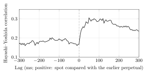

# The question

A perpetual futures contract has no expiry. It is tied to the spot price by a funding payment exchanged between longs and shorts every eight hours, and on Binance the perpetual and the spot pair for BTC sit on the same matching infrastructure. Their difference, the basis, is a few basis points away from zero and fluctuates by about one basis point around that level. The two prices are still two prices. They are set by different participants, with different leverage and different fees, and when information arrives one of them moves first. In theory the no-arbitrage basis is zero; in practice it deviates by basis points for hours ([He et al. 2022](#ref-he2022)).

Price discovery is the name for the question of which one. The usual tools answer it on prices sampled on a grid: a vector error-correction model and the information share of Hasbrouck ([Hasbrouck 2021](#ref-hasbrouck2021)), or the component share of Gonzalo and Granger ([Yan and Zivot 2010](#ref-yan2010)). On a 100 ms grid the two legs of this market move within the same interval most of the time, and the information share is then identified only up to wide bounds. Model-free lead--lag estimators for asynchronous data ([Hayashi and Yoshida 2005](#ref-hayashi2005)) recover the ordering of the moves but give no mechanism.

This note uses a point process instead ([Hawkes 1971](#ref-hawkes1971); [Bacry et al. 2015](#ref-bacry2015)). Each move of a mid-price is an event with a timestamp at microsecond resolution, and a multivariate Hawkes process says how many moves of one leg a move of the other leg causes, in which direction, and how fast. From the fitted parameters one can compute, in closed form, the share of the permanent variance of the common price that originates with each leg. The note reports that share, compares it with the classical measures on the same days, and documents one period in which the answer flips.

# Data and events

The data are the full best-bid-and-offer streams of Binance recorded by Tardis, which distributes the first day of every month free of charge. Both legs are BTCUSDT: the spot pair, with a tick of 0.01 USDT, and the USDT-margined perpetual, with a tick of 0.1 USDT. ETHUSDT is used as a robustness check.

The sample has thirteen days, all first days of a month. Six were the development days (1 March 2023, 2024, 2025 and 2026 and 1 September 2026 for BTC, 1 March 2026 for ETH), and every method and setting was fixed on them. Seven more were added afterwards by a rule fixed before any of them was processed: the two remaining first-of-month days inside Binance's zero-fee promotion on BTC spot pairs (1 December 2022 and 1 February 2023), the days of highest and lowest spot volatility in the archive (1 May 2024 and 1 January 2023), and the days of highest and lowest mean funding rate (1 January 2024 and 1 May 2025), with ETH added on 1 May 2024. The rule selects extremes on purpose. On 1 January 2023 the market was so quiet that only two of the six four-hour windows have enough events to be estimated.

An event is a move of the mid-price $(\text{bid}+\text{ask})/2$ of one leg by at least $\theta = 0.5$ bp of a reference price, which is reset to the new mid at each event, following the convention of ([Bacry et al. 2013](#ref-bacry2013)). Events are classified into four types: $$0 = \text{perp up},\qquad 1 = \text{perp down},\qquad 2 = \text{spot up},\qquad 3 = \text{spot down}.$$ A threshold in basis points makes the two legs comparable despite their tenfold difference in tick size, and it makes the moves nearly equal in size, between 0.6 and 0.9 bp on average on every day and equal across legs. Taking every change of the mid as an event fails for two reasons that the thesis documents in detail: most raw changes are bursts of microseconds that belong to one move of the book, and their sizes differ so much between the legs that a model of counts cannot describe the basis. With the threshold the days have between 12 thousand and 296 thousand events.

Timestamps are integers in nanoseconds. The spot stream carries no exchange timestamp, so both legs are placed on the receive clock of the recorder, which lags the exchange by about four milliseconds on the spot. This matters for the shortest lags and is discussed in @sec-limits.

# The model in one page

Each type $i$ has an intensity, the instantaneous rate at which events of that type arrive given the past: 

$$
\lambda_i(t) = \mu_i(t) + \sum_{j=0}^{3} \sum_{t^j_n < t} \sum_{k=1}^{2} \alpha_{ijk}\, e^{-\beta_{ijk}(t - t^j_n)} .
$$ {#eq-hawkes}

 The baseline $\mu_i(t)$ is piecewise constant on fifteen-minute bins, which absorbs the intraday variation of activity. Every past event of type $j$ adds to the intensity of type $i$ a sum of two decaying exponentials, a fast one and a slow one, with decay rates confined to disjoint ranges. The model is fitted by exact maximum likelihood on four-hour windows, six per day.

The object to read is the branching matrix, 

$$
G_{ij} = \sum_{k} \frac{\alpha_{ijk}}{\beta_{ijk}},
$$ {#eq-g}

 the expected number of events of type $i$ directly caused by one event of type $j$. Its spectral radius $\rho(G)$ must be below one for the process to be stationary. With the instrument and direction symmetries of the problem, $G$ has four kinds of entries: self-excitation (the same leg moves again in the same direction), rebound (the same leg moves back), same-direction cross-excitation (the other leg follows), and opposite-direction cross-excitation.

The branching representation also gives each event a parent, or none if it was generated by the baseline. Events without a parent are called exogenous, or immigrants: they start a cluster. This yields two counting measures of leadership: the share of spot events whose direct parent is a perpetual event, and the converse.

For a measure in units of price variance, let $v_P$ be the vector that maps the four counts into the common price, the average of the two mids, so that each event moves it by half the mean move of its leg, with the sign of its direction. The permanent move caused by one event of type $j$, including all its descendants, is $w_j = v_P^\top (I - G)^{-1} e_j$. By the functional limit theorem for Hawkes processes ([Bacry et al. 2013](#ref-bacry2013limit)), the long-run variance of the common price is a sum over types, $\sum_j w_j^2 \Lambda_j$, where $\Lambda_j$ is the stationary rate of type $j$, and the Hawkes information share of the perpetual is 

$$
IS^{H}_{\text{perp}} = \frac{w_0^2 \Lambda_0 + w_1^2 \Lambda_1}{\sum_{k=0}^{3} w_k^2\, \Lambda_k}.
$$ {#eq-is}

 A second version replaces the total rates $\Lambda_j$ by the baseline rates $\mu_j$ and so counts only the exogenous events as sources of permanent variance. This is the closer analogue of an innovation-based share, because the children of an event are reactions, not news. The share needs no ordering of simultaneous moves and no grid: the events are ordered by their own timestamps.

The share should be read with two cautions. It differs from the asymmetry of the cross kernels: if the perpetual moves twice as often as the spot, a symmetric $G$ still makes most spot moves descendants of perpetual moves. And it is model-based: it inherits any misspecification of the kernels.

# Results

## The two legs imitate each other

@tbl-g summarises the branching matrix by day. The spectral radius is between 0.64 and 0.91 in every window of every day, with standard errors below 0.03, so the process is stationary and away from criticality everywhere. On every BTC day from 2024 the same-direction cross-excitation in the stronger direction is 0.44--0.59, against self-excitation of 0.14--0.28 for the perpetual and 0.15--0.41 for the spot, with $t$-statistics above 20 on every cross entry. The opposite-direction cross entry is zero on every BTC day from 2024: a move of one leg is never followed by a move of the other leg against it.

On a representative window, 12:00--16:00 UTC of 1 March 2026 with 22,275 events, a perpetual up-move generates on average 0.42 spot up-moves and a spot up-move generates 0.51 perpetual up-moves, while self-excitation is 0.26--0.29 for every type. Only 7--13% of the events of that window are exogenous. The cross kernels act on two scales: a fast component with a half-life of 5--23 ms, the reaction time of one leg to the other, and a slow one of 0.2--0.9 s that carries 41--72% of the cross branching ratio.

The one entry that approaches the cross channel is the self-excitation of the spot on 1 May 2024, the most volatile day in the archive: 0.41, against 0.30 from the perpetual to the spot.

::: {#tbl-g}
  ---------------- ----------- ------ ------ --------- --------- ------ ----------- ------
                                Self           Cross                     Exogenous  
  Day               $\rho(G)$   perp   spot   p$\to$s   s$\to$p   Opp.     perp      spot
  BTC 2022-12-01      0.66      0.10   0.10    0.60      0.22     0.37     0.14      0.40
  BTC 2023-01-01      0.65      0.10   0.13    0.43      0.22     0.14     0.12      0.41
  BTC 2023-02-01      0.75      0.08   0.13    0.55      0.25     0.46     0.07      0.36
  BTC 2023-03-01      0.78      0.10   0.22    0.53      0.26     0.28     0.06      0.29
  BTC 2024-01-01      0.71      0.19   0.21    0.44      0.45     0.00     0.39      0.10
  BTC 2024-03-01      0.78      0.14   0.21    0.50      0.53     0.00     0.29      0.13
  BTC 2024-05-01      0.85      0.16   0.41    0.30      0.59     0.00     0.18      0.12
  BTC 2025-03-01      0.77      0.19   0.15    0.49      0.52     0.00     0.28      0.15
  BTC 2025-05-01      0.75      0.18   0.18    0.44      0.56     0.00     0.33      0.18
  BTC 2026-03-01      0.86      0.28   0.27    0.43      0.48     0.00     0.16      0.11
  BTC 2026-09-01      0.80      0.24   0.16    0.50      0.50     0.00     0.24      0.15
  ETH 2024-05-01      0.84      0.17   0.33    0.35      0.58     0.00     0.20      0.11
  ETH 2026-03-01      0.89      0.29   0.36    0.36      0.49     0.07     0.12      0.10
  ---------------- ----------- ------ ------ --------- --------- ------ ----------- ------

  : Branching matrix by day, median over the fitted four-hour windows (trimmed from the thesis table of daily aggregates). $\rho(G)$: spectral radius. Self: same leg, same direction. Cross: same direction, parent $\to$ child. Opp.: larger of the two opposite-direction cross entries. Exogenous: share of the events of each leg with no parent. The first block holds the four zero-fee days.
:::

In terms of the basis, a perpetual up-move widens it, the self-excitation of the perpetual widens it further, and the spot moves it causes close it again. The closing channel is the larger one on every day. This is the first half of the story: the two legs imitate each other more than they cluster on themselves.

## The perpetual leads, through its numbers

Per parent, the two cross directions are close on the development days: 0.43 against 0.48 on 1 March 2026, 0.50 against 0.50 on 1 September 2026. The leadership comes from the rates. On the BTC days from 2024 the perpetual has 1.28--1.53 times the events of the spot, and so it is more often the parent: 45--69% of spot events have a perpetual event as their direct parent, against 32--42% of perpetual events with a spot parent. Over all generations, 57--80% of spot events descend from a perpetual event, against 9--29% the other way.

::: {#tbl-is}
  ---------------- ------ ---------------- ---------------- ---------------- --------- ----------- ------
                            Direct share                     Hawkes IS perp             Hasbrouck  
  Day               Rate   s$\leftarrow$p   p$\leftarrow$s       events       immigr.    1 s mid     HY
  BTC 2022-12-01    0.30        0.27             0.74             0.36         0.17       0.29      0.27
  BTC 2023-01-01    0.28        0.16             0.79             0.39         0.15       0.22      0.04
  BTC 2023-02-01    0.32        0.34             0.82             0.24         0.07       0.33      0.09
  BTC 2023-03-01    0.32        0.25             0.82             0.33         0.08       0.32      0.01
  BTC 2024-01-01    1.53        0.66             0.32             0.57         0.83       0.64      3.00
  BTC 2024-03-01    1.28        0.64             0.42             0.49         0.67       0.58      1.53
  BTC 2024-05-01    1.53        0.45             0.40             0.34         0.47       0.47      0.26
  BTC 2025-03-01    1.39        0.69             0.37             0.53         0.67       0.59      1.60
  BTC 2025-05-01    1.42        0.62             0.40             0.50         0.69       0.66      1.18
  BTC 2026-03-01    1.40        0.60             0.34             0.51         0.61       0.52      1.80
  BTC 2026-09-01    1.36        0.69             0.38             0.59         0.66       0.61      2.16
  ETH 2024-05-01    1.51        0.54             0.40             0.43         0.56       0.50      0.57
  ETH 2026-03-01    1.39        0.51             0.40             0.47         0.50       0.55      1.26
  ---------------- ------ ---------------- ---------------- ---------------- --------- ----------- ------

  : Price leadership by day (trimmed from the thesis table of leadership measures). Rate: perpetual events over spot events. Direct share: share of the events of one leg whose parent is on the other leg (s$\leftarrow$p: spot events with a perpetual parent). Hawkes IS of the perpetual, median over windows, with all events or only immigrants as sources. Hasbrouck IS of the perpetual: midpoint of the bounds on the 1 s grid. HY: Hayashi--Yoshida lead--lag ratio on the 100 ms grid (above one: the perpetual leads).
:::

@tbl-is and @fig-is give the information shares. With all events as sources, the Hawkes share of the perpetual is 0.49--0.59 on six of the seven BTC days from 2024 and 0.34 on 1 May 2024; on ETH it is 0.43 and 0.47. It is stable within a day, with ranges of 0.03--0.14 over the six windows. With immigrants as sources it rises to 0.61--0.83 on the same six BTC days, 0.47 on 1 May 2024, and 0.56 and 0.50 on ETH. The gap between the two weightings is the mechanism in one number. The perpetual's share of all events is only slightly above a half, but its share of the events that start a cluster is about two thirds. It leads in the sense that matters for price discovery, the origination of permanent price moves.

{#fig-is}

## Agreement with the classical measures

The Hasbrouck share from a VECM on the 100 ms grid has wide bounds, $[0.27, 0.86]$ on 1 March 2026 and $[0.50, 0.99]$ on 1 September 2026, because at 100 ms the two legs move in the same interval most of the time (the Hayashi--Yoshida correlation at lag zero is 0.43--0.68) and the Cholesky ordering decides who moved first. On the 1 s grid the midpoint of the bounds is 0.47--0.66 for the perpetual on the BTC days from 2024, and the Gonzalo--Granger component share is 0.36--0.83. The Hawkes share with events as sources lies below the VECM midpoint on every BTC day from 2024, by 0.01--0.09 on five of them, and the immigrant-weighted share sits between the midpoint and the component share. The measures agree on the ranking and on the size of the asymmetry, roughly 50--65% for the perpetual against 35--50% for the spot. That is a moderate lead, far from the near-total dominance one might expect of a derivative over its underlying.

The Johansen test on the 1 s grid finds exactly one cointegrating relation between the two prices on every day, so the VECM framing is appropriate.

The lead--lag itself lives below the 100 ms grid: on the grid the Hayashi--Yoshida cross-correlation peaks at lag zero on every day. Computed on the 1.4 million quote-change times of 1 March 2026, in steps of 5 ms, it resolves the lag (@fig-hy). The correlation is flat at 0.16--0.17 for negative lags and at zero, rises from $+5$ ms, and reaches a plateau of about 0.30 between $+50$ and $+120$ ms, with its maximum at $+50$ ms and a lead--lag ratio of 2.26 over $\pm300$ ms. The spot follows the perpetual by tens of milliseconds, between the fast and the slow cross kernels of the model.

{#fig-hy}

# The zero-fee twist

Four days of the sample behave differently: 1 December 2022, 1 January 2023, 1 February 2023 and 1 March 2023. Between 8 July 2022 and 22 March 2023 Binance charged no fee on BTC spot pairs. For a regular account, the spot leg is normally the more expensive one to trade: in the schedule of October 2026 a regular account pays 0.100% per fill on spot and 0.020% (maker) or 0.050% (taker) on the USDT-margined futures. During the promotion the spot was the cheap leg.

On those four days every row of @tbl-g and @tbl-is changes, and the four days are alike among themselves. The spot has 72--80% of the events, and the rate ratio of the perpetual to the spot falls to 0.28--0.32. The exogenous share of the spot is 0.29--0.41, three to five times that of the perpetual. Self-excitation of the perpetual is 0.08--0.10, the lowest in the sample. Per parent, the perpetual still excites the spot strongly (0.43--0.60, against 0.22--0.26 the other way), but the spot has three times the parents. Opposite-direction cross-excitation, zero on every later BTC day, is 0.14--0.46. The rebound, a move followed by a move of the same leg in the opposite direction, sits on the spot (0.12--0.30) and not on the perpetual (0.00--0.01), the reverse of the later days. The median spot spread on 1 March 2023 was about 0.3 bp.

All leadership measures reverse. The Hawkes share of the perpetual is 0.24--0.39 with all events and 0.07--0.17 with immigrants: nearly every cluster of those days starts on the spot. The Hasbrouck bounds on the 100 ms grid are $[0.00\text{--}0.03,\ 0.18\text{--}0.21]$, the component share is negative or close to zero, and the Hayashi--Yoshida lead--lag ratio is 0.01--0.27. On 1 March 2023 the spot led by more than 100 ms.

Two of the four days, 1 December 2022 and 1 February 2023, were added to the sample because they were in the fee regime and for no other reason, and they reproduce the structure of 1 March 2023 in every entry. The thesis states that the promotion is the explanation of the reversed regime, and reads the result as follows: price leadership between a perpetual and its spot is a property of the relative cost of trading the two legs more than of the contract, and when the spot became the cheap leg, it took over price discovery.

# Limits {#sec-limits}

The sample is thirteen non-consecutive days, the first of a month each. Every estimate is within a day, on four-hour windows, and nothing is carried from one day to the next. The four-year span and the agreement across days are the evidence of stability; they are not a test of it.

The spot stream has no exchange timestamp. Both legs sit on the receive clock, and the spot receive clock lags the exchange by about four milliseconds. Shifting the spot events by $\pm1$ ms moves every entry of $G$ by less than 0.02; shifting them by $\pm4$ ms moves the two cross entries in opposite directions by 0.04 and 0.10. The per-parent symmetry of the cross kernels is therefore known to within about 0.05, and the fast kernels are limited by the clock. The dominance of cross over self excitation and the zero opposite-direction entries do not depend on it.

The model is not the data-generating process. Time-rescaling tests still reject in most windows, and the residuals are mildly autocorrelated and over-dispersed. The Hawkes information share is a function of the fitted kernels and inherits this misfit.

The event-time lead--lag of @fig-hy is computed on one day only. The 100 ms-grid lead--lag ratio in @tbl-is is above one on six of the seven BTC days from 2024 but 0.26 on 1 May 2024, the high-volatility day on which the spot clusters on itself and starts as many clusters as the perpetual.

The fee result rests on four days, and they are also the four earliest days of the sample. Two of them entered the sample for their fee regime alone, which is why the thesis treats the promotion as the cause. The sample cannot, by itself, separate the fee regime from everything else that was different about the market in the winter of 2022--23.

# What it means

For a reader who trades the basis, the practical content is about where to look. On Binance BTC, with regular fees, the perpetual is the slightly better place to watch for the first move: it moves more often, it starts about two thirds of the clusters that end in a permanent price change, and the spot follows within tens of milliseconds, mostly in the same direction. The lead is moderate. Per move, the spot is about as contagious as the perpetual, and a strategy that assumes the spot simply copies the perpetual ignores the 35--50% of the permanent price variation that the measures attribute to the spot.

The second point is that leadership in this pair is not a fixed property of a derivative over its underlying. In this sample it followed the cost of trading. When spot trading was free, the spot carried most of the price discovery and the perpetual followed. A fee change on a major venue is then a natural experiment for price discovery, and an event-level information share, which needs no grid and no ordering of simultaneous moves, is a suitable instrument to measure it.

# References {.unnumbered}

[]{#ref-bacry2013}E. Bacry, S. Delattre, M. Hoffmann and J.-F. Muzy. Modelling microstructure noise with mutually exciting point processes. *Quantitative Finance*, 13(1):65--77, 2013.

[]{#ref-bacry2013limit}E. Bacry, S. Delattre, M. Hoffmann and J.-F. Muzy. Some limit theorems for Hawkes processes and application to financial statistics. *Stochastic Processes and their Applications*, 123(7):2475--2499, 2013.

[]{#ref-bacry2015}E. Bacry, I. Mastromatteo and J.-F. Muzy. Hawkes processes in finance. *Market Microstructure and Liquidity*, 1(1):1550005, 2015.

[]{#ref-hasbrouck2021}J. Hasbrouck. Price discovery in high resolution. *Journal of Financial Econometrics*, 19(3):395--430, 2021.

[]{#ref-hawkes1971}A. G. Hawkes. Spectra of some self-exciting and mutually exciting point processes. *Biometrika*, 58(1):83--90, 1971.

[]{#ref-hayashi2005}T. Hayashi and N. Yoshida. On covariance estimation of non-synchronously observed diffusion processes. *Bernoulli*, 11(2):359--379, 2005.

[]{#ref-he2022}S. He, A. Manela, O. Ross and V. von Wachter. Fundamentals of perpetual futures. arXiv:2212.06888, 2022.

[]{#ref-yan2010}B. Yan and E. Zivot. A structural analysis of price discovery measures. *Journal of Financial Markets*, 2010.

*This note is based on the author's master thesis, "Cross-Excitation and Price Discovery in the Perpetual-Spot Basis" (MSc in Financial Engineering, EDHEC Business School).*

::: {.paper-download}
[Download PDF](btc-perp-spot-price-discovery.pdf){.btn-paper download=""} [Code](https://github.com/tommasozeri/btc-perp-spot-price-discovery){.btn-paper}
:::
