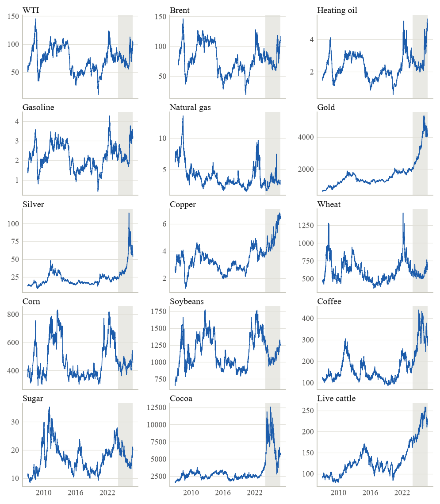
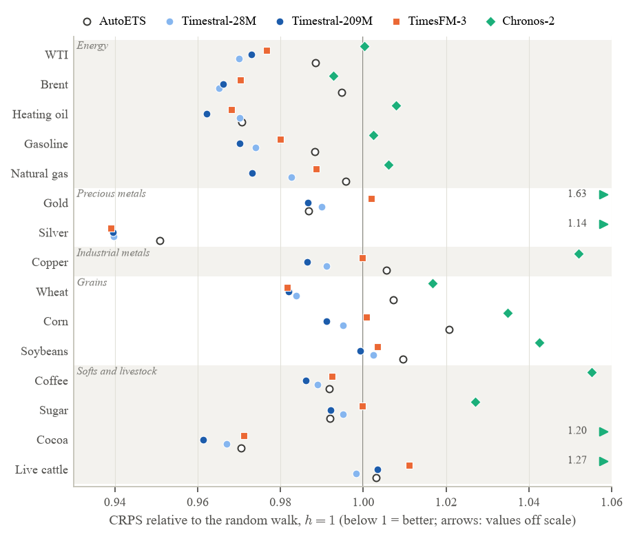
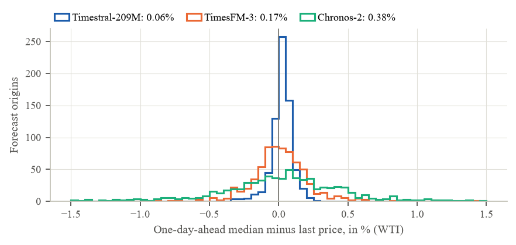
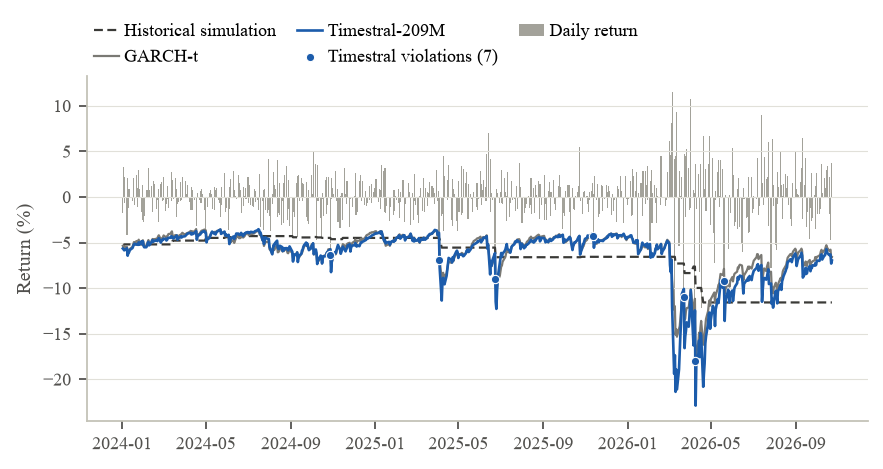
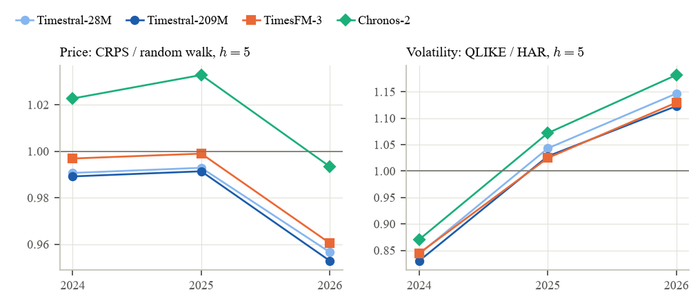
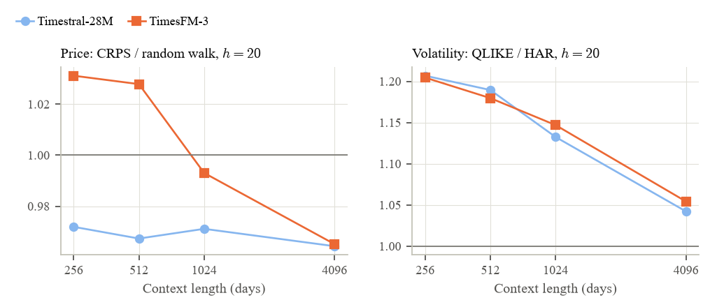
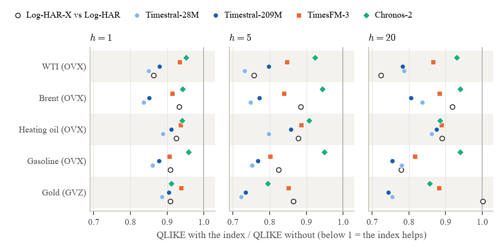

# Introduction {#sec-introduzione}

Time series foundation models are neural networks pre-trained on large collections of real and synthetic series that produce probabilistic forecasts without being estimated on the user's data. On general benchmarks such as GIFT-Eval [@aksu2024gifteval] they outperform classical statistical models, and their developers present them as general-purpose forecasters, finance included. Financial series are a hard case, however: the signal-to-noise ratio is low, tails are heavy and structural breaks are frequent. For the price of oil in particular, the no-change forecast is notoriously hard to beat [@alquist2010; @alquist2013].

This paper asks whether the latest foundation models are useful for commodities, on three tasks that matter to risk managers in these markets: the distribution of the price 1, 5 and 20 days ahead, the Value-at-Risk of the daily return, and realized volatility. We compare four models released between October 2025 and October 2026 (Timestral-28M and Timestral-209M by Mistral AI, TimesFM-3 by Google, Chronos-2 by Amazon), used zero-shot, with the benchmarks that the econometric literature uses for each task: the random walk, AutoARIMA and AutoETS for prices; historical simulation and three GARCH models for VaR; HAR-RV for volatility. The sample covers 15 futures from five sectors, with one forecast per day from January 2024 to October 2026, or 708 forecast origins per asset. Differences are assessed asset by asset with the Diebold-Mariano test and the Benjamini-Hochberg correction, and with the Model Confidence Set.

The question has practical relevance. An econometric model has to be specified, estimated and monitored asset by asset; a foundation model is downloaded once and produces probabilistic forecasts for any series from its recent history alone. If its quality were at least on par with the benchmarks, the cost of building and maintaining a forecasting system across many markets would fall considerably. Commodities are a demanding test of this promise: sectors have different dynamics (the seasonality of grains, the supply shocks of oil, the safe-haven role of gold), volatility regimes change quickly, and for some of them implied volatility indices exist that make it possible to test whether the models can use forward-looking external information.

The three tasks test different aspects of forecasting. For prices the signal is almost absent and the random walk is hard to beat: a model can only gain by describing the dispersion and shape of the distribution better. For VaR, what matters is the left tail and how fast the model reacts to shocks. For volatility the signal is strong, because volatility is persistent, and the question is whether a generic model captures this persistence better than a regression built for the purpose.

There are four main findings.

1.  On prices the foundation models beat the random walk and the ARIMA and ETS models, but by a small margin: the CRPS of Timestral-209M is 2--4% below that of the random walk, and the improvement is significant for 12 of the 15 assets at the one-day horizon. Chronos-2 is the exception: it is worse than the random walk at short horizons, because its median does not stay at the last observed price.

2.  On VaR the foundation models are on par with the GARCH family and better calibrated than historical simulation, especially at the 1% level.

3.  On volatility HAR remains the best model on average, but no foundation model is significantly worse on any asset. Context length matters for this task: with 4096 days instead of 1024, the gap to HAR at 20 days shrinks from 13--15% to 4--6%. Foundation models and HAR make their errors in different regimes, and an equal-weight average of a foundation model and a log-HAR beats HAR at every horizon, by 1--2% at one day and by 5--7% at twenty days.

4.  Covariates help in one case only. Brent and crude oil inventories do not improve the WTI forecasts, and the dollar adds nothing. The commodity's own implied volatility (OVX for oil and refined products, GVZ for gold) reduces the QLIKE of every model on every asset where it is available, by 6--14% at one day, and with it the foundation models beat HAR at 1 and 5 days. The VIX does not help. The same index also improves a log-HAR, however: against this benchmark Timestral stays ahead by 6% at one day, significantly on one asset only, is on par at five days and falls behind at twenty.

The paper adds three things to the literature. To our knowledge, it is the first evaluation of foundation models on daily commodity futures that covers prices, risk and volatility together, with task-specific benchmarks. It includes the latest generation of models, which accept covariates natively, and shows which external information they can use. Finally, it separates the contribution of the model from that of the information: a classical benchmark given the same covariate (log-HAR-X) shows that the gains of the foundation models with implied volatility come mostly from the covariate rather than from the model.

@sec-letteratura reviews the literature. @sec-dati describes the data and @sec-metodologia the evaluation design, how the foundation models work, the benchmarks, the metrics and the tests. @sec-risultati presents the results, the robustness checks and the covariate experiments, and ends with a summary. @sec-conclusioni discusses practical implications and limitations. Readers mainly interested in the results can read @tbl-disegno, which summarizes the evaluation design, and the paragraph on reading the scores in @sec-metodologia, and then move to @sec-risultati.

# Related literature {#sec-letteratura}

#### Forecasting commodity prices and volatility

The literature on oil has shown that at short horizons the no-change forecast is a very hard benchmark to beat, both for econometric models and for futures prices [@alquist2010; @alquist2013]. The random walk is therefore the reference benchmark here as well, alongside AutoARIMA and AutoETS [@hyndman2008], which select the model specification automatically, as foundation models implicitly do. For volatility, the HAR model of @corsi2009 is the standard reference. For the US oil market, @haugom2014 show that adding the OVX to realized volatility models significantly improves daily and weekly forecasts, and that other market variables, including the slope of the futures curve, help at the monthly horizon too. This is in line with the information content of implied volatility documented by @christensen1998 for the equity market. We ask whether foundation models can extract the same information.

#### Time series foundation models

Chronos [@ansari2024chronos] and TimesFM [@das2024timesfm] showed that a single pre-trained model can forecast series from different domains zero-shot, with an accuracy competitive with models estimated on the data. The next generation extends the approach to multivariate series and covariates: Chronos-2 uses in-context learning to condition the forecast on past and future covariates [@ansari2025chronos2], TimesFM-3 is pre-trained directly on the multivariate case [@jain2026timesfm3], and Timestral supports past and known-future covariates [@mistral2026timestral]. The evaluations by their developers rely on general benchmarks such as GIFT-Eval [@aksu2024gifteval], where financial series are a small minority.

#### Foundation models in finance

Studies on financial data paint a less favourable picture.

- On stock returns, @rahimikia2025 find that pre-trained foundation models perform poorly both zero-shot and after fine-tuning, and that models pre-trained from scratch on financial data are needed. @alonso2026 find small and sparse improvements over the random walk, significant in only two cases out of ten.

- On realized volatility, @goel2025vol find that zero-shot TimesFM is a reasonable baseline but that incremental fine-tuning is needed to beat econometric benchmarks. Across 50 equities, currencies and futures, @brini2026 shows that nine zero-shot foundation models do not deliver a uniform gain over HAR: only one small model beats a log-HAR at all horizons, and by a narrow margin.

- On VaR, @goel2025var find that fine-tuned TimesFM ranks among the best models for S&P 100 stocks, but that the zero-shot version is not optimal.

- On agricultural commodities at monthly frequency, by contrast, @wang2026 find that zero-shot foundation models beat classical methods and, for three of four commodities, the futures-based forecasts of the US Department of Agriculture.

Compared with these studies, ours uses daily futures data from all major sectors, evaluates the same models on prices, risk and volatility with task-specific benchmarks, and studies the effect of covariates, which these studies do not consider.

# Data {#sec-dati}

## Futures

The sample consists of 15 commodity futures traded in the United States, with daily open, high, low and close prices (OHLC) from January 2007 to 23 October 2026, downloaded from Yahoo Finance as continuous front-month series. @tbl-asset lists them by sector.

  Sector                Commodity         Ticker   Volatility
  --------------------- ----------------- -------- ------------
  Energy                WTI crude oil     `CL=F`   yes
                        Brent crude oil   `BZ=F`   yes
                        Heating oil       `HO=F`   yes
                        RBOB gasoline     `RB=F`   yes
                        Natural gas       `NG=F`   yes
  Precious metals       Gold              `GC=F`   yes
                        Silver            `SI=F`   no (81%)
  Industrial metals     Copper            `HG=F`   yes
  Grains                Wheat             `ZW=F`   yes
                        Corn              `ZC=F`   yes
                        Soybeans          `ZS=F`   yes
  Softs and livestock   Coffee            `KC=F`   no (78%)
                        Sugar             `SB=F`   yes
                        Cocoa             `CC=F`   no (75%)
                        Live cattle       `LE=F`   yes

  : Commodities in the sample. Volatility: assets included in the realized volatility task (share of days with valid OHLC data in the test period). {#tbl-asset}

@fig-prezzi shows the 15 series. The test period is far from quiet: it includes the rally in gold, silver and copper, the cocoa spike of 2024, and a surge in oil prices and volatility in the spring of 2026.

{#fig-prezzi}

Three commodities were excluded because of the quality of their OHLC data. The COMEX aluminium future (`ALI=F`) starts in 2014 and is illiquid: on 81% of days the high equals the low. The reference market is the London Metal Exchange, whose data are not free. Platinum (`PL=F`) and palladium (`PA=F`) have the same problem.

The daily return is the log return in percentage points: $$r_t = 100 \ln(P_t / P_{t-1}).$$ On 20 April 2020 WTI settled at a negative price: on days with $P_t \le 0$ or $P_{t-1} \le 0$ the return is treated as missing, and set to zero in the series passed to the models.

Daily realized variance is measured with the estimator of @garman1980 from OHLC prices: $$
\hat\sigma^2_t = \tfrac{1}{2}\left[\ln(H_t/L_t)\right]^2 - (2\ln 2 - 1)\left[\ln(C_t/O_t)\right]^2 .
$$ The true variance of a day is not observable and must be estimated. The simplest estimate, the squared return, uses only two prices and is very noisy: a day with large swings that closes near its open has an almost zero return. The Garman-Klass estimator also uses the high and the low, which record the price range during the session. If the log price follows a Brownian motion without drift, its variance is about 7.4 times smaller than that of the squared return [@garman1980]: in terms of precision, a single day of OHLC data is worth more than a week of closing returns. Without intraday data, it is the most precise realized volatility measure available.

The estimator does not include the overnight jump between the previous close and the open, so its level is not comparable with a close-to-close variance. Days with invalid OHLC data (high equal to low, non-positive prices, non-positive estimate) are treated as missing. The volatility task is carried out only for the 12 assets with at least 90% valid days in the test period; silver, coffee and cocoa remain in the price and return tasks.

The continuous Yahoo Finance series are not roll-adjusted: on the day the front month switches to the next contract, the price jumps by the difference between the two maturities. For a commodity in contango, where the next contract is more expensive than the expiring one, the series shows a rise on the roll day that no investor earned; in backwardation the opposite happens. These jumps are small relative to daily volatility for most commodities, but they can matter for natural gas, whose term structure is seasonal. Roll-adjusted series are not freely available contract by contract. We control for the roll in @sec-ris-robustezza using spot prices.

## Spot prices

For the five energy commodities we also use the daily spot prices published by the EIA and distributed by FRED, up to 20 October 2026: WTI Cushing (`DCOILWTICO`), Brent Europe (`DCOILBRENTEU`), NY Harbor heating oil (`DHOILNYH`), NY Harbor gasoline (`DGASNYH`) and Henry Hub natural gas (`DHHNGSP`). Spot series have no roll but only a closing price, so they enter the price and return tasks only.

## Covariates

The covariate experiments of @sec-ris-covariate use the following daily or weekly series:

- the Brent future (`BZ=F`), the same as in the main sample;

- the US dollar index (`DX-Y.NYB`, Yahoo Finance);

- the CBOE implied volatility indices: OVX on crude oil (from May 2007), GVZ on gold (from June 2008) and VIX on the S&P 500 (Yahoo Finance);

- weekly US crude oil inventories excluding the Strategic Petroleum Reserve (EIA, series `WCESTUS1`), in millions of barrels.

The CBOE indices on silver, corn, soybeans and wheat are no longer published, so the commodity's own implied volatility is available only for the four oil commodities (OVX) and for gold and silver (GVZ, which refers to the gold ETF). The spread between the first two WTI maturities, a measure of the term structure, could not be used: the EIA stopped publishing individual contract prices in April 2024, and Yahoo Finance has no continuous second-month series.

All covariates are aligned to the commodity's trading calendar by taking, at each date, the last available value, never a later one. This precaution is necessary: a figure used before its release would give the model information that no forecaster had at the time, and would make a covariate look useful when in real time it is not. Inventories for the week ending on Friday are released on the following Wednesday, or Thursday in holiday weeks; to be safe, each figure is used from the Thursday, six days after the end of the week. GVZ starts in June 2008, while the context of the first origins starts in September 2007: the first months of the covariate are filled with its first available value.

# Methodology {#sec-metodologia}

## Evaluation design

The evaluation is out-of-sample with a rolling origin. The test period runs from 2 January 2024 to 23 October 2026: on each trading day $t$, every model receives the history up to $t-1$ and forecasts the next 20 days. There are 708 origins per asset. Brent, whose Yahoo Finance series starts in July 2007, has 693, because its first 15 origins lack 4096 days of history. Forecasts at $h>1$ from nearby origins overlap and their errors are autocorrelated; the tests in @sec-test account for this.

@fig-origine illustrates the design. At each origin the context window moves one day forward: the model only sees data available at the time of the forecast, and each forecast is evaluated on the values actually observed over the following days. This is the protocol of a forecaster who, every evening after the close, updates the forecasts with the day's data. It rules out look-ahead information for the benchmarks as well, which are estimated only on data preceding the origin.

{#fig-origine width="100%"}

There are three tasks:

1.  *price*: the distribution of the closing price at $h = 1, 5, 20$ days;

2.  *return*: the distribution of the next-day log return, and the VaR at the levels $\alpha = 10\%, 5\%, 1\%$;

3.  *volatility*: the average Garman-Klass variance over the next $h = 1, 5, 20$ days.

For each task the foundation model receives the corresponding series: the closing price, the log return, or the annualized Garman-Klass volatility $100\sqrt{252\,\hat\sigma^2_t}$. Missing prices and volatilities are filled with the last available value.

The three tasks answer different questions, and each has its own natural benchmark and loss function, summarized in @tbl-disegno. The price distribution matters for hedging and procurement, and the question is whether one can do better than the random walk, the standard forecast for liquid markets. The one-day return matters for market risk, where the left tail of the distribution is what counts. Volatility matters for position sizing and option pricing, and it is the most predictable of the three quantities, because it is persistent.

+------------------+--------------------------+---------------------------------+------------------------------------------------+-----------------------------------------------+
| Task             | Input series             | Forecast                        | Reference benchmark (others)                   | Loss and tests                                |
+:=================+:=========================+:================================+:===============================================+:==============================================+
| Price            | closing price            | quantiles at $h=1,5,20$         | probabilistic random walk (AutoARIMA, AutoETS) | CRPS via pinball loss; 80% coverage           |
+------------------+--------------------------+---------------------------------+------------------------------------------------+-----------------------------------------------+
| Return           | log return               | quantiles at $h=1$; VaR 10/5/1% | historical simulation (GARCH, GJR, EGARCH)     | pinball and tick loss; Kupiec, Christoffersen |
+------------------+--------------------------+---------------------------------+------------------------------------------------+-----------------------------------------------+
| Volatility       | annualized GK volatility | average variance at $h=1,5,20$  | HAR-RV (log-HAR, 22-day mean)                  | QLIKE                                         |
+------------------+--------------------------+---------------------------------+------------------------------------------------+-----------------------------------------------+
| All tasks: Diebold-Mariano (HLN), Benjamini-Hochberg at 10%, MCS at 90%.                                                                                                       |
+--------------------------------------------------------------------------------------------------------------------------------------------------------------------------------+

: Evaluation design: what the model receives, what it forecasts and how it is evaluated in each task. {#tbl-disegno}

The test period starts after the declared cutoffs of the pre-training data of TimesFM-3 (Wikipedia pageviews up to November 2023 and Google Trends up to the end of 2022, according to the model card). The real-data corpus of Chronos-2 consists of public datasets on energy, traffic, weather, cloud computing, M4 and Wikipedia, while its multivariate and covariate data are entirely synthetic [@ansari2025chronos2]; none of these datasets contains commodity prices from the test period. Timestral is pre-trained on synthetic data and post-trained on an undocumented mix of real and synthetic data [@mistral2026timestral], so for this model a risk of contamination remains. The breakdown by calendar year (2024, 2025, 2026) also serves as a check: a model that had seen the test period should do better in 2024 than afterwards.

## Foundation models

We compare four foundation models, all zero-shot and with their default inference settings:

- Timestral [@mistral2026timestral], in its 28M- and 209M-parameter sizes (Mistral AI, October 2026);

- TimesFM-3 [Google, August 2026, 330M parameters; @jain2026timesfm3], the successor of TimesFM [@das2024timesfm]; its weights carry a non-commercial licence that allows academic use;

- Chronos-2 [Amazon, 120M parameters; @ansari2025chronos2], the successor of Chronos [@ansari2024chronos].

By default, Timestral and TimesFM-3 average the forecast of the series with the mirrored forecast of the negated series (symmetric averaging) and clip at zero the quantiles of series whose history is non-negative.

*Zero-shot* means that the model weights are the published ones and are not adapted to our data: there is no estimation, no hyperparameter selection and no fine-tuning. For a user this is the main attraction: a single model, downloaded once, produces probabilistic forecasts for any series without a model being specified for each. It is also the most demanding condition for the comparison, because the econometric benchmarks are estimated on the data of each asset.

The architecture of the models is described in @sec-architettura. In short, no parameter is estimated on our data: all series-specific information enters through the context, that is, the last days of history passed to the model at each forecast. Context length is therefore a specification choice, like the estimation window of an econometric model.

The context is 4096 trading days, about 16 years, for all models. A 1024-day context is used as a robustness check, together with 256- and 512-day contexts on one origin out of five. The 4096-day forecasts are computed on an NVIDIA A100 GPU. Recomputed on a second runtime, the WTI price forecasts differ by less than $10^{-4}$ dollars.

Timestral and Chronos-2 produce 21 quantiles: 0.01, 0.05, the levels from 0.10 to 0.95 in steps of 0.05, and 0.99. TimesFM-3 produces only the nine deciles $0.1, \dots, 0.9$. All distributional metrics use the nine common deciles; VaR at 5% and 1% is not available for TimesFM-3.

## Architecture of the foundation models {#sec-architettura}

The four models share the design illustrated in @fig-pipeline and differ in the details summarized in @tbl-architettura. The design helps to read the results: it explains why context length matters, why the models can use covariates without being re-estimated, and why their forecast of a price level can move away from the last observed value.

{#fig-pipeline width="100%"}

#### Normalization

First, each series in the context is brought to a common scale. Chronos-2 standardizes it and applies the $\sinh^{-1}$ transform, which compresses extreme values [@ansari2025chronos2]; Timestral applies the same transform after a per-series scaling; TimesFM-3 normalizes with the mean and standard deviation of the context (RevIN) and can remove a linear trend. At the end, the forecast is mapped back to the original scale. As a consequence, the model sees the shape of the series, not its level: an oil price at 70 dollars and one at 100 look the same to the model if the recent path is the same. This is why the same model can forecast prices, returns and volatilities without changes, but also why nothing in the architecture forces the median of a price to stay at the last value: it does so only if the model has learned that series of that shape behave like a random walk.

#### Patches and tokens

The normalized series is split into consecutive segments of $P$ observations: 32 for Timestral and TimesFM-3, 16 for Chronos-2. Each patch, together with a mask flagging missing values, is mapped by a small network into a vector (token) of dimension $d$, from 384 to 1280 depending on the model. With a 4096-day context the transformer therefore sees 128 tokens for Timestral and TimesFM-3 and 256 for Chronos-2, instead of 4096 observations: patches make long contexts tractable, because the cost of attention grows with the square of the number of tokens.

#### Attention over time and across series

The transformer alternates two kinds of attention, illustrated in @fig-attenzione. Attention over time relates the tokens of the same series: this is what allows the model to recognize trends, cycles and changes in volatility in the context. In TimesFM-3 and Timestral it is causal, that is, each token only looks at earlier tokens; in Chronos-2, an encoder built on T5, it looks at the whole context in both directions. Attention across series relates, at the same time position, the tokens of different series in the same group: the target and its covariates. Chronos-2 uses it in every block, alternating with attention over time; TimesFM-3 also alternates the two; Timestral places it in one layer out of four (3 of 12 layers in the 28M model, 6 of 24 in the 209M model) and lets information flow only from the covariates to the target. In the main tasks of this paper each series is forecast on its own, and attention across series has nothing to combine; it comes into play in the covariate experiments of @sec-metodo-covariate.

{#fig-attenzione width="100%"}

#### Generating the horizon

The first versions of TimesFM forecast one patch at a time and appended it to the context to forecast the next one [@das2024timesfm]. The three models used here instead produce the whole horizon in a single pass, by appending placeholder tokens for the future steps to the context (@fig-orizzonte). In Chronos-2 these are empty future patches, flagged by a mask and a time index; TimesFM-3 uses masked tokens (*contiguous patch masking*); Timestral uses learned forecast tokens that read the history preceding them (*decoupled horizon forecasting*), in blocks of up to 32 patches, or 1024 steps. The advantage is that errors do not accumulate along the horizon. With a maximum horizon of 20 days, all forecasts in this paper fall within the first output patch.

{#fig-orizzonte width="100%"}

#### Probabilistic output

The last layer directly produces the forecast quantiles for each step of the horizon: 21 levels for Timestral and Chronos-2, the deciles for TimesFM-3. In training, the loss is the pinball loss over the same levels, the same loss used here for evaluation. The quantile head of Timestral is monotone by construction, so quantiles cannot cross. At inference, Timestral and TimesFM-3 apply symmetric averaging by default: they forecast both the series and the negated series, and average the two forecasts after mirroring the second. The result is a forecast that does not systematically favour rises or falls.

#### Pre-training

The models learn all this from large collections of series. TimesFM-3 uses more than a trillion time points of real and synthetic data [@jain2026timesfm3]. Chronos-2 combines public univariate datasets with synthetic data, and learns cross-series relations from synthetic data only, built by mixing autoregressive, exponential smoothing and seasonal processes [@ansari2025chronos2]. Timestral is pre-trained on entirely synthetic series with an 8192-step context, and then on a mix of real and synthetic series with a four times longer context [@mistral2026timestral]. None of the three declares the specific use of financial series: their ability to forecast commodity prices and volatility, if any, comes from general regularities of time series.

                                   Timestral-28M        Timestral-209M        TimesFM-3             Chronos-2
  ---------------------------- --------------------- --------------------- ---------------- -------------------------
  Parameters                            28M                  209M                330M                 120M
  Transformer type                causal decoder        causal decoder      causal decoder        encoder (T5)
  Layers / width $d$ / heads       12 / 384 / 6          24 / 768 / 12      20 / 1280 / 16        12 / 768 / 12
  Input patch (steps)                   32                    32                  32                   16
  Attention across series          1 layer in 4          1 layer in 4        alternating           every block
  Normalization                 scale, $\sinh^{-1}$   scale, $\sinh^{-1}$   RevIN, detrend   standard., $\sinh^{-1}$
  Quantiles                        21, monotone          21, monotone             9                    21
  Maximum context                      32768                 32768               n.a.                 8192
  Training data                 synth., then mixed    synth., then mixed    real + synth.         real + synth.

  : Characteristics of the four models. Layers, dimensions and patch sizes are taken from the configuration files of the published weights; the rest from the sources cited in the text. n.a.: not available. {#tbl-architettura}

## Benchmarks {#sec-benchmark}

The benchmarks are chosen so that each task has its standard reference from the econometric literature, plus at least one alternative that selects or estimates the specification automatically. All are estimated only on data preceding the origin and re-estimated periodically, as a real-time forecaster would do.

#### Price

The reference benchmark is a probabilistic random walk: the median is the last price and the quantiles are the last price plus the empirical quantiles of $h$-day price changes over the last 250 days, $$
q^{\mathrm{RW}}_{\tau}(t+h-1) = P_{t-1} + \widehat Q_\tau\!\left(\{P_s - P_{s-h}\}_{s=t-250}^{t-1}\right).
$$ The random walk embodies the hypothesis that future price changes cannot be predicted from past prices, which is the natural starting point for liquid futures: a model beats it only if it describes the dispersion and shape of the distribution better, or if it finds a predictable component in the level.

We also estimate AutoARIMA and AutoETS [@hyndman2008], as implemented in `statsforecast` [@statsforecast], without seasonality, on the log price of the last 750 days. AutoARIMA selects the orders $(p,d,q)$ of the ARIMA model by information criterion; AutoETS selects among exponential smoothing models (error, trend and trend damping) by the same criterion. Like the foundation models, neither requires the model to be specified by hand. The specification is re-selected and re-estimated every 20 origins and, in between, applied to new data with fixed parameters. The deciles come from Gaussian intervals on the log scale, mapped back to prices with the exponential. The 750-day window excludes the negative WTI price of April 2020.

#### Return

The reference benchmark is historical simulation: the empirical quantiles of the returns of the last 250 days. It is the most widespread method among banks for regulatory VaR, but it reacts slowly to changes in volatility, because it gives the same weight to every day in the window. We also estimate three GARCH-family models with Student-$t$ innovations and a constant mean, $r_t = \mu + \sigma_t z_t$ with $z_t$ a standardized $t_\nu$: $$\begin{aligned}
\text{GARCH(1,1)}: \quad & \sigma_t^2 = \omega + \alpha\,\varepsilon_{t-1}^2 + \beta\,\sigma_{t-1}^2, \\
\text{GJR-GARCH(1,1,1)}: \quad & \sigma_t^2 = \omega + (\alpha + \gamma\,\mathbf{1}\{\varepsilon_{t-1}<0\})\,\varepsilon_{t-1}^2 + \beta\,\sigma_{t-1}^2, \\
\text{EGARCH(1,1,1)}: \quad & \ln\sigma_t^2 = \omega + \alpha\left(|z_{t-1}| - \mathrm{E}|z_{t-1}|\right) + \gamma\,z_{t-1} + \beta\ln\sigma_{t-1}^2,
\end{aligned}$$ with $\varepsilon_t = r_t - \mu$ [@bollerslev1986; @glosten1993; @nelson1991]. GARCH captures the persistence of volatility, GJR and EGARCH also the asymmetry between negative and positive shocks; the $t$ innovations allow tails heavier than the normal. The VaR at level $\alpha$ is $\mu + \sigma_t\,F^{-1}_{\nu}(\alpha)$. The models are fitted with the `arch` package [@arch] on a 2500-day window and re-estimated every 20 origins.

#### Volatility

The reference benchmark is the HAR-RV model of @corsi2009 in direct form: $$
\bar\sigma^2_{t:t+h-1} = \beta_0 + \beta_d\,\hat\sigma^2_{t-1} + \beta_w\,\bar\sigma^2_{t-5:t-1}
  + \beta_m\,\bar\sigma^2_{t-22:t-1} + \varepsilon_t ,
$$ where $\bar\sigma^2_{a:b}$ is the average Garman-Klass variance from $a$ to $b$. The idea of @corsi2009 is that the market is populated by agents with different horizons (daily, weekly, monthly), each reacting to the volatility of its own horizon; the sum of the three components approximates the long memory of volatility with a simple linear regression. The direct form estimates a separate regression for each horizon $h$ instead of iterating the one-day forecast. The model is estimated by OLS on an expanding window, re-estimated every 20 origins, and its forecasts are bounded below by the 1st percentile of the variance. The other benchmarks are the 22-day moving average and the previous day's variance (random walk). GARCH is not used for volatility because it forecasts a close-to-close variance, which is not comparable with the Garman-Klass measure.

As a check, HAR is also estimated in logs (log-HAR): the same regression for $\ln\bar\sigma^2_{t:t+h-1}$ on the logs of the regressors. The log makes the residuals closer to normal and guarantees positive forecasts. To return to the variance, the exponential of the forecast is not enough, since it estimates the median rather than the mean: if $\ln\bar\sigma^2 \mid \mathcal F_{t-1} \sim N(m, s^2)$, then $\mathrm{E}[\bar\sigma^2 \mid \mathcal F_{t-1}] = \exp(m + s^2/2)$. The forecast is therefore $\exp(\hat y + \hat s^2/2)$, where $\hat s^2$ is the residual variance in the estimation window.

Finally, each foundation model is combined with the log-HAR with equal weights, by averaging the two variance forecasts: $$
\hat h^{\mathrm{comb}}_{t,h} = \tfrac{1}{2}\,\hat h^{\mathrm{FM}}_{t,h} + \tfrac{1}{2}\,\hat h^{\mathrm{LogHAR}}_{t,h}.
$$ Equal weights require no estimation and are usually hard to beat with estimated weights [@smith2009]: in short samples, the error from estimating the weights exceeds the gain from optimal weights. A combination improves on its components when their errors are weakly correlated, because the errors partly offset each other.

The foundation models forecast the distribution of annualized volatility. The variance forecast is the mean of the squared deciles, converted to daily variance, $$
\hat h^{\mathrm{FM}}_{t,h} = \frac{1}{9}\sum_{j=1}^{9} \frac{\left(q_{\tau_j}\right)^2}{252\cdot 10^4},
$$ rather than the square of the median. The mean of the squared quantiles approximates $\mathrm{E}[\sigma^2] = \int_0^1 Q_\sigma(\tau)^2\,d\tau$, the mean of the forecast distribution. This matters because QLIKE is minimized by the conditional mean and the distribution of volatility is right-skewed: the square of the median would systematically under-predict the expected variance.

## Metrics

#### Price

The main metric is the Continuous Ranked Probability Score [@gneiting2007]. For a forecast with distribution function $F$ and an observed value $y$, $$
\mathrm{CRPS}(F, y) = \int_{-\infty}^{\infty} \left(F(z) - \mathbf{1}\{y \le z\}\right)^2 dz
  = 2\int_0^1 \rho_\tau\!\left(y - F^{-1}(\tau)\right) d\tau,
$$ where $\rho_\tau(u) = \max\{\tau u, (\tau-1)u\}$ is the pinball loss. The second form shows that the CRPS is the average pinball loss over all quantiles. With only nine deciles we approximate it by $$
\mathrm{QL}(q, y) = \frac{1}{9}\sum_{j=1}^{9} \max\left\{\tau_j (y - q_j),\, (\tau_j - 1)(y - q_j)\right\}.
$$ The factor 2 and the discrete grid change the scale, not the ranking, and cancel out in the ratios to the benchmark. The pinball loss of quantile $\tau$ penalizes an observation above the quantile with weight $\tau$ and one below with weight $1-\tau$; in expectation it is minimized only by the true conditional quantile. For example, if the forecast ninth decile is 72 dollars and the observed price is 75, the loss on that decile is $0.9 \times 3 = 2.7$; if the price were 69, it would be $0.1 \times 3 = 0.3$.

The CRPS rewards calibration and sharpness together: a correct but overly wide distribution has a higher CRPS than an equally correct and narrower one, and the score reduces to the absolute error when the forecast is a point. It is expressed in the unit of the forecast variable (dollars per barrel, for example), and is therefore the natural way to compare probabilistic forecasts with a random walk that also provides a distribution. We also report the MAE of the median, the coverage of the interval between the first and ninth deciles (80% nominal) and the share of one-day forecasts with the correct sign of the price change. Coverage measures calibration only: an 80% interval that contains the outcome 75% of the time is too narrow, one that contains it 85% of the time is too wide.

#### Return and VaR

For returns, the same pinball loss measures the whole distribution. The VaR at level $\alpha$ is the forecast $\alpha$-quantile of the return, and a violation is a day on which the observed return falls below it. With $T$ origins and $x$ violations, the expected rate is $\alpha$, and the unconditional coverage test of @kupiec1995 compares the observed rate $\hat\pi = x/T$ with $\alpha$ through the likelihood ratio $$
\mathrm{LR}_{\mathrm{uc}} = -2\ln\!\left[\frac{(1-\alpha)^{T-x}\alpha^{x}}{(1-\hat\pi)^{T-x}\hat\pi^{x}}\right]
  \sim \chi^2_1 .
$$ With 708 origins and $\alpha = 1\%$, about 7 violations are expected. The conditional coverage test of @christoffersen1998 adds the hypothesis that violations are independent over time, that is, that a violation today does not make one tomorrow more likely: a VaR that reacts late to shocks produces clustered violations even when their overall rate is right. The statistic is the sum of $\mathrm{LR}_{\mathrm{uc}}$ and a test of independence in a two-state Markov chain, with a $\chi^2_2$ distribution. Finally, the tick loss $(\alpha - \mathbf{1}\{y < q_\alpha\})(y - q_\alpha)$ is the pinball loss of the $\alpha$-quantile alone. Unlike the violation count, it distinguishes a correct VaR from an equally calibrated but less responsive one, and it is the loss used in the Diebold-Mariano comparisons and in the MCS.

#### Volatility

For volatility, the loss is QLIKE [@patton2011]: $$
\mathrm{QLIKE}(\hat h, \sigma^2) = \frac{\sigma^2}{\hat h} - \ln\frac{\sigma^2}{\hat h} - 1 .
$$ Up to constants it is the negative Gaussian log-likelihood of a return with variance $\hat h$, and it is zero when the forecast equals the realized variance. It depends only on the ratio $\sigma^2/\hat h$, so it weighs errors in calm and turbulent periods equally, whereas the squared error would be dominated by the few days of extreme volatility. QLIKE penalizes under-prediction of the variance more than over-prediction: forecasting half the realized variance costs $2 - \ln 2 - 1 \approx 0.31$, forecasting twice the realized variance costs $0.5 + \ln 2 - 1 \approx 0.19$. Together with the squared error, it is one of the loss functions that rank models correctly even when realized variance is a noisy proxy for the true variance [@patton2011].

#### Reading the scores

For each asset, the score of a model is the ratio of its average loss to that of the reference benchmark: 0.97 means a 3% lower loss, 1.05 a 5% higher loss. The ratios are aggregated across assets with the geometric mean, together with the number of assets on which the model beats the benchmark. The geometric mean treats relative gains and losses symmetrically (a ratio of 0.5 on one asset and of 2 on another cancel out exactly) and is not dominated by the assets with the highest loss in levels, such as natural gas.

## Tests {#sec-test}

A difference in average loss may be due to chance, especially with less than three years of data and heavy-tailed returns. The tests separate systematic differences from sampling noise at three levels: for each pair of models on one asset, across assets, and across models.

#### Pairwise comparisons

Pairwise comparisons use the test of @diebold1995. Let $d_t = L(\text{model}_t) - L(\text{benchmark}_t)$ be the loss differential at origin $t$ and $\bar d$ its mean. The statistic is $$
\mathrm{DM} = \frac{\bar d}{\sqrt{\hat V(\bar d)}}, \qquad
\mathrm{DM}^{*} = \mathrm{DM}\,\sqrt{\frac{T + 1 - 2h + h(h-1)/T}{T}},
$$ where $\hat V(\bar d)$ is the variance of @newey1987 with $h-1$ lags, which accounts for the overlap of multi-day forecasts, and $\mathrm{DM}^*$ is the small-sample correction of @harvey1997, compared with a $t$ distribution with $T-1$ degrees of freedom. A negative and significant value means that the model has a systematically lower loss than the benchmark.

#### Many assets

With 15 assets, more than one rejection at 10% is expected by chance even if there is no true difference. For each task, horizon and model, the 15 asset-level p-values are therefore corrected with the procedure of @benjamini1995: the p-values are sorted, $p_{(1)} \le \dots \le p_{(m)}$, and hypotheses are rejected up to the largest $k$ with $p_{(k)} \le 0.10\,k/m$. The procedure controls the false discovery rate, the expected share of false positives among the assets declared significant, at 10%. It is less conservative than the Bonferroni correction, which controls the probability of even a single false positive and would have little power with 15 tests. We report the number of assets that are significantly better and worse.

#### Many models

The Diebold-Mariano test compares two models at a time. The Model Confidence Set of @hansen2011 answers a different question: which models cannot be distinguished from the best one? Starting from all models, the procedure tests whether expected losses are equal; if the hypothesis is rejected, it removes the worst model and repeats until the hypothesis is no longer rejected. The surviving models form a set that contains the best one with 90% probability. A model that enters the MCS in many asset $\times$ horizon cases is therefore rarely beaten clearly. The MCS is computed for each asset and horizon, with the range statistic, a block bootstrap with block length $\max(h, 2)$ and 1000 replications: on the pinball loss for prices, on the tick loss at each level $\alpha$ for VaR, and on QLIKE for volatility.

#### Subperiods

Results are broken down by calendar year and by volatility regime. An origin belongs to the high-volatility regime if the standard deviation of returns over the previous 22 days, known at the time of the forecast, is above the median for that asset over the test period.

## Covariate experiments {#sec-metodo-covariate}

Timestral, TimesFM-3 and Chronos-2 accept covariates natively. Covariates are passed as *past covariates*: the model sees their history up to $t-1$, aligned with that of the target, and no future value. The protocol is otherwise identical to the main one (same origins, context, metrics and tests), and each model with covariates is compared with itself without covariates. The difference therefore measures only the effect of the additional information, holding the model fixed.

The first experiment concerns WTI, with five configurations: the Brent future; the dollar and the OVX; EIA inventories; all four series together; and a placebo. The placebo is synthetic noise, independent of WTI, with the statistics of Brent: a geometric random walk for the price task, $t$-distributed noise with 4 degrees of freedom for returns, and an AR(1) in logs with persistence 0.97 for volatility. The placebo checks that the model does not deteriorate when it receives a series without information: a model that found spurious relations in noise would get worse, a robust one would be unaffected. Each covariate is transformed like the target of the task:

- price: levels of all series;

- return: Brent and dollar returns, OVX level, percentage change in inventories;

- volatility: Garman-Klass volatility of Brent, annualized absolute dollar return, OVX and inventory levels.

The Benjamini-Hochberg correction is applied to the 20 model $\times$ configuration pairs of each task and horizon.

The second experiment extends the OVX result to the return and volatility tasks of all commodities, with a single implied volatility index as covariate: the VIX for all of them, and the commodity's own implied volatility where it exists (OVX for the four oil commodities, GVZ for gold and silver). Here the Benjamini-Hochberg correction is applied across assets, as in the main comparison. The CBOE indices are computed with the VIX methodology from the prices of options expiring in about 30 days (on the USO oil ETF for the OVX and on the GLD gold ETF for the GVZ), without a specific pricing model. They measure the market's expectation of volatility over the next month, plus a risk premium, and are therefore forward-looking information that the price history alone does not contain. The VIX measures the same quantity for the S&P 500 and separates commodity-specific information from general risk aversion.

In both experiments the classical benchmark given the same information is HAR-X: the HAR of @sec-benchmark with the previous day's daily implied variance, $\mathrm{IV}^2_{t-1}/(252 \cdot
10^4)$, as an additional regressor. When the linear regression yields a forecast below the 1st percentile of the variance, which happens on about 7% of days at $h=1$ for WTI, the HAR forecast without the covariate is used. In the implied volatility experiment we also estimate the log-HAR-X, that is, the log-HAR of @sec-benchmark with the same additional regressor in logs, compared with the log-HAR. Its forecasts are always positive and need no filter. Without this comparison, an improvement of a foundation model with the covariate would not tell whether the credit goes to the model or to the information.

# Results {#sec-risultati}

The test covers 15 commodity futures, with one forecast per day from 2 January 2024 to 23 October 2026 (708 origins per asset, 693 for Brent). The context of the foundation models is 4096 trading days. All scores are ratios of the model's loss to that of the reference benchmark of the task, aggregated with the geometric mean across the 15 assets: a value below 1 means that the model beats the benchmark. Significance for each asset is assessed with the Diebold-Mariano test (Harvey-Leybourne-Newbold correction, Newey-West variance) and with Benjamini-Hochberg control of the false discovery rate at 10% across the 15 assets. The Model Confidence Set (MCS) is at the 90% level. Asset-level results are in @sec-app-asset.

## Prices {#sec-ris-prezzo}

@tbl-prezzo reports the CRPS relative to the probabilistic random walk. Timestral-209M has the lowest CRPS at all horizons (0.978, 0.972 and 0.958 at $h=1,5,20$) and is in the MCS in 44 of 45 cases. At $h=1$ it beats the random walk significantly on 12 of the 15 assets and loses on none. Timestral-28M and TimesFM-3 follow within one percentage point; at $h=20$ TimesFM-3 matches the 209M model (0.960).

The gain is small, between 2 and 4% of the CRPS, but it does not come from the uncertainty bands alone. In a direct comparison, Timestral-209M beats AutoARIMA on all 15 assets at $h=1$ (ratio 0.978, significant on 11) and AutoETS on 13 (0.986, significant on 8). The two classical benchmarks are themselves close to the random walk, with AutoETS the better of the two (0.992, 0.987, 0.973).

The 80% bands of the random walk are too narrow (coverage 74.9%), while those of the foundation models are close to the nominal level (79--81%). The directional accuracy of the median at $h=1$ is around 50% for all models: the gain lies in the shape of the distribution, not in the sign of the change.

These numbers should be read together. No model predicts the direction of the price better than a coin flip, consistent with liquid and efficient futures markets. The median of the best foundation models stays close to the last price, like that of the random walk, so the lower CRPS comes from the bands: they are better calibrated and adapt faster to the current level of volatility. The random walk bands are built from the changes of the last 250 days, all weighted equally, and they stay narrow for months after volatility has risen: the 74.9% coverage reflects precisely this lag. The gain grows with the horizon (from 2.2% at one day to 4.2% at twenty days for Timestral-209M) also for a statistical reason: 250 days contain only about 12 non-overlapping 20-day changes, so the empirical quantiles of the random walk at that horizon are very noisy.

In absolute terms, 2--4% of CRPS is little, but it should be compared with what the classical benchmarks achieve on the same data: AutoARIMA is on par with the random walk at one day and AutoETS improves on it by 0.8%. In the oil literature, beating the random walk systematically at short horizons is a rare result [@alquist2013].

+------------------+------------------------+----------+-------+-----------------+
|                  | CRPS / RW              |          |       | DM+BH, $h=1$    |
+:=================+:=====:+:=====:+:======:+:========:+:=====:+:======:+:======:+
| 2-4(lr)7-8 Model | $h=1$ | $h=5$ | $h=20$ | Cov. 80% | MCS   | better | worse  |
+------------------+-------+-------+--------+----------+-------+--------+--------+
| Timestral-28M    | 0.981 | 0.976 | 0.962  | 0.790    | 41/45 | 7      | 0      |
+------------------+-------+-------+--------+----------+-------+--------+--------+
| Timestral-209M   | 0.978 | 0.972 | 0.958  | 0.792    | 44/45 | 12     | 0      |
+------------------+-------+-------+--------+----------+-------+--------+--------+
| TimesFM-3        | 0.985 | 0.979 | 0.960  | 0.809    | 39/45 | 7      | 0      |
+------------------+-------+-------+--------+----------+-------+--------+--------+
| Chronos-2        | 1.088 | 1.015 | 0.990  | 0.763    | 21/45 | 0      | 10     |
+------------------+-------+-------+--------+----------+-------+--------+--------+
| AutoARIMA        | 1.000 | 0.991 | 0.988  | 0.811    | 27/45 | 2      | 2      |
+------------------+-------+-------+--------+----------+-------+--------+--------+
| AutoETS          | 0.992 | 0.987 | 0.973  | 0.817    | 31/45 | 6      | 2      |
+------------------+-------+-------+--------+----------+-------+--------+--------+
| Random walk      | 1.000 | 1.000 | 1.000  | 0.749    | 24/45 |        |        |
+------------------+-------+-------+--------+----------+-------+--------+--------+

: Prices: CRPS relative to the random walk, coverage of the 80% interval and number of cases in the MCS (15 assets $\times$ 3 horizons). Last two columns: assets significantly better/worse than the random walk at $h=1$. {#tbl-prezzo}

@fig-prezzo-asset shows the results asset by asset. Timestral is below the random walk on almost all assets and on par for soybeans and live cattle. TimesFM-3 is close to Timestral on energy and grains, but on par with the random walk for gold, copper, corn, soybeans, sugar and live cattle. AutoETS often lies between the foundation models and the random walk. The largest gains are for silver, cocoa and the oil products.

{#fig-prezzo-asset}

Chronos-2 is the exception. At $h=1$ it is worse than the random walk (1.088), significantly so on 10 assets; at $h=20$ it is back in line with the others (0.990). The problem is the median: for WTI it deviates on average by 0.30 dollars from the last observed price, against 0.05 for Timestral, so the model does not treat the price level as a random walk. The deviation is the same with contexts from 256 to 4096 days and on CPU as on GPU, so it depends neither on the long context nor on the implementation.

{#fig-chronos}

@fig-chronos shows the phenomenon for WTI. The median of Timestral almost always stays within 0.1% of the last price, that of TimesFM-3 spreads somewhat more, and that of Chronos-2 is scattered up to 1% in both directions. At a one-day horizon this shift is mostly noise, and the CRPS pays for it. A possible explanation is the composition of the Chronos-2 training data, whose real series come from domains such as electricity, traffic and weather, where the persistence typical of a market price is rare; the available documentation does not allow us to verify this.

The gains of the foundation models are concentrated in turbulent periods. At $h=5$ Timestral-209M scores 0.964 when the volatility of the previous 22 days is above the median and 0.991 when it is below; by year, the ratio is 0.989 in 2024, 0.991 in 2025 and 0.953 in 2026. By sector, the gain is largest for energy (0.962) and precious metals (0.956), and nil for copper (0.997).

## Returns and Value-at-Risk {#sec-ris-var}

On one-day returns the foundation models are on par with the GARCH family (@tbl-var). The pinball loss over the deciles, relative to historical simulation, ranges from 0.990 (Timestral-209M) to 0.993 (GARCH-t, GJR-GARCH-t, TimesFM-3). In a direct comparison, Timestral-209M beats GARCH-t with a ratio of 0.997 (significant on 3 assets) and ties with EGARCH-t (0.999, no significant asset); TimesFM-3 and Chronos-2 are at 1.000.

The clearest difference is in the calibration of the tails. At the 1% level, historical simulation has a 1.6% violation rate and the Kupiec test rejects it on 4 assets; the foundation models have 1.0--1.1% violations and one rejection each, the GARCH models 1.1--1.2%. TimesFM-3 produces only the deciles and is therefore excluded from the 5% and 1% VaR. Over 708 days, 1.6% corresponds to about 11 violations per asset against 7 expected: historical simulation underestimates tail risk, mostly in the weeks after a shock, when its window still contains few turbulent days.

The result is notable because the foundation models have no GARCH structure: no equation makes tomorrow's variance depend on today's shock. That their VaR is as well calibrated as that of a GARCH-t suggests that pre-training has taught them to recognize volatility clustering in the context. What they do not do is improve on GARCH: for one-day risk, classical econometrics already captures almost all of the predictable structure.

@fig-var shows the 1% VaR for WTI. The VaR of Timestral-209M closely tracks that of GARCH-t: it widens quickly after large moves, as in the spring of 2026, and narrows again in calm periods. Historical simulation, with a 250-day window, reacts late and stays wide long after a shock.

{#fig-var}

+-------------------------+----------------+----------------+----------------+------------+-----------+
|                         | VaR 10%        | VaR 5%         | VaR 1%         |            |           |
+:========================+:=====:+:======:+:=====:+:======:+:=====:+:======:+:==========:+:=========:+
| 2-3(lr)4-5(lr)6-7 Model | viol. | Kupiec | viol. | Kupiec | viol. | Kupiec | Pinball/HS | MCS (10%) |
+-------------------------+-------+--------+-------+--------+-------+--------+------------+-----------+
| Timestral-28M           | 0.092 | 1      | 0.045 | 2      | 0.011 | 1      | 0.991      | 15/15     |
+-------------------------+-------+--------+-------+--------+-------+--------+------------+-----------+
| Timestral-209M          | 0.094 | 2      | 0.045 | 2      | 0.010 | 1      | 0.990      | 15/15     |
+-------------------------+-------+--------+-------+--------+-------+--------+------------+-----------+
| TimesFM-3               | 0.095 | 1      |       |        |       |        | 0.993      | 15/15     |
+-------------------------+-------+--------+-------+--------+-------+--------+------------+-----------+
| Chronos-2               | 0.096 | 1      | 0.046 | 3      | 0.010 | 1      | 0.992      | 13/15     |
+-------------------------+-------+--------+-------+--------+-------+--------+------------+-----------+
| GARCH-t                 | 0.099 | 1      | 0.050 | 1      | 0.011 | 1      | 0.993      | 14/15     |
+-------------------------+-------+--------+-------+--------+-------+--------+------------+-----------+
| GJR-GARCH-t             | 0.100 | 1      | 0.050 | 1      | 0.012 | 2      | 0.993      | 14/15     |
+-------------------------+-------+--------+-------+--------+-------+--------+------------+-----------+
| EGARCH-t                | 0.097 | 1      | 0.049 | 2      | 0.012 | 3      | 0.991      | 14/15     |
+-------------------------+-------+--------+-------+--------+-------+--------+------------+-----------+
| Historical simulation   | 0.107 | 1      | 0.056 | 1      | 0.016 | 4      | 1.000      | 13/15     |
+-------------------------+-------+--------+-------+--------+-------+--------+------------+-----------+

: One-day returns: VaR violation rate, rejections of the Kupiec test ($p<0.05$, out of 15 assets) and pinball loss over the deciles relative to historical simulation (HS). {#tbl-var}

## Volatility {#sec-ris-vol}

The volatility task uses the Garman-Klass variance on the 12 assets with reliable OHLC data. HAR-RV remains the best model on average (@tbl-vol): the QLIKE of the foundation models is 1.00--1.09 times that of HAR. The closest at $h=1$ is TimesFM-3 (1.004), at $h=20$ Timestral-28M (1.043). Yet no foundation model is significantly worse than HAR on any asset, and TimesFM-3 is in the MCS in all 36 cases. The 22-day moving average, a naive benchmark, is 17--19% worse than HAR and significantly worse on 10 assets at $h=1$.

The gap between the foundation models and HAR should be read on this scale. The 22-day average, which ignores the dynamics of volatility, loses 17--19%; the foundation models lose between 0.4% and 9%. They have therefore learned the persistence of volatility, but they do not exploit it better than a regression on three moving averages. HAR is hard to beat because its structure matches a known feature of financial volatility, long memory, and it is estimated on the data of each asset. A foundation model must instead infer, from the shape of the context alone, how persistent the volatility of that particular series is.

The expected variance of the foundation models is computed as the mean of the squared forecast deciles of volatility, not as the square of the median: QLIKE rewards the conditional mean and the distribution of volatility is skewed. The choice matters: with the 1024-day context, for Timestral-28M at $h=20$, the QLIKE relative to HAR falls from 1.74 to 1.26.

{#fig-anni}

The comparison with HAR changes a lot over time. At $h=5$ the foundation models beat HAR in 2024 (0.83--0.87), are close to it in 2025 (1.03--1.07) and lose in 2026 (1.12--1.18). @fig-anni shows that the pattern is the same for all four models, including TimesFM-3, which cannot have seen these years in training. For prices the picture is the opposite: the gain over the random walk is largest in 2026.

  Model             $h=1$   $h=5$   $h=20$    MCS
  ---------------- ------- ------- -------- -------
  Timestral-28M     1.025   1.038   1.043    34/36
  Timestral-209M    1.013   1.021   1.050    35/36
  TimesFM-3         1.004   1.024   1.060    36/36
  Chronos-2         1.029   1.069   1.085    27/36
  HAR-RV            1.000   1.000   1.000    34/36
  22-day mean       1.171   1.192   1.188    23/36

  : Volatility: QLIKE relative to HAR-RV (12 assets) and number of cases in the MCS (12 assets $\times$ 3 horizons). {#tbl-vol}

#### Log-HAR and combinations

The result does not depend on the form of HAR. A HAR estimated on the log variance (log-HAR, @sec-benchmark) has a QLIKE equal to 1.022, 0.998 and 0.988 times that of the HAR in levels, with no significant difference on any asset, and the foundation models also trail the log-HAR at five and twenty days.

Foundation models and HAR, however, err at different times. The former are more accurate when volatility is low and stable, where HAR over-predicts it; the latter is more accurate after a shock, when the foundation models bring volatility back to its normal level too quickly (@fig-vol-wti). Errors of this kind offset each other in a combination. @tbl-combinazioni reports the equal-weight average of the variance forecast of each foundation model and that of the log-HAR. All four combinations beat HAR at every horizon, with a gain that grows from 1--2% at one day to 5--7% at twenty days, and none is significantly worse on any asset. Relative to the log-HAR the gain is 3--6%, significant on 3 or 4 assets at one and twenty days. The combination with Timestral-209M is in the Model Confidence Set in all 36 cases, more than any single model. Even Chronos-2, the weakest model on its own, yields a competitive combination: what matters is that its errors differ from those of the econometric model, not that it is the best.

The mechanism is the classical one of forecast combination. In calm periods HAR over-predicts volatility while the foundation model is nearly right; after a shock the foundation model under-predicts and HAR is closer. The average of the two forecasts halves the error of the one that is wrong and passes only part of it to the one that was right, and over a period that contains both regimes the result is better than either component. That the gain grows with the horizon is consistent with this reading: at twenty days the two forecasts diverge more after a shock, and the combination has more error to offset.

  Model                          $h=1$         $h=5$        $h=20$       MCS
  -------------------------- ------------- ------------- ------------- -------
  Timestral-28M + log-HAR     0.989 (1/0)   0.971 (2/0)   0.934 (1/0)   30/36
  Timestral-209M + log-HAR    0.982 (1/0)   0.959 (2/0)   0.930 (1/0)   36/36
  TimesFM-3 + log-HAR         0.980 (3/0)   0.966 (2/0)   0.945 (1/0)   34/36
  Chronos-2 + log-HAR         0.984 (1/0)   0.971 (1/0)   0.936 (1/0)   33/36
  Log-HAR                     1.022 (0/0)   0.998 (0/0)   0.988 (0/0)   25/36
  HAR-RV                         1.000         1.000         1.000      33/36

  : Volatility on the 12 assets: equal-weight combinations of a foundation model and the log-HAR. QLIKE relative to HAR (geometric mean) and, in parentheses, assets significantly better/worse than HAR (DM+BH). MCS: cases in the 90% Model Confidence Set among HAR, log-HAR, the four models and the four combinations. {#tbl-combinazioni}

## Robustness {#sec-ris-robustezza}

#### Context length

With a 1024-day context instead of 4096, the price results do not change: for Timestral the difference is below 1%. The only exception is TimesFM-3 at $h=20$, which moves from 0.988 to 0.960. The long context matters for risk and volatility instead. The number of assets on which Timestral significantly beats historical simulation rises from 1--3 to 7, and the QLIKE relative to HAR at $h=20$ falls from 1.13--1.15 to 1.04--1.06. On a sample with one origin every 5 days we also tried contexts of 256 and 512 days. With short contexts TimesFM-3 is worse than the random walk on prices (CRPS between 1.00 and 1.03), while Timestral-28M is not (0.97--0.99). On volatility both improve with context length: at $h=20$ the QLIKE relative to HAR goes from 1.21 with 256 days to 1.04--1.05 with 4096.

{#fig-contesto}

@fig-contesto summarizes the effect of the context. TimesFM-3 needs a long history even for prices, while Timestral is already below the random walk with 256 days. On volatility both improve steadily with context length, without reaching HAR.

#### Spot and futures

The continuous Yahoo Finance futures series are not adjusted for contract rolls. To check that the gains of the foundation models do not come from roll jumps, we repeat the evaluation on the daily FRED/EIA spot prices of the five energy commodities (WTI, Brent, heating oil, gasoline, Henry Hub gas). On the spot series, the CRPS of Timestral-209M relative to the random walk falls from 0.969, 0.962 and 0.952 to 0.941, 0.915 and 0.911. Almost all of the improvement comes from natural gas (0.74--0.86 on the spot series against 0.94--0.98 on the future); on the other four pairs the difference is within two percentage points. The number of assets with a significant gain is similar on the two versions of the series, so the roll does not explain the result.

## Covariates {#sec-ris-covariate}

All four foundation models accept past covariates natively. On the WTI future we tried five configurations, using only the history of the covariates up to the origin: the Brent future; the dollar (DXY) and the implied volatility of oil (OVX); EIA weekly crude inventories, used only from their release date; all four series together; and a placebo of synthetic noise with the statistics of Brent.

For prices and returns no configuration changes the loss significantly, for any model: the ratios to the model without covariates lie between 0.989 and 1.022. Brent and inventories add nothing to the history of WTI. The placebo does not degrade the forecasts.

For volatility the OVX changes the result. With the dollar and the OVX, the QLIKE falls to 0.85--0.94 of the version without covariates at $h=1$ (significant for all four models) and to 0.73--0.86 at $h=5$ ($p$ between 0.047 and 0.110, none significant after the correction for 20 comparisons). The test has little power on a single asset at longer horizons, so we extended the experiment.

The negative result for prices and returns is as informative as the positive one. Brent is almost perfectly correlated with WTI on the same day, but its past does not anticipate the future of WTI: the two prices embed the same information at the same time. Inventories are released once a week and the market prices them on the day of release. That the placebo does not worsen the forecasts shows that the models do not find spurious relations in a series without information: a useless covariate costs only computing time. The OVX differs from the other covariates because it does not summarize the past but the option market's expectation of volatility over the next month.

#### Implied volatility across commodities

@tbl-iv reports two configurations with a single CBOE index as covariate: the commodity's own implied volatility where it exists (OVX for WTI, Brent, heating oil and gasoline; GVZ for gold and silver), and the VIX for all commodities. The CBOE indices on silver, grains and softs are no longer published.

+------------------+-----------------------------------+-----------------------------------+
|                  | Own index (OVX, GVZ)              | VIX                               |
+:=================+:=========:+:=========:+:=========:+:=========:+:=========:+:=========:+
| 2-4(lr)5-7 Model | $h=1$     | $h=5$     | $h=20$    | $h=1$     | $h=5$     | $h=20$    |
+------------------+-----------+-----------+-----------+-----------+-----------+-----------+
| Timestral-28M    | 0.863 (5) | 0.750 (5) | 0.803 (0) | 0.983 (0) | 0.995 (0) | 1.008 (0) |
+------------------+-----------+-----------+-----------+-----------+-----------+-----------+
| Timestral-209M   | 0.885 (5) | 0.785 (5) | 0.791 (0) | 0.984 (0) | 0.997 (0) | 0.996 (0) |
+------------------+-----------+-----------+-----------+-----------+-----------+-----------+
| TimesFM-3        | 0.926 (5) | 0.844 (2) | 0.867 (0) | 0.991 (2) | 0.988 (0) | 0.988 (0) |
+------------------+-----------+-----------+-----------+-----------+-----------+-----------+
| Chronos-2        | 0.941 (5) | 0.902 (5) | 0.909 (0) | 1.013 (0) | 1.053 (0) | 1.058 (0) |
+------------------+-----------+-----------+-----------+-----------+-----------+-----------+
| HAR-X            | 1.145 (1) | 0.950 (0) | 0.864 (0) | 1.020 (0) | 1.041 (0) | 1.034 (0) |
+------------------+-----------+-----------+-----------+-----------+-----------+-----------+
| Log-HAR-X        | 0.907 (4) | 0.840 (3) | 0.857 (0) | 0.988 (2) | 1.010 (0) | 1.032 (0) |
+------------------+-----------+-----------+-----------+-----------+-----------+-----------+

: Volatility: QLIKE with the covariate relative to the same model without it (geometric mean across assets) and number of assets with a significant improvement (DM+BH). Own index: 5 assets; VIX: 12 assets. HAR-X: HAR with the implied variance of the index, relative to HAR; log-HAR-X: the same regression in logs, relative to log-HAR. {#tbl-iv}

The own index improves all four models on all five assets, at every horizon. At $h=1$ and $h=5$ the improvement is significant on every asset for almost all models; at $h=20$ the ratio is between 0.79 and 0.91 but no asset survives the correction. The gain is largest for Timestral and smallest for Chronos-2. The VIX, instead, does not help: the ratios lie between 0.98 and 1.01 for Timestral and TimesFM-3, while Chronos-2 deteriorates and is significantly worse on 2--5 assets. What matters is the commodity's own implied volatility, not equity-market risk aversion.

With the own index the foundation models beat HAR at short horizons. Timestral-28M moves from 1.046 and 1.138 to 0.903 and 0.853 relative to HAR at $h=1$ and $h=5$; Timestral-209M from 1.023 and 1.108 to 0.905 and 0.870.

{#fig-iv}

@fig-iv shows the gain asset by asset: all points are below 1, and the two Timestral models are almost always the leftmost at one and five days. The log-HAR-X tick falls in the same region: the index helps the classical model by a similar amount, and often by more at twenty days.

The decisive comparison, however, is with a classical model that uses the same information, and the specification of that model matters. The HAR-X in levels does not exploit the index at short horizons: at $h=1$ it is worse than HAR (1.145), because the linear regression produces forecasts that are too low on about 7% of days. In logs the problem disappears. The log-HAR-X improves on the log-HAR by 9%, 16% and 14% at $h=1,5,20$, with significant improvements on 4 and 3 of the 5 assets at one and five days, in line with @haugom2014. Relative to HAR, the log-HAR-X with the own index scores 0.961, 0.846 and 0.842.

+-----------------------------------------+--------------------+--------------------+--------------------+
|                                         | $h=1$              | $h=5$              | $h=20$             |
+:========================================+:=====:+:====:+:===:+:=====:+:====:+:===:+:=====:+:====:+:===:+
| 2-4(lr)5-7(lr)8-10 Model with own index | ratio | wins | b/w | ratio | wins | b/w | ratio | wins | b/w |
+-----------------------------------------+-------+------+-----+-------+------+-----+-------+------+-----+
| Timestral-28M                           | 0.940 | 5/5  | 1/0 | 1.009 | 2/5  | 0/0 | 1.173 | 1/5  | 0/0 |
+-----------------------------------------+-------+------+-----+-------+------+-----+-------+------+-----+
| Timestral-209M                          | 0.942 | 5/5  | 1/0 | 1.029 | 2/5  | 0/0 | 1.139 | 1/5  | 0/0 |
+-----------------------------------------+-------+------+-----+-------+------+-----+-------+------+-----+
| TimesFM-3                               | 0.973 | 3/5  | 1/0 | 1.120 | 0/5  | 0/0 | 1.270 | 0/5  | 0/0 |
+-----------------------------------------+-------+------+-----+-------+------+-----+-------+------+-----+
| Chronos-2                               | 1.013 | 1/5  | 1/1 | 1.234 | 0/5  | 0/3 | 1.318 | 0/5  | 0/0 |
+-----------------------------------------+-------+------+-----+-------+------+-----+-------+------+-----+

: Volatility on the 5 assets with their own index: foundation models with the index relative to the log-HAR-X with the same index. Ratio: QLIKE ratio (geometric mean); wins: assets on which the foundation model has the lower loss; b/w: assets significantly better/worse (DM+BH). {#tbl-fm-loghar}

{#fig-vol-wti}

@fig-vol-wti shows the five-day forecasts for WTI and helps to see where the differences come from. In calm periods HAR over-predicts volatility: in 2024 its average forecast is 28% above realized variance, while that of Timestral is almost unbiased, and Timestral has the lower QLIKE (0.075 against 0.102). During the spike of spring 2026 the opposite happens. Timestral under-predicts the variance by 40% and has a QLIKE of 1.11 against 0.97 for HAR; with the OVX it falls to 0.74, but the log-HAR-X with the same index reaches 0.59. The foundation models are thus more accurate when volatility is low and stable, but after a shock they bring it back to its normal level too quickly. This is the same pattern as in @fig-anni, where their advantage over HAR in 2024 turns into a disadvantage in 2026.

@tbl-fm-loghar compares the foundation models with the index directly with the log-HAR-X. At one day Timestral has a 6% lower QLIKE and the lowest loss on all five assets, but the difference is significant on only one. At five days Timestral and log-HAR-X are on par; at twenty days the log-HAR-X is 14--17% better, although not significantly on any asset. TimesFM-3 and Chronos-2 already trail the log-HAR-X at five days. The advantage of the foundation models over HAR at short horizons therefore comes mostly from implied volatility, not from the model: a simple econometric model with the same covariate achieves almost the same result at one day and a better one beyond a week.

Here too the combination helps. The equal-weight average of Timestral with the index and the log-HAR-X has a QLIKE 6% below that of the log-HAR-X at one day, significantly so on all five assets, and 1--3% below at five days; at twenty days it is 4% worse, without significance. With implied volatility, the combination is therefore best at short horizons, while at one month the econometric model alone is preferable.

For returns the index does not shift the centre of the distribution (pinball loss over the deciles between 0.997 and 1.000) but improves the tail. The 1% VaR tick loss of Timestral-28M relative to historical simulation falls from 0.785 to 0.730, that of Chronos-2 from 0.810 to 0.770; GARCH-t and EGARCH-t score 0.809 and 0.845 on the same assets.

## Summary {#sec-ris-sintesi}

@tbl-sintesi collects the main results. In each task the best foundation model is close to the reference benchmark, and the difference, where there is one, is a few percentage points. The advantage is clearest for prices, where it is small but spread across most assets. For VaR the models are equivalent to GARCH. For volatility a foundation model on its own does not pay off, while the combination with the log-HAR is the only approach that beats HAR at every horizon and enters the MCS in every case. Implied volatility is the only useful external information, but its value does not depend on the type of model that uses it.

  Task                        Best approach              Benchmark                       Ratio ($h=1/5/20$)           Reading
  --------------------------- -------------------------- ------------------------------- ---------------------------- ---------------------------------------------------
  Price                       Timestral-209M             random walk                     0.978/0.972/0.958            better on 12 of 15 assets at $h=1$, worse on none
  VaR                         Timestral-209M             historical simulation           0.990 ($h=1$)                on par with GARCH-t; 1% violations: 1.0%
  Volatility                  HAR-RV                     ---                             1.000                        no FM beats it on its own
                              Timestral-209M + log-HAR   HAR-RV                          0.982/0.959/0.930            in the MCS in 36 of 36 cases
  Volatility with own index   Timestral with OVX/GVZ     log-HAR-X with the same index   0.94/1.01--1.03/1.14--1.17   better at one day, worse at one month

  : Summary of results. Loss ratios relative to the stated benchmark (geometric mean across assets) at $h=1,5,20$; values below 1 favour the model. {#tbl-sintesi}

# Conclusions {#sec-conclusioni}

Used zero-shot, the latest time series foundation models are competitive forecasters for commodity futures, but their advantage over classical benchmarks is small and depends on the task. On prices, Timestral and TimesFM-3 lower the CRPS of the random walk by 2--4%, a modest gain that is significant on many assets at one day and holds against AutoARIMA and AutoETS. On VaR the foundation models are as good as a GARCH model with $t$ innovations. On volatility they do not beat HAR on their own: they are more accurate in calm periods, where HAR over-predicts volatility, but after a shock they bring it back to its normal level too quickly. Precisely because they err at different times, a simple average with a log-HAR beats HAR at every horizon, and the combination with Timestral-209M is in the Model Confidence Set in every case. For volatility forecasters, the most useful role of a foundation model today is as a component of a combination, not as a replacement for the econometric model.

Two findings concern the choice of model rather than the model class. Chronos-2, which ranks among the best models in general evaluations, is worse than the random walk on price levels at one day, and general benchmarks do not reveal this. Context length, irrelevant for prices, matters a lot for volatility. Users of these models on financial series should test them on their own task, against a task-specific benchmark, before relying on general leaderboards. @brini2026 reaches the same conclusion for realized volatility.

The covariate experiments show that the models can use the right information and ignore useless information. The commodity's own implied volatility improves their volatility forecasts on every asset, while Brent, the dollar, inventories, the VIX and a placebo do not. The comparison with a log-HAR given the same index, however, puts the result in perspective: most of the gain comes from the covariate, which a simple econometric model exploits almost as well at one day and better beyond a week. Evaluating a foundation model with covariates therefore requires giving the same information to the benchmark; otherwise the model is credited with what is due to the data.

#### Practical implications

For a practitioner choosing a model, the results point to different choices for different tasks.

- *Price distribution.* Timestral or TimesFM-3, with a long context, give better-calibrated bands than the random walk without any estimation. Chronos-2 should be avoided for this task, or at least checked for the distance of its median from the last price.

- *One-day VaR.* A foundation model is a valid alternative to a GARCH-t, useful when many assets have to be covered and one does not want to estimate and monitor a model for each; it does not bring a gain in accuracy, however.

- *Volatility.* The foundation model should be used alongside HAR rather than instead of it: the equal-weight average requires no additional estimation and improves at every horizon. If an implied volatility index exists for the commodity, it should be used, in both the foundation model and the econometric model.

#### Limitations

The test period covers less than three years and includes a high-volatility regime in 2026: the advantage of the foundation models over HAR in 2024 and their disadvantage in 2026 show that the volatility results depend on the period. The futures series are not roll-adjusted; the check on spot prices rules out the roll as an explanation for energy, but does not cover the other sectors. Realized variance is measured with the Garman-Klass estimator on daily prices, not with intraday data. The commodity's own implied volatility exists for only six commodities, and the futures term structure, useful according to @haugom2014, is not freely available for the test period. The real training data of Timestral are not documented, so the risk of contamination cannot be fully excluded. On prices, the breakdown by year shows no advantage in 2024. On volatility all models do better in 2024 than afterwards, including TimesFM-3, whose training data predate the test period: this points to an effect of the market regime rather than to contamination. Finally, all models are used zero-shot: studies on volatility and VaR [@goel2025vol; @goel2025var] suggest that fine-tuning may change the comparison.

#### Extensions

Three extensions follow directly from these results.

- Combinations with weights that depend on the volatility regime, since the foundation models do better in calm periods and the econometric model after shocks.

- Fine-tuning on commodity futures, to see whether the gains on prices and volatility increase.

- An economic evaluation of the forecasts, for instance the capital implied by a 99% VaR or the performance of a dynamic hedge.

# Data and code availability {#data-and-code-availability .unnumbered}

All data are publicly available: futures prices and the dollar and CBOE volatility indices from Yahoo Finance, spot prices from FRED, and crude oil inventories from the US Energy Information Administration. The code, the downloaded data and all model forecasts needed to replicate the results will be made publicly available upon acceptance; during review they are available to the editor on request.

# Declaration of generative AI and AI-assisted technologies in the manuscript preparation process {#declaration-of-generative-ai-and-ai-assisted-technologies-in-the-manuscript-preparation-process .unnumbered}

During the preparation of this work the author(s) used Claude (Anthropic) to write and debug the code of the empirical analysis, to search the literature and to draft and translate parts of the text. After using this tool, the author(s) reviewed and edited the content as needed and take(s) full responsibility for the content of the publication.

::: {.paper-download}
[Download PDF](foundation-models-commodity-futures.pdf){.btn-paper download=""} [Code on GitHub](https://github.com/tommasozeri/Time-Series-Foundation-Models-for-Commodity-Futures){.btn-paper}
:::

# References {.unnumbered}

::: {#refs}
:::

# Results by asset {#sec-app-asset .appendix}

The tables report the score of each model for each asset. An asterisk marks a significant difference from the reference benchmark (Diebold-Mariano test with the Benjamini-Hochberg correction at 10% across the 15 assets, or the 12 assets of the volatility task). T-28M and T-209M are the two Timestral models.

  Asset                 T-28M        T-209M     TimesFM-3     Chronos-2         ARIMA           ETS
  ------------- ------------- ------------- ------------- ------------- ------------- -------------
  WTI             0.970$^{*}$   0.973$^{*}$   0.977$^{*}$         1.000         0.991   0.988$^{*}$
  Brent           0.965$^{*}$   0.966$^{*}$   0.970$^{*}$         0.993         1.002         0.995
  Heating oil     0.970$^{*}$   0.962$^{*}$   0.968$^{*}$         1.008         1.004   0.971$^{*}$
  Gasoline        0.974$^{*}$   0.970$^{*}$   0.980$^{*}$         1.002         0.999         0.988
  Natural gas           0.983   0.973$^{*}$         0.989         1.006         0.994         0.996
  Gold                  0.990         0.987         1.002   1.630$^{*}$         0.995   0.987$^{*}$
  Silver          0.940$^{*}$   0.940$^{*}$   0.939$^{*}$   1.135$^{*}$   0.967$^{*}$   0.951$^{*}$
  Copper                0.991   0.986$^{*}$         1.000   1.052$^{*}$         1.002         1.006
  Wheat           0.984$^{*}$   0.982$^{*}$   0.982$^{*}$   1.017$^{*}$   1.021$^{*}$         1.007
  Corn                  0.995   0.991$^{*}$         1.001   1.035$^{*}$   1.029$^{*}$   1.021$^{*}$
  Soybeans              1.002         0.999         1.003   1.043$^{*}$         1.009   1.010$^{*}$
  Coffee                0.989   0.986$^{*}$         0.993   1.055$^{*}$         0.995         0.992
  Sugar                 0.995   0.992$^{*}$         1.000   1.027$^{*}$         0.995   0.992$^{*}$
  Cocoa           0.967$^{*}$   0.961$^{*}$   0.971$^{*}$   1.205$^{*}$   0.985$^{*}$   0.971$^{*}$
  Live cattle           0.998         1.004         1.011   1.265$^{*}$         1.007         1.003

  : Price, $h=1$: CRPS relative to the random walk. {#tbl-app-prezzo-1}

  Asset                 T-28M        T-209M     TimesFM-3     Chronos-2   ARIMA           ETS
  ------------- ------------- ------------- ------------- ------------- ------- -------------
  WTI             0.951$^{*}$   0.953$^{*}$   0.952$^{*}$         0.980   0.981   0.978$^{*}$
  Brent           0.962$^{*}$   0.963$^{*}$   0.963$^{*}$         0.993   0.985         0.987
  Heating oil           0.987         0.983         0.990         1.013   1.003         0.976
  Gasoline        0.962$^{*}$   0.956$^{*}$   0.965$^{*}$         0.990   0.983         0.977
  Natural gas           0.946   0.954$^{*}$         0.976         0.965   0.984         0.987
  Gold                  0.998         0.986         0.995   1.216$^{*}$   0.997         0.988
  Silver          0.939$^{*}$   0.927$^{*}$         0.934         1.007   0.942   0.947$^{*}$
  Copper                1.006         0.997         1.008         1.018   0.998         1.005
  Wheat           0.966$^{*}$   0.967$^{*}$   0.968$^{*}$         0.985   1.012         0.999
  Corn            0.979$^{*}$   0.973$^{*}$         0.989         1.015   1.009         1.005
  Soybeans              0.994         0.992         0.992         1.015   1.001         1.000
  Coffee                0.989         0.985         0.982         0.974   0.991         0.990
  Sugar                 0.990         0.991         0.999         1.011   0.990         0.988
  Cocoa           0.969$^{*}$   0.956$^{*}$         0.974         1.004   0.988         0.982
  Live cattle           1.001         1.004         0.997         1.057   1.009         0.996

  : Price, $h=5$: CRPS relative to the random walk. {#tbl-app-prezzo-5}

  Asset           T-28M   T-209M     TimesFM-3   Chronos-2   ARIMA     ETS
  ------------- ------- -------- ------------- ----------- ------- -------
  WTI             0.960    0.964         0.965       0.982   0.974   0.974
  Brent           0.972    0.967         0.966       0.986   0.974   0.979
  Heating oil     0.987    0.981         0.975       0.994   1.001   0.976
  Gasoline        0.945    0.929         0.941       0.958   0.965   0.952
  Natural gas     0.910    0.922         0.939       0.906   0.949   0.964
  Gold            1.013    1.014         1.009       1.175   1.016   0.998
  Silver          0.944    0.927         0.915       1.031   1.041   0.946
  Copper          0.994    0.994         1.006       0.990   0.989   0.997
  Wheat           0.922    0.931   0.908$^{*}$       0.926   0.987   0.966
  Corn            0.944    0.936         0.960       0.970   0.953   0.953
  Soybeans        0.968    0.966         0.987       1.004   0.974   0.974
  Coffee          0.985    0.975         0.994       0.961   1.002   0.985
  Sugar           0.967    0.962         0.971       0.992   0.972   0.963
  Cocoa           0.947    0.924         0.910       0.994   1.050   0.999
  Live cattle     0.976    0.987         0.963       1.004   0.976   0.972

  : Price, $h=20$: CRPS relative to the random walk. {#tbl-app-prezzo-20}

  Asset                     T-28M            T-209M         Chronos-2           GARCH-t          EGARCH-t        Hist. sim.
  ------------- ----------------- ----------------- ----------------- ----------------- ----------------- -----------------
  WTI                         1.1               1.0               1.1               1.1               1.3               1.6
  Brent                       1.1               1.1               1.1               1.6               1.7               1.4
  Heating oil                 0.9               0.7               0.9               0.9               0.9               1.6
  Gasoline                    1.3               1.0               1.3               1.0               1.3               1.7
  Natural gas                 1.0               1.1               1.1               1.0               1.0               1.3
  Gold                        1.3               1.3               1.7               1.7               1.6   2.3$^{\dagger}$
  Silver                      0.7               0.6               0.6               1.1               0.9   2.1$^{\dagger}$
  Copper                      1.3               1.3               1.1               1.6               1.4   2.0$^{\dagger}$
  Wheat           0.1$^{\dagger}$   0.0$^{\dagger}$   0.1$^{\dagger}$   0.0$^{\dagger}$   0.0$^{\dagger}$               1.0
  Corn                        0.9               0.7               0.7               0.9               0.9               1.7
  Soybeans                    1.0               1.0               0.9               1.0               1.0               1.1
  Coffee                      1.7               1.1               0.7               0.9               1.4               1.4
  Sugar                       0.9               0.6               0.6               0.6               0.6               1.0
  Cocoa                       1.1               1.1               1.7               1.7   2.1$^{\dagger}$   2.3$^{\dagger}$
  Live cattle                 1.7               1.7               1.6               1.7   1.8$^{\dagger}$               1.4

  : VaR at 1%: violation rate in percent (nominal 1%). $\dagger$: coverage rejected by the Kupiec test at 5%. TimesFM-3 does not produce the 1% quantile. {#tbl-app-var}

  Asset                 T-28M        T-209M     TimesFM-3     Chronos-2       GARCH-t      EGARCH-t
  ------------- ------------- ------------- ------------- ------------- ------------- -------------
  WTI             0.986$^{*}$   0.985$^{*}$         0.991   0.989$^{*}$   0.984$^{*}$   0.986$^{*}$
  Brent           0.980$^{*}$   0.978$^{*}$   0.984$^{*}$   0.983$^{*}$   0.977$^{*}$   0.980$^{*}$
  Heating oil     0.984$^{*}$   0.981$^{*}$         0.988   0.983$^{*}$   0.980$^{*}$   0.981$^{*}$
  Gasoline        0.988$^{*}$   0.985$^{*}$         0.991   0.988$^{*}$   0.990$^{*}$   0.989$^{*}$
  Natural gas           0.994         0.994         0.999         0.994         1.010         0.997
  Gold            0.991$^{*}$         0.993         0.996         0.995         0.995         0.995
  Silver          0.970$^{*}$   0.972$^{*}$   0.978$^{*}$   0.976$^{*}$   0.977$^{*}$   0.972$^{*}$
  Copper                0.993         0.995         0.998         0.996         1.008         0.997
  Wheat           0.993$^{*}$   0.992$^{*}$   0.989$^{*}$   0.993$^{*}$         0.994         0.994
  Corn                  0.996         0.995         0.998         0.995         0.998         0.996
  Soybeans              0.999         0.999         1.001         1.004         1.000         0.999
  Coffee                1.000         0.998         1.001         1.001         0.998         0.996
  Sugar                 0.998         0.998         0.997         0.999         0.997         0.998
  Cocoa                 0.993   0.988$^{*}$         0.992   0.986$^{*}$   0.988$^{*}$   0.988$^{*}$
  Live cattle           0.996         0.996         0.998         1.001         0.999         0.997

  : Returns: pinball loss over the deciles relative to historical simulation. {#tbl-app-pinball}

  Asset           T-28M   T-209M     TimesFM-3   Chronos-2   22-day mean
  ------------- ------- -------- ------------- ----------- -------------
  WTI             1.048    1.024         0.997       1.032   1.417$^{*}$
  Brent           1.067    1.043         1.016       1.048   1.356$^{*}$
  Heating oil     1.048    1.024         1.022       1.046   1.345$^{*}$
  Gasoline        1.060    1.048         1.054       1.038   1.321$^{*}$
  Natural gas     0.944    0.947   0.926$^{*}$       0.943   1.145$^{*}$
  Gold            1.007    0.978         0.965       1.009   1.215$^{*}$
  Copper          1.139    1.114         1.109       1.189         1.025
  Wheat           0.932    0.941         0.900       0.949   1.053$^{*}$
  Corn            1.029    1.038         1.043       1.039         1.061
  Soybeans        1.035    1.020         1.046       1.060   1.070$^{*}$
  Sugar           1.020    1.014         1.013       1.033   1.086$^{*}$
  Live cattle     0.983    0.978         0.972       0.982   1.049$^{*}$

  : Volatility, $h=1$: QLIKE relative to HAR. {#tbl-app-vol-1}

  Asset           T-28M   T-209M     TimesFM-3   Chronos-2   22-day mean
  ------------- ------- -------- ------------- ----------- -------------
  WTI             1.155    1.110         1.127       1.155         1.459
  Brent           1.176    1.144         1.137       1.166   1.325$^{*}$
  Heating oil     1.139    1.095         1.108       1.163   1.382$^{*}$
  Gasoline        1.196    1.211         1.247       1.244         1.320
  Natural gas     0.848    0.892         0.869       0.877         1.078
  Gold            1.030    0.990         1.002       1.064         1.101
  Copper          1.201    1.226         1.166       1.294         1.085
  Wheat           0.692    0.669   0.669$^{*}$       0.754         1.045
  Corn            1.022    1.044         1.036       1.071         1.125
  Soybeans        1.029    0.952         1.037       1.040         1.120
  Sugar           1.039    1.021         1.004       1.061   1.169$^{*}$
  Live cattle     1.065    1.042         1.023       1.061   1.180$^{*}$

  : Volatility, $h=5$: QLIKE relative to HAR. {#tbl-app-vol-5}

  Asset           T-28M   T-209M   TimesFM-3   Chronos-2   22-day mean
  ------------- ------- -------- ----------- ----------- -------------
  WTI             1.278    1.269       1.282       1.259         1.206
  Brent           1.280    1.253       1.265       1.240         1.153
  Heating oil     1.222    1.184       1.232       1.199         1.085
  Gasoline        1.219    1.234       1.261       1.222         1.207
  Natural gas     0.716    0.822       0.850       0.865         0.997
  Gold            1.159    1.126       1.134       1.185         1.033
  Copper          1.504    1.597       1.583       1.703         1.361
  Wheat           0.554    0.540       0.540       0.576         1.005
  Corn            0.852    0.885       0.895       0.953         1.174
  Soybeans        0.892    0.851       0.963       0.870         1.344
  Sugar           1.098    1.084       1.026       1.125         1.299
  Live cattle     1.177    1.189       1.090       1.239   1.501$^{*}$

  : Volatility, $h=20$: QLIKE relative to HAR. {#tbl-app-vol-20}
