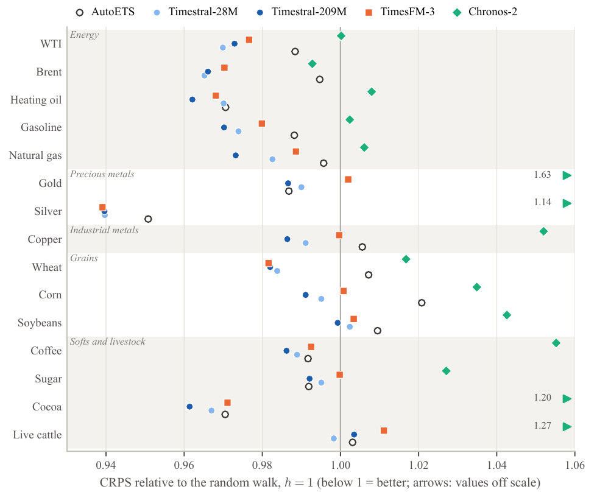
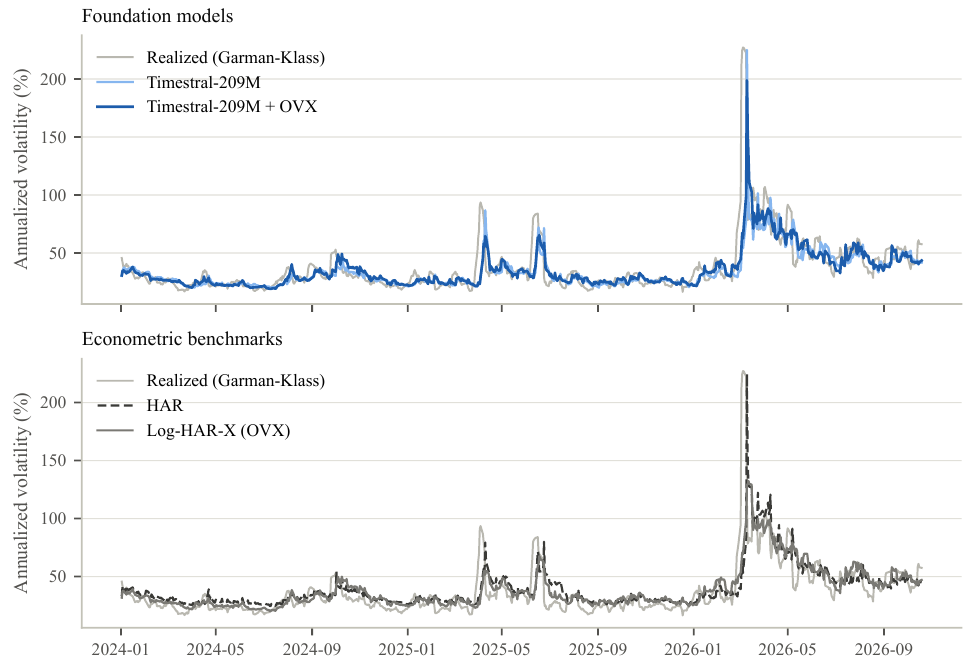

```{=html}
<p class="paper-links"><a class="btn-paper" href="foundation-models-commodity-futures.pdf">PDF</a> <a class="btn-paper" href="https://github.com/tommasozeri/Commodity-foundation-models">Code</a> <a class="btn-paper" href="#quarto-citation">Cite</a></p>
```

## Abstract

We evaluate four recent time series foundation models (Timestral-28M, Timestral-209M, TimesFM-3 and Chronos-2), used zero-shot, against econometric benchmarks on 15 commodity futures, with daily forecasts from January 2024 to October 2026. For price distributions, the best model lowers the CRPS of the random walk by 2–4% and beats AutoARIMA and AutoETS, while Chronos-2 is worse than the random walk at one day. For Value-at-Risk, the models match GARCH and are better calibrated than historical simulation. For realized volatility, they do not beat HAR on their own, but an equal-weight combination with a log-HAR beats HAR at every horizon, by up to 7%. Among the covariates tested, only the commodity's own implied volatility helps, lowering QLIKE by 6–14% at one day, but a log-HAR given the same index gains almost as much. Foundation models are useful for commodity forecasting mainly as complements to econometric models.

## Design

15 futures across energy, precious and industrial metals, grains, softs and livestock; one forecast origin per day, 708 per asset, at horizons of 1, 5 and 20 days. Each task has its own benchmark: random walk, AutoARIMA and AutoETS for prices; historical simulation and three GARCH models for VaR; HAR-RV for realized volatility (Garman-Klass). Differences are tested asset by asset with Diebold-Mariano and the Benjamini-Hochberg correction, and jointly with the Model Confidence Set.

## Main results

| Task | Best approach | Benchmark | Loss ratio ($h$ = 1 / 5 / 20) | Reading |
|---|---|---|---|---|
| Price | Timestral-209M | Random walk | 0.978 / 0.972 / 0.958 | Better on 12 of 15 assets at $h=1$, worse on none |
| VaR | Timestral-209M | Historical simulation | 0.990 ($h=1$) | On par with GARCH-t; 1% violations: 1.0% |
| Volatility | Timestral-209M + log-HAR | HAR-RV | 0.982 / 0.959 / 0.930 | In the MCS in 36 of 36 cases |
| Volatility, own index | Timestral with OVX/GVZ | log-HAR-X, same index | 0.94 / 1.01–1.03 / 1.14–1.17 | Better at one day, worse at one month |

Values below 1 favour the model (geometric mean across assets).





## Full text

```{=html}
<object class="pdf-viewer" data="foundation-models-commodity-futures.pdf" type="application/pdf"><p><a href="foundation-models-commodity-futures.pdf">Download PDF</a></p></object>
```
