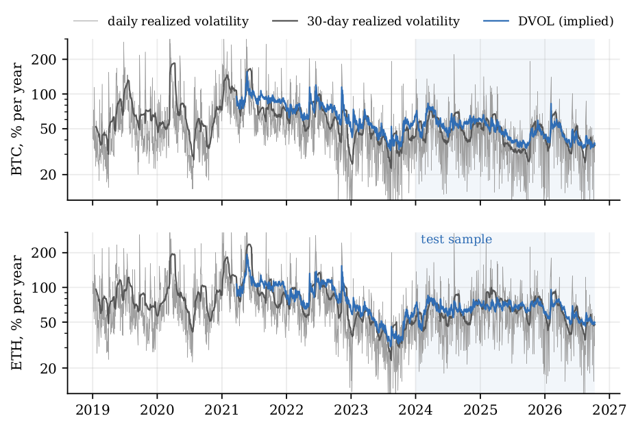
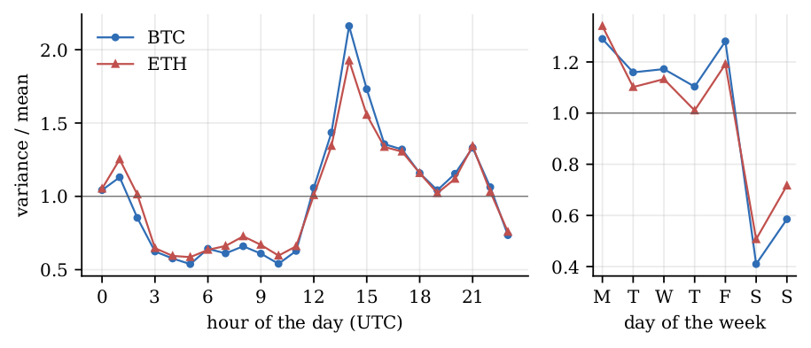
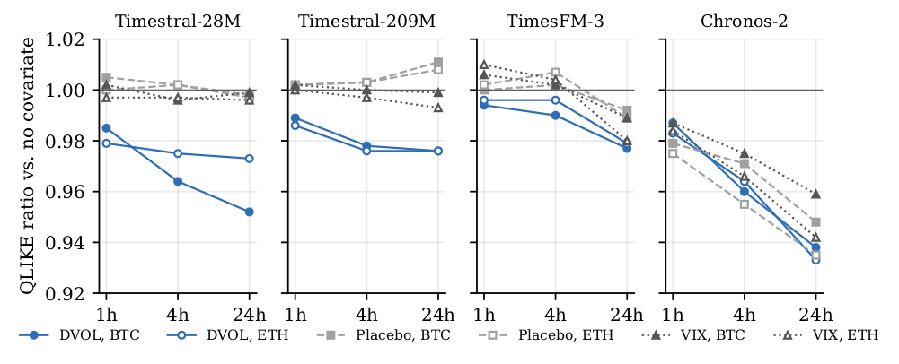

# Introduction

Time series foundation models are pre-trained on large collections of series and produce forecasts for a new series without estimation. Their record in finance is mixed. On stock returns, @rahimikia2025 find that pre-trained foundation models perform poorly both zero-shot and after fine-tuning. On realized volatility, @goel2025vol find that zero-shot TimesFM is a reasonable baseline but needs fine-tuning to beat econometric benchmarks, and across 50 equities, currencies and futures @brini2026 finds no uniform gain of nine zero-shot models over HAR. In a companion paper on 15 commodity futures [@zeri2026commodity] we found that the same four models used here do not beat HAR on their own, that an equal-weight combination with a log-HAR does, and that the only useful covariate is the commodity's own implied volatility, which a log-HAR can exploit almost as well.

This paper asks whether those conclusions hold in a market with different microstructure. Bitcoin and Ether trade 24 hours a day, seven days a week, so realized variance can be measured at any frequency without overnight gaps, and volatility is high and changes regime often [@liu2021]. We build daily and hourly realized variance from five-minute Binance spot returns between January 2019 and October 2026, and forecast it one, five and 22 days ahead and one, four and 24 hours ahead. The hourly series has about 68,000 observations per asset, which gives the foundation models a context of 4,096 hours and gives the tests much more power than daily data.

Three findings stand out. The first concerns benchmarks. Crypto volatility has a pronounced calendar pattern, documented for returns and volume by @baur2019 and for intraday dynamics by @eross2019: in our test sample weekend variance is 41% (Bitcoin) and 53% (Ether) of weekday variance, and hourly variance peaks at 14:00 UTC, when U.S. markets open, at about four times its minimum at 05:00 UTC. A HAR model that ignores this pattern loses 26% in QLIKE at one day on Bitcoin. The foundation models see the pattern in their context and reproduce it, so against an unadjusted HAR they look up to 35% better. Once the benchmarks are adjusted with day-of-week and hour-of-day factors estimated in real time, most of that advantage disappears.

The second finding is that combinations work where the models alone do not. On their own, the foundation models beat the adjusted HAR by 8--13% one hour ahead on Bitcoin, are about even with it at four hours, and lose by 10--24% at 24 hours and by 14--26% at 22 days. The equal-weight average with a log-HAR beats the log-HAR by 3--8% at one and four hours for all four models and both assets, with Diebold--Mariano tests significant after a Benjamini--Hochberg correction. TimesFM-3 combined with the log-HAR is in the 90% model confidence set in every hourly case, and neither HAR nor log-HAR is ever in it at one or four hours. At daily frequency the combination gains 2--4% at one day and nothing at longer horizons.

The third finding concerns covariates. The DVOL index of Deribit, a 30-day implied volatility, improves the hourly forecasts of Timestral and TimesFM-3 by 1--5%, and a placebo random walk does not, so the improvement comes from the information in DVOL. Funding rates of perpetual futures and the VIX add nothing. Chronos-2 behaves differently: it gains 1--7% from DVOL, but also from the VIX, from funding at 24 hours and from the placebo. Whatever the mechanism, its covariate gains measure a change in how the model forecasts when it receives any covariate, not the value of the covariate. As in the commodity paper, a log-HAR with the DVOL implied variance (log-HAR-X) is a hard benchmark for the foundation models with DVOL at long horizons, and the best forecast at one and four hours is the average of the two.

The rest of the paper is organized as follows. @sec-data describes the data, @sec-method the models, benchmarks and tests, @sec-results the results and @sec-contam the issue of pre-training contamination. @sec-concl concludes.

# Data {#sec-data}

## Realized variance

We use five-minute closing prices of the BTCUSDT and ETHUSDT spot pairs on Binance from 1 January 2019 to 10 October 2026, in UTC. On the complete five-minute grid, a log return $r_{j}$ exists when both consecutive closes are available. For a period $t$ (a UTC day or a UTC hour) with $M$ five-minute intervals, realized variance and realized quarticity are $$
  RV_t = \sum_{j=1}^{M} r_{t,j}^2, \qquad RQ_t = \frac{M}{3} \sum_{j=1}^{M} r_{t,j}^4,
$$ with $M=288$ for days and $M=12$ for hours [@andersen2003; @barndorff2002]. Because the market never closes, the first return of a period starts from the last close of the previous one and there is no overnight gap. Periods with fewer than 90% of their returns are set to missing; this affects 0.42% of days and 0.11% of hours, mostly exchange outages. Five minutes is a common compromise between sampling error and microstructure noise for liquid assets, and the two pairs are among the most traded in the world.

@tbl-data summarizes the series and @fig-vol plots daily realized volatility. Volatility was much higher in 2020--2022 than in the test period; this matters for the estimation window of the benchmarks (@sec-bench). Ether is about 40% more volatile than Bitcoin.

::: {#tbl-data}
+----------------------------------+---------------+-----------------+
|                                  | Daily         | Hourly          |
+:=================================+======:+======:+=======:+=======:+
| 2-3(lr)4-5                       | BTC   | ETH   | BTC    | ETH    |
+----------------------------------+-------+-------+--------+--------+
| Periods, Jan 2019--Oct 2026      | 2,840 | 2,840 | 68,153 | 68,153 |
+----------------------------------+-------+-------+--------+--------+
| Missing RV (%)                   | 0.42  | 0.42  | 0.11   | 0.11   |
+----------------------------------+-------+-------+--------+--------+
| Periods in the test sample       | 1,014 | 1,014 | 24,329 | 24,329 |
+----------------------------------+-------+-------+--------+--------+
| Forecast origins                 | 1,014 | 1,014 | 4,866  | 4,866  |
+----------------------------------+-------+-------+--------+--------+
| Mean annualized volatility (%)   | 43.5  | 60.0  | 38.9   | 53.4   |
+----------------------------------+-------+-------+--------+--------+
| Median annualized volatility (%) | 40.2  | 55.0  | 31.6   | 43.6   |
+----------------------------------+-------+-------+--------+--------+
| Weekend / weekday variance       | 0.41  | 0.53  | 0.41   | 0.53   |
+----------------------------------+-------+-------+--------+--------+
| Peak / trough hour variance      |       |       | 4.02   | 3.29   |
+----------------------------------+-------+-------+--------+--------+
| Mean DVOL (%)                    | 49.3  | 65.2  | 49.3   | 65.1   |
+----------------------------------+-------+-------+--------+--------+

: Realized variance of Bitcoin and Ether. Annualized volatility is $\sqrt{K \cdot RV_t}$ in percent, with $K=365$ days or $8{,}760$ hours per year; averages and ratios refer to the test sample (1 January 2024 to 10 October 2026). Hourly forecast origins are taken every five hours.
:::

{#fig-vol}

## Calendar effects

@fig-cal shows the calendar pattern of variance in the test sample. Variance is lowest between 03:00 and 11:00 UTC, rises when European markets open, and peaks at 14:00--15:00 UTC, the opening of U.S. equity markets and the release time of most U.S. macroeconomic data. Saturday and Sunday have about half the variance of weekdays, and Monday and Friday are the most volatile days. It has two consequences. A model of hourly variance that ignores the time of day forecasts the same variance for 05:00 and 14:00, and a model of daily variance that ignores the day of the week overpredicts every weekend [see @andersen1997 for intraday periodicity in other markets].

{#fig-cal}

## Covariates

We test four covariates, each aligned so that the value used at a forecast origin is known at that time:

- **DVOL**: the Deribit implied volatility index for Bitcoin or Ether, a 30-day measure built from option prices, available from March 2021. Daily models use the close of the UTC day; hourly models use the close of each hour, downloaded from the public Deribit API.

- **Funding**: the funding rate of the Bybit perpetual future, settled every eight hours. Daily models use the sum of the rates settled during the day; hourly models use the last settled rate.

- **VIX**: the CBOE volatility index, as a measure of risk in traditional markets. Because it closes in New York at 21:00 or 22:00 UTC, we lag it by one day at both frequencies.

- **Placebo**: a Gaussian random walk with a fixed seed, unrelated to the data by construction.

The placebo is there to separate the value of the information in a covariate from the effect of giving the model a covariate at all.

# Methodology {#sec-method}

## Target and forecast design

The target at horizon $h$ is the average variance over the next $h$ periods, $\overline{RV}_{t,h} = h^{-1}\sum_{k=0}^{h-1} RV_{t+k}$, with $h \in \{1,5,22\}$ days or $h \in \{1,4,24\}$ hours. A forecast made at origin $t$ uses data up to the end of period $t-1$. The test sample starts on 1 January 2024. At daily frequency there is one origin per day, 1,014 per asset. At hourly frequency a forecast every hour would give about 24,000 origins per asset and model, which is costly on a single GPU; we take one origin every five hours, 4,866 per asset. Since five does not divide 24, the origins rotate through all hours of the day.

## Foundation models

We use Timestral-28M and Timestral-209M [@mistral2026timestral], TimesFM-3 [@jain2026timesfm3], the successor of @das2024timesfm, and Chronos-2 [@ansari2025chronos2], which extends @ansari2024chronos. All four are used zero-shot with default settings. The input is annualized realized volatility, $\sqrt{K\, RV_t}\cdot 100$, with missing values carried forward; this scale is close to that of the series the models were trained on and avoids very small numbers. The context is 1,000 days at daily frequency and 4,096 hours (about 170 days) at hourly frequency.

Each model returns quantiles of volatility for each of the next $h$ periods. TimesFM-3 returns deciles only, so we use the nine deciles $q_{t,k,j}$, $j=1,\dots,9$, for all models. The variance forecast is the average of the squared deciles, converted back to variance: $$
  \widehat{RV}_{t,h} = \frac{1}{9h} \sum_{k=1}^{h} \sum_{j=1}^{9} \frac{(q_{t,k,j}/100)^2}{K}.
$$ Squaring the median would underestimate the mean variance because the predictive distribution of volatility is skewed to the right; the average of the squared deciles approximates $E[\sigma^2]$.

Covariates enter as past covariates over the same context window. Funding is expressed in basis points. Each covariate is used on its own, so every model is run in five configurations: without covariates and with each of the four.

## Benchmarks {#sec-bench}

The main benchmark is the HAR model of @corsi2009, estimated directly for each horizon: $$
  \overline{RV}_{t,h} = \beta_0 + \beta_1 RV_{t-1} + \beta_2 \overline{RV}^{(w)}_{t-1}
  + \beta_3 \overline{RV}^{(m)}_{t-1} + \varepsilon_{t},
$$ where $\overline{RV}^{(w)}$ and $\overline{RV}^{(m)}$ are averages over the last $w$ and $m$ periods: seven and 30 days at daily frequency (the crypto week has seven trading days), 24 and 168 hours at hourly frequency. We also use:

- **log-HAR**: the same regression in logarithms, with forecast $\exp(\hat{y} + s^2/2)$, where $s^2$ is the residual variance;

- **HARQ** [@bollerslev2016]: the HAR with an extra term $RV_{t-1}\sqrt{RQ_{t-1}}$, so that the weight on the last period falls when it is measured with more error (daily frequency only, where $RQ$ is computed from 288 returns);

- **log-HAR-X**: the log-HAR with the log of the DVOL implied variance $(\text{DVOL}_{t-1}/100)^2/K$ as an extra regressor. It uses the same information as the foundation models with DVOL.

Forecasts of the HAR and HARQ in levels are kept within the range of the target in the estimation sample.

#### Calendar adjustment.

All benchmarks work on calendar-adjusted variance. At each re-estimation we compute multiplicative factors from data before the origin only: at daily frequency, mean variance by day of the week over the last 365 days, normalized to mean one; at hourly frequency, mean variance by hour of the day over the last 90 days, and then by day of the week over the last 365 days on the hour-adjusted series. Realized variance is divided by its factor before the regression (realized quarticity by the squared factor), and the forecast is multiplied by the average factor of the periods being forecast. As a reference we also report a HAR without this adjustment.

#### Estimation window.

The benchmarks are estimated on a rolling window of 1,000 days at daily frequency, the same span as the foundation model context, and of two years at hourly frequency. With an expanding window from 2019, the daily HAR inherits the high-volatility regime of 2020--2022 and overpredicts throughout the test sample. The models are re-estimated every 20 origins at daily frequency and every 24 origins (five days) at hourly frequency.

#### Combinations.

We combine each foundation model with the log-HAR by a simple average of the variance forecasts, and each foundation model with DVOL with the log-HAR-X in the same way. Equal weights avoid estimating weights, which rarely pays off in practice [@bates1969; @timmermann2006; @smith2009].

## Evaluation

The loss function is QLIKE, $L(RV, \widehat{RV}) = RV/\widehat{RV} - \log(RV/\widehat{RV}) - 1$, which ranks variance forecasts consistently when the target is a noisy but unbiased proxy [@patton2011]. We report the ratio of the mean QLIKE of a model to that of a reference: a value of 0.95 means a 5% lower loss. Equal predictive accuracy is tested with the @diebold1995 test with the small-sample correction of @harvey1997 and a Newey--West variance [@newey1987] with $\lceil h/s \rceil - 1$ lags, where $s$ is the step between origins. Within each comparison, the six tests of a frequency (two assets times three horizons) form a family, and we control the false discovery rate at 10% with the procedure of @benjamini1995. We also compute the 90% model confidence set of @hansen2011 with the range statistic and a block bootstrap of 1,000 replications [@arch], over HAR, log-HAR, HARQ, the four models and the four combinations. Finally, we split the test sample by calendar year and into origins before and after the public release of each model.

# Results {#sec-results}

## Calendar adjustment

The first panel of @tbl-daily and @tbl-hourly compares the HAR with and without calendar adjustment. The adjustment lowers QLIKE by 26% (Bitcoin) and 18% (Ether) one day ahead, by 4--7% at five days and not at all at 22 days, where weekends average out. At hourly frequency the gain is 8--25% at every horizon, since even a 24-hour average covers an uneven mix of weekdays and weekends.

The adjustment changes the assessment of the foundation models. One day ahead on Bitcoin, Timestral-28M has a QLIKE ratio of 0.887 against the adjusted HAR; against the unadjusted HAR the ratio would be $0.887 \times 0.736 = 0.65$, an apparent gain of 35%. A comparison of foundation models with HAR on crypto data that does not adjust the benchmark for the calendar mostly measures the weekend effect.

## Daily frequency

::: {#tbl-daily}
+--------------------------------+-------------------------------+---------------------------+
|                                | BTC                           | ETH                       |
+:===============================+:=========:+:=========:+:=====:+:=========:+:=====:+:=====:+
| 2-4(lr)5-7                     | 1d        | 5d        | 22d   | 1d        | 5d    | 22d   |
+--------------------------------+-----------+-----------+-------+-----------+-------+-------+
| *Calendar adjustment*                                                                      |
+--------------------------------+-----------+-----------+-------+-----------+-------+-------+
| HAR vs. HAR without adjustment | **0.736** | **0.928** | 1.009 | **0.817** | 0.959 | 1.005 |
+--------------------------------+-----------+-----------+-------+-----------+-------+-------+
|                                |           |           |       |           |       |       |
+--------------------------------+-----------+-----------+-------+-----------+-------+-------+
| Timestral-28M                  | 0.887     | 0.980     | 1.138 | 0.951     | 1.079 | 1.172 |
+--------------------------------+-----------+-----------+-------+-----------+-------+-------+
| Timestral-209M                 | 0.889     | 1.019     | 1.203 | 0.957     | 1.125 | 1.259 |
+--------------------------------+-----------+-----------+-------+-----------+-------+-------+
| TimesFM-3                      | 0.897     | 1.008     | 1.161 | 0.961     | 1.100 | 1.193 |
+--------------------------------+-----------+-----------+-------+-----------+-------+-------+
| Chronos-2                      | 0.909     | 1.015     | 1.213 | 0.989     | 1.101 | 1.224 |
+--------------------------------+-----------+-----------+-------+-----------+-------+-------+
|                                |           |           |       |           |       |       |
+--------------------------------+-----------+-----------+-------+-----------+-------+-------+
| Timestral-28M                  | 0.933     | 1.013     | 1.146 | 1.014     | 1.123 | 1.191 |
+--------------------------------+-----------+-----------+-------+-----------+-------+-------+
| Timestral-209M                 | 0.935     | 1.053     | 1.212 | 1.021     | 1.171 | 1.280 |
+--------------------------------+-----------+-----------+-------+-----------+-------+-------+
| TimesFM-3                      | 0.944     | 1.042     | 1.170 | 1.025     | 1.145 | 1.213 |
+--------------------------------+-----------+-----------+-------+-----------+-------+-------+
| Chronos-2                      | 0.956     | 1.049     | 1.222 | 1.055     | 1.146 | 1.244 |
+--------------------------------+-----------+-----------+-------+-----------+-------+-------+
|                                |           |           |       |           |       |       |
+--------------------------------+-----------+-----------+-------+-----------+-------+-------+
| Timestral-28M                  | **0.873** | 0.898     | 0.953 | 0.937     | 0.983 | 0.996 |
+--------------------------------+-----------+-----------+-------+-----------+-------+-------+
| Timestral-209M                 | **0.874** | 0.910     | 0.966 | 0.936     | 0.998 | 1.017 |
+--------------------------------+-----------+-----------+-------+-----------+-------+-------+
| TimesFM-3                      | **0.870** | 0.903     | 0.955 | 0.937     | 0.988 | 0.996 |
+--------------------------------+-----------+-----------+-------+-----------+-------+-------+
| Chronos-2                      | **0.878** | 0.907     | 0.956 | 0.945     | 0.985 | 0.999 |
+--------------------------------+-----------+-----------+-------+-----------+-------+-------+
|                                |           |           |       |           |       |       |
+--------------------------------+-----------+-----------+-------+-----------+-------+-------+
| Timestral-28M                  | **0.962** | 0.970     | 0.933 | **0.971** | 1.006 | 1.009 |
+--------------------------------+-----------+-----------+-------+-----------+-------+-------+
| Timestral-209M                 | **0.962** | 0.984     | 0.947 | **0.970** | 1.020 | 1.030 |
+--------------------------------+-----------+-----------+-------+-----------+-------+-------+
| TimesFM-3                      | 0.958     | 0.975     | 0.935 | 0.971     | 1.010 | 1.009 |
+--------------------------------+-----------+-----------+-------+-----------+-------+-------+
| Chronos-2                      | 0.967     | 0.980     | 0.937 | 0.979     | 1.007 | 1.012 |
+--------------------------------+-----------+-----------+-------+-----------+-------+-------+

: Daily frequency: QLIKE ratios. A value below one means that the model has a lower loss than the reference. Bold: Diebold--Mariano test (HLN correction) significant after Benjamini--Hochberg at 10% within each comparison.
:::

@tbl-daily shows the daily results. On their own, the foundation models beat the HAR by 9--11% one day ahead on Bitcoin and by 1--5% on Ether, but none of these differences is significant. At five days they are about even with the HAR on Bitcoin and 8--13% worse on Ether, and at 22 days they are 14--26% worse. Against the HARQ, the strongest benchmark at long horizons, they lose at every horizon except one day on Bitcoin.

Combined with the log-HAR, every model beats the HAR on Bitcoin, significantly at one day (ratios 0.870--0.878), and is close to the HAR on Ether. Against the log-HAR, which is a stronger benchmark than the HAR in levels, the combination gains 3--4% one day ahead on Bitcoin and 2--3% on Ether, significantly for the two Timestral models. At longer horizons the gain is not significant: 2--7% on Bitcoin, nothing on Ether. The model confidence set (@tbl-mcs) is wide at daily frequency, as expected with about a thousand overlapping observations; HAR and log-HAR are excluded one day ahead on both assets, while HARQ and all four combinations are always included.

## Hourly frequency

::: {#tbl-hourly}
+--------------------------------+-----------------------------------+-----------------------------------+
|                                | BTC                               | ETH                               |
+:===============================+:=========:+:=========:+:=========:+:=========:+:=========:+:=========:+
| 2-4(lr)5-7                     | 1h        | 4h        | 24h       | 1h        | 4h        | 24h       |
+--------------------------------+-----------+-----------+-----------+-----------+-----------+-----------+
| *Calendar adjustment*                                                                                  |
+--------------------------------+-----------+-----------+-----------+-----------+-----------+-----------+
| HAR vs. HAR without adjustment | **0.809** | **0.747** | **0.819** | **0.917** | **0.843** | **0.876** |
+--------------------------------+-----------+-----------+-----------+-----------+-----------+-----------+
|                                |           |           |           |           |           |           |
+--------------------------------+-----------+-----------+-----------+-----------+-----------+-----------+
| Timestral-28M                  | **0.908** | 0.947     | 1.113     | 0.992     | 1.013     | **1.203** |
+--------------------------------+-----------+-----------+-----------+-----------+-----------+-----------+
| Timestral-209M                 | **0.897** | 0.923     | 1.098     | 0.968     | 0.986     | **1.192** |
+--------------------------------+-----------+-----------+-----------+-----------+-----------+-----------+
| TimesFM-3                      | **0.872** | 0.912     | 1.098     | 0.947     | 0.979     | **1.165** |
+--------------------------------+-----------+-----------+-----------+-----------+-----------+-----------+
| Chronos-2                      | **0.916** | 0.948     | 1.136     | 0.989     | 1.017     | **1.243** |
+--------------------------------+-----------+-----------+-----------+-----------+-----------+-----------+
|                                |           |           |           |           |           |           |
+--------------------------------+-----------+-----------+-----------+-----------+-----------+-----------+
| Timestral-28M                  | **0.881** | **0.846** | **0.883** | **0.932** | **0.892** | 0.942     |
+--------------------------------+-----------+-----------+-----------+-----------+-----------+-----------+
| Timestral-209M                 | **0.873** | **0.835** | **0.878** | **0.925** | **0.881** | 0.938     |
+--------------------------------+-----------+-----------+-----------+-----------+-----------+-----------+
| TimesFM-3                      | **0.865** | **0.833** | **0.874** | **0.917** | **0.882** | **0.927** |
+--------------------------------+-----------+-----------+-----------+-----------+-----------+-----------+
| Chronos-2                      | **0.875** | **0.835** | **0.879** | **0.928** | **0.886** | 0.946     |
+--------------------------------+-----------+-----------+-----------+-----------+-----------+-----------+
|                                |           |           |           |           |           |           |
+--------------------------------+-----------+-----------+-----------+-----------+-----------+-----------+
| Timestral-28M                  | **0.940** | **0.946** | 0.975     | **0.966** | **0.963** | 1.008     |
+--------------------------------+-----------+-----------+-----------+-----------+-----------+-----------+
| Timestral-209M                 | **0.931** | **0.934** | 0.970     | **0.959** | **0.951** | 1.004     |
+--------------------------------+-----------+-----------+-----------+-----------+-----------+-----------+
| TimesFM-3                      | **0.922** | **0.932** | 0.965     | **0.951** | **0.952** | 0.992     |
+--------------------------------+-----------+-----------+-----------+-----------+-----------+-----------+
| Chronos-2                      | **0.933** | **0.934** | 0.971     | **0.962** | **0.956** | 1.013     |
+--------------------------------+-----------+-----------+-----------+-----------+-----------+-----------+

: Hourly frequency: QLIKE ratios. See @tbl-daily for details.
:::

::: {#tbl-mcs}
+-----------------------------+-----------------------------------------------------------------------------------------+-----------------------------------------------------------------------------------------+
|                             | Daily                                                                                   | Hourly                                                                                  |
+:============================+:============:+:============:+:============:+:============:+:============:+:============:+:============:+:============:+:============:+:============:+:============:+:============:+
| 2-7(lr)8-13                 | BTC                                        | ETH                                        | BTC                                        | ETH                                        |
+-----------------------------+--------------+--------------+--------------+--------------+--------------+--------------+--------------+--------------+--------------+--------------+--------------+--------------+
| 2-4(lr)5-7(lr)8-10(lr)11-13 | 1d           | 5d           | 22d          | 1d           | 5d           | 22d          | 1h           | 4h           | 24h          | 1h           | 4h           | 24h          |
+-----------------------------+--------------+--------------+--------------+--------------+--------------+--------------+--------------+--------------+--------------+--------------+--------------+--------------+
| HAR                         |              |              | $\checkmark$ |              | $\checkmark$ | $\checkmark$ |              |              |              |              |              |              |
+-----------------------------+--------------+--------------+--------------+--------------+--------------+--------------+--------------+--------------+--------------+--------------+--------------+--------------+
| log-HAR                     |              | $\checkmark$ | $\checkmark$ |              | $\checkmark$ | $\checkmark$ |              |              | $\checkmark$ |              |              | $\checkmark$ |
+-----------------------------+--------------+--------------+--------------+--------------+--------------+--------------+--------------+--------------+--------------+--------------+--------------+--------------+
| HARQ                        | $\checkmark$ | $\checkmark$ | $\checkmark$ | $\checkmark$ | $\checkmark$ | $\checkmark$ | --           | --           | --           | --           | --           | --           |
+-----------------------------+--------------+--------------+--------------+--------------+--------------+--------------+--------------+--------------+--------------+--------------+--------------+--------------+
| Timestral-28M               | $\checkmark$ | $\checkmark$ | $\checkmark$ | $\checkmark$ | $\checkmark$ |              |              |              |              |              |              |              |
+-----------------------------+--------------+--------------+--------------+--------------+--------------+--------------+--------------+--------------+--------------+--------------+--------------+--------------+
| Timestral-209M              | $\checkmark$ |              | $\checkmark$ | $\checkmark$ |              |              |              |              |              |              |              |              |
+-----------------------------+--------------+--------------+--------------+--------------+--------------+--------------+--------------+--------------+--------------+--------------+--------------+--------------+
| TimesFM-3                   | $\checkmark$ | $\checkmark$ | $\checkmark$ | $\checkmark$ |              |              | $\checkmark$ |              |              |              |              |              |
+-----------------------------+--------------+--------------+--------------+--------------+--------------+--------------+--------------+--------------+--------------+--------------+--------------+--------------+
| Chronos-2                   | $\checkmark$ | $\checkmark$ | $\checkmark$ | $\checkmark$ | $\checkmark$ |              |              |              |              |              |              |              |
+-----------------------------+--------------+--------------+--------------+--------------+--------------+--------------+--------------+--------------+--------------+--------------+--------------+--------------+
| Timestral-28M + log-HAR     | $\checkmark$ | $\checkmark$ | $\checkmark$ | $\checkmark$ | $\checkmark$ | $\checkmark$ |              |              | $\checkmark$ |              |              |              |
+-----------------------------+--------------+--------------+--------------+--------------+--------------+--------------+--------------+--------------+--------------+--------------+--------------+--------------+
| Timestral-209M + log-HAR    | $\checkmark$ | $\checkmark$ | $\checkmark$ | $\checkmark$ | $\checkmark$ | $\checkmark$ |              | $\checkmark$ | $\checkmark$ |              | $\checkmark$ | $\checkmark$ |
+-----------------------------+--------------+--------------+--------------+--------------+--------------+--------------+--------------+--------------+--------------+--------------+--------------+--------------+
| TimesFM-3 + log-HAR         | $\checkmark$ | $\checkmark$ | $\checkmark$ | $\checkmark$ | $\checkmark$ | $\checkmark$ | $\checkmark$ | $\checkmark$ | $\checkmark$ | $\checkmark$ | $\checkmark$ | $\checkmark$ |
+-----------------------------+--------------+--------------+--------------+--------------+--------------+--------------+--------------+--------------+--------------+--------------+--------------+--------------+
| Chronos-2 + log-HAR         | $\checkmark$ | $\checkmark$ | $\checkmark$ | $\checkmark$ | $\checkmark$ | $\checkmark$ | $\checkmark$ | $\checkmark$ | $\checkmark$ |              | $\checkmark$ |              |
+-----------------------------+--------------+--------------+--------------+--------------+--------------+--------------+--------------+--------------+--------------+--------------+--------------+--------------+

: Models in the 90% model confidence set ($\checkmark$), computed over HAR, log-HAR, HARQ (daily only), the four foundation models and their combinations with the log-HAR.
:::

Hourly data give a sharper picture (@tbl-hourly). On their own, the foundation models beat the HAR by 8--13% one hour ahead on Bitcoin, significantly for all four, and by 1--5% on Ether. Their advantage fades at four hours and turns into a loss of 10--24% at 24 hours, significant on Ether. The pattern is the same as at daily frequency: the models track the short-run dynamics of volatility well and its level at longer horizons poorly.

The combinations are better at every horizon. Against the HAR they gain 12--17% on Bitcoin and 5--12% on Ether, and against the log-HAR they gain 5--8% on Bitcoin and 3--5% on Ether one and four hours ahead, significantly for every model. At 24 hours the gain against the log-HAR is at most 3.5% and not significant. TimesFM-3 gives the best combination in five of the six hourly cases and its combination is in the model confidence set in all six, while HAR is never included and log-HAR only at 24 hours (@tbl-mcs). The differences between the four foundation models are small compared with the gain from combining any of them with the log-HAR; in particular, Timestral-209M is not better than Timestral-28M.

## Stability over time

::: {#tbl-sub}
+----------------+----------+-------------------------------------------+-------------------------------------------+
|                |          | Daily, $h=1$                              | Hourly, $h=1$                             |
+:===============+:=========+:========:+:========:+:========:+:========:+:========:+:========:+:========:+:========:+
| 3-6(lr)7-10    |          | 2024     | 2025     | 2026     | post     | 2024     | 2025     | 2026     | post     |
+----------------+----------+----------+----------+----------+----------+----------+----------+----------+----------+
| *Foundation model vs. HAR*                                                                                        |
+----------------+----------+----------+----------+----------+----------+----------+----------+----------+----------+
| Timestral-28M  | BTC      | 0.927    | 0.935    | 0.762    |          | 0.942    | 0.926    | 0.863    |          |
+----------------+----------+----------+----------+----------+----------+----------+----------+----------+----------+
|                | ETH      | 0.953    | 0.992    | 0.908    |          | 1.058    | 0.979    | 0.938    |          |
+----------------+----------+----------+----------+----------+----------+----------+----------+----------+----------+
| Timestral-209M | BTC      | 0.953    | 0.926    | 0.747    |          | 0.923    | 0.923    | 0.851    |          |
+----------------+----------+----------+----------+----------+----------+----------+----------+----------+----------+
|                | ETH      | 0.957    | 0.995    | 0.921    |          | 1.035    | 0.961    | 0.906    |          |
+----------------+----------+----------+----------+----------+----------+----------+----------+----------+----------+
| TimesFM-3      | BTC      | 0.930    | 0.981    | 0.719    |          | 0.896    | 0.895    | 0.835    | 0.777    |
+----------------+----------+----------+----------+----------+----------+----------+----------+----------+----------+
|                | ETH      | 0.943    | 1.039    | 0.775    |          | 1.003    | 0.958    | 0.882    | 0.832    |
+----------------+----------+----------+----------+----------+----------+----------+----------+----------+----------+
| Chronos-2      | BTC      | 0.954    | 0.954    |          | 0.801    | 0.954    | 0.971    |          | 0.840    |
+----------------+----------+----------+----------+----------+----------+----------+----------+----------+----------+
|                | ETH      | 0.970    | 1.064    |          | 0.938    | 1.087    | 1.008    |          | 0.881    |
+----------------+----------+----------+----------+----------+----------+----------+----------+----------+----------+
|                |          |          |          |          |          |          |          |          |          |
+----------------+----------+----------+----------+----------+----------+----------+----------+----------+----------+
| Timestral-28M  | BTC      | 0.955    | 1.002    | 0.910    |          | 0.949    | 0.958    | 0.912    |          |
+----------------+----------+----------+----------+----------+----------+----------+----------+----------+----------+
|                | ETH      | 0.965    | 0.984    | 0.962    |          | 0.981    | 0.969    | 0.955    |          |
+----------------+----------+----------+----------+----------+----------+----------+----------+----------+----------+
| Timestral-209M | BTC      | 0.966    | 0.997    | 0.902    |          | 0.940    | 0.954    | 0.900    |          |
+----------------+----------+----------+----------+----------+----------+----------+----------+----------+----------+
|                | ETH      | 0.963    | 0.984    | 0.961    |          | 0.975    | 0.961    | 0.950    |          |
+----------------+----------+----------+----------+----------+----------+----------+----------+----------+----------+
| TimesFM-3      | BTC      | 0.953    | 1.020    | 0.847    |          | 0.928    | 0.943    | 0.874    | 0.944    |
+----------------+----------+----------+----------+----------+----------+----------+----------+----------+----------+
|                | ETH      | 0.958    | 1.000    | 0.912    |          | 0.961    | 0.958    | 0.930    | 0.928    |
+----------------+----------+----------+----------+----------+----------+----------+----------+----------+----------+
| Chronos-2      | BTC      | 0.961    | 1.010    |          | 0.922    | 0.944    | 0.975    |          | 0.890    |
+----------------+----------+----------+----------+----------+----------+----------+----------+----------+----------+
|                | ETH      | 0.969    | 0.990    |          | 0.978    | 0.986    | 0.973    |          | 0.929    |
+----------------+----------+----------+----------+----------+----------+----------+----------+----------+----------+

: QLIKE ratios by subperiod, one period ahead. "Post" collects the origins after the public release of each model (Chronos-2: 20 October 2025; TimesFM-3: 1 August 2026), which are excluded from the calendar year; it is shown when it has at least 100 origins. The Timestral models were released on 1 October 2026, too late for a post-release sample.
:::

@tbl-sub splits the test sample by year. The models alone gain most in 2026, by 24--28% on Bitcoin at daily frequency, and least in 2025, when they are about even with the HAR on Ether. The combinations with the log-HAR are below one in every year at hourly frequency; at daily frequency they are about even with the log-HAR in 2025 on Bitcoin and better in 2024 and 2026. The year-to-year variation is large, so a test sample of less than three years is a real limitation.

## Covariates

::: {#tbl-covd}
+----------------+-------------------------------+-----------------------------------+
|                | BTC                           | ETH                               |
+:===============+:=========:+:=========:+:=====:+:=========:+:=========:+:=========:+
| 2-4(lr)5-7     | 1d        | 5d        | 22d   | 1d        | 5d        | 22d       |
+----------------+-----------+-----------+-------+-----------+-----------+-----------+
| *DVOL vs. no covariate*                                                            |
+----------------+-----------+-----------+-------+-----------+-----------+-----------+
| Timestral-28M  | 0.983     | 0.999     | 0.986 | 0.988     | 1.007     | 0.969     |
+----------------+-----------+-----------+-------+-----------+-----------+-----------+
| Timestral-209M | **0.977** | 0.982     | 0.987 | **0.975** | 0.999     | 0.988     |
+----------------+-----------+-----------+-------+-----------+-----------+-----------+
| TimesFM-3      | 1.000     | 1.016     | 1.029 | 0.997     | 1.006     | 1.012     |
+----------------+-----------+-----------+-------+-----------+-----------+-----------+
| Chronos-2      | 1.002     | 1.010     | 0.995 | 1.005     | 1.035     | 1.043     |
+----------------+-----------+-----------+-------+-----------+-----------+-----------+
|                |           |           |       |           |           |           |
+----------------+-----------+-----------+-------+-----------+-----------+-----------+
| Timestral-28M  | 1.007     | 1.008     | 0.989 | 1.004     | 1.008     | 0.980     |
+----------------+-----------+-----------+-------+-----------+-----------+-----------+
| Timestral-209M | 1.008     | 1.001     | 0.981 | 1.003     | 1.002     | 0.977     |
+----------------+-----------+-----------+-------+-----------+-----------+-----------+
| TimesFM-3      | 1.001     | 1.008     | 1.017 | 1.003     | 1.012     | 1.017     |
+----------------+-----------+-----------+-------+-----------+-----------+-----------+
| Chronos-2      | 1.006     | 0.997     | 0.987 | 1.019     | 1.032     | 1.012     |
+----------------+-----------+-----------+-------+-----------+-----------+-----------+
|                |           |           |       |           |           |           |
+----------------+-----------+-----------+-------+-----------+-----------+-----------+
| Timestral-28M  | 1.002     | 1.012     | 1.003 | 0.992     | 0.999     | 1.005     |
+----------------+-----------+-----------+-------+-----------+-----------+-----------+
| Timestral-209M | 1.002     | 0.995     | 0.984 | 0.995     | 0.994     | 0.998     |
+----------------+-----------+-----------+-------+-----------+-----------+-----------+
| TimesFM-3      | 0.998     | 1.002     | 1.009 | 0.998     | 1.006     | 1.016     |
+----------------+-----------+-----------+-------+-----------+-----------+-----------+
| Chronos-2      | 0.997     | 0.999     | 0.980 | 0.993     | 1.017     | 1.022     |
+----------------+-----------+-----------+-------+-----------+-----------+-----------+
|                |           |           |       |           |           |           |
+----------------+-----------+-----------+-------+-----------+-----------+-----------+
| Timestral-28M  | 1.002     | 1.000     | 0.987 | 0.996     | 0.989     | **0.953** |
+----------------+-----------+-----------+-------+-----------+-----------+-----------+
| Timestral-209M | 0.998     | **0.983** | 0.968 | 0.998     | **0.985** | **0.958** |
+----------------+-----------+-----------+-------+-----------+-----------+-----------+
| TimesFM-3      | 1.000     | 1.003     | 0.991 | 1.002     | 1.006     | 0.985     |
+----------------+-----------+-----------+-------+-----------+-----------+-----------+
| Chronos-2      | 1.018     | 1.007     | 1.013 | 1.021     | **1.032** | 1.031     |
+----------------+-----------+-----------+-------+-----------+-----------+-----------+

: Covariates, daily frequency: QLIKE ratio of each foundation model with a covariate to the same model without covariates. Bold as in @tbl-daily.
:::

::: {#tbl-covh}
+----------------+-----------------------------------+-----------------------------------+
|                | BTC                               | ETH                               |
+:===============+:=========:+:=========:+:=========:+:=========:+:=========:+:=========:+
| 2-4(lr)5-7     | 1h        | 4h        | 24h       | 1h        | 4h        | 24h       |
+----------------+-----------+-----------+-----------+-----------+-----------+-----------+
| *DVOL vs. no covariate*                                                                |
+----------------+-----------+-----------+-----------+-----------+-----------+-----------+
| Timestral-28M  | **0.985** | **0.964** | **0.952** | **0.979** | **0.975** | **0.973** |
+----------------+-----------+-----------+-----------+-----------+-----------+-----------+
| Timestral-209M | **0.989** | **0.978** | **0.976** | **0.986** | **0.976** | **0.976** |
+----------------+-----------+-----------+-----------+-----------+-----------+-----------+
| TimesFM-3      | 0.994     | **0.990** | **0.977** | 0.996     | 0.996     | **0.979** |
+----------------+-----------+-----------+-----------+-----------+-----------+-----------+
| Chronos-2      | **0.987** | **0.960** | **0.938** | **0.983** | **0.964** | **0.933** |
+----------------+-----------+-----------+-----------+-----------+-----------+-----------+
|                |           |           |           |           |           |           |
+----------------+-----------+-----------+-----------+-----------+-----------+-----------+
| Timestral-28M  | 1.000     | 1.000     | 1.007     | 0.991     | 0.996     | 0.997     |
+----------------+-----------+-----------+-----------+-----------+-----------+-----------+
| Timestral-209M | 1.001     | 1.000     | 1.004     | 0.998     | 0.995     | 0.996     |
+----------------+-----------+-----------+-----------+-----------+-----------+-----------+
| TimesFM-3      | 1.001     | 0.997     | 0.990     | 1.004     | 0.997     | **0.977** |
+----------------+-----------+-----------+-----------+-----------+-----------+-----------+
| Chronos-2      | 1.006     | 1.000     | **0.955** | 1.007     | 0.991     | **0.942** |
+----------------+-----------+-----------+-----------+-----------+-----------+-----------+
|                |           |           |           |           |           |           |
+----------------+-----------+-----------+-----------+-----------+-----------+-----------+
| Timestral-28M  | 1.002     | 0.996     | 0.999     | 0.997     | 0.997     | 0.996     |
+----------------+-----------+-----------+-----------+-----------+-----------+-----------+
| Timestral-209M | 1.002     | 1.000     | 0.999     | 1.000     | 0.997     | **0.993** |
+----------------+-----------+-----------+-----------+-----------+-----------+-----------+
| TimesFM-3      | 1.006     | 1.002     | **0.989** | **1.010** | 1.004     | **0.980** |
+----------------+-----------+-----------+-----------+-----------+-----------+-----------+
| Chronos-2      | **0.987** | **0.975** | **0.959** | **0.984** | **0.966** | **0.942** |
+----------------+-----------+-----------+-----------+-----------+-----------+-----------+
|                |           |           |           |           |           |           |
+----------------+-----------+-----------+-----------+-----------+-----------+-----------+
| Timestral-28M  | **1.005** | 1.002     | 0.997     | 1.000     | 1.002     | 0.998     |
+----------------+-----------+-----------+-----------+-----------+-----------+-----------+
| Timestral-209M | 1.002     | 1.003     | **1.011** | 1.002     | 1.003     | **1.008** |
+----------------+-----------+-----------+-----------+-----------+-----------+-----------+
| TimesFM-3      | 1.000     | 1.002     | **0.992** | 1.002     | **1.007** | **0.989** |
+----------------+-----------+-----------+-----------+-----------+-----------+-----------+
| Chronos-2      | **0.979** | **0.971** | **0.948** | **0.975** | **0.955** | **0.935** |
+----------------+-----------+-----------+-----------+-----------+-----------+-----------+

: Covariates, hourly frequency: QLIKE ratio of each foundation model with a covariate to the same model without covariates. Bold as in @tbl-daily.
:::

{#fig-placebo}

@tbl-covd and @tbl-covh report the effect of each covariate on each model, and @fig-placebo plots the hourly case. At daily frequency no covariate helps systematically. DVOL lowers the loss of Timestral-209M by about 2% one day ahead, significantly, and has no clear effect on the other models. Funding, the VIX and the placebo are within about 3% of one in every case. The exceptions are a gain of about 4% for the two Timestral models with the placebo at 22 days on Ether, which we read as noise in a horizon with few independent observations, and a loss of 3% for Chronos-2 with the placebo at five days on Ether.

At hourly frequency DVOL helps. Timestral-28M gains 2--5%, Timestral-209M 1--2% and TimesFM-3 up to 2%, mostly significantly, and with the placebo the same models are within about 1% of one. Funding and the VIX change the loss of Timestral and TimesFM-3 by at most about 2%. Chronos-2 is the exception. With DVOL it gains 1--7%, more than any other model, but with the placebo it gains 2--7% and with the VIX 1--6%, all significantly and with the same profile across horizons: 1--2% at one hour, 3--5% at four hours and 4--7% at 24 hours. At 24 hours on Ether the ratios are 0.933 with DVOL and 0.935 with a random walk. For Chronos-2, then, the gain does not depend on what the covariate contains.

We do not know the mechanism. Chronos-2 treats a target with covariates as a group of related series and lets them attend to each other [@ansari2025chronos2], so its forecast of the target can change when any second series is present; one possibility is that the predictive distribution becomes wider or shifts upward, which QLIKE rewards when volatility forecasts are biased downward. Whatever the cause, the right reference for a covariate in Chronos-2 is the same model with a placebo, and against that reference the value of DVOL is close to zero. Without the placebo we would have concluded that Chronos-2 makes the best use of implied volatility.

## Implied volatility in a HAR

::: {#tbl-dvol}
+:----------------------------------------------------------------------------------------------------------------------------------------------------------------------------------------------------------------------------------------------------------------------------------:+
| *Panel A: daily frequency*                                                                                                                                                                                                                                                         |
+------------------------------------------------------------------------------------------------------------------------------------------------------------------------------------------------------------------------------------------------------------------------------------+
| ::: {#tab:dvol}                                                                                                                                                                                                                                                                    |
| +----------------+-----------------------------------+-----------------------------------+---+---+---+---+---+---+                                                                                                                                                                 |
| |                | BTC                               | ETH                               |   |   |   |   |   |   |                                                                                                                                                                 |
| +:===============+:=========:+:=========:+:=========:+:=========:+:=========:+:=========:+:=:+:=:+:=:+:=:+:=:+:=:+                                                                                                                                                                 |
| | 2-4(lr)5-7     | 1d        | 5d        | 22d       | 1d        | 5d        | 22d       |   |   |   |   |   |   |                                                                                                                                                                 |
| +----------------+-----------+-----------+-----------+-----------+-----------+-----------+---+---+---+---+---+---+                                                                                                                                                                 |
| | *log-HAR-X vs. log-HAR*                                                                |   |   |   |   |   |   |                                                                                                                                                                 |
| +----------------+-----------+-----------+-----------+-----------+-----------+-----------+---+---+---+---+---+---+                                                                                                                                                                 |
| | log-HAR-X      | 0.981     | 0.936     | 0.867     | 0.990     | 0.996     | 0.985     |   |   |   |   |   |   |                                                                                                                                                                 |
| +----------------+-----------+-----------+-----------+-----------+-----------+-----------+---+---+---+---+---+---+                                                                                                                                                                 |
| |                |           |           |           |           |           |           |   |   |   |   |   |   |                                                                                                                                                                 |
| +----------------+-----------+-----------+-----------+-----------+-----------+-----------+---+---+---+---+---+---+                                                                                                                                                                 |
| | Timestral-28M  | 0.979     | 1.130     | 1.267     | 0.982     | 1.115     | 1.168     |   |   |   |   |   |   |                                                                                                                                                                 |
| +----------------+-----------+-----------+-----------+-----------+-----------+-----------+---+---+---+---+---+---+                                                                                                                                                                 |
| | Timestral-209M | 0.976     | **1.155** | 1.340     | 0.976     | **1.153** | **1.280** |   |   |   |   |   |   |                                                                                                                                                                 |
| +----------------+-----------+-----------+-----------+-----------+-----------+-----------+---+---+---+---+---+---+                                                                                                                                                                 |
| | TimesFM-3      | 1.008     | **1.182** | **1.349** | 1.002     | **1.136** | **1.242** |   |   |   |   |   |   |                                                                                                                                                                 |
| +----------------+-----------+-----------+-----------+-----------+-----------+-----------+---+---+---+---+---+---+                                                                                                                                                                 |
| | Chronos-2      | 1.023     | **1.183** | 1.364     | 1.040     | **1.169** | **1.313** |   |   |   |   |   |   |                                                                                                                                                                 |
| +----------------+-----------+-----------+-----------+-----------+-----------+-----------+---+---+---+---+---+---+                                                                                                                                                                 |
| |                |           |           |           |           |           |           |   |   |   |   |   |   |                                                                                                                                                                 |
| +----------------+-----------+-----------+-----------+-----------+-----------+-----------+---+---+---+---+---+---+                                                                                                                                                                 |
| | Timestral-28M  | **0.966** | 1.015     | 1.031     | **0.970** | 1.013     | 1.009     |   |   |   |   |   |   |                                                                                                                                                                 |
| +----------------+-----------+-----------+-----------+-----------+-----------+-----------+---+---+---+---+---+---+                                                                                                                                                                 |
| | Timestral-209M | **0.963** | 1.025     | 1.051     | **0.962** | 1.028     | 1.046     |   |   |   |   |   |   |                                                                                                                                                                 |
| +----------------+-----------+-----------+-----------+-----------+-----------+-----------+---+---+---+---+---+---+                                                                                                                                                                 |
| | TimesFM-3      | 0.968     | 1.032     | 1.043     | 0.973     | 1.019     | 1.021     |   |   |   |   |   |   |                                                                                                                                                                 |
| +----------------+-----------+-----------+-----------+-----------+-----------+-----------+---+---+---+---+---+---+                                                                                                                                                                 |
| | Chronos-2      | 0.978     | 1.032     | 1.038     | 0.989     | 1.033     | 1.041     |   |   |   |   |   |   |                                                                                                                                                                 |
| +----------------+-----------+-----------+-----------+-----------+-----------+-----------+---+---+---+---+---+---+                                                                                                                                                                 |
|                                                                                                                                                                                                                                                                                    |
| : Implied volatility: log-HAR-X (log-HAR with the DVOL implied variance) against the log-HAR, foundation models with DVOL against the log-HAR-X, and their equal-weight combination against the log-HAR-X. Bold as in @tbl-daily. |
| :::                                                                                                                                                                                                                                                                                |
+------------------------------------------------------------------------------------------------------------------------------------------------------------------------------------------------------------------------------------------------------------------------------------+
| *Panel B: hourly frequency*                                                                                                                                                                                                                                                        |
+------------------------------------------------------------------------------------------------------------------------------------------------------------------------------------------------------------------------------------------------------------------------------------+
| ::: {#tab:dvol}                                                                                                                                                                                                                                                                    |
| +----------------+-----------------------------------+-----------------------------------+---+---+---+---+---+---+                                                                                                                                                                 |
| |                | BTC                               | ETH                               |   |   |   |   |   |   |                                                                                                                                                                 |
| +:===============+:=========:+:=========:+:=========:+:=========:+:=========:+:=========:+:=:+:=:+:=:+:=:+:=:+:=:+                                                                                                                                                                 |
| | 2-4(lr)5-7     | 1h        | 4h        | 24h       | 1h        | 4h        | 24h       |   |   |   |   |   |   |                                                                                                                                                                 |
| +----------------+-----------+-----------+-----------+-----------+-----------+-----------+---+---+---+---+---+---+                                                                                                                                                                 |
| | *log-HAR-X vs. log-HAR*                                                                |   |   |   |   |   |   |                                                                                                                                                                 |
| +----------------+-----------+-----------+-----------+-----------+-----------+-----------+---+---+---+---+---+---+                                                                                                                                                                 |
| | log-HAR-X      | 0.997     | 0.993     | 0.974     | 0.995     | 0.991     | 0.979     |   |   |   |   |   |   |                                                                                                                                                                 |
| +----------------+-----------+-----------+-----------+-----------+-----------+-----------+---+---+---+---+---+---+                                                                                                                                                                 |
| |                |           |           |           |           |           |           |   |   |   |   |   |   |                                                                                                                                                                 |
| +----------------+-----------+-----------+-----------+-----------+-----------+-----------+---+---+---+---+---+---+                                                                                                                                                                 |
| | Timestral-28M  | 0.957     | 1.028     | **1.202** | 1.012     | **1.075** | **1.281** |   |   |   |   |   |   |                                                                                                                                                                 |
| +----------------+-----------+-----------+-----------+-----------+-----------+-----------+---+---+---+---+---+---+                                                                                                                                                                 |
| | Timestral-209M | 0.948     | 1.018     | **1.216** | 0.994     | 1.047     | **1.272** |   |   |   |   |   |   |                                                                                                                                                                 |
| +----------------+-----------+-----------+-----------+-----------+-----------+-----------+---+---+---+---+---+---+                                                                                                                                                                 |
| | TimesFM-3      | **0.928** | 1.017     | **1.217** | 0.983     | 1.062     | **1.248** |   |   |   |   |   |   |                                                                                                                                                                 |
| +----------------+-----------+-----------+-----------+-----------+-----------+-----------+---+---+---+---+---+---+                                                                                                                                                                 |
| | Chronos-2      | 0.967     | 1.026     | **1.209** | 1.013     | 1.067     | **1.269** |   |   |   |   |   |   |                                                                                                                                                                 |
| +----------------+-----------+-----------+-----------+-----------+-----------+-----------+---+---+---+---+---+---+                                                                                                                                                                 |
| |                |           |           |           |           |           |           |   |   |   |   |   |   |                                                                                                                                                                 |
| +----------------+-----------+-----------+-----------+-----------+-----------+-----------+---+---+---+---+---+---+                                                                                                                                                                 |
| | Timestral-28M  | **0.935** | **0.942** | 0.990     | **0.961** | **0.957** | 1.008     |   |   |   |   |   |   |                                                                                                                                                                 |
| +----------------+-----------+-----------+-----------+-----------+-----------+-----------+---+---+---+---+---+---+                                                                                                                                                                 |
| | Timestral-209M | **0.927** | **0.933** | 0.996     | **0.955** | **0.946** | 1.008     |   |   |   |   |   |   |                                                                                                                                                                 |
| +----------------+-----------+-----------+-----------+-----------+-----------+-----------+---+---+---+---+---+---+                                                                                                                                                                 |
| | TimesFM-3      | **0.920** | **0.937** | 0.995     | **0.951** | **0.954** | 0.999     |   |   |   |   |   |   |                                                                                                                                                                 |
| +----------------+-----------+-----------+-----------+-----------+-----------+-----------+---+---+---+---+---+---+                                                                                                                                                                 |
| | Chronos-2      | **0.929** | **0.930** | 0.985     | **0.958** | **0.949** | 1.004     |   |   |   |   |   |   |                                                                                                                                                                 |
| +----------------+-----------+-----------+-----------+-----------+-----------+-----------+---+---+---+---+---+---+                                                                                                                                                                 |
|                                                                                                                                                                                                                                                                                    |
| : Implied volatility: log-HAR-X (log-HAR with the DVOL implied variance) against the log-HAR, foundation models with DVOL against the log-HAR-X, and their equal-weight combination against the log-HAR-X. Bold as in @tbl-daily. |
| :::                                                                                                                                                                                                                                                                                |
+------------------------------------------------------------------------------------------------------------------------------------------------------------------------------------------------------------------------------------------------------------------------------------+

: Implied volatility: log-HAR-X (log-HAR with the DVOL implied variance) against the log-HAR, foundation models with DVOL against the log-HAR-X, and their equal-weight combination against the log-HAR-X. Bold as in @tbl-daily.
:::

@tbl-dvol compares the use of DVOL in the foundation models with its use in a log-HAR. At daily frequency the log-HAR-X improves on the log-HAR mainly on Bitcoin at long horizons (by 6% at five days and 13% at 22 days), though not significantly. At hourly frequency it gains at most 3%. The foundation models with DVOL are worse than the log-HAR-X at long horizons, by 11--36% at five and 22 days and by 20--28% at 24 hours, so a linear regression uses implied volatility better than the foundation models do when the forecast horizon approaches the 30-day horizon of the index. At short horizons the combination is again the best forecast: averaging each foundation model with DVOL and the log-HAR-X lowers the QLIKE of the log-HAR-X by 6--8% on Bitcoin and 4--5% on Ether at one and four hours, significantly for every model, and by 1--4% one day ahead.

Option-implied volatility is a known predictor of realized volatility [@christensen1998], and the comparison with commodities is instructive. In @zeri2026commodity, implied volatility lowered the one-day QLIKE of the foundation models by 6--14%. Here DVOL helps less, at most 5% in hourly data and almost nothing in daily data. A plausible reason is that crypto realized variance is measured precisely from 288 returns a day, so the recent history of realized variance already contains most of what a 30-day option-implied measure adds for the next day, whereas the commodity paper measured volatility with the Garman--Klass estimator from daily prices. In both markets the same lesson holds: implied volatility has value, a HAR exploits it at least as well as a foundation model, and the two together are better than either.

# Pre-training contamination {#sec-contam}

Foundation models are trained on large public collections, and the training data of recent models may include part of our test sample, either the series themselves or other series driven by the same events. Chronos-2 was released on 20 October 2025, TimesFM-3 on 1 August 2026 and the Timestral models on 1 October 2026; the training sets of the last two may cover most or all of the test period, and their technical documentation does not list the data in enough detail to rule this out.

The post-release subsample of @tbl-sub gives a partial check. Chronos-2 has almost a year of origins after its release. In that period its gains against the HAR are larger than in 2024--2025 (0.80 against 0.95 on Bitcoin at daily frequency, 0.84 against 0.95--0.97 at hourly frequency), and its combination with the log-HAR is as good as or better than before. TimesFM-3 also does well in its post-release hourly sample (0.78 and 0.83 against the HAR). If contamination drove the results, performance should drop after release; it does not. For the Timestral models we cannot run this check yet. The only clean test for all four models is a forward test on data after 1 November 2026, which the replication code supports by changing the start date of the test sample. Three months of new data give about 90 daily and 440 hourly origins per asset.

Two features of the design limit the damage that contamination could do. First, the benchmarks against which the models are compared are estimated in real time, and the main result concerns combinations, whose gain would shrink but not change sign if the models were somewhat less accurate. Second, the conclusions on covariates rest on within-model comparisons (with and without a covariate, or with DVOL and with a placebo), on which contamination of the target series has a less direct effect.

# Conclusions {#sec-concl}

Zero-shot foundation models are useful for forecasting the realized volatility of Bitcoin and Ether, but mostly as a complement to HAR models and mostly at short horizons. On their own, they beat a calendar-adjusted HAR one hour or one day ahead and lose to it at longer horizons. An equal-weight average with a log-HAR is a better forecast than the log-HAR one and four hours ahead, by 3--8%, for every model and both assets. The daily evidence points the same way but is weaker. The implied volatility index adds information, while funding rates and the VIX do not, and a log-HAR with implied variance remains hard to beat at long horizons.

Two methodological points apply beyond crypto. Benchmarks must be adjusted for calendar effects that the foundation models learn from their context; otherwise the comparison rewards the models for something a day-of-week dummy would capture. And covariate tests need a placebo: one of the four models improves as much with a random walk as with implied volatility, and a comparison with the model without covariates would have credited that gain to the covariate.

The study has limits. It covers two assets, one exchange and one sampling frequency for realized variance, and less than three years of test data, part of which may be in the training sets of the newer models. It uses QLIKE only and the decile forecasts of the models, not their full predictive distributions. A forward test after November 2026, more crypto assets and a comparison with models fine-tuned on realized variance are the natural next steps.

# References {.unnumbered}

::: {#refs}
:::

::: {.paper-download}
[Download PDF](foundation-models-crypto-realized-volatility.pdf){.btn-paper download=""} [Code](https://github.com/tommasozeri/Crypto-Time-Series-Foundation-Models){.btn-paper}
:::
