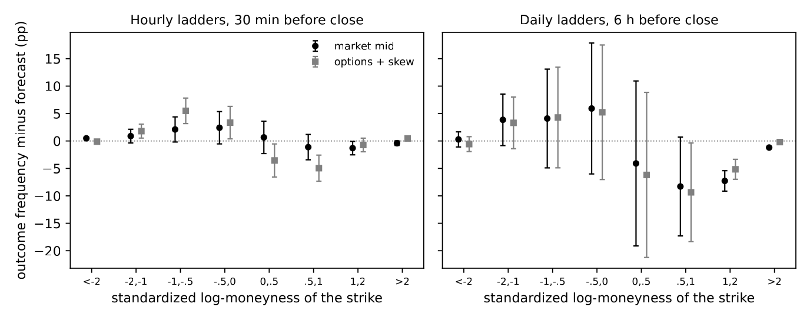

# Question

Kalshi lists, for every hour and for 5 pm New York time every day, a ladder of contracts "Bitcoin above $K$". Each pays one dollar if the 60-second average of the CF Benchmarks index before the expiry exceeds $K$. This payoff is a cash-or-nothing digital call. Its value under a pricing measure is the probability that the index ends above $K$, and that probability can be read from the options traded on Deribit, where the same underlying has a liquid volatility surface.

A firm that makes markets in these contracts prices them from the options surface and hedges in spot and perpetuals. Whether this is a good idea depends on two empirical questions. First, is the option-implied probability a better forecast of the outcome than the contract's own market price? Second, if it is not better, does it at least contain information that the market price lacks? A companion note ([Zeri 2026](#ref-zeri2026)) showed that Kalshi mid prices beat a constant-volatility digital built from realized volatility, and that hourly ladders overprice cheap strikes. Here the benchmark is the options market.

Two measurement problems shape the design. Deribit options expire once a day at 08:00 UTC, while the contracts expire every hour, so the implied variance to the next option expiry has to be allocated to a horizon of 30 minutes to 24 hours. And contracts of one ladder share a single outcome, so all inference is clustered by event, following ([Zeri 2026](#ref-zeri2026)).

# Data and construction

#### Contracts.

Kalshi series `KXBTCD`, events settled from 12 September to 9 November 2026, from the public API. Hourly events are open for one hour and have strikes 100 dollars apart; daily events (5 pm New York) are open for about 25 hours, a few for a week, with strikes 250 to 500 dollars apart. For a horizon $\tau$ I take the last one-minute candle ending at or before $t_0=\text{close}-\tau$ and use the mid of the closing bid and ask if the spread is at most 5 cents. Hourly events are observed at $\tau=30$ minutes (29,503 contracts in 1,324 events), daily events at 60, 360 and 1,440 minutes (2,465, 2,288 and 1,608 contracts in 59 events). Only contracts with traded volume are in the sample.

#### Options.

All Bitcoin option trades on Deribit from 10 September to 9 November 2026, from the exchange's public history API. Each trade reports the implied volatility computed by Deribit and the value of the Deribit index at that instant. The Deribit index is a good proxy for the settlement index: across events the ratio of the Kalshi settlement value to the Deribit index at the close has median 0.99999 and standard deviation 2.5 basis points. I use it as the underlying price $S$ at $t_0$.

#### Option-implied probability.

At $t_0$, for an event closing at $T$:

1.  Take the first Deribit expiry $E\ge T$ and its trades in the 90 minutes before $t_0$ (widened to 6 or 24 hours if fewer than 8 trades). Regress the trade implied volatilities on standardized log-moneyness $x=\ln(K/S)/(\sigma\sqrt{E-t_0})$, with a quadratic term when at least 12 trades are available, weighting by the square root of trade size. The intercept is the at-the-money volatility $\sigma_E$ and the linear coefficient divided by the intercept is the relative smile slope $\beta$. The median fit uses 52 trades on hourly events; the median $\sigma_E$ is 27% and the median $\beta$ is $-0.05$ (volatility falls by 5% of its level per standard deviation of moneyness).

2.  The implied variance to the option expiry is $w_E=\sigma_E^2(E-t_0)$. Allocate it to $[t_0,T]$ in proportion to expected variance: $w=w_E\,\Lambda(t_0,T)/\Lambda(t_0,E)$, where $\Lambda$ sums the average squared one-minute Binance return by hour of day and weekend indicator, estimated on the 28 days before $t_0$. For the hourly events the 30 minutes before the close are 4.0% of the time to the option expiry and 5.9% of the expected variance (medians): the contracts are observed at more active times of day than the average hour. A 60-second settlement average removes $\tfrac23$ of a minute of variance.

3.  The flat-smile price is $\Phi(d_2)$ with $d_2=(\ln(S/K)-w/2)/\sqrt{w}$. With the slope, the total volatility at strike $K$ is $s(K)=\sqrt{w}\,(1+\beta x_K)$, and since a digital is minus the strike derivative of a call ([Breeden and Litzenberger 1978](#ref-breeden1978)), $$p^{\text{opt}}(K)=\Phi\big(d_2(K)\big)-\varphi\big(d_2(K)\big)\,\frac{\partial s}{\partial \ln K}
    =\Phi\big(d_2(K)\big)-\beta\,\varphi\big(d_2(K)\big),$$ with $d_2(K)$ computed with $s(K)$. The smile slope in standardized moneyness is assumed to be the same at the short horizon as at the option expiry.

Only data dated at or before $t_0$ enter. Inputs are available for 1,503 of 1,505 event--horizon pairs.

#### Realized-volatility benchmark.

$\Phi\big(\ln(S/K)/\sqrt{v\tau}\big)$ with $v$ the mean squared one-minute Binance return over the previous 24 hours, as in ([Zeri 2026](#ref-zeri2026)) but with the Deribit index as $S$.

#### Evaluation.

Brier and logarithmic scores, the CORP miscalibration component ([Dimitriadis et al. 2021](#ref-dimitriadis2021)), the slope of the Cox recalibration regression, and Diebold--Mariano tests ([Diebold and Mariano 1995](#ref-dm1995)), all with standard errors clustered by event. Encompassing regressions follow the forecast-combination literature ([Granger and Ramanathan 1984](#ref-granger1984)).

# Results

## Scores

::: {#tbl-scores}
  ------------------------------ ------------------------------- ------ ------- ------------- ---------------------------- ----- ------- -------------
                                   Hourly ladders, $\tau=30$ min                                Daily ladders, $\tau=24$ h               
  Forecast                                                 Brier    MCB     log      $b$ (se)                        Brier   MCB     log      $b$ (se)
  Market mid                                                43.3   0.30   0.149   1.09 (0.03)                        106.1   3.6   0.355   0.91 (0.15)
  Realized volatility                                       46.0   1.47   0.166   1.00 (0.05)                        112.4   6.9   0.397   0.72 (0.15)
  Options, time-proportional                                44.6   0.59   0.159   0.89 (0.04)                        106.6   4.1   0.387   0.69 (0.14)
  Options + seasonality                                     44.4   0.84   0.155   0.98 (0.04)                        106.7   4.0   0.383   0.71 (0.14)
  Options + seasonality + skew                              44.5   0.67   0.156   0.97 (0.04)                        106.0   4.0   0.392   0.70 (0.14)
                                       Daily ladders, $\tau=1$ h                                 Daily ladders, $\tau=6$ h               
  Market mid                                                13.8   1.45   0.059   1.13 (0.14)                         32.8   2.5   0.121   1.34 (0.18)
  Realized volatility                                       14.2   1.95   0.066   0.89 (0.15)                         33.4   2.3   0.123   1.04 (0.21)
  Options, time-proportional                                13.7   1.19   0.061   0.88 (0.13)                         32.1   2.1   0.113   1.08 (0.18)
  Options + seasonality                                     13.9   1.31   0.064   0.84 (0.12)                         33.0   2.4   0.120   1.12 (0.21)
  Options + seasonality + skew                              13.8   1.23   0.062   0.86 (0.12)                         33.2   2.3   0.116   1.17 (0.20)
  ------------------------------ ------------------------------- ------ ------- ------------- ---------------------------- ----- ------- -------------

  : Brier score and its miscalibration component (both $\times10^{-3}$), logarithmic score, and Cox recalibration slope $b$ with event-clustered standard error. All quoted contracts.
:::

@tbl-scores gives the scores. On the hourly ladders the ranking is clear: market mid, then the option-implied probabilities, then realized volatility. Within the option-implied family the three variants are close. Seasonality lowers the logarithmic score from 0.159 to 0.155 (cluster $t=-2.0$) and moves the recalibration slope from 0.89, significantly below one, to 0.98; the skew correction changes nothing measurable. The market mid is the least miscalibrated forecast on the CORP measure and at the same time the only one whose recalibration slope is above one (1.09, $p=0.014$), the favourite--longshot pattern documented in ([Zeri 2026](#ref-zeri2026); [Bürgi et al. 2026](#ref-burgi2026)).

On the daily ladders the scores of market and options are within a few percent of each other at every horizon, and the realized-volatility benchmark is worse at 24 hours.

## Tests

::: {#tbl-dm}
  ---------------- -------------------------- --------- --------- --------- ------------- --------- ---------
                                                  Brier                       Logarithmic           
  Sample           Comparison                      diff   $t$ cl.   $t$ iid          diff   $t$ cl.   $t$ iid
  Hourly, 30 min   market $-$ options           $-1.26$    $-4.8$    $-7.0$        $-6.9$    $-3.7$    $-6.7$
                   options $-$ realized vol     $-1.51$    $-5.7$    $-8.0$        $-9.6$    $-4.8$    $-8.4$
  Daily, 1 h       market $-$ options           $-0.05$    $-0.2$    $-0.2$        $-2.1$    $-0.4$    $-0.7$
                   options $-$ realized vol     $-0.41$    $-1.2$    $-1.3$        $-4.1$    $-1.0$    $-1.6$
  Daily, 6 h       market $-$ options           $-0.36$    $-0.9$    $-1.5$        $+5.0$    $+2.6$    $+4.2$
                   options $-$ realized vol     $-0.21$    $-0.4$    $-0.5$        $-7.2$    $-1.1$    $-2.3$
  Daily, 24 h      market $-$ options           $+0.01$     $0.0$     $0.0$       $-37.0$    $-1.7$    $-4.5$
                   options $-$ realized vol     $-6.31$    $-2.6$    $-6.0$        $-5.3$    $-0.3$    $-0.8$
  ---------------- -------------------------- --------- --------- --------- ------------- --------- ---------

  : Diebold--Mariano tests. Score differences $\times10^{-3}$; negative values favour the first forecast. "Options" is the variant with seasonality and skew. $t$-statistics with event-clustered and with i.i.d. standard errors.
:::

@tbl-dm reports the tests. On hourly ladders the market beats the option-implied probability with a cluster-robust $t$ of $-4.8$ on the Brier score and $-3.7$ on the logarithmic score, and options beat realized volatility with $t=-5.7$ and $-4.8$. These conclusions do not depend on the clustering, although the $t$-statistics fall by a third to a half.

On the daily ladders clustering decides what one concludes. With 59 events, the 24-hour comparison between market and options on the logarithmic score has $t=-4.5$ with contract-level standard errors and $-1.7$ with event-level ones; options against realized volatility on the Brier score goes from $-6.0$ to $-2.6$. One difference survives: six hours before the close the options have a better logarithmic score than the market ($t=2.6$). It comes from the far out-of-the-money strikes. In that bucket (more than two standard deviations above the index, 802 contracts) the market mid averages 1.2 cents, the option-implied probability 0.2 cents, and none of the contracts paid. A mid of 1.2 cents is close to the lowest value the one-cent tick allows.

## Does the options market add information?

::: {#tbl-enc}
  Sample                          $n$   $b_{\text{mkt}}$     (se)   $b_{\text{opt}}$     (se)   $t_{\text{opt}}$ iid
  -------------------------- -------- ------------------ -------- ------------------ -------- ----------------------
  Hourly, 30 min, all          29,503               0.87   (0.07)               0.19   (0.06)                    5.3
  Hourly, 30 min, interior      7,867               0.89   (0.07)               0.19   (0.07)                    4.0
  Daily, 1 h, all               2,465               0.75   (0.51)               0.28   (0.37)                    1.2
  Daily, 6 h, all               2,288               0.78   (0.40)               0.48   (0.23)                    1.7
  Daily, 24 h, all              1,608               1.50   (0.28)            $-0.45$   (0.20)                 $-4.0$
  Daily, 24 h, interior           952               1.14   (0.45)            $-0.05$   (0.40)                 $-0.2$

  : Encompassing regressions $\operatorname{logit}\Pr(y=1)=a+b_{\text{mkt}}\operatorname{logit}(\text{mid})+b_{\text{opt}}\operatorname{logit}(p^{\text{opt}})$, event-clustered standard errors. Interior: mid between 0.05 and 0.95. Last column: $t$-statistic of $b_{\text{opt}}$ with i.i.d. standard errors.
:::

A forecast can be worse on average and still useful. @tbl-enc regresses the outcome on both forecasts. On hourly ladders the option-implied probability enters with a coefficient of 0.19 and a cluster-robust $t$ of 3.2 (2.7 on interior prices), next to 0.87 on the market: the best linear combination in log-odds puts roughly a sixth of the weight on the options. To check that this is not an in-sample artefact I refit the regression every day on the events settled before that day, after a 14-day burn-in, and score the fitted probabilities on the day's events. Over 1,011 out-of-sample events the combination has a logarithmic score of 0.1450 against 0.1462 for the market ($t=-2.3$, $p=0.023$) and an indistinguishable Brier score (42.5 against 42.6 thousandths, $p=0.57$). The gain is small and is concentrated where the logarithmic score is sensitive, that is in the tails.

On the daily ladders the encompassing coefficients are imprecise. The negative coefficient at 24 hours ($t=-2.3$ clustered) disappears on interior prices and I do not read anything into it.

## Where the two forecasts disagree

::: {#tbl-gap}
  --------------- ------- ------- --------- ------- ---------------------- ------- ----------------------- -------
                             Mean                     Frequency $-$ market           Frequency $-$ options 
  Moneyness $x$       $n$     mid   options   freq.                  error    (se)                   error    (se)
  $x\le-2$          9,849   0.989     0.996   0.994                 $+0.5$   (0.1)                  $-0.1$   (0.1)
  $(-2,-1]$         2,439   0.931     0.922   0.940                 $+0.9$   (0.6)                  $+1.8$   (0.7)
  $(-1,-0.5]$       1,224   0.814     0.780   0.835                 $+2.1$   (1.2)                  $+5.5$   (1.2)
  $(-0.5,0]$        1,228   0.623     0.614   0.647                 $+2.4$   (1.5)                  $+3.3$   (1.5)
  $(0,0.5]$         1,206   0.379     0.421   0.386                 $+0.7$   (1.5)                  $-3.5$   (1.5)
  $(0.5,1]$         1,231   0.195     0.233   0.184                 $-1.1$   (1.2)                  $-5.0$   (1.2)
  $(1,2]$           2,437   0.071     0.065   0.058                 $-1.3$   (0.6)                  $-0.7$   (0.6)
  $x>2$             9,889   0.011     0.002   0.007                 $-0.4$   (0.2)                  $+0.5$   (0.2)
  --------------- ------- ------- --------- ------- ---------------------- ------- ----------------------- -------

  : Hourly ladders, 30 minutes before the close, by standardized log-moneyness of the strike, $x=\ln(K/S)/\sqrt{w}$. Errors are outcome frequency minus mean forecast, in percentage points, with event-clustered standard errors.
:::

{#fig-gap}

@tbl-gap and @fig-gap split the hourly sample by the standardized moneyness of the strike. The option-implied probability errs in a pattern. Between half and one standard deviation from the index it is off by about 5 percentage points on both sides, in the direction of too little confidence: strikes it prices at 0.78 pay 83.5% of the time and strikes it prices at 0.23 pay 18.4%. Beyond two standard deviations the sign reverses: it prices at 0.2% strikes that pay 0.7% of the time. A Gaussian with the implied variance has too much mass at moderate distances and too little far away. Thirty-minute Bitcoin returns are more peaked and heavier-tailed than a normal with the same variance, and a one-parameter digital cannot be right in both places. The two errors offset each other in the recalibration slope, which is why @tbl-scores shows a slope near one for a forecast that is visibly miscalibrated bucket by bucket.

The market mid has smaller errors in the middle, none of them two standard errors from zero, and its own error in the upper tail: 1.1 cents on average for strikes that pay 0.7% of the time, and 7.1 cents for strikes that pay 5.8%. At the far strikes the market is above the options by 0.9 cents and the truth lies between the two, closer to the market.

For a market maker the table says where a Gaussian digital from the options surface can be used as a fair value and where it cannot. Near the money, 30 minutes from expiry, quoting at the Gaussian price means quoting too close to 0.5 by three to five cents, on the side that loses to anyone who uses the contract's own book as a reference. In the far tail the Gaussian price is too low, the market price too high, and the one-cent tick leaves room on the offer side only.

# Limits

Sixty days of one underlying in a low-volatility period (at-the-money implied volatility around 25--30%). Fifty-nine daily events are too few to separate market from options at horizons of hours; the conclusion there is that the data do not distinguish them, not that they are equal. The option-implied probability uses trade prints, not quotes, a parametric smile through a handful of trades, and a Gaussian shape; a better benchmark would use the quoted surface, the full implied density and a short-horizon distribution with jumps. The allocation of variance to the horizon relies on a seasonal pattern estimated from 28 days and ignores scheduled announcements. Contract prices are closing quotes of one-minute candles, without depth. The out-of-sample combination covers 46 days.

# Conclusion

Thirty minutes before expiry, the Kalshi mid is a better forecast of the outcome than a digital priced from Deribit implied volatility, and the Deribit-implied digital is better than one priced from realized volatility. The options market still adds something to the Kalshi price, about a sixth of the weight in a log-odds combination, and the combination improves the logarithmic score out of sample. The Gaussian option-implied price is too flat near the money and too thin in the tails; the market overprices the far tail, where the tick binds. On daily ladders, with 59 independent outcomes, I cannot tell the two apart.

# References {.unnumbered}

[]{#ref-burgi2026}Bürgi, C., Deng, W., Whelan, K. (2026). Makers and takers: the economics of the Kalshi prediction market. CEPR Discussion Paper 20631.

[]{#ref-breeden1978}Breeden, D. T., Litzenberger, R. H. (1978). Prices of state-contingent claims implicit in option prices. *Journal of Business*, 51(4), 621--651.

[]{#ref-dm1995}Diebold, F. X., Mariano, R. S. (1995). Comparing predictive accuracy. *Journal of Business & Economic Statistics*, 13(3), 253--263.

[]{#ref-dimitriadis2021}Dimitriadis, T., Gneiting, T., Jordan, A. I. (2021). Stable reliability diagrams for probabilistic classifiers. *Proceedings of the National Academy of Sciences*, 118(8), e2016191118.

[]{#ref-granger1984}Granger, C. W. J., Ramanathan, R. (1984). Improved methods of combining forecasts. *Journal of Forecasting*, 3(2), 197--204.

[]{#ref-zeri2026}Zeri, T. (2026). Evaluating prediction-market probabilities when contracts share an outcome: clustered inference for calibration and forecast comparison. Working paper.

::: {.paper-download}
[Download PDF](kalshi-vs-deribit-options.pdf){.btn-paper download=""}
:::
