# Introduction

## The Evolution of Market-Neutral Strategies

The goal of a market-neutral strategy is to generate positive returns regardless of market direction, achieving negligible net exposure to risk factors (typical of the APT), most notably Market Beta [@jacobs_levy1993].

Its origins are generally traced back to Alfred Winslow Jones, who in 1949 founded what is widely regarded as the first hedge fund in history. He combined long positions in undervalued securities with short positions in overvalued ones, neutralizing exposure to market risk. His approach, described in *Fortune* in 1966 [@loomis1966], laid the conceptual groundwork for *long-short equity investing*.

The next step was shaped by the diffusion of the Capital Asset Pricing Model (CAPM), developed by Sharpe [@sharpe1964], Lintner [@lintner1965], and Mossin [@mossin1966], which provided a theoretical framework for decomposing a security's return into its systematic (beta) and idiosyncratic (alpha) components. Market-neutral strategies aim precisely to isolate and capture this latter component, stripping out the noise generated by aggregate market movements.

The 1980s saw the emergence of *pairs trading*, attributed to a team of quantitative researchers led by Nunzio Tartaglia at Morgan Stanley [@vidyamurthy2004]. Exploiting historical co-movement relationships between pairs of securities, these strategies profited from temporary deviations from long-run equilibrium by opening long-short positions with a mean-reversion expectation.

From an econometric standpoint, the work of Engle and Granger on cointegration provided the mathematical bedrock for modeling long-run relationships between non-stationary time series [@engle_granger1987]. The cointegrating vector, a linear combination of integrated variables that yields a stationary series, translated directly into the pairs trading spread: the weighted difference between the two asset prices that tends to revert toward an equilibrium value. Johansen later extended this framework to the multivariate case, paving the way for statistical arbitrage strategies applied to entire portfolios of cointegrated assets [@johansen1991].

Throughout the 1990s, the growing availability of high-frequency data accelerated the development of ever more sophisticated strategies. Long-Term Capital Management (LTCM), founded in 1994 by John Meriwether, represented both the apex and the limits of this approach: its implosion in 1998 exposed the systemic risks of excessive leverage and the fragility of cointegration relationships during periods of market stress [@lowenstein2000].

The first systematic and rigorous academic study of pairs trading was conducted by Gatev, Goetzmann, and Rouwenhorst, who documented the strategy's profitability in the US equity market between 1962 and 2002, estimating annualized excess returns of up to 6% before transaction costs [@gatev2006]. This work sparked an academic debate about the sources of such returns and their persistence over time. A comprehensive survey of subsequent developments, including machine learning and dynamic model-based approaches, is offered by Krauss [@krauss2017].

## The Relative Value Arbitrage

In its broadest sense, Relative Value Arbitrage (RVA) encompasses any trade that aims to exploit a pricing discrepancy between statistically related assets, betting on the convergence of their values toward a theoretical equilibrium rather than on the absolute direction of the market [@jacobs_levy1993].

Avellaneda and Lee offer a clear taxonomy of the main variants within this strategy family [@avellaneda_lee2010]. Pure Statistical Arbitrage (StatArb) operates on portfolios of equities whose linear combination is stationary, exploiting temporary deviations from equilibrium. Pairs trading is its simplest special case, restricted to two assets. Arbitrage on interest rate term structures, on differentials between convertible bonds and their underlying equities, and convergence strategies between futures and spot prices round out the principal practical applications.

The shared premise across all these strategies is the existence of a mean-reversion force in the spread between selected assets. Formally, this property is modeled through the Ornstein-Uhlenbeck (OU) process [@uhlenbeck_ornstein1930], described by the following Stochastic Differential Equation (SDE):

$$
    dS_t = \kappa(\mu - S_t)\,dt + \sigma\,dW_t
$$ {#eq-ou}

where $S_t$ is the spread value at time $t$, $\kappa > 0$ is the mean reversion speed, $\mu$ is the long-run equilibrium level, $\sigma$ is the process volatility, and $W_t$ is a standard Brownian motion. The half-life of the process, equal to $\ln(2)/\kappa$, measures the average time required for the spread to cover half the distance back to equilibrium and is a fundamental indicator of a strategy's tradability [@vidyamurthy2004].

The classical OLS-based approach for estimating the cointegrating vector and hedge ratio carries well-documented structural limitations. First, OLS assumes that the parameters of the relationship are constant over time: a deeply unrealistic hypothesis in modern financial markets, which are characterized by frequent regime changes and structural breaks [@engle_granger1987].

Second, the homoskedasticity assumption implicit in OLS conflicts with the well-known stylized fact of volatility clustering in financial returns, documented by Mandelbrot [@mandelbrot1963] and Fama [@fama1965] and formalized by the ARCH/GARCH family of Engle [@engle1982] and Bollerslev [@bollerslev1986]. Ignoring this feature leads to a distorted risk estimate and suboptimal entry and exit thresholds.

Third, financial markets are subject to latent regimes (alternating periods of low volatility and strong cointegration with phases of systemic stress or structural breaks) that simply cannot be captured by a fixed-parameter model. Hamilton, with his Markov-switching model, formalized this phenomenon, demonstrating that the dynamics of many economic series are better described by distinct equations operating across alternating regimes [@hamilton1989]. The practical consequences are tangible: OLS-based static strategies tend to generate spurious trading signals during cointegration breakdowns, amplifying maximum drawdowns at precisely the moments of greatest market stress [@vidyamurthy2004].

## Objectives and Methodology

Given the structural limitations of static methods discussed above, this thesis sets out to develop, formalize, and validate a dynamic, hybrid econometric framework for multi-asset statistical arbitrage. The integrated architecture combines three complementary components (the Kalman Filter, Hidden Markov Models, and GARCH models) into a coherent system that simultaneously addresses the challenges of time-varying parameter estimation, conditional volatility modeling, and regime detection.

The five objectives below are not parallel but sequential: each one exists because the previous one left a specific limitation open. Part I's econometric foundations expose the constant-parameter assumption as the point where static models break; Part II removes that assumption by introducing the state-space representation; Part III applies that representation first to the bivariate case and then to high-dimensional baskets, where its dimensionality-driven limits show up; Part IV (the empirical validation) puts the entire chain in front of real data, which is the only test that decides whether any of it was worth building.

**First Objective: Econometric Foundations.** Part I of the thesis provides a systematic treatment of univariate stochastic processes, ARMA models, and unit root tests [@hamilton1994], volatility modeling through the ARCH/GARCH family [@engle1982; @bollerslev1986; @tsay2010], and multivariate VAR and VECM models with particular attention to Engle-Granger [@engle_granger1987] and Johansen [@johansen1991] cointegration.

**Second Objective: State Space Framework.** These same foundations close on the assumption that parameters are fixed, which is exactly what the Second Objective removes. The Kalman Filter, originally developed by Kalman for engineering applications [@kalman1960] and later adopted in financial econometrics by Harvey [@harvey1989] and Durbin and Koopman [@durbin_koopman2012], is implemented for the Bayesian recursive estimation of the dynamic hedge ratio. Unlike OLS, the KF continuously updates parameter estimates as new observations arrive, capturing the temporal evolution of the cointegration relationship without requiring periodic model re-estimation.

The framework concurrently incorporates Hidden Markov Models for the probabilistic detection of market regimes. HMMs, introduced in signal analysis by Baum and Petrie [@baum1966; @baum1970] and applied to finance by Ryden, Teräsvirta, and Åsbrink [@ryden1998] and by Ang and Bekaert [@ang_bekaert2002], enable inference of the latent market regime variable through the Baum-Welch algorithm for parameter estimation and the Viterbi algorithm [@viterbi1967] for optimal state sequence decoding.

**Third Objective: Bivariate Pairs Trading.** Once the dynamic estimator exists, the question becomes operational: can it actually trade something? Trading signal generation relies on a dynamic z-score in which the rolling mean is supplied by the Kalman Filter and the conditional variance by a GARCH model, following the approach proposed by Pole [@pole2007] and Liu et al. [@liu2017]. Regime-dependent trading rules and the optimization of entry and exit thresholds complete the architecture.

**Fourth Objective: High-Dimensional Statistical Arbitrage.** The natural extension, and the natural place where new risk enters, concerns dimensionality. Drawing on the contributions of Avellaneda and Lee [@avellaneda_lee2010] and d'Aspremont [@daspremont2011] on identifying the cointegration subspace and maximizing mean-reversion speed, the framework is extended to multi-asset portfolios. The multivariate Kalman Filter dynamically manages basket weights, while sparse optimization techniques ensure tradability.

**Fifth Objective: Empirical Validation.** None of the four architectures above is worth anything without a check against real data. The strategies are tested out-of-sample on real historical data with the incorporation of realistic transaction costs, slippage, and liquidity constraints, following the methodological best practices of Lopez de Prado to guard against look-ahead bias and overfitting [@lopezdeprado2018]. The proposed dynamic models are benchmarked against OLS-based strategies.

The original contribution of this thesis lies in the integration of KF, HMM, and GARCH into a single coherent architecture for statistical arbitrage, in the formalization of signal generation via dynamic z-score, and in an out-of-sample evaluation showing that the integration mainly acts as drawdown control during structural breaks, while its advantage in risk-adjusted returns depends on the period and on the capital allocation scheme [@avellaneda_lee2010; @lopezdeprado2018].

@tbl-roadmap lays out this chain end to end, and the transition note opening each Part below points back to the specific limitation it closes.

::: {#tbl-roadmap}
   **Part**  **Objective**                                **Limitation inherited from the previous Part**     **What remains open**
  ---------- -------------------------------------------- --------------------------------------------------- ------------------------------------------------
      I      Econometric foundations                      (starting point)                                    parameters constant over time
      II     State-space framework                        constancy of parameters assumed in Part I           estimators with no trading strategy attached
     III     Pairs trading + high-dimensional extension   estimators available, no trading rule               no test against real data
      IV     Empirical validation                         complete architecture, never tested out-of-sample   heterogeneous results requiring interpretation

  : Structure of the thesis: which limitation each Part inherits, and which one it leaves open.
:::

# Stylized Facts in Financial Returns {#sec-stylized}

At first glance, financial markets can appear to be a chaotic jumble of random price movements. Beneath that surface layer, however, lies a kind of structural order: a set of statistical regularities that persist across different time periods, asset classes, and geographic markets. These empirical regularities are known as Stylized Facts. Throughout this chapter we will model log-returns, exploiting their stationarity and additivity properties: $$r_t = \ln\!\left(\frac{P_t}{P_{t-1}} \right)$$

The stylized facts documented in this chapter constitute the necessary motivation for the methodological architecture developed in Part II. Each one exposes a specific limitation of conventional static models and imposes a corresponding design requirement on the proposed framework.

The non-Gaussianity of returns invalidates the normality assumption implicit in the classical z-score and in OLS hedge ratio estimation: fat tails and skewness mean that extreme events are systematically underestimated, rendering entry and exit thresholds calibrated under normality suboptimal. Volatility clustering implies that the variance of the spread is not constant: a z-score with a fixed denominator overstates the signal during high-volatility regimes, inflating the false-positive rate, which directly motivates the integration of a GARCH model for conditional variance estimation. Time-varying correlation and non-linear tail dependence demonstrate that the hedge ratio between two cointegrated assets is not stable over time, making OLS estimation a static snapshot of a dynamic relationship: the Kalman Filter addresses this need by dynamically updating parameters as new observations become available. Finally, regime shifting unifies all preceding phenomena under a single structural cause: periods of cointegration breakdown, during which executing trades exposes the strategy to significant losses, demand an explicit regime detection mechanism, a role assigned to Hidden Markov Models with state-dependent trading rules.

## Non-Gaussianity

The unconditional distribution of asset returns is not Gaussian. The non-Gaussianity phenomenon is fundamentally characterized by the empirical distribution of returns: excess kurtosis (fat tails) and skewness. These two moments are essential for quantifying the market's propensity toward extreme movements and asymmetric risks. Understanding the fat-tailed nature of returns is crucial for robust risk management in our strategy, particularly for models such as CVaR derived from GARCH with non-normal distributions, which are sufficiently robust to account for the true leptokurtic nature of risk.

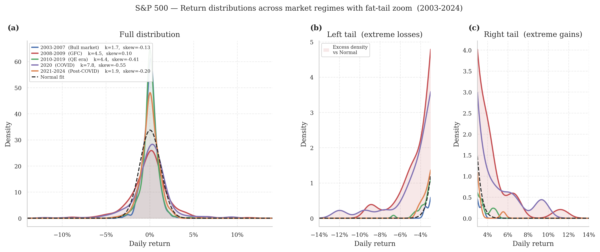{#fig-fig1-kde-tails}

## Leverage Effect

This stylized fact captures the empirical observation that negative returns induce a larger increase in future volatility than positive returns of identical magnitude.

The asymmetry is fundamentally driven by the behavioral prevalence of fear over euphoria. Negative price shocks often trigger widespread risk aversion and herding behavior, leading to aggressive, synchronized selling that amplifies volatility.

The critical implication is that any model assuming a symmetric response to news (such as the standard GARCH model) is misspecified for most financial markets, as it systematically underestimates risk during downturns and overestimates it during rallies.

We define $r_t^2$ as a proxy for volatility because: $$
\text{Var}[r_t] = \mathbb{E}[r_t^2] - (\mathbb{E}[r_t])^2
$$

Since the daily mean return is approximately zero ($\mathbb{E}[r_t] \approx 0$), we obtain: $$
(\mathbb{E}[r_t])^2 \approx 0 \implies \text{Var}[r_t] \approx \mathbb{E}[r_t^2]
$$

To visualize the leverage effect we use a scatterplot of lagged returns $r_{t-1}$ (shifted one period) against today's volatility $r_t^2$.

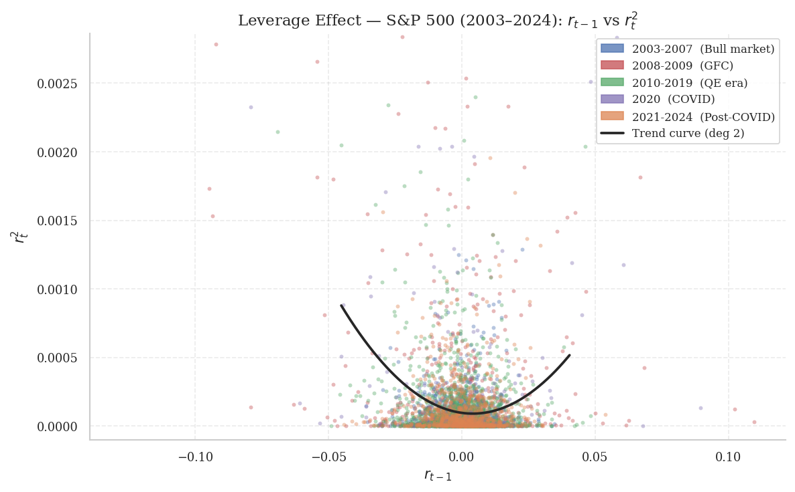{#fig-leverage}

The left-hand side of the trend curve is steeper, meaning that (on average) a negative return generates higher volatility the following day than a positive return of the same size.

## Volatility Clustering {#sec-sub-vol-clustering}

A second important stylized fact is volatility clustering: large price movements, in either direction, tend to be followed by further large movements, while calm periods cluster together. Formally, while the return series $\{r_t\}$ is approximately serially uncorrelated, its squared values $\{r_t^2\}$ (a proxy for volatility) display strong, slowly decaying autocorrelation:

$$\text{Corr}(r_t^2,\, r_{t-k}^2) > 0 \quad \forall\, k = 1, 2, \ldots, K$$

This empirical regularity was first documented by @mandelbrot1963 [@mandelbrot1963], who observed that large changes tend to be followed by large changes in speculative prices, and later formalized by @engle1982 [@engle1982] through the introduction of the ARCH model. The fundamental implication is that return volatility is not constant but time-varying and forecastable: the conditional variance $\sigma_t^2 = \text{Var}(r_t \mid \mathcal{F}_{t-1})$ evolves as a function of past information (represented by the $\sigma$-algebra $\mathcal{F}$), rendering static homoskedastic models fundamentally misspecified.

From a statistical arbitrage perspective, volatility clustering has direct consequences. The spread between two cointegrated assets inherits the heteroskedastic structure of the underlying returns: during high-volatility regimes, the spread widens substantially, generating signals that may appear to indicate trading opportunities but in fact merely reflect the elevated conditional variance of the process. A static z-score computed with a constant-variance denominator will therefore tend to misclassify noise as signal during turbulent periods, inflating the false-positive rate and amplifying drawdowns. This limitation is the primary motivation for incorporating a time-varying volatility model into the signal generation engine developed in Part II of this thesis.

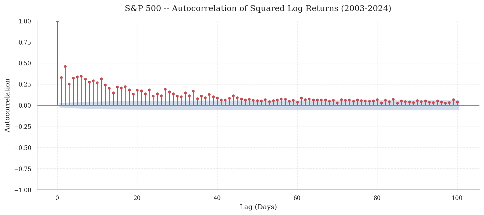{#fig-acf-rt2}

## Correlation Breakdown {#sec-sub-corr-breakdown}

Correlation is not constant; it evolves over time as a function of market regimes and economic conditions. In the context of Statistical Arbitrage, and pairs trading in particular, the entire strategy rests on a more or less stable statistical relationship. When dynamic correlation breaks down, the spread between assets ceases to be mean-reverting and risks diverging indefinitely. This hazard is most acute during periods of market stress, when correlations tend toward unity: precisely when diversification is most needed.

The *Diversification Meltdown Phenomenon* is one of the most critical challenges for portfolio theory and pairs trading strategies alike. It characterizes situations in which, during periods of market stress, correlations collapse toward unity. This is justified by investor irrationality and the *flight-to-safety* mechanism, in which a massive and indiscriminate liquidation of risky assets occurs regardless of the fundamentals of individual securities.

The phenomenon can be formally represented through the dynamics of the correlation matrix. Let $\rho_{ij,t}$ be the time-varying correlation between assets $i$ and $j$. To ensure formal correctness, the Fisher transformation is applied: $$z_{ij,t} = \text{arctanh}(\rho_{ij,t})$$ which maps the correlation, bounded in $[-1,1]$, to a variable defined on $(-\infty, +\infty)$, for which it is legitimate to assume: $$z_{ij,t} \sim \mathcal{N}(\mu_{z}, \sigma_{z}^2)$$ Under normal market conditions, the transformed variable exhibits moderate cross-sectional variation. During crisis regimes, the distribution shifts: $$z_{ij,t} \sim \mathcal{N}(\mu_{z}^{\text{crisis}}, (\sigma_{z}^{\text{crisis}})^2)$$ where $\mu_{z}^{\text{crisis}} \gg \mu_{z}$ and $(\sigma_{z}^{\text{crisis}})^2 \ll \sigma_{z}^2$, indicating higher average correlations with reduced dispersion, consistent with the empirically observed collapse toward unity.

It is worth stressing that in a pairs trading context, the risk is not merely an increase in correlation but more precisely the breakdown of *cointegration* between the two assets. Correlation can remain high while the long-run price relationship collapses, leaving the spread non-stationary and invalidating the fundamental assumptions of the strategy.

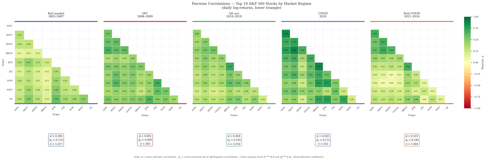{#fig-fig-corr-regimes}

## Non-Linear Dependence

A fundamental stylized fact of financial markets is the presence of non-linear dependence between asset returns. This phenomenon describes how the dependence structure between return series changes as a function of market regimes, in sharp contrast to the assumption of constant linear correlation underlying traditional multivariate models. While standard correlation measures (e.g., Pearson's $\rho$) adequately capture linear relationships in which the conditional expectation $E(Y|X)$ is a linear function of $X$, they fail to detect more complex, state-dependent co-movements.

An effective methodology for empirically documenting non-linear dependence is exceedance correlation analysis. Let $X$ and $Y$ be two standardized return series (zero mean, unit variance). The exceedance correlation $\tilde{\rho}(p)$ at probability level $p$ is defined separately for the left and right tails as: $$\begin{aligned}
    \tilde{\rho}(p) & = \text{Corr}\left(X, Y \,|\, X \leq Q_X(p) \text{ and } Y \leq Q_Y(p)\right), & \text{for } p \leq 0.5 \\
    \tilde{\rho}(p) & = \text{Corr}\left(X, Y \,|\, X > Q_X(p) \text{ and } Y > Q_Y(p)\right), & \text{for } p > 0.5
\end{aligned}$$ where $Q_X(p)$ and $Q_Y(p)$ denote the $p$-th quantile of $X$ and $Y$, respectively.

## Regime-Shifting {#sec-sub-regime-shifting}

A final stylized fact, cutting across all those discussed previously, is *regime shifting*. The statistical properties of returns (mean, variance, correlation structure, and non-linear dependence) are not constant over time but undergo discrete structural changes in correspondence with shifts in macroeconomic conditions, investor sentiment, or exogenous events. In this sense, regime shifting is not an independent phenomenon but the underlying cause of the stylized facts documented above: non-Gaussianity intensifies in crisis regimes, volatility clustering tightens during market stress, correlations collapse toward unity during diversification meltdowns, and non-linear dependence manifests asymmetrically in the left tails during systemic drawdowns.

Formally, the DGP is assumed to be governed by a latent state variable $s_t \in \{1, 2, \ldots, K\}$, which determines the current market regime. The conditional distribution of returns depends on the regime: $$r_t \mid s_t = k \;\sim\; \mathcal{N}(\mu_k,\, \sigma_k^2), \qquad k = 1, \ldots, K$$ The dynamics of the state variable are modeled as a first-order Markov chain, with transition matrix $\mathbf{P}$ whose elements $p_{ij} = \Pr(s_{t+1} = j \mid s_t = i)$ represent the probability of transitioning from regime $i$ to regime $j$. Since $s_t$ is not directly observable, its inference requires dedicated probabilistic methods, which motivates the adoption of Hidden Markov Models discussed later.

The six stylized facts documented collectively define the design requirements of the framework developed in Part II. Before those components can be introduced, however, it is necessary to establish the univariate statistical foundations on which they rest. The following chapter formalizes the concepts of stationarity, unit roots, and ARMA dynamics, the building blocks without which neither cointegration nor the Kalman Filter state-space representation can be rigorously defined.

# Analysis of a Single Time Series

Before introducing multivariate models and the cointegration framework underpinning Statistical Arbitrage strategies, it is necessary to establish the fundamental statistical properties of univariate financial time series. This chapter covers the concepts of stationarity, ARMA models, and unit root theory: all tools that will serve as the technical prerequisite for VECM analysis.

The emphasis falls especially on unit root tests: since asset prices are typically $I(1)$ processes, the distinction between integrated and stationary series is not a technical footnote but the logical premise of the entire strategy. Two $I(1)$ series whose linear combination is $I(0)$ are by definition cointegrated, and their spread is mean-reverting. Verifying this property rigorously is fundamental to trading.

## Stationarity, Ergodicity and the Information Set

### Stationarity {#sec-stationarity .unnumbered}

Stationarity, in its essential form, implies that the fundamental properties of the DGP do not change over time.

This stability can be defined at different levels of rigor. Strict Stationarity requires that the entire joint probability distribution of any set of observations (say $(Y_t, Y_{t+1}, \ldots, Y_{t+h})$) depends only on the temporal gaps between them ($h$) and not on the specific time point ($t$). This is a strong assumption.

A more practical and widely used concept is Covariance Stationarity (or weak stationarity). A process is covariance stationary if it satisfies three conditions:

1.  Its mean is constant and finite: $\mathbb{E}[Y_t] = \mu$ for all $t$

2.  Its variance is constant and finite: $\mathbb{V}[Y_t] = \sigma^2 < \infty$ for all $t$

3.  The covariance between two observations depends only on their temporal lag: $\mathbb{E}[(Y_t - \mu)(Y_{t-s} - \mu)] = \gamma_s$, $\forall$ $t,s$

$\gamma_s$ is the *autocovariance* at lag $s$ and measures the linear dependence between observations separated by $s$ periods.

### Ergodicity {#sec-ergodicity .unnumbered}

Ergodicity guarantees that what we observe in a single long data series is representative of the process as a whole. It allows us to learn the properties of the underlying process by studying a single historical path of the data. More formally, ergodicity is a form of asymptotic independence: temporally distant observations are nearly independent.

The implication is captured by the *Ergodic Theorem*: if a process is stationary and ergodic with finite $r$-th moment $\mu_r$, then the time average converges in probability to the population moment: $$\frac{1}{T}\sum_{t=1}^T Y_t^r \xrightarrow{p} \mu_r$$ with $\mathbb{E}[|Y_t|^r] < \infty$.[^1] For instance, the sample mean $\frac{1}{T}\sum_{t=1}^T Y_t$ becomes a consistent estimator of the true unconditional mean $\mu$. Without ergodicity, even a stationary process could prevent us from learning its properties from a single historical path.

## White Noise Process {#sec-white-noise-process .unnumbered}

A process $\{\epsilon_t\}$ is white noise if:

1.  $\mathbb{E}[\epsilon_t] = 0$ for all $t$

2.  $\mathbb{V}[\epsilon_t] = \sigma^2 < \infty$ for all $t$

3.  $\mathbb{E}[\epsilon_t \epsilon_{t-j}] = 0$ for all $t$ and $j \neq 0$

It is the fundamental "unpredictable" shock of many models. While an i.i.d. sequence is white noise, the converse does not always hold: white noise rules out only *linear* dependence, permitting more complex non-linear dependencies.

### The Information Set {#sec-the-information-set .unnumbered}

The concept of the information set is crucial for defining predictability and conditional expectations. Formally, the information available to an observer up to time $t$ is represented by a $\sigma$-algebra, denoted $\mathcal{F}_t$.

As time advances and new observations are recorded, the information set expands. This creates a non-decreasing, nested sequence of $\sigma$-algebras, $\mathcal{F}_1 \subseteq \mathcal{F}_2 \subseteq \dots \subseteq \mathcal{F}_t$, called a *filtration*. The filtration mathematically models the continuous accumulation of historical market data.

When we say a stochastic process is $\{\mathcal{F}_t\}$-adapted, we mean that its realization at time $t$ is fully observable given the information set $\mathcal{F}_t$. Consequently, the optimal statistical forecast is based on the conditional expectation $\mathbb{E}[Y_{t+h} | \mathcal{F}_t]$.

## Models for the Mean

### MA Models {#sec-ma-models .unnumbered}

Moving Average processes model a time series in which the current value depends on current and past shock terms. The formal representation of an MA($q$) process is: $$Y_t = \theta_0 + \varepsilon_t + \theta_1 \varepsilon_{t-1} + \theta_2 \varepsilon_{t-2} + \dots + \theta_q \varepsilon_{t-q}$$ where $\{\varepsilon_t\}$ is a white noise process. By definition, an MA($q$) process has autocorrelations that cut off sharply after lag $q$. The unconditional mean is constant at $\theta_0$, while the conditional mean varies over time as a function of the sequence of past shocks. The variance structure shows that the unconditional variance strictly exceeds the average conditional variance, a direct consequence of the accumulated variability of the moving average component.

### AR Models {#sec-ar-models .unnumbered}

Autoregressive processes model a time series in which the current observation depends linearly on its own lags. The formal representation of a generic AR($p$) process is: $$Y_t = \phi_0 + \phi_1 Y_{t-1} + \phi_2 Y_{t-2} + \dots + \phi_p Y_{t-p} + \varepsilon_t$$ The most notable example is the AR(1) process: $Y_t = \phi_0 + \phi_1 Y_{t-1} + \varepsilon_t$. Unlike MA processes, AR models exhibit infinite memory: their autocorrelations decay gradually rather than cutting off at a specific lag. For an AR(1) process to be covariance stationary, its coefficient must strictly satisfy $|\phi_1| < 1$, which yields an unconditional mean of $\frac{\phi_0}{1-\phi_1}$. The conditional mean depends entirely on the most recent observation.

### ARMA Models {#sec-arma-models .unnumbered}

ARMA models combine both AR and MA components. An ARMA(1,1) process is defined as $Y_t = \phi_0 + \phi_1 Y_{t-1} + \theta_1 \varepsilon_{t-1} + \varepsilon_t$. These models capture both the persistence of AR components and the finite-memory effects of MA components.

## Unit Roots and Random Walk

A stochastic process $\{Y_t\}$ is called a random walk if it satisfies: $$Y_t = Y_{t-1} + \varepsilon_t, \qquad
    \varepsilon_t \overset{\text{i.i.d.}}{\sim} (0,\,\sigma^2)$$ This process is the limiting case of an AR(1) with autoregressive coefficient $\phi_1 = 1$: it possesses a *unit root*. Its statistical properties stand in sharp contrast to those of a stationary process. The variance grows linearly in time, $\mathrm{Var}(Y_t) = t\sigma^2 \to \infty$, violating the finite and constant variance requirement of covariance stationarity. The autocorrelation function decays to zero at a negligible rate, $\rho_k = \mathrm{Corr}(Y_t, Y_{t-k}) \approx 1$ for any lag $k$ in finite samples, making any long-horizon forecast indistinguishable from the last available observation. Finally, the shock $\varepsilon_t$ has a permanent effect on the level of the process: the infinite MA representation $Y_t = Y_0 + \sum_{j=1}^{t} \varepsilon_j$ shows that every innovation accumulates without attenuation, producing a non-stationary *stochastic drift* [@hamilton1994].

A process is said to be *integrated of order $d$*, denoted $I(d)$, if it becomes stationary after $d$ differences. The random walk is the archetypal $I(1)$ example: $\Delta Y_t = \varepsilon_t \sim I(0)$. For prices, the $I(1)$ class is empirically the most prevalent, and this evidence is robust across markets, historical periods, and sampling frequencies [@campbell_lo_mackinlay1997].

The distinction between an $I(1)$ and an $I(0)$ process is central to this thesis's framework. By definition, two $I(1)$ series whose linear combination $S_t = Y_{1t} - \hat{\beta}\,Y_{2t}$ is $I(0)$ are *cointegrated*, and the spread $S_t$ is mean-reverting [@engle_granger1987]. Operating without verifying this condition exposes one to the risk of *spurious regression*, a phenomenon documented by Granger and Newbold [@granger_newbold1974]: even in the complete absence of any causal relationship, regression between two independent random walks produces a high $R^2$ and a significant $t$-statistic, generating entirely meaningless trading signals.

### Testing for Unit Roots {#sec-testing-for-unit-roots .unnumbered}

Formal verification of the presence of a unit root is carried out through a family of dedicated tests. The most widely used is the **Augmented Dickey-Fuller (ADF)** test, proposed by Dickey and Fuller and subsequently extended by Said and Dickey [@dickey_fuller1979; @said_dickey1984]. The null hypothesis $H_0\colon \phi = 0$ (presence of a unit root, $I(1)$ series) is tested by estimating the augmented regression:

$$
    \Delta Y_t = \alpha + \beta\, t + \phi\, Y_{t-1}
    + \sum_{j=1}^{p} \gamma_j\,\Delta Y_{t-j} + \varepsilon_t
$$ {#eq-adf}

where the lags $\Delta Y_{t-j}$ correct for possible serial autocorrelation of the residuals, and the term $\beta\, t$ is an optional deterministic trend whose inclusion depends on the nature of the process under examination. The test statistic $\hat{\tau} = \hat{\phi}/\mathrm{SE}(\hat{\phi})$ follows the Dickey-Fuller distribution, whose quantiles are strictly negative and depend on the model specification (with or without a constant, with or without a trend). The optimal lag order $p$ is selected by minimizing an information criterion, typically Akaike (AIC) or Schwarz (BIC), or through the sequential elimination of insignificant lags [@hamilton1994].

A more parsimonious alternative in terms of parameters is the **Phillips-Perron (PP) test** [@phillips_perron1988], which corrects the test statistic for the presence of heteroskedasticity and serial autocorrelation in the residuals through a non-parametric approach based on estimating the spectral variance at frequency zero (the so-called *long-run variance*), without requiring the inclusion of additional lags.

Both tests suffer from low power in finite samples, particularly in the presence of autoregressive roots close to unity ($\phi_1 \approx 0.95$) or structural breaks in the DGP [@perron1989]. In such situations, low power translates into frequent failures to reject a false null: highly persistent stationary series are incorrectly classified as integrated processes.

To address this, the **KPSS test** of Kwiatkowski, Phillips, Schmidt, and Shin [@kpss1992] adopts an inverted formulation. The null hypothesis is *stationarity* ($H_0\colon I(0)$), while the alternative is the presence of a unit root. The LM statistic is constructed from the residuals of a regression of $Y_t$ on a trend and constant, and its divergence from the tabulated critical values constitutes evidence against stationarity. Using ADF (or PP) and KPSS jointly enables a more robust diagnosis, summarized in @tbl-unit-root-tests.

::: {#tbl-unit-root-tests}
  **ADF**                 **KPSS**                **Conclusion**
  ----------------------- ----------------------- ---------------------------------------------------
  Fails to reject $H_0$   Rejects $H_0$           Strong evidence of $I(1)$
  Rejects $H_0$           Fails to reject $H_0$   Strong evidence of $I(0)$
  Fails to reject $H_0$   Fails to reject $H_0$   Inconclusive evidence (low power)
  Rejects $H_0$           Rejects $H_0$           Inconclusive evidence (possible structural break)

  : Joint interpretation of ADF and KPSS tests.
:::

A further refinement is the **Perron test** [@perron1989], which extends the ADF to account for exogenous structural breaks in the trajectory of the process. Within the Statistical Arbitrage framework, the relevance of this test is substantial. Periods of financial crisis (such as 2008 or 2020) can produce jumps in the level or slope of a series' trend, which standard tests would erroneously interpret as unit roots, yielding distorted conclusions about the order of integration.

### Implications {#sec-implications .unnumbered}

In the context of this thesis, verifying the order of integration of the selected assets constitutes the logical prerequisite for all subsequent analysis. Only after confirming that prices are $I(1)$ processes is it appropriate to proceed with the Engle-Granger [@engle_granger1987] and Johansen [@johansen1991] cointegration tests described later. The stationarity of the spread (extracted from the Kalman Filter) will be verified dynamically through *rolling* ADF tests, enabling real-time detection of cointegration breakdowns that would render the strategy ineffective, at which point the HMM framework suspends the execution of trading signals [@lopezdeprado2018].

Establishing the order of integration of asset prices is a necessary but not sufficient condition for statistical arbitrage. The spread extracted from a cointegrated system inherits the heteroskedastic structure of the underlying return series. Its variance is not constant, but time-varying (and forecastable). The following chapter addresses this challenge by developing the ARCH/GARCH family of models that will later supply the conditional variance denominator of the dynamic z-score signal generation engine.

# Univariate Volatility Modeling

The stylized fact of volatility clustering has a direct and quantifiable consequence for statistical arbitrage. The conditional variance of the spread between two cointegrated assets is not constant, rendering any signal threshold calibrated under homoskedasticity systematically mis-specified. This chapter develops the ARCH/GARCH family of models that will later be integrated into the dynamic z-score engine to provide a time-varying volatility denominator robust to the leverage effect and fat tails documented in @sec-stylized.

Conditional volatility represents the expected future volatility at time $t+h$, conditioned on all information available up to time $t$ ($\mathcal{F}_t$). One-period-ahead conditional volatility is denoted $E_t[\sigma_{t+1}]$. All concepts apply equally to variance. This chapter focuses specifically on modeling conditional variance, denoted $\mathbb{E}_t[\sigma_{t+1}^2]$ or, more generally, $\mathbb{E}_t[\sigma_{t+h}^2]$.[^2]

## ARCH Model

The ARCH(P) model, introduced by Engle (1982) [@engle1982], captures time-varying volatility by modeling the conditional variance as a function of past squared shocks. The model specification is:

$$\begin{aligned}
r_t &= \mu_t + \varepsilon_t \\
\varepsilon_t &= \sigma_t e_t, \quad e_t \sim \text{i.i.d. } \mathcal{N}(0,1) \\
\sigma_t^2 &= \omega + \alpha_1 \varepsilon_{t-1}^2 + \alpha_2 \varepsilon_{t-2}^2 + \cdots + \alpha_P \varepsilon_{t-P}^2
\end{aligned}$$

where $\mu_t$ represents the conditional mean process. The defining feature of ARCH models is that the conditional variance $\sigma_t^2$ depends on the $P$ most recent squared shocks, making it $\mathcal{F}_{t-1}$-measurable since all right-hand-side variables are known at time $t-1$.

The unconditional variance $\bar{\sigma}^2 = \mathbb{E}[\varepsilon_t^2]$ can be derived under stationarity assumptions. Taking expectations of the conditional variance equation:

$$\begin{aligned}
\mathbb{E}[\sigma_t^2] &= \omega + \alpha_1 \mathbb{E}[\varepsilon_{t-1}^2] + \alpha_2 \mathbb{E}[\varepsilon_{t-2}^2] \\
&\quad + \cdots + \alpha_P \mathbb{E}[\varepsilon_{t-P}^2]
\end{aligned}$$

Using the law of iterated expectations and the fact that $\mathbb{E}[e_t^2] = 1$, we have $\mathbb{E}[\varepsilon_{t-i}^2] = \mathbb{E}[\sigma_{t-i}^2 e_{t-i}^2] = \mathbb{E}[\sigma_{t-i}^2]$. Under covariance stationarity, $\mathbb{E}[\sigma_t^2] = \mathbb{E}[\sigma_{t-1}^2] = \cdots = \mathbb{E}[\sigma_{t-P}^2] = \bar{\sigma}^2$, giving:

$$\bar{\sigma}^2 = \omega + (\alpha_1 + \alpha_2 + \cdots + \alpha_P) \bar{\sigma}^2$$

Solving for the unconditional variance:

$$\bar{\sigma}^2 = \frac{\omega}{1 - \sum_{i=1}^P \alpha_i}$$

This result requires $\sum_{i=1}^P \alpha_i < 1$ for a finite, positive variance, ensuring stationarity of the ARCH process. As the persistence measure $\sum \alpha_i$ approaches unity, the process exhibits increasingly persistent volatility and the unconditional variance grows without bound.

## GARCH Models

The Generalized Autoregressive Conditionally Heteroskedastic (GARCH) model, introduced by Bollerslev in 1986 [@bollerslev1986], extends the ARCH framework by incorporating lagged conditional variances in addition to lagged squared shocks. A GARCH(P,Q) process is defined by the following system of equations:

$$\begin{aligned}
r_t &= \mu_t + \varepsilon_t \\
\sigma_t^2 &= \omega + \sum_{i=1}^P \alpha_i \varepsilon_{t-i}^2 + \sum_{j=1}^Q \beta_j \sigma_{t-j}^2 \\
\varepsilon_t &= \sigma_t e_t, \quad e_t \sim \text{i.i.d. } \mathcal{N}(0,1)
\end{aligned}$$

where $\mu_t$ represents the conditional mean. The most widely used specification is the GARCH(1,1) model, which provides a parsimonious yet flexible representation of volatility dynamics:

$$\sigma_t^2 = \omega + \alpha_1 \varepsilon_{t-1}^2 + \beta_1 \sigma_{t-1}^2$$

This specification expresses the current conditional variance as a weighted average of a constant term, yesterday's squared shock, and yesterday's conditional variance. The fundamental advantage of GARCH over ARCH lies in parsimony: while an ARCH model requires many lags to capture persistent volatility, the GARCH(1,1) can represent an infinite-order ARCH process with just 3 parameters. Specifically, recursive substitution shows that a GARCH(1,1) is equivalent to an ARCH($\infty$) with geometrically decaying weights, $\sigma_t^2 = \frac{\omega}{1-\beta_1} + \alpha_1\sum_{j=0}^{\infty}\beta_1^{j}\,\varepsilon_{t-1-j}^2$.

As with ARCH models, GARCH specifications require parameter restrictions to ensure that conditional variances remain positive. For the GARCH(1,1) these require $\omega > 0$, $\alpha_1 \geq 0$, and $\beta_1 \geq 0$. For higher-order GARCH models the restrictions become more complex.

The unconditional variance of a GARCH process can be derived by taking expectations of both sides of the volatility equation. For a GARCH(1,1):

$$\bar{\sigma}^2 = \frac{\omega}{1 - \alpha_1 - \beta_1}$$

provided $\alpha_1 + \beta_1 < 1$. This condition ensures covariance stationarity and implies that the process exhibits mean reversion toward this long-run variance. For general GARCH(P,Q) models the unconditional variance extends to:

$$\bar{\sigma}^2 = \frac{\omega}{1 - \sum_{i=1}^P \alpha_i - \sum_{j=1}^Q \beta_j}$$

The autocorrelation structure of squared returns in GARCH models can be analyzed through their ARMA representation. In the GARCH(1,1) case, the autocorrelations of $\varepsilon_t^2$ decay geometrically at rate $\alpha_1 + \beta_1$, analogous to the autocorrelation pattern of an ARMA(1,1) process.

### GJR-GARCH

The GJR-GARCH model, introduced by Glosten, Jagannathan, and Runkle (1993) [@glosten_jagannathan_runkle1993], extends the standard GARCH framework by incorporating asymmetric terms to capture the leverage effect typically observed in equity markets. The generic GJR-GARCH(P,O,Q) process is specified as:

$$\begin{aligned}
r_t &= \mu_t + \varepsilon_t \\
\sigma_t^2 &= \omega + \sum_{p=1}^P \beta_p \sigma_{t-p}^2 + \sum_{o=1}^O \gamma_o \varepsilon_{t-o}^2 I[\varepsilon_{t-o} < 0] + \sum_{q=1}^Q \alpha_q \varepsilon_{t-q}^2 \\
\varepsilon_t &= \sigma_t e_t, \quad e_t \sim \text{i.i.d. } \mathcal{N}(0,1)
\end{aligned}$$

where $\mu_t$ represents the conditional mean process and $I[\varepsilon_{t-o} < 0]$ is an indicator function taking the value 1 when the shock is negative and 0 otherwise. The asymmetric component $\gamma_o \varepsilon_{t-o}^2 I[\varepsilon_{t-o} < 0]$ specifically captures the differential impact of negative shocks on future volatility.

The GJR-GARCH(1,1,1) specification is:

$$\sigma_t^2 = \omega + \beta_1 \sigma_{t-1}^2 + \gamma_1 \varepsilon_{t-1}^2 I[\varepsilon_{t-1} < 0] + \alpha_1 \varepsilon_{t-1}^2$$

To ensure positive conditional variances, the parameters must satisfy $\omega > 0$, $\alpha_1 \geq 0$, $\alpha_1 + \gamma_1 \geq 0$, and $\beta_1 \geq 0$. Under the assumption of conditionally normal innovations, the GJR-GARCH(1,1,1) process is covariance stationary when the persistence condition $\beta_1 + \frac{1}{2}\gamma_1 + \alpha_1 < 1$ holds. The model effectively captures the leverage effect stylized fact, making it particularly well suited to modeling financial time series with asymmetric volatility responses.

### EGARCH

The Exponential GARCH (EGARCH) model, introduced by Nelson (1991) [@nelson1991], represents a significant departure from traditional GARCH models in that it models the natural logarithm of the conditional variance. This transformation eliminates the need for parameter restrictions to guarantee variance positivity. The generic EGARCH(P,O,Q) process is defined as:

$$\begin{aligned}
r_t &= \mu_t + \varepsilon_t \\
\ln(\sigma_t^2) &= \omega + \sum_{p=1}^P \beta_p \left(\frac{|\varepsilon_{t-p}|}{\sigma_{t-p}} - \sqrt{\frac{2}{\pi}} \right) + \sum_{o=1}^O \gamma_o \frac{\varepsilon_{t-o}}{\sigma_{t-o}} + \sum_{q=1}^Q \alpha_q \ln(\sigma_{t-q}^2) \\
\varepsilon_t &= \sigma_t e_t, \quad e_t \sim \text{i.i.d. } \mathcal{N}(0,1)
\end{aligned}$$

The EGARCH(1,1,1) specification is:

$$\begin{aligned}
r_t &= \mu + \varepsilon_t \\
\ln(\sigma_t^2) &= \omega + \beta_1 \left(\frac{|\varepsilon_{t-1}|}{\sigma_{t-1}} - \sqrt{\frac{2}{\pi}} \right) + \gamma_1 \frac{\varepsilon_{t-1}}{\sigma_{t-1}} + \alpha_1 \ln(\sigma_{t-1}^2)
\end{aligned}$$

Three distinct components drive the log-variance dynamics: the first term, $\beta_1 \left(\frac{|\varepsilon_{t-1}|}{\sigma_{t-1}} - \sqrt{\frac{2}{\pi}} \right)$, represents the magnitude effect; the second, $\gamma_1 \frac{\varepsilon_{t-1}}{\sigma_{t-1}}$, captures the sign effect through the standardized shock; the third, $\alpha_1 \ln(\sigma_{t-1}^2)$, provides persistence through the lagged log-variance. The asymmetric response to shocks can be analyzed by decomposing the total shock coefficient as a function of the sign of $e_{t-1}$:

$$\text{Shock coefficient} =
\begin{cases}
\beta_1 - \gamma_1 & \text{if } e_{t-1} < 0 \\
\beta_1 + \gamma_1 & \text{if } e_{t-1} > 0
\end{cases}$$

$\gamma_1$ is typically estimated as negative, producing the leverage effect. EGARCH models, like GJR-GARCH, often provide superior empirical fit over standard GARCH specifications, particularly for asset returns that exhibit asymmetric volatility responses.

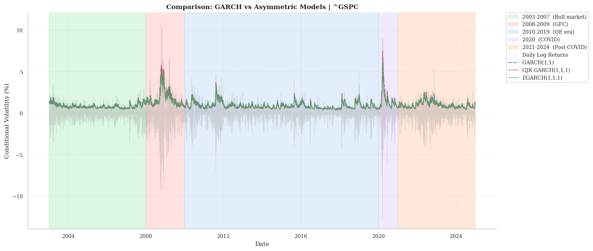{#fig-model-comp}

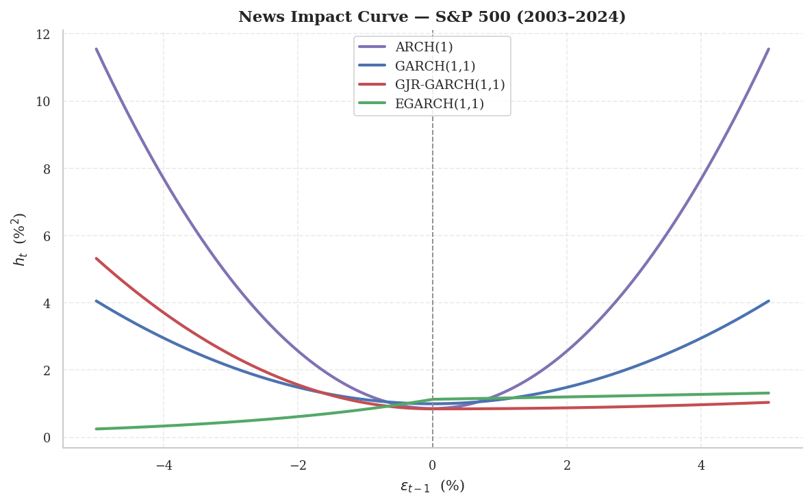{#fig-nic}

## Distribution Assumptions

Assuming conditionally normal errors in GARCH models offers significant advantages, including straightforward estimation and consistent parameter estimators. There are, however, several reasons to consider alternative distributional assumptions for the innovations. First, using a distribution that more accurately approximates the true conditional distribution of standardized returns can improve the precision of volatility process parameter estimates: in the MLE context, this leads to fully efficient estimators. Second, in many practical GARCH applications such as VaR estimation and option pricing, the choice of conditional density is crucial as it directly influences tail risk measures.

- **Standardized Student's t:** Introduced by Bollerslev (1987) [@bollerslev1987], this distribution always features fat tails and typically provides a better fit to the leptokurtic nature of most financial return series than the normal distribution. The degrees of freedom parameter $\nu$ must exceed 2 to ensure finite variance. The density is: $$f(r_t; \sigma^2_t) = \frac{\Gamma\left(\frac{\nu+1}{2}\right)}{\sqrt{\pi(\nu-2)}\Gamma\left(\frac{\nu}{2}\right)} \frac{1}{\sigma_t} \left(1 + \frac{(r_t-\mu)^2}{\sigma_t^2(\nu-2)}\right)^{-\frac{\nu+1}{2}}$$ where $\Gamma(\cdot)$ is the gamma function.

- **Generalized Error Distribution (GED):** Used by Nelson (1991), this is a flexible family that includes the normal distribution when the shape parameter $\kappa=2$, produces fat tails for $\kappa<2$, and thin tails for $\kappa>2$. All moments are finite for any $\kappa > 0$. The density is: $$f(r_t; \sigma^2_t) = \frac{\kappa \exp\left(-\frac{1}{2}\left|\frac{r_t-\mu}{\lambda\sigma_t}\right|^\kappa\right)}{\lambda 2^{1+1/\kappa}\Gamma(1/\kappa)\sigma_t}$$ where $\lambda = \sqrt{2^{-2/\kappa}\Gamma(1/\kappa)/\Gamma(3/\kappa)}$.

- **Hansen's Skewed t:** Proposed by Hansen (1994) [@hansen1994], this distribution generalizes the standardized Student's $t$ by incorporating a separate parameter ($\lambda$) to control skewness, while $\nu$ controls tail thickness. This allows the density to account for the empirical fact that standardized returns may be not only leptokurtic but also asymmetric. The density is defined as: $$f(\epsilon_t; \nu, \lambda) =
      \begin{cases}
      bc\left[1 + \frac{1}{\nu-2}\left(\frac{b\epsilon_t + a}{1-\lambda}\right)^2\right]^{-\frac{\nu+1}{2}} & \epsilon_t < -\frac{a}{b} \\
      bc\left[1 + \frac{1}{\nu-2}\left(\frac{b\epsilon_t + a}{1+\lambda}\right)^2\right]^{-\frac{\nu+1}{2}} & \epsilon_t \geq -\frac{a}{b}
      \end{cases}$$ where $$\begin{aligned}
      a &= 4\lambda c\left(\frac{\nu-2}{\nu-1}\right), \\
      b &= \sqrt{1 + 3\lambda^2 - a^2}, \\
      c &= \frac{\Gamma\left(\frac{\nu+1}{2}\right)}{\sqrt{\pi(\nu-2)}\Gamma\left(\frac{\nu}{2}\right)}.
  \end{aligned}$$

These alternative distributions can provide a better approximation to the empirical density of GARCH model standardized residuals, explicitly modeling the stylized fact of non-Gaussianity (in particular excess kurtosis) and, in the case of the skewed $t$, the skewness observed in financial data.

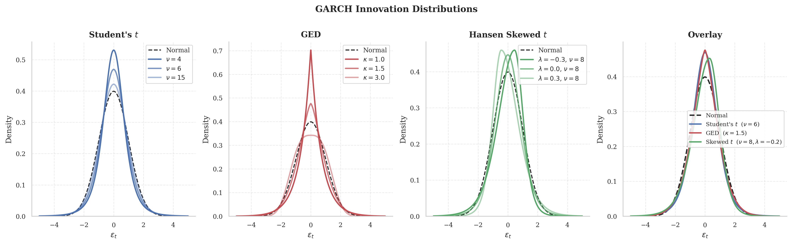{#fig-garch-densities}

## Forecasting Volatility

### Forecasting with GARCH Models

GARCH(1,1) model forecasts are constructed by recursion. The one-step-ahead forecast is: $$\mathbb{E}_t[\sigma_{t+1}^2] = \mathbb{E}_t[\omega + \alpha_1 \varepsilon_t^2
+ \beta_1 \sigma_t^2] = \omega + \alpha_1 \varepsilon_t^2 + \beta_1 \sigma_t^2$$ since all terms are known at time $t$. The two-step-ahead forecast requires additional steps due to the lagged conditional variance term: $$\begin{aligned}
\mathbb{E}_t[\sigma_{t+2}^2]
&= \mathbb{E}_t[\omega + \alpha_1 \varepsilon_{t+1}^2 + \beta_1 \sigma_{t+1}^2] \\
&= \omega + \alpha_1 \mathbb{E}_t[\varepsilon_{t+1}^2]
   + \beta_1 \mathbb{E}_t[\sigma_{t+1}^2] \\
&= \omega + \alpha_1 \mathbb{E}_t[e_{t+1}^2 \sigma_{t+1}^2]
   + \beta_1 \mathbb{E}_t[\sigma_{t+1}^2] \\
&= \omega + \alpha_1 \mathbb{E}_t[e_{t+1}^2]\,\mathbb{E}_t[\sigma_{t+1}^2]
   + \beta_1 \mathbb{E}_t[\sigma_{t+1}^2] \\
&= \omega + (\alpha_1 + \beta_1)\,\mathbb{E}_t[\sigma_{t+1}^2]
\end{aligned}$$ exploiting the independence between $e_{t+1}$ and $\sigma_{t+1}^2$, so that $\mathbb{E}_t[e_{t+1}^2] = 1$. Substituting the one-step-ahead forecast: $$\mathbb{E}_t[\sigma_{t+2}^2] = \omega + (\alpha_1 + \beta_1)\bigl(\omega
+ \alpha_1 \varepsilon_t^2 + \beta_1 \sigma_t^2\bigr)$$ For the three-step-ahead forecast, $\mathbb{E}_t[\sigma_{t+3}^2] = \omega +
(\alpha_1 + \beta_1)\,\mathbb{E}_t[\sigma_{t+2}^2]$, and repeated substitution reveals a pattern expressible in compact form: $$\mathbb{E}_t[\sigma_{t+h}^2] = \sum_{i=0}^{h-1} \omega(\alpha_1 + \beta_1)^i
+ (\alpha_1 + \beta_1)^{h-1}\bigl(\alpha_1 \varepsilon_t^2
+ \beta_1 \sigma_t^2\bigr)$$ The $h$-step-ahead forecast depends entirely on the total persistence parameter $\phi = \alpha_1 + \beta_1$: when $\phi \to 1$ the forecast converges slowly to the unconditional variance $\bar{\sigma}^2 = \omega/(1-\phi)$, while for $\phi \ll 1$ mean reversion is rapid.

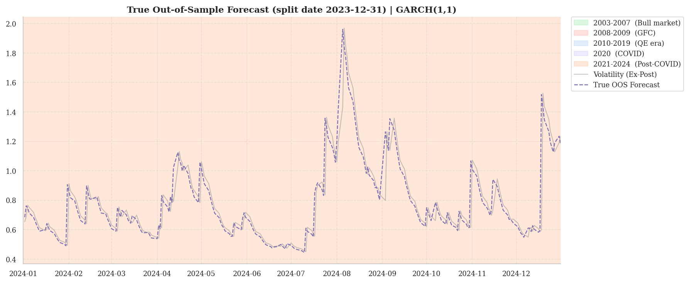{#fig-garch-oos-forecast}

### Forecasting with GJR-GARCH Models

GJR-GARCH forecasts are complicated by the asymmetric term. The one-step-ahead forecast is deterministic, since all conditioning variables are known at time $t$: $$\mathbb{E}_t[\sigma_{t+1}^2] = \omega + \alpha_1 \varepsilon_t^2
+ \gamma\, \varepsilon_t^2\, \mathds{1}_{[\varepsilon_t < 0]} + \beta_1 \sigma_t^2$$ For the two-step-ahead forecast: $$\begin{aligned}
\mathbb{E}_t[\sigma_{t+2}^2]
&= \mathbb{E}_t\bigl[\omega + \alpha_1 \varepsilon_{t+1}^2
   + \gamma\, \varepsilon_{t+1}^2\, \mathds{1}_{[\varepsilon_{t+1}<0]}
   + \beta_1 \sigma_{t+1}^2\bigr] \\
&= \omega + \alpha_1\,\mathbb{E}_t[\sigma_{t+1}^2]
   + \gamma\,\mathbb{E}_t\bigl[\sigma_{t+1}^2\,\mathds{1}_{[e_{t+1}<0]}\bigr]
   + \beta_1\,\mathbb{E}_t[\sigma_{t+1}^2]
\end{aligned}$$ Under conditionally normal innovations, $e_{t+1} \sim \mathcal{N}(0,1)$ and $\sigma_{t+1}^2$ is $\mathcal{F}_t$-measurable at the forecasting step, so: $$\mathbb{E}_t\bigl[\sigma_{t+1}^2\,\mathds{1}_{[e_{t+1}<0]}\bigr]
= \tfrac{1}{2}\,\mathbb{E}_t[\sigma_{t+1}^2]$$ Substituting: $$\mathbb{E}_t[\sigma_{t+2}^2] = \omega + \left(\alpha_1 + \frac{\gamma}{2}
+ \beta_1\right)\mathbb{E}_t[\sigma_{t+1}^2]$$ The forecast recursion thus depends on the modified persistence parameter $\phi^* = \alpha_1 + \frac{\gamma}{2} + \beta_1$, which also governs the covariance stationarity condition of the GJR-GARCH(1,1) process.

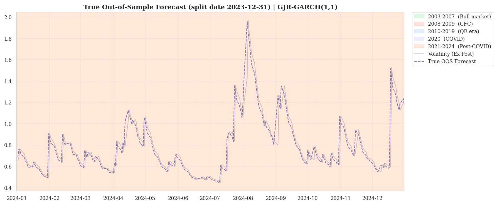{#fig-gjr-garch-oos-forecast}

### Forecasting with EGARCH Models

Multi-step forecasting for EGARCH presents a qualitatively different challenge. The log-variance equation admits a clean linear recursion, but recovering the variance level requires evaluating the expectation of a non-linear transformation.

For the EGARCH(1,0,0) specification: $$\ln \sigma^2_t = \omega + \beta_1 \ln \sigma^2_{t-1} + g(z_{t-1}),
\qquad z_t = \frac{\varepsilon_t}{\sigma_t}$$ where $g(z) = \theta z + \gamma\bigl(|z| - \mathbb{E}[|z|]\bigr)$. The one-step-ahead log-variance forecast is deterministic: $$\mathbb{E}_t[\ln \sigma^2_{t+1}] = \omega + \beta_1 \ln \sigma^2_t + g(z_t)$$ For $h \geq 2$, assuming $\mathbb{E}_t[g(z_{t+1})] = 0$ under symmetric standardized errors, the recursion simplifies to: $$\mathbb{E}_t[\ln \sigma^2_{t+h}] = \omega + \beta_1\,
\mathbb{E}_t[\ln \sigma^2_{t+h-1}]$$ The complication arises in recovering the variance level. By Jensen's inequality applied to the convex exponential function: $$\mathbb{E}_t[\sigma^2_{t+h}] = \mathbb{E}_t\bigl[\exp(\ln \sigma^2_{t+h})\bigr]
> \exp\!\bigl(\mathbb{E}_t[\ln \sigma^2_{t+h}]\bigr)$$ so that simply exponentiating the log-variance systematically understates the true conditional variance. The correct two-step-ahead forecast requires a convexity correction: $$\mathbb{E}_t[\sigma^2_{t+2}] = \exp(\omega)\cdot
(\sigma^2_{t+1})^{\beta_1}\cdot\mathbb{E}_t\bigl[\exp(g(z_{t+1}))\bigr]$$ where $\mathbb{E}[\exp(g(z))]$ depends on the assumed distribution of $z_t$. For Gaussian innovations this term is available analytically via the moment generating function; for the skewed-$t$ distribution it is computed via Monte Carlo integration, as in the empirical application below.

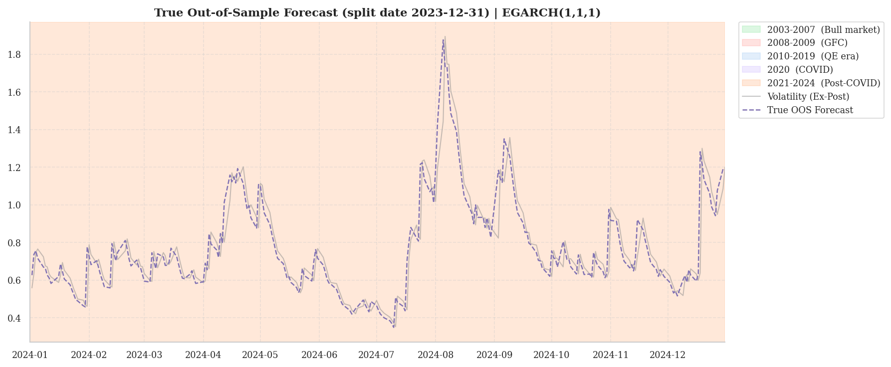{#fig-egarch-oos-forecast}

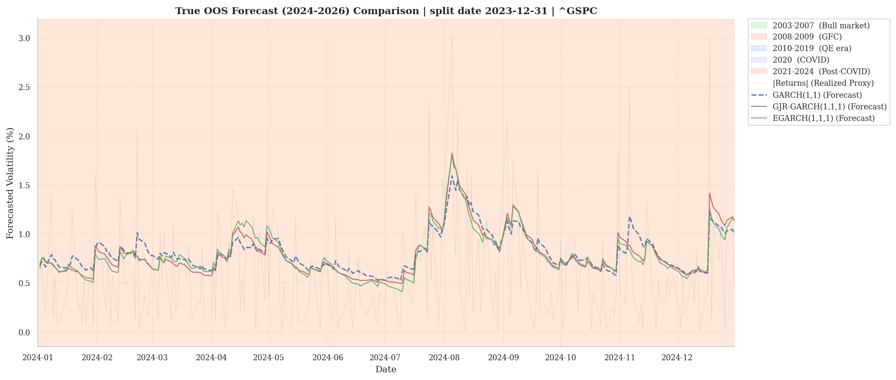{#fig-oos-comparison}

The univariate volatility models developed in this chapter address one of the three core limitations of static OLS-based strategies: the misspecification of the conditional variance of the spread. The remaining two limitations (time-varying nature of the cointegrating relationship and the presence of discrete regime shifts) require moving from a univariate to a multivariate framework. The following chapter introduces the Vector Autoregression and Vector Error Correction models that formalize the joint dynamics of multiple non-stationary series, providing the structural foundation for cointegration-based trading strategies.

# Analysis of Multiple Time Series

## VAR model

The Vector AutoRegression model [@sims1980] describes how multiple variables evolve jointly in an autoregressive manner over time, mutually influencing each other.

### Vector White Noise Process {#sec-vector-white-noise-process .unnumbered}

A $k \times 1$ vector-valued stochastic process $\{\varepsilon_t\}$ is a vector white noise if: $$\begin{aligned}
\mathbb{E}[\varepsilon_t] &= 0_k \\
\mathbb{E}[\varepsilon_t \varepsilon_{t-s}'] &= 0_{k \times k} \quad \text{for } s \neq 0 \\
\mathbb{E}[\varepsilon_t \varepsilon_t'] &= \Sigma
\end{aligned}$$ for all $t$, where $\Sigma$ is a finite positive definite matrix.

The simplest VAR specification is the bivariate VAR(1): $$Y_t = \Phi_0 + \Phi_1 Y_{t-1} + \varepsilon_t$$ or in matrix form: $$\begin{bmatrix} Y_{1,t} \\ Y_{2,t} \end{bmatrix} =
\begin{bmatrix} \phi_{1,0} \\ \phi_{2,0} \end{bmatrix} +
\begin{bmatrix} \phi_{11,1} & \phi_{12,1} \\ \phi_{21,1} & \phi_{22,1} \end{bmatrix}
\begin{bmatrix} Y_{1,t-1} \\ Y_{2,t-1} \end{bmatrix} +
\begin{bmatrix} \varepsilon_{1,t} \\ \varepsilon_{2,t} \end{bmatrix}$$ Corresponding to the system of equations: $$\begin{aligned}
Y_{1,t} &= \phi_{1,0} + \phi_{11,1}Y_{1,t-1} + \phi_{12,1}Y_{2,t-1}
           + \varepsilon_{1,t} \\
Y_{2,t} &= \phi_{2,0} + \phi_{21,1}Y_{1,t-1} + \phi_{22,1}Y_{2,t-1}
           + \varepsilon_{2,t}
\end{aligned}$$ where each element $Y_t$ is a function of the lags $Y_{t-1}$.

The general VAR(P) case for a $k$-dimensional vector is [@lutkepohl2005]: $$Y_t = \Phi_0 + \Phi_1 Y_{t-1} + \Phi_2 Y_{t-2} + \dots + \Phi_P Y_{t-P}
+ \varepsilon_t$$ where $Y_t$ is a $k \times 1$ vector stochastic process, $\Phi_0$ is a $k \times 1$ vector of intercept parameters, $\Phi_j$ ($j = 1, \dots, P$) are $k \times k$ parameter matrices, and $\varepsilon_t$ is a vector white noise process with $\mathbb{E}_{t-1}[\varepsilon_t] = 0$. In matrix form:

$$\begin{aligned}
\begin{bmatrix} Y_{1,t} \\ Y_{2,t} \\ \vdots \\ Y_{k,t} \end{bmatrix} &=
\begin{bmatrix} \phi_{1,0} \\ \phi_{2,0} \\ \vdots \\ \phi_{k,0} \end{bmatrix} +
\begin{bmatrix}
\phi_{11,1} & \phi_{12,1} & \cdots & \phi_{1k,1} \\
\phi_{21,1} & \phi_{22,1} & \cdots & \phi_{2k,1} \\
\vdots      & \vdots      & \ddots & \vdots      \\
\phi_{k1,1} & \phi_{k2,1} & \cdots & \phi_{kk,1}
\end{bmatrix}
\begin{bmatrix} Y_{1,t-1} \\ Y_{2,t-1} \\ \vdots \\ Y_{k,t-1} \end{bmatrix} + \cdots \\[4pt]
&\quad + \begin{bmatrix}
\phi_{11,P} & \phi_{12,P} & \cdots & \phi_{1k,P} \\
\phi_{21,P} & \phi_{22,P} & \cdots & \phi_{2k,P} \\
\vdots      & \vdots      & \ddots & \vdots      \\
\phi_{k1,P} & \phi_{k2,P} & \cdots & \phi_{kk,P}
\end{bmatrix}
\begin{bmatrix} Y_{1,t-P} \\ Y_{2,t-P} \\ \vdots \\ Y_{k,t-P} \end{bmatrix} +
\begin{bmatrix} \varepsilon_{1,t} \\ \varepsilon_{2,t} \\ \vdots \\
\varepsilon_{k,t} \end{bmatrix}
\end{aligned}$$

The corresponding system of $k$ equations is: $$\begin{aligned}
Y_{1,t} &= \phi_{1,0}
+ \sum_{p=1}^{P}\sum_{j=1}^{k} \phi_{1j,p}\,Y_{j,t-p} + \varepsilon_{1,t} \\
Y_{2,t} &= \phi_{2,0}
+ \sum_{p=1}^{P}\sum_{j=1}^{k} \phi_{2j,p}\,Y_{j,t-p} + \varepsilon_{2,t} \\
&\;\vdots  \\
Y_{k,t} &= \phi_{k,0}
+ \sum_{p=1}^{P}\sum_{j=1}^{k} \phi_{kj,p}\,Y_{j,t-p} + \varepsilon_{k,t}
\end{aligned}$$ where each equation $i$ expresses $Y_{i,t}$ as a linear function of all $k$ elements of the vector $Y_t$ at lags $1, \dots, P$, with the parameter $\phi_{ij,p}$ measuring the effect of $Y_{j,t-p}$ on $Y_{i,t}$.

### Stationarity of a VAR Model {#sec-stationarity-of-a-var-model .unnumbered}

A VAR(1) driven by vector white noise shocks, $$
Y_t = \Phi_0 + \Phi_1 Y_{t-1} + \varepsilon_t
$$ is covariance stationary if the eigenvalues of $\Phi_1$ are less than 1 in modulus. In the univariate case, this statement is equivalent to the condition $|\phi_1| < 1$.

### Mean {#sec-mean .unnumbered}

Taking expectations of $Y_t$ expressed in back-substitution form: $$\begin{aligned}
E[Y_t] &= E \left[ (I_k - \Phi_1)^{-1}\Phi_0 + \sum_{i=0}^{\infty} \Phi_1^i \varepsilon_{t-i} \right] \\
&= (I_k - \Phi_1)^{-1}\Phi_0 + \sum_{i=0}^{\infty} \Phi_1^i E[\varepsilon_{t-i}] \\
&= (I_k - \Phi_1)^{-1}\Phi_0
\end{aligned}$$ The mean of a VAR process mirrors that of a univariate AR(1), $(1 - \phi_1)^{-1}\phi_0$. The long-run mean depends on the eigenvalues of $\Phi_1$: if one is close to unity, then $(I_k - \Phi_1)^{-1}$ is large in modulus and, all else equal, the unconditional mean is higher. Conversely, if $\Phi_1 = 0$, the mean is $\Phi_0$ since $\{Y_t\}$ is a constant plus white noise.

### Variance {#sec-variance .unnumbered}

Before deriving the variance of a VAR(1), we rewrite the model in deviation-from-mean form. Let $\mu = E[Y_t] = (I_k - \Phi_1)^{-1}\Phi_0$ be the unconditional mean of the process (assumed finite). Subtracting $\mu$ from both sides of the VAR(P) yields the deviation form: $$\tilde{Y}_t = \Phi_1 \tilde{Y}_{t-1} + \dots + \Phi_P \tilde{Y}_{t-P} + \varepsilon_t$$ where $\tilde{Y}_t = Y_t - \mu$. By construction this process has zero mean, which greatly simplifies calculations without altering either the dynamics or the shock structure. In the VAR(1) case, back-substitution yields the MA$(\infty)$ representation: $$\tilde{Y}_t = \sum_{i=0}^{\infty} \Phi_1^i\, \varepsilon_{t-i}$$ From here we derive the long-run covariance matrix. Substituting the moving average representation and exploiting the uncorrelatedness of shocks at different dates ($E[\varepsilon_{t-i}\varepsilon_{t-j}']=0$ for $i \neq j$): $$\begin{aligned}
    E[\tilde{Y}_t \tilde{Y}_t']
    &= E\!\left[
        \left(\sum_{i=0}^{\infty} \Phi_1^i\, \varepsilon_{t-i}\right)
        \left(\sum_{i=0}^{\infty} \Phi_1^i\, \varepsilon_{t-i}\right)'
       \right] \\
    &= \sum_{i=0}^{\infty} \Phi_1^i\, E[\varepsilon_{t-i}\varepsilon_{t-i}']\,(\Phi_1')^i \\
    &= \sum_{i=0}^{\infty} \Phi_1^i\, \Sigma\, (\Phi_1')^i
\end{aligned}$$ To express this in closed form it is convenient to use the $\operatorname{vec}$ operator and the Kronecker product [@lutkepohl2005]. Denoting $\Gamma_0 = E[\tilde{Y}_t \tilde{Y}_t']$ as the unconditional covariance matrix, one can show that it satisfies the matrix Yule-Walker equation $$\Gamma_0 = \Phi_1\,\Gamma_0\,\Phi_1' + \Sigma,$$ whose solution is: $$\operatorname{vec}(\Gamma_0)
    = \left(I_{k^2} - \Phi_1 \otimes \Phi_1\right)^{-1}
      \operatorname{vec}(\Sigma).$$ The parallel with the univariate case is immediate: for a scalar AR(1) the unconditional variance is $\sigma^2/(1-\phi_1^2)$, rewritable as $(1-\phi_1^2)^{-1}\sigma^2$. The matrix formula is its natural generalization, with the term $(I_{k^2} - \Phi_1 \otimes \Phi_1)^{-1}$ playing the role of $(1-\phi_1^2)^{-1}$. The difference is that in the multivariate case matrix multiplication is not commutative, so the result cannot be factored as in the scalar case.

### Companion Form {#sec-sub-companion}

A stationary VAR(P) can always be rewritten as a VAR(1). This reformulation is useful because it allows the simpler results for first-order processes to be applied to higher-order models.

Suppose $\{Y_t\}$ follows a VAR(P): $$Y_t = \Phi_0 + \Phi_1 Y_{t-1} + \Phi_2 Y_{t-2} + \dots
          + \Phi_P Y_{t-P} + \varepsilon_t$$ Subtracting the unconditional mean $\mu$ and stacking $P$ consecutive lags into a single column vector $Z_t$: $$Z_t = \Upsilon\, Z_{t-1} + \xi_t$$ The state vector $Z_t$, of dimension $kP \times 1$, collects the mean-centered variables: $$Z_t =
\begin{bmatrix}
Y_t - \mu \\ Y_{t-1} - \mu \\ \vdots \\ Y_{t-P+1} - \mu
\end{bmatrix}$$ The transition matrix $\Upsilon$ (the companion matrix) is square of order $kP$. The first $k$ rows contain the autoregressive coefficients; the subsequent rows host identity matrices along the block sub-diagonal, whose sole effect is to shift the lags forward by one period: $$\Upsilon =
\begin{bmatrix}
\Phi_1 & \Phi_2 & \Phi_3 & \dots & \Phi_{P-1} & \Phi_P \\
I_k    & 0      & 0      & \dots & 0          & 0      \\
0      & I_k    & 0      & \dots & 0          & 0      \\
\vdots & \vdots & \vdots & \ddots& \vdots     & \vdots \\
0      & 0      & 0      & \dots & I_k        & 0
\end{bmatrix}$$ The vector $\xi_t$ coincides with $\varepsilon_t$ in the first $k$ components and is zero elsewhere, since the remaining equations are deterministic identities: $$\xi_t =
\begin{bmatrix} \varepsilon_t \\ 0 \\ \vdots \\ 0 \end{bmatrix},
\qquad
E[\xi_t \xi_t'] =
\begin{bmatrix}
\Sigma & 0      & \dots & 0      \\
0      & 0      & \dots & 0      \\
\vdots & \vdots & \ddots& \vdots \\
0      & 0      & \dots & 0
\end{bmatrix}$$ The properties of the original VAR(P) coincide with those of its companion form. In particular, the covariance stationarity condition depends entirely on the eigenvalues of $\Upsilon$: the process is stationary if and only if all $k \times P$ eigenvalues of $\Upsilon$ have modulus $<1$.

## Cointegration

Virtually all financial time series are non-stationary, and so the VAR model (which assumes covariance stationarity) is limited. The concept of cointegration [@granger1981; @engle_granger1987] extends VAR models to non-stationary time series while simultaneously providing a method for characterizing the long-run equilibrium of a system of variables that are not individually stationary.\
Consider two non-stationary variables: consumption and income. If they evolved entirely independently, they could diverge without bound over time, with economically unsustainable implications: income persistently above consumption would lead to infinite saving rates, while consumption persistently above income would imply unsustainable debt. There must exist, therefore, an equilibrium mechanism tying the two variables together in the long run [@engle_granger1987].\
The behavior of cointegrated processes differs substantially from that of stationary ones. In a stationary VAR the process is self-equilibrating and converges toward a fixed unconditional mean. In a cointegrated system, by contrast, each component contains a unit root and is subject to permanent shocks. What binds them is the tendency to move together, following a common stochastic trend rather than a fixed value. The Vector Error Correction Model (VECM) is the model that formalizes this dynamic, treating short-run deviations as mean-reverting forces toward the long-run equilibrium.

An $I(1)$ process is non-stationary in levels but stationary in first differences ($\Delta Y_t \sim I(0)$). Cointegration extends this concept [@granger1981]. Rather than differencing the series, we seek a linear combination of multiple $I(1)$ processes that is $I(0)$, canceling the unit roots without discarding information about the levels.

### Bivariate Case {#sec-bivariate-case .unnumbered}

Let $\{x_t\}$ and $\{Y_t\}$ be two $I(1)$ series. The two series are cointegrated if there exists a vector $\beta$ (with not all elements zero) such that their linear combination is stationary: $$\beta
\begin{bmatrix} x_t \\ Y_t \end{bmatrix}
= \beta_1 x_t - \beta_2 Y_t \sim I(0)$$ This implies that, while the individual series are persistent, there exists a linear combination of them with transitory shocks. By convention the relationship is normalized with respect to one of the two variables, yielding the equilibrium error term $Y_t - \tilde{\beta}\, x_t$.

### Multivariate Case {#sec-multivariate-case .unnumbered}

In the general case with $k$ variables, the definition leverages the rank of the transformation matrix [@johansen1995]. A set of variables $Y_t$ is cointegrated if at least two series are $I(1)$ and if there exists a matrix $\pi$ of dimension $k \times k$ and reduced rank such that: $$\pi Y_t \sim I(0)$$ If $\pi$ were full rank, it would imply that $Y_t$ is already stationary (contradicting the $I(1)$ assumption). If the rank were zero, no stationary linear combination would exist and hence no cointegration. For cointegration to hold, the rank $r$ must satisfy $0 < r < k$: in this way unit roots cancel in the linear combination while remaining in the individual series. If $Y_{1t}$ and $Y_{2t}$ are cointegrated with $Y_{1t} - \beta Y_{2t} \sim I(0)$, a natural choice for $\pi$ is the rank-1 matrix: $$\pi =
\begin{bmatrix}
1 & -\beta \\
1 & -\beta
\end{bmatrix}$$

### System Dynamics and Eigenvalues

To see the difference between cointegration and independent unit roots, consider four VAR(1) processes: $Y_t = \Phi_{ij}Y_{t-1} + \varepsilon_t$. The system's properties depend entirely on the eigenvalues ($\lambda$) of the matrix $\Phi$, as illustrated in @fig-dynamics.

1.  **Cointegration ($\Phi_{11}$):** $\Phi_{11} = \begin{bmatrix} 0.8 & 0.2 \\ 0.2 & 0.8 \end{bmatrix},
        \quad \lambda = \{1,\; 0.6\}$.\
    The system has exactly **one unit eigenvalue**, which generates the common stochastic trend. The stationary eigenvalue ($0.6$) ensures convergence toward the long-run equilibrium.

2.  **Independent unit roots ($\Phi_{12}$):** $\Phi_{12} = \begin{bmatrix} 1 & 0 \\ 0 & 1 \end{bmatrix},
        \quad \lambda = \{1,\; 1\}$.\
    With two unit eigenvalues ($k=2$), each variable follows an independent random walk. The two series diverge indefinitely: no cointegration.

3.  **Persistent stationary ($\Phi_{21}$):** $\Phi_{21} = \begin{bmatrix} 0.7 & 0.2 \\ 0.2 & 0.7 \end{bmatrix},
        \quad \lambda = \{0.9,\; 0.5\}$.\
    All eigenvalues are less than 1 in modulus: the system converges toward a fixed mean, with slow dynamics.

4.  **Anti-persistent stationary ($\Phi_{22}$):** $\Phi_{22} = \begin{bmatrix} -0.3 & 0.3 \\ 0.1 & -0.2 \end{bmatrix},
        \quad \lambda \approx \{-0.43,\; -0.06\}$.\
    The eigenvalues are negative and small in modulus: the system oscillates rapidly around its mean, with strong anti-persistence.

{#fig-dynamics}

The number of unit eigenvalues of a VAR(1) therefore determines long-run behavior. A cointegrated system of dimension $k$ contains between $1$ and $k-1$ unit eigenvalues, each representing a common trend. Identifying these eigenvalues is the central question for distinguishing cointegrated series from independent random walks.

## VECM Model

The *Granger Representation Theorem* [@engle_granger1987] is the bridge between cointegration and dynamic modeling. Granger showed that if a system of variables is cointegrated then a VECM governed by a reduced-rank coefficient matrix must exist, and conversely, if such a VECM exists, the system is necessarily cointegrated.

A VECM decomposes the behavior of a time series into two components: the long-run stochastic trend (the equilibrium) and the short-run deviations from that trend.

### Bivariate Case {#sec-bivariate-case-1 .unnumbered}

In the simplest case, the VECM specifies that the changes in the variables ($\Delta x_t$ and $\Delta Y_t$) depend on the deviation from the long-run equilibrium in the previous period: $$\begin{bmatrix} \Delta x_t \\ \Delta Y_t \end{bmatrix} =
\Pi
\begin{bmatrix} x_{t-1} \\ Y_{t-1} \end{bmatrix} +
\varepsilon_t
=
\begin{bmatrix} \pi_{11} & \pi_{12} \\ \pi_{21} & \pi_{22} \end{bmatrix}
\begin{bmatrix} x_{t-1} \\ Y_{t-1} \end{bmatrix} +
\varepsilon_t$$ Since the variables are cointegrated, the matrix $\Pi$ is singular (reduced rank) and decomposes as $\Pi = \alpha\beta'$, where $\beta$ is the cointegrating vector defining the long-run equilibrium relationship $x_t - \beta Y_t \sim I(0)$. Substituting: $$\begin{bmatrix} \Delta x_t \\ \Delta Y_t \end{bmatrix} =
\begin{bmatrix} \alpha_1 \\ \alpha_2 \end{bmatrix}
(x_{t-1} - \beta Y_{t-1}) +
\begin{bmatrix} \varepsilon_{1,t} \\ \varepsilon_{2,t} \end{bmatrix}$$ or, equation by equation: $$\begin{aligned}
\Delta x_t &= \alpha_1 (x_{t-1} - \beta Y_{t-1}) + \varepsilon_{1,t} \\
\Delta Y_t &= \alpha_2 (x_{t-1} - \beta Y_{t-1}) + \varepsilon_{2,t}
\end{aligned}$$ The term $(x_{t-1} - \beta Y_{t-1})$ is the *error correction*: it measures the deviation from the long-run trend. The parameters $\alpha_1$ and $\alpha_2$ are the *speeds of adjustment* and indicate how strongly the system corrects past disequilibria. For the VECM to be valid, at least one $\alpha$ must be non-zero: otherwise no restoring force toward equilibrium exists, which would contradict cointegration.

### Generalization {#sec-generalization .unnumbered}

In general, the VECM can be enriched with short-run lags and deterministic components. A VECM of order $P$ is [@johansen1995]: $$\Delta Y_t = \delta_0 + \Pi Y_{t-1} +
\sum_{j=1}^{P} \Pi_j\, \Delta Y_{t-j} + \varepsilon_t$$ where $\Pi Y_{t-1} = \alpha\beta' Y_{t-1}$ captures the long-run cointegrating relationship, $\delta_0$ represents a linear trend in levels, and $\Pi_j \Delta Y_{t-j}$ captures short-run dynamics around the stochastic trend.

### The Matrix $\Pi$ {#sec-the-matrix-pi .unnumbered}

The matrix $\Pi$ is the backbone of the VECM. It represents the overall impact of lagged levels on current changes and acts as the bridge between short-run dynamics and the long-run equilibrium. The structural insight of cointegration emerges from the decomposition of this reduced-rank matrix into the product of two $k \times r$ matrices, $\Pi = \alpha \beta'$ [@johansen1988; @johansen1995]:

- **The Cointegrating Matrix ($\beta$):** The columns of $\beta$ contain the cointegrating vectors, which define the stationary long-run relationships (the "equilibrium errors") such that $\beta' Y_{t-1} \sim I(0)$. Geometrically, $\beta$ defines the stable subspace toward which the system tends to reside over time.

- **The Loading Matrix ($\alpha$):** The elements of $\alpha$ represent the speeds of adjustment. They determine how strongly the endogenous variables respond to the equilibrium errors identified by $\beta$. A large $\alpha$ implies rapid correction toward the trend, while a zero coefficient implies that the variable is "weakly exogenous" and does not adjust to correct deviations from that specific equilibrium.

In short, while $\beta$ defines the *target* equilibrium, $\alpha$ describes the *force* driving the variables toward it.

### VAR(P) to VECM {#sec-varp-to-vecm .unnumbered}

Using recursive substitution we can transform a general VAR($P$) into its VECM form [@lutkepohl2005]. Take as an example a VAR(3): $$Y_t = \Phi_1 Y_{t-1} + \Phi_2 Y_{t-2} + \Phi_3 Y_{t-3} + \varepsilon_t$$ To isolate the first differences ($\Delta$), appropriate terms are added and subtracted. First, add and subtract $\Phi_3 Y_{t-2}$: $$\begin{aligned}
Y_t &= \Phi_1 Y_{t-1} + \Phi_2 Y_{t-2}
       + \Phi_3 Y_{t-2} - \Phi_3 Y_{t-2}
       + \Phi_3 Y_{t-3} + \varepsilon_t \\
    &= \Phi_1 Y_{t-1} + (\Phi_2 + \Phi_3) Y_{t-2}
       - \Phi_3 \Delta Y_{t-2} + \varepsilon_t
\end{aligned}$$ Then add and subtract $(\Phi_2 + \Phi_3) Y_{t-1}$: $$\begin{aligned}
Y_t &= \Phi_1 Y_{t-1}
       + (\Phi_2 + \Phi_3) Y_{t-1}
       - (\Phi_2 + \Phi_3) Y_{t-1}
       + (\Phi_2 + \Phi_3) Y_{t-2}
       - \Phi_3 \Delta Y_{t-2} + \varepsilon_t \\
    &= (\Phi_1 + \Phi_2 + \Phi_3) Y_{t-1}
       - (\Phi_2 + \Phi_3) \Delta Y_{t-1}
       - \Phi_3 \Delta Y_{t-2} + \varepsilon_t
\end{aligned}$$ Finally, subtracting $Y_{t-1}$ from both sides yields the VECM form: $$\Delta Y_t = (\Phi_1 + \Phi_2 + \Phi_3 - I_k)\, Y_{t-1}
             - (\Phi_2 + \Phi_3)\, \Delta Y_{t-1}
             - \Phi_3\, \Delta Y_{t-2} + \varepsilon_t$$ This result generalizes through the identities $\Pi = \sum_{i=1}^P \Phi_i - I_k$ and $\Pi_j = -\sum_{i=j+1}^P \Phi_i$, so that any VAR($P$) can be rewritten as: $$\Delta Y_t = \Pi Y_{t-1}
             + \sum_{j=1}^{P-1} \Pi_j\, \Delta Y_{t-j}
             + \varepsilon_t$$ where $\Pi = \alpha\beta'$ collects the cointegrating relationships and adjustment parameters.

### Identification of Cointegrating Vectors {#sec-identification-of-cointegrating-vectors .unnumbered}

The method for making cointegration operational in multivariate systems ($k \ge 3$) lies in the decomposition of the reduced-rank matrix $\Pi$ [@johansen1995]. If $\Pi$ has rank $r < k$, it factors as $\Pi = \alpha\beta'$. Without normalization, however, this decomposition is not unique.

Consider a trivariate system ($k=3$) in which the estimated matrix $\Pi$ is: $$\Pi = \begin{bmatrix}
 0.3  &  0.2  & -0.36 \\
 0.2  &  0.5  & -0.35 \\
-0.3  & -0.3  &  0.39
\end{bmatrix}$$ The eigenvalues of this matrix are $\lambda = \{0.9758,\, 0.2142,\, 0\}$. The presence of exactly one zero eigenvalue implies rank $r=2$. There are therefore two distinct cointegrating relationships and a single common stochastic trend driving the system.

To identify the parameters, a normalization is imposed on $\beta$. With $r=2$, the upper $2 \times 2$ block of $\beta$ is normalized as the identity matrix: $$\beta' = \begin{bmatrix} 1 & 0 & \beta_1 \\ 0 & 1 & \beta_2 \end{bmatrix}$$ The adjustment matrix $\alpha$ remains free ($3 \times 2$). Multiplying $\alpha\beta'$ yields the structural form of $\Pi$: $$\Pi =
\begin{bmatrix}
\alpha_{11} & \alpha_{12} \\
\alpha_{21} & \alpha_{22} \\
\alpha_{31} & \alpha_{32}
\end{bmatrix}
\begin{bmatrix} 1 & 0 & \beta_1 \\ 0 & 1 & \beta_2 \end{bmatrix}
=
\begin{bmatrix}
\alpha_{11} & \alpha_{12} & \alpha_{11}\beta_1 + \alpha_{12}\beta_2 \\
\alpha_{21} & \alpha_{22} & \alpha_{21}\beta_1 + \alpha_{22}\beta_2 \\
\alpha_{31} & \alpha_{32} & \alpha_{31}\beta_1 + \alpha_{32}\beta_2
\end{bmatrix}$$ Comparing this matrix with the estimated numerical one, $\alpha$ is read from the first two columns of $\Pi$. Once the values of $\alpha$ are known, the third column provides a system of equations from which $\beta_1$ and $\beta_2$ are recovered.

### Rank and Common Stochastic Trends {#sec-rank-and-common-stochastic-trends .unnumbered}

The rank of $\Pi$ reveals the structure of the data [@johansen1995; @lutkepohl2005]. If the system has rank $r$, there exist $r$ stationary linear combinations (cointegrating vectors) and the system is driven by $m = k - r$ distinct unit roots (common stochastic trends).

We can formalize this by expressing the observed variables $Y_t$ as functions of latent unit-root processes $w_t$: $$Y_t = K w_t + \varepsilon_t$$ where $K$ is a $k \times m$ matrix of weights, $w_t$ is the vector of $m$ unit-root processes, and $\varepsilon_t$ represents stationary noise.

#### Case 1: one unit root, three variables ($m=1,\, k=3$)

When a single unit root $w_{1,t}$ drives three variables, the cointegration rank is $r = 3 - 1 = 2$: $$\begin{aligned}
Y_{1,t} &= \kappa_1 w_{1,t} + \varepsilon_{1,t} \\
Y_{2,t} &= \kappa_2 w_{1,t} + \varepsilon_{2,t} \\
Y_{3,t} &= \kappa_3 w_{1,t} + \varepsilon_{3,t}
\end{aligned}$$ To find the stationary relationships, $w_{1,t}$ must be eliminated. Normalizing on $Y_1$ gives $Y_{1,t} - \frac{\kappa_1}{\kappa_3}Y_{3,t}$; normalizing on $Y_2$ gives $Y_{2,t} - \frac{\kappa_2}{\kappa_3}Y_{3,t}$. These constitute the two linearly independent cointegrating vectors: $$\beta = \begin{bmatrix}
1 & 0 & -\dfrac{\kappa_1}{\kappa_3} \\[6pt]
0 & 1 & -\dfrac{\kappa_2}{\kappa_3}
\end{bmatrix}'$$ Any third relationship (e.g., between $Y_1$ and $Y_2$) is a linear combination of the first two and is therefore redundant.

#### Case 2: two unit roots, three variables ($m=2,\, k=3$)

With two independent unit roots the cointegration rank drops to $r = 3 - 2 = 1$: $$\begin{aligned}
Y_{1,t} &= \kappa_{11} w_{1,t} + \kappa_{12} w_{2,t} + \varepsilon_{1,t} \\
Y_{2,t} &= \kappa_{21} w_{1,t} + \kappa_{22} w_{2,t} + \varepsilon_{2,t} \\
Y_{3,t} &= \kappa_{31} w_{1,t} + \kappa_{32} w_{2,t} + \varepsilon_{3,t}
\end{aligned}$$ Building a stationary relationship is now harder because *both* $w_{1,t}$ and $w_{2,t}$ must be eliminated simultaneously. This requires a linear combination whose weights satisfy a specific system of linear equations. The unique solution (up to normalization) is: $$\beta = \begin{bmatrix}
1 \\[4pt]
\dfrac{\kappa_{12}\kappa_{31} - \kappa_{11}\kappa_{32}}
      {\kappa_{21}\kappa_{32} - \kappa_{22}\kappa_{31}} \\[8pt]
\dfrac{\kappa_{11}\kappa_{22} - \kappa_{12}\kappa_{21}}
      {\kappa_{21}\kappa_{32} - \kappa_{22}\kappa_{31}}
\end{bmatrix}$$

#### General Case

In the general case of $k$ variables driven by $m$ unit roots, the cointegrating vectors are obtained by partitioning the weight matrix $K$. Normalizing on the first $r$ variables: $$\beta = \begin{bmatrix} I_r \\ \tilde{\beta} \end{bmatrix},
\qquad \tilde{\beta} = -\bigl(K_1 K_2^{-1}\bigr)'$$ where $K_1$ denotes the first $r$ rows of $K$ (associated with the normalized variables) and $K_2$ the remaining $m$ rows, so that $\beta' K = K_1 + \tilde{\beta}' K_2 = 0$. This formulation confirms that as the number of common trends ($m$) increases, the number of stationary equilibrium relationships ($r$) necessarily decreases.

## VAR vs VECM Model

The choice between VAR and VECM is determined by the properties of the data, in particular the order of integration and the cointegration rank. @tbl-var-vs-vecm summarizes the key distinctions.

::: {#tbl-var-vs-vecm}
  **Feature**                **Standard VAR (in Differences)**            **VECM (Vector Error Correction)**
  -------------------------- -------------------------------------------- --------------------------------------------------------------------
  **Data Requirement**       Stationary series ($I(0)$).                  Non-stationary ($I(1)$) but cointegrated.
  **Input Transformation**   First differences required ($\Delta Y_t$).   Uses levels ($Y_t$) and differences ($\Delta Y_t$).
  **Information Loss**       **High:** long-run trends are removed.       **None:** long-run equilibrium is preserved.
  **Dynamics Modeled**       Short-run reactions to shocks only.          Short-run dynamics + equilibrium adjustment.
  **Key Parameter**          Lag coefficients ($\Phi_i$).                 Speed of adjustment ($\alpha$) and cointegrating vector ($\beta$).
  **Risk**                   Over-differencing (signal loss).             Misspecifying rank $r$ (model misspecification).

  : Comparison: Standard VAR vs. VECM
:::

The VECM framework establishes the theoretical conditions under which a mean-reverting spread exists between non-stationary assets. Identifying whether those conditions are empirically satisfied in a given dataset, however, requires formal statistical testing. The following chapter presents the two principal methodologies for cointegration testing: the Johansen procedure and the Engle-Granger two-step approach.

# Testing for Cointegration

Testing for cointegration is analogous to unit root testing, but more complex given the multivariate nature of the system [@engle_granger1987; @johansen1988; @johansen1991]. The two main methodologies are the **Johansen methodology** and the **Engle-Granger two-step procedure**.

The Engle-Granger method is limited to bivariate systems or cases in which a single cointegrating relationship is suspected. The Johansen methodology is more general and applies to systems with $k$ variables and potentially $r$ cointegrating vectors.

## Johansen Methodology

The Johansen methodology [@johansen1988; @johansen1991] is the primary technique for determining the number of cointegrating relationships in a system of $I(1)$ variables. It is based on the rank properties of the matrix $\Pi$ in the VECM specification: $$\Delta Y_t = \Pi Y_{t-1} + \sum_{i=1}^{P-1} \Gamma_i\, \Delta Y_{t-i}
+ \varepsilon_t$$ The rank of $\Pi$ equals the number of non-zero eigenvalues of the associated reduced-rank problem. If $r=k$ the system is stationary; if $r=0$ it contains only unit roots. The Johansen method uses the magnitude of the estimated eigenvalues $\hat{\lambda}_i$ (ordered $\lambda_1 > \lambda_2 > \dots > \lambda_k$) to test the true rank $r$. Two test statistics with different hypotheses are used.

#### Trace Statistic ($\lambda_{\text{trace}}$)

The Trace test evaluates the null hypothesis that the number of cointegrating vectors is at most $r$ against the alternative that it is greater than $r$ [@johansen1991]: $$\lambda_{\text{trace}}(r) = -T \sum_{i=r+1}^k \ln(1 - \hat{\lambda}_i)$$ The test proceeds sequentially: first testing $r=0$ (no cointegration); if $\lambda_{\text{trace}}(0)$ is large, indicating that $\hat{\lambda}_1$ is significantly non-zero, the null is rejected and one proceeds to $r \le 1$, $r \le 2$, and so on, until the null can no longer be rejected.

#### Maximum Eigenvalue Statistic ($\lambda_{\text{max}}$)

This statistic tests the null of exactly $r$ cointegrating vectors against the specific alternative of $r+1$ [@johansen1991]: $$\lambda_{\text{max}}(r,\, r+1) = -T \ln(1 - \hat{\lambda}_{r+1})$$ Intuitively, if $r+1$ relationships exist, the eigenvalue $\hat{\lambda}_{r+1}$ will be positive and significant, making the statistic large.

The implementation steps are as follows:

1.  **Univariate analysis:** verify that all variables in the system are integrated of the same order ($I(1)$).

2.  **Lag selection:** choose the number of lags ($P$) for the VECM via information criteria (AIC/BIC) or general-to-specific LR tests on the underlying VAR.

3.  **Estimation and rank determination:** estimate the VECM and use $\lambda_{\text{trace}}$ and $\lambda_{\text{max}}$ to determine the rank $r$.

4.  **Vector analysis:** examine the estimated cointegrating vectors ($\beta$) to verify consistency with economic theory (expected signs and magnitudes).

5.  **Model diagnostics:** analyze the residuals to verify that they are white noise (absence of autocorrelation and excessive heteroskedasticity).

As with ADF tests, Johansen tests are sensitive to the specification of deterministic components (intercepts and trends) [@johansen1995]. Five standard configurations exist, from the most restrictive to the most general:

1.  **No deterministic components:** $\delta_0 = 0,\, \gamma_0 = 0$. Rarely used.

2.  **Restricted intercept:** intercept in the cointegrating relationship ($\gamma_0 \neq 0$), no trends in levels.

3.  **Unrestricted intercept:** intercept in the VECM ($\delta_0 \neq 0$), allowing linear trends in levels.

4.  **Restricted trend:** linear trend in the cointegrating relationship ($\gamma_1 \neq 0$).

5.  **Unrestricted trend:** allows quadratic trends in the data levels.

Choosing the correct configuration is critical: including too few deterministic components biases the test toward rejecting cointegration, while including too many reduces the test's power.

## Engle-Granger Methodology

The Engle-Granger two-step procedure [@engle_granger1987] exploits the definition of cointegration directly: if $x_t$ and $Y_t$ are cointegrated, some linear combination of them must be stationary.

#### Step 1: Long-Run Regression

The potential long-run equilibrium relationship is estimated via OLS: $$Y_t = \delta_0 + \beta x_t + \varepsilon_t$$ The residuals $\hat{\varepsilon}_t$ represent the deviation from equilibrium. An ADF unit root test is then applied to them:

- If $\hat{\varepsilon}_t \sim I(1)$: the linear combination is non-stationary; no cointegration.

- If $\hat{\varepsilon}_t \sim I(0)$: the variables are cointegrated.

#### Step 2: VECM Estimation

If cointegration is confirmed, the lagged residuals $\hat{\varepsilon}_{t-1}$ are used as the error correction term in the VECM: $$\begin{bmatrix} \Delta x_t \\ \Delta Y_t \end{bmatrix} =
\begin{bmatrix} \alpha_1 \\ \alpha_2 \end{bmatrix}
\hat{\varepsilon}_{t-1} +
\sum_{i=1}^P \Pi_i
\begin{bmatrix} \Delta x_{t-i} \\ \Delta Y_{t-i} \end{bmatrix}
+ \eta_t$$ This substitution allows the dynamic parameters to be estimated via OLS.

## VECM Application

To illustrate the estimation pipeline, we analyze the log-prices of two commodity ETFs: GLD (Gold) and SLV (Silver). This pair is a textbook example of cointegrated series. Both are driven by a common macroeconomic stochastic trend (global risk sentiment, inflation expectations, dollar dynamics) while retaining a stationary idiosyncratic component. The sample consists of $T = 2500$ daily observations from January 2010 to August 2019.

### Step 1: Unit Root Test (ADF) {#sec-step-1-unit-root-test-adf .unnumbered}

Before testing for cointegration we want to verify that both series are integrated of order one. The Johansen procedure requires all variables to be $I(1)$, and the presence of an $I(0)$ series would confound the determination of the cointegration rank.

We apply the ADF test [@said_dickey1984] to each series in levels and in first differences, selecting the optimal lag number via AIC. @tbl-adf reports the results.

::: {#tbl-adf}
  **Series**      **ADF Stat.**   **p-value**   **Lags**   **CV 1%**   **CV 5%**   **Unit root?**
  -------------- --------------- ------------- ---------- ----------- ----------- ----------------
  GLD (levels)      $-0.241$        $0.934$        2       $-3.433$    $-2.863$         Yes
  $\Delta$GLD       $-39.73$        $0.000$        1       $-3.433$    $-2.863$          No
  SLV (levels)      $-0.193$        $0.939$        2       $-3.433$    $-2.863$         Yes
  $\Delta$SLV       $-42.97$        $0.000$        1       $-3.433$    $-2.863$          No

  : ADF unit root tests: GLD and SLV log-prices
:::

In levels, neither series rejects $H_0$ at any conventional significance level ($p > 0.93$). In first differences, $H_0$ is rejected with overwhelming statistical evidence ($p = 0.000$). Therefore $\text{GLD}_t \sim I(1)$ and $\text{SLV}_t \sim I(1)$ pass the pre-test.

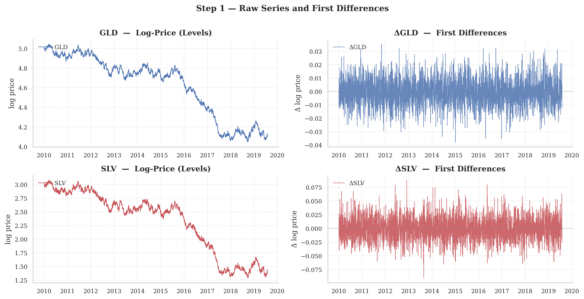{#fig-fig1-adf-series}

### Step 2: Johansen Test {#sec-step-2-johansen-test .unnumbered}

We estimate the VECM with a constant term (`det_order` $= 0$ in `statsmodels`, where $-1$ denotes no deterministic components) and two lagged differences. @tbl-johansen reports the Trace and maximum eigenvalue statistics with their 5% critical values [@johansen1991].

::: {#tbl-johansen}
+----------------------+-------------------------------+-------------------------------+
|                      | **Trace Test**                | **Max Eigenvalue Test**       |
+:=====================+:==============:+:============:+:==============:+:============:+
| 2-3(lr)4-5 **$H_0$** | **Statistic**  | **CV 5%**    | **Statistic**  | **CV 5%**    |
+----------------------+----------------+--------------+----------------+--------------+
| $r \leq 0$           | $755.67^{***}$ | $15.494$     | $755.63^{***}$ | $14.264$     |
+----------------------+----------------+--------------+----------------+--------------+
| $r \leq 1$           | $0.043$        | $3.842$      | $0.043$        | $3.842$      |
+----------------------+----------------+--------------+----------------+--------------+
| $^{***}$ Rejection of $H_0$ at the $1\%$ significance level.                         |
+--------------------------------------------------------------------------------------+

: Johansen cointegration test
:::

Both tests reject $H_0$ (no cointegration, $r = 0$) at the $1\%$ level (statistic $= 755.67$ against critical value $= 15.49$). $H_0$ of at most one cointegrating vector ($r \leq 1$) is not rejected ($0.043 < 3.842$). The cointegration rank is therefore $r = 1$: there exists exactly one stationary linear combination of GLD and SLV, driven by a single common stochastic trend. The estimated cointegrating vector, normalized on GLD, is: $$\hat{\beta} = \begin{bmatrix} 1 \\ -0.5557 \end{bmatrix}$$ that is, the equilibrium relationship $\text{GLD}_t - 0.5557 \cdot \text{SLV}_t \approx c$, stationary with mean $3.333$ and standard deviation $0.009$. The very low standard deviation confirms that the spread is highly stable around its long-run equilibrium.

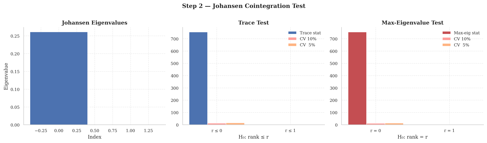{#fig-fig2-johansen}

### Step 3: VECM Estimation {#sec-step-3-vecm-estimation .unnumbered}

With rank $r = 1$ confirmed, we estimate the VECM [@engle_granger1987; @johansen1995]. The key parameters are the adjustment coefficients $\alpha$, which determine the speed of mean reversion, and the short-run coefficients $\Pi_j$. @tbl-vecm reports the results.

::: {#tbl-vecm}
+-----------------------------+---------------------+---------------+--------------+-------------+
| **Parameter**               | **Coeff.**          | **Std. Err.** | **$z$-stat** | **p-value** |
+:============================+:===================:+:=============:+:============:+:===========:+
| *Equation: $\Delta \text{GLD}_t$*                                                              |
+-----------------------------+---------------------+---------------+--------------+-------------+
| $\alpha_{\text{GLD}}$ (ec1) | $-0.0001$           | $0.0000$      | $-1.982$     | $0.048$     |
+-----------------------------+---------------------+---------------+--------------+-------------+
| $L1.\Delta\text{GLD}$       | $-0.3033$           | $0.024$       | $-12.81$     | $0.000$     |
+-----------------------------+---------------------+---------------+--------------+-------------+
| $L1.\Delta\text{SLV}$       | $\phantom{-}0.0982$ | $0.012$       | $8.317$      | $0.000$     |
+-----------------------------+---------------------+---------------+--------------+-------------+
| $L2.\Delta\text{GLD}$       | $-0.1245$           | $0.024$       | $-5.235$     | $0.000$     |
+-----------------------------+---------------------+---------------+--------------+-------------+
| $L2.\Delta\text{SLV}$       | $\phantom{-}0.0659$ | $0.012$       | $5.606$      | $0.000$     |
+-----------------------------+---------------------+---------------+--------------+-------------+
| *Equation: $\Delta \text{SLV}_t$*                                                              |
+-----------------------------+---------------------+---------------+--------------+-------------+
| $\alpha_{\text{SLV}}$ (ec1) | $-0.0001$           | $0.0001$      | $-1.801$     | $0.072$     |
+-----------------------------+---------------------+---------------+--------------+-------------+
| $L1.\Delta\text{GLD}$       | $\phantom{-}0.6282$ | $0.047$       | $13.38$      | $0.000$     |
+-----------------------------+---------------------+---------------+--------------+-------------+
| $L1.\Delta\text{SLV}$       | $-0.4852$           | $0.023$       | $-20.72$     | $0.000$     |
+-----------------------------+---------------------+---------------+--------------+-------------+
| $L2.\Delta\text{GLD}$       | $\phantom{-}0.3682$ | $0.047$       | $7.801$      | $0.000$     |
+-----------------------------+---------------------+---------------+--------------+-------------+
| $L2.\Delta\text{SLV}$       | $-0.2100$           | $0.023$       | $-8.997$     | $0.000$     |
+-----------------------------+---------------------+---------------+--------------+-------------+
| *Cointegrating vector (normalized on GLD)*                                                     |
+-----------------------------+---------------------+---------------+--------------+-------------+
| $\hat{\beta}_{\text{GLD}}$  | $1.0000$            | ---           | ---          | ---         |
+-----------------------------+---------------------+---------------+--------------+-------------+
| $\hat{\beta}_{\text{SLV}}$  | $0.4993$            | $1.140$       | $0.438$      | $0.661$     |
+-----------------------------+---------------------+---------------+--------------+-------------+

: VECM estimation results
:::

The adjustment coefficients are $\hat{\alpha}_{\text{GLD}} = -0.000070$ and $\hat{\alpha}_{\text{SLV}} = -0.000127$. Stability of the error-correction mechanism requires $\hat{\beta}'\hat{\alpha} < 0$, so that a positive deviation of the equilibrium error is reduced in the following period.

The adjustment speed is small in absolute terms (reflecting the highly persistent nature of daily prices) but statistically significant for GLD ($p = 0.048$).

The short-run dynamics are also informative: lagged GLD changes have a positive and significant effect on $\Delta\text{SLV}$ (the coefficients on $L1.\Delta\text{GLD}$ and $L2.\Delta\text{GLD}$ in the SLV equation are $0.628$ and $0.368$), confirming that gold Granger-causes silver in the short run.

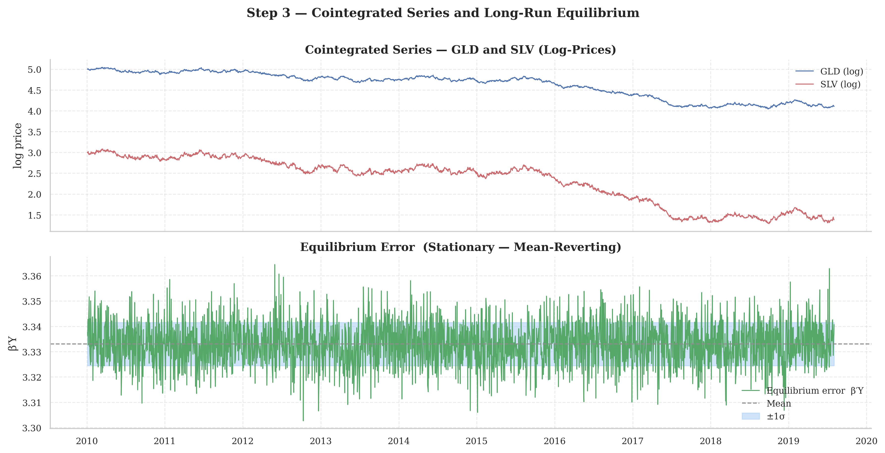{#fig-fig3-equilibrium}

### Step 4: Residuals Diagnostics {#sec-step-4-residuals-diagnostics .unnumbered}

The VECM residuals show no visible patterns and are centered on zero throughout the sample, consistent with a white noise process. The ACFs show all autocorrelations within the $95\%$ confidence bands up to lag 30. The Durbin-Watson statistics confirm the absence of first-order autocorrelation: $DW_{\text{GLD}} = 2.025$ and $DW_{\text{SLV}} = 2.054$, both very close to the reference value of 2. The model is therefore well specified.

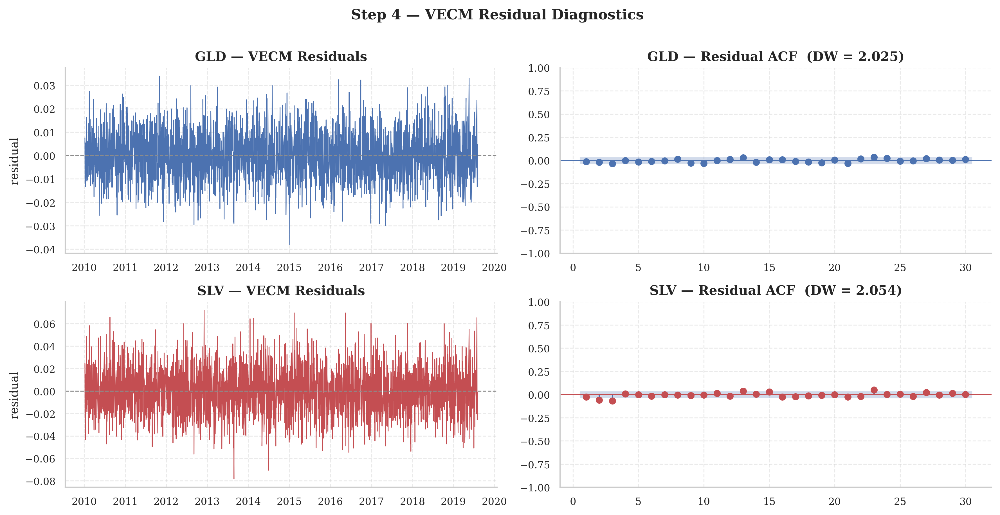{#fig-fig4-residuals}

The IRFs and FEVD (@fig-fig5-irf and @fig-fig6-fevd) derive from a structural VAR representation which requires an identification scheme to recover economically interpretable orthogonal shocks from the reduced-form residuals.

In the reduced form VECM, the residual vector $\hat{\varepsilon}_t = (\hat{\varepsilon}_{GLD,t}, \hat{\varepsilon}_{SLV,t})'$ has a non-diagonal covariance matrix $\hat{\Sigma}$ that reflects the contemporaneous correlation between the two series. This correlation prevents a direct interpretation: a shock to GLD cannot be cleanly separated from a simultaneous movement in SLV without imposing further restrictions.

The standard approach (which we adopt) is the Cholesky decomposition of $\hat{\Sigma}$: $$\hat{\Sigma} = PP'$$ where $P$ is a lower triangular matrix. The structural shocks $u_t$ are then recovered as $u_t = P^{-1}\hat{\varepsilon}_t$ and are orthogonal: $\mathbb{E}[u_t u_t'] = I_k$.

The lower triangular structure of $P$ encodes a recursive causal ordering. The first variable in the system (GLD) responds contemporaneously only to its own structural shock, the second variable (SLV) can respond to both shocks within the same period: $$\begin{aligned}
\hat{\varepsilon}_{GLD,t} &= p_{11} u_{GLD,t} \\
\hat{\varepsilon}_{SLV,t} &= p_{21} u_{GLD,t} + p_{22} u_{SLV,t}
\end{aligned}$$

This identification assumption is not arbitrary, but is based on the microstructure of metals markets. Gold is the dominant market for price discovery: it is more liquid, more heavily traded, and more sensitive to macro factors (inflation expectations, real interest rates, dollar dynamics, geopolitical risk). Silver, by contrast, is a smaller and less liquid market that is significantly influenced by gold's price dynamics. This asymmetry is well documented and is consistent with the FEVD results in @fig-fig6-fevd, which show that almost all of GLD's forecast error variance is attributable to its own shocks, while about 30% of SLV's variance is explained by innovations originating in GLD.

The GLD $\rightarrow$ SLV ordering therefore reflects the hypothesis that gold is the exogenous driver of the common stochastic trend, while silver adjusts to gold's movements (both in the short run via the cross-lag coefficients in @tbl-vecm, and in the long run via the error correction mechanism $\alpha$). Reversing the ordering would imply that silver drives gold, a hypothesis that is inconsistent with the empirical evidence and rejected by the FEVD at all horizons.

The Cholesky identification imposes exactly $k(k-1)/2 = 1$ restriction for $k=2$, the minimum required to achieve identification. More general structural VAR approaches (such as sign restrictions or Blanchard-Quah long-run restrictions) could be applied, but they are not necessary given the strong prior on the causal ordering, supported by both economic theory and data.

### Step 5: Impulse Response Functions {#sec-step-5-impulse-response-functions .unnumbered}

@fig-fig5-irf shows the orthogonalized IRFs over a 20-period horizon. A fundamental feature of cointegrated systems is that shocks have *permanent* effects on the levels of each variable: the IRFs do not decay to zero but converge to a non-zero long-run multiplier, reflecting the persistence of the common stochastic trend. Specifically:

- A unit shock to GLD produces a permanent positive response in both GLD ($\approx 0.75$) and SLV ($\approx 0.45$), consistent with gold as the dominant driver of the common trend.

- A unit shock to SLV has a much smaller permanent effect on GLD ($\approx 0.07$), confirming asymmetric transmission: gold drives silver, but not vice versa.

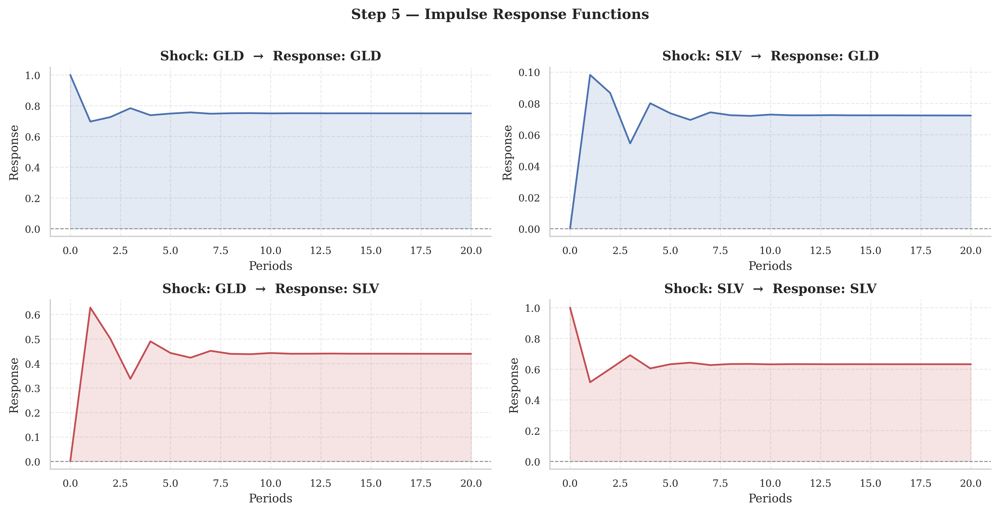{#fig-fig5-irf}

### Step 6: Forecast Error Variance Decomposition {#sec-step-6-forecast-error-variance-decomposition .unnumbered}

The FEVD confirms the asymmetric causal structure. At all horizons, nearly all of the variance ($\approx 100\%$) of GLD's forecast error is attributable to its own shocks, indicating that gold is an exogenous driver of the system. For SLV, approximately $70\%$ of the variance is explained by its own shocks and $30\%$ by shocks originating in GLD, with this decomposition stabilizing after roughly 5 periods. This result is consistent with the interpretation that gold is the price discovery market while silver adjusts to gold over time [@johansen1995; @lutkepohl2005].

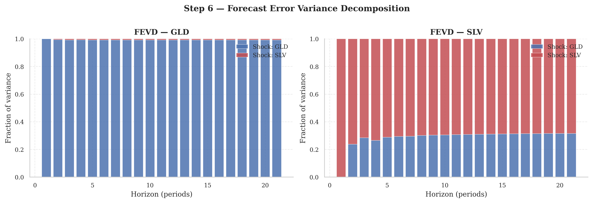{#fig-fig6-fevd}

Part I has established the complete econometric foundation for statistical arbitrage: ARMA and GARCH models for univariate dynamics, VAR and VECM for multivariate cointegration, and the full estimation pipeline illustrated on the GLD--SLV pair. All methodologies developed so far, however, share a critical implicit assumption: model parameters are constant over time. This hypothesis is structurally wrong in live trading. The OLS hedge ratio is a sample average of a relationship that evolves continuously. The spread variance is heteroskedastic, and the cointegrating relationship itself may break down during periods of systemic stress, exposing the strategy to losses precisely when mean-reversion fails. Part II addresses these limitations through the State Space Models framework. The Kalman Filter handles the continuous evolution of the hedge ratio, Hidden Markov Models govern discrete regime shifts in market structure. They form the integrated KF-HMM architecture that constitutes the original methodological contribution of this thesis.

## From Part I to Part II: the limit of constant parameters {#sec-from-part-i-to-part-ii-the-limit-of-constant-parameters .unnumbered}

Part I has treated $\hat\beta$, $\hat\sigma^2$, and market regimes as objects to be estimated once, on a fixed sample. The stability tests shown along the way (the correlation breakdown of @sec-sub-corr-breakdown above all) demonstrate, however, that this assumption breaks down systematically over horizons longer than a few months. This is precisely the limitation flagged in @tbl-roadmap, and it is the problem Part II solves by replacing point estimation with a recursive representation.

# State Space Models

The foundations built in Part I share one implicit assumption that is both their strength and their structural limit: model parameters are constant over time. The OLS cointegrating vector $\hat{\beta}$ is a sample average of a relationship that evolves continuously in response to macroeconomic regime shifts, changes in sectoral competitive structure, and investor sentiment. The volatility clustering documented in @sec-sub-vol-clustering implies that the spread variance is not homoskedastic, so any z-score computed with a historical standard deviation is systematically wrong. The correlation breakdown of @sec-sub-corr-breakdown shows that the relative weights of assets in a cointegrated basket change over time, making the static hedge ratio an increasingly indefensible simplification as the investment horizon lengthens. The regime shifting of @sec-sub-regime-shifting suggests that the very existence of the cointegrating relationship (not just the estimation of its parameters) may break down during systemic stress, leaving the strategy exposed to losses on a spread that is no longer mean-reverting.

The State Space Model (SSM) framework addresses all three problems by explicitly separating the directly observable variables (prices, spreads, returns) from the latent variables that drive their dynamics: the time-varying hedge ratio, the current market regime, and the conditional volatility of the spread. This separation, formalized by the observation equation and the transition equation, allows the latent variables to be estimated and updated recursively as new observations arrive, without imposing constant parameters and without requiring periodic re-estimation of the entire model.

## The Markov Property

The Markov property is the shared probabilistic foundation of every model in this chapter. It formalizes the intuition that, given the present state, the future is conditionally independent of the past: knowing the current state of the system contains all the relevant information, and knowing the prior history adds nothing to the forecast of future states.

### First Order Markov Property {#sec-first-order-markov-property .unnumbered}

A stochastic process $\{X_t\}_{t \geq 0}$ satisfies the first-order Markov property if, for every $t$ and every measurable set $A \in \mathcal{B}(\mathbb{R})$[^3]: 

$$
    \mathbb{P}(X_{t+1} \in A \mid \mathcal{F}_t) =
    \mathbb{P}(X_{t+1} \in A \mid X_t)
$$ {#eq-markov}

 where $\mathcal{F}_t = \sigma(X_0, X_1, \ldots, X_t)$ is the natural filtration generated by the entire history of the process up to time $t$.

Condition [\[eq:markov\]](#eq:markov){reference-type="eqref" reference="eq:markov"} states that the conditional distribution of $X_{t+1}$, once conditioned on $X_t$, does not depend on $X_{t-1}, X_{t-2}, \ldots, X_0$. In terms of conditional densities this is equivalent to: $$
    p(x_{t+1} \mid x_t, x_{t-1}, \ldots, x_0) = p(x_{t+1} \mid x_t)
$$ for almost every realization of the sequence. The Markov property is less restrictive than it appears. Any higher-order stochastic process can be rewritten as a first-order Markov process by appropriately redefining the state space. An AR($p$), for example, is not Markovian in $Y_t$ but is Markovian in the augmented vector $(Y_t, Y_{t-1}, \ldots, Y_{t-p+1})'$. This is exactly the same observation as the companion form of the VAR discussed in @sec-sub-companion: a VAR($P$) is not first-order in $Y_t$ but becomes a VAR(1) in $Z_t = (Y_t', Y_{t-1}', \ldots, Y_{t-P+1}')'$.

### Transition Kernel and Chapman-Kolmogorov Equation {#sec-transition-kernel-and-chapman-kolmogorov-equation .unnumbered}

For continuous state-space processes $\mathcal{X} \subseteq
\mathbb{R}^n$, the Markovian dynamics are completely characterized by the *transition kernel*: $$
    p(x_{t+1} \mid x_t) = \frac{\partial}{\partial x_{t+1}}
    \mathbb{P}(X_{t+1} \leq x_{t+1} \mid X_t = x_t)
$$ which assigns to each current state $x_t$ a probability distribution over future states. Knowing $p(x_{t+1} \mid x_t)$ is equivalent to knowing the laws of motion of the system. Consistency of the kernel over multiple horizons is guaranteed by the Chapman-Kolmogorov equation: 

$$
    p(x_{t+h} \mid x_t) = \int_{\mathcal{X}}
    p(x_{t+h} \mid x_{t+h-1})\, p(x_{t+h-1} \mid x_t)\,
    dx_{t+h-1}
$$ {#eq-ck}

 [\[eq:ck\]](#eq:ck){reference-type="ref" reference="eq:ck"} states that the probability of moving from state $x_t$ to state $x_{t+h}$ in $h$ steps is obtained by integrating over all possible intermediate states $x_{t+h-1}$. For discrete state-space processes $\mathcal{S} = \{1, 2, \ldots, K\}$, the transition kernel becomes the transition matrix $\mathbf{P}$ with entries $p_{ij} = \Pr(X_{t+1} = j \mid X_t = i)$, and the Chapman-Kolmogorov equation reduces to matrix multiplication: the $h$-step transition probability is the $(i,j)$ element of $\mathbf{P}^h$.

### Stationarity and Stationary Distribution {#sec-stationarity-and-stationary-distribution .unnumbered}

A Markov chain is time-homogeneous if the transition kernel does not depend on $t$: $p(x_{t+1} \mid x_t) = p(x_1 \mid x_0)$ for all $t$. Under this assumption, which we maintain throughout the chapter, the dynamics of the process are completely characterized by the kernel alone. A distribution $\pi^*$ is stationary for the Markov chain if: $$
    \pi^*(A) = \int_{\mathcal{X}} p(x' \mid x)\, \pi^*(dx)
    \quad \forall\, A \in \mathcal{B}(\mathbb{R})
$$ or, in the discrete case, $\bm{\pi}^* = \bm{\pi}^* \mathbf{P}$. The stationary distribution is the left eigenvector of $\mathbf{P}$ associated with the unit eigenvalue. Under ergodicity conditions the distribution of the chain converges to the stationary distribution regardless of the initial condition: $\Pr(X_t = j) \to \pi_j^*$ as $t \to \infty$. In the HMM context, $\pi_k^*$ represents the expected proportion of time the system spends in regime $k$ in the long run.

### Implications for Statistical Arbitrage {#sec-implications-for-statistical-arbitrage .unnumbered}

The Markov property has an important consequence for pairs trading. If the latent state vector $\bm{\alpha}_t = (\alpha_t, \beta_t, \sigma_t^2, s_t)'$, comprising the intercept, the hedge ratio, the conditional volatility, and the market regime, satisfies the Markov property, then the optimal forecast of the spread at time $t+1$ requires only the current estimate of the latent state, not the memory of the entire price history. This is the principle underlying both the Kalman Filter recursion and the HMM forward algorithm. Both update the latent state estimate in a single iteration that combines the previous estimate with the new observation, without ever directly accessing the full history.

## Limits of Static Cointegration and Dynamic OLS

The OLS estimator is super-consistent in the presence of cointegration [@engle_granger1987]: it converges to the true parameter $\beta$ at rate $T$ rather than $\sqrt{T}$. That is a useful property, but it conceals a structural problem: $\hat{\beta}_{\text{OLS}}$ estimates the time-average of $\beta_t$ over the full sample, not its current value at time $T$.

### The Issue with the Static Hedge Ratio {#sec-the-issue-with-the-static-hedge-ratio .unnumbered}

The OLS hedge ratio in the cointegrating regression is: 

$$
    Y_{1,t} = \alpha + \beta\, Y_{2,t} + \varepsilon_t
$$ {#eq-static-reg}

 with estimator: $$
    \hat{\beta}_{\text{OLS}} = \frac{\sum_{t=1}^T
    (Y_{2,t} - \bar{Y}_2)(Y_{1,t} - \bar{Y}_1)}
    {\sum_{t=1}^T (Y_{2,t} - \bar{Y}_2)^2}
$$ Let the true hedge ratio be a time-varying process: 

$$
    \beta_t = \beta + \delta_t
$$ {#eq-beta-tv}

 where $\beta$ is the constant component and $\delta_t$ is the time-varying component with $\mathbb{E}[\delta_t] = 0$. The DGP is: $$
    Y_{1,t} = \alpha_t + \beta_t\, Y_{2,t} + u_t =
    \alpha_t + (\beta + \delta_t)\, Y_{2,t} + u_t
$$ Fitting the static regression [\[eq:static_reg\]](#eq:static_reg){reference-type="eqref" reference="eq:static_reg"} on these data, the OLS residual is: 

$$\begin{aligned}
    \hat{\varepsilon}_t &= Y_{1,t} - \hat{\alpha} -
    \hat{\beta}_{\text{OLS}}\, Y_{2,t}  \\
    &= \underbrace{(Y_{1,t} - \alpha_t - \beta_t\, Y_{2,t})}
    _{u_t \sim I(0)} +
    \underbrace{(\alpha_t - \hat{\alpha})}_{I(0) \text{ or }
    I(1)} +
    \underbrace{(\beta_t - \hat{\beta}_{\text{OLS}})\, Y_{2,t}}
    _{\delta_t Y_{2,t}}
    
\end{aligned}
$$ {#eq-ols-error}

 The critical term is $\delta_t Y_{2,t}$. Since $Y_{2,t} \sim
I(1)$ and $\delta_t$ is generally correlated with movements in $Y_{2,t}$ (the parameter drift is not independent of the asset being hedged), this term is $I(1)$. The OLS spread $\hat{\varepsilon}_t$ is therefore non-stationary even though the true cointegrating relationship is intact. An ADF test applied to $\hat{\varepsilon}_t$ will tend not to reject the unit root, leading to the false conclusion that cointegration has broken down.

### DOLS Limitations {#sec-dols-limitations .unnumbered}

Dynamic OLS (DOLS), proposed by Stock and Watson [@stock_watson1993], corrects the OLS bias by including leads and lags of the first differences of the regressor: 

$$
    Y_{1,t} = \alpha + \beta\, Y_{2,t} +
    \sum_{j=-q}^{q} \delta_j\, \Delta Y_{2,t-j} + u_t
$$ {#eq-dols}

 The $\Delta Y_{2,t-j}$ terms remove the endogeneity arising from the correlation between $Y_{2,t}$ and the shocks $u_t$ caused by the common stochastic trend, and the lead terms ($j > 0$) capture any anticipatory correlation. The DOLS estimator of $\beta$ has a mixed-normal asymptotic distribution and converges faster than OLS in finite samples. But DOLS is still a fixed-parameter model: $\beta$ is estimated as a constant over the full sample $t = 1, \ldots, T$. The problem formalized in equation [\[eq:ols_error\]](#eq:ols_error){reference-type="eqref" reference="eq:ols_error"} applies equally to DOLS: correcting the bias does not resolve parameter instability.

### Parametric Stability Tests {#sec-parametric-stability-tests .unnumbered}

Parameter stability in the cointegrating regression can be tested with the CUSUM test of Brown, Durbin and Evans [@brown_durbin_evans1975] or with the Nyblom test [@nyblom1989]. Nyblom tests the null of constant parameters against the alternative that the coefficients follow a random walk: $$
    H_0: \beta_t = \beta \quad \forall t \qquad \text{vs}
    \qquad H_1: \beta_t = \beta_{t-1} + \eta_t, \quad
    \eta_t \sim \text{i.i.d.}(0, \sigma_\eta^2)
$$ The Nyblom statistic for $\beta$ is: $$
    L = \frac{1}{\hat{\sigma}_u^2 T^2} \sum_{t=1}^T
    \left(\sum_{s=1}^t \hat{u}_s\, Y_{2,s}\right)^2
$$ Large values of $L$ reject $H_0$ and signal that the constant-parameter assumption is statistically untenable. The parameter $\sigma_\eta^2$ under $H_1$ is exactly the state process variance $q_\beta$ in the Kalman Filter model, establishing a direct link between the Nyblom test and the calibration of the filter.

### Implications for Trading Signals {#sec-implications-for-trading-signals .unnumbered}

These theoretical limitations translate directly into operational consequences. The classical z-score is: $$
    z_t^{\text{OLS}} = \frac{Y_{1,t} - \hat{\alpha} -
    \hat{\beta}_{\text{OLS}}\, Y_{2,t}}{\hat{\sigma}_\varepsilon}
$$ where $\hat{\sigma}_\varepsilon$ is the sample standard deviation of the OLS residuals over the full sample. This z-score is distorted in three ways:

1.  **Numerator distortion:** the residual includes the non-stationary term $\delta_t Y_{2,t}$, as shown in [\[eq:ols_error\]](#eq:ols_error){reference-type="eqref" reference="eq:ols_error"}. When $\beta_t$ diverges from $\hat{\beta}_{\text{OLS}}$ the numerator takes extreme values not because of a genuine mean-reverting deviation of the spread, but because of the wrong hedge ratio.

2.  **Denominator distortion:** $\hat{\sigma}_\varepsilon$ is estimated over the full sample and reflects historical average volatility. During high-volatility periods it understates the current standard deviation, artificially inflating the z-score and multiplying false entry signals exactly when market risk is highest.

3.  **No regime adaptation:** the static z-score cannot distinguish between a wide spread deviation caused by a genuine mean-reversion opportunity and one caused by a structural break in cointegration. In both cases $z_t^{\text{OLS}}$ crosses the threshold $z^*$ and generates an entry signal, but only in the first case should the position converge to equilibrium.

Each of these three distortions has a precise remedy. The Kalman Filter corrects the numerator by updating $\hat{\beta}_{t|t}$ recursively; the innovation variance $f_t$ replaces the static denominator; and the HMM conditions signal execution on regime stability. The rest of this chapter derives each component in turn.

![Top panel: log-price time series of GLD and SLV (2010–2019). Bottom panel: comparison between the dynamic hedge ratio <em>β̂</em><em>t</em>|<em>t</em> estimated by the Kalman Filter (green line, with $\pm 2\sqrt{P_{t|t}^{(\beta\beta)}}$ confidence band) and the static OLS estimate <em>β̂</em>OLS (dashed orange line). The KF hedge ratio varies significantly over time, declining from values near 2 in 2010 to approximately 1.35 in 2019, highlighting the structural inadequacy of the constant-parameter assumption implicit in OLS.](figures/1-static-vs-dynamic-hedge-ratio.png){#fig-hedge-ratio}

## State-Space Representation {#sec-sub-ssr}

The state-space representation is the formal framework that separates observable variables from latent ones and describes the law of motion of the latter over time. It was originally developed in control systems engineering and later adopted in econometrics by Harvey [@harvey1989] and formalized by Durbin and Koopman [@durbin_koopman2012]. The framework is general enough that AR, ARMA, VECM, and GARCH models, as well as unobserved-component models and local trend models, are all special cases.

### Linear Gaussian State-Space Model {#sec-linear-gaussian-state-space-model .unnumbered}

A linear Gaussian state-space system is defined by: 

$$\begin{aligned}
    \bm{y}_t &= \mathbf{Z}_t\, \bm{\alpha}_t + \mathbf{d}_t +
    \bm{\varepsilon}_t, \qquad \bm{\varepsilon}_t \sim
    \mathcal{N}(\mathbf{0},\, \mathbf{H}_t)
     \\
    \bm{\alpha}_{t+1} &= \mathbf{T}_t\, \bm{\alpha}_t +
    \mathbf{c}_t + \mathbf{R}_t\, \bm{\eta}_t, \qquad
    \bm{\eta}_t \sim \mathcal{N}(\mathbf{0},\, \mathbf{Q}_t)
    
\end{aligned}
$$ {#eq-obs-eq}

 for $t = 1, \ldots, T$, where $\bm{y}_t \in \mathbb{R}^p$ is the vector of observed variables, $\bm{\alpha}_t \in
\mathbb{R}^m$ is the latent state vector, $\mathbf{Z}_t \in
\mathbb{R}^{p \times m}$ is the design matrix, $\mathbf{T}_t
\in \mathbb{R}^{m \times m}$ is the transition matrix, $\mathbf{R}_t \in \mathbb{R}^{m \times g}$ is the selection matrix, $\mathbf{H}_t$ and $\mathbf{Q}_t$ are the innovation covariance matrices, and $\mathbf{d}_t$, $\mathbf{c}_t$ are deterministic offset vectors. The noises are assumed uncorrelated: $\mathbb{E}[\bm{\varepsilon}_t \bm{\eta}_s'] =
\mathbf{0}$ for all $t, s$.

### Interpretation of the Components {#sec-interpretation-of-the-components .unnumbered}

The **observation equation** [\[eq:obs_eq\]](#eq:obs_eq){reference-type="eqref" reference="eq:obs_eq"} describes how the unobservable latent state $\bm{\alpha}_t$ generates the observations $\bm{y}_t$. The matrix $\mathbf{Z}_t$ determines the relationship between state and observation; $\bm{\varepsilon}_t$ is the measurement noise capturing sampling errors and idiosyncratic components.

The **transition equation** [\[eq:state_eq\]](#eq:state_eq){reference-type="eqref" reference="eq:state_eq"} describes the law of motion of the latent state vector. The matrix $\mathbf{T}_t$ describes the persistence of the state, playing the role of the autoregressive coefficients in a VAR. The matrix $\mathbf{Q}_t$ controls the rate of change of the state: a small $\mathbf{Q}_t$ implies slowly evolving parameters, while a large $\mathbf{Q}_t$ allows rapid variation.

### Markovian Structure {#sec-markovian-structure .unnumbered}

A key feature of the state-space model is that $\bm{\alpha}_t$ is a first-order Markov process: given the transition equation [\[eq:state_eq\]](#eq:state_eq){reference-type="eqref" reference="eq:state_eq"} and Gaussianity, the distribution of $\bm{\alpha}_{t+1}$ depends only on $\bm{\alpha}_t$ and not on the prior history. This implies that the joint distribution of the entire system $(\bm{y}_{1:T}, \bm{\alpha}_{1:T})$ factorizes as: $$
    p(\bm{y}_{1:T}, \bm{\alpha}_{1:T}) = p(\bm{\alpha}_1)
    \prod_{t=1}^T p(\bm{y}_t \mid \bm{\alpha}_t)
    \prod_{t=1}^{T-1} p(\bm{\alpha}_{t+1} \mid \bm{\alpha}_t)
$$ This factorization is what makes recursive inference via the Kalman Filter possible. The quantities $p(\bm{y}_t \mid
\bm{\alpha}_t)$ and $p(\bm{\alpha}_{t+1} \mid \bm{\alpha}_t)$ are read directly from equations [\[eq:obs_eq\]](#eq:obs_eq){reference-type="eqref" reference="eq:obs_eq"}--[\[eq:state_eq\]](#eq:state_eq){reference-type="eqref" reference="eq:state_eq"}.

### Initialization {#sec-initialization .unnumbered}

To start the recursion one must specify the initial state distribution: $$
    \bm{\alpha}_1 \sim \mathcal{N}(\bm{a}_1, \mathbf{P}_1)
$$ where $\bm{a}_1 = \mathbb{E}[\bm{\alpha}_1]$ is the prior mean and $\mathbf{P}_1 = \mathbb{V}(\bm{\alpha}_1)$ is the initial covariance. For stationary states such as an AR(1) with $|\phi| < 1$, $\mathbf{P}_1$ can be set to the unconditional covariance of the process. For non-stationary states such as a random walk (the case of the dynamic hedge ratio) one uses *diffuse initialization*: $\mathbf{P}_1 = \kappa
\mathbf{I}$ with $\kappa \to \infty$, which is equivalent to imposing a flat prior on the initial state and letting the algorithm learn entirely from the data [@durbin_koopman2012]. In practice $\kappa = 10^6$ or $\kappa = 10^7$.

### Signal-to-Noise Ratio (SNR) {#sec-signal-to-noise-ratio-snr .unnumbered}

The ratio between the state process variance and the measurement noise variance governs the reactivity of the filter. For the dynamic hedge ratio model with $\mathbf{T} =
\mathbf{I}$: $$
    \text{SNR} = \frac{q_\beta}{\sigma_\varepsilon^2}
$$ A high SNR means that changes in the hedge ratio are large relative to the measurement noise: the filter trusts recent observations more and updates $\beta_t$ quickly. A low SNR means the observations are noisy relative to parameter variation, so the filter trusts the prior forecast more and updates slowly, producing smoother estimates. The optimal SNR is estimated by maximizing the state-space log-likelihood with respect to $\bm{\psi} = (\sigma_\varepsilon^2, q_\alpha,
q_\beta)$.

### Pairs Trading Application {#sec-pairs-trading-application .unnumbered}

In the bivariate pairs trading context the model is set up as follows. The observed variable is the price of the first asset $y_t = Y_{1,t}$. The latent state vector $\bm{\alpha}_t = (\alpha_t, \beta_t)'$ contains the intercept and the time-varying hedge ratio. The design matrix is the regressor vector at time $t$: $\mathbf{Z}_t = (1, Y_{2,t})$. The model equations are: 

$$\begin{aligned}
    Y_{1,t} &= \begin{bmatrix} 1 & Y_{2,t} \end{bmatrix}
    \begin{bmatrix} \alpha_t \\ \beta_t \end{bmatrix} +
    \varepsilon_t, \qquad \varepsilon_t \sim \mathcal{N}(0,
    \sigma_\varepsilon^2)  \\
    \begin{bmatrix} \alpha_{t+1} \\ \beta_{t+1} \end{bmatrix}
    &= \begin{bmatrix} 1 & 0 \\ 0 & 1 \end{bmatrix}
    \begin{bmatrix} \alpha_t \\ \beta_t \end{bmatrix} +
    \begin{bmatrix} \eta_{\alpha,t} \\ \eta_{\beta,t}
    \end{bmatrix}, \qquad \begin{bmatrix} \eta_{\alpha,t} \\
    \eta_{\beta,t} \end{bmatrix} \sim \mathcal{N}\!\left(
    \mathbf{0},\, \mathbf{Q}\right) 
\end{aligned}
$$ {#eq-obs-pt}

 with $\mathbf{Q} = \text{diag}(q_\alpha, q_\beta)$ and $\mathbf{T} = \mathbf{I}_2$. The choice $\mathbf{T} = \mathbf{I}$ specifies that both $\alpha_t$ and $\beta_t$ follow random walks: the parameter drifts without mean-reverting to a fixed value, reflecting the absence of any prior reason why the hedge ratio should return to a preset level.

## Hidden Variables: Continuous vs. Discrete State Spaces

State-space models differ depending on the latent state space $\mathcal{X}$. The distinction between continuous and discrete state spaces reflects different assumptions about the structure of the DGP and requires different inference tools.

### Continuous Spaces: Kalman Filter {#sec-continuous-spaces-kalman-filter .unnumbered}

When $\bm{\alpha}_t \in \mathbb{R}^m$, the latent state vector varies continuously over time. State trajectories are smooth in the sense that $\bm{\alpha}_{t+1}$ is close to $\bm{\alpha}_t$, modelling gradual parameter variation. The Kalman Filter provides the exact solution for this case under Gaussianity: at each $t$ it computes the conditional Gaussian distribution of $\bm{\alpha}_t$ given $\bm{y}_{1:t}$, fully characterized by the filtered mean $\bm{a}_{t|t}$ and filtered covariance $\mathbf{P}_{t|t}$.

Examples in the statistical arbitrage context:

- **Dynamic hedge ratio:** $\beta_t$ varies continuously in response to gradual changes in the correlation structure between the two assets, modelled as a continuous random walk.

- **Stochastic volatility:** $\log \sigma_t^2$ follows a continuous AR(1) process, an alternative to GARCH volatility modelling.

- **Dynamic factor loadings:** the weights of a cointegration portfolio over $k$ assets evolve as a continuous vector in $\mathbb{R}^k$, requiring the multivariate Kalman Filter.

- **Local level model:** the long-run level of the spread drifts slowly over time, captured by the local trend component of the state-space model.

### Discrete Spaces: Hidden Markov Models {#sec-discrete-spaces-hidden-markov-models .unnumbered}

When $s_t \in \mathcal{S} = \{1, 2, \ldots, K\}$, the latent state process is a discrete variable that identifies the current regime. Regime shifts are discrete events, modelling abrupt structural changes in the statistical distributions of the observed variables. Hidden Markov Models handle this case. The state process is a hidden Markov chain that generates observations through regime-dependent emission distributions.

Examples in the statistical arbitrage context:

- **Market regime:** $s_t = 1$ (low volatility, stable cointegration, mean-reverting spread) or $s_t = 2$ (high volatility, degraded cointegration, diverging spread). This is the most operationally relevant case for pairs trading: trading in the wrong regime generates losses.

- **Business cycle:** $s_t \in \{1, 2, 3\}$ corresponding to expansion, contraction, and crisis. The statistical properties of sectoral returns and cross-sectoral cointegrating relationships vary across these states.

- **Market liquidity:** $s_t = 1$ (liquid market, tight bid-ask spread, negligible transaction costs) or $s_t = 2$ (illiquid market, wide bid-ask spread, transaction costs that can erode strategy profits).

### The Hybrid Framework {#sec-the-hybrid-framework .unnumbered}

The framework proposed in this thesis combines both types of state spaces in a two-level hierarchical architecture. At the upper level, the discrete regime $s_t$ governed by the HMM determines the structure of the emission distributions and the state-dependent trading rules. At the lower level, the continuous parameters $\bm{\alpha}_t = (\alpha_t, \beta_t)'$ managed by the Kalman Filter evolve within the current regime. This scheme, discussed in detail in @sec-sub-kf-hmm-integration, allows us to capture simultaneously the slow and gradual variation of the hedge ratio and the discrete structural changes of the market regime.

## The Kalman Filter

The Kalman Filter (KF), originally developed by Kalman for engineering applications [@kalman1960] and adopted in econometrics by Harvey [@harvey1989] and Durbin and Koopman [@durbin_koopman2012], is a recursive algorithm that computes, at each $t$, the conditional distribution of the state vector $\bm{\alpha}_t$ given the available observations $\bm{y}_{1:t}$. For the linear Gaussian model defined by equations [\[eq:obs_eq\]](#eq:obs_eq){reference-type="eqref" reference="eq:obs_eq"}--[\[eq:state_eq\]](#eq:state_eq){reference-type="eqref" reference="eq:state_eq"}, the KF provides the exact solution to the filtering problem: the conditional distribution of $\bm{\alpha}_t$ given $\bm{y}_{1:t}$ is Gaussian, and the KF computes its mean and covariance recursively. No other linear estimator has lower variance.

The algorithm alternates between two steps for each new observation. The *prediction step* projects the state estimate one step forward in time before observing $\bm{y}_t$, while the *update step* corrects the forecast by incorporating the information in the new observation.

We follow the notation of Durbin and Koopman [@durbin_koopman2012]:

- $\bm{a}_{t|t-1} = \mathbb{E}[\bm{\alpha}_t \mid
      \bm{y}_{1:t-1}]$: prior state estimate at time $t$, based on information up to $t-1$.

- $\mathbf{P}_{t|t-1} = \text{Var}(\bm{\alpha}_t \mid
      \bm{y}_{1:t-1})$: prior covariance matrix (uncertainty before observing $\bm{y}_t$).

- $\bm{a}_{t|t} = \mathbb{E}[\bm{\alpha}_t \mid
      \bm{y}_{1:t}]$: posterior (filtered) state estimate after incorporating $\bm{y}_t$.

- $\mathbf{P}_{t|t} = \text{Var}(\bm{\alpha}_t \mid
      \bm{y}_{1:t})$: posterior covariance matrix (residual uncertainty after the update).

- $\bm{v}_t = \bm{y}_t - \mathbf{Z}_t \bm{a}_{t|t-1}
      - \mathbf{d}_t$: innovation, the one-step-ahead forecast error.

- $\mathbf{F}_t = \mathbf{Z}_t \mathbf{P}_{t|t-1}
      \mathbf{Z}_t' + \mathbf{H}_t$: innovation covariance matrix.

- $\mathbf{K}_t = \mathbf{P}_{t|t-1} \mathbf{Z}_t'
      \mathbf{F}_t^{-1}$: Kalman gain, the $m \times p$ matrix that determines the weight given to new observations in the state update.

### Prediction Step {#sec-prediction-step .unnumbered}

Starting from the filtered estimate $\bm{a}_{t-1|t-1}$ and covariance $\mathbf{P}_{t-1|t-1}$ at time $t-1$, the prediction step projects the state to time $t$ using the transition equation: 

$$\begin{aligned}
    \bm{a}_{t|t-1} &= \mathbf{T}_{t-1}\, \bm{a}_{t-1|t-1} +
    \mathbf{c}_{t-1}  \\
    \mathbf{P}_{t|t-1} &= \mathbf{T}_{t-1}\,
    \mathbf{P}_{t-1|t-1}\, \mathbf{T}_{t-1}' + \mathbf{R}_{t-1}
    \, \mathbf{Q}_{t-1}\, \mathbf{R}_{t-1}'
    
\end{aligned}
$$ {#eq-kf-pred-a}

 [\[eq:kf_pred_a\]](#eq:kf_pred_a){reference-type="ref" reference="eq:kf_pred_a"} applies the linear transformation $\mathbf{T}_{t-1}$ to the previous estimate: it is the optimal forecast of the future state given all past information. [\[eq:kf_pred_P\]](#eq:kf_pred_P){reference-type="ref" reference="eq:kf_pred_P"} shows how uncertainty propagates: the prior covariance is the linear transform of the previous posterior covariance, augmented by the process noise contribution $\mathbf{R}_{t-1}
\mathbf{Q}_{t-1} \mathbf{R}_{t-1}'$. Without process noise ($\mathbf{Q} = \mathbf{0}$) the state would be deterministic and would never change. The process noise is the mechanism that keeps the filter open to updating even after many observations.

### Update Step {#sec-update-step .unnumbered}

When the observation $\bm{y}_t$ becomes available, the filter updates the state estimate by combining the prior forecast with the information in the new observation: 

$$\begin{aligned}
    \bm{v}_t &= \bm{y}_t - \mathbf{Z}_t\, \bm{a}_{t|t-1} -
    \mathbf{d}_t  \\
    \mathbf{F}_t &= \mathbf{Z}_t\, \mathbf{P}_{t|t-1}\,
    \mathbf{Z}_t' + \mathbf{H}_t  \\
    \mathbf{K}_t &= \mathbf{P}_{t|t-1}\, \mathbf{Z}_t'\,
    \mathbf{F}_t^{-1}  \\
    \bm{a}_{t|t} &= \bm{a}_{t|t-1} + \mathbf{K}_t\, \bm{v}_t
     \\
    \mathbf{P}_{t|t} &= \left(\mathbf{I} - \mathbf{K}_t\,
    \mathbf{Z}_t\right) \mathbf{P}_{t|t-1}
    
\end{aligned}
$$ {#eq-kf-innov}

### Kalman Gain {#sec-kalman-gain .unnumbered}

The Kalman gain $\mathbf{K}_t$ determines the relative weight assigned to the prior forecast versus the new observation. Rewriting equation [\[eq:kf_update_a\]](#eq:kf_update_a){reference-type="eqref" reference="eq:kf_update_a"}: $$
    \bm{a}_{t|t} = \underbrace{\left(\mathbf{I} - \mathbf{K}_t
    \mathbf{Z}_t\right) \bm{a}_{t|t-1}}_{\text{weight on
    forecast}} + \underbrace{\mathbf{K}_t\, \bm{y}_t}
    _{\text{weight on observation}}
$$ The posterior estimate is a weighted average of the prior forecast and the new observation. When the measurement noise $\mathbf{H}_t$ is large relative to the prior uncertainty $\mathbf{P}_{t|t-1}$, the observations are noisy: $\mathbf{F}_t \approx \mathbf{H}_t$ is large, $\mathbf{K}_t \approx \mathbf{0}$, and the filter nearly ignores the new observation in favor of the prior. Conversely, when $\mathbf{H}_t \to \mathbf{0}$ the observations are essentially noise-free, so $\mathbf{K}_t \to \mathbf{P}_{t|t-1}\mathbf{Z}_t'
(\mathbf{Z}_t\mathbf{P}_{t|t-1}\mathbf{Z}_t')^{-1}$ and the filter trusts the observation completely.

### Posterior Covariance and Noise Reduction {#sec-posterior-covariance-and-noise-reduction .unnumbered}

[\[eq:kf_update_P\]](#eq:kf_update_P){reference-type="ref" reference="eq:kf_update_P"} shows that the posterior covariance matrix is always smaller (in the matrix sense) than the prior covariance: $\mathbf{P}_{t|t} \preceq
\mathbf{P}_{t|t-1}$. Each new observation reduces uncertainty about the state estimate. The variance reduction is: $$
    \mathbf{P}_{t|t-1} - \mathbf{P}_{t|t} = \mathbf{K}_t\,
    \mathbf{F}_t\, \mathbf{K}_t' = \mathbf{P}_{t|t-1}\,
    \mathbf{Z}_t'\, \mathbf{F}_t^{-1}\, \mathbf{Z}_t\,
    \mathbf{P}_{t|t-1}
$$ However, the prediction step [\[eq:kf_pred_P\]](#eq:kf_pred_P){reference-type="eqref" reference="eq:kf_pred_P"} increases the covariance by adding the process noise $\mathbf{RQR}'$. In steady state the alternation of prediction (increasing uncertainty) and update (reducing uncertainty) leads to an asymptotically constant state covariance, the steady-state covariance, which satisfies the Riccati equation: $$
    \mathbf{P}_\infty = \mathbf{T} \left(\mathbf{P}_\infty -
    \mathbf{P}_\infty \mathbf{Z}' \mathbf{F}_\infty^{-1}
    \mathbf{Z} \mathbf{P}_\infty\right) \mathbf{T}' +
    \mathbf{RQR}'
$$ At this point the Kalman gain stabilizes at $\mathbf{K}_\infty = \mathbf{P}_\infty \mathbf{Z}'
\mathbf{F}_\infty^{-1}$ and no longer varies over time.

### Log-Likelihood and Parameter Estimation {#sec-log-likelihood-and-parameter-estimation .unnumbered}

The innovations $\bm{v}_t$ produced by the KF are serially uncorrelated: $\mathbb{E}[\bm{v}_t \bm{v}_s'] = \mathbf{0}$ for $t \neq s$. This orthogonality of innovations is a direct consequence of the orthogonal projection and allows the joint density of the observations to be factorized: $$
    p(\bm{y}_{1:T} \mid \bm{\psi}) = \prod_{t=1}^T
    p(\bm{y}_t \mid \bm{y}_{1:t-1},\, \bm{\psi}) =
    \prod_{t=1}^T \mathcal{N}(\bm{y}_t;\, \mathbf{Z}_t
    \bm{a}_{t|t-1} + \mathbf{d}_t,\, \mathbf{F}_t)
$$ The log-likelihood follows from the prediction error decomposition [@harvey1989]: 

$$
    \log \mathcal{L}(\bm{\psi}) = -\frac{Tp}{2}\log(2\pi) -
    \frac{1}{2}\sum_{t=1}^T \left[\log|\mathbf{F}_t(\bm{\psi})|
    + \bm{v}_t(\bm{\psi})'\, \mathbf{F}_t(\bm{\psi})^{-1}\,
    \bm{v}_t(\bm{\psi}) \right]
$$ {#eq-kf-loglik}

 where the dependence of $\bm{v}_t$ and $\mathbf{F}_t$ on the parameters $\bm{\psi} = (\sigma_\varepsilon^2, q_\alpha,
q_\beta)$ is made explicit. Maximizing [\[eq:kf_loglik\]](#eq:kf_loglik){reference-type="eqref" reference="eq:kf_loglik"} with respect to $\bm{\psi}$, typically via gradient-based algorithms such as L-BFGS-B with multiple starting points to avoid local maxima, yields the MLE parameter estimates.

![Top panel: components of the Kalman gain <strong>k</strong><em>t</em> for the intercept (<em>k</em><em>t</em>(<em>α</em>)) and the hedge ratio (<em>k</em><em>t</em>(<em>β</em>)) on GLD/SLV (2010–2019). The shaded blue area highlights the initial transient due to diffuse initialization; dashed lines indicate the steady-state values <em>K</em>∞(<em>α</em>) and <em>K</em>∞(<em>β</em>). Bottom panel: posterior covariance <strong>P</strong><em>t</em>|<em>t</em> on a logarithmic scale. The monotone convergence toward <em>P</em>∞ (dashed lines) is the empirical solution of the Riccati equation and certifies that the filter has reached steady state.](figures/6-kalman-gain.png){#fig-kalman-gain}

::: {#tbl-kf-params}
+------------------------------+------------------------------------------------------------+------------------------+
| **Parameter**                | **Description**                                            | **Estimated value**    |
+:=============================+:===========================================================+:======================:+
| *MLE parameters*                                                                                                   |
+------------------------------+------------------------------------------------------------+------------------------+
| $\hat{\sigma}^2_\varepsilon$ | Measurement noise variance                                 | $5.995 \times 10^{-9}$ |
+------------------------------+------------------------------------------------------------+------------------------+
| $\hat{q}_\alpha$             | State process variance (intercept)                         | $1.650 \times 10^{-6}$ |
+------------------------------+------------------------------------------------------------+------------------------+
| $\hat{q}_\beta$              | State process variance (hedge ratio)                       | $4.391 \times 10^{-6}$ |
+------------------------------+------------------------------------------------------------+------------------------+
| $\mathrm{SNR}$               | Signal-to-noise ratio $\hat{q}_\beta /                     | $732.5$                |
|                              |                                \hat{\sigma}^2_\varepsilon$ |                        |
+------------------------------+------------------------------------------------------------+------------------------+
| *Steady-state Kalman gain $K_\infty$*                                                                              |
+------------------------------+------------------------------------------------------------+------------------------+
| $K^{(\alpha)}_\infty$        | Steady-state gain for the intercept                        | $2.135 \times 10^{-4}$ |
+------------------------------+------------------------------------------------------------+------------------------+
| $K^{(\beta)}_\infty$         | Steady-state gain for the hedge ratio                      | $2.050 \times 10^{-1}$ |
+------------------------------+------------------------------------------------------------+------------------------+
| *Steady-state posterior covariance $P_\infty$*                                                                     |
+------------------------------+------------------------------------------------------------+------------------------+
| $P^{(\alpha\alpha)}_\infty$  | Steady-state covariance for the intercept                  | $1.234 \times 10^{-2}$ |
+------------------------------+------------------------------------------------------------+------------------------+
| $P^{(\beta\beta)}_\infty$    | Steady-state covariance for the hedge ratio                | $5.194 \times 10^{-4}$ |
+------------------------------+------------------------------------------------------------+------------------------+
| *Dynamic spread $S_t = v_t$*                                                                                       |
+------------------------------+------------------------------------------------------------+------------------------+
| $\min(S_t)$                  | Minimum value of the KF spread                             | $-0.0781$              |
+------------------------------+------------------------------------------------------------+------------------------+
| $\max(S_t)$                  | Maximum value of the KF spread                             | $+0.0459$              |
+------------------------------+------------------------------------------------------------+------------------------+
| $\min(z_t^{\mathrm{KF}})$    | Minimum value of the KF z-score                            | $-7.38$                |
+------------------------------+------------------------------------------------------------+------------------------+
| $\max(z_t^{\mathrm{KF}})$    | Maximum value of the KF z-score                            | $+4.34$                |
+------------------------------+------------------------------------------------------------+------------------------+

: MLE parameters of the state-space model and steady-state values estimated on GLD/SLV (2010--2019), $T = 2{,}515$ daily observations. The parameters $\hat{\sigma}^2_\varepsilon$, $\hat{q}_\alpha$, $\hat{q}_\beta$ are estimated by maximizing the log-likelihood via L-BFGS-B with 5 starting points. The steady-state values $K_\infty$ and $P_\infty$ are computed as the average over the last 10% of the sample.
:::

### Kalman Smoother {#sec-kalman-smoother .unnumbered}

The KF produces filtered estimates $\bm{a}_{t|t}$ that use only the observations up to time $t$. For historical analysis and model calibration it is useful to compute the smoothed estimates $\bm{a}_{t|T}$, which use the full time series $\bm{y}_{1:T}$ to infer the state at time $t$. The Rauch-Tung-Striebel smoother [@rauch1965] computes the smoothed estimates via a backward recursion running from $t = T$ back to $t = 1$: 

$$\begin{aligned}
    \mathbf{L}_t &= \mathbf{P}_{t|t}\, \mathbf{T}_t'\,
    \mathbf{P}_{t+1|t}^{-1}  \\
    \bm{a}_{t|T} &= \bm{a}_{t|t} + \mathbf{L}_t\,
    \left(\bm{a}_{t+1|T} - \bm{a}_{t+1|t}\right)
     \\
    \mathbf{P}_{t|T} &= \mathbf{P}_{t|t} + \mathbf{L}_t\,
    \left(\mathbf{P}_{t+1|T} - \mathbf{P}_{t+1|t}\right)
    \mathbf{L}_t' 
\end{aligned}
$$ {#eq-smoother-l}

 The smoothed estimates $\bm{a}_{t|T}$ cannot be used for real-time trading because they require future observations, but they are essential for ex-post analysis and model optimization.

## Recursive Bayesian Estimation

The Kalman Filter can be derived in the Bayesian framework as a special case of the recursive posterior update.

The filtering problem consists in computing the posterior distribution of the latent state at time $t$ given all information up to $t$: 

$$
    p(\bm{\alpha}_t \mid \bm{y}_{1:t}) \propto
    p(\bm{y}_t \mid \bm{\alpha}_t)\, p(\bm{\alpha}_t \mid
    \bm{y}_{1:t-1})
$$ {#eq-bayes-update}

 This is simply Bayes' theorem applied to the filtering problem: the posterior is proportional to the likelihood of the current observation times the prior predictive distribution. The prior predictive is obtained by integrating out the previous state: 

$$
    p(\bm{\alpha}_t \mid \bm{y}_{1:t-1}) = \int
    p(\bm{\alpha}_t \mid \bm{\alpha}_{t-1})\,
    p(\bm{\alpha}_{t-1} \mid \bm{y}_{1:t-1})\,
    d\bm{\alpha}_{t-1}
$$ {#eq-bayes-predict}

 [\[eq:bayes_update\]](#eq:bayes_update){reference-type="ref" reference="eq:bayes_update"}--[\[eq:bayes_predict\]](#eq:bayes_predict){reference-type="eqref" reference="eq:bayes_predict"} define the recursive Bayesian filter. Without Gaussianity and linearity these equations have no closed-form solution and require approximation methods such as the Particle Filter or the Unscented Kalman Filter. Under Gaussianity and linearity the analytical solution exists and is the Kalman Filter.

Assume the filtered distribution at time $t-1$ is Gaussian: $$
    p(\bm{\alpha}_{t-1} \mid \bm{y}_{1:t-1}) =
    \mathcal{N}(\bm{\alpha}_{t-1};\, \bm{a}_{t-1|t-1},\,
    \mathbf{P}_{t-1|t-1})
$$ **Prediction step:** since the transition $p(\bm{\alpha}_t \mid \bm{\alpha}_{t-1}) = \mathcal{N}(
\bm{\alpha}_t;\, \mathbf{T} \bm{\alpha}_{t-1} + \mathbf{c},\,
\mathbf{RQR}')$ is Gaussian and the convolution of Gaussians is Gaussian, the integral [\[eq:bayes_predict\]](#eq:bayes_predict){reference-type="eqref" reference="eq:bayes_predict"} can be computed analytically: $$\begin{aligned}
    p(\bm{\alpha}_t \mid \bm{y}_{1:t-1}) &= \int
    \mathcal{N}(\mathbf{T}\bm{\alpha}_{t-1} + \mathbf{c},\,
    \mathbf{RQR}')\, \mathcal{N}(\bm{a}_{t-1|t-1},\,
    \mathbf{P}_{t-1|t-1})\, d\bm{\alpha}_{t-1}  \\
    &= \mathcal{N}\!\left(\bm{\alpha}_t;\,
    \mathbf{T}\bm{a}_{t-1|t-1} + \mathbf{c},\,
    \mathbf{T}\mathbf{P}_{t-1|t-1}\mathbf{T}' +
    \mathbf{RQR}'\right)  \\
    &= \mathcal{N}\!\left(\bm{\alpha}_t;\, \bm{a}_{t|t-1},\,
    \mathbf{P}_{t|t-1}\right)
\end{aligned}$$ which coincides exactly with equations [\[eq:kf_pred_a\]](#eq:kf_pred_a){reference-type="eqref" reference="eq:kf_pred_a"}--[\[eq:kf_pred_P\]](#eq:kf_pred_P){reference-type="eqref" reference="eq:kf_pred_P"}.

**Update step:** The joint distribution of $(\bm{\alpha}_t, \bm{y}_t)$ given $\bm{y}_{1:t-1}$ is jointly Gaussian. Using the properties of the conditional Gaussian, the covariance between $\bm{\alpha}_t$ and $\bm{y}_t$ is: $$
    \text{Cov}(\bm{\alpha}_t, \bm{y}_t \mid \bm{y}_{1:t-1})
    = \mathbf{P}_{t|t-1} \mathbf{Z}_t'
$$ The conditional distribution of $\bm{\alpha}_t$ given $\bm{y}_t$ follows from the conditional Gaussian formula: $$\begin{aligned}
    \mathbb{E}[\bm{\alpha}_t \mid \bm{y}_{1:t}] &=
    \bm{a}_{t|t-1} + \mathbf{P}_{t|t-1} \mathbf{Z}_t'\,
    \mathbf{F}_t^{-1}\, \bm{v}_t = \bm{a}_{t|t} \\
    \text{Var}(\bm{\alpha}_t \mid \bm{y}_{1:t}) &=
    \mathbf{P}_{t|t-1} - \mathbf{P}_{t|t-1} \mathbf{Z}_t'\,
    \mathbf{F}_t^{-1}\, \mathbf{Z}_t \mathbf{P}_{t|t-1} =
    \mathbf{P}_{t|t}
\end{aligned}$$ which coincide with equations [\[eq:kf_update_a\]](#eq:kf_update_a){reference-type="eqref" reference="eq:kf_update_a"}--[\[eq:kf_update_P\]](#eq:kf_update_P){reference-type="eqref" reference="eq:kf_update_P"}. The Gaussian form is preserved at every iteration. Starting from a Gaussian prior, the posterior is Gaussian and becomes the prior for the next step. This conjugate closure is the key property that makes the KF computationally tractable.

::: theorem
**Theorem 1** (Optimality of the Kalman Filter). *Under the linear Gaussian state-space model [\[eq:obs_eq\]](#eq:obs_eq){reference-type="eqref" reference="eq:obs_eq"}--[\[eq:state_eq\]](#eq:state_eq){reference-type="eqref" reference="eq:state_eq"}, the Kalman Filter is the optimal estimator of $\bm{\alpha}_t$ in the sense of minimum mean squared error (MMSE) among all estimators, linear and nonlinear.*
:::

Under non-Gaussianity, the KF remains the optimal linear MMSE estimator (BLUE) but a nonlinear estimator may exist with lower mean squared error.

## Dynamic Hedge Ratio

The application of the Kalman Filter to pairs trading is the recursive estimation of the hedge ratio $\beta_t$ and the intercept $\alpha_t$. The idea is to treat the cointegrating regression as a linear regression model whose coefficients follow random walks and apply the KF to estimate them optimally given all observations up to $t$.

### Model Specification {#sec-model-specification .unnumbered}

The state-space model for the dynamic hedge ratio is the one introduced in @sec-sub-ssr, equations [\[eq:obs_pt\]](#eq:obs_pt){reference-type="eqref" reference="eq:obs_pt"}--[\[eq:state_pt\]](#eq:state_pt){reference-type="eqref" reference="eq:state_pt"}: 

$$\begin{aligned}
    Y_{1,t} &= \mathbf{z}_t' \bm{\alpha}_t + \varepsilon_t,
    \qquad \varepsilon_t \sim \mathcal{N}(0, \sigma_\varepsilon^2)
     \\
    \bm{\alpha}_{t+1} &= \bm{\alpha}_t + \bm{\eta}_t, \qquad
    \bm{\eta}_t \sim \mathcal{N}(\mathbf{0}, \mathbf{Q})
    
\end{aligned}
$$ {#eq-hedge-obs}

 with $\mathbf{z}_t = (1, Y_{2,t})'$, $\bm{\alpha}_t =
(\alpha_t, \beta_t)'$ and $\mathbf{Q} = \text{diag}(q_\alpha,
q_\beta)$. The parameters to be estimated via MLE are $\bm{\psi} = (\sigma_\varepsilon^2, q_\alpha, q_\beta)$.

### KF Recursion on the Hedge Ratio {#sec-kf-recursion-on-the-hedge-ratio .unnumbered}

For the univariate case $p = 1$ the KF equations simplify to scalar form. Let $\mathbf{z}_t = \mathbf{Z}_t'$ to be consistent with vector notation.

*Initialization:* $\bm{a}_{1|0} = \bm{0}$, $\mathbf{P}_{1|0} = \kappa \mathbf{I}_2$ with $\kappa = 10^6$.

*For $t = 1, \ldots, T$:*

$$\begin{aligned}
    v_t &= Y_{1,t} - \mathbf{z}_t' \bm{a}_{t|t-1}
    \tag{Innovation} \\
    f_t &= \mathbf{z}_t' \mathbf{P}_{t|t-1} \mathbf{z}_t +
    \sigma_\varepsilon^2 \tag{Innovation variance} \\
    \mathbf{k}_t &= \mathbf{P}_{t|t-1} \mathbf{z}_t / f_t
    \tag{Kalman gain} \\
    \bm{a}_{t|t} &= \bm{a}_{t|t-1} + \mathbf{k}_t\, v_t
    \tag{State update} \\
    \mathbf{P}_{t|t} &= \left(\mathbf{I}_2 - \mathbf{k}_t
    \mathbf{z}_t'\right) \mathbf{P}_{t|t-1}
    \tag{Covariance update} \\
    \bm{a}_{t+1|t} &= \bm{a}_{t|t} \tag{State prediction} \\
    \mathbf{P}_{t+1|t} &= \mathbf{P}_{t|t} + \mathbf{Q}
    \tag{Covariance prediction}
\end{aligned}$$

### Dynamic Spread and Adaptive Z-score {#sec-dynamic-spread-and-adaptive-z-score .unnumbered}

The one-step-ahead prediction $\hat{\beta}_{t|t-1} = [\bm{a}_{t|t-1}]_2$ (second component of the predicted state vector) allows us to define the dynamic spread: 

$$
    S_t = Y_{1,t} - \hat{\alpha}_{t|t-1} - \hat{\beta}_{t|t-1}\,
    Y_{2,t} = v_t
$$ {#eq-dyn-spread}

 The dynamic spread coincides with the KF innovation $v_t$: it is the component of $Y_{1,t}$ not explained by the regression estimated on information up to $t-1$. This is a direct consequence of the one-step-ahead forecast structure of the state-space model. The conditional variance of the spread is $f_t$ and the adaptive z-score is: 

$$
    z_t = \frac{v_t}{\sqrt{f_t}} = \frac{S_t}{\sqrt{f_t}}
$$ {#eq-adaptive-zscore}

 Unlike the static z-score, which normalizes by the constant sample standard deviation $\hat{\sigma}_\varepsilon$, the adaptive z-score uses $\sqrt{f_t}$, which varies over time with the current estimation uncertainty. When $\mathbf{P}_{t|t-1}$ is large (high parametric uncertainty), $f_t$ increases and the z-score shrinks, reducing the probability of false signals. This self-calibrating property is what distinguishes the KF approach from the classical strategy.

### Adaptive Confidence Bands {#sec-adaptive-confidence-bands .unnumbered}

The innovation variance $f_t$ gives a confidence band for the spread: $$
    \hat{Y}_{1,t} \pm z_{\alpha/2}\sqrt{f_t}
$$ where $\hat{Y}_{1,t} = \mathbf{z}_t' \bm{a}_{t|t-1}$ is the one-step-ahead forecast of $Y_{1,t}$. This band has exact $(1 - \alpha)$ coverage under the Gaussian state-space model. It widens during periods of high parametric uncertainty and narrows during stable periods, providing a risk measure that automatically adapts to market conditions.

![Comparison between the static z-score <em>z</em><em>t</em>OLS = <em>S</em><em>t</em>OLS / <em>σ̂</em><em>ε</em> (top panel) and the adaptive z-score $z_t^{\mathrm{KF}} = v_t\,/\,\sqrt{f_t}$ (bottom panel) on GLD/SLV (2010–2019). The shaded pink area highlights the high-volatility episode of August 2015 – February 2016. The static z-score shows a persistent negative drift in the second half of the sample caused by the mis-estimated hedge ratio, generating false short entry signals. The adaptive z-score remains stationary around zero throughout the sample, with the conditional standard deviation $\sqrt{f_t}$ self-calibrating to the current market context.](figures/2-ols-spread-vs-kf-spread.png){#fig-zscore-comparison}

## Markov Chains and Hidden Markov Models

While the Kalman Filter governs the continuous evolution of the parameters, Hidden Markov Models (HMMs) handle the discrete latent state $s_t \in \mathcal{S} = \{1, 2, \ldots,
K\}$ that identifies the current market regime. HMMs were introduced in signal analysis by Baum and Petrie [@baum1966; @baum1970], extended by Rabiner [@rabiner1989], and applied to finance by Ryden, Teräsvirta and Åsbrink [@ryden1998] and by Ang and Bekaert [@ang_bekaert2002].

### Properties of Markov Chains {#sec-properties-of-markov-chains .unnumbered}

A discrete Markov chain on $\mathcal{S} = \{1, \ldots, K\}$ is completely characterized by two objects. The first is the initial distribution $\bm{\pi} = (\pi_1, \ldots, \pi_K)'$ with $\pi_k = \Pr(s_1 = k)$ and $\sum_k \pi_k = 1$. The second is the transition matrix $\mathbf{P} \in [0,1]^{K
\times K}$ with elements: $$
    p_{ij} = \Pr(s_{t+1} = j \mid s_t = i), \quad
    \sum_{j=1}^K p_{ij} = 1 \quad \forall i
$$ Row $i$ of $\mathbf{P}$ is the probability distribution of states at time $t+1$ when the current state is $i$. The diagonal element $p_{ii}$ measures regime persistence: the expected duration in regime $i$ before a transition is geometrically distributed with mean $d_i = 1/(1 - p_{ii})$. Typical values in finance are $p_{11} \approx 0.97$ for the low-volatility regime (average duration $\approx 33$ days) and $p_{22} \approx 0.90$ for the high-volatility regime (average duration $\approx 10$ days). This reflects the empirically documented asymmetry: markets spend extended periods in low volatility, punctuated by shorter but intense stress episodes.

The stationary distribution $\bm{\pi}^*$ satisfies $\bm{\pi}^* = \bm{\pi}^* \mathbf{P}$ and is the left eigenvector of $\mathbf{P}$ associated with the unit eigenvalue. For a two-state HMM ($K=2$) with transition matrix: $$
    \mathbf{P} = \begin{bmatrix} p_{11} & 1 - p_{11} \\
    1 - p_{22} & p_{22} \end{bmatrix}
$$ the stationary distribution is: 

$$
    \pi_1^* = \frac{1 - p_{22}}{2 - p_{11} - p_{22}},
    \qquad \pi_2^* = \frac{1 - p_{11}}{2 - p_{11} - p_{22}}
$$ {#eq-hmm-stat}

 and represents the expected proportion of time spent in each regime in the long run.

### Definition of HMM {#sec-definition-of-hmm .unnumbered}

A Hidden Markov Model is a Markov chain with hidden (unobservable) states coupled to an emission process that generates the observations. An HMM is defined by the triple $\bm{\lambda} = (\mathbf{P}, \bm{\pi}, \{f_k\}_{k=1}^K)$ where:

- $\mathbf{P}$ is the transition matrix between latent states.

- $\bm{\pi}$ is the initial state distribution.

- $f_k(\bm{y}_t) = p(\bm{y}_t \mid s_t = k;\,
      \bm{\theta}_k)$ is the emission density of regime $k$, with parameters $\bm{\theta}_k$.

The observations $\bm{y}_t$ are conditionally independent given the state sequence: $$
    p(\bm{y}_t \mid s_t, s_{t-1}, \ldots, s_1, \bm{y}_{1:t-1}) = p(\bm{y}_t \mid s_t).
$$ The standard choice is regime-dependent Gaussian emission: 

$$
    \bm{y}_t \mid s_t = k \sim \mathcal{N}(\bm{\mu}_k,\,
    \bm{\Sigma}_k)
$$ {#eq-hmm-emission}

 The unconditional distribution of the observations is a Gaussian mixture: $$
    p(\bm{y}_t) = \sum_{k=1}^K \pi_k^*\,
    \mathcal{N}(\bm{y}_t;\, \bm{\mu}_k,\, \bm{\Sigma}_k)
$$ which provides a formal explanation for the non-Gaussianity documented in financial returns: excess kurtosis in the unconditional distribution emerges from the mixture structure, even when each component is Gaussian.

### Three Fundamental Problems {#sec-three-fundamental-problems .unnumbered}

Practical use of HMMs requires solving three computational problems identified by Rabiner [@rabiner1989]:

**Problem 1** (Evaluation): given the model $\bm{\lambda}$ and an observation sequence $\bm{y}_{1:T}$, what is $p(\bm{y}_{1:T} \mid \bm{\lambda})$? This quantity is needed to compare models with different numbers of regimes and for MLE parameter estimation.

**Problem 2** (Decoding): given the observation sequence $\bm{y}_{1:T}$, what is the most likely latent state sequence $\hat{s}_{1:T}^* = \arg\max_{s_{1:T}} p(s_{1:T} \mid
\bm{y}_{1:T}, \bm{\lambda})$? The answer gives a segmentation of the time series into market regimes.

**Problem 3** (Learning): how do we estimate the model parameters $\bm{\lambda}$ from an observation sequence $\bm{y}_{1:T}$? This is the estimation problem, solved by the Baum-Welch algorithm.

### Forward Algorithm: Solution to Problem 1 {#sec-forward-algorithm-solution-to-problem-1 .unnumbered}

The solution to Problem 1 is based on the forward variable: $$
    \alpha_t(k) = p(\bm{y}_{1:t},\, s_t = k \mid \bm{\lambda})
$$ which represents the joint probability of observing the sequence $\bm{y}_{1:t}$ and being in state $k$ at time $t$.

*Initialization:* $$
    \alpha_1(k) = \pi_k\, f_k(\bm{y}_1), \qquad k = 1,
    \ldots, K
$$

*Recursion ($t = 2, \ldots, T$):* 

$$
    \alpha_t(j) = \left[\sum_{i=1}^K \alpha_{t-1}(i)\,
    p_{ij}\right] f_j(\bm{y}_t), \qquad j = 1, \ldots, K
$$ {#eq-forward-rec}

*Termination:* $$
    p(\bm{y}_{1:T} \mid \bm{\lambda}) = \sum_{k=1}^K
    \alpha_T(k)
$$

Recursion [\[eq:forward_rec\]](#eq:forward_rec){reference-type="eqref" reference="eq:forward_rec"} sums, for each state $j$ at time $t$, the probability of having been in each state $i$ at time $t-1$ (weighted by the transition probability $p_{ij}$) and multiplies by the emission probability $f_j(\bm{y}_t)$. The computational cost is $O(K^2 T)$, compared to $O(K^T)$ for exhaustive enumeration.

### Backward Algorithm {#sec-backward-algorithm .unnumbered}

The backward variable is defined as: $$
    \beta_t(k) = p(\bm{y}_{t+1:T} \mid s_t = k,\, \bm{\lambda})
$$ and represents the probability of observing the future sequence $\bm{y}_{t+1:T}$ given that the system is in state $k$ at time $t$.

*Initialization:* $\beta_T(k) = 1$ for all $k$.

*Recursion ($t = T-1, \ldots, 1$):* 

$$
    \beta_t(i) = \sum_{j=1}^K p_{ij}\, f_j(\bm{y}_{t+1})\,
    \beta_{t+1}(j)
$$ {#eq-backward-rec}

The backward variable is the mirror image of the forward: it sums, for each state $j$ at time $t+1$, the probability of transitioning from $i$ to $j$ (weighted by the emission of $j$ at $t+1$) multiplied by the probability of continuing the path from $j$ onwards.

The forward and backward quantities combine to produce the smoothed regime probabilities: 

$$
    \gamma_t(k) = \Pr(s_t = k \mid \bm{y}_{1:T},\,
    \bm{\lambda}) = \frac{\alpha_t(k)\, \beta_t(k)}
    {\sum_{j=1}^K \alpha_t(j)\, \beta_t(j)}
$$ {#eq-gamma-smoothed}

 and the joint transition probabilities: 

$$
    \xi_t(i,j) = \Pr(s_t = i,\, s_{t+1} = j \mid
    \bm{y}_{1:T},\, \bm{\lambda}) = \frac{\alpha_t(i)\,
    p_{ij}\, f_j(\bm{y}_{t+1})\, \beta_{t+1}(j)}
    {p(\bm{y}_{1:T} \mid \bm{\lambda})}
$$ {#eq-xi-smoothed}

### Viterbi Algorithm: Solution to Problem 2 {#sec-viterbi-algorithm-solution-to-problem-2 .unnumbered}

The Viterbi algorithm [@viterbi1967] solves Problem 2 by finding the most probable state sequence via dynamic programming. Define: $$
    \delta_t(k) = \max_{s_{1:t-1}} p(\bm{y}_{1:t},\,
    s_{1:t-1},\, s_t = k \mid \bm{\lambda})
$$ as the probability of the most probable path ending in state $k$ at time $t$.

*Initialization:* $\delta_1(k) = \pi_k\,
f_k(\bm{y}_1)$, $\psi_1(k) = 0$.

*Recursion ($t = 2, \ldots, T$):* 

$$\begin{aligned}
    \delta_t(j) &= \max_{i \in \mathcal{S}}\left[
    \delta_{t-1}(i)\, p_{ij}\right] f_j(\bm{y}_t)
     \\
    \psi_t(j) &= \arg\max_{i \in \mathcal{S}}\left[
    \delta_{t-1}(i)\, p_{ij}\right]
    
\end{aligned}
$$ {#eq-viterbi-delta}

*Termination and backtracking:* $$
    \hat{s}_T^* = \arg\max_{k} \delta_T(k), \qquad
    \hat{s}_t^* = \psi_{t+1}(\hat{s}_{t+1}^*) \quad
    \text{for } t = T-1, \ldots, 1
$$ The pointers $\psi_t(j)$ store the optimal state at the previous step: backtracking reconstructs the most probable state sequence. Note that the Viterbi sequence $\hat{s}_{1:T}^*$ is globally optimal (it maximizes the joint probability $p(s_{1:T} \mid \bm{y}_{1:T})$) but may differ from the sequence obtained by selecting, at each $t$, the regime with the highest marginal probability.

### Baum-Welch Algorithm: Solution to Problem 3 {#sec-baum-welch-algorithm-solution-to-problem-3 .unnumbered}

Baum-Welch is a special case of the Expectation-Maximization (EM) algorithm [@dempster1977] for MLE estimation of HMM parameters. It alternates between an E-step (computing expectations of the latent quantities given the current model) and an M-step (maximizing the expected complete-data log-likelihood with respect to the parameters).

*E-step:* with the current parameters $\bm{\lambda}^{(s)}$ run the forward [\[eq:forward_rec\]](#eq:forward_rec){reference-type="eqref" reference="eq:forward_rec"} and backward [\[eq:backward_rec\]](#eq:backward_rec){reference-type="eqref" reference="eq:backward_rec"} recursions and compute $\gamma_t(k)$ [\[eq:gamma_smoothed\]](#eq:gamma_smoothed){reference-type="eqref" reference="eq:gamma_smoothed"} and $\xi_t(i,j)$ [\[eq:xi_smoothed\]](#eq:xi_smoothed){reference-type="eqref" reference="eq:xi_smoothed"} for all $t$ and all pairs $(i,j)$.

*M-step:* update the parameters using the closed-form update equations: 

$$\begin{aligned}
    \hat{p}_{ij} &= \frac{\sum_{t=1}^{T-1} \xi_t(i,j)}
    {\sum_{t=1}^{T-1} \gamma_t(i)}
     \\
    \hat{\bm{\mu}}_k &= \frac{\sum_{t=1}^T \gamma_t(k)\,
    \bm{y}_t}{\sum_{t=1}^T \gamma_t(k)}
     \\
    \hat{\bm{\Sigma}}_k &= \frac{\sum_{t=1}^T \gamma_t(k)\,
    \left(\bm{y}_t - \hat{\bm{\mu}}_k\right)\left(\bm{y}_t
    - \hat{\bm{\mu}}_k\right)'}{\sum_{t=1}^T \gamma_t(k)}
    
\end{aligned}
$$ {#eq-bw-p}

The numerator of [\[eq:bw_P\]](#eq:bw_P){reference-type="eqref" reference="eq:bw_P"} is the expected number of transitions from regime $i$ to regime $j$; the denominator is the expected number of periods in regime $i$. The algorithm guarantees that the log-likelihood does not decrease at each iteration and converges to a local maximum. Sensitivity to initial conditions is its main limitation, which is why we use 50 random initializations and keep the solution with the highest log-likelihood.

![Left: regime-dependent emission densities <em>f</em><em>k</em>(<strong>y</strong><em>t</em>) = 𝒩(<strong>μ</strong><em>k</em>, <strong>Σ</strong><em>k</em>) estimated via Baum-Welch on GLD log-returns (2010–2019), with the unconditional mixture distribution ∑<em>k</em><em>π</em><em>k</em>*<em>f</em><em>k</em> overlaid on the empirical histogram. Right: GLD log-return time series coloured by regime according to the Viterbi sequence <em>ŝ</em>1 : <em>T</em>*; shaded areas indicate periods classified as regime 2 (high volatility).](figures/hmm-emission-distribution.png){#fig-hmm-emissions}

::: {#tbl-hmm-params}
  **Parameter**                        **Regime 1 (Low Vol)**   **Regime 2 (High Vol)**
  ----------------------------------- ------------------------ -------------------------
  $\hat{\mu}_k$                              $+0.00025$               $-0.00044$
  $\hat{\sigma}_k$                           $0.00775$                 $0.01616$
  $\hat{\sigma}_k / \hat{\sigma}_1$           $1.000$                   $2.085$
  $\pi^*_k$                                   $0.788$                   $0.212$
  $p_{kk}$                                    $0.9823$                 $0.9342$
  $d_k$ (days)                                 $56.5$                   $15.2$
  $d_k$ (weeks)                             $\approx 11$              $\approx 3$

  : Estimated parameters of the two-state HMM on GLD log-returns (2010--2019), $T = 2{,}514$ daily returns. Estimation is conducted via Baum-Welch with 50 random initializations; the solution with the highest log-likelihood is reported. The expected duration $d_k = 1/(1-p_{kk})$ is expressed in trading days.
:::

::: minipage
*Notes:* The ratio $\hat{\sigma}_2 / \hat{\sigma}_1 = 2.085$ indicates that the stress regime exhibits approximately twice the return volatility of the stable regime. The stationary distribution $\pi^*$ implies that the system spends 78.8% of the time in regime 1 and 21.2% in regime 2. The average duration of stress episodes ($d_2 = 15.2$ days) is approximately 3.7 times shorter than the average duration of stable periods ($d_1 = 56.5$ days), confirming the empirically documented asymmetry between prolonged stability phases and brief but intense stress episodes.
:::

## Regime-Switching Models in Finance

Hamilton's original insight was simple: the dynamics of US GDP were better described by two regimes with distinct statistical properties (expansion and recession) than by any single linear model [@hamilton1989]. That observation opened the door to a class of models now standard in financial econometrics, applied to returns, volatility, interest rates, and correlations.

### The Hamilton Model {#sec-the-hamilton-model .unnumbered}

The original Hamilton model specifies: 

$$
    r_t = \mu_{s_t} + \varepsilon_t, \qquad \varepsilon_t
    \sim \mathcal{N}(0, \sigma_{s_t}^2)
$$ {#eq-hamilton-model}

 where $s_t$ follows a Markov chain on $\{1, 2\}$. The unconditional distribution is a Gaussian mixture: $$
    p(r_t) = \pi_1^* \mathcal{N}(\mu_1, \sigma_1^2) +
    \pi_2^* \mathcal{N}(\mu_2, \sigma_2^2)
$$ with $\bm{\pi}^*$ given by equation [\[eq:hmm_stat\]](#eq:hmm_stat){reference-type="eqref" reference="eq:hmm_stat"}. This model gives a formal account of two stylized facts from @sec-stylized: non-Gaussianity (the leptokurtic unconditional distribution emerges from the mixture structure) and regime shifting (the variation of $s_t$ describes the structural changes in the process). Ang and Bekaert [@ang_bekaert2002] document that two-regime Markov-switching models fit equity and bond returns better than constant-parameter models, particularly in capturing regime-dependent correlations.

### Markov-Switching VAR {#sec-markov-switching-var .unnumbered}

The Hamilton model extends to the multivariate context as the Markov-Switching VAR (MS-VAR): 

$$
    \bm{y}_t = \bm{\mu}_{s_t} + \sum_{j=1}^P \bm{\Phi}_{j,
    s_t}\, \bm{y}_{t-j} + \bm{\varepsilon}_t, \qquad
    \bm{\varepsilon}_t \sim \mathcal{N}(\mathbf{0},
    \bm{\Sigma}_{s_t})
$$ {#eq-ms-var}

 Here the conditional mean, autoregressive coefficients, and covariance matrix all change with the current regime $s_t$. The MS-VAR is particularly relevant for multivariate pairs trading: the regime-dependent correlation matrix $\bm{\Sigma}_{s_t}$ captures the correlation breakdown documented in @sec-sub-corr-breakdown, allowing us to distinguish the regime of high correlation and stable cointegration from the regime of unstable correlation and degraded cointegration.

### The Hamilton Filter {#sec-the-hamilton-filter .unnumbered}

The Hamilton filter is the specialization of the forward recursion [\[eq:forward_rec\]](#eq:forward_rec){reference-type="eqref" reference="eq:forward_rec"} to the econometric context. Denoting by $\hat{\bm{\xi}}_{t|t-1}$ the $K \times 1$ vector of predicted regime probabilities and by $\hat{\bm{\xi}}_{t|t}$ the filtered probabilities: 

$$\begin{aligned}
    \hat{\bm{\xi}}_{t|t-1} &= \mathbf{P}'\,
    \hat{\bm{\xi}}_{t-1|t-1}  \\
    \hat{\xi}_{t|t}^{(k)} &= \frac{f_k(\bm{y}_t)\,
    \hat{\xi}_{t|t-1}^{(k)}}{\sum_{j=1}^K f_j(\bm{y}_t)\,
    \hat{\xi}_{t|t-1}^{(j)}} 
\end{aligned}
$$ {#eq-hamilton-pred}

 [\[eq:hamilton_pred\]](#eq:hamilton_pred){reference-type="ref" reference="eq:hamilton_pred"} propagates regime probabilities through the transition matrix, while [\[eq:hamilton_update\]](#eq:hamilton_update){reference-type="eqref" reference="eq:hamilton_update"} updates them via Bayes' theorem: the numerator is the product of the observation likelihood under regime $k$ and the predicted probability of regime $k$; the denominator is the normalizing constant. The structure is identical to the Bayesian update [\[eq:bayes_update\]](#eq:bayes_update){reference-type="eqref" reference="eq:bayes_update"} applied to the discrete state space.

## Market Regime Detection

Regime detection is the problem of inferring, given the estimated model $\hat{\bm{\lambda}}$ and the observation sequence $\bm{y}_{1:t}$, the current market regime $s_t$. In the pairs trading context this inference is operational: the filtered probability of being in a favorable regime determines whether the signal generated by the Kalman Filter is executed or suppressed.

There are three quantities of interest:

1.  **Filtered probabilities:** $\hat{\xi}_{t|t}^{(k)} = \Pr(s_t = k \mid \bm{y}_{1:t},
        \hat{\bm{\lambda}})$. These use only the information available up to time $t$ and are therefore the only ones usable for real-time trading decisions. Computed from recursion [\[eq:hamilton_pred\]](#eq:hamilton_pred){reference-type="eqref" reference="eq:hamilton_pred"}--[\[eq:hamilton_update\]](#eq:hamilton_update){reference-type="eqref" reference="eq:hamilton_update"}.

2.  **Smoothed probabilities:** $\hat{\xi}_{t|T}^{(k)} = \Pr(s_t = k \mid \bm{y}_{1:T},
        \hat{\bm{\lambda}})$. These use the full time series and produce more accurate estimates of the regime at time $t$, but require future observations. Useful only for ex-post analysis, structural break identification, and model validation.

3.  **Viterbi sequence:** $\hat{s}_{1:T}^*$. The globally most probable latent state sequence, computed by the Viterbi algorithm. It gives a hard segmentation of the time series into regimes, useful for visualization and for estimating regime-dependent parameters.

![Filtered regime probabilities $\phi_t = \Pr(s_t=1 \mid \bm{y}_{1:t}, \hat{\bm{\lambda}})$ (top panel) and smoothed probabilities $\hat{\xi}_{t|T}^{(1)} = \Pr(s_t=1 \mid \bm{y}_{1:T}, \hat{\bm{\lambda}})$ (bottom panel) on GLD (2010–2019). Shaded areas indicate periods in which <em>ϕ</em><em>t</em> &lt; 0.5 (regime 2 prevailing). The dashed line is the operational threshold <em>ϕ</em>* = 0.65. The lag of the filtered probabilities relative to the smoothed probabilities at regime transitions highlights the informational cost of operating in real time versus ex-post analysis.](figures/4-filtered-vs-smoothed-probabilities.png){#fig-regime-probs}

![Top panel: log-price time series of GLD and SLV (2010–2019) with background coloured according to the Viterbi sequence <em>ŝ</em>1 : <em>T</em>* (green = stable regime 1, pink = stress regime 2). Bottom panel: filtered probabilities <em>ϕ</em><em>t</em> (left axis) and the Viterbi sequence as a step function (right axis). The correspondence between regime 2 periods and known stress episodes in the gold and silver markets (Gold ATH 2011–2012, China shock 2015–2016, sell-off 2018) confirms the HMM’s ability to structurally identify periods of degraded cointegration.](figures/5-viterbi-regime-sequence.png){#fig-viterbi-prices}

### Selecting the Number of Regimes {#sec-selecting-the-number-of-regimes .unnumbered}

The number of regimes $K$ is a model hyperparameter and must be selected by balancing fit and parsimony. For a Gaussian univariate HMM the number of free parameters is $d_K = K(K-1) + 2K = K^2 + K$, and the information criteria are: $$\begin{aligned}
    \text{AIC} &= -2 \log \mathcal{L}(\hat{\bm{\lambda}}) +
    2 d_K \\
    \text{BIC} &= -2 \log \mathcal{L}(\hat{\bm{\lambda}}) +
    d_K \log T
\end{aligned}$$ The BIC penalizes complexity more heavily and is preferred for HMMs. In practice, for pairs trading $K = 2$ (low/high volatility) is almost always sufficient and produces interpretable regimes. Models with $K = 3$ can capture an intermediate phase but at the cost of greater numerical instability.

### Trading Indicators {#sec-trading-indicators .unnumbered}

The filtered probability of being in the favorable regime is: $$
    \phi_t = \hat{\xi}_{t|t}^{(1)} = \Pr(s_t = 1 \mid
    \bm{y}_{1:t}, \hat{\bm{\lambda}})
$$ where regime 1 is conventionally the low-volatility, stable cointegration regime (identified during estimation as the regime with $\hat{\sigma}_1 < \hat{\sigma}_2$). A composite indicator that combines the regime probability with the estimated duration in the current regime is: $$
    \Phi_t = \phi_t \cdot \left(1 - e^{-\phi_t /
    (1 - p_{11})}\right)
$$ where the second factor penalizes recent transitions. In @sec-sub-kf-hmm-integration we use the simpler threshold rule $\phi_t > \phi^*$ with $\phi^*$ optimized on the training sample.

![HMM regime detection on GLD/SLV (2010–2019). Top panel: scatter plot of $z_t^2 = (v_t/\sqrt{f_t})^2$ coloured by Viterbi regime (green = regime 1, red = regime 2); vertical dashed lines mark relevant market events. Middle panel: soft filtered regime probabilities <em>ξ̂</em><em>t</em>|<em>t</em>(<em>k</em>) (Hamilton filter, causal) in stacked-area format: the green component represents Pr (<em>s</em><em>t</em> = 1 ∣ <strong>y</strong>1 : <em>t</em>) and the red component Pr (<em>s</em><em>t</em> = 2 ∣ <strong>y</strong>1 : <em>t</em>). Bottom panel: hard regime sequence <em>ŝ</em>1 : <em>T</em>* (Viterbi algorithm). The comparison between middle and bottom panels highlights the structural difference between continuous probabilistic estimation (soft) and optimal discrete classification (hard): the former captures uncertainty at regime transitions, the latter provides a clean segmentation suitable for estimating regime-dependent parameters.](figures/8-hardvssoftprob.png){#fig-hmm-hard-soft}

@tbl-hmm-zscore-params reports the parameters of the HMM estimated on the z-score $z_t^{\mathrm{KF}}$ used for regime detection in @fig-hmm-hard-soft. Note that the parameters are not comparable with those of @tbl-hmm-params, since the input is the standardized z-score rather than raw log-returns.

::: {#tbl-hmm-zscore-params}
  **Parameter**                        **Regime 1 (Low Vol)**   **Regime 2 (High Vol)**
  ----------------------------------- ------------------------ -------------------------
  $\hat{\mu}_k$                              $-0.00965$               $-0.04283$
  $\hat{\sigma}_k$                           $0.68765$                 $1.79467$
  $\hat{\sigma}_k / \hat{\sigma}_1$           $1.000$                   $2.609$
  $\pi^*_k$                                   $0.811$                   $0.189$
  $p_{kk}$                                    $0.9763$                 $0.8979$
  $d_k$ (days)                                 $42.2$                    $9.8$
  $d_k$ (weeks)                             $\approx 8$               $\approx 2$

  : Estimated parameters of the two-state HMM on the adaptive z-score $z_t^{\mathrm{KF}} = v_t/\sqrt{f_t}$ of GLD/SLV (2010--2019). Relative to @tbl-hmm-params, the input is the standardized z-score rather than raw log-returns; the parameters therefore operate on a different scale and are not directly comparable.
:::

## Integrating HMM and KF in Pairs Trading {#sec-sub-kf-hmm-integration}

The Kalman Filter and the HMM play complementary and non-overlapping roles in the signal generation chain. The KF estimates the structure of the cointegrating relationship and produces the quantitative signal; the HMM assesses the quality of the market context and acts as a qualitative filter on signal execution. The separation is intentional: a spread far from its mean is not enough, since the market regime must also be compatible with mean reversion.

::: {#tbl-framework-comparison}
  **Property**                           **OLS**   **KF**    **KF-HMM-GARCH**
  ------------------------------------- --------- --------- ------------------
  Stationary numerator                     No        Yes           Yes
  Adaptive denominator                     No      Partial         Yes
  Corrects parameter drift                 No        Yes           Yes
  Corrects volatility clustering           No        No            Yes
  Operational regime filter                No        No            Yes
  Suppresses signals in regime 2           No        No            Yes
  Requires periodic re-estimation          Yes       No             No
  Causal (real-time)                       Yes       Yes           Yes
  Thresholds optimized on performance       2         2             3
  Parameters estimated by likelihood        0         3      3 + GARCH + HMM

  : Comparison between signal generation framework specifications for pairs trading. The KF-HMM framework resolves all three distortions identified in equation [\[eq:ols_error\]](#eq:ols_error){reference-type="eqref" reference="eq:ols_error"}.
:::

::: minipage
*Notes:* The parameters of the KF-HMM-GARCH framework are $(\hat{\sigma}^2_\varepsilon, \hat{q}_\alpha, \hat{q}_\beta)$ for the KF, estimated via MLE, plus the operational thresholds $(z^*, z^{\mathrm{exit}}, \phi^*)$ optimized via grid search on the training sample in Part III. The GARCH parameters $(\hat{\omega}, \hat{\alpha},
\hat{\beta})$ are estimated via MLE on the KF residuals and do not require separate optimization.
:::

### Trading System Architecture {#sec-trading-system-architecture .unnumbered}

The integrated KF-HMM system operates according to the following pipeline, repeated at each new data point:

1.  **KF update:** with the new price pair $(Y_{1,t}, Y_{2,t})$, run the prediction and update steps of the Kalman Filter to obtain the updated filtered estimate $\hat{\bm{\alpha}}_{t|t} = (\hat{\alpha}_{t|t},
        \hat{\beta}_{t|t})'$, the innovation $v_t$, and its variance $f_t$.

2.  **HMM update:** with the current observation $\bm{y}_t$ (standardized returns or the normalized z-score from the previous step), update the filtered regime probability $\phi_t$ via the Hamilton filter [\[eq:hamilton_pred\]](#eq:hamilton_pred){reference-type="eqref" reference="eq:hamilton_pred"}--[\[eq:hamilton_update\]](#eq:hamilton_update){reference-type="eqref" reference="eq:hamilton_update"}.

3.  **Dynamic z-score:** the KF innovation, normalized by its conditional standard deviation, produces the adaptive z-score defined in [\[eq:adaptive_zscore\]](#eq:adaptive_zscore){reference-type="eqref" reference="eq:adaptive_zscore"}: $$
            z_t = \frac{v_t}{\sqrt{f_t}}
    $$ To also correct for volatility clustering of the spread, one replaces $\sqrt{f_t}$ with $\sqrt{f_t +
        \hat{\sigma}_{S,t}^2}$ where $\hat{\sigma}_{S,t}^2$ is the GARCH conditional variance estimated on the KF filtered residuals. This specification is adopted in Part III.

4.  **Regime-dependent signal generation:** the trading signal $\tau_t$ combines the dynamic z-score with the regime probability: 

$$
            \tau_t = \begin{cases}
                +1 & \text{if } z_t < -z^* \text{ and }
                \phi_t > \phi^* \\
                -1 & \text{if } z_t > +z^* \text{ and }
                \phi_t > \phi^* \\
                \phantom{+}0 & \text{otherwise}
            \end{cases}
$$ {#eq-signal-rule}

 where $z^*$ is the entry threshold and the position is closed when $|z_t|$ falls below the exit threshold $z^{\text{exit}} < z^*$.

5.  **Position sizing:** the position size can be scaled by the regime probability and the z-score magnitude: $$
            w_t = \bar{w}\, \phi_t \cdot \min\!\left(
            \frac{|z_t|}{z^*},\, w_{\max}\right)
    $$ where $\bar{w}$ is the maximum position size and $w_{\max}$ is a maximum multiplier.

The condition $\phi_t > \phi^*$ in rule [\[eq:signal_rule\]](#eq:signal_rule){reference-type="eqref" reference="eq:signal_rule"} is not arbitrary. The signal $z_t > z^*$ indicates that the spread is significantly above its historical mean. This deviation can have two distinct causes:

1.  The spread has temporarily departed from the long-run equilibrium and will revert to it. This is a genuine mean-reversion opportunity, characterized by $\phi_t \approx 1$ (stable cointegration regime).

2.  The cointegrating relationship has broken down. This is a structural break, not a temporary deviation, characterized by $\phi_t \approx 0$ (degraded cointegration regime).

Without the regime condition the signal $z_t > z^*$ is ambiguous. The condition $\phi_t > \phi^*$ selects the first case: we execute the signal only when the HMM is sufficiently confident that cointegration is stable. The optimal threshold $\phi^*$ is determined empirically based on the trade-off between the number of signals generated and the quality of the selection (typical values in the range $[0.6, 0.8]$).

### Sequential Estimation {#sec-sequential-estimation .unnumbered}

The KF-HMM architecture is estimated in three steps:

**Step 1 (KF):** estimate the hyperparameters $\hat{\bm{\psi}} = (\hat{\sigma}_\varepsilon^2, \hat{q}_\alpha,
\hat{q}_\beta)$ by maximizing the log-likelihood [\[eq:kf_loglik\]](#eq:kf_loglik){reference-type="eqref" reference="eq:kf_loglik"} via L-BFGS-B. Obtain the filtered state estimates $\{\hat{\bm{\alpha}}_{t|t}\}_{t=1}^T$, the innovations $\{v_t\}$, and the innovation variances $\{f_t\}$. Compute the dynamic spread $S_t = v_t$ and the adaptive z-score $z_t = v_t / \sqrt{f_t}$.

**Step 2 (HMM):** estimate a $K$-regime HMM on the regime observations $\bm{y}_t^{\text{HMM}}$ (raw returns, standardized returns, or z-scores). Estimate $\hat{\bm{\lambda}}$ via Baum-Welch with $N_{\text{init}} = 50$ random initializations. Obtain the filtered probability series $\{\phi_t\}_{t=1}^T$.

**Step 3 (Threshold optimization):** optimize the thresholds $(z^*, z^{\text{exit}}, \phi^*)$ on the training sample by maximizing a performance metric (e.g. Sharpe ratio) via three-dimensional grid search, followed by walk-forward validation to prevent overfitting [@lopezdeprado2018].

### Comparison with Alternative Approaches {#sec-comparison-with-alternative-approaches .unnumbered}

The simplest approach, a rolling z-score with fixed-window mean and standard deviation, is computationally immediate but non-adaptive: the window length is a fixed hyperparameter that does not respond to market changes. Too short a window produces noisy estimates; too long a window produces estimates that are slow to adapt to structural breaks.

Pole [@pole2007] proposes a Kalman Filter for the rolling mean alone, leaving the standard deviation constant. Our architecture extends this by estimating the mean, the hedge ratio, and the conditional variance simultaneously, and adding the market regime dimension through the HMM.

Liu et al. [@liu2017] combine KF for the mean and GARCH for the variance, but do not incorporate regime detection as a filter on signal execution. Adding the HMM is the specific methodological contribution of this thesis: the condition $\phi_t > \phi^*$ is designed to suppress signals during structural break periods.

The empirical evidence is deferred to Part IV, where the three specifications (OLS, KF, and KF-HMM-GARCH) are benchmarked out-of-sample on a universe of 747 US securities with realistic transaction costs; their measurable effect turns out to be mainly a reduction in drawdown.

## KF Innovation Diagnostics and GARCH Enhancement

Before replacing the denominator $\sqrt{f_t}$ with $\sqrt{f_t + \hat{\sigma}^2_{S,t}}$, we need to formally motivate why a GARCH model is needed on the innovations $v_t$. The Kalman Filter resolves the first distortion of the z-score (the non-stationary numerator) but leaves the second untouched: the conditional variance of the spread is not constant. @fig-kf-residuals-diag makes this residual heteroskedasticity visible.

The time series of $v_t$ (top panel) shows episodes of markedly larger amplitude during the known stress periods (Gold ATH 2011--2012, China shock 2015--2016, December 2018 sell-off). The residuals are not homoskedastic. The plot of $v_t^2$ (middle panel) makes the clustering obvious: volatility spikes cluster in prolonged bursts separated by long calm periods, a structure incompatible with the homoskedastic white noise hypothesis. The ACF and PACF of $v_t^2$ (bottom panels) show significant autocorrelations decaying slowly to zero, the signature of a GARCH process.

Three formal tests confirm this:

- **Ljung-Box on $v_t$**: does not reject $H_0$ (no autocorrelation in the mean) at short lags, confirming that the Kalman Filter has already made $v_t$ white noise in the mean (@tbl-ljungbox).

- **Ljung-Box on $v_t^2$**: rejects $H_0$ with $p < 0.001$ at all tested lags ($\ell = 5, 10, 20, 30$), documenting very strong autocorrelation in the conditional variance (@tbl-ljungbox).

- **Engle ARCH-LM test** (10 lags): statistic $LM \approx 102$, $p \approx 0$ (@tbl-arch-lm). The conditional variance of $v_t$ is autoregressive.

On the descriptive statistics side (@tbl-kf-resid-stats), $v_t$ has an empirical excess kurtosis of $5.49$ and negative skewness of $-0.38$, consistent with heavy tails and left asymmetry. Together these tests make GARCH(1,1) the right tool for estimating $\hat{\sigma}^2_{S,t}$: it captures the persistent heteroskedasticity of the residuals and provides an adaptive conditional variance estimate to add to $f_t$ in the z-score denominator.

![Diagnostics of the Kalman Filter innovations <em>v</em><em>t</em> on GLD/SLV (2010–2019), <em>T</em> = 2, 510 observations. <em>Panel 1</em>: time series of <em>v</em><em>t</em> with ±2<em>σ̂</em> band; vertical dashed lines mark the main stress episodes (Gold ATH 2011–2012, China shock 2015–2016, December 2018 sell-off). <em>Panel 2</em>: time series of <em>v</em><em>t</em>2 (conditional variance proxy); volatility clustering is immediately visible. <em>Panels 3–6</em>: ACF and PACF of <em>v</em><em>t</em> and <em>v</em><em>t</em>2; dashed bands indicate the $\pm 1.96/\sqrt{T}$ threshold. The ACF of <em>v</em><em>t</em> is consistent with white noise in the mean (Ljung-Box: <em>p</em> = 0.26 at lag 5), while the ACF of <em>v</em><em>t</em>2 shows strongly significant autocorrelations (<em>p</em> &lt; 0.001 at all lags), confirming the presence of ARCH effects. The Engle ARCH-LM test (10 lags) returns <em>L</em><em>M</em> ≈ 102 with <em>p</em> ≈ 0, formally motivating the adoption of GARCH(1,1) for modelling <em>σ̂</em><em>S</em>, <em>t</em>2.](figures/fig-kf-residuals-garch-diagnostics.png){#fig-kf-residuals-diag}

::: {#tbl-kf-resid-stats}
  **Statistic**                                   **Value**
  ----------------------------------- ----------------------------------
  Mean $\hat{\mu}$                          $-7.37 \times 10^{-4}$
  Standard deviation $\hat{\sigma}$         $1.184 \times 10^{-2}$
  Skewness $\hat{s}$                               $-0.384$
  Excess kurtosis $\hat{\kappa}$       $\mathbf{5.493}$ (Gaussian: $0$)
  Minimum                                   $-9.07 \times 10^{-2}$
  Maximum                                   $+7.33 \times 10^{-2}$

  : Descriptive statistics of the Kalman Filter innovations $v_t$ on GLD/SLV (2010--2019), $T = 2{,}510$ daily observations. The excess kurtosis $\hat{\kappa} = 5.49 \gg 0$ indicates heavy tails; the negative skewness $\hat{s} = -0.38$ confirms left asymmetry consistent with the leverage effect.
:::

::: minipage
*Note:* Under the Gaussian white noise hypothesis the excess kurtosis should be zero. The empirical value of $5.49$ is incompatible with that hypothesis and motivates the use of a heavy-tailed conditional distribution in the GARCH specification.
:::

::: {#tbl-ljungbox}
+---------------------------+---------------------------------------------+-----------------------------------------------+
|                           | **Ljung-Box on $v_t$**                      | **Ljung-Box on $v_t^2$**                      |
+:=========================:+:=========:+:=========:+:===================:+:=========:+:=========:+:=====================:+
| 2-4(lr)5-7 **Lag $\ell$** | $Q(\ell)$ | $p$-value | Reject $H_0^{(v)}$? | $Q(\ell)$ | $p$-value | Reject $H_0^{(v^2)}$? |
+---------------------------+-----------+-----------+---------------------+-----------+-----------+-----------------------+
| $5$                       | $6.48$    | $0.262$   | No                  | $110.25$  | $<0.001$  | Yes $^{***}$          |
+---------------------------+-----------+-----------+---------------------+-----------+-----------+-----------------------+
| $10$                      | $23.20$   | $0.010$   | Yes $^{**}$         | $130.54$  | $<0.001$  | Yes $^{***}$          |
+---------------------------+-----------+-----------+---------------------+-----------+-----------+-----------------------+
| $20$                      | $32.39$   | $0.039$   | Yes $^{**}$         | $177.40$  | $<0.001$  | Yes $^{***}$          |
+---------------------------+-----------+-----------+---------------------+-----------+-----------+-----------------------+
| $30$                      | $45.08$   | $0.038$   | Yes $^{**}$         | $192.25$  | $<0.001$  | Yes $^{***}$          |
+---------------------------+-----------+-----------+---------------------+-----------+-----------+-----------------------+

: Ljung-Box portmanteau test on the innovations $v_t$ and their squares $v_t^2$, for lag orders $\ell \in \{5, 10, 20, 30\}$. GLD/SLV (2010--2019), $T = 2{,}510$. $H_0^{(v)}$: no autocorrelation in $v_t$ (mean). $H_0^{(v^2)}$: no autocorrelation in $v_t^2$ (variance/ARCH).
:::

::: minipage
$^{**}$ Rejection of $H_0$ at 5%.$^{***}$ Rejection of $H_0$ at 0.1%.\
*Interpretation:* The test on $v_t$ does not reject $H_0^{(v)}$ at short lags ($\ell=5$, $p=0.26$), confirming that the Kalman Filter has already rendered the innovation mean approximately white. The weak rejections at longer lags ($\ell \geq 10$) reflect a residual low-order autocorrelation in the mean, common in daily pairs trading spreads. In contrast, the test on $v_t^2$ rejects $H_0^{(v^2)}$ with overwhelming evidence ($p < 10^{-20}$) at all lags, documenting strong serial dependence in the conditional variance and directly motivating the adoption of the GARCH(1,1) model.
:::

::: {#tbl-arch-lm}
  **Test**                    **LM statistic**    **$p$-value**
  -------------------------- ------------------ -----------------
  Engle ARCH-LM ($p = 10$)        $102.01$       $< 0.001^{***}$

  : Engle (1982) ARCH Lagrange Multiplier test on the Kalman Filter innovations $v_t \times 10^4$, GLD/SLV (2010--2019), $T = 2{,}510$. $H_0$: no ARCH effects (conditional homoskedasticity). The test is conducted with lag order $p = 10$.
:::

::: minipage
$^{***}$ Rejection of $H_0$ at 0.1%.\
*Interpretation:* The LM statistic of $102.01$ far exceeds the $\chi^2_{10}$ critical value at 1% (equal to $23.21$), rejecting $H_0$ with $p < 10^{-6}$. Together with the Ljung-Box results on $v_t^2$ (@tbl-ljungbox), this formally confirms the need for a GARCH model for the component $\hat{\sigma}^2_{S,t}$ of the adaptive z-score denominator $\sqrt{f_t + \hat{\sigma}^2_{S,t}}$.
:::

### The KF + GARCH Denominator {#sec-the-kf-garch-denominator .unnumbered}

The diagnostic evidence above justifies replacing the partial denominator $\sqrt{f_t}$ with the full denominator $\sqrt{f_t + \hat{\sigma}^2_{S,t}}$, where $\hat{\sigma}^2_{S,t}$ is the GARCH(1,1) conditional variance estimated on the KF innovations. @fig-zscore-garch compares the three z-score specifications, while @tbl-garch-params and @tbl-zscore-comparison report the estimated GARCH parameters and the comparative z-score statistics respectively.

![Comparison of three z-score specifications on GLD/SLV (2010–2019). Top panel: static z-score <em>z</em><em>t</em>OLS = <em>S</em><em>t</em>OLS / <em>σ̂</em><em>ε</em> with fixed denominator. Middle panel: adaptive z-score $z_t^{\mathrm{KF}} = v_t\,/\,\sqrt{f_t}$ correcting for parametric uncertainty only. Bottom panel: full-denominator z-score $z_t^{\mathrm{KF+GARCH}} = v_t\,/\,\sqrt{f_t + \hat{\sigma}^2_{S,t}}$, where <em>σ̂</em><em>S</em>, <em>t</em>2 is the GARCH(1,1) conditional variance estimated on the innovations <em>v</em><em>t</em>; the right axis shows the two denominator components ($\sqrt{f_t}$ in green and <em>σ̂</em><em>S</em>, <em>t</em> in blue, both ×103). The move from OLS to KF resolves the systematic drift in the numerator, rendering the z-score stationary by construction. Adding the GARCH component in the denominator further widens it during periods of high conditional volatility (2011–2012, 2015–2016), correcting the second distortion discussed in <a href="#eq:ols_error" data-reference-type="eqref" data-reference="eq:ols_error">[eq:ols_error]</a>. Empirical evaluation of the combined denominator versus $\sqrt{f_t}$ alone is deferred to the backtesting of Part IV.](figures/garchzscore.png){#fig-zscore-garch}

::: {#tbl-garch-params}
  **Parameter**                  **Description**                                                        **Estimated value**
  ------------------------------ -------------------------------------------------------------------- -----------------------
  $\hat{\omega}$                 Constant term                                                         $1.448 \times 10^{2}$
  $\hat{\alpha}$                 ARCH coefficient (squared shock)                                            $0.0817$
  $\hat{\beta}$                  GARCH coefficient (lagged variance)                                         $0.9043$
  $\hat{\alpha} + \hat{\beta}$   Conditional volatility persistence                                          $0.9860$
  $\hat{\sigma}^2_\infty$        Unconditional variance $\hat{\omega}/(1-\hat{\alpha}-\hat{\beta})$    $1.034 \times 10^{4}$

  : Estimated parameters of the GARCH(1,1) model on the Kalman Filter innovations $v_t$ on GLD/SLV (2010--2019). The model is estimated on $v_t \times 10^4$ for numerical stability and the parameters are reported in these scaled units. The persistence $\hat{\alpha} + \hat{\beta} = 0.986$ indicates highly persistent conditional volatility of the spread.
:::

::: {#tbl-zscore-comparison}
  **Statistic**                           $z_t^{\mathrm{OLS}}$          $z_t^{\mathrm{KF}}$         $z_t^{\mathrm{KF+GARCH}}$
  -------------------------------- ---------------------------------- ----------------------- -------------------------------------
  Min                                           $-2.62$                       $-7.38$                        $-3.86$
  Max                                           $+3.83$                       $+4.34$                        $+2.44$
  Std                                           $1.000$                       $1.001$                        $0.658$
  Denominator                       Fixed $\hat{\sigma}_\varepsilon$   Adaptive $\sqrt{f_t}$   $\sqrt{f_t + \hat{\sigma}^2_{S,t}}$
  Systematic drift                          Yes (2013--2019)                    No                             No
  Corrects parameter drift                         No                           Yes                            Yes
  Corrects volatility clustering                   No                           No                             Yes

  : Statistical comparison of the three z-score specifications on GLD/SLV (2010--2019). A correctly standardized z-score has std $\approx 1$.
:::

::: minipage
*Note:* The standard deviation of $z_t^{\mathrm{KF+GARCH}} = 0.658 < 1$ indicates that the combined denominator $\sqrt{f_t + \hat{\sigma}^2_{S,t}}$ over-standardizes the spread during high-volatility periods, compressing signals beyond what is necessary. This suggests that the threshold $z^*$ should be re-calibrated in Part III, typically lowering it from $z^* = 2$ to $z^* \approx 1.3$.
:::

![Operational dashboard of the KF-HMM system on GLD/SLV (2010–2019). Top panel: dynamic spread <em>S</em><em>t</em> = <em>v</em><em>t</em> with adaptive confidence band $\pm 2\sqrt{f_t}$. Middle panel: adaptive z-score $z_t = v_t/\sqrt{f_t}$ with entry thresholds ±<em>z</em>* = 2 and exit threshold ±<em>z</em>exit = 0.5; green arrows = long signals, red arrows = short signals; grey areas = periods with <em>ϕ</em><em>t</em> ≤ <em>ϕ</em>* = 0.65 in which signals are suppressed by the regime filter. Bottom panel: filtered regime probability <em>ϕ</em><em>t</em> with threshold <em>ϕ</em>*. The suppression of signals during regime 2 periods, in particular during the China shock 2015–2016 and the December 2018 sell-off, reduces the number of spurious trades executed during phases of degraded cointegration.](figures/7-kf-signal-dynamic-spread-adaptive-zscore.png){#fig-kf-hmm-signals}

## From Part II to Part III: from estimator to strategy {#sec-from-part-ii-to-part-iii-from-estimator-to-strategy .unnumbered}

Kalman Filter and Hidden Markov Model, derived in this Part as general estimators for time-varying parameters and latent regimes, are at this point tools without a strategy that uses them. Nothing in the chapters above says how to size a position, where to set a threshold, or when to trust a signal. That is the specific gap Part III closes, first for a single pair, then for a basket of many assets.

Part I built the econometric grammar of cointegration and conditional volatility; Part II made its parameters time-varying, deriving the Kalman Filter, the Hidden Markov Model, and their integration into a single KF--HMM--GARCH architecture. What was there developed as theory is, at this point, a collection of estimators in search of a strategy. Part III bridges this gap. It assembles the components into two complete trading systems: first the bivariate *pairs trade*, in which a single cointegration relationship is modeled, monitored, and traded; then high-dimensional *statistical arbitrage*, in which the same logic is lifted to a basket of many assets whose joint mean-reversion must be identified, maximized, and dynamically managed. The emphasis is always on the operational level: how each estimator feeds the next, how a signal is generated and filtered, how the free parameters are selected without overfitting. The out-of-sample evaluation of the resulting strategies, with realistic frictions, is the object of the empirical part that follows.

# Pairs Trading {#sec-pairs}

Pairs trading is the minimal instance of relative-value arbitrage: two assets, one cointegration relationship, one tradable spread. Its simplicity has didactic value: every component of the high-dimensional machine of @sec-statarb appears here in scalar form, where it can be reasoned about simply. The strategy decomposes into four logically sequential problems: (i) characterizing the mean-reverting object one intends to trade; (ii) discovering, in a large universe, the pairs of assets that actually possess such an object; (iii) modeling the spread dynamically, so that mean, variance, and regime are estimated in real time rather than assumed constant; and (iv) converting those estimates into a filtered trading rule whose thresholds are calibrated without look-ahead. The four subsections that follow treat each problem, at the same level of detail as the econometric foundations of Part I.

## Mean Reversion and the Ornstein--Uhlenbeck Process {#sec-sub-ou}

The premise of the entire strategy is that the spread between two cointegrated assets behaves as a continuous-time mean-reverting process. The canonical model, introduced in the Introduction, is the Ornstein--Uhlenbeck (OU) process [@uhlenbeck_ornstein1930], defined by the stochastic differential equation (SDE) 

$$
\mathrm{d}S_t = \kappa(\mu - S_t)\,\mathrm{d}t + \sigma\,\mathrm{d}W_t,
\qquad \kappa>0,
$$ {#eq-ou-sde}

 where $\mu$ is the long-run equilibrium, $\kappa$ the reversion speed, $\sigma$ the instantaneous volatility, and $W_t$ a standard Brownian motion. We treat the OU not as a black box but as the analytical object whose moments, discretization, and estimation determine every downstream design choice.

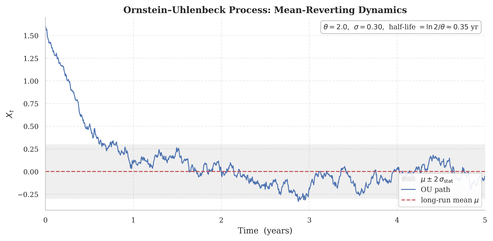{#fig-ou-process}

#### Closed-form solution.

[\[eq:ou_sde\]](#eq:ou_sde){reference-type="ref" reference="eq:ou_sde"} is a linear SDE and is solved with the integrating factor $e^{\kappa t}$. Applying Itô's product rule to $e^{\kappa t}S_t$, $$
\mathrm{d}\!\left(e^{\kappa t}S_t\right)
= e^{\kappa t}\bigl(\mathrm{d}S_t + \kappa S_t\,\mathrm{d}t\bigr)
= e^{\kappa t}\bigl(\kappa\mu\,\mathrm{d}t + \sigma\,\mathrm{d}W_t\bigr),
$$ and integrating from $0$ to $t$, $$
e^{\kappa t}S_t - S_0
= \mu\bigl(e^{\kappa t}-1\bigr) + \sigma\!\int_0^t e^{\kappa s}\,\mathrm{d}W_s .
$$ Solving for $S_t$ yields the explicit solution 

$$
S_t = \mu + (S_0-\mu)\,e^{-\kappa t}
 + \sigma\,e^{-\kappa t}\!\int_0^t e^{\kappa s}\,\mathrm{d}W_s .
$$ {#eq-ou-sol}

 The stochastic integral is a zero-mean Gaussian variable, so $S_t\mid S_0$ is Gaussian with 

$$\begin{aligned}
\mathbb{E}[S_t\mid S_0] &= \mu + (S_0-\mu)\,e^{-\kappa t},
\\
\mathbb{V}[S_t\mid S_0]
&= \sigma^2 e^{-2\kappa t}\!\int_0^t e^{2\kappa s}\,\mathrm{d}s
 = \frac{\sigma^2}{2\kappa}\bigl(1-e^{-2\kappa t}\bigr),

\end{aligned}
$$ {#eq-ou-mean}

 where the variance follows from Itô's isometry. The conditional mean decays geometrically toward $\mu$ at rate $\kappa$ (the restoring force that the strategy monetizes) while the conditional variance saturates at $\sigma^2/2\kappa$. As $t\to\infty$ the process forgets $S_0$ and converges to the stationary distribution 

$$
S_\infty \sim \mathcal{N}\!\left(\mu,\ \frac{\sigma^2}{2\kappa}\right),
$$ {#eq-ou-stat}

 whose *finite* variance is precisely the property that separates a tradable spread from a random walk (for which the variance diverges linearly in time).

#### Half-life and its uncertainty.

The most important tradability descriptor is the half-life, the expected time for a deviation to decay by half. Setting the deterministic part of [\[eq:ou_mean\]](#eq:ou_mean){reference-type="eqref" reference="eq:ou_mean"} equal to $\tfrac12(S_0-\mu)$, 

$$
t_{1/2} = \frac{\ln 2}{\kappa}.
$$ {#eq-halflife}

 Since $t_{1/2}$ is estimated, not observed, it carries a sampling uncertainty that must be propagated. By the delta method, if $\hat\kappa$ has asymptotic standard error $\mathrm{se}(\hat\kappa)$, then 

$$
\mathrm{se}\bigl(\hat t_{1/2}\bigr)
\approx \frac{\ln 2}{\hat\kappa^{2}}\,\mathrm{se}(\hat\kappa)
= \frac{\hat t_{1/2}}{\hat\kappa}\,\mathrm{se}(\hat\kappa).
$$ {#eq-halflife-se}

 Reporting a point estimate of the half-life without [\[eq:halflife_se\]](#eq:halflife_se){reference-type="eqref" reference="eq:halflife_se"} hides the fact that, for slowly reverting spreads, the half-life is estimated with very wide confidence bands, a caveat that bears directly on the ranking of pairs (@sec-sub-discover).

#### Exact discretization: from OU to AR(1).

Estimation is carried out in discrete time, and here the OU reveals its econometric face. Evaluating the exact solution [\[eq:ou_sol\]](#eq:ou_sol){reference-type="eqref" reference="eq:ou_sol"} over a sampling interval $\Delta t$ yields 

$$
S_t = c + \varphi\,S_{t-1} + \epsilon_t,
\qquad \epsilon_t \sim \mathcal{N}\!\left(0,\sigma_\epsilon^2\right),
$$ {#eq-ou-ar1}

 an AR(1) process whose coefficients map bijectively onto the structural parameters: 

$$
\varphi = e^{-\kappa\Delta t},\qquad
c = \mu(1-\varphi),\qquad
\sigma_\epsilon^2 = \frac{\sigma^2}{2\kappa}\bigl(1-\varphi^2\bigr).
$$ {#eq-ou-map}

 Inverting [\[eq:ou_map\]](#eq:ou_map){reference-type="eqref" reference="eq:ou_map"} recovers the OU parameters from an estimated AR(1): 

$$
\hat\kappa = -\frac{\ln\hat\varphi}{\Delta t},\qquad
\hat\mu = \frac{\hat c}{1-\hat\varphi},\qquad
\hat\sigma^2 = \hat\sigma_\epsilon^2\,\frac{-2\ln\hat\varphi}{\Delta t\,(1-\hat\varphi^2)},
$$ {#eq-ou-inv}

 and $\hat t_{1/2} = -\Delta t\,\ln 2/\ln\hat\varphi$. The stationarity condition $|\varphi|<1$ of the AR(1) is identical to $\kappa>0$: genuine mean-reversion and covariance stationarity are the same requirement.

#### Maximum likelihood estimation.

Although OLS on [\[eq:ou_ar1\]](#eq:ou_ar1){reference-type="eqref" reference="eq:ou_ar1"} is consistent, the efficient estimator maximizes the exact Gaussian log-likelihood implied by [\[eq:ou_mean\]](#eq:ou_mean){reference-type="eqref" reference="eq:ou_mean"} and [\[eq:ou_var\]](#eq:ou_var){reference-type="eqref" reference="eq:ou_var"}. Setting $m_{t} = \mu + (S_{t-1}-\mu)e^{-\kappa\Delta t}$ and $s^2 = \tfrac{\sigma^2}{2\kappa}(1-e^{-2\kappa\Delta t})$ for the one-step conditional mean and variance, 

$$
\log L(\kappa,\mu,\sigma^2)
= -\frac{T}{2}\log(2\pi s^2)
 -\frac{1}{2s^2}\sum_{t=1}^{T}\bigl(S_t - m_t\bigr)^2 .
$$ {#eq-ou-loglik}

 Maximizing [\[eq:ou_loglik\]](#eq:ou_loglik){reference-type="eqref" reference="eq:ou_loglik"} yields $(\hat\kappa,\hat\mu,\hat\sigma^2)$ and, via the Hessian, the standard errors that enter [\[eq:halflife_se\]](#eq:halflife_se){reference-type="eqref" reference="eq:halflife_se"}.

#### The small-sample bias of the reversion speed.

A subtle but relevant point is that the OLS/Yule--Walker estimator of the autoregressive coefficient $\varphi$ is biased *downward* in finite samples. To first order, Kendall's classical result gives 

$$
\mathbb{E}[\hat\varphi] - \varphi \approx -\frac{1+3\varphi}{T},
$$ {#eq-kendall}

 so for a spread near the unit root ($\varphi\to 1$) the bias is about $-4/T$. Through the nonlinear map $\hat\kappa = -\ln\hat\varphi/\Delta t$, a downward bias in $\hat\varphi$ becomes an *upward* bias in $\hat\kappa$ and therefore a *downward* bias in the estimated half-life: the spread appears to revert more rapidly than it actually does. The practical consequence is an overly optimistic pair selection, since the most attractive candidates (shorter half-life) are exactly the most affected. The remedy is to bias-correct $\hat\varphi$ (analytically via [\[eq:kendall\]](#eq:kendall){reference-type="eqref" reference="eq:kendall"} or, more robustly, with a parametric bootstrap that resamples the OU innovations and reconstructs the entire sampling distribution of $\hat t_{1/2}$) before any ranking. This correction is applied throughout the empirical part.

#### From the OU spread to the Kalman spread.

In the classical formulation the spread is a fixed linear combination, $S_t = Y_{1,t} - \beta Y_{2,t}$, with $\beta$ estimated once and for all via OLS. The empirical reality documented in Part II is that $\beta$ drifts, so that a static spread is itself non-stationary even when the underlying relationship is intact (the term $\delta_t Y_{2,t}$ of equation [\[eq:ols_error\]](#eq:ols_error){reference-type="eqref" reference="eq:ols_error"}). The OU model of this subsection therefore describes the *ideal* object; the dynamic spread $S_t = v_t = Y_{1,t} - \hat\alpha_{t|t-1} - \hat\beta_{t|t-1}Y_{2,t}$ produced by the Kalman Filter (@sec-sub-dhr) is its operational realization, and the OU parameters estimated on $\{v_t\}$ (bias-corrected as above) remain the yardstick of tradability.

{#fig-halflife-bootstrap}

## Discovering Cointegrated Pairs {#sec-sub-discover}

Before a spread can be modeled, it must be found. Given a universe of $N$ assets there are $\binom{N}{2}=N(N-1)/2$ candidate pairs (for $N=500$ about $1.25\times10^{5}$ candidates) and only a small fraction host a stable cointegration relationship. Pair discovery is a screening problem in which statistical power, control of multiple testing, and a-priori economic knowledge must be balanced.

#### Two classical paradigms.

The literature offers two approaches. The *distance method* of Gatev, Goetzmann, and Rouwenhorst [@gatev2006] normalizes each cumulative-return series to a common origin, $P_{i,t}=\prod_{s\le t}(1+r_{i,s})$, and for each candidate computes the sum of squared deviations between the two normalized paths over a formation window of length $T_f$: 

$$
\mathrm{SSD}_{ij} = \sum_{t=1}^{T_f}\bigl(P_{i,t}-P_{j,t}\bigr)^2 .
$$ {#eq-ssd}

 The pairs with minimal $\mathrm{SSD}$ are traded when the normalized gap exceeds a fixed multiple (typically two historical standard deviations) of its formation dispersion. The method is nonparametric and robust, but it selects on *comovement*, not on *stationarity*: nothing guarantees that a low-SSD spread is mean-reverting, and diverging pairs may drift without bound. The *cointegration method* [@vidyamurthy2004; @engle_granger1987] instead selects directly the property on which the strategy is founded, keeping only the pairs whose spread is provably $I(0)$. We adopt the cointegration method, since its selection criterion coincides with the trading hypothesis; the distance method is retained only as a fast pre-filter.

#### The cointegration test and a robust alternative.

For each candidate, the Engle--Granger procedure regresses $Y_{1,t}$ on $Y_{2,t}$ and applies an ADF test to the residual $\hat u_t$; rejection of the unit-root hypothesis on $\hat u_t$ is evidence of cointegration. Since the regressor is itself $I(1)$, the residual-based test uses the non-standard Phillips--Ouliaris critical values rather than the usual ADF tabulation. As a robustness check we also report the Phillips--Ouliaris $\hat Z_\alpha$ and $\hat Z_t$ statistics, which correct nonparametrically for autocorrelation and heteroskedasticity in the residual and are less sensitive than the ADF form to the choice of augmentation.

#### Stationarity diagnostics.

Two model-free statistics complement the formal test and feed the tradability ranking. The *Hurst exponent* $H$ measures long memory through the scaling of the rescaled range, $\mathbb{E}[R(n)/S(n)]\sim n^{H}$; $H<\tfrac12$ signals anti-persistence (mean-reversion), $H=\tfrac12$ a random walk, $H>\tfrac12$ trending behavior. The *variance ratio* of Lo and MacKinlay, 

$$
\mathrm{VR}(q) = \frac{\operatorname{Var}(S_t - S_{t-q})}{q\,\operatorname{Var}(S_t - S_{t-1})},
$$ {#eq-vr}

 equals one under a random walk and falls below one for mean-reverting spreads; its standardized statistic provides a formal test. Together with the bias-corrected half-life of @sec-sub-ou, these diagnostics turn a binary cointegration verdict into a continuous tradability score.

#### The multiple-testing problem, quantified.

Screening $m\approx 10^{5}$ pairs at a nominal level $\alpha$ produces, under the global null hypothesis of no cointegration, an expected number of $$
\mathbb{E}[\text{false positives}] = m\,\alpha
$$ false discoveries: at $\alpha=0.05$ and $m=10^{5}$ these are $5{,}000$ pairs that "pass" by pure chance. Two safeguards are essential. The *economic pre-filtering* (below) reduces $m$ before any test is run and is the most powerful lever, acting multiplicatively on the count. The *formal error control* then governs the residual tests: the Bonferroni correction ($\alpha/m$) controls the family-wise error rate but is severely conservative for large $m$; the Benjamini--Hochberg procedure instead controls the false-discovery rate $q$, rejecting the null of non-cointegration for all ordered $p$-values that satisfy 

$$
p_{(i)} \le \frac{i}{m}\,q,
$$ {#eq-bh}

 retaining many more genuine discoveries at a controlled expected proportion of false discoveries. Reporting a raw count of "cointegrated pairs found" without either safeguard is an error.

#### Economic pre-filtering and clustering.

The candidate pairs are restricted a priori to economically related assets: same sector or industry (GICS classification), shared supply chain, or a common documented macro driver, as gold and silver share inflation and real-rate dynamics. Where no classification is available, an unsupervised alternative groups the assets on the return-correlation structure (for example via a correlation distance $d_{ij}=\sqrt{2(1-\rho_{ij})}$ and hierarchical clustering) and forms candidate pairs only within clusters. Both routes reduce the set of candidates by one or two orders of magnitude and raise the prior probability that a statistical discovery reflects a structural relationship.

#### Formation/trading split and selection bias.

A pair selected because its spread was stationary over a formation window has been chosen *conditional on past mean-reversion*; the act of selection induces an optimistic bias, and there is no guarantee of out-of-sample persistence [@lopezdeprado2018]. The protocol is rigorous: testing and parameter estimation occur on a formation window $[\,t_0, t_0+T_f\,]$; trading occurs on a strictly subsequent window $[\,t_0+T_f, t_0+T_f+T_h\,]$; and cointegration is re-validated *during* trading by a rolling stationarity check on the Kalman spread, which delegates the role of breakdown detection to the HMM regime filter of @sec-sub-hmmspread. Algorithm [\[alg:discovery\]](#alg:discovery){reference-type="ref" reference="alg:discovery"} summarizes the entire pipeline.

:::: algorithm
::: algorithmic
universe $\{Y_i\}_{i=1}^N$, formation window $T_f$, FDR level $q$ **pre-filter:** group the assets by sector or correlation clustering form the candidate set $\mathcal{P}$ of intra-group pairs;  $m \gets |\mathcal{P}|$ test $Y_i, Y_j$ for $I(1)$ via joint ADF/KPSS; **skip** if not both $I(1)$ Engle--Granger regression $\Rightarrow$ residual $\hat u_t$ compute the Phillips--Ouliaris $p$-value $p_{ij}$ apply Benjamini--Hochberg [\[eq:bh\]](#eq:bh){reference-type="eqref" reference="eq:bh"} at level $q$ to $\{p_{ij}\}$ estimate OU on the (Kalman) spread; bias-correct the half-life [\[eq:kendall\]](#eq:kendall){reference-type="eqref" reference="eq:kendall"} compute Hurst $H$ and variance ratio $\mathrm{VR}(q)$ tradability score $\gets$ f(half-life band, $H$, $\mathrm{VR}$, spread stability) top-ranked pairs, traded on the subsequent window $T_h$
:::
::::

![Economic pre-filtering through correlation clustering. <em>Left</em>: hierarchical dendrogram (Ward) on the correlation distance $d_{ij}=\sqrt{2(1-\rho_{ij})}$, which recovers the sector-block structure. <em>Right</em>: correlation matrix reordered by cluster, with candidate pairs formed only within the blocks. Restricting the search to intra-cluster pairs reduces the number of tested hypotheses (here from 91 to 18), cutting the multiple-testing burden before any cointegration test is run.](figures/correlation-clustering.png){#fig-correlation-clustering}

## Advanced Spread Modeling {#sec-sub-spreadmodel}

Once a pair is selected, the spread must be modeled as a living object. Three estimators (derived in full in Part II) are layered to capture, respectively, the drift of the hedge ratio, the heteroskedasticity of the spread, and its discrete regime.

### Dynamic Hedge Ratio {#sec-sub-dhr}

The hedge ratio is estimated recursively by the Kalman Filter of Section 7.7, treating the cointegration regression as a linear model with random-walk coefficients: $$\begin{aligned}
Y_{1,t} &= z_t'\,\alpha_t + \varepsilon_t,
& \varepsilon_t &\sim \mathcal{N}(0,\sigma_\varepsilon^2),
& z_t &= (1,\ Y_{2,t})',\\
\alpha_{t+1} &= \alpha_t + \eta_t,
& \eta_t &\sim \mathcal{N}(0,\,Q),
& Q &= \operatorname{diag}(q_\alpha,q_\beta).
\end{aligned}$$ In scalar form (univariate observation) the recursion, with diffuse initialization $P_{1|0}=\kappa I_2$, $\kappa=10^6$, is $$\begin{aligned}
v_t &= Y_{1,t} - z_t'\,a_{t|t-1}
& &\text{(innovation / dynamic spread)}\\
f_t &= z_t'\,P_{t|t-1}\,z_t + \sigma_\varepsilon^2
& &\text{(innovation variance)}\\
k_t &= P_{t|t-1}\,z_t / f_t
& &\text{(Kalman gain)}\\
a_{t|t} &= a_{t|t-1} + k_t v_t,\qquad
P_{t|t} = (I_2 - k_t z_t')\,P_{t|t-1}
& &\text{(update)}\\
a_{t+1|t} &= a_{t|t},\qquad
P_{t+1|t} = P_{t|t} + Q
& &\text{(prediction)}.
\end{aligned}$$ The filtered hedge ratio $\hat\beta_{t|t}=[a_{t|t}]_2$, the dynamic spread $S_t=v_t$, and its variance $f_t$ are the quantities passed downstream.

#### Calibration of the signal-to-noise ratio.

The decisive tuning quantity is the $\mathrm{SNR}=q_\beta/\sigma_\varepsilon^2$, which governs how rapidly the filter tracks the hedge ratio: a high SNR trusts recent observations and adapts quickly; a low SNR trusts the prior and smooths. The hyperparameters $\psi=(\sigma_\varepsilon^2,q_\alpha,q_\beta)$ are estimated once by maximizing the prediction-error log-likelihood $$
\log L(\psi) = -\frac{1}{2}\sum_{t=1}^{T}
\Bigl[\log(2\pi f_t(\psi)) + \frac{v_t(\psi)^2}{f_t(\psi)}\Bigr],
$$ via L-BFGS-B with multiple starting points; the EM algorithm offers a slower derivative-free alternative when the likelihood surface is ill-conditioned. On GLD/SLV the MLE SNR of $732.5$ (@tbl-kf-params) corresponds to a hedge ratio that falls from $\approx 2.0$ in 2010 to $\approx 1.35$ in 2019, a structural drift that no static estimate can represent.

#### Why not rolling OLS or DOLS.

A rolling-window OLS hedge ratio is the naive dynamic alternative, but the window length is a fixed hyperparameter that reacts to nothing: too short and the estimate is noisy, too long and it lags structural change. DOLS corrects the endogeneity bias of static OLS by augmenting the regression with leads and lags of $\Delta Y_{2,t}$, but it remains a fixed-parameter estimator: the instability formalized in equation [\[eq:ols_error\]](#eq:ols_error){reference-type="eqref" reference="eq:ols_error"} is intact. The Kalman Filter is the only one of the three to update the hedge ratio at the frequency of the observations, weighting prior and data optimally, and this is why it removes the numerator distortion of the z-score at its root: $v_t$ is the one-step-ahead residual of a regression re-estimated at each $t$, hence stationary whenever the relationship is intact.

#### Ex-post smoothing and innovation diagnostics.

For calibration and structural analysis, the Rauch--Tung--Striebel smoother produces $\hat\beta_{t|T}$ using the entire sample; these estimates are not tradable (they use future data) but are essential for validating the model and for estimating the regime-dependent parameters. The filter innovations $\{v_t\}$ are, by construction, serially uncorrelated in mean (a property verified by the Ljung--Box test on $v_t$), which legitimizes their use as input to the regime model. The same innovations, however, are *not* homoskedastic: it is the next level that addresses this point.

{#fig-snr-sensitivity}

### Capturing Spread Heteroskedasticity with GARCH Models {#sec-sub-garchspread}

The Kalman Filter makes the spread stationary in mean but not in variance. The innovation diagnostics of Section 7.12 establish this formally on the GLD/SLV innovations $v_t$: the Ljung--Box test does not reject autocorrelation in $v_t$ at short lags ($p=0.26$ at lag 5, mean already whitened) but rejects overwhelmingly in $v_t^2$ ($p<10^{-20}$ at all lags); Engle's ARCH-LM statistic is $\approx 102$ ($p\approx 0$); and the empirical excess kurtosis of $5.49$ with skewness $-0.38$ confirms heavy, left-asymmetric tails. The conditional variance of the spread is time-varying, clustered, and predictable.

#### GARCH(1,1) on the innovations.

A GARCH(1,1) is estimated by maximum likelihood on $\{v_t\}$, 

$$
\hat\sigma_{S,t}^2 = \hat\omega + \hat\alpha\,v_{t-1}^2 + \hat\beta\,\hat\sigma_{S,t-1}^2,
\qquad \hat\alpha+\hat\beta<1,
$$ {#eq-garch-innov}

 producing an adaptive conditional standard deviation of the spread. On GLD/SLV the estimated persistence $\hat\alpha+\hat\beta=0.986$ (@tbl-garch-params) shows that volatility shocks to the spread decay slowly, a structure that a constant denominator ignores entirely.

#### Choice of the innovation distribution.

Given the excess kurtosis and negative skewness documented for $v_t$, a Gaussian GARCH likelihood is misspecified in the tails. We therefore estimate [\[eq:garch_innov\]](#eq:garch_innov){reference-type="eqref" reference="eq:garch_innov"} under a heavy-tailed conditional density (the standardized Student-$t$ for symmetric leptokurtosis, or Hansen's skewed-$t$ when the left asymmetry is relevant), using the densities and parameter restrictions catalogued in Part I (§4.3). Quasi-maximum-likelihood under the Gaussian assumption remains consistent for the variance parameters but loses efficiency and distorts the tail-risk measures; since the z-score thresholds are effectively tail quantiles of the spread, the distributional choice enters directly into the calibration of the signal.

#### The combined denominator.

The KF forecast variance $f_t$ and the GARCH variance $\hat\sigma_{S,t}^2$ are *different* sources of dispersion: $f_t$ measures *parametric* uncertainty (how poorly the hedge ratio is currently determined), while $\hat\sigma_{S,t}^2$ measures the *conditional* volatility of the spread itself. Since the two are, to first order, additive contributions to the one-step forecast variance of $Y_{1,t}$, the appropriate denominator is their sum, $$
\sqrt{f_t + \hat\sigma_{S,t}^2},
$$ not one or the other alone. This is the denominator used in the z-score of @sec-sub-zscore.

#### Over-standardisation and its correction.

The diagnostics of Part II signal a calibration consequence to carry downstream. On GLD/SLV the combined denominator produces a z-score with standard deviation $0.658<1$ (@tbl-zscore-comparison): adding $\hat\sigma_{S,t}^2$ *over*-standardizes the spread in high-volatility windows, compressing otherwise valid signals below the entry threshold. The GARCH term remains necessary (it corrects the volatility-clustering distortion) and the correct remedy is to *rescale* the threshold so as to preserve the entry quantile. If a correctly standardized z-score crosses at $z^*=2$, the empirical standard deviation $\hat s_z=0.658$ implies an equivalent threshold of $z^{*}\hat s_z\approx 2\times0.658\approx 1.3$, a value carried into the threshold optimization of @sec-sub-thresholds as the starting point of the grid, not as a fixed constant.

### Regime-Switching Spreads Using HMM {#sec-sub-hmmspread}

The KF and GARCH levels correct the *magnitude* of the signal; neither can say whether a large deviation reflects a genuine opportunity or a breakdown of the cointegration relationship. That distinction concerns the structure of the relationship, not its magnitude, and it is provided by the two-state Hidden Markov Model of Sections 7.8--7.10.

#### The two-regime model and its economics.

The latent regime $s_t\in\{1,2\}$ is identified at the estimation stage as low volatility / stable cointegration ($s_t=1$) versus high volatility / degraded cointegration ($s_t=2$), with regime-dependent Gaussian emissions $y_t\mid s_t=k \sim \mathcal{N}(\mu_k,\sigma_k^2)$ and a transition matrix whose diagonal encodes persistence, $d_k=1/(1-p_{kk})$. The chain estimated on GLD/SLV (@tbl-hmm-zscore-params) spends $\approx 81\%$ of the time in the stable regime, with stress episodes of average duration $\approx 10$ trading days against $\approx 42$ for the stable phases, and the Viterbi segmentation aligns with the 2011--2012 gold peak, the 2015--2016 China shock, and the 2018 sell-off. This asymmetry between long calm phases and short violent ones is the empirical regularity that the regime filter exploits.

#### Real-time inference: the Hamilton filter.

Only the *filtered* probability is admissible for trading, since the smoothed ones require future data. The Hamilton filter computes it recursively: $$\begin{aligned}
\hat\xi_{t|t-1} &= P'\,\hat\xi_{t-1|t-1}
& &\text{(regime prediction)}\\
\hat\xi^{(k)}_{t|t} &=
\frac{f_k(y_t)\,\hat\xi^{(k)}_{t|t-1}}{\sum_{j} f_j(y_t)\,\hat\xi^{(j)}_{t|t-1}}
& &\text{(Bayes update)},
\end{aligned}$$ returning the probability of the favorable regime $\phi_t=\hat\xi^{(1)}_{t|t}=\Pr(s_t=1\mid y_{1:t},\hat\lambda)$. The filtered series lags the smoothed one at transitions, the unavoidable informational cost of operating causally, and this is why the trading threshold $\phi^*$ is set conservatively (@sec-sub-rules).

#### A duration-aware composite indicator.

The bare probability $\phi_t$ can be refined by penalizing very recent transitions, since a just-entered stable regime is less reliable than a consolidated one. The composite indicator 

$$
\Phi_t = \phi_t\cdot\Bigl(1 - e^{-\phi_t/(1-p_{11})}\Bigr)
$$ {#eq-phi-composite}

 multiplies the regime probability by a factor increasing with the expected duration of the regime. In the strategy of @sec-sub-rules we use the simpler threshold rule $\phi_t>\phi^*$ for transparency, but $\Phi_t$ is the natural refinement when the regime persistence is itself unstable, and it is reported as a robustness variant.

## Designing the Trading Strategy {#sec-sub-strategy}

The three estimators are now composed into a single executable rule. The design principle, stated once and applied everywhere, is a clean division of labor: the Kalman Filter and the GARCH produce the *quantitative* signal (how far the spread is from equilibrium, in self-calibrating units), while the HMM provides a *qualitative* veto (whether the market context is one in which that signal should be executed).

### Dynamic Z-Score Generation (KF Mean + GARCH Variance) {#sec-sub-zscore}

The signal is the adaptive z-score that normalizes the Kalman innovation by the full conditional standard deviation of the spread: 

$$
z_t^{\mathrm{KF+GARCH}} = \frac{v_t}{\sqrt{f_t + \hat\sigma_{S,t}^2}}.
$$ {#eq-zfull}

 Each term addresses one of the three distortions of the static z-score catalogued in equation [\[eq:ols_error\]](#eq:ols_error){reference-type="eqref" reference="eq:ols_error"}. The numerator $v_t$ is stationary by construction (dynamic hedge ratio), removing the numerator distortion. The component $f_t$ is the KF forecast variance, which inflates in periods of high parametric uncertainty and contracts the z-score when the hedge ratio is poorly determined. The component $\hat\sigma_{S,t}^2$ is the GARCH conditional variance, which widens the denominator in volatility clusters and removes the denominator distortion that a fixed $\hat\sigma_\varepsilon$ would impose. @tbl-zscore-compare summarizes the progression across the three nested specifications.

#### Distributional properties.

Under the linear-Gaussian state-space model, the standardized innovation $v_t/\sqrt{f_t}$ is, by the prediction-error decomposition, an i.i.d. $\mathcal{N}(0,1)$ sequence, so the KF z-score is exactly standard normal when the model is correctly specified, and the entry threshold $z^*$ has a clean interpretation as a tail quantile. Adding $\hat\sigma_{S,t}^2$ to the denominator trades this exact normality for robustness to volatility clustering, at the cost of the over-standardisation (std $0.658$) discussed above; the threshold recalibration of @sec-sub-garchspread restores the intended signal frequency. Every quantity in [\[eq:zfull\]](#eq:zfull){reference-type="eqref" reference="eq:zfull"} is measurable at $t$, so the z-score is strictly causal.

::: {#tbl-zscore-compare}
  Statistic                              $z^{\mathrm{OLS}}_t$         $z^{\mathrm{KF}}_t$       $z^{\mathrm{KF+GARCH}}_t$
  -------------------------------- -------------------------------- ----------------------- ---------------------------------
  Min                                          $-2.62$                      $-7.38$                      $-3.86$
  Max                                          $+3.83$                      $+4.34$                      $+2.44$
  Std                                          $1.000$                      $1.001$                      $0.658$
  Denominator                       fixed $\hat\sigma_\varepsilon$   adaptive $\sqrt{f_t}$   $\sqrt{f_t+\hat\sigma_{S,t}^2}$
  Corrects parameter drift                        No                          Yes                          Yes
  Corrects volatility clustering                  No                          No                           Yes

  : Statistical comparison of the three z-score specifications on GLD/SLV (2010--2019), reproduced from @tbl-zscore-comparison. A correctly standardised z-score has std $\approx 1$.
:::

### State-Dependent Trading Rules with HMM {#sec-sub-rules}

The trading signal couples the dynamic z-score to the regime probability through a filtered rule: 

$$
\tau_t =
\begin{cases}
+1 & \text{if } z_t < -z^* \ \text{and}\ \phi_t > \phi^*,\\[2pt]
-1 & \text{if } z_t > +z^* \ \text{and}\ \phi_t > \phi^*,\\[2pt]
\ \ 0 & \text{otherwise,}
\end{cases}
$$ {#eq-tau}

 with the open position closed when $|z_t|$ falls below the exit threshold $z^{\text{exit}}<z^*$. The first line opens a long-spread position (long $Y_1$, short $\hat\beta_{t|t}Y_2$) when the spread is significantly below equilibrium; the second a short-spread position symmetrically; the exit band near zero realizes the reversion.

#### Why the regime gate is not optional.

A crossing $z_t>z^*$ is intrinsically ambiguous. It may signal a transient deviation that will revert ($\phi_t\approx 1$, stable cointegration) or a structural break that will not ($\phi_t\approx 0$, degraded cointegration). Without the gate, both produce the same entry and the second is a trap: the spread keeps widening, the position accumulates losses, and the static strategy is forced into a stop-loss at the worst possible moment. The condition $\phi_t>\phi^*$ admits only the first case, executing signals exclusively when the HMM is sufficiently confident that mean-reversion is operative. This is the specific mechanism through which the integrated framework is designed to reduce drawdowns during structural breaks, the central hypothesis of the work.

#### Position management.

Three additional rules complete the execution logic. A *stop-loss* closes the position if $|z_t|$ exceeds a level $z^{\text{stop}}>z^*$, limiting the loss when even a filtered entry turns out to be on a breakdown. A *time-based exit* closes any position held longer than a multiple of the estimated half-life, since a trade that has not reverted within a few half-lives is evidence that the OU hypothesis has failed for that episode. A *regime exit* closes positions when $\phi_t$ falls below $\phi^*$ with a trade open, withdrawing the book as the market deteriorates rather than waiting for the z-score trigger.

#### Position sizing.

The exposure can exploit the continuous nature of both signals, 

$$
w_t = \bar w\,\phi_t\,\min\!\left(\frac{|z_t|}{z^*},\ w_{\max}\right),
$$ {#eq-sizing}

 so that the size scales both with the strength of the deviation and with the confidence in the regime, and is automatically dampened toward the stress state. This soft scaling avoids "whipsawing" the book when $\phi_t$ oscillates around $\phi^*$. The two legs are sized to maintain dollar-neutrality at entry, $w_t^{(1)} = -\hat\beta_{t|t}\,w_t^{(2)}$ in notional terms, with the hedge ratio refreshed by the Kalman Filter so that neutrality is preserved as $\hat\beta_{t|t}$ drifts.

#### Transaction cost.

Each rebalancing of the drifting hedge ratio carries a cost; the strategy therefore trades neutrality against turnover by rebalancing the hedge only when $\hat\beta_{t|t}$ moves beyond a no-trade band, and by charging in the backtest proportional costs and realistic slippage. The cost model is specified in the empirical part, but its existence shapes the design here: the regime gate and the no-trade band exist in part to suppress low-conviction trades whose expected edge does not exceed the cost threshold.

### Threshold Optimization {#sec-sub-thresholds}

The system exposes three free thresholds, entry $z^*$, exit $z^{\text{exit}}$, and regime gate $\phi^*$, collected in $\theta=(z^*, z^{\text{exit}}, \phi^*)$ (with the optional $z^{\text{stop}}$ and holding cap as fixed risk limits). The Kalman hyperparameters and the GARCH and HMM parameters are estimated by maximum likelihood and are *not* tuned on performance; only $\theta$ is optimized against a trading objective. This separation confines the overfitting surface to three interpretable quantities and keeps the statistical estimators honest.

#### Objective function.

The thresholds maximize a risk-adjusted performance metric over a training window. The annualized Sharpe ratio is the natural default, $$
\mathrm{SR}(\theta) = \frac{\bar r(\theta)}{\hat\sigma_r(\theta)}\sqrt{A},
$$ with $A$ the annualization factor, but a metric that penalizes drawdown better reflects the stated objective of drawdown control during breaks. The Calmar ratio (annual return over maximum drawdown) and the Sortino ratio (excess return over downside deviation) are reported as alternatives, and the choice of objective is itself treated as a hyperparameter validated out-of-sample.

#### Grid and search.

The optimization is a three-dimensional grid search over $z^*\in[1.0,2.5]$, $z^{\text{exit}}\in[0,1.0]$, $\phi^*\in[0.6,0.8]$: the lower end of the $z^*$ range reflects the over-standardisation correction of @sec-sub-garchspread, the $\phi^*$ range the empirical trade-off between signal frequency and selection quality. The grid is deliberately coarse: a fine grid multiplies the number of effective trials and inflates the selection bias that the following controls are meant to neutralize.

#### The danger of overfitting, formalized.

Selecting the thresholds by maximizing the in-sample Sharpe over a grid is, without safeguards, a textbook route to backtest overfitting: with $N$ configurations tried, the maximum in-sample Sharpe is biased upward even when no configuration has genuine edge [@lopezdeprado2018]. Three controls are imposed.

*(i) Combinatorial purged cross-validation (CPCV).* The sample is partitioned into $N_g$ contiguous groups; each combination of $k$ groups is used as the test set and the remaining $N_g-k$ as the training set, producing $\binom{N_g}{k}$ train/test splits and a distribution of out-of-sample performance rather than a single path. The training-set observations whose labels overlap the test window are *purged*, and an *embargo* of $h$ observations after each test block is removed, to prevent leakage through the serially correlated states of the Kalman and GARCH, a leakage that ordinary $k$-fold CV would silently admit and that here matters acutely because the filters carry information across the fold boundaries.

*(ii) Deflated Sharpe ratio (DSR).* The observed Sharpe is corrected for the number of trials and for the non-normality of the returns. With $\hat\gamma_3,
\hat\gamma_4$ the skewness and kurtosis of the return series and $T$ the sample length, 

$$
\mathrm{DSR} = \Phi\!\left(
\frac{(\widehat{\mathrm{SR}} - \mathrm{SR}_0)\sqrt{T-1}}
{\sqrt{\,1 - \hat\gamma_3\widehat{\mathrm{SR}} + \tfrac{\hat\gamma_4-1}{4}\widehat{\mathrm{SR}}^{\,2}\,}}
\right),
$$ {#eq-dsr}

 where $\Phi$ is the standard normal CDF and the benchmark $\mathrm{SR}_0$ is the *expected maximum* Sharpe under $N$ independent trials with null edge, $$
\mathrm{SR}_0 = \sqrt{\operatorname{Var}(\widehat{\mathrm{SR}})}\,
\Bigl[(1-\gamma)\,\Phi^{-1}\!\bigl(1-\tfrac1N\bigr)
 + \gamma\,\Phi^{-1}\!\bigl(1-\tfrac{1}{N e}\bigr)\Bigr],
$$ with $\gamma$ the Euler--Mascheroni constant. The DSR returns the probability that the true Sharpe is positive after accounting for selection, replacing a biased point estimate with a calibrated significance.

*(iii) Probability of backtest overfitting (PBO).* Estimated from the combinatorial procedure, the PBO is the fraction of CPCV splits in which the best in-sample configuration ranks below the out-of-sample median. A PBO near $0.5$ indicates that in-sample optimization carries no out-of-sample information (the configuration was overfit) while a low PBO supports the selection.

#### Status of the empirical calibration.

The values of $\hat\theta$, the cross-validated performance, and the deflated statistics are established in the empirical part, where the three nested specifications (static OLS, Kalman-only, and full KF--HMM--GARCH) are compared on the full US universe of Part IV with realistic transaction costs. This subsection fixes the *protocol*: which parameters are estimated and which optimized, the objective, the grid, and the anti-overfitting controls that any reported result must satisfy to be credible.

#### Bridge to high-dimensional StatArb.

The bivariate strategy assembled in this section is complete: a tradable mean-reverting object (@sec-sub-ou), a disciplined and statistically controlled way of discovering it (@sec-sub-discover), a three-level dynamic spread model (@sec-sub-spreadmodel), and a filtered and validated trading rule (@sec-sub-strategy). Its limitation is dimensional. Restricting the arbitrage to two assets discards the far richer mean-reversion structure latent in a basket, where many assets share a small number of common stochastic trends and where the *cointegration subspace* (not a single vector) must be identified and optimized. The next section lifts every component developed here to that high-dimensional context.

# StatArb {#sec-statarb}

Pairs trading exploits a single cointegration relationship between two assets. Statistical arbitrage (StatArb) generalizes the idea to a *basket* of $k$ assets whose space of stationary combinations has dimension $r>1$. The jump entails a change in nature, not merely in scale. In high dimension the number of common stochastic trends, the identification of the cointegration space, and the choice of the trading direction within that space become distinct problems, each with its own formal solution, and the methods that work well for $k=2$ (the Johansen tests applied naively, the reading of a single cointegrating vector) degrade or lose meaning. The subsections that follow reconstruct the entire pipeline at the same level of detail as the bivariate strategy: from the rank test to the construction of the mean-reverting portfolio, from the maximization of the reversion speed to the dynamic management via multivariate Kalman Filter, from regime filtering of the book to the constrained allocation of capital.

## Cointegration in High Dimensions {#sec-sub-hd-coint}

Multivariate cointegration is governed by the rank of the matrix $\Pi$ in the VECM representation (Part I). For a system of $k$ series $I(1)$, a rank $r$ with $0<r<k$ implies the existence of $r$ linearly independent cointegration relationships and of $m=k-r$ common stochastic trends. Determining $r$ is the first problem to be solved, and in high dimension it is also the most fragile.

#### Rank determination via Johansen.

Johansen's methodology [@johansen1991; @johansen1995] estimates the rank from the eigenvalues $\hat\lambda_1\ge\dots\ge\hat\lambda_k$ of the reduced-rank decomposition of $\Pi$, through two statistics with complementary hypotheses. The *trace* tests the hypothesis of at most $r$ vectors against the alternative of a larger number, 

$$
\lambda_{\text{trace}}(r) = -T\sum_{i=r+1}^{k}\ln\bigl(1-\hat\lambda_i\bigr),
$$ {#eq-trace}

 while the *maximum eigenvalue* tests exactly $r$ against $r+1$, 

$$
\lambda_{\max}(r,r+1) = -T\,\ln\bigl(1-\hat\lambda_{r+1}\bigr).
$$ {#eq-maxeig}

 The procedure is sequential: one starts from $r=0$ and increments until the hypothesis can no longer be rejected. The rank thus determined fixes the dimension of the cointegration space and, with it, the number of tradable candidate spreads.

#### The curse of dimensionality, quantified.

Mechanically extending Johansen to large $k$ is problematic for structural, not implementational, reasons. The underlying VAR of order $P$ has $k^2 P$ autoregressive parameters: at $k=50$ and $P=2$ these are $5{,}000$ coefficients, a number that makes estimation noisy for any sample of realistic length and causes the variance of the eigenvalues $\hat\lambda_i$ to explode. The asymptotic distributions of the statistics [\[eq:trace\]](#eq:trace){reference-type="eqref" reference="eq:trace"}--[\[eq:maxeig\]](#eq:maxeig){reference-type="eqref" reference="eq:maxeig"} are moreover subject to severe size distortion in finite samples as $k$ grows: the test *over-rejects*, declaring spurious combinations cointegrated and leading to a systematically inflated rank estimate. Bartlett-type corrections mitigate but do not eliminate the problem. To this is added the internal non-identification discussed in @sec-sub-hd-vecm: even with $r$ correctly estimated, the columns of $\beta$ are defined only up to a rotation, and no privileged basis emerges from the test.

#### Dimension reduction as a prerequisite.

The operational answer is to reduce the dimension *before* testing. Three strategies, often combined: grouping by sector or by common factor, which reduces the problem to sub-systems of manageable dimension; projection onto a reduced number of principal components, which removes the noise-dominated directions before VECM estimation; and direct regularization of the reduced-rank estimate. Above all, the object of interest shifts from the single cointegrating vector to the entire *cointegration subspace* and to the choice, within it, of the most rapidly mean-reverting combination. This is the line developed in @sec-sub-subspace--@sec-sub-maxmr, which distinguishes modern StatArb [@avellaneda_lee2010; @daspremont2011] from the direct application of Johansen's framework.

![Finite-sample size distortion of the Johansen Trace test in high dimension. Under the global null hypothesis of no cointegration (<em>k</em> independent random walks, true rank <em>r</em> = 0), the sequential test over-rejects to an increasing degree as the dimension <em>k</em> grows: the average estimated rank and the spurious rejection rate rise well beyond the nominal level of 5%, so that a naive application in high dimension systematically overestimates the cointegration rank. Monte Carlo: 400 replications, <em>T</em> = 150, <code>det_order</code> = 0, one lagged difference, critical values at 95%.](figures/johansen-size-distortion.png){#fig-johansen-size-distortion}

## The VECM Model Applications {#sec-sub-hd-vecm}

The multivariate VECM (Part I, §5.3) provides the structure within which to read the cointegrated system: 

$$
\Delta Y_t = \Pi\, Y_{t-1} + \sum_{j=1}^{P-1}\Gamma_j\,\Delta Y_{t-j} + \varepsilon_t,
\qquad \Pi = \alpha\beta',
$$ {#eq-hd-vecm}

 with $\beta\in\mathbb{R}^{k\times r}$ (cointegrating matrix) and $\alpha\in\mathbb{R}^{k\times r}$ (loading matrix). The Granger Representation Theorem guarantees the equivalence between cointegration of rank $r$ and the existence of a VECM representation with $\operatorname{rank}(\Pi)=r$, making [\[eq:hd_vecm\]](#eq:hd_vecm){reference-type="eqref" reference="eq:hd_vecm"} the canonical form of the system.

#### Operational reading of $\alpha$ and $\beta$.

Each column $\beta_{\cdot i}$ defines a stationary linear combination $\beta_{\cdot i}'Y_t\sim I(0)$, that is, a candidate spread; the space $\operatorname{span}(\beta)$ collects all tradable spreads. The corresponding row of $\alpha$ measures its speed of adjustment (how rapidly the system corrects a deviation from that equilibrium), and it is therefore the multivariate counterpart of the coefficient $\kappa$ of the OU process: a large $\alpha$ in absolute value signals rapid reversion, a null $\alpha$ a *weakly exogenous* variable that does not adjust to that equilibrium. The weak-exogeneity analysis (test of nullity of rows of $\alpha$) identifies which assets drive the common trend and which adapt to it, information valuable for the causal ordering of the basket.

#### The identification problem.

The naive reading "translate a column of $\beta$ into basket weights" inherits two limitations. The first is one of identification: since 

$$
\Pi = \alpha\beta' = (\alpha R^{-1})(R\beta')\quad\text{for every }R\in GL(r),
$$ {#eq-rotation}

 the columns of $\beta$ are defined only up to a rotation internal to the cointegration space; the basis returned by Johansen (normalized, for example, with the upper $r\times r$ block equal to the identity) is one among infinitely many, not necessarily the one with the best trading properties. The second is one of staticity: $\beta$ is estimated as constant over the entire sample, whereas the basket weights (like the bivariate hedge ratios) drift. Relation [\[eq:rotation\]](#eq:rotation){reference-type="eqref" reference="eq:rotation"} is what compels treating the *space* $\operatorname{span}(\beta)$, and not the single column, as the identified object (@sec-sub-subspace); staticity is resolved by the multivariate Kalman Filter (@sec-sub-mkf).

![Estimated VECM decomposition <em>Π</em> = <em>α</em><em>β</em>′. <em>Left</em>: the cointegrating matrix <em>β</em>, whose columns define the tradable long-run spreads. <em>Right</em>: the loading matrix <em>α</em>, whose rows are the speeds of adjustment; the rows with <em>α</em> ≈ 0 (boxed) identify the weakly exogenous assets that drive the common stochastic trend instead of adjusting to it (the price leaders).](figures/vecm-alpha-beta.png){#fig-vecm-alpha-beta}

## Constructing the Mean Reverting Portfolio {#sec-sub-construct}

Once a direction $w\in\mathbb{R}^{k}$ in the cointegration space is fixed, the mean-reverting portfolio is the combination of the log-prices 

$$
S_t = w'\,Y_t,
$$ {#eq-basket-spread}

 and the weights $w$ represent the signed quantities of each asset. The spread $S_t$ is the tradable object, with the same logic as the bivariate case: long when $S_t$ is below its own equilibrium, short in the opposite case. The construction requires some normalization and neutrality choices, each with a precise motivation.

- **Scale normalization.** The direction $w$ is defined up to a scale factor; one fixes $\|w\|_2=1$ or normalizes on a reference asset, so that $S_t$ has a well-defined unit of measurement on which to calibrate the z-score thresholds.

- **Dollar neutrality.** Imposing $\sum_i w_i = 0$ (or, on monetary values, $\sum_i w_i P_{i,t}=0$) cancels the net exposure and makes the basket market-neutral to first order, isolating the relative-value component.

- **Beta neutrality.** A more stringent constraint, $\sum_i w_i\beta_i^{\text{mkt}}=0$ with $\beta_i^{\text{mkt}}$ the market beta of asset $i$, neutralizes the exposure to the market factor even when the weights are not dollar-neutral, protecting against residual systematic risk.

- **OU characterization.** The OU parameters of $S_t$ (in particular the half-life $t_{1/2}=\ln 2/\kappa$, estimated on the discretized AR(1) and bias-corrected as in @sec-sub-ou) provide the tradability criterion of the basket.

#### The selection problem.

Any linear combination of cointegrating vectors is still stationary: $\operatorname{span}(\beta)$ contains infinitely many mean-reverting portfolios with very different reversion speeds. Constructing *one* portfolio is not enough; one must choose the direction $w^\star\in\operatorname{span}(\beta)$ that reverts most rapidly (minimal half-life), because it is the one that maximizes the frequency of opportunities and minimizes the exposure time to a breakdown. This turns the construction into an optimization problem on the subspace, the object of the two following subsections.

{#fig-basket-spread}

## Identifying the Cointegration Subspace {#sec-sub-subspace}

The correctly identified object, by [\[eq:rotation\]](#eq:rotation){reference-type="eqref" reference="eq:rotation"}, is the space $\mathcal{C}=\operatorname{span}(\beta)$ of dimension $r$, not its columns. Identifying $\mathcal{C}$ means estimating a basis for it and ordering its directions by reversion speed. The tool is the canonical analysis of Box and Tiao [@box_tiao], which orders the linear combinations of a multivariate system by *predictability*, separating the persistent (trending) components from the strongly mean-reverting ones.

#### Predictability decomposition.

One models the system (in its stationary representation, or through the companion form of a VAR$(P)$) as a VAR(1): $$
Y_t = A\,Y_{t-1} + \varepsilon_t,
\qquad \Gamma = \mathbb{E}[Y_t Y_t'],\quad \hat A = \arg\min_A \mathbb{E}\|Y_t-AY_{t-1}\|^2 .
$$ For a combination $x_t = w'Y_t$, the one-step predictable part is $\hat x_t = w'A\,Y_{t-1}$, with variance $w'A\Gamma A'w$. The *predictability* is the ratio 

$$
\nu(w) = \frac{\operatorname{Var}(\hat x_t)}{\operatorname{Var}(x_t)}
 = \frac{w'\,A\,\Gamma\,A'\,w}{w'\,\Gamma\,w}\ \in[0,1].
$$ {#eq-predictability}

 A value $\nu\to 1$ indicates a component almost entirely explained by its own past: persistent, trending; a value $\nu\to 0$ a component dominated by the innovation: strongly mean-reverting. The canonical decomposition solves the generalized eigenvalue problem 

$$
A\,\Gamma\,A'\, w = \nu\,\Gamma\, w,
$$ {#eq-gep}

 whose eigenvalues $\nu_1\ge\dots\ge\nu_k$ order the directions from the most to the least predictable.

#### Symmetric form and numerical stability.

To solve [\[eq:gep\]](#eq:gep){reference-type="eqref" reference="eq:gep"} in a numerically stable way one factorizes $\Gamma = LL'$ (Cholesky) and transforms it into a symmetric standard eigenvalue problem: setting $u = L'w$, 

$$
\bigl(L^{-1} A\,\Gamma\,A'\,L^{-\top}\bigr)\,u = \nu\,u,
$$ {#eq-sym-eig}

 whose matrix is symmetric and positive semidefinite, with real eigenvalues in $[0,1]$ and orthonormal eigenvectors. The directions associated with the smallest eigenvalues, transformed back via $w = L^{-\top}u$, identify the most mean-reverting combinations and jointly generate the cointegration space: the stationary directions are precisely those with low predictability. Identifying $\mathcal{C}$ and ordering it by reversion speed become the same operation.

#### Consistency with the rank.

The number of eigenvalues $\nu_i$ significantly below unity estimates the rank $r$, in a way complementary to the Johansen tests: canonical analysis and trace/max-eigenvalue provide two readings of the same subspace, and their agreement is a valuable robustness check in high dimension, where (by @sec-sub-hd-coint) the rank tests suffer from size distortion.

![Box–Tiao canonical decomposition of the basket into components ordered by predictability <em>ν</em> ∈ [0, 1]. The most predictable direction (<em>ν</em> → 1) is a wandering common stochastic trend; the least predictable direction (<em>ν</em> → 0) is a strongly mean-reverting and stationary combination, namely the tradable spread. Identifying the cointegration subspace and ordering its directions by reversion speed are therefore the same operation.](figures/boxtiao-components.png){#fig-boxtiao-components}

## Maximizing Mean-Reversion {#sec-sub-maxmr}

Once the subspace is identified, the selection of the trading direction is an explicit optimization problem: among all stationary combinations, choose the one that reverts most rapidly. The natural criterion is the minimization of the predictability [\[eq:predictability\]](#eq:predictability){reference-type="eqref" reference="eq:predictability"}, 

$$
w^\star = \arg\min_{w}\ \frac{w'\,A\,\Gamma\,A'\,w}{w'\,\Gamma\,w},
$$ {#eq-min-pred}

 whose solution is the eigenvector of [\[eq:gep\]](#eq:gep){reference-type="eqref" reference="eq:gep"} associated with the minimal eigenvalue $\nu_k$. The resulting portfolio is the most mean-reverting expressible by the system and, by the relation between $\nu$ and persistence, the one with minimal half-life.

#### Alternative criteria.

Predictability is not the only measure. Two alternatives recur in the StatArb literature and lead to problems of analogous structure.

- **Portmanteau statistic.** One minimizes an aggregate measure of the portfolio's autocorrelation, $p_L(w) = \sum_{\ell=1}^{L}\rho_\ell(w)^2$, where $\rho_\ell$ is the autocorrelation at lag $\ell$ of $w'Y_t$; the minimum identifies the spread whose serial structure decays most rapidly.

- **Crossing statistics.** Following Kedem, one maximizes the expected number of crossings of the mean by the centered spread. For a stationary Gaussian process the expected rate of zero-crossings is related to the lag-one autocorrelation by $\mathbb{E}[\text{crossings}] \propto \arccos(\rho_1(w))$, so that maximizing the crossings is equivalent to pushing $\rho_1(w)$ toward negative values (anti-persistence), favoring portfolios that oscillate frequently around the equilibrium.

The three formulations capture different nuances of the same objective and in practice select nearby directions.

#### Sparsity and tradability: the d'Aspremont formulation.

The solution [\[eq:min_pred\]](#eq:min_pred){reference-type="eqref" reference="eq:min_pred"} is in general *dense*: it assigns non-null weight to all $k$ assets. A basket with many legs is costly to execute, exposes to liquidity constraints, and multiplies the transaction costs. d'Aspremont [@daspremont2011] therefore reformulates the problem by imposing a cardinality constraint, 

$$
\min_{w}\ \frac{w'\,M\,w}{w'\,\Gamma\,w}
\quad\text{s.t.}\quad \|w\|_0 \le \kappa_{\max},
\qquad M = A\,\Gamma\,A',
$$ {#eq-sparse-mr}

 which produces *small mean-reverting portfolios*. The $\ell_0$ constraint is combinatorial and makes [\[eq:sparse_mr\]](#eq:sparse_mr){reference-type="eqref" reference="eq:sparse_mr"} non-convex.

#### Semidefinite relaxation.

One linearizes the problem by lifting it into the space of matrices. Setting $X = ww'\succeq 0$ with $\operatorname{rank}(X)=1$, and using the identity $w'Mw = \operatorname{Tr}(MX)$, [\[eq:sparse_mr\]](#eq:sparse_mr){reference-type="eqref" reference="eq:sparse_mr"} is rewritten as 

$$
\min_{X\succeq 0}\ \operatorname{Tr}(M X)
\quad\text{s.t.}\quad
\operatorname{Tr}(\Gamma X) = 1,\ \ \operatorname{rank}(X)=1,\ \ \operatorname{Card}(X)\le \kappa_{\max}^2.
$$ {#eq-lift}

 The rank constraint is non-convex and is relaxed by removing it; the $\ell_0$ cardinality constraint is replaced by the convex $\ell_1$ surrogate $\mathbf{1}'|X|\mathbf{1}\le \rho$, with $\rho$ a sparsity parameter. The result is a convex semidefinite program (SDP), solvable in polynomial time; the direction $w$ is recovered from the principal eigenvector of the solution $X^\star$ (which is nearly rank-1 when the relaxation is tight). Alternatively, a greedy procedure builds the support incrementally, adding at each step the asset that most reduces the predictability until $\kappa_{\max}$ is reached. The result is the cornerstone operational compromise of StatArb in high dimension: one sacrifices a fraction of reversion speed in exchange for an effectively executable basket, with few liquid legs and controlled costs.

{#fig-halflife-cardinality}

## Multivariate KF for Dynamic Baskets {#sec-sub-mkf}

The basket weights, like the bivariate hedge ratios, are not constant: the correlation structure among the assets evolves, and with it the optimal mean-reverting direction. The multivariate Kalman Filter extends the dynamic hedge ratio model (@sec-sub-dhr) to a vector state.

#### Vector-state specification.

Normalizing on a reference asset, $Y_{1,t}$ is regressed on the vector $X_t=(Y_{2,t},\dots,Y_{k,t})'$ with time-varying coefficients. The state $\alpha_t=(\alpha_t,\ b_t')'\in\mathbb{R}^{k}$ collects the intercept and the $k-1$ hedge weights, modeled as a random walk: $$\begin{aligned}
Y_{1,t} &= Z_t\,\alpha_t + \varepsilon_t,
& Z_t &= (1,\ X_t'),\quad \varepsilon_t \sim \mathcal{N}(0,\sigma_\varepsilon^2),\\
\alpha_{t+1} &= \alpha_t + \eta_t,
& \eta_t &\sim \mathcal{N}(0,\,Q),\quad Q=\operatorname{diag}(q_\alpha, q_{b_2},\dots,q_{b_k}).
\end{aligned}$$

#### Recursion in matrix form.

With diffuse initialization $P_{1|0}=\kappa I_k$, $\kappa=10^6$, the filter alternates prediction and update: $$\begin{aligned}
\text{(predict)}\quad
& a_{t|t-1} = a_{t-1|t-1},
& & P_{t|t-1} = P_{t-1|t-1} + Q,\\[2pt]
\text{(innovation)}\quad
& v_t = Y_{1,t} - Z_t\,a_{t|t-1},
& & F_t = Z_t\,P_{t|t-1}\,Z_t' + \sigma_\varepsilon^2,\\[2pt]
\text{(gain)}\quad
& K_t = P_{t|t-1}\,Z_t'\,F_t^{-1},
& & \\[2pt]
\text{(update)}\quad
& a_{t|t} = a_{t|t-1} + K_t\,v_t,
& & P_{t|t} = (I_k - K_t Z_t)\,P_{t|t-1}.
\end{aligned}$$ The filter returns, at each $t$, the dynamic basket spread $S_t=v_t$ (the innovation, that is, the component of $Y_{1,t}$ not explained by the regression estimated on information up to $t-1$) and its forecast variance $F_t$, as in the scalar case. The structure is formally identical: what changes is the dimension of the state. When an entire panel of baskets is tracked simultaneously the observation becomes vectorial ($y_t\in\mathbb{R}^p$, $F_t$ a $p\times p$ matrix to be inverted), and the computational cost grows as $O(k^2)$--$O(k^3)$ per step because of the inversion of the innovation covariance and the updates of $P_{t|t}$.

#### Role in the system.

The multivariate KF resolves, at the portfolio level, the correlation breakdown documented in Part I: by updating the weights $b_t$ in real time, the basket realigns to the current dependence structure without periodic re-estimation, and the spread remains stationary by construction as long as the underlying cointegration relationship is intact. The calibration of the hyperparameters $(\sigma_\varepsilon^2, Q)$ via maximum likelihood and the use of the smoother for ex-post analysis follow the protocol of Part II. The spread $S_t$ thus obtained feeds the same adaptive z-score $z_t = v_t/\sqrt{F_t+\hat\sigma_{S,t}^2}$ as the bivariate case, with $\hat\sigma_{S,t}^2$ estimated by a GARCH(1,1) on the basket innovations.

{#fig-mv-kf-weights}

## Regime-Switching in High-Dimensional Spreads {#sec-sub-hd-regime}

In high dimension, regime risk is not a detail but the dominant loss mechanism. During stress episodes correlations collapse toward unity (the diversification meltdown of Part I), and a whole class of cointegration relationships can degrade at the same time. What deforms is not the single spread but the cointegration space as a whole.

#### Markov-Switching VAR.

The tool is the Markov-Switching VAR of Section 7.9, which makes the mean, the dynamics and, above all, the covariance regime-dependent: 

$$
y_t = \mu_{s_t} + \sum_{j=1}^{P}\Phi_{j,s_t}\,y_{t-j} + \varepsilon_t,
\qquad \varepsilon_t \sim \mathcal{N}(0,\Sigma_{s_t}),
$$ {#eq-msvar}

 with $s_t$ a $K$-state Markov chain with transition matrix $P$. The matrix $\Sigma_{s_t}$ captures the change in correlation structure across regimes: the high-volatility regime is precisely the one in which cross-dependence thickens and cointegration weakens. It is this regime dependence of the *covariance*, more than of the mean, that makes the MS-VAR the natural tool for basket risk.

#### Inference: Hamilton filter and EM estimation.

The real-time regime probability comes from the multivariate specialization of the Hamilton filter. With $\hat\xi_{t|t}\in\mathbb{R}^K$ the vector of filtered probabilities, $$\begin{aligned}
\hat\xi_{t|t-1} &= P'\,\hat\xi_{t-1|t-1},\\
\hat\xi_{t|t} &= \frac{\hat\xi_{t|t-1}\odot \boldsymbol{\eta}_t}
 {\mathbf{1}'(\hat\xi_{t|t-1}\odot \boldsymbol{\eta}_t)},
\qquad
\boldsymbol{\eta}_t = \bigl(f_1(y_t),\dots,f_K(y_t)\bigr)',
\end{aligned}$$ where $\odot$ is the Hadamard product and $f_k(y_t)=\mathcal{N}(y_t;\,\mu_k+\sum_j\Phi_{j,k}y_{t-j},\,\Sigma_k)$ is the emission density of regime $k$. The parameters $\{\mu_k,\Phi_{j,k},\Sigma_k,P\}$ are estimated by Baum--Welch (EM). The E-step computes the smoothed and joint probabilities through forward--backward; the M-step updates the regime-dependent emissions in closed form and the rows of $P$ as expected transition frequencies (Part II, Section 7.8), with multiple initializations to limit sensitivity to the starting point.

#### Regime-dependent cointegration and gating of the book.

The cointegration structure itself can be regime-dependent. Under stress the rank $r$ can drop and $\operatorname{span}(\beta)$ can rotate, so that a basket that was optimal in the stable regime stops being mean-reverting. An HMM estimated on an aggregate stress indicator (or on the basket z-score) produces the filtered probability $\phi_t$ of the favorable regime, which *gates* the whole book with the same logic as the bivariate rule [\[eq:tau\]](#eq:tau){reference-type="eqref" reference="eq:tau"}. In regime 2 signals are suppressed, because trading a spread whose cointegration has degraded exposes the book to systemic losses exactly when diversification across the legs disappears. The effect is larger than in the two-asset case: a stress regime invalidates many relationships at once, and a single regime decision protects the entire portfolio.

{#fig-regime-correlations}

## Portfolio Optimization {#sec-sub-hd-portopt}

The last level aggregates several mean-reverting baskets into a StatArb portfolio and allocates capital among them. Given $N$ spreads $\{S^{(i)}_t\}_{i=1}^{N}$, each with its own dynamic z-score $z^{(i)}_t$, reversion speed and regime probability $\phi^{(i)}_t$, the allocation has to maximize the expected reversion P&L while accounting for the cross-dependence among spreads and for operational constraints.

#### Expected reversion returns.

For an OU process the expected one-step reversion return is proportional, with opposite sign, to the current deviation. Let $\mu^{(i)}_t = -\theta_i\,z^{(i)}_t\,\phi^{(i)}_t$ be the expected return of basket $i$, with $\theta_i$ increasing in the reversion speed (short half-life $\Rightarrow$ large $\theta_i$) and scaled by the regime confidence $\phi^{(i)}_t$. The vector $\widehat\mu_t=(\mu^{(1)}_t,\dots,\mu^{(N)}_t)'$ collects the expected signals.

#### Convex allocation problem.

A natural formulation is the quadratic program 

$$
\max_{u}\ \ u'\,\widehat\mu_t \;-\; \frac{\gamma}{2}\,u'\,\widehat\Sigma_t\,u
\;-\; c\,\|u-u_{t-1}\|_1
\quad\text{s.t.}\quad
\mathbf{1}'u = 0,\ \ \|u\|_1\le L,\ \ \|u\|_0\le \kappa_{\max},
$$ {#eq-portopt}

 where $u\in\mathbb{R}^N$ is the vector of exposures to the individual spreads, $\widehat\Sigma_t$ the covariance among spreads, and $\gamma$ the risk-aversion coefficient. The $\ell_1$ term $\|u-u_{t-1}\|_1$ penalizes turnover (transaction costs), and the constraints impose dollar neutrality, a leverage cap $\|u\|_1\le L$, and a cardinality limit on the number of simultaneous positions to protect liquidity.

#### KKT conditions.

Setting aside for a moment the non-smooth terms ($\ell_1$ and cardinality) and treating the smooth problem with multipliers $\lambda$ (dollar neutrality) and $\xi\ge 0$ (leverage), the Lagrangian is $\mathcal{L}=u'\widehat\mu_t-\tfrac{\gamma}{2}u'\widehat\Sigma_t u
-\lambda\,\mathbf{1}'u-\xi(\|u\|_1-L)$ and the stationarity conditions give 

$$
\widehat\mu_t - \gamma\,\widehat\Sigma_t\,u^\star - \lambda\,\mathbf{1} - \xi\,g = 0
\ \Longrightarrow\
u^\star = \frac{1}{\gamma}\,\widehat\Sigma_t^{-1}\bigl(\widehat\mu_t - \lambda\mathbf{1} - \xi g\bigr),
$$ {#eq-kkt}

 with $g\in\partial\|u^\star\|_1$ a subgradient and $\lambda,\xi$ pinned down by the complementarity conditions and by $\mathbf{1}'u^\star=0$. The structure $u^\star\propto\widehat\Sigma_t^{-1}\widehat\mu_t$ shows that the optimal allocation weights the signals by the inverse covariance: highly correlated spreads receive less exposure, which avoids concentrating risk on redundant bets. The terms $\lambda\mathbf{1}$ and $\xi g$ then project the solution onto the dollar-neutral plane and cap its leverage.

#### Covariance estimation: Ledoit--Wolf shrinkage.

[\[eq:kkt\]](#eq:kkt){reference-type="ref" reference="eq:kkt"} requires inverting $\widehat\Sigma_t$, which is ill-conditioned in high dimension: the spreads are not independent (they share assets and common trends) and the sample matrix $S$ is unstable, often close to singular when $N$ is comparable with the window length. We use the Ledoit--Wolf shrinkage estimator, 

$$
\widehat\Sigma_t = \hat\delta\,F + (1-\hat\delta)\,S,
\qquad \hat\delta\in[0,1],
$$ {#eq-ledoitwolf}

 where $S$ is the sample covariance, $F$ a structured target (scaled identity or constant-correlation model), and $\hat\delta$ the optimal shrinkage intensity that minimizes the expected Frobenius loss $\mathbb{E}\|\widehat\Sigma_t-\Sigma\|_F^2$, available in closed form from sample moments. Shrinkage pulls in the extreme eigenvalues and stabilizes the inversion, which the solution of [\[eq:portopt\]](#eq:portopt){reference-type="eqref" reference="eq:portopt"} needs in order to be robust. Reversion speed and $\phi^{(i)}_t$ enter the sizing of each spread through rule [\[eq:sizing\]](#eq:sizing){reference-type="eqref" reference="eq:sizing"} extended to the multi-spread case, so the regime filter acts both at the level of the single basket and at the aggregate level.

#### Overfitting of the allocation.

Optimizing weights, thresholds and hyperparameters jointly on one sample adds degrees of freedom and inflates the in-sample metrics [@lopezdeprado2018]. The discipline of @sec-sub-thresholds carries over: selection on training folds, evaluation on disjoint folds with purging and embargo (CPCV), deflated Sharpe ratio to correct for the number of configurations tried, and probability of backtest overfitting, applied, however, to a wider choice space $(\gamma, L, \kappa_{\max}, c)$, where the risk is correspondingly larger. These hyperparameters are validated out-of-sample, not fitted to performance.

::: {#tbl-constraints}
  Constraint          Form                                          Controls
  ------------------- --------------------------------------------- -----------------------------------
  Dollar neutrality   $\mathbf{1}'u = 0$                            directional / market exposure
  Beta neutrality     $\boldsymbol\beta^{\text{mkt}\prime} u = 0$   systematic factor exposure
  Leverage cap        $\|u\|_1 \le L$                               gross exposure / financing risk
  Cardinality         $\|u\|_0 \le \kappa_{\max}$                   liquidity / execution feasibility
  Turnover penalty    $c\,\|u-u_{t-1}\|_1$                          transaction costs

  : Constraint set of the StatArb allocation problem [\[eq:portopt\]](#eq:portopt){reference-type="eqref" reference="eq:portopt"} and the economic risk each constraint controls.
:::

#### Bridge to the empirical validation.

With this section the StatArb pipeline is complete: rank and cointegration subspace identification (@sec-sub-hd-coint--@sec-sub-subspace), selection of the most mean-reverting direction under sparsity constraints (@sec-sub-maxmr), dynamic weight management through the multivariate Kalman Filter (@sec-sub-mkf), regime filtering of the book (@sec-sub-hd-regime) and constrained allocation across spreads (@sec-sub-hd-portopt). Together with the bivariate strategy of @sec-pairs, these architectures are the object of the empirical validation that follows, where the nested specifications (static OLS, Kalman-only, and full KF--HMM--GARCH, in both bivariate and high-dimensional versions) are backtested out-of-sample with realistic transaction costs, slippage and liquidity constraints, following the anti-overfitting protocol of Lopez de Prado [@lopezdeprado2018].

{#fig-ledoit-wolf}

## From Part III to Part IV: from strategy to evidence {#sec-from-part-iii-to-part-iv-from-strategy-to-evidence .unnumbered}

Part III ends with two complete strategies and a validation protocol, but no evidence. Every design choice above (the regime gate, the combined denominator, the sparse basket) is a hypothesis about how the strategies should behave on real data. Part IV tests those hypotheses on a US universe with frozen thresholds and realistic costs, and reports the results as they came out of the pipeline.

Part III built two strategies: bivariate pairs trading with a KF--HMM--GARCH signal (@sec-pairs) and its extension to multivariate baskets via VECM/Box--Tiao (@sec-statarb). This Part tests them on real data. The experimental design is the same for both: a development sample on which the models are estimated and the thresholds calibrated, a holdout period on which the thresholds stay frozen, and a second, independent experiment isolated on the 2008--2009 financial crisis, meant to check whether the conclusions drawn on the recent period also hold in a full-blown stress regime. The results are not uniformly positive. Where they are not, they are reported as they came out of the pipeline, including the windows in which the strategy loses money or in which not a single pair survives screening. This is the part of the work where the predictions of the theory meet actual execution, and the comparison is left to speak for itself.

# Trading Pipeline {#sec-pipeline}

The starting universe consists of 747 US securities, stocks and ETFs, observed from 1990-01-02 to 2026-05-22. On this universe the pipeline works on rolling windows: formation, during which the models are estimated; embargo, a buffer period that prevents information from the trading window from leaking into the estimation through the autocorrelation of the Kalman and GARCH latent states; and trading, where the calibrated thresholds are applied causally. Within each window the candidates are grouped by affinity (sector or capitalization for pairs, GICS or asset class for baskets) and go through cointegration screening with FDR control (@sec-sub-discover). They are then filtered on split-sample stability of the half-life, an acceptable half-life range, correlation, and variance ratio. The survivors are ranked by *quality_score* (a function of half-life, Hurst exponent and standard deviation of the estimated hedge ratio for pairs, and of half-life and mean probability of the stable regime for baskets), and the top of the ranking forms the portfolio: Top-50 for pairs, Top-10 for baskets. The lower number for baskets simply reflects how many baskets pass screening, not a design choice.

The portfolio is read in two ways, and the distinction matters below: keeping them apart avoids mistaking a composition effect for a change in edge. In the *flat* view every position receives the same notional capital regardless of the window in which it trades, and the metrics are aggregated over the whole period; this view isolates risk at the level of the single position. In the *invested* view ("invested backtest") capital is allocated per window and the equity curves of successive windows are chained, reproducing the experience of someone who rebalances the portfolio at every new window and bears its path dependency: compounding, and uneven market participation over time. The two views can diverge a great deal when the specifications differ in participation rate, the fraction of days with an open position, *frac_active_days*, which is exactly what happens in the general holdout of the pairs branch (@sec-sub-general-experiment).

One point holds for everything that follows: every number reported is out-of-sample with respect to threshold selection. The thresholds $\theta=(z^*,z^{\text{exit}},\phi^*)$ are optimized only on the development sample, with the CPCV protocol of @sec-sub-thresholds, and then frozen: no re-training and no access to holdout data during calibration. Two independent experiments were run with this design: development up to 2019 with a 2020--2026 holdout, and development up to 2007-06-30 with a holdout restricted to the 2008--2009 crisis. For baskets a third comparison is forced by the fact that the multivariate thresholds were never recalibrated from scratch but inherited from the bivariate ones (@sec-backtesting-statarb). Base transaction costs are set at 5 basis points per side, the same value used in calibration; the sensitivity to this parameter is discussed in @sec-sub-sensitivity.

# Evaluation Metrics {#sec-evalmetrics}

All metrics below are net of transaction costs unless stated otherwise. The annualized net Sharpe ratio follows the same definition used as objective function in threshold calibration (@sec-sub-calibration-results): mean return over the standard deviation of returns, annualized by $\sqrt{A}$. The Calmar ratio is the annualized return divided by the absolute maximum drawdown, a rough but readable measure of how much return is bought per unit of maximum loss endured. In this work it weighs more than the Sharpe ratio, because the stated purpose of the regime gate is drawdown control during structural breaks, not the maximization of variance-adjusted return in normal conditions. CVaR at 95% is the mean of the worst 5% of daily returns. Exposure is the average fraction of notional capital at risk over the period; n_trades counts position entries; hit is the share of closed trades in profit; frac_active_days, defined only for the invested view, is the fraction of calendar days on which at least one position of the portfolio is open. The pair and basket selection metrics (quality_score, half-life, Hurst exponent, standard deviation of the hedge ratio) were already introduced in @sec-sub-ou, @sec-sub-discover and @sec-pipeline and are not repeated here; they appear in the tables of this Part only where they help show how large, or small, the sample behind a reported Sharpe ratio is. It is worth saying up front: at more than one point of the 2008--2009 crisis that sample is a single position, and the tables flag it explicitly.

# Backtesting Pairs Trading Strategies {#sec-backtesting-pairs}

## Universe, Screening and Audit of the Selection Process {#sec-sub-screening-audit}

Before looking at performance, it is worth looking at how many pairs survive to get there. Across the rolling windows used in the two experiments, 26 in total between general development, general holdout and the 2008--2009 crisis, 113,460 candidate pairs were evaluated. @tbl-screening-audit reports the reason for rejection of those that do not reach the final portfolio. The vast majority is removed by the FDR control on cointegration significance, which is what one expects from a starting universe of this size: with thousands of pairs tested simultaneously, the Benjamini--Hochberg multiple-testing correction (@sec-sub-discover) has to discard most of them to keep the false discovery rate under control. Only 169 pairs, 0.15% of the candidates, pass the whole chain of filters.

::: {#tbl-screening-audit}
  **Rejection reason**                                      **Count**
  ------------------------------------------------------- -----------
  FDR rejected (cointegration not significant after BH)       112,686
  Not $I(1)$                                                      529
  Unstable split-sample half-life                                 486
  Half-life outside acceptable range                               91
  Correlation too high                                             22
  Variance ratio too high                                           5
  Non-stationary half-life                                          1
  **OK (admitted to portfolio)**                              **169**

  : Screening audit: rejection reasons for candidate pairs, aggregated over 26 rolling windows (113,460 candidate pairs in total).
:::

::: minipage
*Note:* counts as reported by the screening pipeline.
:::

## Threshold Calibration: CPCV, DSR, PBO {#sec-sub-calibration-results}

@tbl-calib-general reports the outcome of calibration for the general experiment, development up to 2019, with $N=20$ trials per specification on the grid of @sec-sub-thresholds; @tbl-calib-crisis reports the same exercise for the pre-crisis development sample, data up to 2007-06-30. In both cases OLS reaches the highest development Sharpe and, after deflation, also the most solid statistical significance: DSR above 0.9 and PBO between 0.24 and 0.34, against an expected value of 0.5 under pure selection. That makes sense: beyond the closed-form hedge ratio, OLS has no state-space, GARCH or HMM parameters (@tbl-framework-comparison), so it has less room to overfit the development window. KF and KF--HMM--GARCH instead show PBO closer to 0.5 and lower DSR, a sign that part of their nominal in-sample advantage is probably selection rather than genuine edge. This does not make them useless. It means they should be judged mainly on how they behave outside the development sample, discussed in the rest of this section, not on their development Sharpe.

::: {#tbl-calib-general}
  **Spec.**    $z^*$   $z^{\text{exit}}$   $\phi^*$   $\mathrm{SR}_{\text{net}}^{\text{dev}}$   **PBO**   **DSR**   $\mathrm{SR}_0$
  ----------- ------- ------------------- ---------- ----------------------------------------- --------- --------- -----------------
  OLS           2.0          1.00             --                       0.584                     0.343     0.963         0.213
  KF            2.5          0.50             --                       0.384                     0.443     0.576         0.346
  FULL          2.5          0.50            0.65                      0.330                     0.414     0.471         0.344

  : Threshold calibration and anti-overfitting statistics, general experiment (development $\leq$ 2019).
:::

::: minipage
*Note:* $\mathrm{SR}_{\text{net}}^{\text{dev}}$ is the net Sharpe on the development sample at the selected configuration; $\mathrm{SR}_0$ is the deflated benchmark, the expected maximum Sharpe under $N=20$ trials with null edge (eq. [\[eq:dsr\]](#eq:dsr){reference-type="eqref" reference="eq:dsr"}). Transaction costs: 5 bps per side.
:::

::: {#tbl-calib-crisis}
  **Spec.**    $z^*$   $z^{\text{exit}}$   $\phi^*$   **PBO**   **DSR**
  ----------- ------- ------------------- ---------- --------- ---------
  OLS           2.0          1.00             --       0.24      0.91
  KF            2.5          0.25             --       0.36      0.53
  FULL          2.5          0.25            0.65      0.33      0.39

  : Threshold calibration and anti-overfitting statistics, 2008--2009 crisis experiment (development $\leq$ 2007-06-30).
:::

::: minipage
*Note:* thresholds optimized on 52 pairs (56 candidates) selected by the pre-crisis screening; frozen and applied without re-optimization to the 2008--2009 holdout (@sec-sub-crisis-experiment).
:::

## General Experiment: Development and 2020--2026 Holdout {#sec-sub-general-experiment}

@tbl-portfolio-general compares the Top-50 portfolio in the flat view, fixed capital $1/N$, on the development sample and on the 2020--2026 holdout, with frozen thresholds. In development, 122 pairs admitted out of 133 candidates, the Sharpe ranking mirrors that of calibration: OLS first, then KF, then FULL. In the holdout, 22 pairs admitted out of 24 candidates across the six windows of @tbl-window-comparison, all three specifications close in the red, but the order reverses on drawdown. OLS loses the most in absolute terms, with Sharpe $-0.628$ and maximum drawdown $-9.0\%$, while KF and FULL, also in the red, keep the drawdown an order of magnitude smaller, $-1.4\%$ and $-0.6\%$ respectively. The price of this protection is a much lower market exposure, a point taken up below.

::: {#tbl-portfolio-general}
+-----------------------+-----------------------------------------+--------------------------------+
|                       | **Development ($\leq$ 2019)**           | **Holdout (2020--2026)**       |
+:======================+:===========:+:===========:+:===========:+:========:+:========:+:========:+
| 2-4 (lr)5-7 **Spec.** | Sharpe      | maxDD       | Calmar      | Sharpe   | maxDD    | Calmar   |
+-----------------------+-------------+-------------+-------------+----------+----------+----------+
| OLS                   | 0.587       | $-0.010$    | 0.255       | $-0.628$ | $-0.090$ | $-0.119$ |
+-----------------------+-------------+-------------+-------------+----------+----------+----------+
| KF                    | 0.164       | $-0.008$    | 0.034       | $-0.161$ | $-0.014$ | $-0.064$ |
+-----------------------+-------------+-------------+-------------+----------+----------+----------+
| FULL                  | 0.103       | $-0.009$    | 0.017       | $-0.053$ | $-0.006$ | $-0.033$ |
+-----------------------+-------------+-------------+-------------+----------+----------+----------+

: Top-50 portfolio (fixed capital $1/N$, flat view): development vs. holdout, general experiment.
:::

::: minipage
*Note:* 122 pairs admitted in development, 22 across the six holdout windows (@tbl-window-comparison). Thresholds frozen from development (@tbl-calib-general).
:::

@tbl-window-comparison breaks the holdout down by trading window. The 2020-01-16 window, the first after development and straddling the COVID-19 shock, gives OLS its lowest Sharpe ($-1.844$) and a drawdown of $-18.1\%$, against $-2.6\%$ for KF and $-1.3\%$ for FULL. In later windows the picture gets messier, with OLS alternating a strongly positive window (2023) with a strongly negative one (2024). Across the six windows with at least one admitted pair, OLS never has the shallowest drawdown: FULL has it outright in three windows (2020, 2025, 2026) and ties with KF in the other three.

::: {#tbl-window-comparison}
+-------------------------------------+-------------+-------------------------------+-------------------------------+-------------------------------+
|                                     |             | **OLS**                       | **KF**                        | **FULL**                      |
+:====================================+:===========:+:==================:+:========:+:==================:+:========:+:==================:+:========:+
| 3-4(lr)5-6(lr)7-8 **Trading start** | **N pairs** | SR                 | maxDD    | SR                 | maxDD    | SR                 | maxDD    |
+-------------------------------------+-------------+--------------------+----------+--------------------+----------+--------------------+----------+
| 2020-01-16                          | 10          | $-1.844$           | $-0.181$ | $-0.734$           | $-0.026$ | $-0.036$           | $-0.013$ |
+-------------------------------------+-------------+--------------------+----------+--------------------+----------+--------------------+----------+
| 2022-01-14                          | 1           | $-1.246$           | $-0.014$ | $\phantom{-}0.741$ | $-0.002$ | $\phantom{-}0.127$ | $-0.002$ |
+-------------------------------------+-------------+--------------------+----------+--------------------+----------+--------------------+----------+
| 2023-01-18                          | 1           | $\phantom{-}1.203$ | $-0.065$ | $-0.284$           | $-0.037$ | $\phantom{-}0.054$ | $-0.037$ |
+-------------------------------------+-------------+--------------------+----------+--------------------+----------+--------------------+----------+
| 2024-01-19                          | 2           | $-1.579$           | $-0.240$ | $\phantom{-}1.053$ | $-0.010$ | $\phantom{-}0.811$ | $-0.010$ |
+-------------------------------------+-------------+--------------------+----------+--------------------+----------+--------------------+----------+
| 2025-01-22                          | 2           | $\phantom{-}0.859$ | $-0.070$ | $-0.773$           | $-0.057$ | $-0.473$           | $-0.042$ |
+-------------------------------------+-------------+--------------------+----------+--------------------+----------+--------------------+----------+
| 2026-01-23                          | 6           | $\phantom{-}0.568$ | $-0.033$ | $\phantom{-}0.785$ | $-0.006$ | $-0.128$           | $-0.004$ |
+-------------------------------------+-------------+--------------------+----------+--------------------+----------+--------------------+----------+

: Comparison by trading window, Top-50 portfolio with fixed intra-window capital, 2020--2026 holdout.
:::

::: minipage
*Note:* the window with formation/trading centered on 2021 does not appear because no pair passed screening in that iteration (@tbl-screening-audit). Sharpe and maxDD are computed on the window alone, with fixed capital.
:::

@tbl-invested-backtest reports the invested view, per-window allocation and chained equity, on the same holdout, and here the picture flips. OLS participates in the market far more often, frac_active_days $0.585$ against $0.106$ for KF and $0.097$ for FULL, and closes with a positive net Sharpe and a total return of $200.8\%$ over the period, more than four times KF's. This does not contradict @tbl-portfolio-general; it is a composition effect. The flat view gives every pair-day the same weight and is dominated by the ten pairs of the 2020 window, where OLS has its worst result, while the chained equity of the invested view compounds window by window and is driven by the windows in which OLS was active and profitable (2023, 2025, 2026).

The regime gate of FULL, and to a lesser extent the implicit filter of the Kalman spread in KF, suppress trades in the windows and sub-periods with a weak signal, cutting exposure drastically. This cuts both the losses and the accumulated absolute gains, and over 2020--2026 the lower participation penalizes FULL and KF on compounded total return, even though they remain the specifications with the more contained per-position risk profile. One detail is worth isolating: on the chained equity curve the maximum drawdown of FULL, $-32.2\%$, is deeper than that of OLS, $-26.4\%$. Lower trading activity does not automatically reduce drawdown when it is measured on cumulative equity instead of the single position, because uninvested capital earns no return that could cushion the residual losses.

::: {#tbl-invested-backtest}
  **Spec.**    **Sharpe**   **ann. ret.**   **Total**   **maxDD**   **Calmar**   **CVaR95**   **frac. active**
  ----------- ------------ --------------- ----------- ----------- ------------ ------------ ------------------
  OLS            0.825          0.134         2.008     $-0.264$      0.506       $-0.024$         0.585
  KF             0.383          0.031         0.459     $-0.292$      0.105       $-0.010$         0.106
  FULL           0.360          0.028         0.422     $-0.322$      0.087       $-0.009$         0.097

  : Invested backtest (per-window allocation, chained equity), 2020--2026 holdout.
:::

::: minipage
*Note:* *Total* is the cumulative return over the period; *frac. active* is the fraction of calendar days with at least one open position. Thresholds frozen from development.
:::

## Sensitivity: Transaction Costs and $\phi^*$ {#sec-sub-sensitivity}

@tbl-cost-sensitivity reports the sensitivity of the net Sharpe of the Top-50 portfolio, flat view, to the transaction cost per side, with thresholds frozen at the calibration value, 5 bps. In development, KF and FULL stay positive up to 5 bps and turn negative around 10 bps, while OLS stays positive even at 40 bps thanks to its wider margin. In the holdout, KF and FULL are positive only at zero cost and turn negative from 5 bps onwards, while OLS is negative at every cost level tested. For OLS the out-of-sample decay is therefore not a transaction-cost artifact; for KF and FULL the residual gross edge is too thin to survive realistic costs.

::: {#tbl-cost-sensitivity}
+----------------------------+-----------------------------+--------------------------------+
|                            | **Development**             | **Holdout**                    |
+:===========================+:=====:+:========:+:========:+:========:+:========:+:========:+
| 2-4 (lr)5-7 **Cost (bps)** | OLS   | KF       | FULL     | OLS      | KF       | FULL     |
+----------------------------+-------+----------+----------+----------+----------+----------+
| 0                          | 0.633 | 0.330    | 0.268    | $-0.577$ | 0.058    | 0.171    |
+----------------------------+-------+----------+----------+----------+----------+----------+
| 5                          | 0.587 | 0.164    | 0.103    | $-0.628$ | $-0.161$ | $-0.053$ |
+----------------------------+-------+----------+----------+----------+----------+----------+
| 10                         | 0.541 | $-0.002$ | $-0.062$ | $-0.680$ | $-0.378$ | $-0.277$ |
+----------------------------+-------+----------+----------+----------+----------+----------+
| 20                         | 0.448 | $-0.331$ | $-0.387$ | $-0.782$ | $-0.805$ | $-0.716$ |
+----------------------------+-------+----------+----------+----------+----------+----------+
| 40                         | 0.260 | $-0.956$ | $-0.997$ | $-0.984$ | $-1.587$ | $-1.520$ |
+----------------------------+-------+----------+----------+----------+----------+----------+

: Sensitivity of the net Sharpe to transaction costs (Top-50 portfolio, flat view), development vs. holdout, general experiment.
:::

@tbl-phi-sensitivity shows that on the development sample the Sharpe of FULL is almost flat in $\phi^*$ over the whole range explored, 0.50--0.80. The regime gate therefore contributes mainly through the qualitative selection of trades, visible in the drawdown of @tbl-portfolio-general, rather than through a critical threshold value for the Sharpe. The choice $\phi^*=0.65$ from the grid search is not the result of a sharp, fragile maximum: almost any value in that range would have done about as well.

::: {#tbl-phi-sensitivity}
   $\phi^*$   **Sharpe**   **maxDD**   **exposure**
  ---------- ------------ ----------- --------------
     0.50       0.106      $-0.009$       0.002
     0.55       0.102      $-0.009$       0.002
     0.60       0.103      $-0.009$       0.002
     0.65       0.103      $-0.009$       0.002
     0.70       0.119      $-0.009$       0.001
     0.75       0.115      $-0.009$       0.001
     0.80       0.121      $-0.009$       0.001

  : Sensitivity of the (development) Sharpe to $\phi^*$, FULL specification, $z$ thresholds frozen.
:::

## Stress Experiment: the 2008--2009 Crisis {#sec-sub-crisis-experiment}

The second experiment freezes the thresholds optimized on the pre-crisis development sample (@tbl-calib-crisis, 52 pairs admitted out of 56 candidates) and applies them, without re-optimization, to the 2008-01-01 to 2009-12-31 holdout. Screening on the holdout admits a single pair, GPC_HAS (*quality_score* $=0.0$, half-life $\approx 10.3$ days), against 22 in the general holdout: the crisis sharply reduces the number of pairs that satisfy the cointegration and statistical stability criteria at the same time, an expected outcome given the structural break in price relationships during that period. The result in @tbl-crisis-portfolio should therefore be read as the behavior of the three specifications on a single position, not as a portfolio average: the sampling variance of the estimate is huge and no statistical inference should be drawn from the sign or size of the Sharpe. The drawdown profile remains informative, because it concerns the single realized path and does not require a large sample. With a Sharpe below that of OLS, FULL holds the maximum drawdown at $-3.7\%$ against $-24.0\%$ for OLS, a factor of $6.5$, consistent with the design goal of the regime gate of suppressing exposure during structural breaks.

::: {#tbl-crisis-portfolio}
+-----------------------+-----------------------------------------------+--------------------------------+
|                       | **Development ($\leq$ 2007-06-30)**           | **Holdout (2008--2009)**       |
+:======================+:=============:+:=============:+:=============:+:========:+:========:+:========:+
| 2-4 (lr)5-7 **Spec.** | Sharpe        | maxDD         | Calmar        | Sharpe   | maxDD    | Calmar   |
+-----------------------+---------------+---------------+---------------+----------+----------+----------+
| OLS                   | 0.878         | $-0.010$      | 0.652         | 0.136    | $-0.240$ | 0.108    |
+-----------------------+---------------+---------------+---------------+----------+----------+----------+
| KF                    | 0.312         | $-0.007$      | 0.153         | $-0.266$ | $-0.101$ | $-0.275$ |
+-----------------------+---------------+---------------+---------------+----------+----------+----------+
| FULL                  | 0.313         | $-0.007$      | 0.131         | $-0.056$ | $-0.037$ | $-0.066$ |
+-----------------------+---------------+---------------+---------------+----------+----------+----------+

: Top-50 portfolio: pre-crisis development vs. 2008--2009 crisis holdout (holdout: a single pair, GPC_HAS).
:::

::: minipage
*Note:* development on 52 pairs; holdout on a single pair (GPC_HAS, 2004-12-28 to 2009-01-12). The holdout columns are not portfolio statistics: $n=1$.
:::

## Summary: Two Independent Holdouts Compared {#sec-sub-two-crisis}

@tbl-two-crisis puts the two holdout experiments side by side. The picture is mixed and is reported without softening. FULL never has the best risk-adjusted return across the board: OLS has the highest Sharpe in the crisis holdout and in the invested view of the general holdout, while in the flat view of 2020--2026 all three specifications are negative and FULL is simply the least negative. What emerges consistently across the two independent experiments is drawdown protection: FULL reports the shallowest maximum drawdown both in the 2008--2009 crisis ($-3.7\%$ against $-24.0\%$ for OLS) and, in the flat view, in the general holdout ($-0.6\%$ against $-9.0\%$ for OLS). The exception is the invested view of the general holdout (@tbl-invested-backtest), where the lower market participation of FULL produces a deeper cumulative drawdown than OLS's ($-32.2\%$ against $-26.4\%$), together with a much lower total return. The most defensible reading of the whole block of results is that the KF--HMM--GARCH framework does not produce a systematically higher Sharpe than the OLS baseline in the two available holdout samples, but it repeatedly reduces exposure during sub-periods of acute stress, at the cost of lower market participation in favorable periods.

::: {#tbl-two-crisis}
+-----------------------+------------------------------+---------------------------+
|                       | **Crisis 2008--2009**        | **General 2020--2026**    |
+:======================+:===========:+:==============:+:===========:+:===========:+
| 2-3 (lr)4-5 **Spec.** | Development | Crisis holdout | Development | Holdout     |
+-----------------------+-------------+----------------+-------------+-------------+
| OLS                   | 0.878       | 0.136          | 0.587       | $-0.628$    |
+-----------------------+-------------+----------------+-------------+-------------+
| KF                    | 0.312       | $-0.266$       | 0.164       | $-0.161$    |
+-----------------------+-------------+----------------+-------------+-------------+
| FULL                  | 0.313       | $-0.056$       | 0.103       | $-0.053$    |
+-----------------------+-------------+----------------+-------------+-------------+

: Net Sharpe ratio: the two independent holdout experiments compared, development vs. holdout.
:::

::: minipage
*Note:* the 2008--2009 crisis holdout rests on one pair ($n=1$, see @tbl-crisis-portfolio); the general holdout on 22 pairs (flat view, @tbl-portfolio-general). The two experiments are not comparable in statistical power and should be read as two independent observations, not as a repeated series.
:::

## Limitations of the Data Panel {#sec-sub-data-limits}

An audit of the price panel (747 tickers, 1990--2026) shows an anomalous rate of in-sample "deaths": only 1 ticker out of 747, $0.1\%$, has its last valid observation before the end of the sample, and eleven names historically bankrupt or delisted through M&A between 1998 and 2018 are missing from the universe, among them Enron, WorldCom, Lehman Brothers and Bear Stearns. The pattern is consistent with a database built by backfilling only today's survivors, which implies survivorship bias. The results of this Part should therefore be read as an optimistic upper bound on the performance achievable in real time on a complete historical universe, not as an unbiased estimate.

# Backtesting StatArb Trading Strategies {#sec-backtesting-statarb}

This section applies to high-dimensional StatArb (Part III) the same backtesting protocol used for pairs trading (@sec-backtesting-pairs): development, frozen thresholds and out-of-sample evaluation, with the nested specifications raw (static Box--Tiao/VECM), static (+GARCH) and full (+GARCH+HMM gating) in place of OLS/KF/FULL. One methodological limitation has to be stated at the outset, because it conditions the reading of everything that follows: the thresholds $(z^*,z^{\text{exit}},\phi^*)$ were not recalibrated for the multivariate case with a second CPCV exercise. They were inherited from the bivariate calibration (@sec-sub-calibration-results: raw$\leftarrow$OLS with $z^*=2.0,z^{\text{exit}}=1.0$; static/full$\leftarrow$KF with $z^*=2.5,z^{\text{exit}}=0.5$, full with $\phi^*=0.65$). The results are therefore a test of the framework with *transferred* thresholds, not with thresholds optimized on the basket itself; a dedicated calibration remains a natural next step.

## Basket Construction and Screening

Baskets are built by grouping securities by sector or asset class (GICS, commodities, fixed income) and estimating, within each group, the reduced-rank VECM representation (@sec-sub-hd-vecm) on rolling formation/embargo/trading windows, with the most mean-reverting combination selected through the Box--Tiao decomposition under a sparsity constraint (@sec-sub-maxmr). On the development sample 33 candidate baskets were evaluated and 21 admitted, 63.6%, after the stability filters, with a median half-life of 9.5 days and 3.9 legs on average, consistent with the expectation that a combination optimized over several assets captures faster mean reversion (@sec-sub-maxmr).

As an illustration, @tbl-basket-example reports the estimated composition of the 4-leg basket in the Consumer Discretionary sector (window 1991-12-30 to 1996-01-08, seventh by quality_score in the Top-10 group, @tbl-basket-quality): the weights $w_i$ are the column of the cointegrating vector $\beta$ selected by the Box--Tiao step, and the $\alpha_i$ are the respective speeds of adjustment. The raw weights are not dollar-neutral ($\sum_i w_i = 0.138$).

::: {#tbl-basket-example}
  **Ticker**    **Weight $w_i$**   **Loading $\alpha_i$**
  ------------ ------------------ ------------------------
  AZO               $-0.052$              $-0.011$
  GPC                0.569                $-0.059$
  HAS               $-0.069$               0.047
  MCD               $-0.310$               0.075

  : Composition of a cointegrating basket estimated via VECM: Consumer Discretionary sector, 1991-12-30 to 1996-01-08.
:::

::: minipage
*Note:* GPC and HAS also appear as an isolated bivariate pair (@sec-sub-crisis-experiment), showing that the sectoral cointegration subspace and the two-leg relationship are not mutually exclusive.
:::

## Results on the Development Sample

@tbl-basket-quality lists the 10 baskets with the highest *quality_score* among the 21 admitted, used for the Top-10 portfolio with fixed capital $1/N$: the scaled-down analogue of the Top-50 used for pairs, since the number of baskets available after screening does not allow a wider selection. @tbl-basket-portfolio-dev reports the portfolio performance for the three specifications.

::: {#tbl-basket-quality}
   **Rank**  **Basket**                                         **quality_score**   **half-life (d)**   $\bar\phi_{\text{trading}}$
  ---------- ------------------------------------------------- ------------------- ------------------- -----------------------------
      1      BKT_Energy_2000-12-19_2005-01-10                         2.542               15.14                    1.000
      2      BKT_fixed_income_2010-12-29_2015-01-14                   2.160               14.24                    0.929
      3      BKT_CommunicationServices_1999-12-21_2004-01-09          1.584               12.81                    0.834
      4      BKT_commodities_2013-12-31_2018-01-16                    1.528               10.75                    0.989
      5      BKT_Financials_1990-01-02_1994-01-07                     1.521               16.01                    0.592
      6      BKT_sector_us_1998-12-21_2003-01-09                      1.294               12.28                    0.775
      7      BKT_ConsumerDiscretionary_1991-12-30_1996-01-08          0.957               10.97                    0.771
      8      BKT_Utilities_1996-12-20_2001-01-03                      0.559               20.81                    0.000
      9      BKT_Materials_2000-12-19_2005-01-10                      0.513               7.83                     0.951
      10     BKT_Utilities_1993-12-27_1998-01-05                      0.446               9.44                     0.744

  : The 10 baskets with the highest quality_score, development sample.
:::

::: minipage
*Note:* $\bar\phi_{\text{trading}}$ is the mean probability of the stable regime (HMM) over the trading window; values close to $0$, as for basket 8, flag a basket that the filter places almost always in the stress regime, and that the full specification therefore almost never trades.
:::

::: {#tbl-basket-portfolio-dev}
  **Spec.**    **Sharpe**   **ann. ret.**   **maxDD**   **Calmar**   **CVaR95**   **exposure**
  ----------- ------------ --------------- ----------- ------------ ------------ --------------
  raw           $-0.086$      $-0.001$      $-0.026$     $-0.020$     $-0.001$       0.019
  static         0.049          0.000       $-0.028$      0.010       $-0.001$       0.019
  full           0.209          0.001       $-0.012$      0.061       $-0.000$       0.012

  : Top-10 basket portfolio (fixed capital $1/N$), development sample.
:::

Unlike the bivariate case, here the progressive addition of GARCH and of the HMM regime gate improves the net Sharpe monotonically on the development sample, from $-0.086$ to $0.209$, and the full specification halves the maximum drawdown of raw, from $-2.6\%$ to $-1.2\%$ (static alone is slightly worse, at $-2.8\%$). The result is consistent with the theoretical expectation: in high dimension the basket spread inherits a richer volatility and regime structure than a single pair (@sec-sub-hd-regime), so the regime filter has more signal to work with. It is still a development result, not yet validated out-of-sample, and the next subsection shows that such validation was not possible with the current thresholds.

## Out-of-Sample Holdout: No Basket Survives {#sec-sub-basket-holdout}

Applying the frozen thresholds to the same general holdout used for pairs (trading $\geq$ 2020-01-01), zero baskets out of 33 candidates pass the cointegration and stability screening. The pipeline therefore produces neither a basket to trade nor an out-of-sample performance metric for this experiment. It is a non-result, and it is reported as such rather than hidden or interpolated.

The outcome, negative as it is, is consistent with the theoretical discussion of @sec-sub-hd-coint: with an underlying VAR of $k^2P$ parameters, the Johansen test over-rejects in finite samples and tends to certify as cointegrated combinations that are in fact sampling noise. The development screening, 21 baskets admitted out of 33 (@tbl-basket-quality), is therefore probably less clean than the count alone suggests, and the relationships identified struggle to persist when thresholds that were themselves not recalibrated for the multivariate case are applied to a later period. The comparison with bivariate pairs, where 22 pairs out of 24 candidates survive the same holdout (@sec-sub-general-experiment), suggests that dimensionality, more than the holdout period itself, is the dominant factor in the collapse of the strategy.

## The 2008--2009 Crisis Experiment {#sec-sub-basket-crisis}

The same two-experiment design applied to pairs (@sec-sub-crisis-experiment) was replicated for baskets. The pre-crisis development screening, data up to 2007-06-30, admits 20 baskets out of 33 candidates, with thresholds inherited from the pairs branch (@tbl-calib-crisis). @tbl-basket-crisis-dev reports the Top-10 portfolio on this development sample: the ordering raw $<$ static $<$ full observed on the general development sample (@tbl-basket-portfolio-dev) holds, with full again well ahead of the other two.

::: {#tbl-basket-crisis-dev}
  **Spec.**    **Sharpe**   **ann. ret.**   **maxDD**   **Calmar**   **CVaR95**   **exposure**
  ----------- ------------ --------------- ----------- ------------ ------------ --------------
  raw           $-0.089$      $-0.001$      $-0.026$     $-0.021$     $-0.001$       0.020
  static         0.018          0.000       $-0.028$      0.004       $-0.001$       0.022
  full           0.226          0.001       $-0.012$      0.068       $-0.000$       0.014

  : Top-10 basket portfolio (fixed capital $1/N$), pre-crisis development (up to 2007-06-30).
:::

Unlike the general holdout, screening on the crisis holdout (2008-01-01 to 2009-12-31, frozen thresholds) admits one basket out of 33 candidates: `BKT_bond_tsy_2004-12-28_2009-01-12`, a 3-leg basket on the Treasury/bond segment, with a half-life of 84 days, an order of magnitude above the development median of 9.5 days, and $\bar\phi_{\text{trading}}=0.026$. According to the HMM filter the basket is almost always outside the stable regime during the trading window, a plausible outcome for a bond basket in the middle of the crisis. As with GPC_HAS in the pairs branch (@sec-sub-crisis-experiment), the result in @tbl-basket-crisis-holdout is that of a single position, not of a portfolio: $n=1$, and no statistical inference should be drawn from the size of the Sharpe.

::: {#tbl-basket-crisis-holdout}
  **Spec.**    **Sharpe**   **ann. ret.**   **maxDD**   **Calmar**   **CVaR95**   **n_trades**   **exposure**
  ----------- ------------ --------------- ----------- ------------ ------------ -------------- --------------
  raw            0.464          0.012       $-0.012$      0.998       $-0.004$         9            0.337
  static         1.091          0.017       $-0.005$      3.523       $-0.001$         3            0.290
  full           0.766          0.002       $-0.000$      3.610       $-0.000$         1            0.004

  : 2008--2009 crisis holdout: the only admitted basket (`BKT_bond_tsy`, legs $=3$).
:::

::: minipage
*Note:* $n=1$ basket; the columns are not portfolio statistics. full executes a single trade over the whole holdout window (exposure $0.004$): its near-zero maximum drawdown largely reflects the absence of market participation, not necessarily better risk management over a number of trades comparable with the other specifications.
:::

@tbl-basket-two-crisis puts crisis development and crisis holdout side by side. It is the only out-of-sample evidence available for the basket branch, since the general holdout produces no basket (@sec-sub-basket-holdout). The picture differs from that of both development samples: here static, GARCH without HMM gating, has the highest Sharpe, $1.091$, not full. full remains well above raw ($0.766$ against $0.464$) and keeps the most contained drawdown, but, given the single trade behind it, this second point is a descriptive observation of one path, not a confirmation of the value of regime gating in the multivariate case.

::: {#tbl-basket-two-crisis}
  **Spec.**    **Pre-crisis development ($\leq$ 2007-06-30)**   **Crisis holdout (2008--2009)**
  ----------- ------------------------------------------------ ---------------------------------
  raw                             $-0.089$                                   0.464
  static                           0.018                                     1.091
  full                             0.226                                     0.766

  : Net Sharpe ratio, basket branch: pre-crisis development vs. 2008--2009 crisis holdout, the only out-of-sample evidence available.
:::

::: minipage
*Note:* holdout based on 1 basket ($n=1$, @tbl-basket-crisis-holdout); not comparable in statistical power with the corresponding comparison in the pairs branch (22 pairs in the general holdout, 1 pair in the crisis holdout, @tbl-two-crisis).
:::

## Summary

The empirical picture of high-dimensional StatArb is harsher than that of bivariate pairs trading, though not uniformly negative. On the development sample, both the general and the pre-crisis one, the GARCH+HMM framework beats the raw baseline in both Sharpe and drawdown, an encouraging sign for regime gating in a multivariate setting. This advantage is not cleanly confirmed out-of-sample: the general holdout yields no tradable basket (@sec-sub-basket-holdout), and the only out-of-sample evidence available, the 2008--2009 crisis, rests on a single bond basket, where the intermediate specification, static, has the highest Sharpe and where the near-zero drawdown of full is largely an effect of market participation close to zero rather than a demonstration of risk management over a substantial sample of trades. The most honest reading is that the high-dimensional extension, as implemented and with thresholds transferred from the bivariate case, shows a consistent advantage only in-sample; the one out-of-sample test that could be completed is too thin, $n=1$, to confirm or reject the generalization of the framework to the multivariate case. A dedicated CPCV calibration, a wider base of candidate baskets and a second crisis experiment on a different window, so as not to depend on a single surviving basket, are the natural steps to establish whether the collapse of the general holdout is a structural limit of dimensionality or an artifact of the inherited thresholds.

Taken together, the two branches of this chapter tell a consistent story. Bivariate pairs trading holds up, though unevenly across specifications, under both holdout regimes tested, and the regime gate shows its value where one would expect it to: in containing drawdown during stress, not in maximizing the Sharpe ratio in normal conditions. The multivariate extension, as implemented in this work, does not pass the same comparison: the curse of dimensionality discussed in Part III materializes in the near-total collapse of out-of-sample screening, an outcome the theoretical framework had anticipated and the data confirm.

# Conclusions {#sec-conclusions}

This thesis built a statistical arbitrage framework that replaces the static estimation of the hedge ratio and of the trading thresholds with a dynamic representation: a Kalman Filter for the evolution of the cointegration relationship, a GARCH model for the conditional variance of the spread, and an HMM for the latent market regime, combined in a single adaptive z-score. The empirical validation of Part IV tests this architecture on two independent experiments in the bivariate case and on its high-dimensional extension. The results are reported with the same methodological discipline required during their construction, including the evidence that complicates the picture instead of confirming it.

For bivariate pairs trading, the signal that repeats across two independent holdout experiments, built on different periods, is the ability of the full KF--HMM--GARCH specification to contain drawdown during structural breaks: $-0.6\%$ against $-9.0\%$ for OLS in the 2020--2026 general holdout, and $-3.7\%$ against $-24.0\%$ in the 2008--2009 crisis, a factor above six in the second case. The Sharpe ratio tells a different story. OLS has the higher Sharpe in the crisis holdout and in the invested view of the general holdout; in the flat view of 2020--2026 all three specifications lose money and FULL is only the least negative. The invested view of the same holdout adds a further nuance: the maximum drawdown of FULL there is deeper than that of OLS, not because the regime gate fails but because lower market participation deprives FULL of the return cushion that absorbs losses when performance is measured on cumulative equity rather than on the single position. The hypothesis stated at the outset, superior risk-adjusted returns relative to static approaches, is therefore only partly confirmed: fully on drawdown control during stress, not at all on the Sharpe ratio in ordinary conditions. On the available data, the KF--HMM--GARCH framework behaves as a risk management tool for stress sub-periods more than as a systematic source of alpha.

The high-dimensional extension tests a limit that @sec-sub-hd-coint had anticipated on theoretical grounds, and confirms it empirically. On the development sample the basket portfolio reproduces, and partly amplifies, the ordering seen in the bivariate case: raw with a negative Sharpe, static and full improving monotonically up to $0.209$, and full cutting the drawdown from $-2.6\%$ to $-1.2\%$. This fits the expectation that a multivariate spread gives the regime filter more signal. The advantage does not carry over to the holdout: zero baskets out of 33 candidates pass cointegration screening in the general holdout, against 22 pairs out of 24 that pass it in the same period under the same methodology applied to the bivariate case. It is this direct comparison between the two branches, with the same protocol and the same time window, that isolates dimensionality, rather than the sample period, as the factor that decides whether the strategy generalizes. This is the dynamic described in @sec-sub-hd-coint for the Johansen test when the number of free parameters of the underlying VAR, $k^2P$, grows with basket size faster than the sample available to estimate them. The only out-of-sample evidence available for the basket branch, the 2008--2009 crisis, rests on a single bond basket that survived screening: a sample of $n=1$, useful as a descriptive observation but not enough for inference.

Two factors condition the reading of these results and should be kept in mind together. The basket thresholds were inherited from the bivariate calibration rather than recalibrated with a second CPCV exercise dedicated to the multivariate case, so part of the missing out-of-sample transfer may reflect thresholds not yet adapted to the basket structure, on top of the dimensional limit itself; the two factors cannot be separated with the data collected in this work. The price panel also shows a ticker survival rate that is anomalous for a complete historical universe (@sec-sub-data-limits), which implies survivorship bias and places the results of both branches as an optimistic upper bound on the performance achievable in real time.

Three directions seem the most natural to continue this work, and none of them requires rethinking the base architecture. The first is to check whether survival at screening depends on the size $k$ of the single basket: stratifying the 33 candidates by size could show that smaller baskets hold up in the holdout better than larger ones, in which case dimensionality becomes a parameter to calibrate rather than a fixed limit of the approach. The second is to extend to the estimation of the cointegrating vector the sparsity constraint already used in this thesis for the basket weights (@sec-sub-maxmr), reducing the number of parameters actually estimated by the cointegration test itself. The third, more demanding but probably the one with the largest impact, is to bring to the basket branch the same walk-forward protocol already used for pairs, with thresholds recalibrated periodically instead of frozen on a single development window, together with a second crisis experiment on a window other than 2008--2009 so as not to depend on a single surviving basket.

Overall, the first four objectives stated in the Introduction (the econometric foundations, the state-space framework, bivariate pairs trading and its high-dimensional extension) were developed and implemented in full, and form the infrastructure on which the empirical validation rests. The fifth objective, the empirical one, returns a picture more nuanced than hypothesized at the outset, but internally consistent: the regime-aware framework offers measurable and repeated capital protection during structural breaks, the bivariate case shows it on two independent experiments, and its extension to the multivariate case meets a generalization limit that the theoretical framework of Part III had already predicted and that the data, once tested, confirm.

[^1]: Saying that $\mathbb{E}[|Y_t|^r] < \infty$ is equivalent to saying that $Y_t \in 
    L^r(\Omega, \mathcal{F}, \mathbb{P})$, where $L^r$ is the space of random variables with finite $r$-th moment, defined as: $L^r(\Omega, \mathcal{F}, \mathbb{P}) = \left\{ X : \Omega \to \mathbb{R} 
    \;\text{measurable} \;\bigg|\; \|X\|_r = \left(\mathbb{E}\left[|X|^r\right] 
    \right)^{1/r} < \infty \right\}$.

[^2]: $E_t[\sigma_{t+h}^2]$ refers to the conditional expectation given the information set $\mathcal{F}_t$, that is $\mathbb{E}[\sigma^2_{t+h}|\mathcal{F}_t]$.

[^3]: $\mathcal{B}$ denotes the Borel sigma-algebra.

# References {.unnumbered}

::: {#refs}
:::

::: {.paper-download}
[Download PDF](thesis_zeri_tommaso.pdf){.btn-paper download=""}
:::
