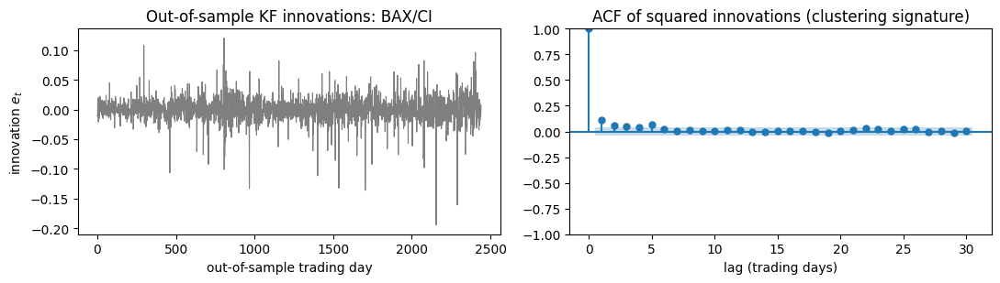
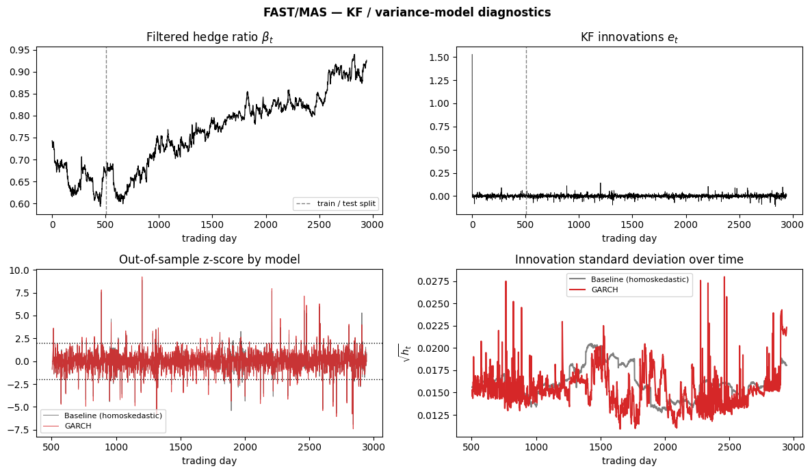
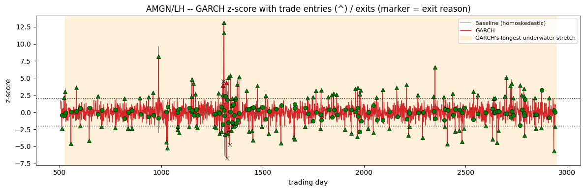

```{=html}
<p class="paper-links"><a class="btn-paper" href="kf-innovations-heteroskedasticity.pdf">PDF</a> <a class="btn-paper" href="kf_heteroskedasticity_pairs_trading.ipynb" download>Notebook</a> <a class="btn-paper" href="#quarto-citation">Cite</a></p>
```

## Abstract

This paper studies whether modeling heteroskedasticity in the innovations of a Kalman Filter (KF) used to estimate the dynamic hedge ratio in a pairs trading strategy improves, relative to a homoskedastic benchmark, (i) the calibration of the trading z-score, (ii) the forecasting accuracy of the conditional variance, and (iii) the realized-risk metrics of a backtest that applies the same trading rule to both models. The candidate universe spans 101 cross-sector pairs, of which 23 are selected by cointegration screening, over a daily sample running from 2010 to the present. Beyond the standard pair-level tests, the statistical apparatus includes a panel test that pools evidence at the level of the individual pair-day rather than the pair, and an inverse-variance-weighted combination of p-values (Stouffer-Liptak) alongside the equal-weighted version.

The two questions receive answers of markedly different strength: the forecasting advantage of GARCH over the conditional variance is strongly significant (aggregate Diebold-Mariano test, $Z = 9.86$), while the evidence on realized backtested risk remains weak even under a panel test on more than 85,000 pair-day observations ($p = 0.27$). Given the statistical power available, this divergence reads as a genuinely weak or absent effect, not merely as a symptom of a small sample.

## Setup

The hedge ratio between the log prices $y_t$ and $x_t$ is a latent state following a random walk (local-level model):

$$
\beta_t = \beta_{t-1} + w_t, \qquad y_t = \beta_t x_t + v_t .
$$

The innovation $e_t = y_t - \beta_{t|t-1} x_t$ is the trading signal, standardized by an estimate of its variance:

$$
z_t = \frac{e_t}{\sqrt{h_t}}, \qquad h_t = S_t \ \text{(baseline)}, \qquad h_t = h_t^{\text{GARCH}} \ \text{(corrected)} .
$$

$S_t$ is the innovation variance produced by the filter itself; $h_t^{\text{GARCH}}$ is the conditional variance of a GARCH model fitted to $e_t$, with order and error distribution chosen by BIC over a grid. The numerator is identical in both models.

Everything is walk-forward: every refit uses only data prior to the point where it is applied, and both models trade under the same entry, exit and stop rule, so any difference comes from the z-score alone.

## Main results

| Question | Test | Result |
|---|---|---|
| H1: ARCH effects in KF innovations | ARCH-LM, out of sample | Significant in 20 of 23 pairs |
| H2: z-score calibration | PIT-Kolmogorov-Smirnov | Baseline rejected in 23 of 23; GARCH not rejected in 19 of 23 |
| Variance forecast accuracy | QLIKE, Diebold-Mariano | GARCH better in 19 of 23; Stouffer $Z = 9.86$, $p < 10^{-4}$ |
| H3: realized backtest risk | Block bootstrap, Stouffer | Lower volatility in 13 of 23; $Z = 1.09$, $p = 0.137$ |
| H3, pooled | Panel test, 85,054 pair-days | $t = 0.63$, $p = 0.27$ |

The three pairs with no ARCH effect (BSX/EW, ISRG/EW, LMT/NOC) are discussed separately in the paper, as is the collapse of the precision-weighted Stouffer test on H3, which is a useful warning on when inverse-variance weighting misleads.







## Full text

```{=html}
<object class="pdf-viewer" data="kf-innovations-heteroskedasticity.pdf" type="application/pdf"><p><a href="kf-innovations-heteroskedasticity.pdf">Download PDF</a></p></object>
```
