# Introduction

Building on the paper *From GARCH to Neural Network for Volatility Forecast* (2024) by Pengfei Zhao, Haoren Zhu, Wilfred Siu Hung, and Dik Lun Lee, in which the authors first establish an equivalence relation between classical financial econometrics (GARCH models) and machine learning (neural networks), and then design a hybrid model that integrates GARCH into an LSTM architecture. This study seeks to extend the power of that model by introducing external features.

Volatility is a phenomenon that is not directly observable; we use the squared log-return $r_t^2$ as a proxy.

# Hardware and Notebook

All experiments, deep learning models, and Optuna hyperparameter tuning sweeps were executed on the Google Colab platform, utilising the following cloud hardware configuration:

- **GPU:** NVIDIA A100 Tensor Core (80 GB VRAM) --- *CUDA Accelerated*

- **CPU:** Intel^®^ Xeon^®^ CPU @ 2.20 GHz (12 vCPUs)

- **RAM:** 83 GB System Memory

- **Environment:** Google Colab / Ubuntu LTS

Notebooks on <https://github.com/tommasozeri/GARCH---LSTM>

# Stylized Facts

Stylized facts are empirical regularities of financial time-series returns. The most notable are:

- **Non-Gaussianity:** the distribution of financial returns is not Gaussian; instead it exhibits fat tails (excess kurtosis) and skewness. According to the normal distribution, an observation more than five standard deviations from the mean should occur once every $14{,}000$ years, yet we observed such events in 1929, 2008, and 2020 --- three times in only 91 years.

  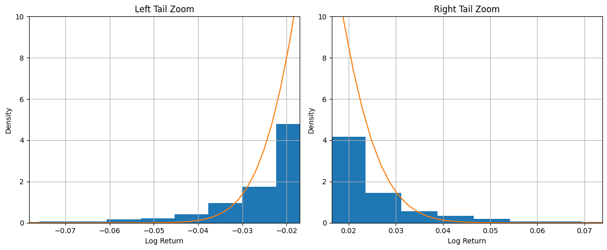{#fig-tails}

- **Leverage Effect:** negative returns cause, on average, more volatility than positive returns of the same magnitude.

  {#fig-leverage}

- **Volatility Clustering:** periods of high volatility tend to cluster, i.e. volatility persists over time.

  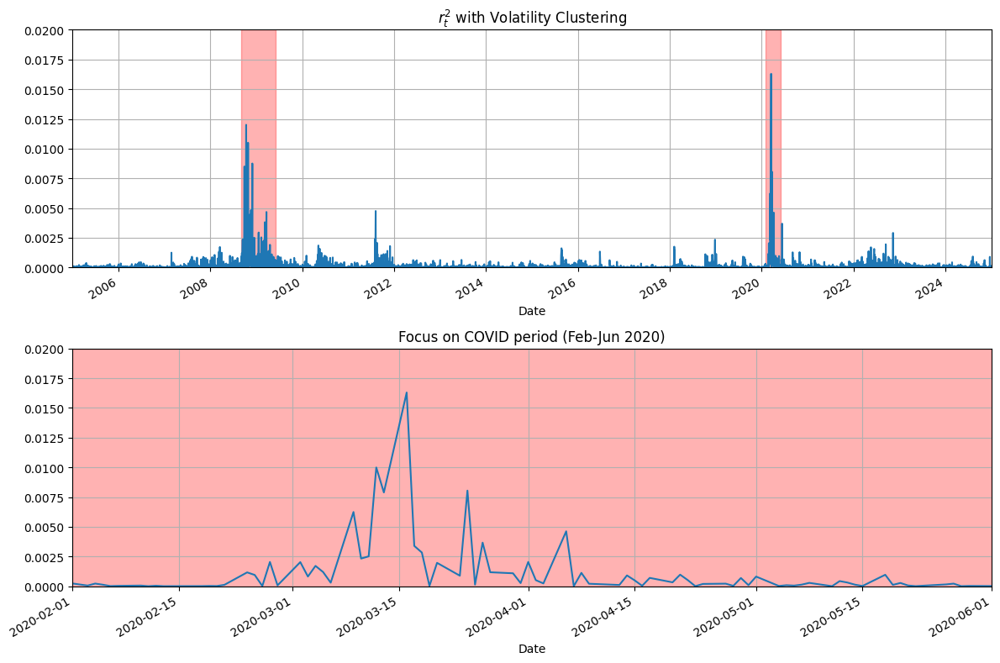{#fig-clustering}

# GARCH Model

The Generalized Autoregressive Conditionally Heteroskedastic (GARCH) model, introduced by Bollerslev in 1986, models volatility by incorporating lagged conditional variances in addition to lagged squared innovations. A GARCH(P,Q) process is formally defined by the system of equations:

$$\begin{aligned}
r_t        &= \mu_t + \varepsilon_t \\
\sigma_t^2 &= \omega
              + \sum_{i=1}^{P} \alpha_i\,\varepsilon_{t-i}^{2}
              + \sum_{j=1}^{Q} \beta_j\,\sigma_{t-j}^{2} \\
\varepsilon_t &= \sigma_t\,e_t, \quad e_t \sim \text{i.i.d.}\;\mathcal{N}(0,1)
\end{aligned}$$

where $\mu_t$ represents the conditional mean. The most prevalent specification in empirical finance is the GARCH(1,1) model, which provides a parsimonious yet flexible representation of volatility dynamics:

$$\sigma_t^2 = \omega + \alpha_1\,\varepsilon_{t-1}^{2} + \beta_1\,\sigma_{t-1}^{2}$$

This specification expresses current conditional variance as a weighted average of a constant term, yesterday's squared innovation, and yesterday's conditional variance. The key advantage of the GARCH approach lies in its mathematical parsimony: while a purely autoregressive volatility framework requires many lags to capture persistent volatility, the GARCH(1,1) specification can represent an infinite-order distributed lag process with only three parameters. This equivalence can be demonstrated through recursive substitution an infinite-order autoregressive variance process can be rewritten as a GARCH(1,1) with $\omega = \alpha_0(1-\beta)$, $\alpha = \alpha_1$, and $\beta$ capturing the persistence. This mathematical equivalence allows GARCH models to capture the same long-memory properties of volatility with far fewer parameters, making them more efficient for estimation and forecasting while maintaining the ability to model volatility clustering and persistence observed in financial time series.

GARCH specifications require parameter restrictions to ensure that conditional variances remain positive. In the simplest GARCH(1,1) case, these restrictions require $\omega > 0$, $\alpha_1 \geq 0$, and $\beta_1 \geq 0$. For higher-order GARCH models the restrictions become more complex it is sometimes possible for one of the $\alpha$ parameters to be slightly negative while still maintaining positive conditional variances, though the general requirement remains that parameters should be non-negative to guarantee well-behaved volatility processes.

The unconditional variance of a GARCH process is obtained by taking expectations of both sides of the volatility equation. For GARCH(1,1) this yields:

$$\bar{\sigma}^2 = \frac{\omega}{1 - \alpha_1 - \beta_1}$$

provided $\alpha_1 + \beta_1 < 1$. This condition ensures covariance stationarity and implies mean reversion toward this long-run variance. For general GARCH(P,Q) models the unconditional variance extends naturally to:

$$\bar{\sigma}^2 = \frac{\omega}{1 - \sum_{i=1}^{P}\alpha_i - \sum_{j=1}^{Q}\beta_j}$$

The autocorrelation structure of squared returns in GARCH models can be analysed through the ARMA representation. In the GARCH(1,1) case, the autocorrelations of $\varepsilon_t^2$ decay geometrically at rate $\alpha_1 + \beta_1$, similar to the autocorrelation pattern of an ARMA(1,1) process. This analytical tractability makes GARCH models particularly appealing for both theoretical analysis and empirical applications, as it allows researchers to understand and predict the persistence patterns of volatility shocks over time.

# GJR-GARCH Model

The GJR-GARCH model, introduced by Glosten, Jagannathan, and Runkle (1993), extends the standard GARCH framework by incorporating asymmetric terms to capture the leverage effect commonly observed in equity markets. This phenomenon describes the tendency for volatility to increase more substantially following negative shocks compared to positive shocks of equal magnitude. The general GJR-GARCH(P,O,Q) process is specified as:

$$\begin{aligned}
r_t        &= \mu_t + \varepsilon_t \\
\sigma_t^2 &= \omega
              + \sum_{p=1}^{P}\beta_p\,\sigma_{t-p}^{2}
              + \sum_{o=1}^{O}\gamma_o\,\varepsilon_{t-o}^{2}\,I[\varepsilon_{t-o}<0]
              + \sum_{q=1}^{Q}\alpha_q\,\varepsilon_{t-q}^{2} \\
\varepsilon_t &= \sigma_t\,e_t, \quad e_t \sim \text{i.i.d.}\;\mathcal{N}(0,1)
\end{aligned}$$

where $\mu_t$ represents the conditional mean process and $I[\varepsilon_{t-o}<0]$ is an indicator function equal to 1 when the shock is negative and 0 otherwise. The asymmetric component $\gamma_o\,\varepsilon_{t-o}^{2}\,I[\varepsilon_{t-o}<0]$ specifically captures the differential impact of negative shocks on future volatility.

Considering the GJR-GARCH(1,1,1) specification:

$$\sigma_t^2 = \omega + \beta_1\,\sigma_{t-1}^{2}
             + \gamma_1\,\varepsilon_{t-1}^{2}\,I[\varepsilon_{t-1}<0]
             + \alpha_1\,\varepsilon_{t-1}^{2}$$

To ensure positive conditional variances, the parameters must satisfy $\omega > 0$, $\beta_1 \geq 0$, $\gamma_1 + \alpha_1 \geq 0$. Under conditionally normal innovations, the process is covariance stationary when $\beta_1 + \tfrac{1}{2}\gamma_1 + \alpha_1 < 1$. The model effectively captures the empirical regularity that negative returns induce disproportionately larger increases in future volatility, making it particularly suitable for financial time series exhibiting asymmetric volatility responses.

# Long Short-Term Memory Model

Long Short-Term Memory (LSTM) networks are a specialised type of Recurrent Neural Network (RNN). While standard RNNs suffer from a short attention span they forget earlier inputs as a sequence grows longer LSTMs are explicitly designed to remember information over long periods.

To understand an LSTM intuitively, imagine a person keeping a running summary of a story in a notebook. This notebook represents the **cell state** ($C_t$), which acts like a conveyor belt running straight down the entire chain of the network. As the person reads a new chapter (the current input, $x_t$), they do three things: erase outdated details, write down new important points, and read aloud a brief summary of what is happening right now (the **hidden state**, $h_t$).

This process of reading, writing, and erasing is controlled by three *gates*. These gates use a sigmoid function ($\sigma$) to output numbers between 0 and 1, where 0 means "block everything" and 1 means "let everything through." The governing equations are:

$$\begin{aligned}
f_t          &= \sigma(W_f x_t + U_f h_{t-1} + b_f)
               \quad &&\text{(1.\ Forget Gate)} \\
i_t          &= \sigma(W_i x_t + U_i h_{t-1} + b_i)
               \quad &&\text{(2.\ Input Gate)} \\
\tilde{C}_t  &= \tanh(W_C x_t + U_C h_{t-1} + b_C)
               \quad &&\text{(3.\ New Candidate)} \\
C_t          &= f_t \odot C_{t-1} + i_t \odot \tilde{C}_t
               \quad &&\text{(4.\ Memory Update)} \\
o_t          &= \sigma(W_o x_t + U_o h_{t-1} + b_o)
               \quad &&\text{(5.\ Output Gate)} \\
h_t          &= o_t \odot \tanh(C_t)
               \quad &&\text{(6.\ Hidden State)}
\end{aligned}$$

What happens at each step?

1.  **Deciding what to forget ($f_t$):** the Forget Gate examines the previous output ($h_{t-1}$) and the new input ($x_t$). It outputs a value between 0 and 1 for each piece of information in the old memory ($C_{t-1}$). A 0 means "completely erase this"; a 1 means "keep this completely." For example, when a new subject is introduced in a sentence, the network may choose to forget the gender of the previous subject.

2.  **Deciding what to write ($i_t$ and $\tilde{C}_t$):** the network must decide what new information to add to the notebook. First it creates a draft of potential new memories ($\tilde{C}_t$). The Input Gate ($i_t$) then acts as a filter, deciding which parts of that draft are important enough to be written down.

3.  **Updating the memory ($C_t$):** the network takes the old memory ($C_{t-1}$), multiplies it element-wise by the forget gate (erasing what it decided to forget), and adds the filtered new memories. This simple additive update is the key of the LSTM: it allows important memories to flow forward unchanged for a very long time without fading.

4.  **Deciding what to output ($o_t$ and $h_t$):** the network takes its updated internal memory ($C_t$), squashes the values through $\tanh$ (pushing them to $[-1, 1]$), and applies the Output Gate ($o_t$) as a final filter to determine which parts of that internal memory are exposed as the new hidden state ($h_t$), passed to the next step.

# Equivalence Relation

The core contribution of Zhao et al. is to demonstrate that GARCH models can be expressed exactly as elementary neural networks, sharing structure, parameters, loss function, and training procedure.

## Equivalent Formulation

GARCH(1,1) has a recurrent structure identical to that of a simple Recurrent Neural Network. The model inputs are $\sigma^2_{t-1}$ and $\varepsilon^2_{t-1}$, while the output $\sigma^2_t$ is fed back as the input of the next GARCH cell. Intuitively, one can observe a recurrent structure identical to an RNN. Indeed, if we remove the output layer and the $\tanh$ activation of the RNN, and simultaneously constrain both the input and the hidden state to a scalar, the two model structures become identical. Therefore, from a theoretical standpoint, the GARCH(1,1) model is a special case of an RNN with the output layer and activation function removed.

The RNN cell contains the parameter list $\Theta_{\text{GARCH}(1,1)} = (\omega,\alpha_1,\beta_1)$ and receives the observation list $X_{\text{GARCH}(1,1)} = (1,\varepsilon^2_{t-1},\sigma^2_{t-1})$; the output $\sigma_t^2$ is the linear combination: $$\Theta_{\text{GARCH}(1,1)}\,X_{\text{GARCH}(1,1)}$$

{#fig-rnn}

{#fig-garch11}

For the GJR-GARCH model, the RNN cell input is $\varepsilon_t$ rather than $\varepsilon^2_t$, since the sign of $\varepsilon_t$ is required. The cell contains the parameter list $\Theta_{\text{GJR}} = (\omega,\alpha_1,\gamma,\beta_1)$ and the observation list $X_{\text{GJR}} = (1,\varepsilon_t^2,\varepsilon_t^2 I_{\{\varepsilon_t<0\}},
\sigma^2_{t-1})$, where $I_{\{\cdot\}}$ is the sign indicator function; the output $\sigma^2_t$ is the linear relation: $$\Theta_{\text{GJR}}\,X_{\text{GJR}}$$

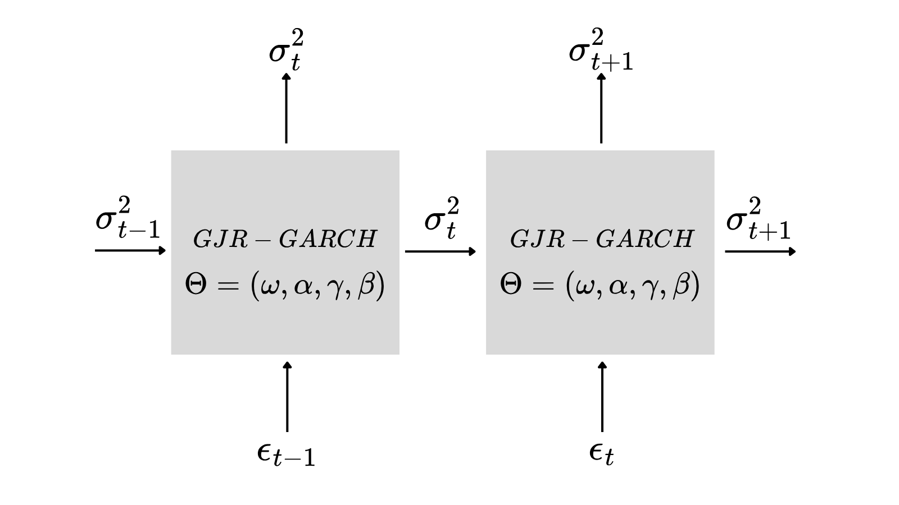{#fig-gjr}

## Equivalent Loss Function

GARCH models are typically estimated by maximum likelihood. Most existing neural models instead use MSE or MAE on the predicted volatility, which is problematic because true volatility is not directly observable.

To establish formal equivalence, the authors adopt the negative log-likelihood as the loss function. Under the Gaussian assumption they obtain the N-loss: $$-\log\mathcal{L}(\varepsilon_t;\Theta)
  = \frac{\log\hat{\sigma}_t(\Theta)^2}{2}
    + \frac{\varepsilon_t^2}{2\,\hat{\sigma}_t(\Theta)^2}$$

Under the Student-$t$ distribution with $\nu$ degrees of freedom they obtain the T-loss: $$-\log\mathcal{L}(\varepsilon_t;\Theta)
  = \frac{\log\hat{\sigma}_t(\Theta)^2}{2}
    + \frac{\nu+1}{2}\log\!\left(1+\frac{\varepsilon_t^2}{(\nu-2)\,\hat{\sigma}_t(\Theta)^2}\right)$$

# The GARCH-LSTM Model

LSTM is a sequential deep learning model whose ability to balance long- and short-term information (memory) has been extensively studied and validated across a variety of forecasting tasks. The objective of the GARCH-LSTM model is to combine the capacity of the traditional GARCH family to model stylized facts with the ability of the LSTM to balance the long- and short-term memory of volatility history.

Contrary to the conventional interpretation of the LSTM output gate $o_t$ as a regulator of information selection from $C_t$, we reinterpret $o_t$ as the GARCH output and $C_t$ as the controller that infuses the long- and short-term memory effect of the LSTM.

$\kappa_{\text{GARCH}}$ denotes the GARCH kernel function, which can be flexibly replaced by the neural network counterparts of different GARCH models (GARCH(1,1), GJR-GARCH) introduced earlier.

It is important to note that $\varepsilon_{t-1}$ is the model input rather than $\varepsilon_t$ as originally used in the LSTM, since $\varepsilon_t$ cannot be sampled before $\sigma_t$ is known.

The output structure is modified in the last equation by multiplying the GARCH kernel output by $(1 + w\cdot\tanh(C_t))$. The LSTM influence is ignored when $w=0$ and the model reduces to the NN counterpart of the GARCH. As $w$ increases, the LSTM module has a greater impact on the final output, amplifying $o_t$ (when $C_t > 0$) or attenuating it (when $C_t < 0$). The GARCH-LSTM seamlessly integrates the NN counterparts of the GARCH family, encapsulating stylized facts within the LSTM framework.

$$\begin{aligned}
f_t        &= \sigma_g\!\left(W_f\varepsilon_{t-1}+U_f\sigma_{t-1}^2+b_f\right) \\
i_t        &= \sigma_g\!\left(W_i\varepsilon_{t-1}+U_i\sigma_{t-1}^2+b_i\right) \\
o_t        &= \mathcal{K}_{\text{garch}}\!\left(\varepsilon_{t-1},\sigma_{t-1}^2;\Theta\right) \\
\tilde{c}_t&= \sigma_c\!\left(W_c\varepsilon_{t-1}+U_c\sigma_{t-1}^2+b_c\right) \\
c_t        &= f_t\odot c_{t-1}+i_t\odot\tilde{c}_t \\
\sigma_t^2 &= o_t\odot\!\left(1+w\cdot\tanh(c_t)\right)
\end{aligned}$$

# Model Extension

## Dataset and Split

The dataset consists of daily BTC/USD prices downloaded from Yahoo Finance for the period 2 January 2017 -- 6 February 2026. Log-returns are computed as $\varepsilon_t = \log(p_t/p_{t-1})\times 100$, scaled by 100 to avoid numerical underflow in likelihood computations.

  **Asset**         **Period**                  **N**   **Mean $\varepsilon$**   **Std $\varepsilon$**   **ADF stat**      **$p$-value**
  ----------------- -------------------------- ------- ------------------------ ----------------------- -------------- ----------------------
  BTC/USD (daily)   02/01/2017 -- 06/02/2026    2375            0.041                    1.078             $-15.99$     $6.72\times10^{-29}$

  : Descriptive statistics of the BTC/USD dataset.

The ADF (Augmented Dickey-Fuller) test rejects the unit-root null hypothesis with $p\approx 0$, confirming stationarity of the return series. The standard deviation of 1.078 on $\times100$ returns corresponds to an average daily volatility of approximately 1.1% --- roughly $3\times$ higher than that of the S&P 500 over the same period.

The dataset is divided into three non-overlapping subsets with strict temporal separation, the only correct approach for broadly non-stationary financial series:

  **Split**     **N obs.**   **Share**          **Period**         **Role in the model**
  ------------ ------------ ----------- -------------------------- ---------------------------------------------------
  Training         1899         80%      03/01/2017 -- 12/04/2024  GARCH parameter fitting; LSTM training
  Validation       237          10%      13/04/2024 -- 11/03/2025  Early stopping and HP selection (GARCH-LSTM only)
  Test (OOS)       238          10%      12/03/2025 -- 06/02/2026  Final evaluation, never touched during training

  : Time split and role in the model.

An important asymmetry: the validation set plays a different role for the two models. For GJR-GARCH it is purely passive --- parameters are estimated exclusively on the training set via MLE and the causal filter propagates forward without re-fitting. For GARCH-LSTM the validation set is active: it drives early stopping and Optuna hyperparameter selection. The test set remains untouched until the final evaluation, guaranteeing a genuinely out-of-sample estimate.

## Feature Engineering

The forecasting target is the 5-day realised variance (RV5), defined as the rolling mean of squared log-returns over a 5-day window: $$\text{RV5}_t = \frac{1}{5}\sum_{k=0}^{4}\varepsilon^2_{t-k}
= \frac{1}{5}\sum_{k=0}^{4}
  \left[\log\!\left(\frac{p_{t-k}}{p_{t-k-1}}\right)\times100\right]^2$$

This definition is causal by construction: $\text{RV5}_t$ is computed exclusively from returns up to and including time $t$, with no future information. At each step $t$, the model receives inputs up to $t-1$ ($\varepsilon_{t-1}$, $\sigma^2_{t-1}$, $X_{t-1}$) and produces an estimate of $\text{RV5}_t$. Compared to the daily variance $\varepsilon^2_t$, RV5 is a more stable proxy for the conditional variance $\sigma^2_t$: the 5-day average reduces idiosyncratic noise in a single return while maintaining responsiveness to regime changes, and is the standard most widely used in the realised volatility literature (Andersen 2003).

### On-Chain Features: Selection and Transformation {#sec-on-chain-features-selection-and-transformation .unnumbered}

Six on-chain metrics were selected from the Blockchain.com database (2,375 daily observations, no missing values) on the basis of two criteria: lagged correlation with $\varepsilon^2$ measured on the full dataset before any split, and an economic rationale grounded in the microeconomics literature of crypto markets.

The standard transformation applied to each feature guarantees zero data leakage:

**Step 1 --- Percentage change** (with `shift(1)`): $$X_{\text{pct}}[t] = \frac{X[t]-X[t-1]}{X[t-1]}$$

**Step 2 --- Causal rolling z-score**: $$X_{\text{norm}}[t] =
  \frac{X_{\text{pct}}[t]-\mu_{90}[t-1]}{\sigma_{90}[t-1]+\varepsilon}$$

where $\mu_{90}[t-1]$ and $\sigma_{90}[t-1]$ are the mean and standard deviation computed over a 90-day rolling window using only data prior to $t$ (`shift(1)` applied before the rolling computation). Values are clipped to $[-5,5]$ to limit the influence of outliers.

  **Code**   **Description**                     **Transformation**                 **Rationale --- Lagged corr. with $\varepsilon^2$**
  ---------- ----------------------------------- ---------------------------------- -------------------------------------------------------------------------------------
  TRVOU      Transaction volume (USD)            $\Delta\%$ + rolling z-score 90d   Volume spikes precede price uncertainty. Lagged corr.: $+0.36$ (highest in dataset)
  ETRAV      Estimated transferred value (BTC)   $\Delta\%$ + rolling z-score 90d   Proxy for on-chain sentiment and speculative activity. Corr.: $+0.30$
  TRFEE      Average transaction fee (BTC)       $\Delta\%$ + rolling z-score 90d   Mempool congestion signals urgency and network stress. Corr.: $+0.26$
  HRATE      Hash rate                           $\Delta\%$ + rolling z-score 90d   Miner health; hash-rate drops anticipate sell-offs. Corr.: $-0.26$
  NADDU      Number of unique active addresses   $\Delta\%$ + rolling z-score 90d   Market participation and breadth. Corr.: $+0.13$
  NTRBL      Transactions per block              Rolling z-score 90d                Block capacity utilisation, proxy for on-chain demand

  : On-chain features: description, transformation, and economic rationale.

## Methodology

### Baseline: GJR-GARCH(1,1) with Student-$t$ {#sec-baseline-gjr-garch11-with-student-t .unnumbered}

The benchmark model is the GJR-GARCH(1,1) with standardised Student-$t$ innovations: $$\sigma^2_t = \omega
  + \left(\alpha + \gamma\cdot I_{[\varepsilon_{t-1}<0]}\right)\varepsilon^2_{t-1}
  + \beta\,\sigma^2_{t-1}$$

The parameter $\lambda$ captures the asymmetric (leverage) effect. Stationarity is guaranteed by $\alpha+\lambda/2+\beta<1$. Estimation is via maximum likelihood with a Student-$t$ distribution (T-NLL): $$-\log L(\varepsilon_t;\Theta)
  = \frac{1}{2}\log(\sigma^2_t)
    + \frac{\nu+1}{2}\log\!\left(1+\frac{\varepsilon^2_t}{(\nu-2)\sigma^2_t}\right)$$

Optimisation uses Nelder-Mead with three distinct starting points and a constrained parametrisation (softplus for $\omega$, scaled sigmoid for $\alpha$, $\lambda$, $\beta$). The filter is applied causally over the full series with parameters fixed from training, propagating $\sigma^2$ forward without re-fitting on the validation and test periods.

### GARCH-LSTM Architecture with On-Chain Features {#sec-garch-lstm-architecture-with-on-chain-features .unnumbered}

The hybrid model follows Zhao et al. (2024) with the addition of the on-chain vector $X_{t-1}\in\mathbb{R}^6$ as an exogenous input to the LSTM gates. At step $t$ the full input is $[\varepsilon_{t-1},\sigma^2_{t-1},X_{t-1}]\in\mathbb{R}^8$. The model equations are:

$$\begin{aligned}
f_t        &= \sigma\!\left(W_f\cdot[\varepsilon_{t-1},\sigma^2_{t-1},X_{t-1}]+b_f\right)
             && \text{[forget gate]} \\
i_t        &= \sigma\!\left(W_i\cdot[\varepsilon_{t-1},\sigma^2_{t-1},X_{t-1}]+b_i\right)
             && \text{[input gate]} \\
\tilde{c}_t&= \tanh\!\left(W_c\cdot[\varepsilon_{t-1},\sigma^2_{t-1},X_{t-1}]+b_c\right)
             && \text{[candidate cell]} \\
c_t        &= f_t\odot c_{t-1}+i_t\odot\tilde{c}_t
             && \text{[memory cell]} \\
o_t        &= \mathcal{K}_{\text{GJR}}(\varepsilon_{t-1},\sigma^2_{t-1};\Theta)
             && \text{[GJR-GARCH kernel]} \\
\sigma^2_t &= o_t\cdot\!\left(1+w\cdot\tanh(\text{mean}(c_t))\right)
             && \text{[final output]}
\end{aligned}$$

The classical LSTM output gate is replaced by the differentiable GJR-GARCH kernel. The memory cell $c_t$ acts as a controller: for $w=0$ the model reduces to pure GJR-GARCH; as $w$ increases, the LSTM representation modulates the GARCH forecast. The optimal value $w=0.084$ indicates a modest modulation the GARCH kernel remains dominant.

The kernel parameters ($\omega$, $\alpha$, $\lambda$, $\beta$) are initialised from the MLE values of the standalone GJR-GARCH (warm start) and are refined end-to-end during training, with the same constrained parametrisation as the baseline to ensure stationarity throughout training.

## Training and Optimisation

The model is implemented in PyTorch and trained on GPU (CUDA) using Adam with gradient clipping ($\text{max\_norm}=5.0$) and `ReduceLROnPlateau` (factor $0.5$, patience $=7$). Training uses TBPTT-1 (Truncated Backpropagation Through Time with truncation at 1 step): $\sigma^2_{t-1}$ is detached from the computational graph before being passed to step $t$, keeping GPU memory constant at $\mathcal{O}(1)$ and preventing gradient vanishing/exploding on long sequences.

## Hyperparameter Tuning with Optuna

Hyperparameter optimisation is performed via Optuna with a TPE sampler (Tree-structured Parzen Estimator, Bergstra et al. 2011) over 25 trials, with early stopping at 80 epochs per trial. The TPE builds a probabilistic model of the hyperparameter space that preferentially samples in low-validation-loss regions, making it significantly more efficient than grid search for mixed spaces (categorical + continuous log-uniform).

  **Hyperparameter**        **Symbol**  **Search space (Optuna)**                         **Optimal**      **Notes**
  ------------------------ ------------ -------------------------------------------- --------------------- ---------------------------------------------
  LSTM hidden size             $H$      $\{16,32,64\}$ --- categorical                       $32$          Found at trial #17; $H=64$ does not improve
  LSTM modulation weight       $w$      $[0.01,0.40]$ --- log-uniform                       $0.084$        Small: GARCH kernel dominates
  Student df                  $\nu$     $[4.0,12.0]$ --- uniform                             $7.0$         Moderate tails; heavier than normal
  Adam learning rate           $lr$     $[5\times10^{-4},10^{-2}]$ --- log-uniform    $2.01\times10^{-3}$  Stable convergence at this value

  : Optimised hyperparameters: search space and optimal values.

   **\#**   **$H$**   **$w$**   **$\nu$**        **$lr$**         **tr loss**   **val loss**  **Notes**
  -------- --------- --------- ----------- --------------------- ------------- -------------- -----------------------------
     1        32       0.091       5.2      $8.0\times10^{-4}$      2.7644         2.5884     ---
              32       0.115       6.5      $2.37\times10^{-3}$     2.7742         2.5878     Second best
              32       0.105       6.8      $5.2\times10^{-4}$      2.7753         2.5873     Third best
              32       0.393       6.2      $5.1\times10^{-4}$      2.4839         4.6451     Overfitting: $w$ too high
              32       0.084       7.0      $2.01\times10^{-3}$     2.7773         2.5867     $\star$ Best trial
              16       0.171       7.4      $1.60\times10^{-3}$     2.5146         4.6024     Unstable: $H=16$ + high $w$
              32       0.231       8.1      $1.14\times10^{-3}$     2.5269         4.5856     Unstable: $w$ too high
              32       0.083       6.8      $2.82\times10^{-3}$     2.7762         2.5878     Similar to best

  : Selected Optuna trials (out of 25 total).

Three trials (15, 19, 24) show an anomalous validation loss ($\sim4.6$) against a normal training loss ($\sim2.5$): these are cases of numerical instability caused by the combination of high $w$ ($>0.17$) with small $H$ ($16$) or a low learning rate. In these trials the LSTM controller produces excessive modulations that destabilise the GARCH filter. This confirms that the optimal value $w=0.084$ represents an equilibrium point between LSTM contribution and GARCH kernel stability.

## Results

### Estimated GJR-GARCH Parameters {#sec-estimated-gjr-garch-parameters .unnumbered}

  **Parameter**                **Symbol**          **Estimate**  **Interpretation**                       **Implication for BTC**
  -------------------- -------------------------- -------------- ---------------------------------------- --------------------------------------------------------------
  Variance constant             $\omega$            $0.33957$    Long-run baseline variance               Base level of unconditional volatility
  ARCH effect                   $\alpha$             $0.0855$    Reactivity to recent shocks (5-day)      Moderate but significant response to shocks
  Asymmetric effect            $\lambda$             $0.0000$    Difference in neg./pos. shock response   No leverage effect: BTC reacts symmetrically
  GARCH persistence             $\beta$              $0.9144$    Memory of past volatility                Highly persistent (near-integrated)
  Total persistence     $\alpha+\lambda/2+\beta$     $0.9999$    Half-life $\approx 6{,}931$ days         Volatility shocks are essentially permanent
  Degrees of freedom             $\nu$                $3.08$     Tail thickness                           Extremely heavy tails: finite sample variance not guaranteed

  : GJR-GARCH parameters estimated on the training set (MLE, fitting time: 12.2 s).

Two results merit attention. First, $\lambda = 0.0000$: Bitcoin shows no leverage effect --- negative and positive shocks of equal magnitude generate equivalent conditional variance. This contrasts with equity markets (where $\lambda > 0$) but is consistent with Katsiampa (2017) and with the bidirectional structure of the crypto market, where upward movements can be associated with short-position liquidations as violent as long-position ones.

Second, $\nu = 3.08$ is exceptionally low, implying tails so heavy that the finite-sample variance of the distribution is not mathematically guaranteed (requires $\nu > 4$). Comparable values for BTC are documented by Bouri et al. (2019). This characteristic justifies the use of T-NLL over N-NLL: the normal distribution systematically underestimates the probability of extreme events, producing biased parameter estimates.

The total persistence $\alpha + \lambda/2 + \beta = 0.9999$ indicates a near-integrated process: the half-life of volatility shocks is approximately 6,931 days ($\sim$<!-- -->19 years). In practice this means that BTC volatility never returns to an unconditional stable level over relevant investment horizons every shock permanently alters the volatility regime.

### Comparison {#sec-comparison .unnumbered}

  **Model**    **Split**     **MAE**   **RMSE**   **$R^2$**   **QLIK**   **Best val T-NLL**
  ------------ ------------ --------- ---------- ----------- ---------- --------------------
  GJR-GARCH    In-sample     12.7034   19.5445    $0.4710$     3.7028           ---
  GJR-GARCH    Validation    6.5675     8.5793    $0.1931$     3.3010           ---
  GJR-GARCH    OOS (test)    5.0228     5.8413    $-0.0270$    2.8515           ---
  GARCH-LSTM   In-sample     10.3074   19.0057    $0.4998$     3.6284          2.5867
  GARCH-LSTM   Validation    4.9266     7.5348    $0.3776$     3.2361          2.5867
  GARCH-LSTM   OOS (test)    3.6092     4.8126    $0.3029$     2.7791           ---

  : Comparative metrics: GJR-GARCH vs GARCH-LSTM (target: $\mathrm{RV5}_t$, 5-day smoothed realised variance).

  **Metric**    **GJR-GARCH (OOS)**   **GARCH-LSTM (OOS)**   **Absolute $\Delta$**     **Improvement %**
  ------------ --------------------- ---------------------- ----------------------- ------------------------
  MAE                 5.0228                 3.6092                $-1.4136$         $-28.1\%$ $\downarrow$
  RMSE                5.8413                 4.8126                $-1.0287$         $-17.6\%$ $\downarrow$
  $R^2$              $-0.027$                0.303                 $+0.330$             $+0.330$ points
  QLIK                2.8515                 2.7791                $-0.0724$         $-2.5\%$ $\downarrow$

  : GARCH-LSTM improvement over GJR-GARCH on the test set (OOS).

The GARCH-LSTM improves on all out-of-sample metrics. The most relevant gain is in $R^2$: from $-0.027$ to $+0.303$, an increase of 0.33 points. The negative $R^2$ of the GJR-GARCH does not indicate a dysfunctional model, but reflects the intrinsic difficulty of forecasting daily $\varepsilon^2_t$ over a period (March 2025 - February 2026) with volatility regimes different from training. The GARCH-LSTM, thanks to on-chain information, is better able to anticipate regime shifts.

It is also notable that the GARCH-LSTM improves in-sample RMSE (19.005 vs 19.545), suggesting that integrating GARCH parameters into end-to-end training produces a slightly better estimate even on the training set compared to pure MLE.

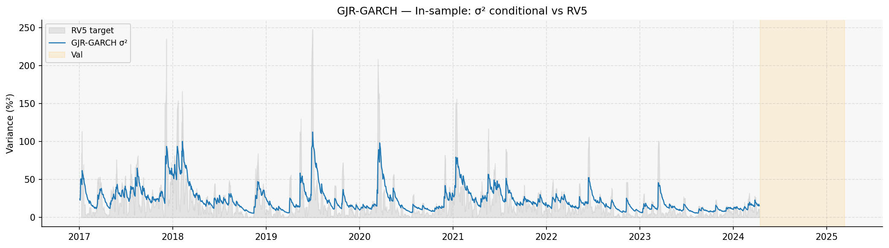{#fig-gjr-insample}

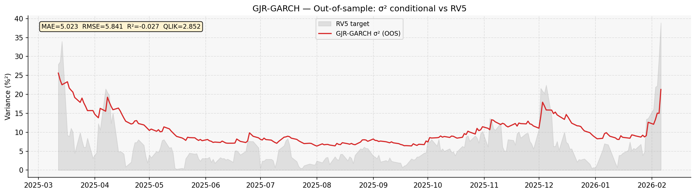{#fig-gjr-oos}

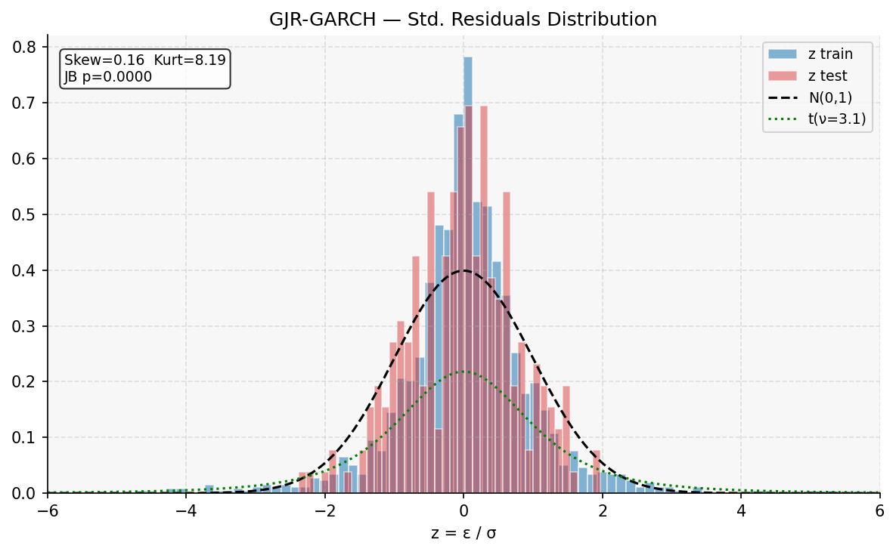{#fig-gjr-dist}

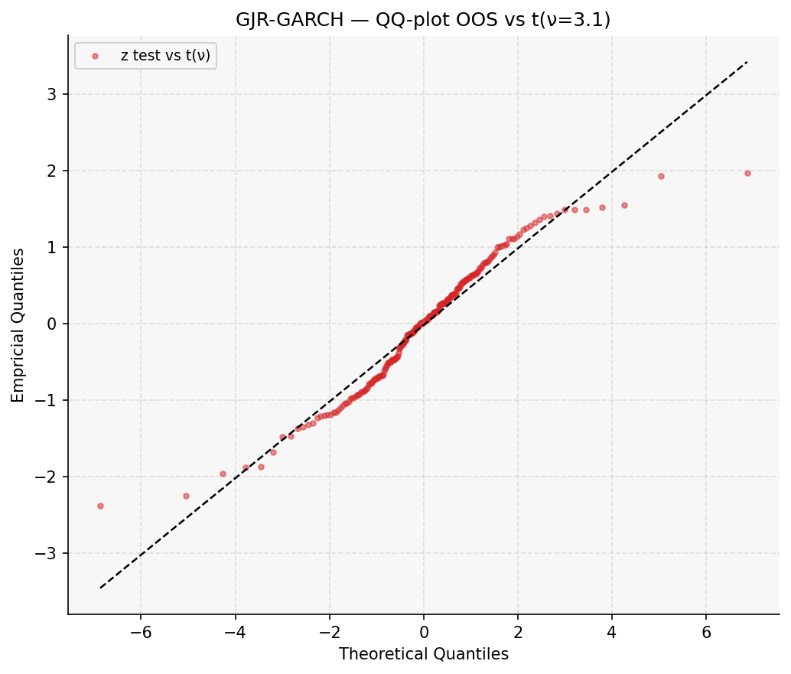{#fig-gjr-qq}

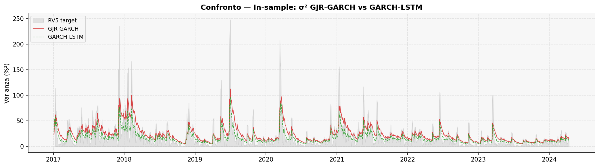{#fig-cmp-insample}

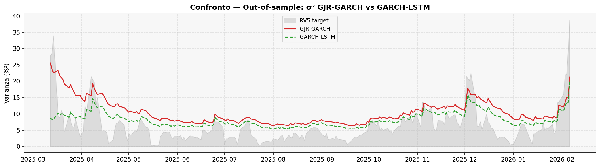{#fig-cmp-oos}

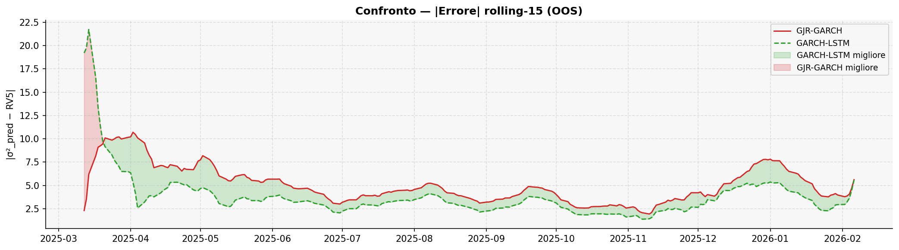{#fig-rolling-error}

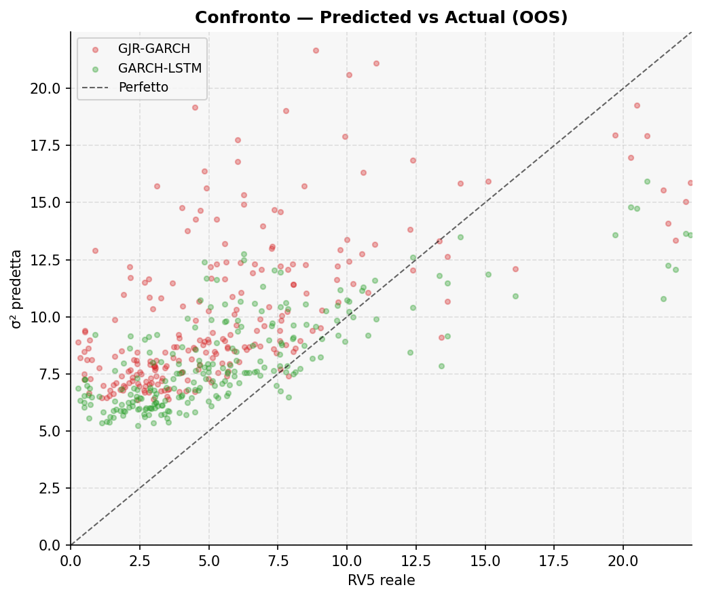{#fig-pred-actual}

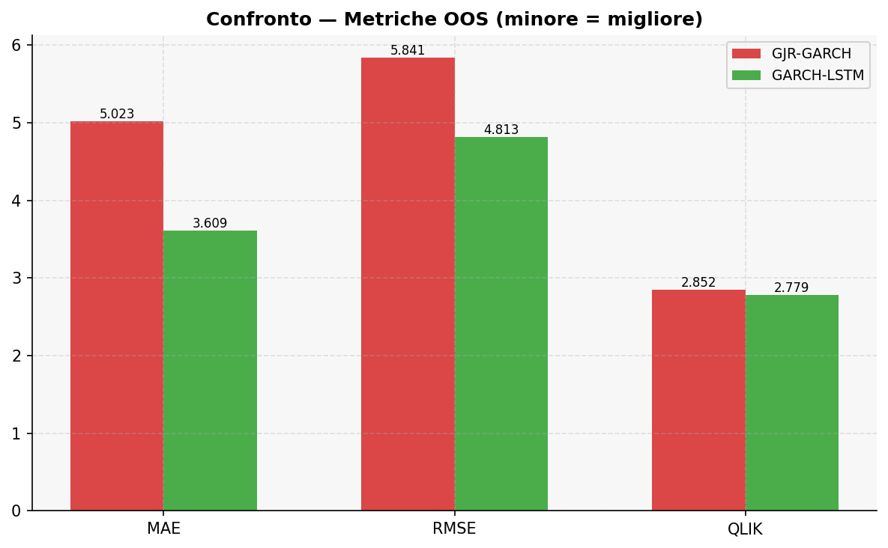{#fig-metrics-cmp}

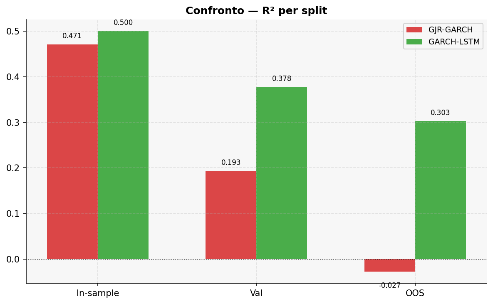{#fig-r2-cmp}

# Conclusions

The optimal LSTM modulation weight $w = 0.0692$ (learned value after final training) is small but non-negligible: it produces an average correction of approximately $\pm7\%$ on the GARCH kernel forecast. The on-chain features most correlated with volatility (TRVOU, ETRAV) capture spikes in activity that precede price movements and therefore episodes of high volatility. The fact that the model learns to use them with moderation ($w < 0.1$) is consistent with the view that the GARCH already captures most of the temporal dependence structure of volatility.

The GJR-GARCH kernel parameters after end-to-end training ($\omega=0.336$, $\alpha=0.087$, $\gamma=0.000$, $\beta=0.913$) are nearly identical to the standalone MLE values ($\omega=0.340$, $\alpha=0.086$, $\gamma=0.000$, $\beta=0.914$). This empirically validates the equivalence relation of Zhao et al. (2024): backpropagation through the T-NLL converges to the same parameters as classical MLE, with the difference that here it occurs end-to-end alongside the update of gate weights.

This work has presented an application of the GARCH-NN framework to daily Bitcoin volatility forecasting, with three contributions relative to the existing literature:

- **PyTorch CUDA implementation:** the differentiable GJR-GARCH kernel is trained end-to-end on an A100 GPU, reducing tuning time from hours (numerical gradient) to minutes (autograd).

- **Exogenous on-chain features:** six blockchain metrics, normalised with a causal rolling z-score (zero data leakage), integrate structural information unique to Bitcoin into the LSTM cell.

- **Continuous optimisation with Optuna TPE:** the continuous search space for $w$, $\nu$, and $lr$ allows the optimal balance between LSTM contribution and GARCH kernel stability to be found efficiently.

Quantitative results on a genuinely OOS test set (March 2025 -- February 2026) show: MAE $-28.1\%$, RMSE $-17.6\%$, $R^2$ $+0.33$ points, QLIK $-2.5\%$ relative to the standalone GJR-GARCH. The model preserves the econometric interpretability of the GARCH --- the end-to-end learned parameters converge to classical MLE values --- while adding a correction layer guided by on-chain information.

# Bibliography

Bergstra, J., Bardenet, R., Bengio, Y., and Kégl, B. (2011). Algorithms for Hyper-Parameter Optimization. *Advances in Neural Information Processing Systems*, 24.

Bollerslev, T. (1986). Generalized autoregressive conditional heteroskedasticity. *Journal of Econometrics*, 31(3), 307--327.

Bouri, E., Azzi, G., and Dyhrberg, A. H. (2016). On the return-volatility relationship in the Bitcoin market around the price crash of 2013. *Economics Discussion Papers*, No. 2016-41.

Glosten, L. R., Jagannathan, R., and Runkle, D. E. (1993). On the Relation between the Expected Value and the Volatility of the Nominal Excess Return on Stocks. *Journal of Finance*, 48(5), 1779--1801.

Hansen, P. R., and Lunde, A. (2005). A forecast comparison of volatility models: does anything beat a GARCH(1,1)? *Journal of Applied Econometrics*, 20(7), 873--889.

Katsiampa, P. (2017). Volatility estimation for Bitcoin: A comparison of GARCH models. *Economics Letters*, 158, 3--6.

Patton, A. J. (2011). Volatility forecast comparison using imperfect volatility proxies. *Journal of Econometrics*, 160(1), 246--256.

Zhao, P., Zhu, H., Ng, W. S., and Lee, D. L. (2024). From GARCH to Neural Network for Volatility Forecast. *arXiv:2402.06642*.

::: {.paper-download}
[Download PDF](lstm_garch.pdf){.btn-paper download=""}
:::
