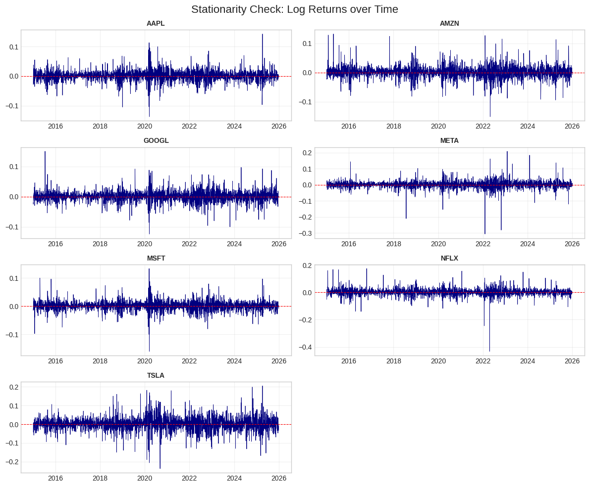
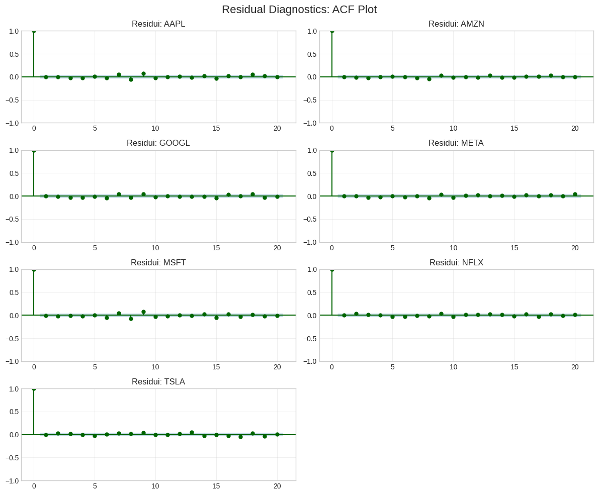
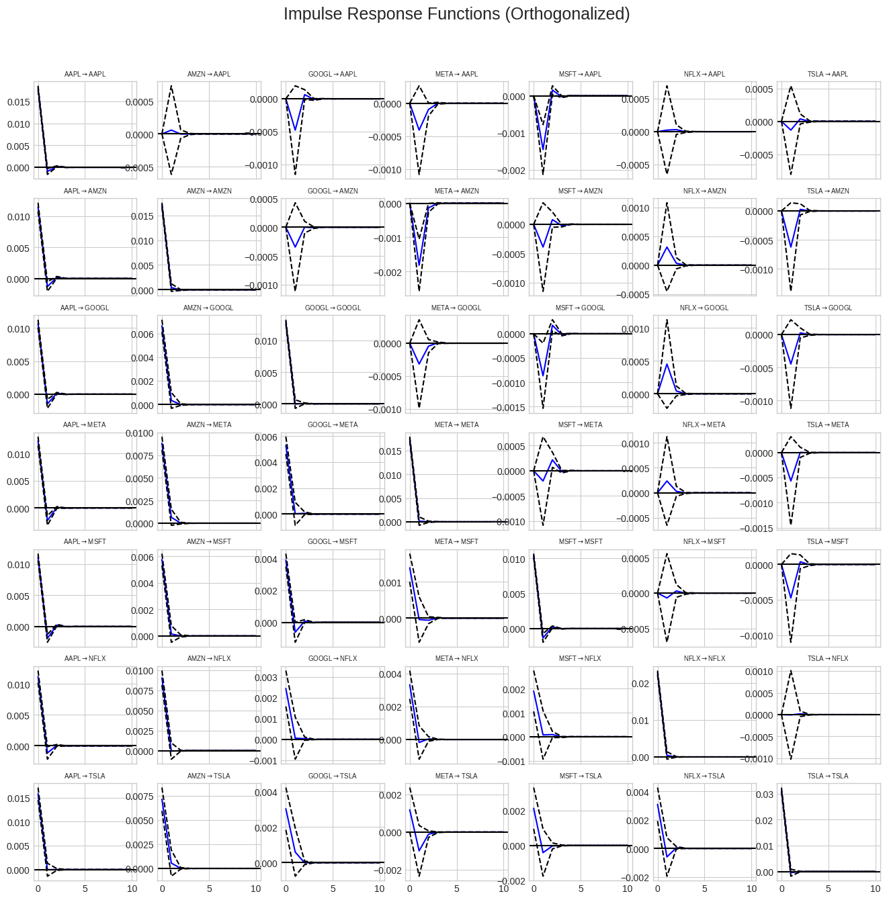
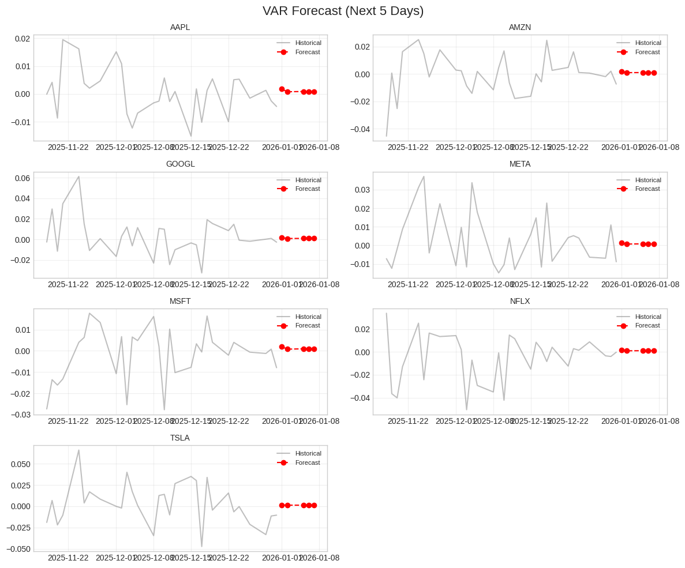
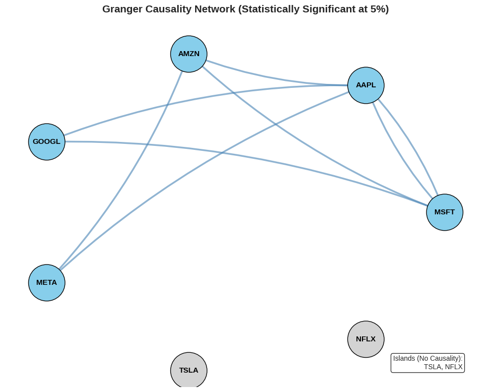
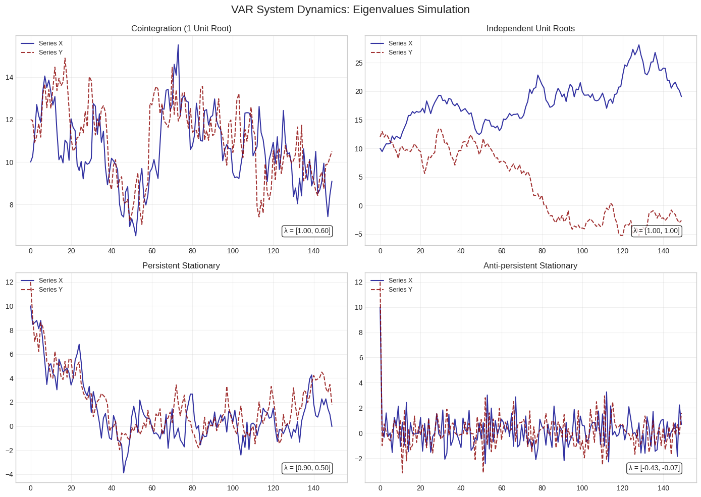
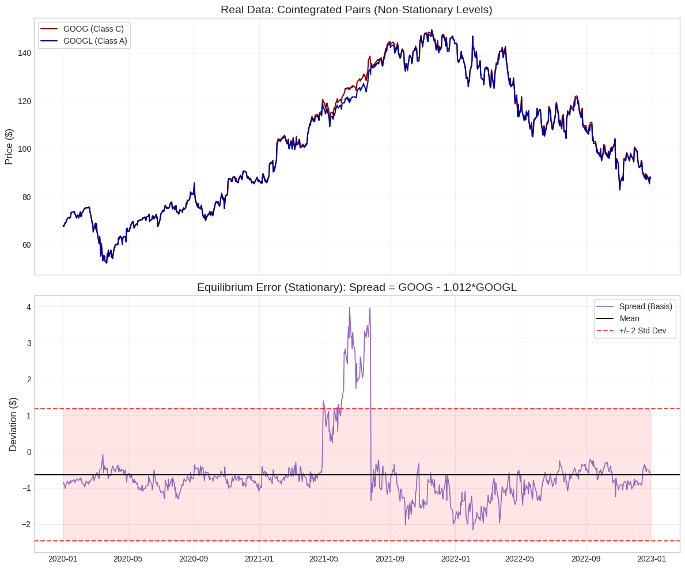
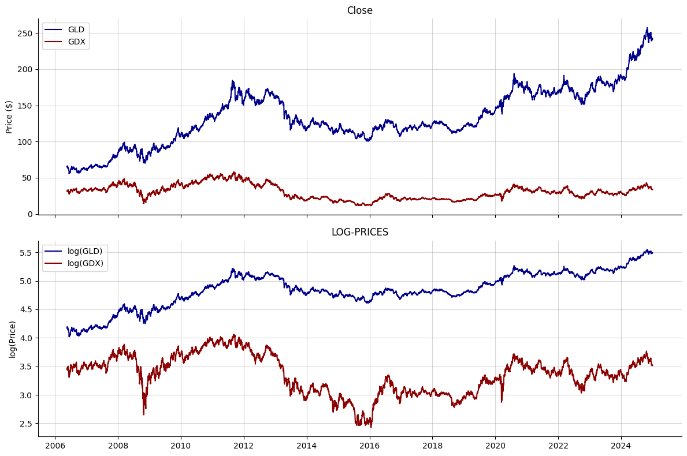
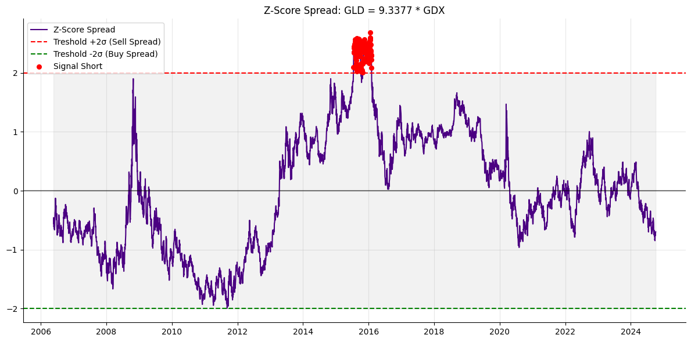
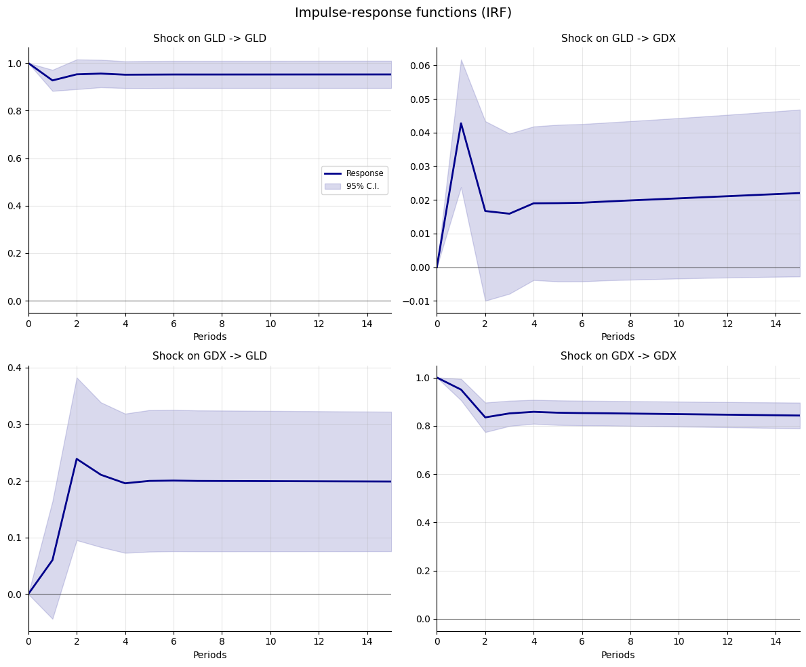

# VAR (Vector AutoRegression)

Vector autoregressions are remarkably similar to univariate autoregressions, and most results carry over by replacing scalars with matrices and scalar operations with their linear algebra equivalent.\
The definition of a vector autoregression is nearly identical to that of a univariate autoregression[^1].

A VAR(P) reduces to an AR(P) when $k = 1$ so that $Y_t$ and the coefficient matrices, $\Phi_j$, are scalars. A vector white noise process extends the three properties of a univariate white noise process to a vector; it is mean zero, has finite covariance, and is uncorrelated with its past. The components of a vector white noise process[^2] are not assumed to be contemporaneously uncorrelated.

The simplest VAR is a first-order bivariate specification which is equivalently expressed as: $$
Y_t = \Phi_0 + \Phi_1 Y_{t-1} + \varepsilon_t
$$ or in matrix form: $$
\begin{bmatrix} Y_{1,t} \\ Y_{2,t} \end{bmatrix} = 
\begin{bmatrix} \phi_{1,0} \\ \phi_{2,0} \end{bmatrix} + 
\begin{bmatrix} \phi_{11,1} & \phi_{12,1} \\ \phi_{21,1} & \phi_{22,1} \end{bmatrix} 
\begin{bmatrix} Y_{1,t-1} \\ Y_{2,t-1} \end{bmatrix} + 
\begin{bmatrix} \varepsilon_{1,t} \\ \varepsilon_{2,t} \end{bmatrix}
$$ which corresponds to the system of equations: $$\begin{aligned}
Y_{1,t} &= \phi_{1,0} + \phi_{11,1}Y_{1,t-1} + \phi_{12,1}Y_{2,t-1} + \varepsilon_{1,t} \\
Y_{2,t} &= \phi_{2,0} + \phi_{21,1}Y_{1,t-1} + \phi_{22,1}Y_{2,t-1} + \varepsilon_{2,t}
\end{aligned}$$ Each element of $Y_t$ is a function of each element of $Y_{t-1}$.\
The properties of the VAR(1) are straightforward to derive. Importantly, section 5.2 shows that all VAR(P)s can be rewritten as a VAR(1), and so the properties of any VAR follow from those of a first-order VAR.

### Stationarity {#sec-stationarity .unnumbered}

A VAR(1), driven by vector white noise shocks, $$
Y_t = \Phi_0 + \Phi_1 Y_{t-1} + \varepsilon_t
$$ is covariance stationary if the eigenvalues of $\Phi_1$ are less than 1 in modulus. In the univariate case, this statement is equivalent to the condition $|\phi_1| < 1$. Assuming the eigenvalues of $\Phi_1$ are less than one in absolute value, backward substitution can be used to show that: $$
Y_t = \sum_{i=0}^{\infty} \Phi_1^i \Phi_0 + \sum_{i=0}^{\infty} \Phi_1^i \varepsilon_{t-i}
$$ which, applying the theorem on convergent matrices[^3], is equivalent to: $$
Y_t = (I_k - \Phi_1)^{-1}\Phi_0 + \sum_{i=0}^{\infty} \Phi_1^i \varepsilon_{t-i}
$$ where the eigenvalue condition ensures that $\Phi_1^i$ converges to zero as $i$ grows large.

#### Eigenvalues and Matrix Properties

The long-run mean depends on the intercept, $\Phi_0$, and the inverse of $\Phi_1$. The magnitude of the inverse is determined by the eigenvalues[^4].

To understand the behavior of matrix powers in the context of VARs, it is useful to recall the singular value decomposition[^5] and the properties of matrix exponentiation[^6].

### Mean {#sec-mean .unnumbered}

Taking expectations of $Y_t$ expressed in the backward substitution form yields: $$\begin{aligned}
E[Y_t] &= E \left[ (I_k - \Phi_1)^{-1}\Phi_0 + \sum_{i=0}^{\infty} \Phi_1^i \varepsilon_{t-i} \right] \\
&= (I_k - \Phi_1)^{-1}\Phi_0 + \sum_{i=0}^{\infty} \Phi_1^i E[\varepsilon_{t-i}] \\
&= (I_k - \Phi_1)^{-1}\Phi_0
\end{aligned}$$ The mean of a VAR process resembles that of a univariate AR(1), $(1 - \phi_1)^{-1}\phi_0$. The long-run mean depends on the eigenvalues of $\Phi_1$, and if any eigenvalue is close to one, then $(I_k - \Phi_1)^{-1}$ is large in magnitude and, all things equal, the unconditional mean is larger. Similarly, if $\Phi_1 = 0$, then the mean is $\Phi_0$ since $\{Y_t\}$ is a constant plus white noise.

### Variance {#sec-variance .unnumbered}

Before deriving the variance of a VAR(1), it is useful to express a VAR in deviations form. Define $\mu = E[Y_t]$ to be the unconditional expectation (assumed it is finite). The deviations form of the VAR(P) is: $$
Y_t - \mu = \Phi_1(Y_{t-1} - \mu) + \Phi_2(Y_{t-2} - \mu) + \dots + \Phi_P(Y_{t-P} - \mu) + \varepsilon_t
$$ or $\tilde{Y}_t = \Phi_1 \tilde{Y}_{t-1} + \dots + \Phi_P \tilde{Y}_{t-P} + \varepsilon_t$. The deviations form is mean 0 by construction, and so the backward substitution form in a VAR(1) is: $$
\tilde{Y}_t = \sum_{i=0}^{\infty} \Phi_1^i \varepsilon_{t-i}
$$ The deviations form translates the VAR from its original mean, $\mu$, to a mean of 0. The process written in deviations form has the same dynamics and shocks, and so can be used to derive the long run covariance and autocovariances. The long-run covariance is derived using the backward substitution form so that: $$\begin{aligned}
E[(Y_t - \mu)(Y_t - \mu)'] &= E[\tilde{Y}_t \tilde{Y}_t'] = E \left[ \left( \sum_{i=0}^{\infty} \Phi_1^i \varepsilon_{t-i} \right) \left( \sum_{i=0}^{\infty} \Phi_1^i \varepsilon_{t-i} \right)' \right] \\
&= \sum_{i=0}^{\infty} \Phi_1^i E[\varepsilon_{t-i}\varepsilon_{t-i}'] (\Phi_1')^i \\
&= \sum_{i=0}^{\infty} \Phi_1^i \Sigma (\Phi_1')^i
\end{aligned}$$ Using the `vec` operator and Kronecker product to compactly express the long-run covariance: $$
\text{vec}(E[(Y_t - \mu)(Y_t - \mu)']) = (I_{k^2} - \Phi_1 \otimes \Phi_1)^{-1} \text{vec}(\Sigma)
$$ where $\mu = (I_k - \Phi_1)^{-1}\Phi_0$. The similarity between the long-run covariance of a VAR(1) and the long-run variance of a univariate autoregression, $\sigma^2 / (1 - \phi_1^2)$, is less pronounced due to non-commutative matrix multiplication.

#### Operators: Vec and Kronecker Product

The final line makes use of the vec operator[^7] to compactly express the long-run covariance. The vec operator and a Kronecker product[^8] stack the elements of a matrix product into a single column.

The relationship between these operators is crucial for the derivation[^9].

### Autocovariance {#sec-autocovariance .unnumbered}

The autocovariances of a vector-valued stochastic process are defined[^10] as follows.

The structure of the autocovariance function is the first significant deviation from univariate time-series analysis. Vector autocovariances are reflected, and so are symmetric only when transposed. Specifically, $\Gamma_s = \Gamma_{-s}'$ but $\Gamma_s \neq \Gamma_{-s}$. Computing the autocovariances uses the backward substitution form:

Computing $\Gamma_s$: $$\begin{aligned}
\Gamma_s &= E[(Y_t - \mu)(Y_{t-s} - \mu)'] \\
&= E \left[ \sum_{i=0}^{\infty} \Phi_1^i \varepsilon_{t-i} \left( \sum_{j=0}^{\infty} \Phi_1^j \varepsilon_{t-s-j} \right)' \right] \\
&= E \left[ \left( \sum_{i=0}^{s-1} \Phi_1^i \varepsilon_{t-i} + \sum_{i=0}^{\infty} \Phi_1^{s} \Phi_1^i \varepsilon_{t-s-i} \right) \left( \sum_{j=0}^{\infty} \Phi_1^j \varepsilon_{t-s-j} \right)' \right] \\
&= \Phi_1^s E \left[ \sum_{i=0}^{\infty} \Phi_1^i \varepsilon_{t-s-i} \left( \sum_{j=0}^{\infty} \Phi_1^j \varepsilon_{t-s-j} \right)' \right] \\
&= \Phi_1^s V[Y_t]
\end{aligned}$$

Computing $\Gamma_{-s}$: $$\begin{aligned}
\Gamma_{-s} &= E[(Y_t - \mu)(Y_{t+s} - \mu)'] \\
&= E \left[ \sum_{i=0}^{\infty} \Phi_1^i \varepsilon_{t-i} \left( \sum_{j=0}^{\infty} \Phi_1^j \varepsilon_{t+s-j} \right)' \right] \\
&= E \left[ \sum_{i=0}^{\infty} \Phi_1^i \varepsilon_{t-i} \left( \sum_{j=0}^{\infty} \Phi_1^s \Phi_1^j \varepsilon_{t-j} \right)' \right] \\
&= V[Y_t] (\Phi_1')^s
\end{aligned}$$

Like most properties of a VAR, the autocovariance function of a VAR(1) closely resembles that of an AR(1): $\gamma_s = \phi_1^{|s|} \sigma^2 / (1 - \phi_1^2)$.

## VAR Companion Form

A fundamental property of Vector Autoregressions is that any stationary VAR(P) process can be rewritten as a VAR(1). This transformation is extremely useful analytically, as it allows us to apply the simpler results of first-order processes to models of any order.

Suppose $\{Y_t\}$ follows a VAR(P) process: $$
Y_t = \Phi_0 + \Phi_1 Y_{t-1} + \Phi_2 Y_{t-2} + \dots + \Phi_P Y_{t-P} + \varepsilon_t
$$ By subtracting the unconditional mean $\mu$ and stacking $P$ consecutive lags of $Y_t$ into a large column vector denoted as $Z_t$, the system can be equivalently expressed in the **companion form**: $$
Z_t = \Upsilon Z_{t-1} + \xi_t
$$

The state vector $Z_t$ has dimension $kP \times 1$ and is constructed by stacking the mean-adjusted variables: $$
Z_t = 
\begin{bmatrix}
Y_t - \mu \\
Y_{t-1} - \mu \\
\vdots \\
Y_{t-P+1} - \mu
\end{bmatrix}
$$

The transition matrix $\Upsilon$ (Upsilon), often called the *companion matrix*, is a $kP \times kP$ square matrix. Its structure places the autoregressive coefficients in the first $k$ rows and identity matrices along the sub-diagonal to conceptually \"shift\" the lags down: $$
\Upsilon = 
\begin{bmatrix}
\Phi_1 & \Phi_2 & \Phi_3 & \dots & \Phi_{P-1} & \Phi_P \\
I_k & 0 & 0 & \dots & 0 & 0 \\
0 & I_k & 0 & \dots & 0 & 0 \\
\vdots & \vdots & \vdots & \ddots & \vdots & \vdots \\
0 & 0 & 0 & \dots & I_k & 0
\end{bmatrix}
$$

Finally, the noise vector $\xi_t$ contains the original white noise process in the first $k$ elements and zeros elsewhere (since the identities $Y_{t-j} = Y_{t-j}$ are deterministic): $$
\xi_t = 
\begin{bmatrix}
\varepsilon_t \\
0 \\
\vdots \\
0
\end{bmatrix}, 
\quad 
E[\xi_t \xi_t'] = 
\begin{bmatrix}
\Sigma & 0 & \dots & 0 \\
0 & 0 & \dots & 0 \\
\vdots & \vdots & \ddots & \vdots \\
0 & 0 & \dots & 0
\end{bmatrix}
$$

The properties of the original VAR(P) are identical to those of its companion form VAR(1). Most notably, the condition for covariance stationarity is determined by the eigenvalues of the companion matrix $\Upsilon$. The process is stationary if and only if all $k \times P$ eigenvalues of $\Upsilon$ are less than one in absolute value (or modulus if complex).

## Multivariate Analysis of Interdependencies in the Tech Sector: A VAR Approach in Python

This study investigates the dynamic transmission of price shocks among seven major technology equity assets: Apple (AAPL), Amazon (AMZN), Google (GOOGL), Meta Platforms (META), Microsoft (MSFT), Netflix (NFLX), and Tesla (TSLA). Utilizing daily closing price data from January 2015 to September 2023, we employ a Vector Autoregression (VAR) framework to determine the directional linkages and feedback mechanisms within this sector.

Preliminary testing using the Augmented Dickey-Fuller (ADF) test indicated that the raw price series were integrated of order one, $I(1)$. Consequently, all series were transformed into logarithmic returns, $r_{i,t} = \ln(P_{i,t}/P_{i,t-1})$, to ensure covariance stationarity, a prerequisite for stable VAR estimation.

## Model Specification and Estimation {#sec-model-specification-and-estimation .unnumbered}

We estimate a seven-variable VAR(1) system. Let $Y_t$ be the $7 \times 1$ vector of log-returns at time $t$. The structural model is defined as: $$
Y_t = \Phi_0 + \Phi_1 Y_{t-1} + \varepsilon_t
$$ where $\Phi_0$ is the vector of intercepts, $\Phi_1$ is the $7 \times 7$ matrix of autoregressive coefficients capturing the lagged effects, and $\varepsilon_t$ is the vector of error terms with covariance matrix $\Omega$.

## Estimated Coefficient Matrix {#sec-estimated-coefficient-matrix .unnumbered}

Based on the Ordinary Least Squares (OLS) estimation performed on 2,764 observations, the resulting system parameters are presented below. Due to the dimensionality, the system is expressed in matrix form (coefficients are rounded to three decimal places for readability):

$$
{$
\begin{bmatrix} 
r_{\text{AAPL},t} \\ 
r_{\text{AMZN},t} \\ 
r_{\text{GOOGL},t} \\ 
r_{\text{META},t} \\ 
r_{\text{MSFT},t} \\ 
r_{\text{NFLX},t} \\ 
r_{\text{TSLA},t} 
\end{bmatrix} = 
\begin{bmatrix} 
0.001 \\ 0.001 \\ 0.001 \\ 0.001 \\ 0.001 \\ 0.001 \\ 0.001 
\end{bmatrix} + 
\begin{bmatrix}
 0.004 &  0.053 &  0.011 & -0.012 & -0.139 &  0.002 & -0.004 \\
-0.040 &  0.080 &  0.028 & -0.102 & -0.037 &  0.016 & -0.020 \\
-0.062 &  0.040 &  0.027 & -0.015 & -0.084 &  0.022 & -0.014 \\
-0.143 &  0.039 &  0.005 &  0.008 & -0.018 &  0.013 & -0.018 \\
-0.050 &  0.057 & -0.011 &  0.009 & -0.125 & -0.001 & -0.015 \\
-0.065 & -0.009 &  0.006 & -0.014 &  0.004 &  0.017 & -0.000 \\
-0.005 &  0.055 &  0.083 & -0.049 & -0.032 & -0.024 & -0.014 
\end{bmatrix}
\begin{bmatrix} 
r_{\text{AAPL},t-1} \\ 
r_{\text{AMZN},t-1} \\ 
r_{\text{GOOGL},t-1} \\ 
r_{\text{META},t-1} \\ 
r_{\text{MSFT},t-1} \\ 
r_{\text{NFLX},t-1} \\ 
r_{\text{TSLA},t-1} 
\end{bmatrix} + \varepsilon_t
$}
$$

$$
{$
\begin{aligned}
r_{\text{AAPL},t} &= 0.001 + 0.004 r_{\text{AAPL},t-1} + 0.053 r_{\text{AMZN},t-1} + 0.011 r_{\text{GOOGL},t-1} - 0.012 r_{\text{META},t-1} - 0.139 r_{\text{MSFT},t-1} + 0.002 r_{\text{NFLX},t-1} - 0.004 r_{\text{TSLA},t-1} + \varepsilon_{1,t} \\
r_{\text{AMZN},t} &= 0.001 - 0.040 r_{\text{AAPL},t-1} + 0.080 r_{\text{AMZN},t-1} + 0.028 r_{\text{GOOGL},t-1} - 0.102 r_{\text{META},t-1} - 0.037 r_{\text{MSFT},t-1} + 0.016 r_{\text{NFLX},t-1} - 0.020 r_{\text{TSLA},t-1} + \varepsilon_{2,t} \\
r_{\text{GOOGL},t} &= 0.001 - 0.062 r_{\text{AAPL},t-1} + 0.040 r_{\text{AMZN},t-1} + 0.027 r_{\text{GOOGL},t-1} - 0.015 r_{\text{META},t-1} - 0.084 r_{\text{MSFT},t-1} + 0.022 r_{\text{NFLX},t-1} - 0.014 r_{\text{TSLA},t-1} + \varepsilon_{3,t} \\
r_{\text{META},t} &= 0.001 - 0.143 r_{\text{AAPL},t-1} + 0.039 r_{\text{AMZN},t-1} + 0.005 r_{\text{GOOGL},t-1} + 0.008 r_{\text{META},t-1} - 0.018 r_{\text{MSFT},t-1} + 0.013 r_{\text{NFLX},t-1} - 0.018 r_{\text{TSLA},t-1} + \varepsilon_{4,t} \\
r_{\text{MSFT},t} &= 0.001 - 0.050 r_{\text{AAPL},t-1} + 0.057 r_{\text{AMZN},t-1} - 0.011 r_{\text{GOOGL},t-1} + 0.009 r_{\text{META},t-1} - 0.125 r_{\text{MSFT},t-1} - 0.001 r_{\text{NFLX},t-1} - 0.015 r_{\text{TSLA},t-1} + \varepsilon_{5,t} \\
r_{\text{NFLX},t} &= 0.001 - 0.065 r_{\text{AAPL},t-1} - 0.009 r_{\text{AMZN},t-1} + 0.006 r_{\text{GOOGL},t-1} - 0.014 r_{\text{META},t-1} + 0.004 r_{\text{MSFT},t-1} + 0.017 r_{\text{NFLX},t-1} - 0.000 r_{\text{TSLA},t-1} + \varepsilon_{6,t} \\
r_{\text{TSLA},t} &= 0.001 - 0.005 r_{\text{AAPL},t-1} + 0.055 r_{\text{AMZN},t-1} + 0.083 r_{\text{GOOGL},t-1} - 0.049 r_{\text{META},t-1} - 0.032 r_{\text{MSFT},t-1} - 0.024 r_{\text{NFLX},t-1} - 0.014 r_{\text{TSLA},t-1} + \varepsilon_{7,t}
\end{aligned}
$}
$$

## Analysis of Dynamics {#sec-analysis-of-dynamics .unnumbered}

The estimated coefficients reveal asymmetric transmission mechanisms within the tech sector. We highlight the statistically significant relationships (at the 5% level):

#### 1. The Dominance of Microsoft:

Microsoft (MSFT) exhibits a strong negative influence on the sector. The lagged return of MSFT significantly negatively predicts the returns of Apple ($\phi = -0.139$, $p < 0.01$) and Google ($\phi = -0.084$, $p = 0.011$). Furthermore, Microsoft shows significant mean-reversion in its own returns ($\phi = -0.125$, $p < 0.01$). This suggests that an over-performance by Microsoft on day $t-1$ tends to be followed by a correction in both its own price and its key competitors on day $t$.

#### 2. Apple's Impact on Meta:

There is a notable negative unidirectional causality from Apple to Meta. The coefficient for $r_{\text{AAPL},t-1}$ in the Meta equation is $-0.143$ ($t = -4.00$). Economically, this may reflect the market pricing in the structural dependency of Meta's advertising revenue on Apple's ecosystem (e.g., privacy policy changes), where strength in Apple is perceived as a potential headwind for Meta.

#### 3. Amazon as a Momentum Driver:

Amazon (AMZN) acts as a positive reinforcing signal. It is the only asset with a significant positive autoregressive term ($\phi = 0.080$, $p = 0.005$), indicating short-term momentum. Additionally, it positively spills over into Apple ($\phi = 0.053$) and Microsoft ($\phi = 0.057$).

## Residual Correlation and Co-movement {#sec-residual-correlation-and-co-movement .unnumbered}

While the lagged coefficients describe predictive causality, the correlation matrix of the residuals, $\text{Corr}(\varepsilon_t)$, captures contemporaneous co-movement (shocks that happen to all assets simultaneously on the same day).

$$
{$
\text{Corr}(\varepsilon_t) = 
\begin{bmatrix}
1.00 & 0.56 & 0.59 & 0.52 & 0.66 & 0.41 & 0.44 \\
0.56 & 1.00 & 0.64 & 0.60 & 0.65 & 0.50 & 0.41 \\
0.59 & 0.64 & 1.00 & 0.60 & 0.68 & 0.43 & 0.39 \\
0.52 & 0.60 & 0.60 & 1.00 & 0.58 & 0.45 & 0.34 \\
0.66 & 0.65 & 0.68 & 0.58 & 1.00 & 0.46 & 0.41 \\
0.41 & 0.50 & 0.43 & 0.45 & 0.46 & 1.00 & 0.33 \\
0.44 & 0.41 & 0.39 & 0.34 & 0.41 & 0.33 & 1.00 
\end{bmatrix}
$}
$$

The high positive correlations, particularly between Microsoft and Google (0.68) and Microsoft and Apple (0.66), indicate a dominant \"market factor.\" Even if the lagged dynamics (VAR coefficients) show negative or complex relationships, on any given day, these assets tend to move in the same direction due to macroeconomic news (e.g., interest rate decisions, inflation data).

## Visual Diagnostics {#sec-visual-diagnostics .unnumbered}

The validity of the model was confirmed through the following diagnostic plots generated in the analysis:

- **Stationarity Check:** The time-series plots of log-returns confirmed mean-reverting behavior around zero, validating the transformation from prices.

  {#fig-placeholder}

- **ACF of Residuals:** The Autocorrelation Function of the residuals showed no significant serial correlation, supporting the adequacy of the VAR(1) lag length.

  {#fig-placeholderx}

- **Impulse Response Functions (IRF):** To examine the dynamic stability and transmission of shocks beyond static coefficients, we employed Impulse Response Functions. IRFs trace the complete time path of the effect of an exogenous shock to one variable on the current and future values of all other variables in the system, utilizing the model's Moving Average representation[^11].

  However, given the significant contemporaneous correlation observed in the residuals (e.g., $\rho_{\text{MSFT,GOOGL}} = 0.68$), a \"pure\" shock to one asset rarely occurs in isolation. To address this identification problem, we utilized Orthogonalized IRFs via a Cholesky decomposition[^12].

  The empirical results from this analysis demonstrate distinct structural hierarchies: shocks to dominant firms with high market capitalization (AAPL, MSFT) exhibit persistent spillover effects on the sector for 1-2 trading days, whereas shocks originating from high-volatility names like Tesla (TSLA) tend to dissipate rapidly without significantly displacing the broader sector's pricing trajectory.

  {#fig-placeholder}

## Short-Term Forecasting {#sec-short-term-forecasting .unnumbered}

Using the estimated parameters from the VAR(1) model, we generated out-of-sample forecasts for the next 5 business days ($h=1, \dots, 5$). The forecasting procedure is recursive, utilizing the chain rule of forecasting where the projection for time $t+h$ depends on the projection for $t+h-1$.\
Given the estimated system $\hat{Y}_t = \hat{\Phi}_0 + \hat{\Phi}_1 Y_{t-1}$, the $h$-step ahead forecast conditional on information at time $t$ is computed as:

$$
\hat{Y}_{t+h|t} = \hat{\Phi}_0 + \hat{\Phi}_1 \hat{Y}_{t+h-1|t}
$$

For the first step ($h=1$), the input is the actual observed vector $Y_t$. For subsequent steps ($h>1$), the input is the forecasted vector from the previous step.\
We plotted the generated 5-day forecasts against the realized volatility of the preceding 30 trading days. The visual analysis reveals a distinct pattern of **mean reversion**.

- **Convergence to the Mean:** The forecasted paths (red lines) for all seven assets rapidly converge toward zero. This behavior is mathematically expected for covariance-stationary processes ($I(0)$), such as log-returns. As the forecast horizon $h$ increases, the influence of the initial condition $Y_t$ decays geometrically according to the eigenvalues of $\Phi_1$, and the forecast approaches the unconditional mean of the process ($\mu \approx 0$).

- **Economic Interpretation:** The rapid decay of the forecast signal implies that the market is relatively efficient in the weak form. While the VAR detects statistically significant lag relationships (e.g., MSFT impacting AAPL), these inefficiencies are short-lived. The model suggests that while volatility (risk) is persistent, the predictable component of the directional return dissipates quickly, typically within 1 to 2 days.

- **Implication for Trading:** The forecasts indicate that, absent new exogenous shocks, the \"best guess\" for the future return of these assets is the long-run average. The lack of explosive trends in the forecast confirms the stability of the estimated VAR system.

{#fig-placeholderx}

# Granger Causality

Granger causality serves as the cornerstone metric within vector analysis for determining the predictive utility of one time series regarding another. Crucially, it provides the primary empirical justification for adopting a multivariate VAR framework over isolated univariate models.

## Theoretical Framework {#sec-theoretical-framework .unnumbered}

Formally, the concept is established through a negative definition. A scalar random variable $x_t$ is said **not** to Granger-cause $Y_t$ if the conditional expectation of $Y_t$ remains unaltered when the history of $x_t$ is excluded from the information set: $$
E[Y_t | Y_{t-1}, x_{t-1}, \dots] = E[Y_t | Y_{t-1}, \dots]
$$ Within the context of a VAR($P$) system, this definition translates directly into specific parameter restrictions. Consequently, variable $j$ does not Granger-cause variable $i$ if all coefficients associated with the lags of variable $j$ in the equation for variable $i$ are jointly zero: $$
\phi_{ij,1} = \phi_{ij,2} = \dots = \phi_{ij,P} = 0
$$

To empirically validate these restrictions, a Likelihood Ratio (LR) test is employed. This statistic compares the log-likelihood of the unrestricted model against a restricted counterpart where the null hypothesis of non-causality is enforced: $$
LR = (T - k) \left( \ln|\hat{\Sigma}_r| - \ln|\hat{\Sigma}_u| \right) \sim \chi^2_P
$$ where $\hat{\Sigma}_r$ and $\hat{\Sigma}_u$ represent the residual covariance matrices of the restricted and unrestricted models, respectively.

## Empirical Results {#sec-empirical-results .unnumbered}

We conducted pairwise Granger causality tests based on the estimated VAR(1) model. The findings uncover a dense network of directional causality linking the largest capitalization firms, contrasting sharply with high-beta growth stocks, which appear distinct.

The complete matrix of p-values is detailed in @tbl-pvalues, with statistically significant relationships ($p < 0.05$) highlighted in bold.

::: {#tbl-pvalues}
  **Effect \Cause**    **MSFT**    **AAPL**    **TSLA**   **NFLX**   **META**    **AMZN**    **GOOGL**
  ------------------- ----------- ----------- ---------- ---------- ----------- ----------- -----------
  **MSFT**                --       **0.045**    0.138      0.946       0.634     **0.014**     0.694
  **AAPL**             **0.000**      --        0.697      0.915       0.537     **0.033**     0.711
  **TSLA**               0.626       0.928        --       0.424       0.222       0.277       0.154
  **NFLX**               0.934       0.114      0.989        --        0.645       0.807       0.898
  **META**               0.676     **0.000**    0.209      0.520        --         0.241       0.894
  **AMZN**               0.330       0.197      0.110      0.340     **0.000**      --         0.403
  **GOOGL**            **0.011**   **0.022**    0.192      0.151       0.466       0.108        --

  : Granger Causality P-Value Matrix (Rows=Effect, Columns=Cause)
:::

The statistically significant pathways highlight a specific \"core-periphery\" structure within the sector, as summarized below:

::: {#tbl-pathways}
  **Causal Direction**   **Interpretation**           **p-value**  
  ---------------------- --------------------------- ------------- --
  **MSFT $\to$ AAPL**    Microsoft predicts Apple      $< 0.01$    
  **MSFT $\to$ GOOGL**   Microsoft predicts Google      $0.01$     
  **AAPL $\to$ META**    Apple predicts Meta           $< 0.01$    
  **META $\to$ AMZN**    Meta predicts Amazon          $< 0.01$    
  **AMZN $\to$ MSFT**    Amazon predicts Microsoft      $0.01$     

  : Significant Granger Causality Pathways
:::

{#fig-network-viz}

## Network Interpretation: {#sec-network-interpretation .unnumbered}

- **The Core (Interdependent):** Microsoft, Apple, and Amazon establish a feedback loop. Microsoft exerts strong negative pressure on Apple and Google, whereas Amazon acts as a positive momentum driver for both Microsoft and Apple. This dynamic confirms that information is processed sequentially across these tech giants rather than instantaneously.

- **The Downstream (Meta):** Meta exhibits characteristics of a \"price taker,\" reacting strongly to movements in Apple (likely reflecting platform dependency) while significantly influencing only Amazon.

- **The Periphery (Isolated):** Corroborating the Impulse Response analysis, Tesla and Netflix appear isolated. They neither Granger-cause the established giants nor are they significantly predicted by them in this specification. Consequently, their price formation appears dominated by idiosyncratic news rather than broader, lagged sector dynamics.

# Cointegration

Many economic time-series exhibit non-stationarity, a characteristic that renders standard VAR analysis---which relies on the assumption of covariance stationarity---unsuitable. Cointegration extends the framework of stationary VAR models to non-stationary time series, providing a robust method to characterize the long-run equilibrium of a system of variables that individually contain unit roots.

## Economic Intuition and Long-Run Equilibrium

To understand the necessity of cointegration, consider two variables widely documented to contain unit roots: consumption ($C_t$) and income ($I_t$). If these variables evolved independently without a long-run relationship, they could diverge infinitely over time. Such divergence would imply economically implausible scenarios, such as income rising far above consumption (leading to infinite savings rates) or consumption exceeding income indefinitely (leading to unsustainable debt). Consequently, there must be an equilibrium mechanism tethering consumption to income.

A similar logic applies to financial markets, specifically in the arbitrage relationship between spot ($s_t$) and futures ($f_t$) prices. Standard finance theory posits that futures are a conditionally unbiased estimate of future spot prices ($f_t = E_t[s_{t+1}]$) and that today's spot price forecasts tomorrow's ($s_t = E_t[s_{t+1}]$). Although both $s_t$ and $f_t$ are non-stationary unit root processes, combining these identities implies that their basis, $s_t - f_t$, must be stationary to prevent risk-free arbitrage opportunities.

#### Mean Reversion to a Stochastic Trend

The behavior of cointegrated processes is fundamentally different from stationary ones. In a standard stationary VAR, the process is self-equilibrating and reverts to a fixed unconditional mean. In contrast, within a cointegrated system, each component contains a unit root and is subject to permanent shocks. However, the variables are linked such that they revert towards one another, following a common *stochastic trend* rather than a fixed value. The Vector Error Correction Model (VECM) is the methodological tool used to analyze this dynamic, explicitly modeling short-term deviations to push components back towards their long-run equilibrium.

## Formal Definitions

Recall that an integrated process of order one, $I(1)$, is non-stationary in levels but stationary in first differences ($\Delta Y_t \sim I(0)$). Cointegration builds on this by transforming multiple $I(1)$ series into an $I(0)$ series via a linear combination, effectively cancelling out the unit roots without differencing.

#### Bivariate Specification

In the bivariate case, let $\{x_t\}$ and $\{Y_t\}$ be two $I(1)$ series. These series are defined as cointegrated if there exists a vector $\beta$ (with non-zero elements) such that their linear combination is stationary: $$
\beta \begin{bmatrix} x_t \\ Y_t \end{bmatrix} = \beta_1 x_t - \beta_2 Y_t \sim I(0)
$$ This implies that while the individual data are persistent, a well-behaved linear combination with transitory shocks exists. Standard practice normalizes this relationship on one variable, yielding the equilibrium error term $Y_t - \tilde{\beta} x_t$.

#### Multivariate Specification

Generalizing to the multivariate case with $k$ variables, the definition relies on the properties of the transformation matrix. A set of variables $Y_t$ is cointegrated if at least two series are $I(1)$ and there exists a non-zero $k \times k$ matrix $\pi$ of **reduced rank** such that: $$
\pi Y_t \sim I(0)
$$ The rank condition of $\pi$ is technically critical. If $\pi$ were full rank, it would imply $Y_t$ itself is stationary, contradicting the $I(1)$ assumption. If $\pi$ has rank 0, no stationary linear combination exists (no cointegration). Therefore, for cointegration, the rank $r$ must satisfy $0 < r < k$. This ensures that common unit roots cancel out in the linear combination while persisting in the individual series. For example, if $Y_{1t}$ and $Y_{2t}$ are cointegrated such that $Y_{1t} - \beta Y_{2t} \sim I(0)$, a valid choice for $\pi$ is the rank-1 matrix: $$
\pi = \begin{bmatrix} 1 & -\beta \\ 1 & -\beta \end{bmatrix}
$$

## System Dynamics and Eigenvalues

To illustrate the mechanics of cointegration versus independent unit roots, we consider four distinct VAR(1) processes generated by $Y_t = \Phi_{ij}Y_{t-1} + \varepsilon_t$. The system's dynamic properties are determined entirely by the eigenvalues ($\lambda$) of the coefficient matrix $\Phi$, as visualized in @fig-dynamics.

1.  **Cointegration ($\Phi_{11}$):** $\Phi_{11} = \begin{bmatrix} 0.8 & 0.2 \\ 0.2 & 0.8 \end{bmatrix}, \: \lambda = \{1, 0.6\}$. The system has exactly **one unit eigenvalue**. This single unit root drives the common stochastic trend, while the stationary eigenvalue ($0.6$) ensures mean reversion toward the equilibrium.

2.  **Independent Unit Roots ($\Phi_{12}$):** $\Phi_{12} = \begin{bmatrix} 1 & 0 \\ 0 & 1 \end{bmatrix}, \: \lambda = \{1, 1\}$. With two unit eigenvalues ($k=2$), each variable acts as an independent random walk. They drift apart indefinitely, indicating no cointegration.

3.  **Persistent Stationary ($\Phi_{21}$):** $\Phi_{21} = \begin{bmatrix} 0.7 & 0.2 \\ 0.2 & 0.7 \end{bmatrix}, \: \lambda = \{0.9, 0.5\}$. All eigenvalues are less than 1, so the system reverts to a fixed mean.

4.  **Anti-persistent Stationary ($\Phi_{22}$):** $\Phi_{22} = \begin{bmatrix} -0.3 & 0.3 \\ 0.1 & -0.2 \end{bmatrix}, \: \lambda = \{-0.43, -0.06\}$. Eigenvalues are small or negative, indicating rapid oscillation.

{#fig-dynamics}

In summary, the number of unit eigenvalues in a VAR(1) determines the long-run behavior. A cointegrated system of dimension $k$ will contain between $1$ and $k-1$ unit eigenvalues, representing the number of \"unit root drivers\" (common trends). Identifying these eigenvalues is the core challenge in distinguishing cointegrated series from independent random walks.

## Empirical Application: Alphabet Inc. Share Classes

To validate the theoretical framework with empirical data, we analyzed the relationship between Alphabet Inc.'s two primary share classes: Class C (`GOOG`, non-voting) and Class A (`GOOGL`, voting). Since both assets represent ownership in the same underlying entity, economic theory dictates they should share a single common stochastic trend driven by the company's fundamental value.

#### Estimation of the Equilibrium Relationship

We estimated the long-run equilibrium equation $P_{\text{GOOG},t} = \alpha + \beta P_{\text{GOOGL},t} + \varepsilon_t$ using Ordinary Least Squares (OLS). The resulting hedge ratio was calculated as $\beta \approx 1.0122$. This coefficient is economically significant, implying that the two assets are near-perfect substitutes with a slight market premium (approx. 1.2%) for Class C shares. Crucially, this defines the \"neutral\" portfolio: hedging a long position in 1 unit of `GOOG` requires shorting 1.0122 units of `GOOGL`.

{#fig-google-coint}

#### Analysis of the Spread

The graphical evidence in @fig-google-coint visually confirms the cointegration hypothesis. While the top panel shows that individually both `GOOG` and `GOOGL` wander unpredictably like non-stationary random walks, the bottom panel reveals a different story for their linear combination.

The spread $z_t = P_{\text{GOOG},t} - 1.0122 \times P_{\text{GOOGL},t}$ is clearly stationary, oscillating around a stable zero mean. Most importantly, the plot demonstrates strong mean reversion: whenever the spread deviates significantly from its historical average (touching the $\pm 2\sigma$ bands), it rapidly corrects back toward the center. This \"rubber band\" effect is the hallmark of a cointegrated system, confirming that while prices may drift apart temporarily due to noise, arbitrage forces ultimately bind them together in the long run.

# VECM (Vector Error Correction Model)

The **Granger Representation Theorem** provides the fundamental theoretical bridge between cointegration and dynamic modeling. Granger demonstrated a necessary condition: if a system of variables is cointegrated, there must exist a Vector Error Correction Model (VECM) governed by a reduced-rank coefficient matrix. Conversely, if such a VECM exists, the system must be cointegrated.

Fundamentally, a VECM decomposes the behavior of a time series into two distinct components: the long-run stochastic trend (equilibrium) and the short-term deviations from that trend.

## The Bivariate VECM Framework

Consider the simplest case of a cointegrated system. The VECM specifies that changes in the variables ($\Delta x_t$ and $\Delta Y_t$) depend on the deviations from the long-run equilibrium in the previous period. Mathematically, this is expressed as: 

$$
\begin{bmatrix} \Delta x_t \\ \Delta Y_t \end{bmatrix} = 
\Pi 
\begin{bmatrix} x_{t-1} \\ Y_{t-1} \end{bmatrix} + 
\begin{bmatrix} \varepsilon_{1,t} \\ \varepsilon_{2,t} \end{bmatrix} 
=
\begin{bmatrix} \pi_{11} & \pi_{12} \\ \pi_{21} & \pi_{22} \end{bmatrix}
\begin{bmatrix} x_{t-1} \\ Y_{t-1} \end{bmatrix} + 
\varepsilon_t
$$ {#eq-vecm-simple}

 Because the variables are cointegrated, the coefficient matrix $\Pi$ is singular (reduced rank) and can be decomposed into two vectors, $\alpha$ and $\beta$, such that $\Pi = \alpha \beta'$. Here, $\beta$ represents the cointegrating vector, defining the long-run equilibrium relationship $x_t - \beta Y_t \sim I(0)$.

Substituting this decomposition into @eq-vecm-simple, we obtain: $$
\begin{bmatrix} \Delta x_t \\ \Delta Y_t \end{bmatrix} = 
\begin{bmatrix} \alpha_1 \\ \alpha_2 \end{bmatrix}
(x_{t-1} - \beta Y_{t-1}) + 
\begin{bmatrix} \varepsilon_{1,t} \\ \varepsilon_{2,t} \end{bmatrix}
$$ This formulation allows for a clear economic interpretation of the short-run dynamics: $$\begin{aligned}
\Delta x_t &= \alpha_1 (x_{t-1} - \beta Y_{t-1}) + \varepsilon_{1,t} \\
\Delta Y_t &= \alpha_2 (x_{t-1} - \beta Y_{t-1}) + \varepsilon_{2,t}
\end{aligned}$$ The term $(x_{t-1} - \beta Y_{t-1})$ is the equilibrium correction term, representing the deviation from the long-run trend. The parameters $\alpha_1$ and $\alpha_2$ are the speed of adjustment parameters. They dictate how essentially the system corrects past disequilibrium. For a valid VECM, at least one $\alpha$ must be non-zero; otherwise, there would be no force restoring the equilibrium, implying no cointegration.

## Generalization and Dynamics

In a general setting, the VECM can be augmented to include lagged short-run dynamics and deterministic trends. A VECM of order $P$ evolves according to: $$
\Delta Y_t = \delta_0 + \Pi Y_{t-1} + \sum_{j=1}^{P} \Pi_j \Delta Y_{t-j} + \varepsilon_t
$$ where:

- $\Pi Y_{t-1} = \alpha \beta' Y_{t-1}$ captures the long-run cointegrating relationship.

- $\delta_0$ represents a linear time trend in the levels of the data.

- $\Pi_j \Delta Y_{t-j}$ captures the short-run dynamics around the stochastic trend.

### Interpretation of the Matrix $\Pi$ {#sec-interpretation-of-the-matrix-pi .unnumbered}

The matrix $\Pi$ is the pivotal component of the VECM, serving as the bridge between short-run dynamics and long-run equilibrium. It represents the total impact of the lagged levels on the current changes. The structural insight of cointegration arises from decomposing this reduced-rank matrix into the product of two $k \times r$ matrices, $\Pi = \alpha \beta'$:

- **The Cointegrating Matrix ($\beta$):** The columns of $\beta$ contain the cointegrating vectors. These define the long-run stationary relationships (the \"equilibrium errors\") such that $\beta' Y_{t-1} \sim I(0)$. Geometrically, $\beta$ defines the stable subspace where the system tends to reside over time.

- **The Loading Matrix ($\alpha$):** The elements of $\alpha$ represent the speed of adjustment parameters. They determine how strongly the endogenous variables react to the equilibrium errors identified by $\beta$. A large $\alpha$ implies a rapid correction back to the trend, while a zero coefficient implies that a variable is \"weakly exogenous\" and does not adjust to correct deviations from that specific equilibrium.

In essence, while $\beta$ defines the *target* equilibrium, $\alpha$ describes the *force* pulling the variables back toward that target.

## The Mechanics: Transforming VAR to VECM

Any cointegrated Vector Autoregression (VAR) model can be algebraically transformed into a VECM.

#### Numerical Example: VAR(1)

Consider a simple bivariate VAR(1) system: $$
\begin{bmatrix} x_t \\ Y_t \end{bmatrix} = 
\begin{bmatrix} 0.8 & 0.2 \\ 0.2 & 0.8 \end{bmatrix}
\begin{bmatrix} x_{t-1} \\ Y_{t-1} \end{bmatrix} + \varepsilon_t
$$ To transform this into an error correction form, we subtract the vector of lagged variables $\begin{bmatrix} x_{t-1} \\ Y_{t-1} \end{bmatrix}$ (effectively the identity matrix $I$) from both sides: $$\begin{aligned}
\begin{bmatrix} x_t \\ Y_t \end{bmatrix} - \begin{bmatrix} x_{t-1} \\ Y_{t-1} \end{bmatrix} &= 
\left( \begin{bmatrix} 0.8 & 0.2 \\ 0.2 & 0.8 \end{bmatrix} - \begin{bmatrix} 1 & 0 \\ 0 & 1 \end{bmatrix} \right)
\begin{bmatrix} x_{t-1} \\ Y_{t-1} \end{bmatrix} + \varepsilon_t \\
\begin{bmatrix} \Delta x_t \\ \Delta Y_t \end{bmatrix} &= 
\begin{bmatrix} -0.2 & 0.2 \\ 0.2 & -0.2 \end{bmatrix}
\begin{bmatrix} x_{t-1} \\ Y_{t-1} \end{bmatrix} + \varepsilon_t
\end{aligned}$$ The resulting coefficient matrix can be factorized as: $$
\begin{bmatrix} \Delta x_t \\ \Delta Y_t \end{bmatrix} = 
\begin{bmatrix} -0.2 \\ 0.2 \end{bmatrix} 
\begin{bmatrix} 1 & -1 \end{bmatrix} 
\begin{bmatrix} x_{t-1} \\ Y_{t-1} \end{bmatrix} + \varepsilon_t
$$ Here, the speed of adjustment vector is $\alpha = (-0.2, 0.2)'$, and the cointegrating vector is $\beta = (1, -1)'$.

### General Derivation: VAR(P) to VECM {#sec-general-derivation-varp-to-vecm .unnumbered}

The recursive substitution method allows us to transform a general VAR($P$) into a VECM. Consider a VAR(3): $$
Y_t = \Phi_1 Y_{t-1} + \Phi_2 Y_{t-2} + \Phi_3 Y_{t-3} + \varepsilon_t
$$ To isolate the differences ($\Delta$), we add and subtract specific terms. First, add and subtract $\Phi_3 Y_{t-2}$: $$\begin{aligned}
Y_t &= \Phi_1 Y_{t-1} + \Phi_2 Y_{t-2} + \Phi_3 Y_{t-2} - \Phi_3 Y_{t-2} + \Phi_3 Y_{t-3} + \varepsilon_t \\
    &= \Phi_1 Y_{t-1} + (\Phi_2 + \Phi_3) Y_{t-2} - \Phi_3 \Delta Y_{t-2} + \varepsilon_t
\end{aligned}$$ Next, add and subtract $(\Phi_2 + \Phi_3) Y_{t-1}$: $$\begin{aligned}
Y_t &= \Phi_1 Y_{t-1} + (\Phi_2 + \Phi_3) Y_{t-1} - (\Phi_2 + \Phi_3) Y_{t-1} + (\Phi_2 + \Phi_3) Y_{t-2} - \Phi_3 \Delta Y_{t-2} + \varepsilon_t \\
    &= (\Phi_1 + \Phi_2 + \Phi_3) Y_{t-1} - (\Phi_2 + \Phi_3) \Delta Y_{t-1} - \Phi_3 \Delta Y_{t-2} + \varepsilon_t
\end{aligned}$$ Finally, subtracting $Y_{t-1}$ from both sides yields the VECM form: $$
\Delta Y_t = (\Phi_1 + \Phi_2 + \Phi_3 - I_k) Y_{t-1} - (\Phi_2 + \Phi_3) \Delta Y_{t-1} - \Phi_3 \Delta Y_{t-2} + \varepsilon_t
$$ This can be generalized using the identity $\Pi = \sum_{i=1}^P \Phi_i - I_k$ and $\Pi_j = -\sum_{i=j+1}^P \Phi_i$. Thus, any VAR($P$) can be rewritten as: $$
\Delta Y_t = \Pi Y_{t-1} + \sum_{j=1}^{P-1} \Pi_j \Delta Y_{t-j} + \varepsilon_t
$$ where $\Pi = \alpha \beta'$ contains the cointegrating relations and adjustment parameters.

## Identification of Cointegrating Vectors

The key to operationalizing cointegration in multivariate systems (where $k \ge 3$) lies in decomposing the reduced-rank matrix $\Pi$. Recall that if $\Pi$ has rank $r$ (where $r < k$), it can be factored as $\Pi = \alpha \beta'$. However, this decomposition is not unique without normalization.

Consider a trivariate system ($k=3$) where the estimated $\Pi$ matrix is: $$
\Pi = \begin{bmatrix} 
0.3 & 0.2 & -0.36 \\ 
0.2 & 0.5 & -0.35 \\ 
-0.3 & -0.3 & 0.39 
\end{bmatrix}
$$ The eigenvalues of this matrix are $\lambda = \{0.9758, 0.2142, 0\}$. The presence of exactly one zero eigenvalue implies the rank is $r=2$. Consequently, there are two distinct cointegrating relationships and one common stochastic trend driving the system.

To identify the parameters, we impose a normalization on $\beta$. Since $r=2$, we normalize the top $2 \times 2$ block of $\beta$ to be an identity matrix: $$
\beta' = \begin{bmatrix} 1 & 0 & \beta_1 \\ 0 & 1 & \beta_2 \end{bmatrix}
$$ The loading matrix $\alpha$ remains fully unrestricted ($3 \times 2$). Multiplying $\alpha \beta'$ yields the structural form of $\Pi$: $$
\Pi = \begin{bmatrix} \alpha_{11} & \alpha_{12} \\ \alpha_{21} & \alpha_{22} \\ \alpha_{31} & \alpha_{32} \end{bmatrix} 
\begin{bmatrix} 1 & 0 & \beta_1 \\ 0 & 1 & \beta_2 \end{bmatrix} 
= \begin{bmatrix} 
\alpha_{11} & \alpha_{12} & \alpha_{11}\beta_1 + \alpha_{12}\beta_2 \\ 
\alpha_{21} & \alpha_{22} & \alpha_{21}\beta_1 + \alpha_{22}\beta_2 \\ 
\alpha_{31} & \alpha_{32} & \alpha_{31}\beta_1 + \alpha_{32}\beta_2 
\end{bmatrix}
$$ By comparing this symbolic matrix with the estimated numerical matrix, $\alpha$ is immediately determined by the first two columns (the \"left block\") of $\Pi$. Once $\alpha$ is known, the remaining column provides a system of equations to solve for $\beta_1$ and $\beta_2$.

## Rank and Common Stochastic Trends

The rank of $\Pi$ provides deep insight into the underlying structure of the data. If the system has rank $r$, it implies there are $r$ stationary linear combinations (cointegrating vectors). Conversely, it implies that the system is driven by $m = k - r$ distinct unit roots (common stochastic trends).

We can formalize this by expressing the observed variables $Y_t$ as a function of latent unit root processes $w_t$: $$
Y_t = K w_t + \varepsilon_t
$$ where $K$ is a $k \times m$ matrix of weights, $w_t$ is the vector of $m$ unit root processes, and $\varepsilon_t$ represents stationary noise.

#### Case 1: One Unit Root, Three Variables ($m=1, k=3$)

When a single unit root $w_{1,t}$ drives three variables, the rank of cointegration is $r = 3 - 1 = 2$. The system evolves as: $$\begin{aligned}
Y_{1,t} &= \kappa_1 w_{1,t} + \varepsilon_{1,t} \\
Y_{2,t} &= \kappa_2 w_{1,t} + \varepsilon_{2,t} \\
Y_{3,t} &= \kappa_3 w_{1,t} + \varepsilon_{3,t}
\end{aligned}$$ To find the stationary relationships, we must eliminate $w_{1,t}$. Normalizing on $Y_1$, we find that $Y_{1,t} - \frac{\kappa_1}{\kappa_3}Y_{3,t}$ removes the unit root. Similarly, normalizing on $Y_2$ yields $Y_{2,t} - \frac{\kappa_2}{\kappa_3}Y_{3,t}$. These constitute the two linearly independent cointegrating vectors: $$
\beta = \begin{bmatrix} 1 & 0 & -\frac{\kappa_1}{\kappa_3} \\ 0 & 1 & -\frac{\kappa_2}{\kappa_3} \end{bmatrix}'
$$ Any third relationship (e.g., between $Y_1$ and $Y_2$) is merely a linear combination of these two and is therefore redundant.

#### Case 2: Two Unit Roots, Three Variables ($m=2, k=3$)

When two independent unit roots drive the system, the rank of cointegration is only $r = 3 - 2 = 1$. $$\begin{aligned}
Y_{1,t} &= \kappa_{11} w_{1,t} + \kappa_{12} w_{2,t} + \varepsilon_{1,t} \\
Y_{2,t} &= \kappa_{21} w_{1,t} + \kappa_{22} w_{2,t} + \varepsilon_{2,t} \\
Y_{3,t} &= \kappa_{31} w_{1,t} + \kappa_{32} w_{2,t} + \varepsilon_{3,t}
\end{aligned}$$ Here, forming a stationary relationship is more difficult because we must eliminate *both* $w_{1,t}$ and $w_{2,t}$ simultaneously. This requires a unique linear combination where the weights satisfy a specific system of linear equations. The unique solution (up to normalization) is: $$
\beta = \begin{bmatrix} 1 \\ \frac{\kappa_{11}\kappa_{32} - \kappa_{12}\kappa_{22}}{\kappa_{21}\kappa_{32} - \kappa_{22}\kappa_{31}} \\ \frac{\kappa_{12}\kappa_{21} - \kappa_{11}\kappa_{31}}{\kappa_{21}\kappa_{32} - \kappa_{22}\kappa_{31}} \end{bmatrix}
$$

#### General Solution

In the general case of $k$ variables driven by $m$ unit roots, the set of cointegrating vectors can be derived by partitioning the weight matrix $K$. If we normalize on the first $r$ variables, the cointegrating vectors $\beta$ are given by: $$
\beta = \begin{bmatrix} I_r \\ \tilde{\beta} \end{bmatrix}, \quad \text{where } \tilde{\beta} = K_2^{-1} K_1
$$ Here, $K_1$ represents the first $r$ rows of $K$ (associated with the normalized variables), and $K_2$ represents the remaining $m$ rows. This formulation confirms that as the number of common trends ($m$) increases, the number of stable equilibrium relationships ($r$) necessarily decreases.

## Testing for Cointegration

Testing for cointegration is analogous to testing for a unit root but significantly more complex due to the multivariate nature of the system. Two primary methodologies exist: the generalized **Johansen Methodology** and the **Engle-Granger 2-step procedure**.

The Engle-Granger method is typically restricted to bivariate systems or cases where a single cointegrating relationship is suspected. The Johansen methodology is more general, applicable to complex systems with $k$ variables and potentially multiple ($r$) cointegrating vectors.

### The Johansen Methodology

The Johansen methodology is the dominant technique for determining the number of cointegrating relationships in a system of $I(1)$ variables. It relies directly on the rank properties of the matrix $\Pi$ in the VECM specification: $$
\Delta Y_t = \Pi Y_{t-1} + \sum_{i=1}^{P-1} \Gamma_i \Delta Y_{t-i} + \varepsilon_t
$$ Recall that the rank of $\Pi$ is equal to the number of non-zero eigenvalues ($r$). If $r=k$, the system is stationary; if $r=0$, the system contains only unit roots. The Johansen framework uses the magnitude of the estimated eigenvalues $\hat{\lambda}_i$ (ordered $\lambda_1 > \lambda_2 > \dots > \lambda_k$) to test for the true rank $r$.

Two test statistics are utilized, each with different hypotheses:

#### 1. The Trace Statistic ($\lambda_{\text{trace}}$)

The trace test evaluates the null hypothesis that the number of cointegrating vectors is less than or equal to $r$ against the alternative that it is greater than $r$. $$
\lambda_{\text{trace}}(r) = -T \sum_{i=r+1}^k \ln(1 - \hat{\lambda}_i)
$$ The test proceeds sequentially. First, it tests $r=0$ (no cointegration). If $\lambda_{\text{trace}}(0)$ is large (meaning $\hat{\lambda}_1$ is significantly non-zero), the null is rejected. The test continues for $r \le 1, r \le 2$, etc., until the null cannot be rejected.

#### 2. The Maximum Eigenvalue Statistic ($\lambda_{\text{max}}$)

This statistic tests the null hypothesis of exactly $r$ cointegrating vectors against the specific alternative of $r+1$. $$
\lambda_{\text{max}}(r, r+1) = -T \ln(1 - \hat{\lambda}_{r+1})
$$ Intuitively, if there are $r+1$ relationships, the eigenvalue $\hat{\lambda}_{r+1}$ should be positive and significant, making the statistic large.

#### Implementation Steps

A rigorous cointegration analysis follows these five steps:

1.  **Univariate Analysis:** Confirm that all variables in the system are integrated of the same order ($I(1)$).

2.  **Lag Selection:** Select the lag length ($P$) for the VECM using Information Criteria (AIC/BIC) or General-to-Specific LR tests on the underlying VAR.

3.  **Estimation and Rank Determination:** Estimate the VECM and use $\lambda_{\text{trace}}$ and $\lambda_{\text{max}}$ to determine the rank $r$.

4.  **Vector Analysis:** Analyze the estimated cointegrating vectors ($\beta$) to check for consistency with economic theory (e.g., proper signs and magnitudes).

5.  **Model Diagnostics:** Analyze residuals to ensure they are white noise (no autocorrelation or excessive heteroskedasticity).

#### Deterministic Trends

Just as with ADF tests, Johansen tests are sensitive to the specification of deterministic terms (intercepts and trends). There are five standard configurations, ranging from restrictive to general:

1.  **No Deterministics:** $\delta_0 = 0, \gamma_0 = 0$. (Rarely used).

2.  **Restricted Intercept:** Intercept allowed in the cointegrating relationship ($\gamma_0 \neq 0$) but no trend in the levels of data.

3.  **Unrestricted Intercept:** Intercept in the VECM ($\delta_0 \neq 0$), allowing for linear trends in the data levels.

4.  **Restricted Trend:** Linear trend allowed in the cointegrating relationship ($\gamma_1 \neq 0$).

5.  **Unrestricted Trend:** Quadratic trends allowed in data levels.

Selecting the correct configuration is vital; including too few terms biases the test toward rejecting cointegration, while including too many reduces power.

### The Engle-Granger Methodology

The Engle-Granger 2-step procedure exploits the definition of cointegration: if $x_t$ and $Y_t$ are cointegrated, a linear combination of them must be stationary.

#### Step 1: The Cross-Sectional Regression

We estimate the potential long-run equilibrium using OLS: $$
Y_t = \delta_0 + \beta x_t + \varepsilon_t
$$ The residuals $\hat{\varepsilon}_t$ represent the deviation from equilibrium. We then perform a unit root test (ADF) on these residuals.

- If $\hat{\varepsilon}_t \sim I(1)$: The linear combination is non-stationary. There is no cointegration.

- If $\hat{\varepsilon}_t \sim I(0)$: The variables are cointegrated.

#### Step 2: VECM Estimation

If cointegration is found, the lagged residuals $\hat{\varepsilon}_{t-1}$ are used as the error correction term in the VECM: $$
\begin{bmatrix} \Delta x_t \\ \Delta Y_t \end{bmatrix} = 
\begin{bmatrix} \alpha_1 \\ \alpha_2 \end{bmatrix} \hat{\varepsilon}_{t-1} + 
\sum_{i=1}^P \Pi_i \begin{bmatrix} \Delta x_{t-i} \\ \Delta Y_{t-i} \end{bmatrix} + \eta_t
$$ This substitution allows the dynamic parameters to be estimated via OLS.

### Dynamic OLS (DOLS)

A limitation of the standard Engle-Granger OLS regression (Step 1) is that parameter estimates are inefficient and non-normally distributed due to endogeneity and serial correlation in the errors.

Dynamic OLS (DOLS) addresses this by augmenting the cointegrating regression with leads and lags of the differenced explanatory variables: $$
Y_t = \delta_0 + \beta x_t + \sum_{i=-P}^P \gamma_i \Delta x_{t-i} + \varepsilon_t
$$ These additional terms projection-out the short-run dynamics, making the estimator of the cointegrating vector $\beta$ asymptotically efficient and normally distributed, allowing for standard hypothesis testing.

## VECM application in Python

This section presents the empirical results of the Vector Error Correction Model (VECM) applied to the relationship between the SPDR Gold Shares (GLD) and the VanEck Gold Miners ETF (GDX) over the period 2000--2025. The analysis follows the Granger representation theorem, which posits that if a system of variables is cointegrated, there exists a valid error correction representation.

{#fig-placeholder}

### Stationarity Analysis (Integration Order) {#sec-stationarity-analysis-integration-order .unnumbered}

Before specifying the VECM, we verified the integration order of the variables. The Augmented Dickey-Fuller (ADF) test results indicate:

- **Levels ($p_t$):** We failed to reject the null hypothesis of a unit root for both GLD ($p=0.6300$) and GDX ($p=0.2022$).

- **First Differences ($\Delta p_t$):** We strongly rejected the null hypothesis for both variables ($p < 0.01$).

Consequently, both series are integrated of order one, denoted as $I(1)$. This satisfies the necessary condition to test for cointegration.

### Johansen Cointegration Test {#sec-johansen-cointegration-test .unnumbered}

We utilized the Johansen methodology to determine the rank ($r$) of the cointegration matrix $\Pi = \alpha\beta'$. The Trace Test statistics are compared against critical values at the 10% significance level:

$$
    \lambda_{trace}(r) = -T \sum_{i=r+1}^{k} \ln(1 - \hat{\lambda}_i)
$$

**Results:**

- $H_0: r = 0$: The test statistic ($14.50$) exceeds the critical value ($13.43$). We reject the null of no cointegration.

- $H_0: r \leq 1$: The test statistic ($1.544$) is below the critical value ($2.705$). We cannot reject the null.

**Conclusion:** The system contains exactly **one cointegrating relationship** ($r=1$).

### Estimated VECM Specification {#sec-estimated-vecm-specification .unnumbered}

Given $r=1$, the bivariate system evolves according to the following VECM specification:

$$
    \begin{pmatrix} 
    \Delta \text{GLD}_t \\ 
    \Delta \text{GDX}_t 
    \end{pmatrix} 
    = 
    \begin{pmatrix} 
    \alpha_1 \\ 
    \alpha_2 
    \end{pmatrix} 
    \left( \text{GLD}_{t-1} - \beta \text{GDX}_{t-1} - c \right) 
    + \sum_{i=1}^{p-1} \Gamma_i 
    \begin{pmatrix} 
    \Delta \text{GLD}_{t-i} \\ 
    \Delta \text{GDX}_{t-i} 
    \end{pmatrix} 
    + \epsilon_t
$$

### Long-Run Equilibrium ($\beta$) {#sec-long-run-equilibrium-beta .unnumbered}

The normalized cointegrating vector identifies the long-run equilibrium relationship. Normalizing on GLD, the estimated equation is: $$
    \text{GLD}_t = 9.3377 \times \text{GDX}_t
$$ This implies that, in the long run, the price of Gold is approximately $9.34$ times the price of the Gold Miners ETF. Deviations from this parity constitute the spread or equilibrium error.

{#fig-placeholderx}

### Speed of Adjustment ($\alpha$) {#sec-speed-of-adjustment-alpha .unnumbered}

The loading coefficients ($\alpha$) measure the speed at which the variables return to equilibrium after a shock (the mean-reversion dynamic).

- $\boldsymbol{\alpha_{\text{GLD}}} \approx \mathbf{-0.0000}$ (insignificant): GLD shows little to no adjustment to the spread. It acts as the \"weakly exogenous\" variable in this system, meaning it drives the trend rather than reacting to mispricings relative to miners.

- $\boldsymbol{\alpha_{\text{GDX}}} = \mathbf{0.0002}$ (significant): GDX exhibits a significant adjustment coefficient. The positive sign indicates that when the spread ($\text{GLD} - 9.33\text{GDX}$) is positive (i.e., GLD is overvalued relative to GDX), GDX tends to rise to close the gap.

### Short-Run Dynamics and Causality {#sec-short-run-dynamics-and-causality .unnumbered}

The Granger Causality results derived from the VECM lag structure provide insight into the lead-lag relationship:

- **GDX $\to$ GLD ($p=0.0000$):** Strong statistical evidence suggests that changes in Gold Miners predict short-term changes in Gold prices.

- **GLD $\to$ GDX ($p=0.0052$):** Evidence also suggests Gold prices influence Miners, supporting a bidirectional feedback loop, though the statistical significance is slightly lower than the reverse direction.

The analysis suggests a stable long-term relationship where Gold Miners (GDX) act as a leveraged play on Gold (GLD). The finding that $\alpha_{GDX}$ is significant while $\alpha_{GLD}$ is near zero implies that **GDX does the work of restoring equilibrium**. When the ratio diverges from 9.33, it is primarily the price of the miners that adjusts to realign with the spot price of gold, rather than the gold price adjusting to the miners.

{#fig-placeholder}

# VAR vs. VECM: A Conceptual Comparison

Having detailed the theoretical underpinnings of both the Vector Autoregression (VAR) and the Vector Error Correction Model (VECM), it is crucial to establish a clear decision framework for choosing between them. While both models analyze the dynamic interaction between time series, they differ fundamentally in how they treat the memory of the system and the stationarity of the data.

## Intuitive Explanation

To visualize the difference, consider the movement of two objects:

- **The VAR Approach (The \"Race Cars\" Analogy):** Imagine two race cars on a track. A standard VAR on differenced data ($\Delta Y_t$) analyzes their *changes* in speed. If Car A accelerates, Car B might react by accelerating too (short-term correlation). However, the VAR does not care about their absolute position on the track. Car A could be 10 km ahead of Car B; the model only looks at the lap-by-lap changes. By differencing the data to achieve stationarity, we \"erase\" the information about their relative distance.

- **The VECM Approach (The \"Tethered Climbers\" Analogy):** Imagine two mountain climbers tied together by a long rope (the cointegrating vector). Like the cars, they react to each other's movements step-by-step (short-run dynamics). However, the rope imposes a physical constraint: they cannot drift too far apart. If Climber A moves too fast and the rope tightens (disequilibrium), a force pulls Climber B forward or slows Climber A down. The VECM models both the individual steps *and* the tension in the rope. It preserves the information about the \"level\" (distance) and the \"change\" (speed).

## Summary of Differences

The choice between VAR and VECM is strictly determined by the properties of the data, specifically the order of integration and the rank of cointegration. @tbl-var-vs-vecm summarizes the key distinctions.

::: {#tbl-var-vs-vecm}
  **Feature**                **Standard VAR (in Differences)**             **VECM (Vector Error Correction)**
  -------------------------- --------------------------------------------- --------------------------------------------------------------------
  **Data Requirement**       Stationary series ($I(0)$).                   Non-stationary ($I(1)$) but Cointegrated.
  **Input Transformation**   Must take first differences ($\Delta Y_t$).   Uses levels ($Y_t$) and differences ($\Delta Y_t$).
  **Information Loss**       **High:** Long-run trends are removed.        **None:** Long-run equilibrium is preserved.
  **Dynamics Modeled**       Only short-run reactions to shocks.           Short-run dynamics + Adjustment to equilibrium.
  **Key Parameter**          Lag coefficients ($\Phi_i$).                  Speed of adjustment ($\alpha$) and Cointegrating vector ($\beta$).
  **Risk**                   \"Over-differencing\" (loss of signal).       Specifying wrong rank $r$ (model misspecification).

  : Comparison: Standard VAR vs. VECM
:::

## Decision Framework

The econometric procedure follows a hierarchical logic:

1.  **Test for Unit Roots (ADF):**

    - If series are $I(0) \to$ Use VAR in Levels.

    - If series are $I(1) \to$ Proceed to Step 2.

2.  **Test for Cointegration (Johansen):**

    - If Rank $r = 0$ (No Cointegration) $\to$ The series are driven by independent trends. Use VAR in Differences ($\Delta Y_t$). Using a VECM here is erroneous as there is no equilibrium to correct towards.

    - If Rank $0 < r < k$ (Cointegration) $\to$ The series share a common trend. Use VECM. Using a VAR in differences here would be a specification error (Omitted Variable Bias), as it ignores the error correction term.

In the context of our analysis of the Tech sector, the finding of cointegration (e.g., between GOOG and GOOGL, or MSFT and AAPL in specific windows) mandates the use of VECM to capture the mean-reverting arbitrage forces that a standard VAR would miss.

# Bibliography and Github repository

# References {.unnumbered}

[]{#ref-github-repo}Zeri, T. (2026). *Financial Econometrics Models: Code Repository*. GitHub. <https://github.com/tommasozeri/Financial-Econometrics-Models>

[]{#ref-sheppard2021}Sheppard, K. (2021). *Financial Econometrics Notes*. University of Oxford.

[]{#ref-danielsson2011}Danielsson, J. (2011). *Financial Risk Forecasting*. Chichester: John Wiley & Sons.

[^1]: **Definition (Vector Autoregression of Order P):** A $P$-th order vector autoregression, written VAR(P), is a process that evolves according to: $$
    Y_t = \Phi_0 + \Phi_1 Y_{t-1} + \Phi_2 Y_{t-2} + \dots + \Phi_P Y_{t-P} + \varepsilon_t
    $$ where $Y_t$ is a $k \times 1$ vector stochastic process, $\Phi_0$ is a $k \times 1$ vector of intercept parameters, $\Phi_j$ ($j = 1, \dots, P$) are $k \times k$ parameter matrices, and $\varepsilon_t$ is a vector white noise process with the additional assumption that $E_{t-1}[\varepsilon_t] = 0$.

[^2]: **Definition (Vector White Noise Process):** A $k \times 1$ vector-valued stochastic process $\{\varepsilon_t\}$ is a vector white noise if: $$\begin{aligned}
    E[\varepsilon_t] &= 0_k \\
    E[\varepsilon_t \varepsilon_{t-s}'] &= 0_{k \times k} \quad \text{for } s \neq 0 \\
    E[\varepsilon_t \varepsilon_t'] &= \Sigma
    \end{aligned}$$ for all $t$, where $\Sigma$ is a finite positive definite matrix.

[^3]: **Theorem (Convergent Matrices):** Let $A$ be an $n \times n$ matrix. Then the following statements are equivalent:

    - $A^m \to 0$ as $m \to \infty$.

    - All eigenvalues of $A$, $\lambda_i, i = 1, 2, \dots, n$, are less than 1 in modulus ($|\lambda_i| < 1$).

    - The series $\sum_{i=0}^m A^i = I_n + A + A^2 + \dots + A^m \to (I_n - A)^{-1}$ as $m \to \infty$.

[^4]: **Definition (Eigenvalue):** $\lambda$ is an eigenvalue of a square matrix $A$ if and only if $|A - \lambda I_n| = 0$ where $|\cdot|$ denotes determinant.

[^5]: **Theorem (Singular Value Decomposition):** Let $A$ be an $n \times n$ real-valued matrix. Then $A$ can be decomposed as $A = U\Lambda V$ where $VU = UV = I_n$ and $\Lambda$ is a diagonal matrix containing the eigenvalues of $A$.

[^6]: **Theorem (Matrix Power):** Let $A$ be an $n \times n$ real-valued matrix. Then $A^m = AA\dots A = U\Lambda V U \Lambda V \dots U \Lambda V = U \Lambda^m V$ where $\Lambda^m$ is a diagonal matrix containing each eigenvalue of $A$ raised to the power $m$.

[^7]: **Definition (vec):** Let $A = [a_{ij}]$ be an $m \times n$ matrix. The vec operator (also known as the stack operator) is defined as: $\text{vec}(A) = [a_1', a_2', \dots, a_n']'$ where $a_j$ is the $j$-th column of the matrix $A$.

[^8]: **Definition (Kronecker Product):** Let $A = [a_{ij}]$ be an $m \times n$ matrix, and let $B$ be a $k \times l$ matrix. The Kronecker product is defined as: $$
    A \otimes B = 
    \begin{bmatrix} 
    a_{11}B & a_{12}B & \dots & a_{1n}B \\
    a_{21}B & a_{22}B & \dots & a_{2n}B \\
    \vdots & \vdots & \ddots & \vdots \\
    a_{m1}B & a_{m2}B & \dots & a_{mn}B
    \end{bmatrix}
    $$ and has dimension $mk \times nl$.

[^9]: **Theorem (Kronecker and vec of a product):** Let $A$, $B$ and $C$ be conformable matrices as needed. Then: $\text{vec}(ABC) = (C' \otimes A)\text{vec}(B)$.

[^10]: **Definition (Autocovariance):** The autocovariance matrices of a $k \times 1$ vector-valued covariance stationary stochastic process $\{Y_t\}$ are defined as: $$\begin{aligned}
    \Gamma_s &= E[(Y_t - \mu)(Y_{t-s} - \mu)'] \\
    \Gamma_{-s} &= E[(Y_t - \mu)(Y_{t+s} - \mu)']
    \end{aligned}$$ where $\mu = E[Y_t] = E[Y_{t-j}] = E[Y_{t+j}]$.

[^11]: **Definition (Vector Moving Average Representation):** A stationary VAR process can be inverted into an infinite Vector Moving Average (VMA) representation: $Y_t = \mu + \sum_{s=0}^{\infty} \Psi_s \varepsilon_{t-s}$, where $\Psi_s$ are the $k \times k$ matrices of impulse response coefficients. The element $\psi_{ij,s}$ identifies the response of the $i$-th variable at time $t+s$ to a one-unit shock in the $j$-th variable at time $t$, holding all other shocks constant: $\Psi_s = \frac{\partial Y_{t+s}}{\partial \varepsilon_t}$.

[^12]: **Method (Orthogonalization via Cholesky):** Since the covariance matrix $\Omega$ is not diagonal, residuals are correlated. We decompose $\Omega = PP'$ (where $P$ is lower triangular) to define uncorrelated structural shocks $u_t$ such that $\varepsilon_t = P u_t$. The orthogonalized impulse responses are given by $\Theta_s = \Psi_s P$.

::: {.paper-download}
[Download PDF](multivariate-models.pdf){.btn-paper download=""} [Code](https://github.com/tommasozeri/Financial-Econometrics-Models){.btn-paper}
:::
