# Introduction and Motivation

## Background

The Efficient Market Hypothesis [@fama1970] posits that asset prices fully reflect all available information. A substantial body of behavioural-finance evidence shows, however, that investor sentiment---measurable through language, tone, and narrative---systematically influences price formation and generates predictable return anomalies. With the proliferation of financial social media (Twitter/X, StockTwits, Reddit), retail investor sentiment can be measured at near-real-time frequency and at scale.

Early quantitative text approaches relied on domain-specific lexicons, notably the Loughran-McDonald Financial Sentiment Dictionary [@loughran2011], which assigns polarity scores to terms in SEC 10-K filings. These bag-of-words methods are interpretable and computationally cheap but cannot handle negations, contextual ambiguity, or informal language. Deep learning and large pre-trained Transformers have substantially improved classification performance on short, informal financial text such as tweets.

## Research Question

The central question motivating this work is the following:

> *Does a more accurate NLP classifier for financial sentiment always produce a more profitable trading signal? Or does signal effectiveness depend on asset-specific social-media dynamics that are independent of classifier quality?*

This framing exposes a gap between the NLP literature, which optimises classification metrics (F1, accuracy), and the finance literature, which requires economic evaluation (Sharpe ratio, cumulative return). A model achieving state-of-the-art F1 may not generate trading alpha if the sentiment it measures is not causally linked to price dynamics for a given asset.

## Project Structure

The project comprises six Jupyter notebooks executed on Google Colab Pro (A100 GPU):

1.  **Data Setup.** HuggingFace corpus download, synthetic timestamp generation, AAPL price alignment.

2.  **Baseline.** TF-IDF with Logistic Regression, LinearSVC, RBF-SVM; SMOTE experiment.

3.  **BiLSTM + GloVe.** Vocabulary construction, GloVe initialisation, bidirectional LSTM training.

4.  **FinBERT Fine-tuning.** Two-phase fine-tuning, early stopping, test evaluation.

5.  **Synthetic Backtest.** Sentiment index construction, lag analysis, buy-and-hold comparison on AAPL.

6.  **Real-Timestamp Backtest.** Kaggle corpus, LinearSVC vs. FinBERT vs. Weighted FinBERT on AAPL, TSLA, MSFT.

# Datasets and Data Engineering

## Primary Training Corpus

The training and evaluation dataset is `zeroshot/twitter-financial-news-sentiment` [@hf_dataset], available on HuggingFace Hub. It contains 11,931 financial tweets annotated by domain experts with three sentiment labels.

::: {#tbl-splits}
  Split           Count   Share
  ------------ -------- -------
  Train           8,352   70.0%
  Validation      1,789   15.0%
  Test            1,790   15.0%
  Total          11,931    100%

  : Dataset splits. Stratified by class with `random_state=42`.
:::

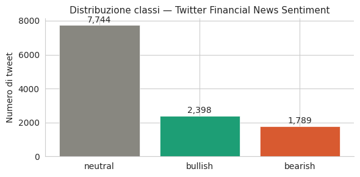{#fig-class-dist}

### Class Imbalance

The label distribution is strongly skewed toward Bullish, which is characteristic of financial social media: users post more frequently when they hold positive expectations.

::: {#tbl-class-dist}
  Class      Count   Share   Numeric score
  --------- ------- ------- ----------------
  Neutral    1,162   64.9%        $+1$
  Bullish     359    20.1%   $\phantom{+}0$
  Bearish     269    15.0%        $-1$

  : Class distribution in the test split (1,790 examples).
:::

A naïve classifier that always predicts "Bullish" achieves approximately 65% accuracy without understanding any text. Accordingly, the primary evaluation metric throughout this project is **F1 Macro**---the unweighted average of per-class F1 scores---which penalises poor performance on minority classes. The Bearish class (15% of test data) is both the hardest to classify and the most financially relevant: failure to detect negative signals leads to unhedged downside exposure.

### Linguistic Characteristics of Financial Tweets

Financial tweets present several challenges absent from standard NLP benchmarks.

- **Cashtag entities.** References to equities via `$AAPL`, `$TSLA`.

- **Domain jargon.** Terms such as *covenant breach*, *write-down*, and *guidance cut* carry precise negative connotations absent from general corpora.

- **Negation and understatement.** "Revenue slightly below expectations" is Bearish despite the absence of any overtly negative word.

- **Brevity.** Most tweets are under 280 characters, limiting available context.

## Real-Timestamp Backtest Corpus

To conduct a methodologically valid backtest, a second corpus was sourced from Kaggle [@kaggle_dataset]: `equinxx/stock-tweets-for-sentiment-analysis-and-prediction`. This dataset provides real UTC timestamps, enabling causal alignment between tweet sentiment and subsequent price movements.

::: {#tbl-kaggle}
  Attribute             Value
  --------------------- ---------------------------------------
  Total tweets          80,793
  Period                October 2021--September 2022
  License               CC0-1.0
  TSLA tweets           37,422 ($\approx$<!-- -->150 per day)
  AAPL tweets           5,056 ($\approx$<!-- -->20 per day)
  MSFT tweets           4,089 ($\approx$<!-- -->16 per day)
  Price data included   Yes (`stock_yfinance_data.csv`)

  : Kaggle backtest corpus statistics.
:::

The 8$\times$ asymmetry in tweet volume between TSLA and AAPL/MSFT reflects Tesla's exceptional social-media coverage in this period. As shown in @sec-real-backtest, this asymmetry directly determines signal robustness.

## Price Data and Return Construction

Daily OHLCV data for AAPL (2019--2024) was downloaded via `yfinance` for the synthetic backtest; for the real-timestamp backtest, prices are taken directly from the Kaggle CSV. Forward returns and directional labels are defined as: 

$$\begin{aligned}
  r_{t+1} &= \frac{P_{t+1} - P_t}{P_t},  \\
  d_{t+1} &= \mathbf{1}[r_{t+1} > 0]. 
\end{aligned}
$$ {#eq-fwdret}

# Text Preprocessing

A key methodological choice is to adopt differentiated preprocessing strategies for models with different input requirements.

## Preprocessing for TF-IDF and BiLSTM

Aggressive normalisation reduces vocabulary noise for bag-of-words and fixed-embedding models:

*Financial tweet preprocessing for TF-IDF and BiLSTM.*

```
def preprocess_tweet(text: str) -> str:
    text = str(text).lower()
    text = re.sub(r'http\S+|www\S+', '', text)      # remove URLs
    text = re.sub(r'\$[A-Za-z]+', 'ticker', text)   # $AAPL -> ticker
    text = re.sub(r'@\w+', '', text)                 # remove @mentions
    text = re.sub(r'#(\w+)', r'\1', text)            # #tag -> tag
    text = re.sub(r'[^a-z0-9\s]', ' ', text)        # strip punctuation
    text = re.sub(r'\s+', ' ', text).strip()
    return text
```

The cashtag substitution (`$AAPL` $\to$ `ticker`) is important for TF-IDF: it prevents the vocabulary from treating `$AAPL` and `$TSLA` as independent features, instead generalising them into a single "stock mention" signal.

## Preprocessing for FinBERT

*Minimal preprocessing for FinBERT.*

```
def preprocess_bert(text: str) -> str:
    text = str(text)
    text = re.sub(r'http\S+|www\S+', '', text)
    text = re.sub(r'@\w+', '', text)
    text = re.sub(r'\$([A-Za-z]+)', r'\1', text)    # $AAPL -> AAPL
    return re.sub(r'\s+', ' ', text).strip()
```

Three deliberate differences from the TF-IDF pipeline distinguish this approach.

1.  **No lowercasing.** BERT is case-sensitive; *Apple* (the firm) and *apple* (the fruit) receive different contextual embeddings. Lowercasing would destroy this distinction.

2.  **Punctuation retained.** The WordPiece tokeniser uses punctuation as a syntactic cue; removing it degrades the quality of attention patterns.

3.  **`$AAPL` $\to$ `AAPL`.** FinBERT was pre-trained on Reuters and SEC filings where tickers appear without the dollar prefix. Preserving the alphanumeric form maximises overlap with the pre-training vocabulary.

# Model Architectures

## Baseline: TF-IDF with Classical Classifiers

### TF-IDF Representation

TF-IDF [@manning2008] maps each tweet to a sparse vector in $\mathbb{R}^{|V|}$, $|V|=50{,}000$. The weight of term $t$ in document $d$ from a corpus of $N$ documents is: 

$$
  \mathrm{TF\text{-}IDF}(t,d)
    = \bigl(1 + \log \mathrm{TF}(t,d)\bigr)
      \cdot \log\!\left(\frac{N}{\mathrm{df}(t)}\right),
$$ {#eq-tfidf}

 where the log-normalised term frequency (`sublinear_tf=True`) dampens the contribution of very frequent terms. Bigrams (`ngram_range=(1,2)`) capture financially meaningful phrases such as "strong buy", "not good", and "below expectations" that are invisible to unigram-only models.

### Logistic Regression

Given a TF-IDF vector $\mathbf{x}\in\mathbb{R}^{|V|}$, the class probability is: 

$$
  P(y=k\mid\mathbf{x}) =
    \frac{\exp(\mathbf{w}_k^\top\mathbf{x}+b_k)}
         {\sum_{j=1}^{K}\exp(\mathbf{w}_j^\top\mathbf{x}+b_j)},
  \qquad K=3,
$$ {#eq-logreg}

 regularised with L2 penalty $\lambda = 1/C$, $C=1$. Class imbalance is handled via `class_weight=‘balanced’`, which sets $w_k \propto 1/n_k$.

### LinearSVC

For each class $k$ under a one-vs-rest strategy, LinearSVC [@manning2008] solves: 

$$
  \min_{\mathbf{w}_k,b_k}\;\frac{1}{2}\|\mathbf{w}_k\|^2
    + C\sum_{i}\max\!\bigl(0,\;1-y_i^{(k)}(\mathbf{w}_k^\top\mathbf{x}_i+b_k)\bigr).
$$ {#eq-svm}

 LinearSVC achieves the best baseline performance (F1 Macro $=0.754$) in 1.6 s, versus 145.7 s for RBF-SVM at comparable accuracy.

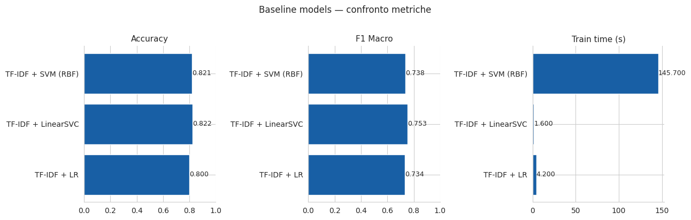{#fig-class-distx}

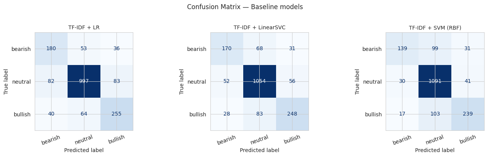

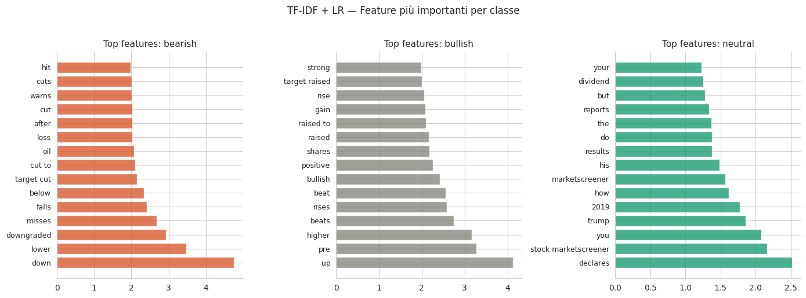{#fig-class-dist}

### SMOTE Experiment {#sec-smote}

SMOTE [@chawla2002] generates synthetic minority-class samples by linear interpolation between two real examples $\mathbf{x}_i, \mathbf{x}_j$ in feature space: 

$$
  \mathbf{x}_\mathrm{new} = \mathbf{x}_i
    + \lambda\cdot(\mathbf{x}_j - \mathbf{x}_i),
  \qquad \lambda\sim\mathrm{Uniform}(0,1).
$$ {#eq-smote}

 $\lambda$ is drawn uniformly so that synthetic points are distributed uniformly along the segment $[\mathbf{x}_i,\mathbf{x}_j]$. SMOTE is applied after TF-IDF vectorisation via `imblearn.Pipeline` to prevent data leakage.

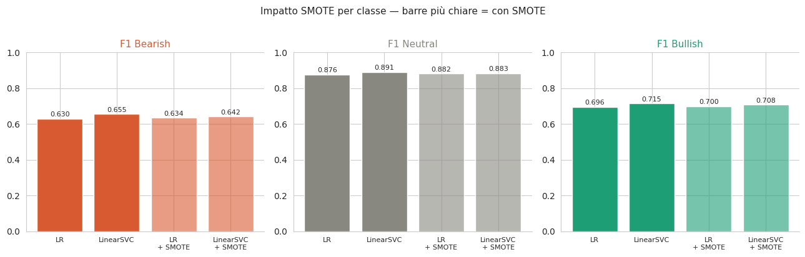{#fig-class-distx}

::: {#tbl-smote}
  Model                 F1 Bear. (no SMOTE)   F1 Bear. (SMOTE)   $\Delta$
  -------------------- --------------------- ------------------ ----------
  TF-IDF + LR                  0.630               0.634         $+0.004$
  TF-IDF + LinearSVC           0.655               0.642         $-0.013$

  : SMOTE experiment: change in Bearish F1 relative to no oversampling.
:::

The negligible or negative effect of SMOTE has a principled explanation. Interpolating between two sparse 50,000-dimensional TF-IDF vectors produces a dense vector that corresponds to no real tweet. The class imbalance problem is *semantic*, not statistical: the model fails on Bearish examples because it lacks linguistic understanding of financial negation and understatement, not because it has too few training examples. No amount of synthetic interpolation in bag-of-words space can supply that understanding.

## BiLSTM with GloVe Embeddings

### GloVe Pre-trained Embeddings

GloVe [@pennington2014] trains dense vectors $\mathbf{e}_w\in\mathbb{R}^d$ by factorising a log co-occurrence matrix: 

$$
  \mathbf{e}_w^\top\mathbf{e}_{w'} + b_w + b_{w'}
    \approx \log X_{ww'},
$$ {#eq-glove}

 where $X_{ww'}$ is the co-occurrence count within a context window. This project uses GloVe Twitter 27B at $d=100$, trained on 2 billion tweets, preferred over the Wikipedia variant because it captures the informal financial language of the target domain. Vocabulary coverage over the 20,000-token lexicon is approximately 85%; out-of-vocabulary tokens are initialised as $\mathbf{e}\sim\mathcal{N}(\mathbf{0},\,0.01\cdot\mathbf{I})$.

### LSTM Cell Equations

The LSTM [@hochreiter1997] controls information flow through a cell state via three multiplicative gates. At each timestep $t$: 

$$\begin{aligned}
  \mathbf{i}_t &= \sigma(\mathbf{W}_i\mathbf{h}_{t-1}+\mathbf{U}_i\mathbf{x}_t+\mathbf{b}_i), \\
  \mathbf{f}_t &= \sigma(\mathbf{W}_f\mathbf{h}_{t-1}+\mathbf{U}_f\mathbf{x}_t+\mathbf{b}_f), \\
  \mathbf{o}_t &= \sigma(\mathbf{W}_o\mathbf{h}_{t-1}+\mathbf{U}_o\mathbf{x}_t+\mathbf{b}_o), \\
  \tilde{\mathbf{c}}_t &= \tanh(\mathbf{W}_c\mathbf{h}_{t-1}+\mathbf{U}_c\mathbf{x}_t+\mathbf{b}_c), \\
  \mathbf{c}_t &= \mathbf{f}_t\odot\mathbf{c}_{t-1}+\mathbf{i}_t\odot\tilde{\mathbf{c}}_t, \\
  \mathbf{h}_t &= \mathbf{o}_t\odot\tanh(\mathbf{c}_t). 
\end{aligned}
$$ {#eq-lstm-i}

 In the bidirectional variant, a forward LSTM and a backward LSTM process the sequence independently, and their final hidden states are concatenated: 

$$
  \mathbf{h}_\mathrm{BiLSTM}
    = \bigl[\,\overrightarrow{\mathbf{h}}_T;\;\overleftarrow{\mathbf{h}}_1\,\bigr]
    \in\mathbb{R}^{2H},
  \qquad H=128.
$$ {#eq-bilstm}

 This 256-dimensional representation captures both left-to-right context and right-to-left context simultaneously, which is important for sentiment prediction in complex financial sentences such as "revenue below expectations despite strong volume."

### Full Architecture and Training

The complete network is: $$\begin{array}{c}
\mathbf{x}(L) \\
\downarrow \\
\mathrm{Emb}(|V|=20{,}000, \, d=100, \, \text{GloVe}) \\
\downarrow \\
\mathrm{Dropout}(0.3) \\
\downarrow \\
\mathrm{BiLSTM}(H=128, \, \ell=2) \\
\downarrow \\
\mathrm{Dropout}(0.3) \\
\downarrow \\
\mathrm{Linear}(256 \to 3) \\
\downarrow \\
\hat{\mathbf{y}}
\end{array}$$

::: {#tbl-bilstm-config}
  Hyperparameter         Value
  ---------------------- -----------------------------------------------------
  Optimiser              Adam, $\mathrm{lr}=10^{-3}$, weight decay $10^{-5}$
  Loss                   CrossEntropyLoss with class weights (balanced)
  Class weights          Bearish 2.22, Neutral 0.51, Bullish 1.66
  Gradient clipping      $\|\nabla\|_2 \leq 1.0$
  Epochs                 15 (best val F1 at epoch 10: 0.7465)
  Batch size             64
  Sequence length        64 tokens
  Trainable parameters   $\approx$<!-- -->500,000
  Training time (A100)   11.8 s

  : BiLSTM training configuration.
:::

At epoch 15, train loss $= 0.06$ and val loss $= 1.18$, confirming structural overfitting. With approximately 500,000 parameters and only 8,352 training examples, the parameter-to-data ratio is too high for robust generalisation regardless of regularisation strength. Early stopping at epoch 10 would have been appropriate.

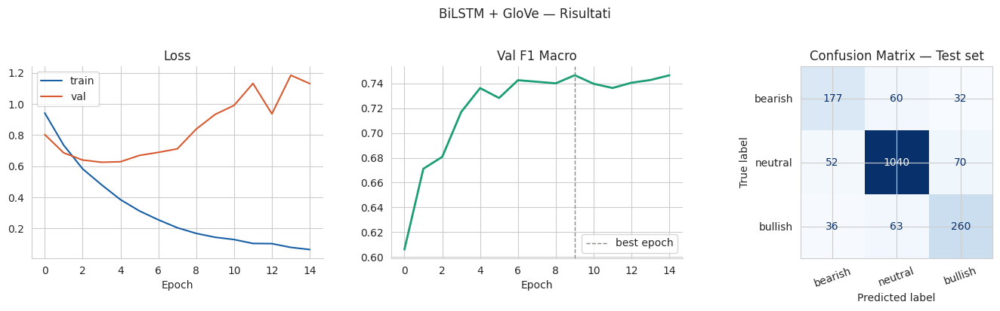{#fig-bilstm-results}

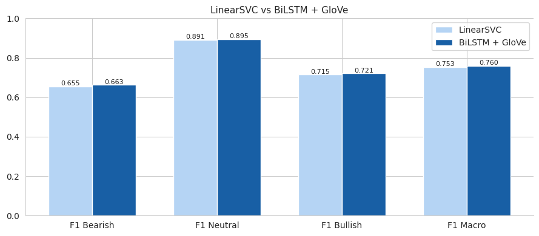{#fig-bilstm-resultsx}

## FinBERT Fine-Tuning

### BERT Architecture and Self-Attention

BERT [@devlin2019] is built on the Transformer encoder [@vaswani2017]. The core operation is scaled dot-product multi-head self-attention: 

$$
  \mathrm{Attention}(\mathbf{Q},\mathbf{K},\mathbf{V})
    = \mathop{\mathrm{softmax}}\!\left(\frac{\mathbf{Q}\mathbf{K}^\top}{\sqrt{d_k}}\right)\mathbf{V},
$$ {#eq-attention}

 

$$
  \mathrm{MultiHead}(\mathbf{H})
    = [\mathrm{head}_1;\ldots;\mathrm{head}_h]\,\mathbf{W}^O,
  \quad
  \mathrm{head}_i
    = \mathrm{Attention}(\mathbf{H}\mathbf{W}_i^Q,\,\mathbf{H}\mathbf{W}_i^K,\,\mathbf{H}\mathbf{W}_i^V).
$$ {#eq-multihead}

 With $h=12$ heads and $d_k=64$, each head specialises in distinct relational patterns (syntactic agreement, semantic roles, co-reference). Unlike the BiLSTM, self-attention computes all pairwise token interactions in parallel, capturing long-range dependencies without processing tokens sequentially. BERT-base has 12 encoder layers, hidden size 768, and approximately 110 million parameters.

### Pre-training Hierarchy

`ProsusAI/finbert` [@araci2019] extends BERT with additional domain pre-training on a 1.8-billion-word financial corpus (Reuters, Bloomberg, SEC 10-K filings). The full training lineage for the model used in this project is:

::: center
BERT-base $\xrightarrow{\text{domain pre-training}}$ FinBERT $\xrightarrow{\text{fine-tune on FPB}}$ `ProsusAI/finbert` $\xrightarrow{\text{further fine-tuning}}$ **this project**
:::

where FPB denotes Financial PhraseBank. The final step---further fine-tuning on Twitter data---adapts the model from formal financial prose to informal social-media language, a non-trivial stylistic shift.

### Two-Phase Fine-Tuning Strategy

Fine-tuning 110 million parameters on 8,352 examples risks catastrophic forgetting: large gradient updates overwrite domain knowledge encoded during pre-training. A two-phase strategy mitigates this.

#### Phase 1: Classifier Warmup (1 epoch).

BERT layers are frozen (`requires_grad=False`). Only the classification head $\mathbf{W}\in\mathbb{R}^{768\times3}$ is updated with $\mathrm{lr}=10^{-3}$, stabilising head weights before exposing all parameters to backpropagation.

#### Phase 2: Full Fine-Tuning (4 epochs).

All parameters are unfrozen. The learning rate schedule is linear warmup followed by linear decay: 

$$
  \mathrm{lr}(s) = \mathrm{lr}_{\max}\cdot
    \begin{cases}
      s / s_\mathrm{warm}
        & s < s_\mathrm{warm}, \\
      (s_\mathrm{total}-s)\,/\,(s_\mathrm{total}-s_\mathrm{warm})
        & s \ge s_\mathrm{warm},
    \end{cases}
$$ {#eq-lr-schedule}

 with $\mathrm{lr}_{\max}=2\times10^{-5}$, $s_\mathrm{warm}=\lfloor0.1\cdot
s_\mathrm{total}\rfloor$, $s_\mathrm{total}=1{,}044$. AdamW [@loshchilov2019] is used with weight decay 0.01. The choice of $\mathrm{lr}_{\max}=2\times10^{-5}$ follows the original BERT recommendation for small-dataset fine-tuning [@devlin2019]; values above $5\times10^{-5}$ empirically destroy pre-trained financial representations.

::: {#tbl-finbert-epochs}
   Epoch   Train loss   Train acc   Val loss   Val acc    Val F1
  ------- ------------ ----------- ---------- --------- -----------
     1       0.567        0.781      0.417      0.825      0.793
     2       0.311        0.884      0.379      0.850      0.821
     3       0.176        0.940      0.433      0.882    **0.854**
     4       0.106        0.964      0.465      0.882      0.853

  : FinBERT per-epoch results (Phase 2). Best val F1 in bold.
:::

Early stopping with patience 2 saves the epoch-3 checkpoint (val F1 $=0.8542$). Total training time on A100: 94.7 s.

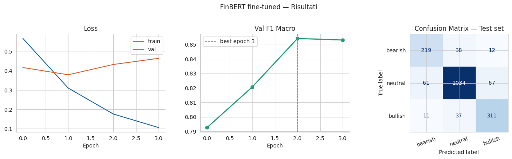{#fig-finbert-results}

# Classification Results

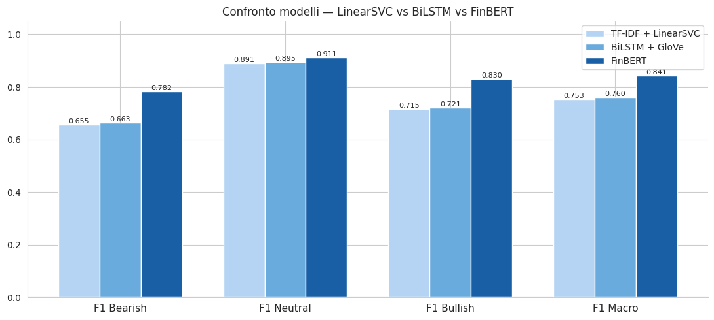{#fig-all-models}

## Summary Table

::: {#tbl-results}
  Model                 Acc.    F1 Macro    F1 Bear.    F1 Neut.    F1 Bull.    Train (s)
  -------------------- ------- ----------- ----------- ----------- ----------- -----------
  TF-IDF + LR           0.800     0.734       0.630       0.876       0.696        4.2
  TF-IDF + LinearSVC    0.822     0.754       0.655       0.891       0.715      **1.6**
  TF-IDF + SVM (RBF)    0.821     0.738       0.610       0.882       0.721       145.7
  BiLSTM + GloVe        0.825     0.760       0.663       0.895       0.721       11.8
  FinBERT (ours)         ---    **0.841**   **0.782**   **0.911**   **0.830**     94.7

  : All models on the held-out test set (1,790 examples). Best per column in bold.
:::

## Analysis of the Bearish Class

The Bearish class shows the largest absolute improvement: $$\Delta\mathrm{F1}_\mathrm{Bear}
    = 0.782 - 0.655 = +0.127 \quad (+19.4\%).$$ On the test set, FinBERT correctly classifies 219 out of 269 Bearish examples (81.4%), versus 177 out of 269 (65.8%) for the BiLSTM. Crucially, FinBERT reduces Bearish$\to$Bullish misclassifications from 32 to 12, the most costly confusion pattern for a trading system.

## The BiLSTM Paradox

Despite greater architectural sophistication, the BiLSTM improves F1 Macro by only 0.006 over LinearSVC. Two factors explain this outcome.

First, GloVe provides domain-agnostic embeddings. Financial jargon items such as *covenant breach* and *write-down* appear rarely in general Twitter corpora, yielding poor representations for domain-critical tokens.

Second, the parameter-to-data ratio is too high. With approximately 500,000 parameters and 8,352 training examples, the model memorises rather than generalises, as confirmed by the large train-validation loss gap at epoch 15 (0.06 vs. 1.18).

The finding is: what matters is not architectural complexity but domain-specific pre-training. FinBERT contributes $\Delta$F1 Macro $= +0.087$ over LinearSVC; the BiLSTM contributes only $+0.006$. For practitioners with limited labelled data, a pre-trained domain model fine-tuned for a few epochs will consistently outperform a custom architecture trained from scratch.

# From Sentiment to Trading Signal

## Sentiment Index Variants

For each trading day $t$, three sentiment signals are computed from model predictions over all tweets published on day $t$.

::: definition
**Definition 1** (Binary Sentiment Index). *

$$
  \mathrm{SI}_t = p_t^\mathrm{bull} - p_t^\mathrm{bear} \;\in [-1,+1],
$$ {#eq-si}

 where $p_t^\mathrm{bull}$ (resp. $p_t^\mathrm{bear}$) is the fraction of Bullish (resp. Bearish) tweets on day $t$.*
:::

::: definition
**Definition 2** (Confidence-Weighted Score). *

$$
  \mathrm{WS}_t = \frac{1}{N_t}\sum_{i=1}^{N_t}
    \bigl(\hat{p}_i^\mathrm{bull} - \hat{p}_i^\mathrm{bear}\bigr),
$$ {#eq-ws}

 where $\hat{p}_i^\mathrm{bull},\hat{p}_i^\mathrm{bear}\in[0,1]$ are FinBERT softmax probabilities for tweet $i$. A tweet classified Bullish with 95% confidence contributes approximately $+0.90$ to the index; one classified at 51% contributes only $+0.02$.*
:::

::: definition
**Definition 3** (Three-Day Moving Average). *

$$
  \overline{\mathrm{SI}}_t
    = \tfrac{1}{3}(\mathrm{SI}_t + \mathrm{SI}_{t-1} + \mathrm{SI}_{t-2}).
$$ {#eq-ma3}

*
:::

## Look-Ahead Bias Prevention

All signals are lagged by one business day before being used to take a position: 

$$
  \mathrm{Signal}_t = \mathrm{SI}_{t-1},
$$ {#eq-lag}

 ensuring that only information available at the close of day $t-1$ informs the position taken at the open of day $t$.

## Trading Rule and Cost Model

$$
  \mathrm{Pos}_t = \begin{cases}
    +1 & \mathrm{Signal}_t > \theta, \\
    -1 & \mathrm{Signal}_t < -\theta, \\
    \hphantom{+}0 & \text{otherwise,}
  \end{cases}
  \qquad \theta = 0.05.
$$ {#eq-position}

 The strategy return on day $t$ net of transaction costs is: 

$$
  r_t^\mathrm{strat}
    = \mathrm{Pos}_{t-1}\cdot r_t
    - \mathbf{1}[\mathrm{Pos}_{t-1}\neq\mathrm{Pos}_{t-2}]\cdot c,
  \qquad c = 0.001.
$$ {#eq-strat-ret}

## Performance Metrics

$$\begin{aligned}
  \text{Cumulative Return}
    &= \prod_{t=1}^{T}(1+r_t^\mathrm{strat}) - 1,
     \\[4pt]
  \text{Sharpe Ratio}
    &= \frac{\bar{r}^\mathrm{strat}}{\sigma(r^\mathrm{strat})}\cdot\sqrt{252},
     \\[4pt]
  \text{Max Drawdown}
    &= \min_{t}\!\left(\frac{V_t}{\max_{s\le t}V_s}-1\right),
     \\[4pt]
  \text{Hit Rate}
    &= \frac{1}{|\mathcal{A}|}\sum_{t\in\mathcal{A}}\mathbf{1}[r_t^\mathrm{strat}>0],
\end{aligned}
$$ {#eq-cumret}

 where $\mathcal{A}=\{t:\mathrm{Pos}_{t-1}\neq0\}$ is the set of active days and $V_t=\prod_{s=1}^{t}(1+r_s^\mathrm{strat})$ is the portfolio value.

# Synthetic Backtest

## Experimental Setup

The HuggingFace dataset lacks original timestamps. For a pilot backtest, timestamps are generated synthetically by sampling uniformly from NYSE business days (2020--2023) with intraday times in 09:30--16:00 EST:

*Synthetic timestamp generation (NB5).*

```
np.random.seed(42)
trading_days = pd.bdate_range('2020-01-01', '2023-12-31')
days = np.random.choice(trading_days, size=len(tweets_df), replace=True)
mins = np.random.randint(0, 390, size=len(tweets_df))  # 390 = 6.5h * 60
tweets_df['timestamp'] = [
    pd.Timestamp(d) + pd.Timedelta(minutes=int(570 + m))
    for d, m in zip(days, mins)
]
```

## Results and Methodological Assessment

::: {#tbl-synth-bt}
  Strategy                  Return         Sharpe
  -------------------- ----------------- ----------
  Buy & Hold AAPL       $\approx+160\%$   positive
  FinBERT signal        $\approx-50\%$    $-0.40$
  Label-based signal    $\approx-50\%$    negative

  : Synthetic backtest on AAPL ($\theta=0.05$, lag $=+1$ day).
:::

The strategy severely underperforms buy-and-hold. Three structural reasons account for this result.

1.  **Broken causality.** Random timestamps sever the causal link between news sentiment and price movement. The model is effectively trading on noise.

2.  **Anomalous period.** AAPL appreciated approximately $+160\%$ from 2020 to late 2022, driven by the COVID-era tech bull market. Occasional Bearish signals generate short positions during a sustained uptrend.

3.  **Quartile inversion.** Days in the most Bearish sentiment quartile (Q1) yield higher forward returns than days in the most Bullish quartile (Q4), a direct symptom of the temporal misalignment.

The synthetic backtest is not valid for evaluating signal quality. Its value is purely demonstrative: it confirms that the end-to-end pipeline executes correctly and motivates the real-timestamp experiment in @sec-real-backtest.

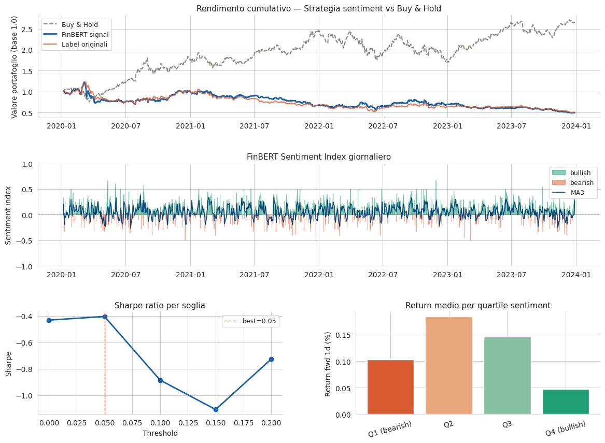{#fig-synth-bt}

# Real-Timestamp Backtest {#sec-real-backtest}

## Setup and Out-of-Distribution Generalisation

Both models were trained on the HuggingFace corpus and applied to Kaggle tweets never seen during training. This constitutes an out-of-distribution generalisation test across three dimensions: different authors, a different time period (2021--2022 vs. 2020--2023), and a different asset composition. LinearSVC was retrained within Notebook 6 with identical hyperparameters and seed 42 before Kaggle inference; FinBERT loaded the fine-tuned checkpoint from Google Drive.[^1]

## Results by Asset

::: {#tbl-real-bt}
+--------+------------------+-------------------+----------+-------------------+----------+-------+
| Ticker | Model            | Return %          | B&H %    | Sharpe            | Max DD % | Hit % |
+:=======+:=================+:=================:+:========:+:=================:+:========:+:=====:+
| AAPL   | LinearSVC        | $-12.90$          | $-0.12$  | $-0.355$          | $-29.63$ | 46.63 |
|        +------------------+-------------------+          +-------------------+----------+-------+
|        | FinBERT          | $-22.15$          |          | $-0.718$          | $-30.05$ | 45.59 |
|        +------------------+-------------------+          +-------------------+----------+-------+
|        | Weighted FinBERT | $-31.03$          |          | $-1.166$          | $-37.98$ | 45.15 |
+--------+------------------+-------------------+----------+-------------------+----------+-------+
| TSLA   | LinearSVC        | $-6.09$           | $+3.79$  | $+0.116$          | $-44.64$ | 49.06 |
|        +------------------+-------------------+          +-------------------+----------+-------+
|        | FinBERT          | $+5.98$           |          | $+0.396$          | $-43.71$ | 53.81 |
|        +------------------+-------------------+          +-------------------+----------+-------+
|        | Weighted FinBERT | $\mathbf{+19.91}$ |          | $\mathbf{+0.605}$ | $-40.64$ | 53.77 |
+--------+------------------+-------------------+----------+-------------------+----------+-------+
| MSFT   | LinearSVC        | $-17.50$          | $-17.85$ | $-0.565$          | $-30.37$ | 46.41 |
|        +------------------+-------------------+          +-------------------+----------+-------+
|        | FinBERT          | $-54.07$          |          | $-2.628$          | $-62.28$ | 40.62 |
|        +------------------+-------------------+          +-------------------+----------+-------+
|        | Weighted FinBERT | $-59.11$          |          | $-2.981$          | $-65.57$ | 37.93 |
+--------+------------------+-------------------+----------+-------------------+----------+-------+

: Real-timestamp backtest: all models on AAPL, TSLA, MSFT. $\theta=0.05$, lag $=+1$ day, TC $=0.1\%$, 250 trading days each.
:::

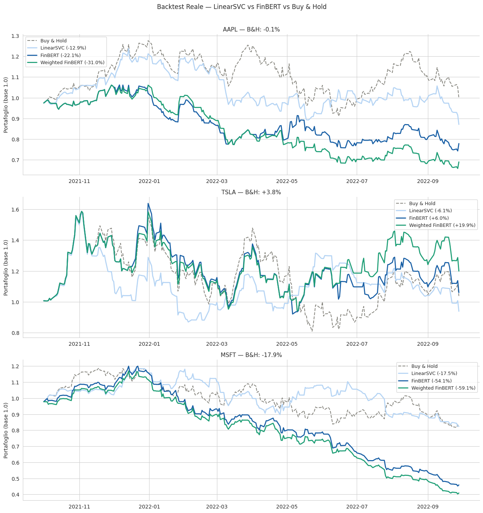{#fig-real-bt}

## Asset-by-Asset Analysis

### TSLA: Sentiment-Driven Regime

TSLA is the only asset on which the sentiment signal is consistently profitable across all three model variants. The ordering LinearSVC ($-6.09\%$) $<$ FinBERT ($+5.98\%$) $<$ Weighted FinBERT ($+19.91\%$, Sharpe $+0.605$) demonstrates that classifier accuracy directly improves signal quality on this asset.

Three factors drive TSLA's social-media predictability. First, high tweet density (approximately 150 per day) makes the daily sentiment index statistically robust. Second, Elon Musk's Twitter activity in 2021--2022 frequently preceded price movements; retail sentiment tracked and partly anticipated these events. Third, FinBERT correctly predicts the sign of the next-day return in 53.81% of active trades, sufficient to generate positive expected returns net of transaction costs.

The value of the confidence-weighted signal is also evident: at the same classifier, Weighted FinBERT yields $+19.91\%$ versus FinBERT's $+5.98\%$, confirming that probability calibration adds substantial trading value beyond hard labels.

### AAPL: Non-Predictive Regime

All signals underperform buy-and-hold on AAPL, and performance worsens monotonically with model sophistication. The Pearson correlation: $$r(\mathrm{SI}_{t-1},\,r_t^\mathrm{AAPL}) = -0.003 \quad (\text{FinBERT})$$ confirms that the signal carries no directional information. AAPL's price in this period was governed by macroeconomic factors (Federal Reserve decisions, inflation, the Ukraine war) and earnings releases---none of which are captured by retail Twitter sentiment. The counterintuitive degradation with classifier quality arises because FinBERT issues more confident predictions; on a non-predictive asset, confident wrong signals are more costly than uncertain wrong signals.

### MSFT: Contrarian (Mean-Reversion) Regime

MSFT exhibits a statistically significant negative Pearson correlation, consistent across all signal variants:

::: {#tbl-corr}
  Ticker    LinearSVC   FinBERT    Weighted FinBERT
  -------- ----------- ---------- ------------------
  AAPL      $+0.029$    $-0.003$       $+0.000$
  TSLA      $+0.023$    $+0.004$       $+0.010$
  MSFT      $-0.001$    $-0.141$       $-0.134$

  : Pearson correlations: $r(\mathrm{Signal}_{t-1},\,r_t)$.
:::

The negative correlation on MSFT is consistent with retail sentiment acting as a contrarian indicator: investors express bullish sentiment near local price maxima (when buying pressure has already been absorbed) and bearish sentiment near local minima (when selling pressure has been exhausted). The signal lags rather than leads price. The consistency of the correlation across binary, weighted, and MA3 variants ($-0.141$, $-0.134$, $-0.115$) argues against a statistical artefact. Inverting the FinBERT signal on MSFT is a natural direction for future work.

## Answering the Research Question

The empirical evidence yields a nuanced, asset-dependent answer to the central research question.

On TSLA, the answer is yes: a more accurate classifier produces a more profitable signal. Weighted FinBERT converts a losing LinearSVC signal ($-6.09\%$) into a strongly profitable one ($+19.91\%$, Sharpe $+0.605$).

On AAPL, the answer is no: signal profitability degrades with classifier quality. On a non-predictive asset, model confidence amplifies errors rather than correct calls.

On MSFT, the answer is also no, but for a different reason. The signal is contrarian; a more accurate classifier issues more confident contrarian predictions, increasing losses. Inverting the signal would reverse this conclusion.

The overarching finding is that signal effectiveness is a joint property of the classifier and the asset's social-media ecosystem. A classifier can only add trading value if the sentiment it measures is causally or predictively linked to the asset's price dynamics.

# Conclusions and Future Work

## Summary of Findings

1.  FinBERT achieves F1 Macro $= 0.841$, outperforming LinearSVC ($0.754$) and BiLSTM ($0.760$) on the held-out test set.

2.  The largest gain is on the Bearish class ($+19.4\%$ versus baseline), driven by FinBERT's understanding of financial negation and domain jargon.

3.  The BiLSTM adds only $\Delta$F1 $= +0.006$ over LinearSVC. Domain-specific pre-training dominates architectural complexity.

4.  SMOTE on TF-IDF features does not resolve class imbalance; the problem is semantic, not statistical.

5.  The synthetic backtest is not valid for signal evaluation; real timestamps are necessary.

6.  On TSLA, Weighted FinBERT achieves $+19.91\%$ cumulative return and Sharpe $+0.605$, beating buy-and-hold by $+16.1$ percentage points.

7.  On AAPL, the sentiment signal is non-predictive ($r\approx0$).

8.  On MSFT, the signal is contrarian ($r=-0.141$); inverting it could yield positive returns.

9.  A more accurate classifier does not always produce a better trading signal. Signal effectiveness depends on the asset's social-media ecosystem.

## Future Directions

- **Contrarian signal for MSFT.** Test the inverted FinBERT signal over a longer out-of-sample period to confirm the mean-reversion hypothesis.

- **Intraday lag analysis.** Collect sub-daily timestamped data and test lags of 2 h, 4 h, 8 h, 24 h, and 48 h to find the optimal sentiment response window.

- **Aspect-based sentiment.** Classify sentiment separately for revenue, margins, management guidance, and outlook components, providing richer signals for event-driven strategies.

- **LLM zero-shot baseline.** Compare FinBERT fine-tuned against GPT-4o or Claude in zero-shot and few-shot configurations to assess whether LLMs generalise better to rare financial terms without task-specific training.

- **Ensemble.** Combine TF-IDF features with FinBERT embeddings via a meta-classifier; preliminary results in similar settings suggest $+1$--$2\%$ F1 Macro without significant inference overhead.

- **Position sizing.** Weight position size by $|\mathrm{WS}_t|$ to allocate larger exposure on high-confidence days.

- **Multi-asset portfolio.** Combine TSLA (direct signal) and MSFT (contrarian signal) in a risk-parity allocation to diversify signal-specific risk.

# Technical Appendix {#sec-technical-appendix .unnumbered}

## A.1 Reproducibility {#sec-a-1-reproducibility .unnumbered}

All random seeds are fixed at 42: `np.random.seed(42)`, `torch.manual_seed(42)`, `train_test_split(..., random_state=42)`. The identical stratified split is reused by every notebook for fair cross-model comparison. Processed data (`.parquet`), model checkpoints (`finbert_best.pt`, `bilstm_best.pt`), and metric JSON files are persisted on Google Drive under `sentiment_project/data/`.

## A.2 yfinance MultiIndex Compatibility {#sec-a-2-yfinance-multiindex-compatibility .unnumbered}

From version 0.2.18, `yfinance` returns a MultiIndex column structure `(‘Close’, ‘AAPL’)` for single-ticker downloads. The following fix handles both API versions:

*yfinance MultiIndex compatibility fix.*

```
if isinstance(aapl.columns, pd.MultiIndex):
    aapl.columns = [c[0].lower() for c in aapl.columns]
else:
    aapl.columns = [c.lower() for c in aapl.columns]
```

## A.3 FinBERT Head Reinitialisation {#sec-a-3-finbert-head-reinitialisation .unnumbered}

`ProsusAI/finbert` ships with a classification head trained on Financial PhraseBank (labels: positive / negative / neutral). Loading with `ignore_mismatched_sizes=True` discards this head and reinitialises a new head with labels bearish / neutral / bullish, preserving all 110 million BERT encoder weights.

## A.4 Kaggle Authentication via Colab Secrets {#sec-a-4-kaggle-authentication-via-colab-secrets .unnumbered}

*Kaggle authentication via Colab Secrets.*

```
from google.colab import userdata
kaggle_creds = {
    'username': 'tommasozeri',
    'key': userdata.get('KAGGLE')
}
with open('/root/.kaggle/kaggle.json', 'w') as f:
    json.dump(kaggle_creds, f)
os.chmod('/root/.kaggle/kaggle.json', 0o600)
```

[^1]: A strict temporal split is not enforced between the HuggingFace training corpus and the Kaggle backtest period because HuggingFace timestamps are synthetic. The two datasets are drawn from independent sources with no verified tweet overlap, making label leakage unlikely in practice. A fully rigorous evaluation would require a training corpus with authentic timestamps predating October 2021.


# References {.unnumbered}

::: {#refs}
:::


::: {.paper-download}
[Download PDF](sentiment_analysis_nlp-5.pdf){.btn-paper download=""} [Code](https://github.com/tommasozeri/Sentiment-Analysis-Trading-Strategy){.btn-paper}
:::
