# Introduzione: I Regimi Finanziari come Funzioni Multivariate {#sec-introduzione}

I regimi finanziari rappresentano modelli matematici per descrivere l'evoluzione temporale del valore del denaro. Tradizionalmente presentati come funzioni del tempo a tasso fisso, la loro piena comprensione richiede invece un approccio multidimensionale che consideri contemporaneamente la dipendenza dal tempo $t$ e dal tasso d'interesse $i$.

Il valore di un capitale $C$ può essere espresso attraverso funzioni bivariate:

- **Montante**: $M(i,t) = C \cdot f(i,t)$

- **Valore attuale**: $A(i,t) = C \cdot g(i,t)$

dove $f(i,t)$ e $g(i,t)$ sono rispettivamente i fattori di montante e di sconto, specifici per ciascun regime.

# Il Regime Semplice: Linearità Bidimensionale {#sec-regime-semplice}

## Formulazione Matematica

Il regime semplice è caratterizzato da una relazione lineare in entrambe le variabili:

$$

M(i,t) = C(1 + it)
$$ {#eq-montante-semplice-2d}

$$

A(i,t) = \frac{C}{1 + it}
$$ {#eq-attuale-semplice-2d}

La funzione montante $M(i,t)$ rappresenta un piano nello spazio tridimensionale, mentre la funzione valore attuale $A(i,t)$ descrive una superficie iperbolica.

## Proprietà Geometriche

- **Curvatura**: Superficie planare per il montante, superficie iperbolica per l'attualizzazione

- **Derivate parziali**: $\frac{\partial M}{\partial i} = Ct$ (cresce linearmente con $t$), $\frac{\partial M}{\partial t} = Ci$ (cresce linearmente con $i$)

- **Piano tangente**: Coincide con la superficie stessa per il montante

## Visualizzazione 3D

La @fig-superficie-semplice mostra le superfici caratteristiche del regime semplice. Si osserva come l'andamento lineare del montante contrasti con la decrescita iperbolica del valore attuale.

::: {#fig-superficie-semplice layout-ncol=2}

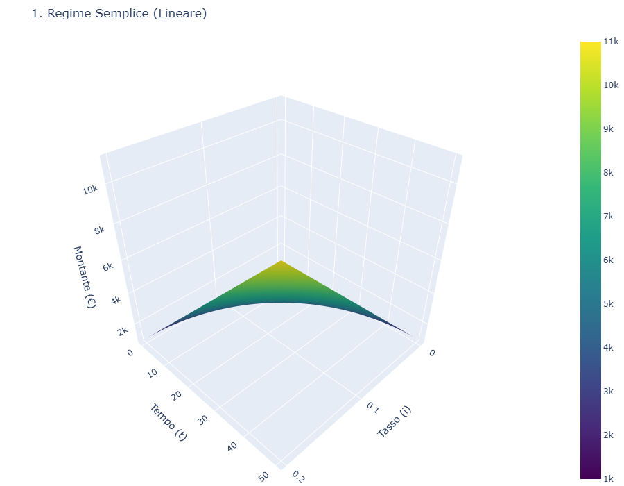

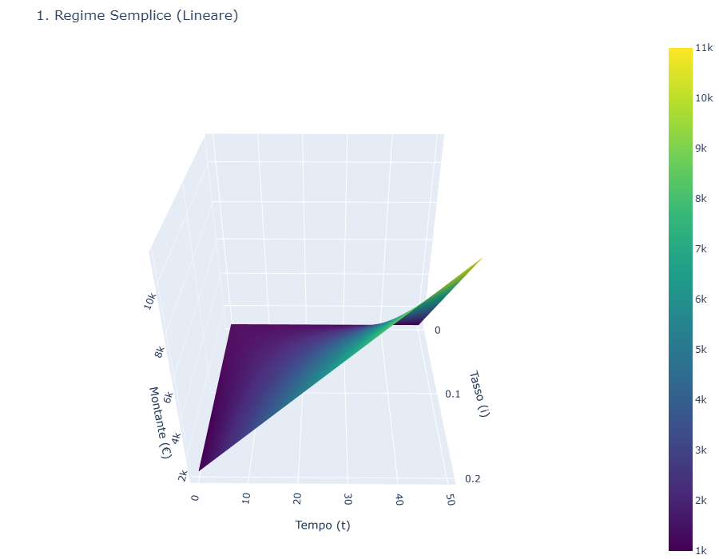

Superfici 3D del regime semplice per $C=1000$

:::

::: {layout-ncol=2}

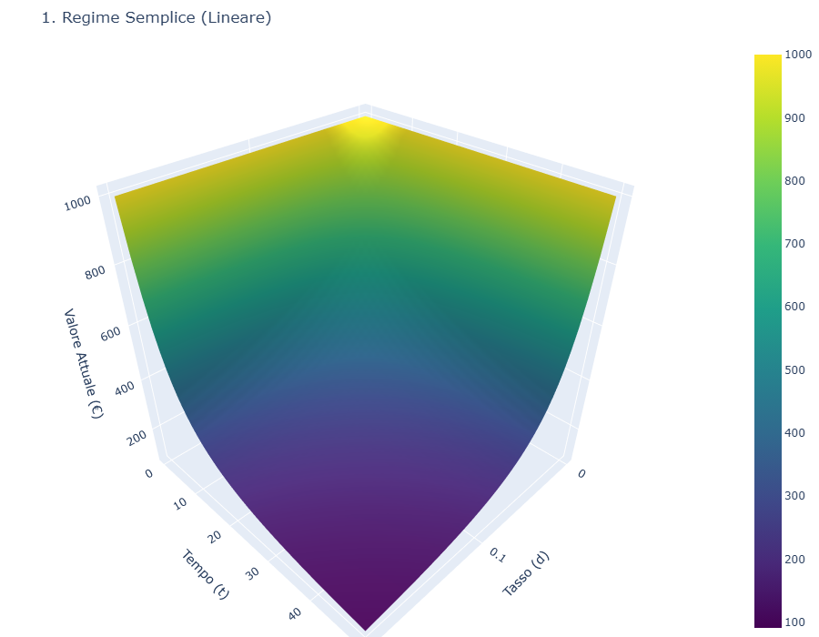

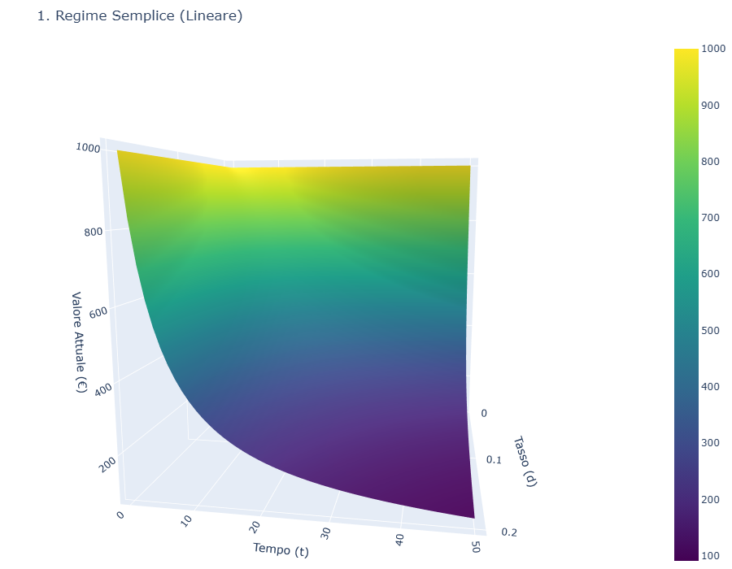

Superfici 3D del regime semplice per $M=1000$

:::

# Il Regime Composto: Esponenzialità nello Spazio dei Parametri {#sec-regime-composto}

## Formulazione Matematica

Il regime composto introduce una dipendenza esponenziale dal tempo:

$$

M(i,t) = C(1 + i)^t
$$ {#eq-montante-composto-2d}

$$

A(i,t) = \frac{C}{(1 + i)^t}
$$ {#eq-attuale-composto-2d}

Queste equazioni descrivono superfici con curvatura positiva (montante) e negativa (valore attuale).

## Proprietà Geometriche

- **Curvatura**: Superficie esponenziale convessa per il montante, superficie esponenziale concava per l'attualizzazione

- **Derivate parziali**: $\frac{\partial M}{\partial i} = Ct(1+i)^{t-1}$, $\frac{\partial M}{\partial t} = C(1+i)^t \ln(1+i)$

- **Elasticità**: La sensibilità al tasso aumenta esponenzialmente con il tempo

## Visualizzazione 3D

La Figura illustra le superfici del regime composto, evidenziando la crescita esponenziale del montante e il decadimento esponenziale del valore attuale.

::: {#fig-superficie-composto layout-ncol=2}

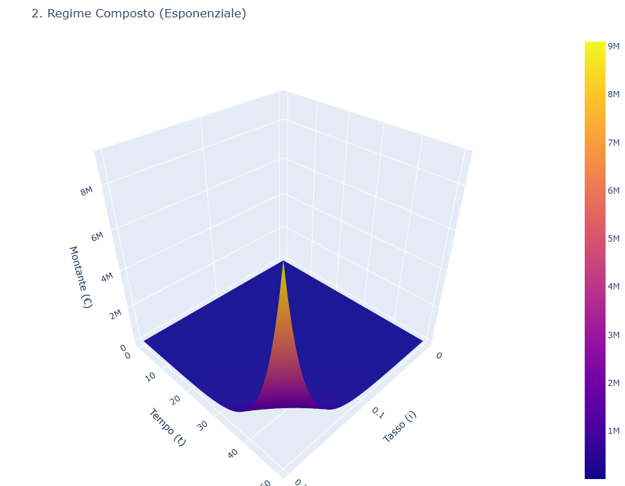

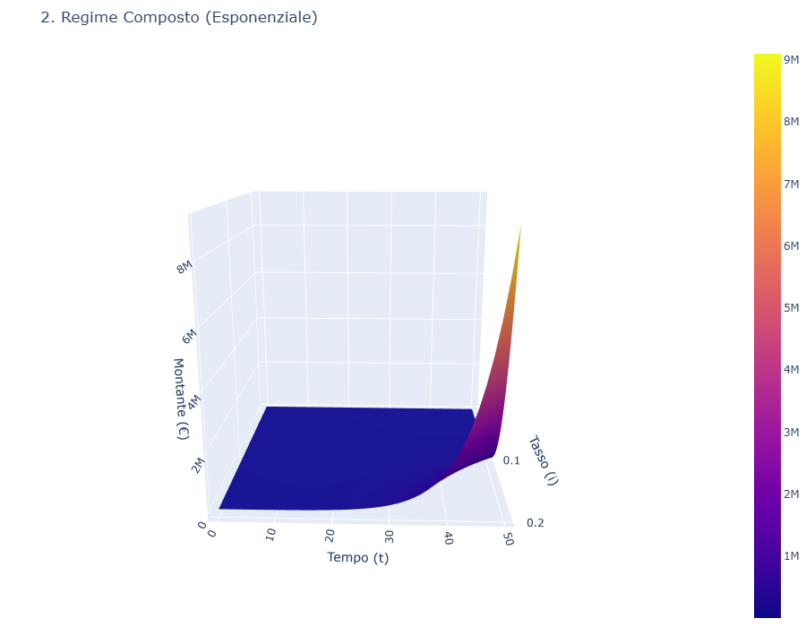

Superfici 3D del regime composto per $C=1000$

:::

::: {layout-ncol=2}

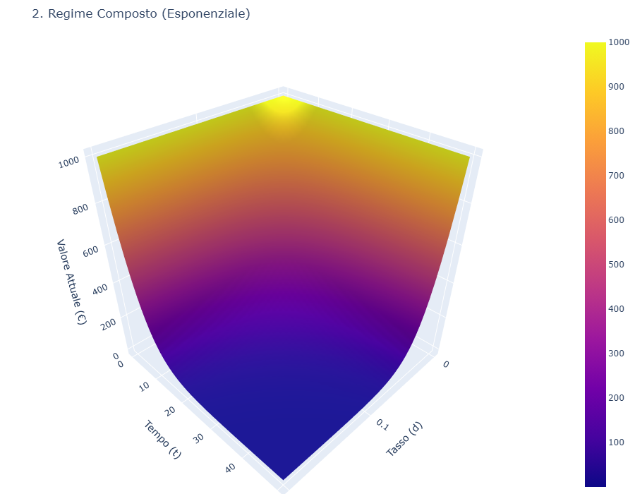

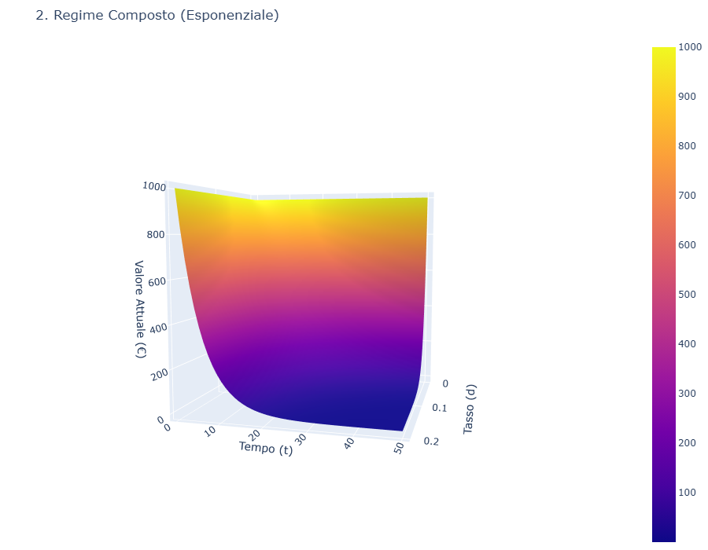

Superfici 3D del regime composto per $M=1000$

:::

# Analisi Comparativa attraverso le Superfici 3D {#sec-confronto}

## Intersezione delle Superfici

La condizione di equivalenza tra i due regimi si ottiene uguagliando le funzioni montante:

$$

C(1 + \alpha t) = C(1 + \beta)^t
$$ {#eq-equivalenza}

dove $\alpha$ è il tasso nel regime semplice e $\beta$ nel regime composto.

Questa equazione definisce una curva nello spazio $(i,t)$ lungo la quale le due superfici si intersecano.

## Casi di Studio Tridimensionali

### Caso 1: Dominanza del Regime Composto

Quando $\beta \geq e^\alpha - 1$, la superficie del regime composto giace interamente sopra quella del regime semplice per ogni $t > 0$ .

### Caso 2: Transizione di Dominanza

Quando $0 < \beta < e^\alpha - 1$, esiste un tempo critico $t^*$ tale che:

- Per $t < t^*$: il regime semplice domina ($M_{semplice} > M_{composto}$)

- Per $t > t^*$: il regime composto domina ($M_{composto} > M_{semplice}$)

::: {#fig-confronto-generale layout-ncol=2}

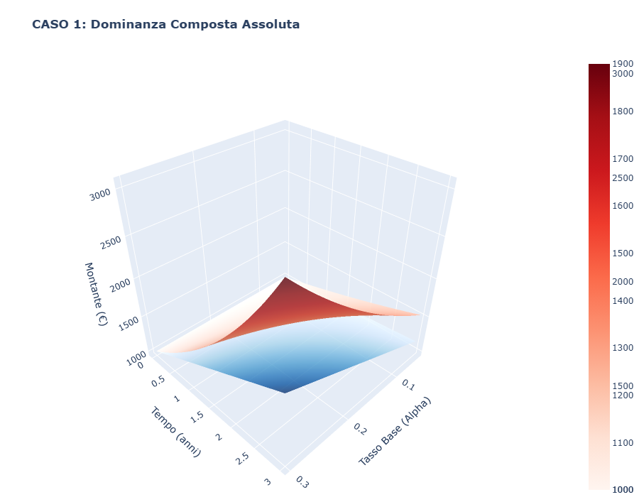

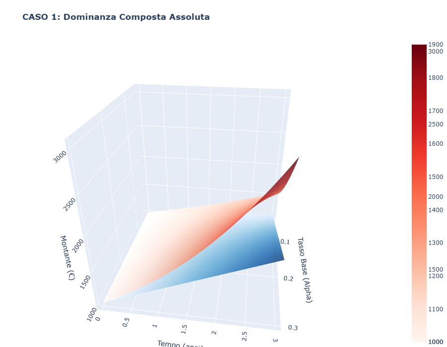

Confronto 3D tra le superfici dei due regimi

:::

::: {layout-ncol=2}

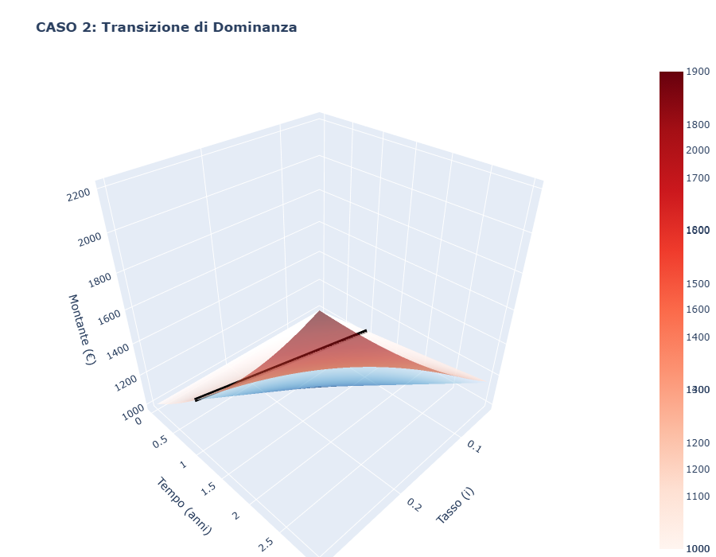

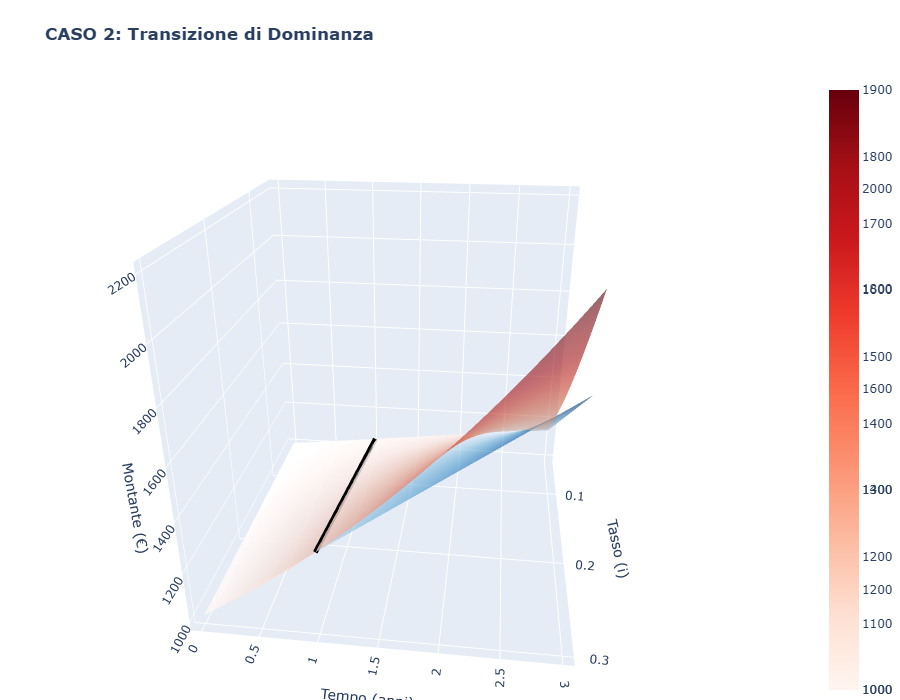

Confronto 3D tra le superfici dei due regimi

:::

## Analisi delle Derivate Parziali

La @tbl-derivate confronta le sensibilità dei due regimi alle variazioni dei parametri:

::: {#tbl-derivate}
  **Derivata**                           **Regime Semplice**    **Regime Composto**
  ------------------------------------- --------------------- ------------------------
  $\frac{\partial M}{\partial i}$                $t$               $t(1+i)^{t-1}$
  $\frac{\partial M}{\partial t}$                $i$             $(1+i)^t \ln(1+i)$
  $\frac{\partial^2 M}{\partial i^2}$            $0$            $t(t-1)(1+i)^{t-2}$
  $\frac{\partial^2 M}{\partial t^2}$            $0$           $(1+i)^t [\ln(1+i)]^2$

  : Confronto delle derivate parziali ($C=1$)
:::

# Applicazioni Pratiche dell'Approccio Tridimensionale {#sec-applicazioni}

La visualizzazione 3D consente di identificare rapidamente le regioni dello spazio $(i,t)$ in cui un regime è preferibile all'altro, supportando decisioni di allocazione ottimale.

## Analisi di Sensibilità

Le mappe di sensibilità mostrano come variano i rendimenti al variare simultaneo di tasso e tempo:

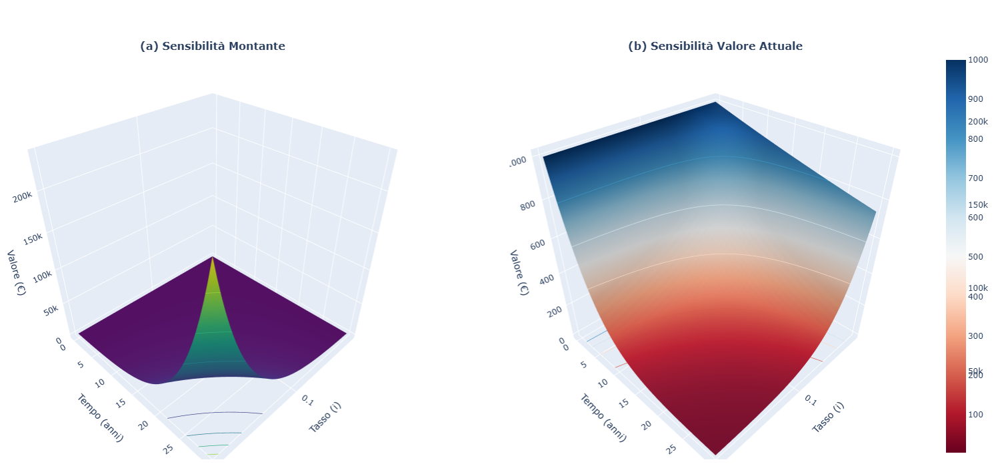{#fig-placeholder}

## Valutazione del Rischio

La curvatura delle superfici fornisce informazioni intuitive sul rischio:

- Superfici molto curve → alta sensibilità ai parametri → alto rischio

- Superfici piane → bassa sensibilità → basso rischio

# Conclusioni {#sec-conclusioni}

L'approccio tridimensionale allo studio dei regimi finanziari offre numerosi vantaggi:

- **Intuizione geometrica**: Le proprietà dei regimi diventano immediatamente visibili

- **Analisi comparativa**: Il confronto tra regimi è naturale e completo

- **Decisioni informate**: Supporta scelte ottimali in condizioni di incertezza

Le superfici 3D rivelano chiaramente come il regime semplice, con la sua planarità, offra prevedibilità ma limitato potenziale di crescita, mentre il regime composto, con la sua curvatura esponenziale, garantisce rendimenti superiori nel lungo periodo a scapito di una maggiore sensibilità alle fluttuazioni dei tassi.

::: {.paper-download}
[Scarica il PDF](matematica_finanziaria_3d.pdf){.btn-paper download=""}
:::
