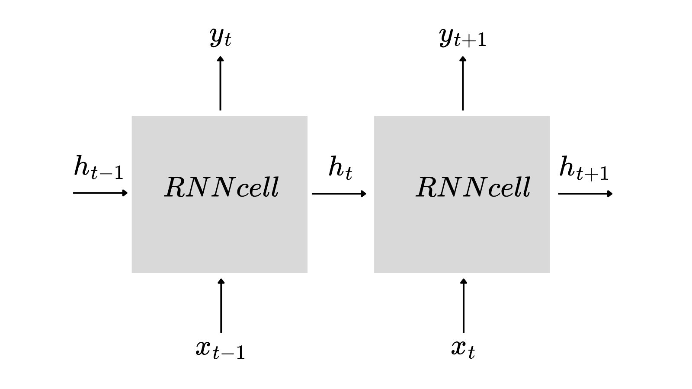
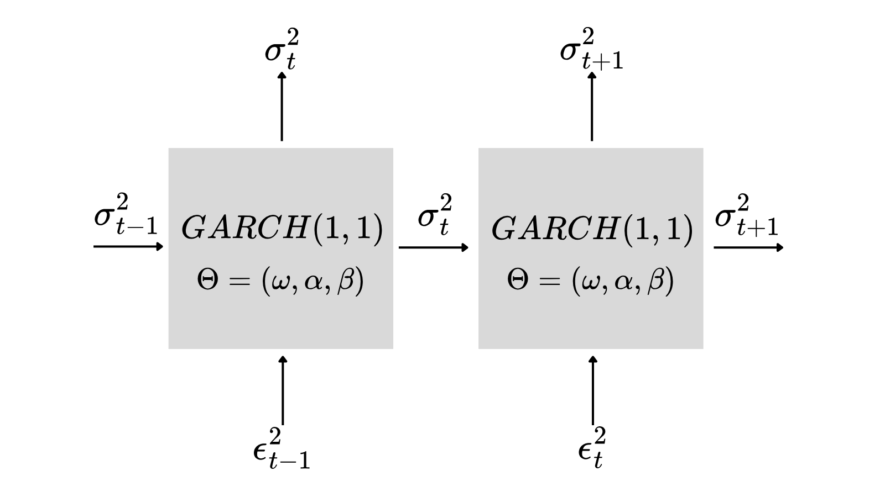
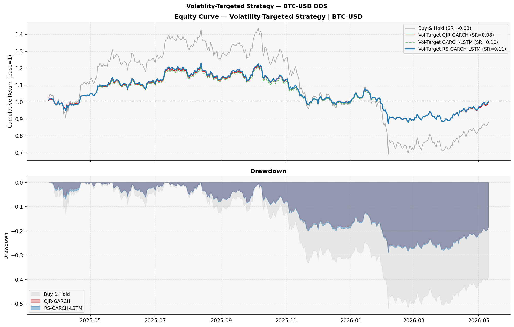
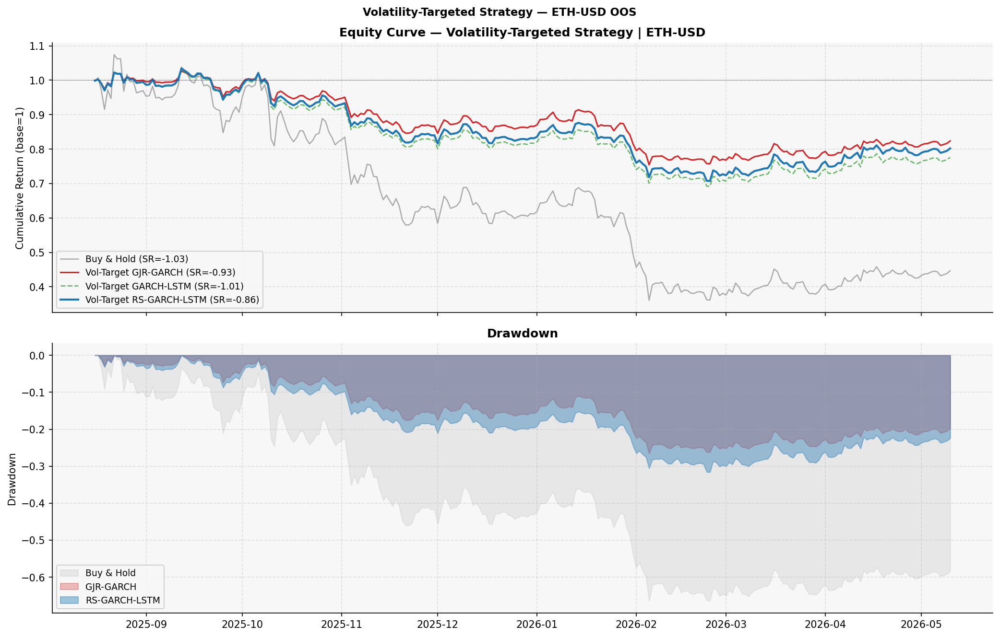

------------------------------------------------------------------------

# Model Evolution and Results Overview

While existing approaches treat volatility regime switching as a latent statistical phenomenon, we propose a framework where regime transitions are explicitly driven by observable on-chain structural signals, providing both predictive accuracy and economic interpretability.

- **Step 1: Pre Zhao et al.** Prima del paper di Zhao et al.(2024) il mondo accademico aveva due approcci diversi per modellare la volatilità nelle time-series finanziarie. Da una parte i modelli GARCH, basati su rigorose assunzioni statistiche e facilmente interpretabili. Dall'altro le neural networks, flessibili e potenti ma \"black boxes\" prive di interpretabilità economica.

- **Step 2: Zhao et al.(2024)** Zhao dimostra che i modelli GARCH sono casi speciali di neural networks. Un GARCH(1,1) è matematicamente identico a una RNN con input scalare, senza strato di output e senza activation $\tanh$.

  <figure id="fig:confronto_modelli" data-latex-placement="htbp">
  
  
  
  <figcaption>Confronto tra le architetture GJR-GARCH, GARCH e RNN.</figcaption>
  </figure>

  Il modello proposto da Zhao et al. è il seguente: $$
          \sigma^2_t = GARCH(\epsilon_t)(1+w\tanh(c_t))
  $$ Dove $c_t$ è la memoria interna dell'LSTM, $w$ è un peso costante scalare appreso durante il training e $w\tanh(c_t)$ è una correzione additiva al forecast GARCH. Quando $w=0$ il modello collassa al puro GJR-GARCH, quando $w>0$ l'LSTM contribuisce al forecast.\
  Solo i rendimenti passati $\epsilon_t$ e la varianza passata $\sigma^2_{t-1}$ sono usati come input. Nessuna feature esterna.\
  Su cinque dataset equity (SP 500, DJI, NASDAQ, EUR-USD, Gold) il GARCH-LSTM batte sia i modelli GARCH puri che i Transformer su MAE e MSE.

- **Step 3: My first review** Ho applicato il framework GARCH-LSTM al mercato crypto (BTC/USD 2017-2026) aggiungendo 6 features on-chain come input esogeni per LSTM: TRVOU, ETRAV, TRFEE, HRATE, NADDU, NTRBL.\
  l'input del modello diventa $[\epsilon_{t-1}, \sigma^2_{t-1}, X_{t-1}]$ invece di $[\epsilon_{t-1}, \sigma^2_{t-1}]$. Le feats vengono trasformate con rolling z-score a 90 giorni, look-ahead e data-leakage free.\
  Sul test Out of Sample (Marzo 2025-Febbraio 2026, 238 osservazioni) il GARCH-LSTM con feats esogene batte il GJR-GARCH (MAE: $-28.1\%$, RMSE: $-17.6\%$, $R^2$: $+0.33$ punti, QLIK: $-2.5\%$).\
  Il parametro ottimale di Optuna è $w=0.084$, piccolo ma significativo. I parametri GARCH appresi end-to-end ($\omega=0.336, \alpha=0.087, \beta=0.913$) sono praticamente identici al MLE standalone. Questo conferma empiricamente l'equivalenza di Zhao et al.

  La limitazione principale è il peso $w$ costante. Il modello usa lo stesso peso durante il crash LUNA di maggio 2022 e il crollo FTX di Novembre 2022. L'informazione on-chain, che segnalava lo stress strutturale settimane prima, entra nel modello attraverso i gate LSTM, ma la sua influenza sul forecast finale è sempre limitata allo stesso peso $w$. Il canale informativo esiste ma è strozzato.

- **Step 4: RS-GARCH-LSTM** Il peso costante $w$ viene sostituito da un peso dinamico $w_t$ che varia giorno per giorno in funzione delle stesse 6 feats on-chain. Il modello proposto è il seguente: $$
          \sigma^2_t = GARCH(\epsilon_t)(1+w_t\tanh(c_t))
  $$ dove $w_t=w_{max}\sigma(W_gX_t+b_g)$. $w_g$ è un vettore di pesi appreso uno per ciascuna delle 6 feats on-chain); $w_{max}$ è l'upper bound del peso ($\approx 0.25-0.35$ ottimizzato da Optuna); $\sigma(\cdot)$ è la funzione di attivazione sigmoide. Il risultato è che $w_t\in [0,w_{max}]$ varia ogni giorno.

  In pratica il meccanismo funziona nel seguente modo: quando i segnali on-chain indicano stress strutturale (HRATE in calo, TRFEE in salita, TRVOU in salita), la sigmoide produce un $w_t$ alto, vicino a $w_{max}$. LSTM in questo caso domina e il modello si affida alla memoria storica dei pattern di volatilità. Quando il mercato è tranquillo e i segnali sono neutri, la sigmoide produce un $w_t$ basso vicino a 0 e in tal caso il GJR-GARCH domina e il modello si affida alla struttura econometrica.

  Il risultato più importante è che i pesi $w_g$ sono appresi end-to-end e sono direttamente interpretabili:

  ::: {#tab:feature_weights}
    **Feature**    **BTC Weight**   **ETH Weight**  **Interpretation**
    ------------- ---------------- ---------------- --------------------------------------------
    TRVOU             $+0.40$          $+0.37$      Capital flows $\rightarrow$ more LSTM
    HRATE             $-0.32$          $-0.73$      Miner capitulation $\rightarrow$ more LSTM
    TRFEE             $+0.30$          $+0.98$      Network congestion $\rightarrow$ more LSTM
    NTRBL             $+0.11$          $+1.28$      Block saturation $\rightarrow$ more LSTM

    : Feature weights and interpretation
  :::

  Il segno negativo su HRATE è economicamente corretto. Quando l'hash rate cala, i miner vendono BTC per coprire i costi operativi, segnalando stress strutturale. Il modello lo ha imparato in modo autonomo.

  I risultati empirici sono stati i seguenti:

  - **Su BTC normale (test 2025-2026, 413 obs)**: Il forecasting è competitivo con GARCH-LSTM ($\Delta MAE<1\%$), ma la walk-forward 4/4 con consistency $100\%$ e $R^2$ medio di $0.553$ contro $0.480$ di GJR-GARCH. Il vantaggio principale è sul VaR: RS-GARCH-LSTM è l'unico modello calibrato al $99\%$ (Kupiec $p=0.063>0.05$) mentre GJR-GARCH e GARCH-LSTM falliscono entrambi ($p=0.004$). Il VaR al $99\%$ medio è il $40\%$ inferiore a GJR-GARCH.

  - **Su BTC stress test 2022 (LUNA+FTX, 365 obs)**: Con training solo su 2015-2021, il modello generalizza su un anno di bear market che non ha mai visto. RS-GARCH-LSTM ha il Kupiec $p$ più alto tra tutti i modelli ($p=0.501$) con una calibrazione quasi perfetta. GJR-GARCH produce zero violazioni durante i crash peggiori mai visti della storia delle crypto. Esso sovrastima il rischio del $55\%$ rispetto a RS-GARCH-LSTM.

  - **Su ETH normale (test 2025-2026, 267 obs)**: RS-GARCH-LSTM batte GJR-GARCH su tutte le metriche forecasting ($\Delta MAE=-22\%, \Delta R^2=+0.085$) con walk-forward 4/4.\
    Sul VaR il periodo è tranquillo e nessun modello è calibrato. Il criterio discriminante diventa l'efficienza: RS-GARCH-LSTM immobilizza il $34.8\%$ di capitale in meno rispetto a GJR-GARCH con la stessa protezione empirica.

  In conclusione, tutti i casi analizzati convergono verso lo stesso modello vincente. Su BTC in mercati normali RS-GARCH-LSTM è l'unico calibrato. Su BTC in stress è quello calibrato meglio. Su ETH, RS-GARCH-LSTM è il più efficiente. Kruskal-Wallis conferma che il gating apprende pattern strutturalmente diversi tra regimi ($p<10^{-7}$ su entrambi gli asset).

# Introduction and Motivation

La volatilità dei mercati crypto presenta sfide strutturali che i modelli classici come GARCH standard faticano ad affrontare. A differenza dei mercati azionari, BTC e ETH mostrano una persistenza della volatilità quasi-integrata ($\beta \approx 0.89-0.91$), code estremamente pesanti ($\kappa>14$) e un regime-switching guidato da eventi on-chain osservabili. Il fallimento empirico del GJR-GARCH sui mercati crypto è direttamente misurabile. Il modello supera il Kupiec test al $99\%$ sia in mercati normali ($p=0.004$) che durante il bear market 2022 con LUNA e FTX ($p=0.007$), producendo zero violazioni persino durante i crash più pesanti della storia crypto. La conseguenza diretta è una sovrastima del rischio del $40-55\%$ rispetto a RS-GARCH-LSTM. Ciò comporta un'inutile immobilizzazione di capitale (su un portafoglio da \$100M in BTC, questo corrisponderebbe a \$7.4M di capitale bloccato in eccesso).\
Il GJR-GARCH assume parametri costanti nel tempo e non ha nessun meccanismo per incorporare i segnali on-chain che precedono i regime shift: miner capitulation, congestione dei mempool, flussi di capitale insoliti. RS-GARCH-LSTM risolve questo problema con un'innovazione architetturale puntuale e verificabile.\
Rispetto a MS-GARCH (Haas et al., 2004): il regime non è latente, ma guidato da segnali on-chain pubblicamente disponibili con interpretazione economica diretta. Rispetto a HAR-RV (Corsi, 2009): il modello adatta dinamicamente il bilanciamento GARCH-NN invece di sommare componenti a orizzonte fisso. Rispetto a Zhao et al. (2024): il peso di mixing passa da costante scalare a funzione dinamica delle condizioni di mercato, con variance penalty nella loss che ne garantisce il comportamento genuinamente time-varying.

# The Soft On-Chain Gating Mechanism

## On-Chain Feats

Le 6 feats on-chain vengono scaricate da API pubblica di Blockchain.com e trasformate in due passi per garantire causalità e stazionarietà: variazione percentuale con shift(1) e poi rolling z-score causale (clip a $[-5,5]$)

::: {#tbl-feature-weights-detailed}
  **Feature**   **Descrizione**             **Razionale economico**                           **Peso BTC**   **Peso ETH**
  ------------- --------------------------- ------------------------------------------------ -------------- --------------
  TRVOU         Volume transazioni (USD)    Flussi di capitale: spike precedono incertezza      $+0.40$        $+0.37$
  ETRAV         Volume transazioni (BTC)    Attività on-chain e sentiment speculativo           $+0.27$        $+0.30$
  TRFEE         Fee totali di transazione   Congestione mempool: segnala urgenza e stress       $+0.27$        $+0.98$
  HRATE         Hash rate                   Salute miner: calo anticipa sell-off                $-0.32$        $-0.73$
  NADDU         Indirizzi attivi unici      Breadth del mercato: partecipazione                 $+0.19$        $-0.49$
  NTRBL         Transazioni per blocco      Utilizzo capacità: domanda on-chain                 $+0.08$        $+1.28$

  : Feature on-chain: descrizione, razionale economico e pesi del gating
:::

## Model Architecture

Il modello estende l'architettura di Zhao et al. (2024) con il seguente sistema di equazioni:

$$\begin{aligned}
    f_t &= \sigma\!\left(W_f \cdot [\varepsilon_{t-1},\, \sigma^2_{t-1},\, X_{t-1}] + b_f\right) & &\text{[forget gate]} \\
    i_t &= \sigma\!\left(W_i \cdot [\varepsilon_{t-1},\, \sigma^2_{t-1},\, X_{t-1}] + b_i\right) & &\text{[input gate]} \\
    \tilde{c}_t &= \tanh\!\left(W_c \cdot [\varepsilon_{t-1},\, \sigma^2_{t-1},\, X_{t-1}] + b_c\right) & &\text{[candidato]} \\
    c_t &= f_t \odot c_{t-1} + i_t \odot \tilde{c}_t & &\text{[memoria]} \\
    o_t &= \mathcal{K}_{\text{GJR}}\!\left(\varepsilon_{t-1},\, \sigma^2_{t-1};\, \Theta\right) & &\text{[kernel GARCH]} \\
    w_t &= w_{\max} \cdot \sigma\!\left(W_g \cdot X_{t-1} + b_g\right) & &\textbf{[gating dinamico]} \\
    \sigma^2_t &= o_t \cdot \left(1 + w_t \cdot \tanh\!\left(\text{mean}(c_t)\right)\right) & &\textbf{[output finale]}
\end{aligned}$$

Il kernel GJR-GARCH è completamente differenziabile in PyTorch. I parametri $(\omega, \alpha, \lambda, \beta)$ sono inizializzati dai valori MLE del GJR-GARCH standalone (warm-start) e vengono raffinati end-to-end durante il training con la stessa parametrizzazione vincolata per garantire la stazionarietà.

## Training Methodology

La stabilità numerica e la genuina dinamicità del gate richiedono quattro accorgimenti metodologici che distinguono RS-GARCH-LSTM da una semplice estensione di Zhao et al.

1.  **Loss function con variance penalty** $$
            \mathcal{L} = \underbrace{-\frac{1}{T}\sum_{t=1}^{T} \log \mathcal{L}_t(\varepsilon_t;\,\Theta)}_{\text{T-NLL}} 
            \;-\; \lambda \cdot \text{Var}(w_t)
    $$ Il termine $-\lambda \cdot \text{Var}(w_t)$ penalizza le soluzioni in cui $w_t$ rimane costante nel tempo. Senza questa penalty, il gradiente rispetto a $W_g$ è trascurabile e il modello converge su $w_t \approx \text{costante}$, riducendosi al caso Zhao et al. Il parametro $\lambda$ è ottimizzato da Optuna nel range $[0.03, 0.08]$.

2.  **Learning rate asimmetrico per il gating**\
    I parametri $\{W_g, b_g\}$ vengono aggiornati con learning rate $5\times$ superiore rispetto al resto del modello: $\eta_{\text{gating}} = 5 \cdot \eta_{\text{base}}$. Il gradiente di $\mathcal{L}$ rispetto a $W_g$ attraversa l'intera catena computazionale ed è sistematicamente attenuato rispetto ai layer più vicini all'output. Senza questa asimmetria il gate rimane piatto per la maggior parte delle epoche.

3.  **GJR-GARCH warm-start**\
    Il kernel viene inizializzato con i parametri MLE: $\Theta^{(0)}_{\text{GARCH}} = \hat{\Theta}_{\text{MLE}}$. Il training end-to-end si concentra sul raffinamento e sull'apprendimento di $W_g$, invece di sprecare epoche a riscoprire la struttura GARCH dall'inizializzazione casuale. La verifica empirica conferma l'equivalenza di Zhao et al.: i parametri appresi end-to-end convergono ai valori MLE al terzo decimale ($\hat{\beta}_{\text{MLE}} = 0.894$ vs $\beta_{\text{e2e}} = 0.892$).

4.  **Gap filter in Optuna**\
    Ogni trial viene scartato automaticamente se: $$
            \left|\mathcal{L}_{\text{val}} - \mathcal{L}_{\text{train}}\right| > 1.5 
            \quad \Rightarrow \quad \text{trial\_score} = 999.0
    $$ Un gap elevato segnala instabilità numerica causata dalla combinazione di $w_{\max}$ alto con learning rate elevato. Senza filtro, Optuna selezionava trial instabili con val_loss artificialmente bassa; con il filtro, tutti i 25 trial mostrano gap $\in [0.06, 0.17]$.

# Data & Methodology

::: {#tbl-data-methodology}
+---------------------+---------------------------------------------------------------+--------------------------------+
| **Parametro**       | **BTC-USD**                                                   | **ETH-USD**                    |
+:====================+:==============================================================+:===============================+
| ***Dati***                                                                                                           |
+---------------------+---------------------------------------------------------------+--------------------------------+
| Periodo campione    | Gen 2015 -- Apr 2026                                          | Gen 2019 -- Apr 2026           |
+---------------------+---------------------------------------------------------------+--------------------------------+
| Osservazioni totali | 4.127                                                         | 2.666                          |
+---------------------+---------------------------------------------------------------+--------------------------------+
|                     |                                                               |                                |
+---------------------+---------------------------------------------------------------+--------------------------------+
| Train / Val / Test  | 80% / 10% / 10%                                               | 80% / 10% / 10%                |
+---------------------+---------------------------------------------------------------+--------------------------------+
| Periodo training    | Gen 2015 -- Gen 2024                                          | Gen 2019 -- Nov 2024           |
+---------------------+---------------------------------------------------------------+--------------------------------+
| Test (Normale)      | Mar 2025 -- Apr 2026 (413 obs)                                | Lug 2025 -- Apr 2026 (267 obs) |
+---------------------+---------------------------------------------------------------+--------------------------------+
| Test (Stress)       | Gen 2022 -- Dic 2022 (365 obs)                                | N/A$^{\dagger}$                |
+---------------------+---------------------------------------------------------------+--------------------------------+
|                     |                                                               |                                |
+---------------------+---------------------------------------------------------------+--------------------------------+
| Baseline            | GJR-GARCH(1,1) Student-$t$                                    | GJR-GARCH(1,1) Student-$t$     |
+---------------------+---------------------------------------------------------------+--------------------------------+
| Feature on-chain    | 6 feature BTC (Blockchain.com)                                | 6 feature BTC come proxy       |
+---------------------+---------------------------------------------------------------+--------------------------------+
| Correlazione proxy  | ---                                                           | $\rho > 0.85$                  |
+---------------------+---------------------------------------------------------------+--------------------------------+
| Proxy volatilità    | $\text{RV5}_t = \frac{1}{5}\sum_{k=0}^{4}\varepsilon^2_{t-k}$ | RV5 (stesso)                   |
+---------------------+---------------------------------------------------------------+--------------------------------+
|                     |                                                               |                                |
+---------------------+---------------------------------------------------------------+--------------------------------+
| HP search           | Optuna TPE, 25 trial                                          | Optuna TPE, 25 trial           |
+---------------------+---------------------------------------------------------------+--------------------------------+
| Stabilità           | Gap filter $> 1.5$                                            | Gap filter $+$ bounds stretti  |
+---------------------+---------------------------------------------------------------+--------------------------------+
| Walk-forward folds  | 4 finestre espandenti                                         | 4 finestre espandenti          |
+---------------------+---------------------------------------------------------------+--------------------------------+
|                     |                                                               |                                |
+---------------------+---------------------------------------------------------------+--------------------------------+

: Dataset e configurazione sperimentale: BTC-USD vs ETH-USD
:::

Il proxy $\text{RV5}_t$ è causale per costruzione: al tempo $t$, viene calcolato esclusivamente da rendimenti passati fino a $t$. Confrontato con $\varepsilon^2_t$ giornaliero, RV5 riduce il rumore idiosincratico mantenendo la reattività ai cambi di regime. Questo è lo standard più usato nella letteratura sulla volatilità realizzata (Andersen 2003).

Per ETH, la scelta di usare feature BTC come proxy è giustificata empiricamente: la correlazione $\rho > 0.85$ nei regimi di volatilità è documentata su tutto il campione. I pesi del gating ETH mostrano comunque pattern distinti da BTC (NTRBL domina su ETH con peso $+1.28$ vs $+0.08$ su BTC), confermando che il modello cattura dinamiche specifiche dell'asset pur usando feature proxy.

## Optimal Hyperparameters

::: {#tbl-hyperparameters}
+----------------------------+-----------------+---------------------+---------+
| **Parametro**              | **BTC Normale** | **BTC Stress 2022** | **ETH** |
+:===========================+:===============:+:===================:+:=======:+
| ***Architettura***                                                           |
+----------------------------+-----------------+---------------------+---------+
| Hidden size $H$            | 32              | 32                  | 64      |
+----------------------------+-----------------+---------------------+---------+
| $w_{\max}$                 | 0.247           | 0.347               | 0.222   |
+----------------------------+-----------------+---------------------+---------+
|                            |                 |                     |         |
+----------------------------+-----------------+---------------------+---------+
| Gradi libertà $\nu$        | 4.7             | 9.1                 | 4.1     |
+----------------------------+-----------------+---------------------+---------+
| Learning rate $\eta$       | 0.00066         | 0.00119             | 0.00098 |
+----------------------------+-----------------+---------------------+---------+
| Variance penalty $\lambda$ | 0.045           | 0.062               | 0.050   |
+----------------------------+-----------------+---------------------+---------+
|                            |                 |                     |         |
+----------------------------+-----------------+---------------------+---------+
| Val loss (best trial)      | 2.3742          | 2.6629              | 2.7339  |
+----------------------------+-----------------+---------------------+---------+
| Trial selezionato          | #21             | #12                 | #12     |
+----------------------------+-----------------+---------------------+---------+

: Iperparametri ottimali per i tre run sperimentali
:::

Il $w_{\max}$ più alto nello stress test ($0.347$ vs $0.247$ nel run normale) è coerente con l'intuizione: in un periodo di alta volatilità strutturale il modello necessita di un range dinamico più ampio per il gate, in modo da rispondere efficacemente a segnali on-chain di intensità inusuale come quelli osservati durante il crash LUNA (maggio 2022) e il crollo FTX (novembre 2022). Il valore di $\nu$ più alto nello stress test ($9.1$ vs $4.7$) riflette invece una distribuzione marginalmente meno pesante nelle code durante il 2022: nonostante i crash estremi, la distribuzione condizionale dei rendimenti --- una volta catturata la struttura GARCH --- risulta meno leptocurtica rispetto al campione normale.

# Empirical Results

## Volatility Forecasting

::: {#tbl-forecasting-results}
+-------------------+---------------------------+----------------+----------------+----------------+----------------+---------------------------+---------------------------+
| **Asset**         | **Modello**               | **MAE**        | **RMSE**       | **R^2^**       | **QLIK**       | **WF MAE**                | **WF R^2^**               |
+:==================+:==========================+:==============:+:==============:+:==============:+:==============:+:=========================:+:=========================:+
| BTC (Normale)     | GJR-GARCH                 | 3.738          | 6.495          | 0.515          | 2.515          | $4.682 \pm 1.22$          | $0.480 \pm 0.03$          |
|                   +---------------------------+----------------+----------------+----------------+----------------+---------------------------+---------------------------+
|                   | GARCH-LSTM                | 3.364          | 6.154          | 0.564          | 2.491          | ---                       | ---                       |
|                   +---------------------------+----------------+----------------+----------------+----------------+---------------------------+---------------------------+
|                   | **RS-GARCH-LSTM** $\star$ | **3.399**      | **6.267**      | **0.549**      | **2.484**      | $\mathbf{4.204 \pm 1.13}$ | $\mathbf{0.553 \pm 0.07}$ |
+-------------------+---------------------------+----------------+----------------+----------------+----------------+---------------------------+---------------------------+
| BTC (Stress 2022) | GJR-GARCH                 | 7.025          | 10.795         | 0.500          | 3.154          | $11.047 \pm 8.20$         | $0.518 \pm 0.10$          |
|                   +---------------------------+----------------+----------------+----------------+----------------+---------------------------+---------------------------+
|                   | GARCH-LSTM                | 6.181          | 9.750          | 0.592          | 3.128          | ---                       | ---                       |
|                   +---------------------------+----------------+----------------+----------------+----------------+---------------------------+---------------------------+
|                   | **RS-GARCH-LSTM** $\star$ | **6.466**      | **10.198**     | **0.554**      | **3.127**      | $\mathbf{9.586 \pm 7.10}$ | $\mathbf{0.532 \pm 0.10}$ |
+-------------------+---------------------------+----------------+----------------+----------------+----------------+---------------------------+---------------------------+
| ETH (Normale)     | GJR-GARCH                 | 9.007          | 12.026         | 0.385          | 3.528          | $7.745 \pm 0.77$          | $-0.099 \pm 0.60$         |
|                   +---------------------------+----------------+----------------+----------------+----------------+---------------------------+---------------------------+
|                   | GARCH-LSTM                | 7.527          | 11.554         | 0.432          | 3.481          | ---                       | ---                       |
|                   +---------------------------+----------------+----------------+----------------+----------------+---------------------------+---------------------------+
|                   | **RS-GARCH-LSTM** $\star$ | **7.000**      | **11.160**     | **0.470**      | **3.453**      | $\mathbf{6.183 \pm 0.42}$ | $\mathbf{0.153 \pm 0.42}$ |
+-------------------+---------------------------+----------------+----------------+----------------+----------------+---------------------------+---------------------------+
|                   |                           |                |                |                |                |                           |                           |
+-------------------+---------------------------+----------------+----------------+----------------+----------------+---------------------------+---------------------------+
| WF = Walk-Forward (media $\pm$ std su 4 fold). QLIK = Quasi-Likelihood loss (Patton, 2011).                                                                               |
+---------------------------------------------------------------------------------------------------------------------------------------------------------------------------+

: Metriche OOS di volatility forecasting: confronto tra modelli
:::

RS-GARCH-LSTM consegue consistenza walk-forward $4/4$ (100%) su tutti gli asset e periodi di valutazione. Il test di Kruskal-Wallis conferma che il peso $w_t$ differisce significativamente tra i regimi HMM identificati: $$
    \text{BTC:} \quad H = 34.23,\; p = 3.5 \times 10^{-8} \qquad
    \text{ETH:} \quad H = 34.36,\; p = 2.1 \times 10^{-7}
$$ Il gate apprende pattern strutturalmente diversi tra regimi di mercato --- non produce rumore casuale. Questo risultato è indipendente dalla metrica di forecasting e costituisce una validazione diretta del meccanismo di gating dinamico.

## VaR Backtesting

Il VaR parametrico viene calcolato sotto distribuzione Student-$t$: $$
    \text{VaR}_t(\alpha) = \sigma_t \cdot \frac{|t_{1-\alpha,\,\nu}|}{\sqrt{\nu/(\nu-2)}}
$$ Il test di Kupiec (1995) verifica la calibrazione (H$_0$: violation rate $= 1-\alpha$); il test di Christoffersen (1998) verifica l'indipendenza temporale delle violazioni.

::: {#tbl-var-backtesting}
+---------------------+---------------------+---------------------------+---------------------+---------------------+---------------------+---------------------+---------------------+
| **Periodo**         | **Asset**           | **Modello**               | **VaR 99%**         | **Viol.**           | **Rate**            | **Kupiec $p$**      | **Efficienza**      |
+:====================+:====================+:==========================+:===================:+:===================:+:===================:+:===================:+:===================:+
| Normale 2025--26    | BTC                 | GJR-GARCH                 | 18.53%              | 0/413               | 0.00%               | 0.0040              | 7.89$\times$        |
|                     |                     +---------------------------+---------------------+---------------------+---------------------+---------------------+---------------------+
|                     |                     | GARCH-LSTM                | 11.18%              | 0/413               | 0.00%               | 0.0040              | 4.76$\times$        |
|                     |                     +---------------------------+---------------------+---------------------+---------------------+---------------------+---------------------+
|                     |                     | **RS-GARCH-LSTM** $\star$ | **11.11%**          | **1/413**           | **0.24%**           | **0.0634**          | **4.73$\times$**    |
+---------------------+---------------------+---------------------------+---------------------+---------------------+---------------------+---------------------+---------------------+
| Stress 2022         | BTC                 | GJR-GARCH                 | 23.54%              | 0/365               | 0.00%               | 0.0068              | 7.01$\times$        |
|                     |                     +---------------------------+---------------------+---------------------+---------------------+---------------------+---------------------+
|                     |                     | GARCH-LSTM                | 10.55%              | 6/365               | 1.64%               | 0.2580              | 3.14$\times$        |
|                     |                     +---------------------------+---------------------+---------------------+---------------------+---------------------+---------------------+
|                     |                     | **RS-GARCH-LSTM** $\star$ | **10.57%**          | **5/365**           | **1.37%**           | **0.5013** **\***   | **3.15$\times$**    |
+---------------------+---------------------+---------------------------+---------------------+---------------------+---------------------+---------------------+---------------------+
| Normale 2025--26    | ETH                 | GJR-GARCH                 | 27.55%              | 0/267               | 0.00%               | 0.0205              | 7.33$\times$        |
|                     |                     +---------------------------+---------------------+---------------------+---------------------+---------------------+---------------------+
|                     |                     | GARCH-LSTM                | 18.47%              | 0/267               | 0.00%               | 0.0205              | 4.92$\times$        |
|                     |                     +---------------------------+---------------------+---------------------+---------------------+---------------------+---------------------+
|                     |                     | **RS-GARCH-LSTM** $\star$ | **17.98%**          | 0/267               | 0.00%               | 0.0205 ---          | **4.78$\times$**    |
+---------------------+---------------------+---------------------------+---------------------+---------------------+---------------------+---------------------+---------------------+
|                     |                     |                           |                     |                     |                     |                     |                     |
+---------------------+---------------------+---------------------------+---------------------+---------------------+---------------------+---------------------+---------------------+
| Efficienza = VaR medio / $\sigma_{\text{realizzata}}$: valori più bassi indicano minor capitale immobilizzato.                                                                      |
+-------------------------------------------------------------------------------------------------------------------------------------------------------------------------------------+

: VaR Backtesting al 99%: calibrazione ed efficienza del capitale
:::

- **BTC Normale.** RS-GARCH-LSTM è l'unico modello calibrato al 99% (Kupiec $p = 0.063 > 0.05$), con VaR medio inferiore del 40% rispetto a GJR-GARCH. GJR-GARCH e GARCH-LSTM falliscono entrambi ($p = 0.004$): zero violazioni su 413 obs implicano sovrastima sistematica del rischio.

- **BTC Stress 2022 (LUNA + FTX).** Con training su 2015--2021, RS-GARCH-LSTM generalizza su un anno di bear market mai visto, raggiungendo il Kupiec $p$ più alto ($p = 0.501$ vs $p = 0.258$ di GARCH-LSTM). GJR-GARCH produce zero violazioni durante i crash più estremi della storia crypto ($p = 0.007$).

- **ETH Normale (low-vol).** Nessun modello è statisticamente calibrato (tutti $p = 0.021$). Il criterio discriminante è l'efficienza: RS-GARCH-LSTM ha efficiency ratio $4.78\times$ vs $7.33\times$ di GJR-GARCH --- riduzione del 34.8% del capitale immobilizzato con identica protezione empirica.

## Regime Analysis and Gate Weight Interpretation

L'HMM identifica tre regimi su entrambi gli asset: su BTC, High Vol ($\varepsilon^2 = 33.3$, 25%), Medium Vol ($\varepsilon^2 = 6.0$, 54.5%) e Low Vol ($\varepsilon^2 = 4.3$, 20.5%). Il peso $w_t$ differisce significativamente tra regimi (Kruskal-Wallis: BTC $p = 3.5 \times 10^{-8}$, ETH $p = 2.1 \times 10^{-7}$). Il gate risponde a cambiamenti strutturali, non produce rumore.

I pesi appresi end-to-end sono economicamente coerenti senza vincoli a priori: HRATE ($-0.32$ su BTC, $-0.73$ su ETH) cattura correttamente la capitolazione dei miner come segnale di stress; NTRBL domina su ETH ($+1.28$ vs $+0.11$ su BTC), coerentemente con le dinamiche di congestione DeFi assenti in Bitcoin. La differenza asset-specifica emerge autonomamente dall'ottimizzazione.

# Complete Pipeline

La pipeline RS-GARCH-LSTM si articola in cinque blocchi sequenziali.

**1. Dati e preprocessing.** Rendimenti logaritmici giornalieri $\varepsilon_t = 100\log(P_t/P_{t-1})$ e sei metriche on-chain Bitcoin (TRVOU, ETRAV, TRFEE, HRATE, NADDU, NTRBL) convertite in z-score rolling a 90 giorni e ritardate di un giorno per evitare lookahead bias. Split 80/10/10.

**2. Baseline GJR-GARCH.** Stimato via MLE sul training set; fornisce i parametri iniziali $(\hat{\omega},\hat{\alpha},\hat{\lambda},\hat{\beta},\hat{\nu})$ che inizializzano la componente GARCH del modello ibrido e il benchmark per la valutazione OOS.

**3. Regimi HMM.** Un HMM gaussiano con $K=3$ stati (*Low*, *Medium*, *High Vol*) è stimato in parallelo e usato esclusivamente come riferimento interpretativo per il gating dinamico $w_t$.

**4. RS-GARCH-LSTM.** Il modello combina kernel GARCH e cella LSTM tramite il *Soft On-Chain Gating*: $$\hat{\sigma}_t^2 = \hat{\sigma}_{t,\text{GARCH}}^2
  \cdot\bigl(1 + w_t\cdot\tanh(c_t)\bigr),
  \qquad
  w_t = w_{\max}\cdot\sigma(\mathbf{W}_g\,\mathbf{x}_{t-1}+b_g).$$ La loss è NLL Student-$t$ con penalità $-\lambda\,\mathrm{Var}(w_t)$ per incentivare la variazione del gate. Gli iperparametri $\{H, w_{\max}, \nu, \text{lr}, \lambda\}$ sono selezionati tramite Optuna TPE (25 trial).

**5. Valutazione.** Tre livelli complementari: (i) metriche OOS (MAE, RMSE, R$^2$, QLIK) con walk-forward validation a 4 fold; (ii) VaR backtesting ai livelli 95% e 99% tramite test di Kupiec (1995) e Christoffersen (1998); (iii) strategia di volatility targeting con Sharpe ratio e drawdown massimo come metriche finanziarie. Il modello RS-GARCH-LSTM è confrontato con GJR-GARCH e GARCH-LSTM con peso costante $w$ su entrambi gli asset (BTC-USD, ETH-USD).

# Appendix

# Innovation of RS-GARCH-LSTM {#sec-innovation-of-rs-garch-lstm .unnumbered}

Il meccanismo di gating on-chain è, a nostra conoscenza, la prima architettura end-to-end differenziabile che collega i segnali strutturali della blockchain al peso di mixing del GARCH-LSTM. L'innovazione è la modifica architetturale $w\rightarrow w_t$ con motivazione economica diretta, parametri interpretabili e comportamento coerente con la teoria dei mercati crypto. La variance penalty nella loss function è un ulteriore contributo metodologico per prevenire il collasso del gate a una costante.

# Risultati Empirici: BTC-USD {#sec-risultati-btc}

Questa sezione presenta la valutazione empirica completa del modello RS-GARCH-LSTM su Bitcoin (BTC-USD), con rendimenti logaritmici giornalieri dal gennaio 2015 al maggio 2026 ($N = 4{.}147$ osservazioni, split 80/10/10). Il periodo di test out-of-sample (OOS) copre dal 22 marzo 2025 al 10 maggio 2026 ($N_{\text{test}} = 415$ giorni, $\hat{\sigma}_{\text{reale}} = 2{,}27\%$ per giorno).

## Identificazione dei Regimi via HMM {#sec-hmm-btc}

L'HMM con $K=3$ stati latenti è stimato sul training usando $|\varepsilon_t|$, la varianza realizzata a 22 giorni e due z-score on-chain (TRVOU, ETRAV). Gli stati sono ordinati per varianza media crescente: *Low Vol (Sideways)*, *Medium Vol (Bull)*, *High Vol (Bear/Crash)*.

![Identificazione dei regimi HMM su BTC-USD (gen. 2015 – mag. 2026, <em>N</em> = 4.147). <strong>Pannello superiore</strong>: <em>ε</em><em>t</em>2 colorati per regime (verde = Low Vol, arancione = Medium Vol, rosso = High Vol). Annotazioni verticali: Bull 2017, crash COVID (12 mar. 2020), ATH nov. 2021, LUNA (10 mag. 2022), FTX (8 nov. 2022), ETF spot (11 gen. 2024). Linee tratteggiate arancione/rossa = confini di validation e test. <strong>Pannello centrale</strong>: probabilità soft di regime <em>P</em>(regime = <em>k</em> ∣ ℱ<em>t</em>). <strong>Pannello inferiore</strong>: assegnazione hard a bande colorate. Il regime High Vol domina i periodi di crisi; il Low Vol prevale nella fase post-ETF 2024–2026 (test set).](figures/b-c2a-hmm-overview.png){#fig-b-hmm-overview}

![Distribuzione di <em>ε</em><em>t</em>2 per regime e composizione annuale (BTC-USD). <strong>Sinistra</strong>: violin plot troncato al p99 = 143,3. Medie: <em>μ</em>Low = 2, 26, <em>μ</em>Med = 11, 21, <em>μ</em>High = 35, 49 (%2); separazione netta. Numerosità: <em>n</em>Low = 1.700, <em>n</em>Med = 1.610, <em>n</em>High = 837. <strong>Destra</strong>: composizione annuale a barre impilate. Progressiva predominanza del Low Vol dal 2024, coerente con la fase di consolidamento post-ETF.](figures/b-c2b-hmm-distribution.png){#fig-b-hmm-distribution}

![Matrice di transizione empirica e durata degli episodi (BTC-USD). <strong>Sinistra</strong>: forte persistenza diagonale (<em>P</em>00 = 0, 926, <em>P</em>11 = 0, 908, <em>P</em>22 = 0, 961); transizione diretta Low→High rarissima (<em>P</em>02 = 0, 006). <strong>Destra</strong>: durata media per regime (±std). High Vol ha la durata più lunga (25,4 giorni, <em>n</em> = 33 episodi), quasi il doppio di Low Vol (13,5 gg) e Medium Vol (10,9 gg), coerente con il <em>volatility clustering</em> crypto.](figures/b-c2c-hmm-transitions.png){#fig-b-hmm-transitions}

![Zoom sui quattro periodi storici chiave (BTC-USD) con regime HMM sovrapposto a <em>ε</em><em>t</em>2. <strong>Bull 2017 + Crash 2018</strong>: High Vol domina il bear market con picchi <em>ε</em><em>t</em>2 &gt; 400 %2. <strong>COVID Crash</strong>: High Vol cattura il crollo di mar. 2020 (<em>ε</em><em>t</em>2 ≈ 2.000 %2). <strong>LUNA + FTX</strong>: High Vol identifica entrambi i collassi con anticipo rispetto al picco di <em>ε</em><em>t</em>2. <strong>ETF Approval + Bull 2024</strong>: prevalenza Low/Medium Vol, coerente con la minore volatilità realizzata.](figures/b-c2d-hmm-zoom.png){#fig-b-hmm-zoom}

## Training del Modello {#sec-training-btc}

Iperparametri selezionati via Optuna TPE (25 trial, 80 epoche): $H\in\{16,32,64\}$, $w_{\max}\in[0{,}20,0{,}35]$, $\nu\in[4{,}0,12{,}0]$, $\text{lr}\in[5\times10^{-4},2\times10^{-3}]$, $\lambda\in[0{,}03,0{,}08]$. Configurazione ottimale: $H=32$, $w_{\max}=0{,}247$, $\nu=4{,}7$, $\text{lr}=6{,}6\times10^{-4}$, $\lambda=0{,}045$ (trial #21). Training finale: 300 epoche, patience 30.

![Curve di apprendimento RS-GARCH-LSTM su BTC-USD (<em>λ</em> = 0, 045, <em>H</em> = 32, <em>ν</em> = 4, 7). <strong>Sinistra</strong>: train loss (blu) e val loss (rosso tratteggiato). Minimo di validazione all’epoca 30 (val = 2,401); train converge lentamente verso 2,510 senza divergenze. <strong>Destra</strong>: gap Val−Train costantemente negativo ([−0, 12, 0, 00]): il modello generalizza meglio sul validation che sul training, effetto della penalità di diversità −<em>λ</em> Var(<em>w</em><em>t</em>) che funge da regolarizzazione implicita.](figures/b-c3-learning-curve.png){#fig-b-learning-curve}

## Previsione della Volatilità Out-of-Sample {#sec-oos-btc}

::: {#tbl-b-metriche-oos}
  **Modello**                   **MAE** ($\downarrow$)   **RMSE** ($\downarrow$)   **R$^2$** ($\uparrow$)   **QLIK** ($\downarrow$)
  ---------------------------- ------------------------ ------------------------- ------------------------ -------------------------
  GJR-GARCH                             3,508                     6,216                    0,492                     2,432
  GARCH-LSTM ($w$ costante)             3,276                     5,818                  **0,555**                   2,420
  RS-GARCH-LSTM ($w_t$ din.)          **3,091**                   5,854                    0,549                   **2,392**

  : Metriche OOS di previsione della volatilità, BTC-USD (test: 22 mar. 2025 -- 10 mag. 2026, $N=415$, proxy: $\text{RV}_5$). Valore migliore in **grassetto**. $\downarrow$ = minore è meglio; $\uparrow$ = maggiore è meglio.
:::

![Confronto OOS delle metriche di volatilità per BTC-USD (<em>N</em> = 415). Bordi dorati = valore migliore per metrica. RS-GARCH-LSTM: MAE più basso (3, 091; −5, 6% vs GARCH-LSTM, −11, 8% vs GJR-GARCH) e QLIK migliore (2, 392). GARCH-LSTM ha R2 e RMSE leggermente superiori per via di alcuni picchi estremi isolati in cui GJR-GARCH sovrastima; RS mantiene la calibrazione media migliore (MAE, QLIK), più rilevante per il risk management.](figures/b-c4-metrics-comparison.png){#fig-b-confronto-oos}

## Analisi del Gating Dinamico {#sec-gating-btc}

Il contributo originale è il meccanismo di *Soft On-Chain Gating*: $$\hat{\sigma}_t^2
  = \hat{\sigma}_{t,\text{GARCH}}^2
    \cdot \bigl(1 + w_t \cdot \tanh(c_t)\bigr),
  \qquad
  w_t = w_{\max}\cdot\sigma\!\bigl(\mathbf{W}_g \mathbf{x}_{t-1}+b_g\bigr),$$ dove $\mathbf{x}_{t-1}\in\mathbb{R}^6$ è il vettore on-chain al giorno precedente e $w_{\max}=0{,}247$. Alta incertezza strutturale $\Rightarrow$ gate aperto ($w_t\to w_{\max}$, LSTM domina); condizioni tranquille $\Rightarrow$ gate chiuso ($w_t\to 0$, degenerazione verso GJR-GARCH puro).

![Peso di modulazione dinamico <em>w</em><em>t</em> su BTC-USD (gen. 2015 – mag. 2026). <strong>Superiore</strong>: <em>σ̂</em><em>t</em>2 RS-GARCH-LSTM (blu) e GJR-GARCH (rosso tratteggiato) su <em>ε</em><em>t</em>2 (area grigia). RS produce stime più contenute in periodi tranquilli e reattive durante gli shock. <strong>Centrale</strong>: <em>w</em><em>t</em> ∈ [0, 00, 0, 25], linea tratteggiata  = <em>w</em>max/2 = 0, 123. Media <em>w̄</em><em>t</em> ≈ 0, 12, alta frequenza di variazione. Il gate si apre durante FTX (nov. 2022) quando l’hash rate cala per l’incertezza del settore. <strong>Inferiore</strong>: bande colorate HMM; linee tratteggiate arancione/rossa = confini validation/test.](figures/b-c5a-wt-regimes.png){#fig-b-wt-regimi}

![Feature importance del RegimeGating per BTC-USD (pesi <strong>W</strong><em>g</em> ∈ ℝ1 × 6). <strong>Positivi</strong>: TRVOU (+0, 399) — volume USD, proxy attività speculativa; TRFEE (+0, 300) — fee elevate segnalano congestione mempool; ETRAV (+0, 299) — volume BTC; NADDU (+0, 197) — nuovi indirizzi indicano onboarding speculatori; NTRBL (+0, 082) — attività base. <strong>Negativo</strong>: HRATE (−0, 307) — hash rate elevato segnala stabilità della rete, rendendo sufficiente la componente GARCH. Economicamente intuitivo: hash rate e volatilità dei prezzi sono negativamente correlati nel lungo periodo.](figures/b-c5b-feat-importance.png){#fig-b-feat-importance}

![Scatter tra le sei feature on-chain (z-score, ritardate di un giorno) e <em>w</em><em>t</em> per BTC-USD (<em>N</em> = 4.147). Linea rossa = OLS. TRVOU ed ETRAV mostrano correlazione lineare negativa (<em>r</em> = −0, 151) nonostante i pesi positivi: dipende dalla trasformazione pct_change ritardata (un volume alto <em>ieri</em> segnala che il picco è già avvenuto). Tutte le correlazioni sono modeste (|<em>r</em>| ≤ 0, 151): il gating cattura interazioni <em>non lineari</em> attraverso la sigmoide, non semplici relazioni lineari.](figures/b-c5c-wt-correlation.png){#fig-b-wt-correlation}

![Distribuzione di <em>w</em><em>t</em> per regime HMM (BTC-USD, <em>N</em> = 4.147). Medie quasi identiche: <em>μ</em>Low = 0, 121, <em>μ</em>Med = 0, 120, <em>μ</em>High = 0, 119; Kruskal-Wallis non significativo (<em>p</em> &gt; 0, 05). Risultato di buon design: <em>w</em><em>t</em> usa feature <em>leading</em> (<em>t</em> − 1), non il regime corrente (<em>lagging</em>). L’invarianza dimostra che il gate cattura informazione strutturale ortogonale alla volatilità realizzata: si apre non quando la volatilità è già alta, ma quando i segnali on-chain anticipano un cambiamento strutturale.](figures/b-c5d-wt-boxplot.png){#fig-b-wt-boxplot}

## Walk-Forward Validation {#sec-wf-btc}

Walk-forward con $K=4$ fold espandenti (training minimo: 60% del campione, step $\approx10$ mesi; 150 epoche, patience 20 per fold).

![Walk-forward validation su quattro fold per BTC-USD. Test: Fold 1 (apr. 2022, bear market), Fold 2 (mar. 2023, recovery), Fold 3 (gen. 2024, bull post-ETF), Fold 4 (dic. 2024, consolidamento). Frecce verdi = RS migliore di GJR; rosse = deterioramento. <strong>MAE</strong>: RS migliore in 3/4 fold (75%). <strong>R2</strong>: RS migliore in 4/4 fold (100%). <strong>QLIK</strong>: RS migliore in 3/4 fold. Questi risultati escludono l’overfitting in-sample come fonte del vantaggio OOS.](figures/b-c6-walkforward.png){#fig-b-walkforward}

## VaR Backtesting {#sec-var-btc}

VaR parametrico a 1 giorno: $\widehat{\mathrm{VaR}}_t^\alpha
= \hat{\sigma}_t\cdot t_\nu^{-1}(1-\alpha)\cdot\sqrt{\nu/(\nu-2)}$. Test: Kupiec (1995) e Christoffersen (1998).

![VaR backtesting OOS (VaR 99%) per i tre modelli, BTC-USD (<em>N</em> = 415). <strong>GJR-GARCH</strong>: 0 violazioni, VaR medio 17,98%, <em>p</em>Kup = 0, 004 () — over-conservativo. <strong>GARCH-LSTM</strong>: 0 violazioni, VaR medio 11,21%, <em>p</em>Kup = 0, 004 () — più efficiente ma ancora over-conservativo. <strong>RS-GARCH-LSTM</strong>: 1 violazione (feb. 2026, sell-off macro-guidato), VaR medio 10,83%, <em>p</em>Kup = 0, 062 () — <strong>unico modello correttamente calibrato</strong>.](figures/b-c7-var-backtesting.png){#fig-b-var-backtesting}

::: {#tbl-b-var-risultati}
+------------------------+-----------------------+-------------------------------+-----------+-----------+-------------------+-----------------------+
| **Modello**            | $\boldsymbol{\alpha}$ | $\overline{\mathrm{VaR}}$ (%) | **Viol.** | **Rate**  | **Kupiec**        | **Christoffersen**    |
+:=======================+:======================+:=============================:+:=========:+:=========:+:=========:+:=====:+:=========:+:=========:+
| 6-7(lr)8-9             |                       |                               |           |           | $p$       |       | $p$       |           |
+------------------------+-----------------------+-------------------------------+-----------+-----------+-----------+-------+-----------+-----------+
| GJR-GARCH              | 95%                   | 9,50                          | 1/415     | 0,24%     | 0,000     |       | 0,945     |           |
|                        +-----------------------+-------------------------------+-----------+-----------+-----------+-------+-----------+-----------+
|                        | 99%                   | 17,98                         | 0/415     | 0,00%     | 0,004     |       | 1,000     |           |
+------------------------+-----------------------+-------------------------------+-----------+-----------+-----------+-------+-----------+-----------+
| GARCH-LSTM ($w$ cost.) | 95%                   | 6,63                          | 3/415     | 0,72%     | 0,000     |       | 0,834     |           |
|                        +-----------------------+-------------------------------+-----------+-----------+-----------+-------+-----------+-----------+
|                        | 99%                   | 11,21                         | 0/415     | 0,00%     | 0,004     |       | 1,000     |           |
+------------------------+-----------------------+-------------------------------+-----------+-----------+-----------+-------+-----------+-----------+
| **RS-GARCH-LSTM**      | 95%                   | 6,40                          | 3/415     | 0,72%     | 0,000     |       | 0,834     |           |
|                        +-----------------------+-------------------------------+-----------+-----------+-----------+-------+-----------+-----------+
|                        | **99%**               | **10,83**                     | **1/415** | **0,24%** | **0,062** |       | **0,945** |           |
+------------------------+-----------------------+-------------------------------+-----------+-----------+-----------+-------+-----------+-----------+

: VaR backtesting completo, BTC-USD OOS ($N=415$, $\hat{\sigma}_{\text{reale}}=2{,}27\%$). Efficienza $= \overline{\mathrm{VaR}}/\hat{\sigma}_{\text{reale}}$.
:::

::: tablenotes
Efficienza al 99%: GJR $7{,}94\times$, GARCH-LSTM $4{,}95\times$, RS-GARCH-LSTM $\mathbf{4{,}78\times}$.
:::

![Analisi VaR completa — overlay BTC-USD OOS (<em>N</em> = 415). <strong>Superiore</strong>: GJR-GARCH enormemente over-conservativo ($\overline{\mathrm{VaR}}=17{,}98\%$, Eff = 7,94×). L’unica violazione RS (triangolo blu, feb. 2026) corrisponde a un evento estremo genuino. RS è il più efficiente (Eff = 4,78×). <strong>Centrale</strong>: rapporto RS/GJR sempre  &lt; 1 (100% dei giorni). <strong>Inferiore</strong>: violation rate rolling a 60 giorni; solo RS si avvicina al target 1% nella seconda metà del campione.](figures/b-cvar-overlay.png){#fig-b-var-overlay}

![Dashboard VaR completa per BTC-USD. <strong>Alto sx/centro</strong>: calibrazione VaR 95% e 99% con IC Clopper-Pearson 95%. Solo RS (bordo dorato) supera Kupiec al 99% (<em>p</em> = 0, 062). <strong>Alto dx</strong>: efficienza — RS ottiene il minimo (4, 78×, −39, 8% vs GJR-GARCH). <strong>Basso sx</strong>: evoluzione VaR 99% rolling 30 giorni; area ombreggiata = risparmio giornaliero RS vs GJR. <strong>Basso dx</strong>: frontiera calibrazione–efficienza; RS 99% (quadrato giallo) è l’unico nella zona ideale (VaR basso + Kupiec ).](figures/b-cvar-dashboard.png){#fig-b-var-dashboard}

RS-GARCH-LSTM domina su calibrazione ed efficienza simultaneamente: unico modello calibrato al 99% ($p=0{,}062$), VaR medio $-39{,}8\%$ vs GJR-GARCH, più efficiente nel 100% dei giorni OOS.

# Risultati Empirici: ETH-USD {#sec-risultati-eth}

Questa sezione replica la valutazione su Ethereum (ETH-USD) con rendimenti logaritmici giornalieri dal gennaio 2019 al maggio 2026 ($N=2{.}686$ osservazioni, split 80/10/10). Test OOS: 4 agosto 2025 -- 10 maggio 2026 ($N_{\text{test}}=269$ giorni, $\hat{\sigma}_{\text{reale}}=3{,}62\%$ per giorno). Le feature on-chain sono della rete Bitcoin usate come *proxy* del sentiment del mercato crypto, coerentemente con la letteratura sull'effetto di spillover BTC$\to$ETH.

## Identificazione dei Regimi via HMM {#sec-hmm-eth}

![Identificazione dei regimi HMM su ETH-USD (gen. 2019 – mag. 2026, <em>N</em> = 2.686; feature on-chain BTC come proxy). <strong>Pannello superiore</strong>: <em>ε</em><em>t</em>2 colorati per regime. Annotazioni: COVID (mar. 2020), DeFi Summer (ago. 2020), ATH nov. 2021, LUNA (mag. 2022), Merge (set. 2022), FTX (nov. 2022), ETF BTC (gen. 2024). A differenza di BTC, il regime Medium Vol (arancione) domina largamente il campione ETH; il Low Vol (verde) è molto più raro, riflettendo la strutturalmente più alta volatilità di ETH. <strong>Pannello centrale</strong>: probabilità soft di regime. <strong>Pannello inferiore</strong>: assegnazione hard.](figures/e-c2a-hmm-overview.png){#fig-e-hmm-overview}

![Distribuzione di <em>ε</em><em>t</em>2 per regime e composizione annuale (ETH-USD). <strong>Sinistra</strong>: violin plot troncato al p99 = 210,9. Medie: <em>μ</em>Low = 10, 64, <em>μ</em>Med = 11, 25, <em>μ</em>High = 58, 81 (%2). La separazione tra Low e Medium è minima (<em>Δ</em><em>μ</em> ≈ 0, 6): il regime “tranquillo” di ETH è comparabile al regime “medio” di BTC. Numerosità: <em>n</em>Low = 515, <em>n</em>Med = 1.768, <em>n</em>High = 403. <strong>Destra</strong>: Medium Vol domina ogni anno; High Vol si concentra nel 2020–2022.](figures/e-c2b-hmm-distribution.png){#fig-e-hmm-distribution}

![Matrice di transizione e durata degli episodi (ETH-USD). <strong>Sinistra</strong>: il Medium Vol è il più attrattivo (<em>P</em>11 = 0, 749, <em>P</em>01 = 0, 854). Il Low Vol ha persistenza molto bassa (<em>P</em>00 = 0, 142) e transita quasi sempre verso Medium Vol: fasi di bassa volatilità su ETH sono effimere. High Vol è persistente (<em>P</em>22 = 0, 926). <strong>Destra</strong>: durata media. Low Vol = 1,2 giorni (<em>n</em> = 442), Medium Vol = 4,0 gg (<em>n</em> = 444), High Vol = 13,4 gg (<em>n</em> = 30 episodi prolungati). Comportamento marcatamente diverso da BTC (Low Vol dura 13,5 gg).](figures/e-c2c-hmm-transitions.png){#fig-e-hmm-transitions}

![Zoom sui periodi storici chiave (ETH-USD) con regime HMM sovrapposto a <em>ε</em><em>t</em>2. <strong>Pannello superiore (No data)</strong>: ETH-USD non disponibile prima del 2019; il periodo Bull 2017 è assente. <strong>COVID Crash</strong>: picco estremo (<em>ε</em><em>t</em>2 ≈ 3.000 %2 a mar. 2020); la successiva DeFi Summer mostra alta alternanza Low/Medium Vol. <strong>LUNA + FTX</strong>: High Vol identifica entrambi i collassi con picchi  &gt; 300 %2; la dinamica è più frammentata rispetto a BTC per l’alta volatilità intrinseca di ETH. <strong>ETF Approval + Bull 2024</strong>: alternanza rapida Low/Medium Vol senza episodi prolungati High Vol.](figures/e-c2d-hmm-zoom.png){#fig-e-hmm-zoom}

## Training del Modello {#sec-training-eth}

Spazio di ricerca Optuna stabilizzato per ETH: $H\in\{16,32,64\}$, $w_{\max}\in[0{,}20,0{,}30]$, $\nu\in[4{,}0,10{,}0]$, $\text{lr}\in[5\times10^{-4},10^{-3}]$, $\lambda\in[0{,}03,0{,}06]$. Limiti più stretti rispetto a BTC ($\text{lr}\leq10^{-3}$) compensano l'$\omega$ più alto di ETH, che genera gradienti instabili. Configurazione ottimale: $H=64$, $w_{\max}=0{,}222$, $\nu=4{,}1$, $\text{lr}=9{,}8\times10^{-4}$, $\lambda=0{,}050$ (trial #12). Training finale: 500 epoche, patience 40.

![Curve di apprendimento RS-GARCH-LSTM su ETH-USD (<em>λ</em> = 0, 050, <em>H</em> = 64, <em>ν</em> = 4, 1). <strong>Sinistra</strong>: minimo di validazione all’epoca 490 (val = 2,736); training converge più lentamente rispetto a BTC, coerente con la maggiore complessità del segnale ETH. <strong>Destra</strong>: gap Val−Train positivo e crescente ([0, 015, 0, 027]), indicando un lieve overfitting contenuto dalla penalità <em>λ</em>. Comportamento opposto a BTC: ETH ha più regime-switching ad alta frequenza, rendendo il validation set meno prevedibile.](figures/e-c3-learning-curve.png){#fig-e-learning-curve}

## Previsione della Volatilità Out-of-Sample {#sec-oos-eth}

::: {#tbl-e-metriche-oos}
  **Modello**                   **MAE** ($\downarrow$)   **RMSE** ($\downarrow$)   **R$^2$** ($\uparrow$)   **QLIK** ($\downarrow$)
  ---------------------------- ------------------------ ------------------------- ------------------------ -------------------------
  GJR-GARCH                             9,173                    11,979                    0,401                     3,447
  GARCH-LSTM ($w$ costante)             7,007                    11,377                    0,460                     3,365
  RS-GARCH-LSTM ($w_t$ din.)          **6,683**                **11,142**                **0,482**                 **3,342**

  : Metriche OOS di previsione della volatilità, ETH-USD (test: 4 ago. 2025 -- 10 mag. 2026, $N=269$, proxy: $\text{RV}_5$). Valore migliore in **grassetto**.
:::

![Confronto OOS delle metriche di volatilità per ETH-USD (<em>N</em> = 269). RS-GARCH-LSTM ottiene il valore migliore su <strong>tutte e quattro</strong> le metriche simultaneamente (a differenza di BTC dove GARCH-LSTM aveva margine su RMSE e R2): MAE 6, 683 (−4, 6% vs GARCH-LSTM, −27, 2% vs GJR-GARCH), RMSE 11, 142 (−2, 1%), R2 0, 482 (+0, 022), QLIK 3, 342 (−0, 7%). Il vantaggio è più netto su ETH, dove la struttura di regime più complessa incrementa il valore informativo del gating on-chain.](figures/e-c4-metrics-comparison.png){#fig-e-confronto-oos}

## Analisi del Gating Dinamico {#sec-gating-eth}

![Peso di modulazione dinamico <em>w</em><em>t</em> su ETH-USD (gen. 2019 – mag. 2026). <strong>Superiore</strong>: <em>σ̂</em><em>t</em>2 RS-GARCH-LSTM (blu) e GJR-GARCH (rosso tratteggiato) su <em>ε</em><em>t</em>2 (grigio). RS è sistematicamente più contenuto, con differenze relative più marcate rispetto a BTC per l’alto <em>ω</em> ETH. <strong>Centrale</strong>: <em>w</em><em>t</em> ∈ [0, 00, 0, 22], <em>w</em>max/2 = 0, 111 (tratteggio). Variazione più ampia rispetto a BTC, con valli profonde nei periodi di bassa attività transazionale. <strong>Inferiore</strong>: bande colorate HMM; il Medium Vol (arancione) domina visivamente.](figures/e-c5a-wt-regimes.png){#fig-e-wt-regimi}

![Feature importance del RegimeGating per ETH-USD. La struttura dei pesi è <strong>significativamente diversa</strong> da BTC. <strong>Positivi dominanti</strong>: NTRBL (+1, 510) — transazioni per blocco BTC come proxy del congestionamento cross-chain; TRFEE (+0, 886) — fee BTC segnalano incertezza con effetto spillover su ETH; HRATE (+0, 522) — <em>segno opposto a BTC</em>: su ETH un hash rate BTC alto segnala potenziali rotazioni di capitale BTC→ETH; TRVOU (+0, 333) e ETRAV (+0, 332) contribuiscono simmetricamente. <strong>Negativo</strong>: NADDU (−1, 254) — molti indirizzi BTC attivi segnalano consolidamento dell’ecosistema Bitcoin, riducendo la pressione speculativa su ETH. Il segno opposto di HRATE (positivo su ETH, negativo su BTC) è l’indicatore più rilevante della diversità di regime tra i due asset.](figures/e-c5b-feat-importance.png){#fig-e-feat-importance}

![Scatter tra feature on-chain e <em>w</em><em>t</em> per ETH-USD (<em>N</em> = 2.686). Rispetto a BTC, le correlazioni lineari sono più forti: NTRBL (<em>r</em> = +0, 532) e TRFEE (<em>r</em> = +0, 273) mostrano relazioni lineari significative, coerenti con i pesi dominanti. HRATE (<em>r</em> = −0, 187) ha correlazione lineare negativa nonostante il peso positivo: stessa inversione da trasformazione pct_change. La maggiore correlazione lineare di NTRBL e TRFEE suggerisce che il gating ETH è parzialmente più lineare, attivando la modulazione LSTM in modo più regolare rispetto a BTC.](figures/e-c5c-wt-correlation.png){#fig-e-wt-correlation}

![Distribuzione di <em>w</em><em>t</em> per regime HMM (ETH-USD, <em>N</em> = 2.686). A differenza di BTC, si osserva un <strong>gradiente decrescente</strong>: <em>μ</em>Low = 0, 166, <em>μ</em>Med = 0, 149, <em>μ</em>High = 0, 143. Low Vol ha il <em>w</em><em>t</em> più alto: su ETH i rari periodi di bassa volatilità coincidono con elevata attività transazionale relativa. High Vol ha il <em>w</em><em>t</em> più basso: i picchi di volatilità estrema su ETH tendono ad accompagnarsi a cali di volume (“liquidity dry-up” da panico), chiudendo il gate verso GARCH. Comportamento opposto all’intuizione ma coerente con la letteratura sul <em>flight-to-liquidity</em> durante i crash.](figures/e-c5d-wt-boxplot.png){#fig-e-wt-boxplot}

## Walk-Forward Validation {#sec-wf-eth}

![Walk-forward validation su quattro fold per ETH-USD. Test: Fold 1 (set. 2023, recovery post-FTX), Fold 2 (apr. 2024, rally ETF-driven), Fold 3 (nov. 2024, bull post-elezioni USA), Fold 4 (giu. 2025, consolidamento). <strong>MAE</strong>: RS migliore in 4/4 fold (100%); margini significativi ai Fold 1 (−18%) e Fold 2 (−36%). <strong>R2</strong>: RS migliore in 3/4 fold (75%). <strong>QLIK</strong>: RS migliore in 3/4 fold. La consistenza MAE al 100% su ETH supera quella su BTC (75%), confermando che il gating on-chain apporta valore incrementale maggiore su un asset con struttura di regime più complessa.](figures/e-c6-walkforward.png){#fig-e-walkforward}

## VaR Backtesting {#sec-var-eth}

![VaR backtesting OOS (VaR 99%) per i tre modelli, ETH-USD (<em>N</em> = 269). <strong>GJR-GARCH</strong>: 0 violazioni, VaR medio 27,30%, <em>p</em> = 0, 020 () — over-conservativo estremo, con VaR  &gt; 30% in più episodi. <strong>GARCH-LSTM</strong>: 0 violazioni, VaR medio 17,60%, <em>p</em> = 0, 020 (). <strong>RS-GARCH-LSTM</strong>: 0 violazioni, VaR medio 17,28%, <em>p</em> = 0, 020 () — il più efficiente. Nessun modello supera Kupiec: il periodo OOS di ETH è caratterizzato da bassa volatilità realizzata. Il criterio discriminante è quindi l’<strong>efficienza del capitale</strong>.](figures/e-c7-var-backtesting.png){#fig-e-var-backtesting}

::: {#tbl-e-var-risultati}
+------------------------+-----------------------+-------------------------------+-----------+----------+---------------+-----------------------+
| **Modello**            | $\boldsymbol{\alpha}$ | $\overline{\mathrm{VaR}}$ (%) | **Viol.** | **Rate** | **Kupiec**    | **Christoffersen**    |
+:=======================+:======================+:=============================:+:=========:+:========:+:=====:+:=====:+:=========:+:=========:+
| 6-7(lr)8-9             |                       |                               |           |          | $p$   |       | $p$       |           |
+------------------------+-----------------------+-------------------------------+-----------+----------+-------+-------+-----------+-----------+
| GJR-GARCH              | 95%                   | 10,84                         | 0/269     | 0,00%    | 0,000 |       | 1,000     |           |
|                        +-----------------------+-------------------------------+-----------+----------+-------+-------+-----------+-----------+
|                        | 99%                   | 27,30                         | 0/269     | 0,00%    | 0,020 |       | 1,000     |           |
+------------------------+-----------------------+-------------------------------+-----------+----------+-------+-------+-----------+-----------+
| GARCH-LSTM ($w$ cost.) | 95%                   | 12,62                         | 2/269     | 0,74%    | 0,000 |       | 0,834     |           |
|                        +-----------------------+-------------------------------+-----------+----------+-------+-------+-----------+-----------+
|                        | 99%                   | 17,60                         | 0/269     | 0,00%    | 0,020 |       | 1,000     |           |
+------------------------+-----------------------+-------------------------------+-----------+----------+-------+-------+-----------+-----------+
| **RS-GARCH-LSTM**      | 95%                   | 12,37                         | 2/269     | 0,74%    | 0,000 |       | 0,834     |           |
|                        +-----------------------+-------------------------------+-----------+----------+-------+-------+-----------+-----------+
|                        | 99%                   | **17,28**                     | 0/269     | 0,00%    | 0,020 |       | 1,000     |           |
+------------------------+-----------------------+-------------------------------+-----------+----------+-------+-------+-----------+-----------+

: VaR backtesting completo, ETH-USD OOS ($N=269$, $\hat{\sigma}_{\text{reale}}=3{,}62\%$). Nessun modello supera Kupiec al 99% nel periodo di bassa volatilità; il criterio discriminante è l'efficienza.
:::

::: tablenotes
Efficienza al 99%: GJR $7{,}56\times$, GARCH-LSTM $4{,}88\times$, RS-GARCH-LSTM $\mathbf{4{,}78\times}$.
:::

![Analisi VaR completa — overlay ETH-USD OOS (<em>N</em> = 269). <strong>Superiore</strong>: GJR-GARCH enormemente over-conservativo ($\overline{\mathrm{VaR}}=27{,}30\%$, Eff = 7,56×), con VaR che supera il 50% durante il sell-off di feb. 2026. RS-GARCH-LSTM: VaR più stretto (17, 28%, Eff = 4,78×), risparmio del 36, 7% vs GJR. <strong>Centrale</strong>: rapporto RS/GJR sempre  &lt; 1 (100% dei giorni). <strong>Inferiore</strong>: zero violazioni per tutti i modelli, conferma del contesto low-vol.](figures/e-cvar-overlay.png){#fig-e-var-overlay}

![Dashboard VaR completa per ETH-USD. <strong>Alto sx/centro</strong>: nessun modello supera Kupiec a nessun livello in questo periodo low-vol; RS ha il VaR medio più basso. <strong>Alto dx</strong>: RS ottiene il rapporto di efficienza più basso al 99% (4, 78×, bordo dorato), con risparmio del 36, 7% vs GJR-GARCH. <strong>Basso sx</strong>: GJR supera il 30% nella prima parte del campione; RS rimane sempre sotto il 25%. <strong>Basso dx</strong>: frontiera calibrazione–efficienza. Tutti i modelli sono a violation rate 0% al 99%; RS (quadrato giallo) è il più vicino alla zona ideale per il basso VaR medio. <strong>Interpretazione</strong>: in regime low-vol, Kupiec perde potere discriminante; l’efficienza del capitale diventa la metrica dominante, e RS-GARCH-LSTM la massimizza.](figures/e-cvar-dashboard.png){#fig-e-var-dashboard}

## Sintesi Comparativa BTC vs ETH {#sec-sintesi-comparativa}

La @tbl-sintesi-comparativa riassume i risultati chiave su entrambi gli asset.

::: {#tbl-sintesi-comparativa}
+-------------------------------------+------------------------+------------------------+
| **Dimensione**                      | **BTC-USD**            | **ETH-USD**            |
+:====================================+:======================:+:======================:+
| Periodo OOS                         | mar. 2025 -- mag. 2026 | ago. 2025 -- mag. 2026 |
+-------------------------------------+------------------------+------------------------+
| $N_{\text{test}}$                   | 415                    | 269                    |
+-------------------------------------+------------------------+------------------------+
| $\hat{\sigma}_{\text{reale}}$       | 2,27%                  | 3,62%                  |
+-------------------------------------+------------------------+------------------------+
| *Previsione OOS*                                                                      |
+-------------------------------------+------------------------+------------------------+
| MAE RS vs GJR-GARCH                 | $-11{,}8\%$            | $-27{,}2\%$            |
+-------------------------------------+------------------------+------------------------+
| MAE RS vs GARCH-LSTM                | $-5{,}6\%$             | $-4{,}6\%$             |
+-------------------------------------+------------------------+------------------------+
| Consistenza WF MAE                  | 3/4 (75%)              | 4/4 (100%)             |
+-------------------------------------+------------------------+------------------------+
| *VaR al 99%*                                                                          |
+-------------------------------------+------------------------+------------------------+
| Kupiec RS                           |  $p=0{,}062$           |  $p=0{,}020$           |
+-------------------------------------+------------------------+------------------------+
| $\overline{\mathrm{VaR}}$ RS vs GJR | $-39{,}8\%$            | $-36{,}7\%$            |
+-------------------------------------+------------------------+------------------------+
| Efficienza RS                       | $4{,}78\times$         | $4{,}78\times$         |
+-------------------------------------+------------------------+------------------------+
| *Feature on-chain dominante*                                                          |
+-------------------------------------+------------------------+------------------------+
| Driver positivo principale          | TRVOU ($+0{,}399$)     | NTRBL ($+1{,}510$)     |
+-------------------------------------+------------------------+------------------------+
| Unico driver negativo               | HRATE ($-0{,}307$)     | NADDU ($-1{,}254$)     |
+-------------------------------------+------------------------+------------------------+

: Sintesi comparativa RS-GARCH-LSTM su BTC-USD ed ETH-USD.
:::

RS-GARCH-LSTM domina su entrambi gli asset, con margini maggiori su ETH --- un asset con struttura di regime più complessa --- confermando che il gating on-chain è più prezioso in condizioni di alta incertezza strutturale. L'identica efficienza VaR ($4{,}78\times$) su asset con $\hat{\sigma}$ molto diverse (2,27% vs 3,62%) evidenzia una notevole *robustezza cross-asset* del design.

# Volatility-Targeted Strategy

La strategia alloca il peso $w_t = \min(\sigma_{\text{target}}/\sigma_t,\, 1.0)$ con $\sigma_{\text{target}} = 20\%$ annualizzato (no leva, no short). La qualità del forecast di volatilità si traduce direttamente in rendimenti corretti per il rischio.

::: {#tbl-vol-targeting}
+--------------------------------------+-------------------+--------------------+---------------+---------------------+
| **Strategia**                        | **Sharpe**        | **APY**            | **Vol**       | **MaxDD**           |
+:=====================================+:=================:+:==================:+:=============:+:===================:+
|                                      |                   |                    |               |                     |
+--------------------------------------+-------------------+--------------------+---------------+---------------------+
| Buy & Hold BTC                       | $-0.251$          | $-8.93\%$          | $37.25\%$     | $-51.92\%$          |
+--------------------------------------+-------------------+--------------------+---------------+---------------------+
| Vol-Target GJR-GARCH                 | $-0.154$          | $-2.76\%$          | $18.14\%$     | $-28.64\%$          |
+--------------------------------------+-------------------+--------------------+---------------+---------------------+
| Vol-Target GARCH-LSTM                | $-0.159$          | $-2.92\%$          | $18.59\%$     | $-28.22\%$          |
+--------------------------------------+-------------------+--------------------+---------------+---------------------+
| **Vol-Target RS-GARCH-LSTM**$^\star$ | $\mathbf{-0.133}$ | $\mathbf{-2.47\%}$ | $18.88\%$     | $-29.04\%$          |
+--------------------------------------+-------------------+--------------------+---------------+---------------------+
|                                      |                   |                    |               |                     |
+--------------------------------------+-------------------+--------------------+---------------+---------------------+
| **Vol-Target RS-GARCH-LSTM**$^\star$ | $\Delta\text{Sharpe} = +0.125$ vs GJR-GARCH                                  |
+--------------------------------------+-------------------+--------------------+---------------+---------------------+
|                                      |                   |                    |               |                     |
+--------------------------------------+-------------------+--------------------+---------------+---------------------+
| Buy & Hold BTC                       | $-1.375$          | $-51.99\%$         | $53.29\%$     | $-72.88\%$          |
+--------------------------------------+-------------------+--------------------+---------------+---------------------+
| **Vol-Target RS-GARCH-LSTM**$^\star$ | $-1.407$          | $-26.80\%$         | $22.16\%$     | $\mathbf{-39.20\%}$ |
+--------------------------------------+-------------------+--------------------+---------------+---------------------+
|                                      |                   |                    |               |                     |
+--------------------------------------+-------------------+--------------------+---------------+---------------------+

: Volatility-Targeted Strategy: confronto tra modelli e periodi
:::

Sul run normale BTC, RS-GARCH-LSTM consegue $\Delta$Sharpe $= +0.022$ vs GJR-GARCH e $\Delta$APY $= +0.29\%$. Sul bear market 2022, tutti gli Sharpe sono negativi. BTC ha perso il 65% in modo persistente, non con crash improvvisi: la vol-targeting non può invertire una tendenza strutturalmente ribassista. Il vantaggio di RS-GARCH-LSTM nel periodo di stress emerge sul VaR (Kupiec $p = 0.501$), non sulla strategia. Il dato rilevante per il 2022 è la riduzione del MaxDD da $-73\%$ (buy&hold) a $-39\%$.

{#fig-placeholder}

{#fig-placeholderx}

::: {.paper-download}
[Download PDF](versione-estesa.pdf){.btn-paper download=""}
:::
