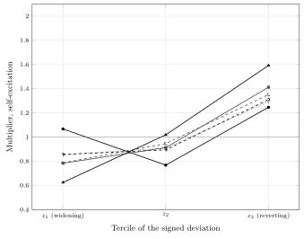
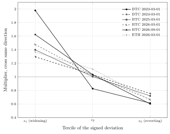

# The problem: right structure, wrong speed

The basis is the gap between the perpetual futures mid-price and the spot mid-price of the same asset on the same exchange. On Binance BTC it fluctuates by about one basis point around a level that moves on a scale of hours. The two legs are linked by arbitrage, so any widening of the basis should eventually close. The question is how, and how fast.

The base model treats price moves as events. An event is a move of one mid-price by at least $0.5\,\mathrm{bp}$ of a reference price that is reset at each event, and it is classified into one of four types: perpetual up, perpetual down, spot up, spot down. The four counting processes form a multivariate Hawkes process ([Hawkes 1971](#ref-hawkes1971); [Bacry et al. 2015](#ref-bacry2015)) with exponential kernels, 

$$
\lambda_i(t) = \mu_i(t) + \sum_{j=1}^{4} \sum_{k=1}^{K} \alpha_{ijk} \sum_{t^j_n < t} e^{-\beta_{ijk}(t - t^j_n)},
$$ {#eq-linear}

 with $K = 2$ exponentials per pair and a baseline $\mu_i(t)$ that is piecewise constant on fifteen-minute bins. The branching matrix $G_{ij} = \sum_k \alpha_{ijk}/\beta_{ijk}$ counts the expected number of type-$i$ children of one type-$j$ parent. Its entries fall into four channels: self-excitation (same leg, same direction), rebound (same leg, opposite direction), cross-excitation in the same direction (the other leg follows) and cross-excitation in the opposite direction. Self-excitation widens the basis and same-direction cross-excitation closes it. On the fitted data the closing channel dominates, with $0.43$--$0.60$ children per parent in the stronger cross direction against $0.08$--$0.41$ for self-excitation, and the process is stationary on every window (spectral radius $0.64$--$0.91$).

With mean event sizes $m_p$ and $m_s$, the basis is a linear functional of the counts, $B(t) = B(0) + v_B^\top N(t)$ with $v_B = (m_p, -m_p, -m_s, m_s)$. The permanent impact of an event of type $j$ is then available in closed form, 

$$
B_j(\infty) = v_B^\top (I - G)^{-1} e_j ,
$$ {#eq-permanent}

 and the transitory component is the own move minus this permanent part. For a perpetual up-move the model puts the permanent share at $0.61$--$0.84$ on the BTC days from 2024 and on ETH. The data agree on the sign and disagree on the size and the speed. In an event study on the one-millisecond basis path, $56$--$95\%$ of a perpetual move is undone within five minutes on every one of these days except 1 May 2024, where the level of the basis itself drifts within the window. The empirical half-reversion time after a perpetual up-move is $1.4$--$4.4$ s on six of the seven BTC days from 2024. The Palm response of the model, which is what an event study estimates, needs $4.9$--$15.5$ s on the four original days from 2024 for which the comparison is meaningful. @fig-alldays shows the gap on six days.

{#fig-alldays}

A second failure is structural. Spot up-moves happen when the basis is already wide, $+0.5$ to $+1.0\,\mathrm{bp}$ above its local level, and that pre-existing deviation is gone in the five-minute response. A linear, time-invariant Hawkes process cannot produce this. Its intensities are functions of the event history only, so it has no force that depends on how far the basis is from its level. The same limitation shows up in the long run: the fitted linear model assigns the basis a random-walk component with $29$--$46\%$ of the permanent variance of the price, while the basis in the data is stationary around its level on every day. The Ornstein--Uhlenbeck benchmark has the missing ingredient, a pull proportional to the deviation, and none of the event structure. The extension below puts the level-dependent pull into the Hawkes model.

# The model

## State variables

Let $s_n$ be the state observed just before the $n$-th event, computed only from information strictly prior to $t_n$. The first component is the signed basis deviation $$z_n = \sigma_{y_n}\big(B(t_n^-) - \bar B(t_n^-)\big), \qquad
\sigma_y = \begin{cases} -1 & y \in \{\text{perp up}, \text{spot down}\},\\ +1 & y \in \{\text{perp down}, \text{spot up}\}, \end{cases}$$ where $B(t^-)$ is the mid basis in basis points at the last quote change before $t$ and $\bar B$ a causal exponentially weighted level with a half-life of thirty minutes. The sign $\sigma_y$ orients the deviation relative to the event: $z_n > 0$ means that event $n$ moves the basis back towards its level, $z_n < 0$ that it widens the gap. The second component is the logarithm of a causal realised volatility of the spot mid (exponentially weighted squared one-second returns, half-life one minute). Both are standardised with the mean and standard deviation of the fitting window, and those constants are carried forward to the next window.

## Modulated kernels

The intensity becomes 

$$
\lambda_i(t) = \mu_i(t) + \sum_{j=1}^{4} \sum_{k=1}^{K} \alpha_{ijk} \sum_{t^j_n < t} m_{c(i,j)}(s_n)\, e^{-\beta_{ijk}(t - t^j_n)} .
$$ {#eq-sd}

 The offspring that a parent of type $j$ sends towards type $i$ is scaled by a positive multiplier evaluated at the state of the parent's time. The sixteen pairs share four multipliers, one per channel $c(i,j)$ (self, rebound, cross same direction, cross opposite direction), which keeps the modulation readable. The multiplier of channel $c$ is 

$$
m_c(s) = \exp f_c(s), \qquad f_c(s) = F \tanh\!\Big(\frac{w_c^\top\big(\phi(s) - \bar\phi\big)}{F}\Big), \qquad \phi(s) = \tanh(W s + b).
$$ {#eq-mod}

 The hidden layer $\phi$ has $H$ units shared across channels, and $w_c$ are channel-specific output weights. Subtracting the in-sample mean $\bar\phi$ keeps $\alpha_{ijk}$ interpretable as the excitation at the average state, and it is also what identifies the modulation separately from the level of $\alpha$. The outer squashing bounds every multiplier in $[e^{-F}, e^{F}]$; with $F = \log 10$ no channel can be scaled by more than a factor ten, which stops pairs with negligible $\alpha$ from being inflated in rarely visited states. With $H = 4$ and two state variables the modulation has $4H + H(m+1) = 28$ parameters. Replacing $\phi$ by the indicator of the tercile of $z$ gives the discrete-state process of ([Morariu-Patrichi and Pakkanen 2021](#ref-morariupatrichi2022)), with three states and twelve parameters, which serves as the benchmark.

{#fig-architecture width=90%}

The construction follows the state-dependent Hawkes processes of ([Morariu-Patrichi and Pakkanen 2021](#ref-morariupatrichi2022)), who modulate each kernel by a discrete order-book state at the trigger time. Here the state is continuous and the dependence is learned. Neural Hawkes processes ([Du et al. 2016](#ref-du2016); [Mei and Eisner 2017](#ref-mei2017)) go further and replace the kernel by a recurrent network; they gain flexibility and lose the branching matrix, the stationarity condition and the closed forms, and their likelihood needs Monte Carlo for the compensator. The model in @eq-sd keeps all three, and it reduces exactly to the linear model when $f \equiv 0$.

## Local criticality

At a frozen state $s$ the model is a linear Hawkes process with branching matrix $$G_{ij}(s) = m_{c(i,j)}(s) \sum_k \frac{\alpha_{ijk}}{\beta_{ijk}},$$ subcritical in that state when its spectral radius satisfies $\rho(G(s)) < 1$. Nothing forces this everywhere, and the data do push it above one in one state (@sec-mechanism). A locally supercritical state is not an explosion: the state moves, and the process returns to subcritical states. It does mean that the closed forms of the linear model, such as @eq-permanent, are defined state by state only where $\rho(G(s)) < 1$.

# Estimation

## Exact likelihood in $O(N)$

The multiplier is a mark of the parent event, so conditional on the state path the process is a marked linear Hawkes process and its log-likelihood on $[0,T]$ is the usual $$\ell = \sum_{i=1}^{4} \Big[ \sum_{n:\, y_n = i} \log \lambda_i(t_n) - \int_0^T \lambda_i(t)\,dt \Big].$$ For each pair the running sum $R(t) = \sum_{t^j_n < t} m_{c(i,j)}(s_n)\, e^{-\beta_{ijk}(t - t^j_n)}$ is updated with one multiplication and one addition per event, and the compensator of the excitation is $\sum_n m_{c(i,j)}(s_n)\,(\alpha_{ijk}/\beta_{ijk})\,(1 - e^{-\beta_{ijk}(T - t_n)})$. The cost is the same $O(NdK)$ per row as for the base model. The gradient with respect to each mark is a backward recursion of the same cost, and the chain rule through @eq-mod is a short sequence of matrix products, so the whole gradient is analytic; it is checked against finite differences in the test suite. The state is not modelled: it is treated as exogenous, as in ([Morariu-Patrichi and Pakkanen 2021](#ref-morariupatrichi2022)), which is enough for conditional forecasts.

All parameters are fitted jointly by L-BFGS-B, warm-started at the linear fit of the same window with $f \equiv 0$, so the first iterate is the linear model. The decay rates are kept within a factor $e^2$ of their warm-start values to preserve the labelling of the fast and slow kernels. Regularisation comes from the bound $F$, a ridge penalty of $10$ on the network weights and a hidden layer of four units. These choices were made on one day, 1 March 2026, by the out-of-sample likelihood of the next window, and then applied unchanged to the other eleven days. No choice was made on trading performance.

## Training for the decision

The likelihood rewards the model for timing every event, and most events do not matter for a trade. Decision-focused learning ([Donti et al. 2017](#ref-donti2017); [Elmachtoub and Grigas 2022](#ref-elmachtoub2022)) trains the parameters that enter a decision for the loss of that decision. Here the decision is a forecast of the basis change over $h = 10$ s and the position it implies. Only the modulation is retrained; $(\mu, \alpha, \beta)$ stay at their maximum-likelihood values.

The forecast uses the closed-form conditional expectation of future counts of the linear model, evaluated with the state frozen at its current value and the intensity components accumulated with the actual marks of past events. The state is placed on a grid of twenty-one values so that matrix exponentials are computed once per grid point, and where $\rho(G(s)) \ge 0.98$ the frozen branching matrix is rescaled to $0.98$, otherwise the expected counts over ten seconds diverge in supercritical states. Two objectives are used:

-   a *forecast loss*, the mean squared error between the forecast $\widehat{\Delta B}_h(t)$ and the realised change $B(t+h) - B(t)$ over the decision events of the fitting window;

-   a *profit surrogate*, which replaces the threshold trading rule by a soft position $\pi(t) = \tanh(\widehat{\Delta B}_h(t)/\theta)$, with $\theta$ the entry threshold, and maximises the mean of $\pi(t)\,(B(t+h) - B(t))$, the expected gross profit of holding the soft position for the horizon.

Both start from the maximum-likelihood modulation, so a decision-trained model that cannot improve in the fitting window stays at the likelihood solution.

# Results

The model is estimated on twelve days (ten BTC days between December 2022 and September 2026 and two ETH days), each split into six four-hour windows. Every window is fitted and then evaluated on the following window, which gives five out-of-sample comparisons per day. Because the hyperparameters were selected on 1 March 2026, the results on that day are not free of the selection; the eleven other days, seven of which were added after the model was finished, are the clean evidence.

## Out-of-sample likelihood

In sample the neural modulation adds $0.02$ to $0.09$ nats per event over the linear model and the terciles $0.01$ to $0.07$. With four to a hundred thousand events per window these are likelihood-ratio statistics in the hundreds or thousands. Out of sample, with every model using the time average of its own baseline, the neural modulation improves on the linear model in 56 of 60 windows, by up to $0.10$ nats per event. Day means range from $+0.008$ on 1 March 2024, the weakest day, to $+0.051$ on 1 December 2022, and the three zero-fee days have the three largest gains. The terciles improve in 57 windows by somewhat less, and the neural version beats the terciles in 51. The four exceptions are the first window of 1 March 2024, the day with the smallest state effect and the widest basis, and one window each on 1 February 2023, 1 January 2024 and 1 May 2024.

## The mechanism {#sec-mechanism}

@tbl-mod and @fig-terciles give the tercile multipliers. The tercile $z_1$ collects events that widen a basis already far from its level, $z_3$ events that move it back. The shape is the same on all twelve days and on both assets. Same-direction cross-excitation is strongest after a widening event ($1.3$--$2.3$) and weakest after a reverting one ($0.5$--$0.75$). After a perpetual move that opens the basis the spot follows more than on average; after one that closes it the spot follows less, which would have reopened the gap. Self-excitation does the opposite, weak after widening events ($0.6$--$1.1$) and strong after reverting ones ($1.25$--$1.8$): a move in the reverting direction is followed by more moves of the same leg in the same direction. This is the restoring force that the linear model lacked. The fast reversion seen in the event study comes from a cross channel that strengthens in the widening state.

::: {#tbl-mod}
  ---------------- ------- ------- ------- ----------------------- ------- ------- ----------- ------- -------
                      Self                   Cross, same direction                   $\rho(G)$         
  Day                $z_1$   $z_2$   $z_3$                   $z_1$   $z_2$   $z_3$       $z_1$   $z_2$   $z_3$
  BTC 2022-12-01      0.81    0.69    1.80                    2.15    0.83    0.56        1.16    0.55    0.67
  BTC 2023-02-01      0.98    0.72    1.45                    2.32    0.85    0.53        1.36    0.58    0.71
  BTC 2023-03-01      1.07    0.77    1.25                    1.98    0.82    0.61        1.11    0.60    0.78
  BTC 2024-01-01      0.81    0.92    1.35                    1.70    0.99    0.61        1.03    0.69    0.69
  BTC 2024-03-01      0.86    0.89    1.31                    1.29    1.03    0.75        0.89    0.76    0.74
  BTC 2024-05-01      0.94    0.82    1.30                    1.32    1.16    0.66        0.96    0.79    0.83
  BTC 2025-03-01      0.78    0.91    1.41                    1.40    1.00    0.72        0.97    0.71    0.72
  BTC 2025-05-01      0.77    0.97    1.35                    1.51    1.02    0.65        1.00    0.73    0.71
  BTC 2026-03-01      0.79    0.95    1.35                    1.48    1.03    0.66        0.99    0.75    0.85
  BTC 2026-09-01      0.62    1.02    1.59                    1.62    1.03    0.60        1.04    0.75    0.91
  ETH 2024-05-01      0.85    0.85    1.39                    1.31    1.13    0.69        0.93    0.80    0.83
  ETH 2026-03-01      0.85    0.91    1.29                    1.37    1.11    0.66        0.96    0.77    0.89
  ---------------- ------- ------- ------- ----------------------- ------- ------- ----------- ------- -------

  : Tercile model: multipliers of self-excitation and of same-direction cross-excitation, and spectral radius of the frozen-state branching matrix, by tercile of the signed deviation ($z_1$: widening events far from the level; $z_3$: reverting events). Mean over the windows of each day. The first three BTC days fall in Binance's zero-fee promotion on spot. Source: thesis Table ch21_modulation (ranges over windows omitted).
:::

::: {#fig-terciles layout-ncol=2}

Tercile multipliers on the six original days (mean over windows). The horizontal line at one is the linear model. From the widening to the reverting tercile self-excitation rises and cross-excitation falls on every day.

:::

The dependence is strongest on the zero-fee days, where the cross multiplier after a widening event reaches $2.0$--$2.3$, and weakest on 1 March 2024 and 1 May 2024. The rebound channel is U-shaped (on 1 March 2026 it is $0.4$--$0.6$ near the level and $1.0$--$1.8$ away from it in both directions), and the opposite-direction cross channel has too little base excitation for its multiplier to be identified.

The spectral radius follows the cross channel. It is $0.9$--$1.4$ in the widening tercile, above one on the three zero-fee days and on 1 January 2024, 1 May 2025 and 1 September 2026, and $0.55$--$0.80$ near the level. The market is locally critical while the basis is being pushed away from its level and clearly subcritical when it sits on it, which matches what ([Morariu-Patrichi and Pakkanen 2021](#ref-morariupatrichi2022)) find for the order book in states of wide spread or extreme imbalance. Between the first and third quartiles of $z$, where $\rho(G(s)) < 1$ in every window, the frozen-state permanent fraction of a perpetual shock rises from about $0.6$--$0.7$ to about $0.8$--$1.0$, and the Hawkes information share of the perpetual rises with $z$ (from $0.51$ to $0.60$ on 1 March 2026). A perpetual move that brings the basis back is mostly permanent; one that opens it is largely transitory. Near $\rho = 1$ the frozen-state linearisation produces permanent fractions above one, so these numbers indicate a direction and should not be read as point estimates.

Volatility, the second state variable, matters less. Between its tenth and ninetieth percentiles at $z = 0$, self-excitation and the rebound rise on every day while same-direction cross-excitation stays flat. Volatility raises clustering within each leg and leaves the coupling between the legs unchanged.

## Trading

The signal of the linear model is the excess of the closed-form forecast of the basis change over ten seconds over its unconditional value; a threshold of $0.5\,\mathrm{bp}$ opens a position, and execution is at the touch. With the likelihood-trained neural modulation in place of the linear forecast, the forecasts are not systematically more correlated with the realised change (higher on five BTC days and lower on five), and they are over-dispersed, because the marks accumulate in the intensity as if the state stayed where it is while in reality it reverts. At a fixed threshold the signal therefore fires more often. On the BTC days it trades $3{,}300$ times per day against $2{,}300$ for the linear signal, at $+0.37\,\mathrm{bp}$ per trade against $+0.44\,\mathrm{bp}$ on average, so the gross profit per day is about a third higher ($1{,}360$ against $1{,}010\,\mathrm{bp}$). It fails on 1 January 2024 ($-0.24\,\mathrm{bp}$ over $2{,}100$ trades), the day of highest funding and widest positive basis, where the state at decision time sits far from the standardisation of the previous window and the modulation is extrapolated. At ten milliseconds of latency the ranking does not change.

@tbl-dfl shows what retraining the modulation for the decision does to the two task losses in the fitting window.

::: {#tbl-dfl}
  ---------------- --------------------------- --------- --------------------------------- ----------
                     Forecast loss (MSE / Var)             Profit surrogate (bp per event) 
  Day                                   At MLE   Trained                            At MLE    Trained
  BTC 2022-12-01                          7.16      2.63                          $+0.361$   $+0.667$
  BTC 2023-02-01                          5.79      1.27                          $+0.263$   $+0.731$
  BTC 2023-03-01                         21.26      1.81                          $+0.067$   $+0.711$
  BTC 2024-01-01                          1.93      0.92                          $-0.089$   $+0.291$
  BTC 2024-03-01                          0.97      0.69                          $+0.147$   $+0.312$
  BTC 2024-05-01                         13.26      3.33                          $+0.096$   $+0.811$
  BTC 2025-03-01                          1.02      0.69                          $+0.187$   $+0.374$
  BTC 2025-05-01                          1.29      0.78                          $+0.131$   $+0.332$
  BTC 2026-03-01                          6.32      0.66                          $+0.349$   $+0.684$
  BTC 2026-09-01                          4.90      1.68                          $-0.003$   $+0.442$
  ETH 2024-05-01                         93.42     12.70                          $+0.012$   $+0.317$
  ETH 2026-03-01                          3.72      0.66                          $+0.337$   $+0.754$
  ---------------- --------------------------- --------- --------------------------------- ----------

  : Decision-focused training of the modulation on the fitting window (mean over windows): forecast loss relative to the variance of the realised ten-second change, and profit surrogate in basis points per decision event, at the maximum-likelihood (MLE) modulation and after training. Source: thesis Table ch21_dfl.
:::

The maximum-likelihood modulation produces forecasts whose squared error is one to twenty times the variance of the realised change (ninety times on ETH on 1 May 2024). Twenty iterations of the forecast loss bring it to $0.66$--$3.3$ times on BTC, with a calibration slope between $0.67$ and $1.0$ on every day but ETH 1 May 2024. The resulting signal earns $+0.46\,\mathrm{bp}$ per trade over $5{,}500$ trades per day on BTC, positive on all ten days; on seven BTC days and on ETH 1 March 2026 it is the best signal per trade, at $+0.50$ to $+0.72\,\mathrm{bp}$ with hit rates of $0.69$--$0.84$. The exceptions are the three zero-fee days, where the trained forecasts remain over-dispersed and the threshold rule fires on noise ($+0.02$ to $+0.23\,\mathrm{bp}$ over five to twelve thousand trades).

The profit surrogate rises from $-0.09$--$0.36$ to $0.29$--$0.81\,\mathrm{bp}$ per decision event, and it gives the forecast with the highest correlation with the realised change on every day ($0.24$--$0.56$, against $-0.03$--$0.35$ for the likelihood-trained neural forecast). Its forecasts have the right direction and an arbitrary scale (calibration slope $0.10$--$0.19$ on every BTC day), so a fixed threshold makes it trade three to thirty-two thousand times per day at $-0.01$ to $+0.52\,\mathrm{bp}$ per trade. Per trade it is below the likelihood-trained signal, and per day it earns about twice as much as the forecast-loss signal and three times the linear one. Taken together, training the modulation for the decision instead of the likelihood raises the gross profit per day two to three times at the same or a higher edge per trade.

The split matches the argument of ([Donti et al. 2017](#ref-donti2017)). The likelihood is the right objective when the model is close to correct and the target is the timing of events. A point process on event counts is misspecified for the change of a price ten seconds ahead, and there a decision loss does better. The forecast loss produces forecasts of the right scale, which a threshold rule can use directly. The profit surrogate weights the forecast by its sign and saturates its size, so it learns direction and needs a calibration step before a threshold rule can use it.

All of these numbers are gross. Half a basis point per round trip at the touch is below the fees of every Binance tier, which run from $2.2\,\mathrm{bp}$ per round trip on both legs for a top-tier maker to $30\,\mathrm{bp}$ for a regular taker, and the state-dependent model does not change that conclusion of the thesis. This is research on market microstructure and not a trading recommendation.

# Limitations

The modulation has 28 parameters, estimated on windows of ten to fifty thousand events. Its hyperparameters were selected on 1 March 2026, a day that is also reported. Its curves beyond two standard deviations of the state rest on few events and are extrapolations, and the one trading failure (1 January 2024) is a case of exactly that. The frozen-state closed forms hold state by state and become unreliable near criticality, which is where the interesting state is. The sample is thirteen days, the first of a month each, so every out-of-sample statement is within a day. The funding rate, the spread and the book depth can enter the state in the same way as $z$ but are not estimated here: funding is nearly constant within a four-hour window and the spread is one tick in the median. Trading results are gross of fees, assume that the displayed quote is available for the full size, and do not cover the fees.

# Conclusion

A linear Hawkes model of perpetual and spot price moves describes who follows whom and how much of a move is permanent. It has no notion of where the basis is, and so it cannot pull back a deviation or revert at the speed seen in the data. Scaling the kernels by a bounded function of the signed basis deviation at the parent event keeps the exact $O(N)$ likelihood and every closed form of the linear model, state by state. The learned dependence is the same on every day: the other leg follows harder when a move stretches the basis and more weakly when a move relaxes it, with the process close to critical in the stretched state. For trading, the same 28 parameters do more when they are trained for the forecast or the profit than for the likelihood, although no version of the signal covers the cost of trading.

# References {.unnumbered}

[]{#ref-bacry2015}E. Bacry, I. Mastromatteo and J.-F. Muzy. Hawkes processes in finance. *Market Microstructure and Liquidity*, 1(1):1550005, 2015. doi:10.1142/S2382626615500057.

[]{#ref-donti2017}P. L. Donti, B. Amos and J. Z. Kolter. Task-based end-to-end model learning in stochastic optimization. In *Advances in Neural Information Processing Systems 30 (NIPS 2017)*, 2017. arXiv:1703.04529.

[]{#ref-du2016}N. Du, H. Dai, R. Trivedi, U. Upadhyay, M. Gomez-Rodriguez and L. Song. Recurrent marked temporal point processes: embedding event history to vector. In *Proceedings of the 22nd ACM SIGKDD*, pages 1555--1564, 2016. doi:10.1145/2939672.2939875.

[]{#ref-elmachtoub2022}A. N. Elmachtoub and P. Grigas. Smart "predict, then optimize". *Management Science*, 68(1):9--26, 2022. arXiv:1710.08005.

[]{#ref-hawkes1971}A. G. Hawkes. Spectra of some self-exciting and mutually exciting point processes. *Biometrika*, 58(1):83--90, 1971. doi:10.1093/biomet/58.1.83.

[]{#ref-mei2017}H. Mei and J. Eisner. The neural Hawkes process: a neurally self-modulating multivariate point process. In *Advances in Neural Information Processing Systems 30 (NIPS 2017)*, 2017. arXiv:1612.09328.

[]{#ref-morariupatrichi2022}M. Morariu-Patrichi and M. S. Pakkanen. State-dependent Hawkes processes and their application to limit order book modelling. arXiv:1809.08060, 2021.

*This article is based on the author's master thesis on Hawkes-based statistical arbitrage between BTC perpetual and spot markets.*

::: {.paper-download}
[Download PDF](state-dependent-hawkes-basis.pdf){.btn-paper download=""} [Code](https://github.com/tommasozeri/state-dependent-hawkes-basis){.btn-paper}
:::
