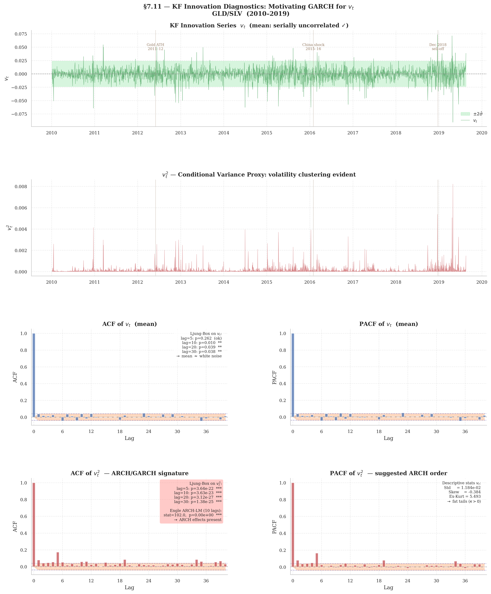

```{=html}
<p class="paper-links"><a class="btn-paper" href="thesis_zeri_tommaso-4.pdf">PDF</a> <a class="btn-paper" href="#quarto-citation">Cite</a></p>
```

This paper develops a state-space framework for enhancing signal generation in statistical arbitrage pairs trading strategies. Classical approaches --- OLS and Dynamic OLS cointegrating regressions --- estimate a static hedge ratio over the full sample, introducing three structural biases in the trading z-score: a non-stationary numerator caused by parameter drift, a denominator that ignores time-varying volatility, and an inability to distinguish genuine mean-reversion opportunities from structural breaks in cointegration. The proposed framework addresses all three limitations through the integration of two complementary models operating at different levels of the latent state space.

At the continuous level, a linear Gaussian state-space model estimated via the Kalman Filter tracks the time-varying hedge ratio and intercept as random walks, producing a dynamic spread that coincides with the filter innovation and an adaptive z-score normalised by the innovation variance. At the discrete level, a Hidden Markov Model with Gaussian emissions --- estimated via the Baum-Welch algorithm --- identifies latent market regimes characterised by distinct volatility and cointegration stability profiles. The filtered regime probability, computed causally via the Hamilton filter, acts as a qualitative gate on signal execution: trades are initiated only when the system is sufficiently confident that the cointegrating relationship is intact.

The integrated KF-HMM architecture is illustrated empirically on the GLD/SLV pair over the 2010--2019 period. Results confirm that the dynamic hedge ratio exhibits substantial time variation inconsistent with the constant-parameter OLS assumption, that the adaptive z-score remains stationary by construction throughout the sample, and that regime detection correctly identifies known stress episodes (including the 2011--2012 Gold ATH, the 2015--2016 China shock, and the 2018 sell-off) during which signal suppression prevents spurious entries. An optional GARCH augmentation of the z-score denominator further corrects for spread volatility clustering in the KF residuals.

There is statistical evidence of the presence of heteroskedasticity on the Kalman Filter residuals, so there are several reasons to build a GARCH-based Z-score:



Table 10

**Descriptive statistics of daily innovations.**

GLD/SLV spread, 2010--2019, *T* = 2,510.

  ---------------------- ----------------
  Statistic              Value
  Mean  *μ̂*              −7.37 × 10^−4^
  Std. deviation  *σ̂*    1.184 × 10^−2^
  Skewness  *ŝ*          −0.384
  Excess kurtosis  *κ̂*   5.493
  Minimum                −9.07 × 10^−2^
  Maximum                +7.33 × 10^−2^
  ---------------------- ----------------

*Note.* Under Gaussian white noise, excess kurtosis should be zero. The value of 5.49 motivates a heavy-tailed conditional distribution in the GARCH specification. Negative skewness (*ŝ* = −0.38) confirms left asymmetry, consistent with the leverage effect.

------------------------------------------------------------------------

Table 11

**Ljung--Box tests on *v*~t~ and *v*~t~^2^.**

H~0~^(*v*)^: no autocorr. in *v*~t~.   H~0~^(*v*^2^)^: no autocorr. in *v*~t~^2^.

Panel A --- Innovations *v*~t~

  Lag *ℓ*   *Q*(*ℓ*)   *p*-value   Reject?
  --------- ---------- ----------- -----------
  5         6.48       0.262       No
  10        23.20      0.010       Yes^\*\*^
  20        32.39      0.039       Yes^\*\*^
  30        45.08      0.038       Yes^\*\*^

Panel B --- Squared innovations *v*~t~^2^

  Lag *ℓ*   *Q*(*ℓ*)   *p*-value   Reject?
  --------- ---------- ----------- -------------
  5         110.25     \< 0.001    Yes^\*\*\*^
  10        130.54     \< 0.001    Yes^\*\*\*^
  20        177.40     \< 0.001    Yes^\*\*\*^
  30        192.25     \< 0.001    Yes^\*\*\*^

^\*\*^ Rejection at 5%.   ^\*\*\*^ Rejection at 0.1%.

The test on *v*~t~ fails to reject H~0~^(*v*)^ at lag 5 (*p* = 0.26), confirming approximately white innovations in the mean. Weak rejections at *ℓ* ≥ 10 are physiological in daily pairs-trading spreads. By contrast, the test on *v*~t~^2^ rejects H~0~^(*v*^2^)^ with overwhelming evidence (*p* \< 10^−20^) at all lags, documenting strong serial dependence in conditional variance and motivating GARCH(1,1).

------------------------------------------------------------------------

Table 12

**Engle (1982) ARCH-LM test.**

H~0~: no ARCH effects. Lag *p* = 10. GLD/SLV 2010--2019, *T* = 2,510.

  Test                       LM stat.   *p*-value
  -------------------------- ---------- ------------------
  Engle ARCH-LM (*p* = 10)   102.01     \< 0.001^\*\*\*^

^\*\*\*^ Rejection at 0.1%.

The LM statistic of 102.01 far exceeds the *χ*^2^~10~ critical value at 1% (= 23.21), rejecting H~0~ with *p* \< 10^−6^. Together with Table 11, this formally confirms the necessity of a GARCH model for *σ̂*^2^~S,t~ in the adaptive *z*-score √(*f*~t~ + *σ̂*^2^~S,t~).

## Full text

```{=html}
<object class="pdf-viewer" data="thesis_zeri_tommaso-4.pdf" type="application/pdf"><p><a href="thesis_zeri_tommaso-4.pdf">Download PDF</a></p></object>
```
