# Introduction

The intersection of stochastic calculus and portfolio theory has become increasingly central to modern quantitative finance. As financial markets evolve in complexity and dynamism, classical models based on historical returns and static parameters often prove insufficient to capture the full range of risks and opportunities faced by investors. In this context, continuous-time models and simulation-based approaches have gained prominence for their ability to model uncertainty and randomness in a more realistic and theoretically rigorous manner.

This paper explores a simulation-based framework for portfolio optimization that builds upon the tools of stochastic calculus, particularly the modeling of asset prices via geometric Brownian motion (GBM). The GBM process---governed by stochastic differential equations (SDEs)---offers a foundational example of how randomness can be formally incorporated into the modeling of financial phenomena. By leveraging concepts such as Brownian motion, Itô calculus, and stochastic integration, this approach allows us to move beyond static historical averages and to simulate future price paths under well-defined probabilistic assumptions.

To operationalize this stochastic framework, we employ Monte Carlo simulation, a powerful numerical method for approximating the outcomes of complex stochastic systems. Using GBM as the generative model for asset dynamics, we simulate thousands of potential future scenarios for a portfolio composed of ten selected stocks listed on the New York Stock Exchange (NYSE). This probabilistic exploration enables us to estimate the distribution of future returns and to incorporate uncertainty directly into the portfolio construction process.

# Outcomes, events and probabilities

An **outcome** is a single result of a random experiment. Each experiment has a set of possible outcomes called the sample space $\Omega$. Suppose we toss a coin: the sample space is defined as $\Omega = \{ \text{Head}, \text{Tail} \}$ and the single otucomes are $\omega_1=Head$ and $\omega_2=Tail$. For a dice, we have $\Omega=\{1,2,3,4,5,6\}$ where the single outcome is $\omega_i$ for $i=1,...,6$.\
An **event** is a subset of the sample space $A\subseteq\Omega$. It can include one, one or more, or no outcomes. In the case of the dice, if we consider the event: \"even number\", then $A\subseteq\Omega=\{2,4,6\}$.\
Probability is a measure that assigns to each event a number between 0 and 1, indicating the likelihood of the event occurring.

- **Probability of an outcome**: if the sample space is finite, and each outcome has the same probability of occurring, the probability of an outcome is given by $\mathbb{P}(\omega)=1/|\Omega|$, where $|\Omega|$ is the number of outcomes in the sample space.

- **Probability of an event**: The probability of an event $A$ is the sum of the probabilities of the outcomes that make it up: $$
        \mathbb{P} (A)=\sum_{\omega\in A}\mathbb{P(\omega)}
  $$ In the roll of a die, if $A$ is the event: 'getting an even number', then: $$
          \mathbb{P}(A)=\mathbb{P}(2)+\mathbb{P}(4)+\mathbb{P}(6)=1/2
  $$

# Continuous time stochastic processes and filtrations

This section introduces continuous-time stochastic processes, which model random phenomena evolving over time, and the concept of filtrations, which represent the accumulation of information over time. Stochastic processes are essential for understanding systems with uncertainty, like financial markets or physical processes. Filtrations help track the information available at each point in time, forming the basis for modeling decision-making in uncertain environments.

## Continuos time stochastic processes

A continuous time stochastic process $\{X_t\}_{t \geq 0}$ is a collection of random variables defined on a common probability space $(\Omega, \mathcal{F}, P)$. The collection is indexed to the time parameter $t$ and that implies that $t\in [0,+\infty)$. From now on, we can think a continuous time stochastic process as a sequence of random variables $X_t$ that evolves in time ($X_1,X_2,...,X_T$) with each variable representing the state of the process at a certain time.\
If we consider a stochastic process $\{X_t\}_{t \geq 0}$ which represents the return over time of a stock, for each moment $t$, $X_t$ is a random variable that represent the observed return at that specific time: $$
    \omega \rightarrow X_t(\omega)
$$ If we chose a particular scenario (for example, a specific realization of the markets conditions), the function: $$
    t\rightarrow X_t(\omega)
$$ describes how the return changes over time for that specific scenario.

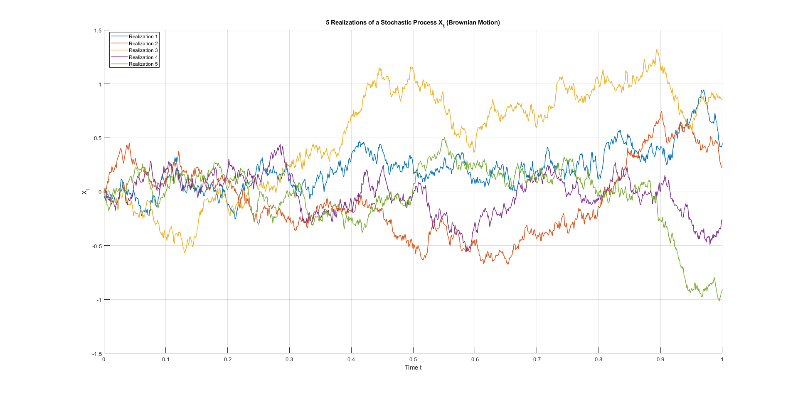{#fig-enter-label}

## Filtrations

A **filtrarion** $\{\mathcal{F}\}_{t\geq 0}$ on a probability space $(\Omega, \mathcal{F}, P)$ is an increasing collection of $\sigma algebras$[^1] contained in $\mathcal{F}$: 

$$
    \mathcal{F}_s\subseteq\mathcal{F}_t \subseteq \mathcal{F} \quad  \forall \,  0\leq s \leq t
$$ {#eq-five}

 A continuous time stochastic process is said to be adapted to the filtration $\{\mathcal{F}\}_{t\geq 0}$ if $X_t$ is $\mathcal{F}_t-measurable \ \forall t \geq 0$. In other words, $\{X_t\}_{t \geq 0}$ is adapted to the filtration $\{\mathcal{F}\}_{t\geq 0}$ if for each moment $t$, the information contained in the events belonging to $\mathcal{F}_t$ is sufficient to determine the value taken by $X_t$.\
Statement [\[five\]](#five){reference-type="ref" reference="five"} exploit the fact that the quantity of information is an increasing function of time. As $t$ increases, we have more and more information.\
For Example, if $X_t$ is the stock price at time $t$, the filtration $\mathcal{F}_t$ includes all information available up to time $t$. As time passes, more information is added, so $\mathcal{F}_s\subseteq\mathcal{F}_t$ for $s\leq t$. Moreover, if $\{X_t\}_{t \geq 0}$ is adapted to the filtration $\{\mathcal{F}\}_{t\geq 0}$, it means that the price $X_t$ can be determined using only the information up to time $t$, without referencing future events. Therefore, at time $t$, $\mathcal{F}_t$ contains all the historical and current information needed to 'explain' the value of the price $X_t$ at that moment.

# Martingales

A continuous time stochastic process $\{X_t\}_{t \geq 0}$ is an $(\{\mathcal{F}_t\}_{t\geq 0},\mathbb{P})$-Martingale if:

- It is adapted to the filtration $\{\mathcal{F}\}_{t\geq 0}$: meaning that the value of $X_t$ at a particular moment $t$ only depends on the information available up to time $t$.

- It is square integrable: meaning that $\forall t\geq0, X_t\in\mathcal{L}^2(\Omega,\mathcal{F,}\mathbb{P})$:[^2] $$
      \mathbb{E}[X_t^2]<\infty
  $$ In other words, this condition implies that $X_t$ has to have a finite variance.

- Conditional expectation property: $\forall 0\leq s \leq t:$ $$
      \mathbb{E}[X_t|\mathcal{F}_s]=X_s
  $$ We can think of the conditional expectation $\mathbb{E}[X_t|\mathcal{F}_s]$ as the best estimate of the future value of $X_t$, based on the information available up to time $s$ .This means that the expected value of the process in a future moment $t$, conditional to the information available up to time $s$ is equal to the value of the process at time $s$.\
  In other words, knowing everything up to time $s$, we don't expect the process to change in any particular direction --- it's like saying, *"On average, we expect it to stay the same."*

  This is a key idea behind a martingale: it's a stochastic process with no \"drift\" or predictable trend --- the future is, on average, the same as the present, given all the information we currently have.\

Consider a simple game based on the repeated tossing of a fair coin. At each round, if the outcome is heads, the player wins one unit of currency; if the outcome is tails, the player loses one unit. Suppose the player starts with an initial capital of zero. After each toss, their total capital increases or decreases by one, depending on the result.

Although the capital fluctuates over time, the key point is that the game is fair: there is no systematic tendency for the capital to increase or decrease. At any given time, the expected value of the player's capital in the next round, conditional on all past outcomes, is equal to the current capital. Intuitively, a martingale represents a fair game: knowledge of the past does not allow one to predict future gains or losses. In such a process, the conditional expectation remains constant over time, capturing the idea of \"no advantage\" or \"no drift.\" This makes martingales central in probability theory and particularly relevant in finance, where they are used to model asset prices under the assumption of no arbitrage. In such contexts, the fair game principle ensures that, in the absence of additional information, the best estimate of tomorrow's price is simply today's price.

# The Brownian Motion

Brownian motion can be imagined as the random movement of a particle in a fluid, influenced by random collisions with other particles.

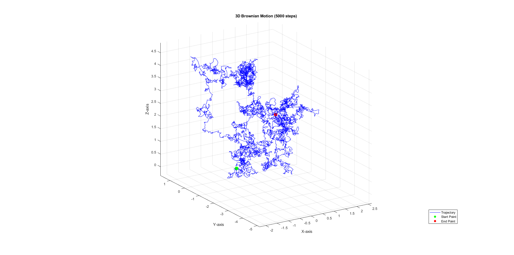{#fig-enter-labelx}

A stochastic process $\{{W_t\}_{t\geq0}}$ defined on a probability space $(\Omega,\mathcal{F}, \mathbb{P)}$ is a brownian motion if it satisfies the following properties:

- $\mathbb{P}(W_0=0)=1$: it starts at $t=0$ with probability 1.

- $\forall0\leq s \leq t$, $\Delta W \sim \mathcal{N}(0, t-s)$: the brownian increment $\Delta W:=Wt-Ws$ follows a normal distribution with mean zero (no systematic trend) and variance $t-s$ (the increments become increasingly dispersed as time progresses).

- $\forall\, 0 \leq t_1 \leq t_2 \leq \dots \leq t_n \leq T, \quad \Delta W_i := W(t_{i+1}) - W(t_i), \quad \text{then} \quad \Delta W_i \perp\!\!\!\perp \Delta W_j \quad \text{for all } i \neq j$: the brownian increments are independent, this means that the evolution of a brownian motion over a time interval is independent of the evolution of the process in the past or future. there is no correlation between the increments, either over time or between past and future values.

- The trajectories of Brownian motion are continuous, meaning that they have no jumps, but they are nowhere differentiable, so they do not vary smoothly.

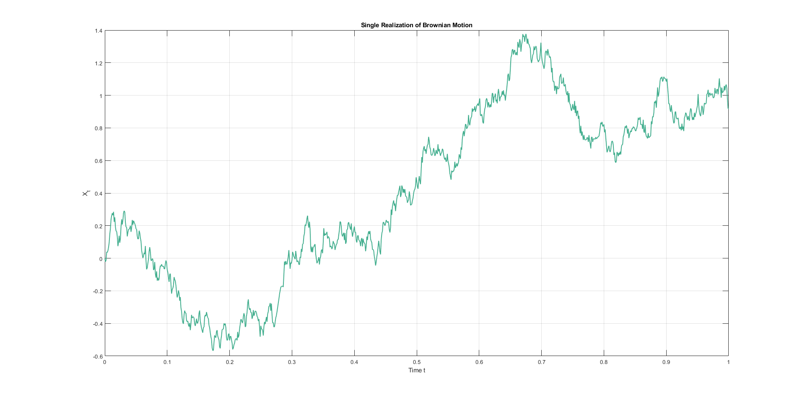{#fig-enter-label}

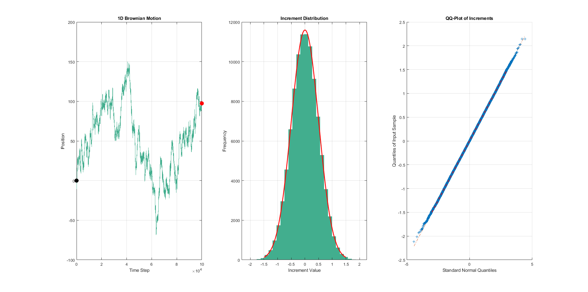{#fig-enter-labelx}

# The Itô Integral

## Definition of the Itô Integral

Given a Brownian motion $\{W_t\}_{t \geq 0}$ and an adapted process $\{X_t\}_{t \in [0,T]}$ that is sufficiently regular (typically belonging to $L^2_{\text{ad}}(\Omega \times [0,T])$), the Itô integral of $X$ with respect to $W$ is defined as $$\int_0^T X_t \, dW_t,$$ where the symbol $dW_t$ denotes stochastic integration. This integral is constructed as a limit in probability of sums of the form: $$\sum_{i=0}^{n-1} X_{t_i}(W_{t_{i+1}} - W_{t_i}),$$ with $X_{t_i}$ evaluated at the left endpoint of each subinterval. A key property is the **Itô isometry**: $$\mathbb{E} \left[ \left( \int_0^T X_t \, dW_t \right)^2 \right] = \mathbb{E} \left[ \int_0^T X_t^2 \, dt \right],$$ which guarantees the well-posedness of the integral.

## Spaces of Integrable Processes

The standard space of integrands is $$L^2_{\text{ad}}(\Omega \times [0,T]) := \left\{ X_t \text{ adapted }: \mathbb{E} \left[ \int_0^T X_t^2 \, dt \right] < +\infty \right\}.$$ This space consists of processes that are square-integrable over the interval $[0,T]$ and adapted to the filtration of $W_t$. These processes are the most commonly used as integrands in the Itô integral.

Next, we define the extended space $L_{\text{ad}}(\Omega; L^2([0,T]))$, which is given by $$L_{\text{ad}}(\Omega; L^2([0,T])) := \left\{ X_t \text{ adapted}: \int_0^T X_t^2 \, dt < +\infty \ \text{almost surely} \right\}.$$ This space allows for processes that may not be square-integrable in the sense of $L^2_{\text{ad}}(\Omega \times [0,T])$, but still belong to $L^2$ when integrated over $[0,T]$. These processes can still be used as integrands in the Itô integral, but the definition must be extended to handle them appropriately.

There is an inclusion relation between these two spaces: $$L^2_{\text{ad}}(\Omega \times [0,T]) \subset L_{\text{ad}}(\Omega; L^2([0,T])).$$ In other words, every process in $L^2_{\text{ad}}(\Omega \times [0,T])$ is also in $L_{\text{ad}}(\Omega; L^2([0,T]))$, but the converse does not necessarily hold. This extended space allows for a broader class of processes to be integrated with respect to $W_t$.

## Extension of the Integral

Any $X \in L_{\text{ad}}(\Omega; L^2([0,T]))$ can be approximated by a sequence of simple processes $X^{(n)}$ such that $$\int_0^T |X_t^{(n)} - X_t|^2 \, dt \to 0 \quad \text{in probability}.$$ The Itô integral is then defined as the (probability) limit of the integrals of these approximating processes: $$\int_0^T X_t \, dW_t := \lim_{n \to \infty} \int_0^T X_t^{(n)} \, dW_t.$$

## Conclusion

The Itô integral generalizes the concept of integration to stochastic settings. Its domain can be extended from $L^2_{\text{ad}}(\Omega \times [0,T])$ to $L_{\text{ad}}(\Omega; L^2([0,T]))$ while preserving key properties such as continuous sample paths and the martingale structure of the integral process. These extensions are fundamental for applications in quantitative finance, stochastic control, and other fields involving random dynamics.

# Itô's Lemma

## Itô process

The Itô process is a mathematical model that describes the dynamics of a system influenced by both a deterministic trend and random fluctuations. A stochastic process $\{X_t\}_{t\geq 0}$ is said to be an Itô process if, $\forall t\geq 0$, it can be expressed in the form of: $$
    X_t=X_0+\int_o^t \mu(s,X_s)ds+\int_o^t\sigma(s,X_s)dW_s
$$ The associated Stochastic Differential Equation (SDE) is: $$
    dX_t=\mu_tdt+\sigma_tdWt, \quad with X_0=x
$$

Where $X_0$ is the initial value of the process, $\mu_t$ is the deterministic trend, $\sigma_t$ is the diffusion.

<figure data-latex-placement="H">

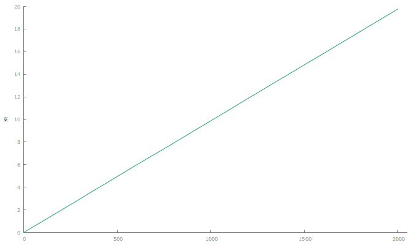

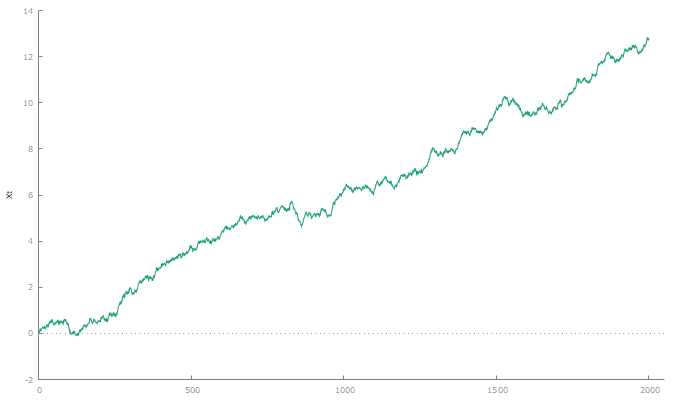

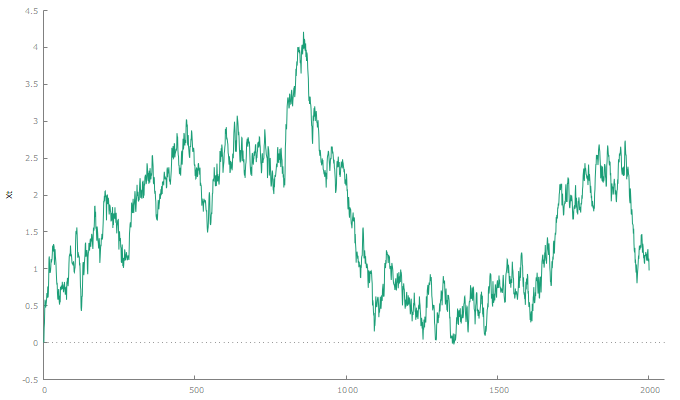

<figcaption><em>μ</em><em>t</em> &lt;  &lt; <em>σ</em><em>t</em></figcaption>
</figure>

## Itô Formula

Now, let $W=\{W_t\}_{t\geq 0}$ be a brownian motion and $\Phi_t=\Phi(t, W_t)$ a function that is continuous and once differentiable with respect to the first variable, and twice differentiable with respect to the second variable, with bounded derivatives. Then: $$
    \Phi(t,W_t)=\Phi(0,W_0)+\int_0^t\frac{\partial\Phi(s,W_s)}{\partial s}ds+\int_0^t\frac{\partial\Phi(s,W_s)}{\partial W_s}dW_s+\frac{1}{2}\int_0^t\frac{\partial^2\Phi(s,W_s)}{\partial W^2}ds
$$ The differential form is:

$$
\mathrm{d}\Phi(t, W_t) = \frac{\partial \Phi(t, W_t)}{\partial t}\,\mathrm{d}t + \frac{\partial \Phi(t, W_t)}{\partial W} \,\mathrm{d}W_t + \frac{1}{2} \frac{\partial^2 \Phi(t, W_t)}{\partial W^2} (\mathrm{d}W_t)^2 \\
= \left( \frac{\partial \Phi(t, W_t)}{\partial t} + \frac{1}{2} \frac{\partial^2 \Phi(t, W_t)}{\partial W^2} \right) \mathrm{d}t + \frac{\partial \Phi(t, W_t)}{\partial W} \,\mathrm{d}W_t\footnote{In Itô calculus, we assume that $(\mathrm{d}W_t)^2 = \mathrm{d}t$, while products such as $\mathrm{d}t \cdot \mathrm{d}W_t$ and $(\mathrm{d}t)^2$ are negligible (i.e., they vanish in the infinitesimal sense). Therefore, the term $(\mathrm{d}W_t)^2$ is replaced by $\mathrm{d}t$ in the simplified form of the equation.}
$$

Since $\Phi$ is a function of a stochastic process, it is itself a stochastic process. We are therefore interested in understanding its dynamics, that is, the equation that describes how $\Phi$ evolves over time, taking into account both the deterministic trends and the random fluctuations inherited from the original process.

Itô's lemma also holds in a more general form:\
let $Y_t:=\Phi(t,X_t)$, then: $$
  \boldsymbol{  dY_t=\frac{\partial\Phi(t,X_t)}{\partial t}dt+\frac{\partial\Phi(t,X_t)}{\partial X}dX_t+\frac{\partial^2\Phi(t,X_t)}{\partial X^2}\langle dX, dX \rangle_t}
$$ Where $\langle dX, dX \rangle_t$ is the covariance of $X_t$.\
Since $X$ is an Itô process, then $\langle dX, dX \rangle_t = \sigma^2_t dt$. We can therefore rewrite the SDE (13) as follows: $$
dY_t=  \left[ \frac{\partial \Phi(t, X_t)}{\partial t} + \mu(t, X_t) \frac{\partial \Phi(t, X_t)}{\partial X} + \frac{1}{2} \sigma^2 \frac{\partial^2 \Phi(t, X_t)}{\partial X^2} \right] dt \\
 + \sigma(t, X_t) \frac{\partial \Phi(t, X_t)}{\partial X} dW_t.
$$\

## The Multidimensioal Itô Formula

Let $X = \{X_t\}_{t \in [0,T]} = \{X^1_t, \ldots, X^M_t\}_{t \in [0,T]}$ be an $M$-dimensional Itō process, where the $j$-th component, $j = 1, \ldots, M$, has dynamics:

$$
dX^{(j)}_t = \mu^{(j)}(t, X_t) \, dt + \sum_{k=1}^d \sigma^{j,k}(t, X_t) \, dW^{(k)}_t.
$$

Let $\Phi_t = \Phi(t, X)$ be an $\mathbb{R}^M$-valued function, continuous and differentiable once with respect to the first variable and twice with respect to the second. Then, the differential of $\Phi_t$ is given by:

$$
d\Phi_t = \frac{\partial \Phi}{\partial t} \, dt + \nabla \Phi \cdot dX_t + \frac{1}{2} \sum_{i,j=1}^M \frac{\partial^2 \Phi}{\partial X^i \partial X^j} \left\langle dX^{(i)}, dX^{(j)} \right\rangle_t,
$$

where

$$
\nabla \Phi \cdot dX_t := \sum_{i=1}^M \frac{\partial \Phi}{\partial X^i} dX^i_t.
$$

An alternative form of the multidimensioal Itô formula is given by: $$
\mathrm{d}\Phi(t, X_t) = \frac{\partial \Phi}{\partial t}(t, X_t) \, \mathrm{d}t 
+ \sum_{i=1}^M \frac{\partial \Phi}{\partial X^i}(t, X_t) \, \mathrm{d}X^i_t 
+ \frac{1}{2} \sum_{i=1}^M \sum_{j=1}^M \frac{\partial^2 \Phi}{\partial X^i \partial X^j}(t, X_t) 
\sum_{k=1}^M \sigma^{i,k}(t, X_t) \sigma^{j,k}(t, X_t) \, \mathrm{d}t
$$

Whose integral form is: $$
    X_t=x+\int_0^t\mu_s ds+\int_0^t\sigma_sdW_s \quad t\in[0,T]
$$

Here, we set:

$$
X_t := (X^1_t, \ldots, X^M_t)^\ast, \quad x=(x^1,...,x^M), \quad
\mu_t := (\mu^1_t, \ldots, \mu^M_t)^\ast,
$$

$$
\sigma_t := 
\begin{bmatrix}
\sigma^{11}_t & \cdots & \sigma^{1M}_t \\
\vdots & \ddots & \vdots \\
\sigma^{M1}_t & \cdots & \sigma^{MM}_t
\end{bmatrix},
$$

$$
W_t := (W^1_t, \ldots, W^M_t)^\ast,
$$

where $\ast$ denotes the transpose operation.\

## The Itô Product Rule

Let $X_t$ and $Y_t$ be two Itô processes defined on a filtered probability space. Then the differential of their product $Z_t = X_t Y_t$ is given by:

$$d(X_t Y_t) = X_t \, dY_t + Y_t \, dX_t + dX_t \, dY_t$$

This is known as **Itô's product rule**. It extends the classical product rule of calculus by including an additional term: the differential of the cross-variation $dX_t \, dY_t$. This term is non-zero in stochastic calculus and plays a crucial role in the behavior of stochastic processes.

Suppose $X_t$ and $Y_t$ are Itô processes of the form:

$$\begin{aligned}
dX_t &= \mu_t^X \, dt + \sigma_t^X \, dW_t^1 \\
dY_t &= \mu_t^Y \, dt + \sigma_t^Y \, dW_t^2
\end{aligned}$$

where $W_t^1$ and $W_t^2$ are (possibly correlated) Brownian motions, and $\rho \in [-1, 1]$ is their instantaneous correlation, so that:

$$dW_t^1 \, dW_t^2 = \rho \, dt$$

Then, the product rule becomes:

$$\begin{aligned}
d(X_t Y_t) &= X_t \, dY_t + Y_t \, dX_t + dX_t \, dY_t \\
&= X_t (\mu_t^Y \, dt + \sigma_t^Y \, dW_t^2) + Y_t (\mu_t^X \, dt + \sigma_t^X \, dW_t^1) + \sigma_t^X \sigma_t^Y \, dW_t^1 dW_t^2 \\
&= \left(X_t \mu_t^Y + Y_t \mu_t^X + \rho \sigma_t^X \sigma_t^Y \right) dt + X_t \sigma_t^Y \, dW_t^2 + Y_t \sigma_t^X \, dW_t^1
\end{aligned}$$

Note that the extra term $\rho \sigma_t^X \sigma_t^Y \, dt$ comes from the cross-variation $dX_t \, dY_t$. If $W_t^1 = W_t^2$, then $\rho = 1$, and if they are independent, $\rho = 0$.

# Some Stochastic Differential Equations (SDEs)

A stochastic differential equation is an identity of the form:

$$
    X_t=x+\int_0^t\mu(s,X_s)ds+\int_0^t\sigma(s,X_s)dW_s, \quad t\in[0,T]
$$ Where $X_t$ is the the stochastic process we would like to find, $x=X_0$ is the initial value of the process at $t=0$, $\mu(t,X_t)$ is the drift term in the Riemann integral and $\sigma(t,X_t)$ is the diffusion term in the stochastic integral.

The differential form of the SDE is: $$
    \begin{cases}
dX_t = \mu(t, X_t)\,dt + \sigma(t, X_t)\,dW_t, & t \in [0, T] \\
X_0 = x
\end{cases}
$$

## General linear SDE

We consider a general class of linear stochastic differential equations of the form:\
$$
dX_t = (a(t) X_t + b(t))\,dt + (\sigma(t) X_t + \theta(t))\,dW_t, \quad X_0 = x > 0,
$$\
where the functions $a(t), b(t), \sigma(t), \theta(t) : [0, +\infty) \to \mathbb{R}$ are deterministic and bounded, and $W_t$ denotes a standard Brownian motion. This type of SDE is called \"linear\" because the solution depends linearly on the state variable $X_t$, both in the drift and in the diffusion term.

The SDE admits a unique strong solution, which can be written explicitly as:

$$X_t = e^{Y_t} x + e^{Y_t} \int_0^t e^{-Y_s} \theta(s) \, dW_s + e^{Y_t} \int_0^t e^{-Y_s} \left( b(s) - \theta(s)\sigma(s) \right) \, ds,$$

with the auxiliary process $Y_t$ defined by:

$$Y_t := \int_0^t \left( a(r) - \frac{1}{2} \sigma^2(r) \right) \, dr + \int_0^t \sigma(r) \, dW_r.$$

The solution is derived using a stochastic version of the integrating factor method. This approach transforms the original SDE into an expression that can be handled analytically. The term $Y_t$ captures both the cumulative effect of the drift adjustment and the randomness introduced by the Brownian motion. This structure is useful in modeling systems with both multiplicative and additive noise.

## Geometric Brownian Motion

One of the most important stochastic processes in quantitative finance is the *Geometric Brownian Motion* (GBM), which is used extensively to model asset prices. The GBM is defined by the following stochastic differential equation:

$$
dS_t = \mu S_t\,dt + \sigma S_t\,dW_t, \quad S_0 = s > 0,
$$

where $\mu \in \mathbb{R}$ is the constant drift rate, $\sigma > 0$ is the volatility parameter, and $W_t$ is a standard Brownian motion. The initial value $S_0 = s$ represents the starting price of the asset.

This equation is linear in $S_t$ and represents a process with proportional drift and diffusion. The unique strong solution to this SDE is given explicitly by:

$$S_t = S_0 \exp\left\{ \left( \mu - \frac{1}{2} \sigma^2 \right)t + \sigma W_t \right\}, \quad t \geq 0.$$

The GBM has several key properties that make it suitable for modeling asset prices:

- The solution $S_t$ is always positive, which aligns with the real-world behavior of asset prices.

- The logarithm of the process, $\log S_t$, follows a Brownian motion with drift, making log-returns normally distributed.

- The model captures both deterministic growth (through $\mu$) and random fluctuations (through $\sigma B_t$).

GBM forms the mathematical foundation of the famous Black-Scholes option pricing model. It allows for the derivation of closed-form solutions for European-style derivative prices and plays a central role in risk-neutral pricing theory. Despite its simplicity, GBM remains a cornerstone in both theoretical modeling and practical applications in financial engineering.

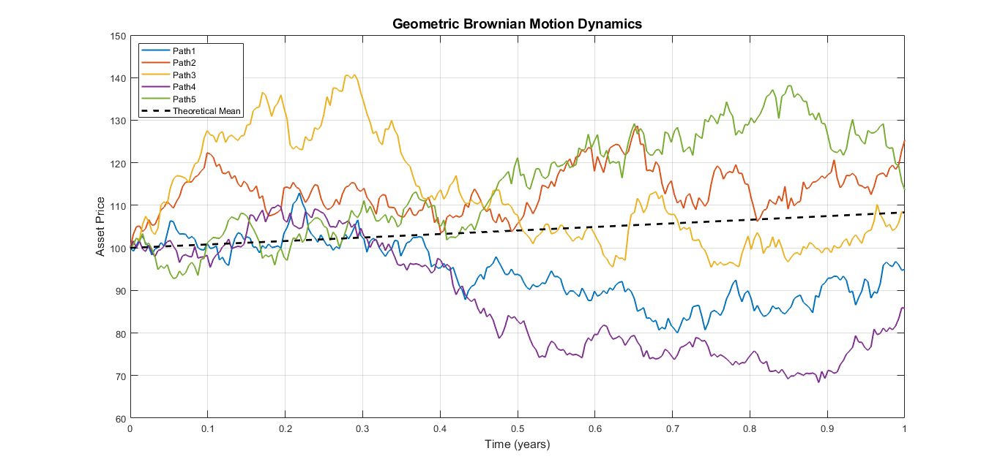{#fig-enter-label}

The cumulative distribution function of the asset price $S_t$ is derived as follows. Starting from the geometric Brownian motion model: $$S_t = S_0 \exp\left\{\left(\mu - \frac{\sigma^2}{2}\right)t + \sigma W_t\right\},$$

where $W_t$ is a standard Brownian motion, we compute the probability $\mathbb{P}(S_t \leq y)$ by taking logarithms and rearranging terms: $$\mathbb{P}(S_t \leq y) = \mathbb{P}\left(\left(\mu - \frac{\sigma^2}{2}\right)t + \sigma W_t \leq \log\left(\frac{y}{S_0}\right)\right).$$

Normalizing the inequality by dividing through by $\sigma\sqrt{t}$ and using the fact that $W_t/\sqrt{t} \sim \mathcal{N}(0,1)$, we obtain: $$\mathbb{P}(S_t \leq y) = \mathbb{P}\left(\frac{W_t}{\sqrt{t}} \leq \frac{\log\left(\frac{y}{S_0}\right) - \left(\mu - \frac{\sigma^2}{2}\right)t}{\sigma\sqrt{t}}\right).$$

Finally, expressing this in terms of the standard normal cumulative distribution function $N(x)$, defined as: $$N(x) = \int_{-\infty}^x \frac{1}{\sqrt{2\pi}} e^{-t^2/2} \, dt,$$

we arrive at the closed-form solution: $$\mathbb{P}(S_t \leq y) = N\left(\frac{\log\left(\frac{y}{S_0}\right) - \left(\mu - \frac{\sigma^2}{2}\right)t}{\sigma\sqrt{t}}\right).$$

## GBM as price dynamics

We model the price dynamics of the risky asset using a geometric Brownian motion (GBM), which is commonly employed to capture the stochastic behavior of asset prices thanks to its properties. In particular, the GBM framework ensures that asset prices remain strictly positive and exhibit continuous sample paths. $$\frac{dS_t}{S_t}=\mu dt+\sigma dW_t$$ Where:

- $\frac{dS_t}{S_t}$ is the relative return of the asset for an infinitesimal time step. for example, if for an infinitesimal small time step the shift is from $100$ to $101$, the relative return will be $0.01$.

- $\mu dt$ is the drift, or the average growth rate of the asset, for example $10\%$ per year. then we multiply it for an infinitesimal time step ($dt)$.

- $\sigma dW_t$ is the diffusion, or random noise, where $\sigma$ represents the asset's variance and $dW_t$ represents the pure randomness of a brownian motion.

While the GBM is a powerful and tractable model, one of its key limitations lies in its assumption of continuous paths. In reality, financial asset prices can exhibit sudden and significant changes---known as jumps---due to unexpected news, economic events, or market shocks. These discontinuities cannot be captured by the standard GBM model, which assumes that returns are normally distributed and that price paths are smooth.

To address this limitation, a jump component is introduced into the model, resulting in a jump-diffusion process. The modified price dynamics are given by: $$\frac{dS_t}{S_{t-}} = \mu \, dt + \sigma \, dW_t + (J_t - 1) \, dN_t$$ Where:

- $S_{t^-}$ denotes the asset price just before time $t$, ensuring proper handling of discontinuities.

- $(J_t - 1)$ represents the relative jump size at time $t$, where $J_t$ is a random variable (typically lognormally distributed) modeling the jump magnitude.

- $dN_t$ is the increment of a Poisson process with intensity $\lambda$, representing the occurrence of jump events. For example, if $\lambda = 2$, we expect two jumps per unit time on average.

The term $(J_t - 1) \, dN_t$ introduces discontinuous movements in the asset price. When $dN_t = 1$ (i.e., a jump occurs), the asset price is multiplied by $J_t$, reflecting a sudden shift. This extension allows the model to capture leptokurtic return distributions (i.e., distributions with fat tails and excess kurtosis) that are commonly observed in empirical financial data.

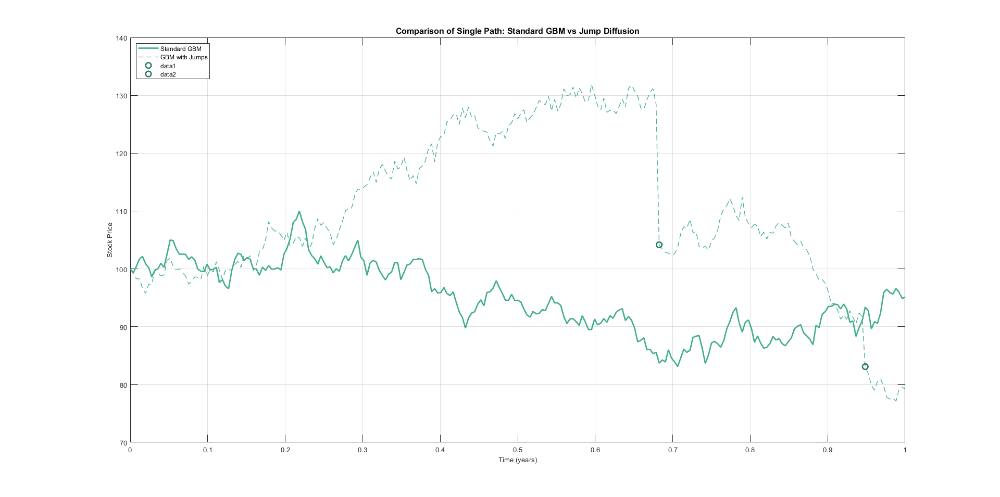{#fig-enter-labelx}

# Montecarlo Simulation

Monte Carlo simulation is a powerful and widely adopted computational technique used to evaluate the behavior of complex systems under uncertainty. In the context of financial mathematics and portfolio management, it plays a critical role in modeling the stochastic evolution of asset prices and in estimating the distribution of future portfolio returns. The fundamental principle behind Monte Carlo methods is to generate a large number of random realizations (or \"paths\") of the underlying stochastic processes governing asset price dynamics. These paths are constructed based on probabilistic models, such as geometric Brownian motion (GBM) or other more general jump-diffusion and stochastic volatility processes, which aim to capture both the deterministic trends and random fluctuations observed in financial markets.

Formally, given a stochastic process for asset prices, Monte Carlo simulation discretizes the continuous-time dynamics over a finite time horizon and iteratively simulates asset values at each step using random draws from a specified distribution, typically the standard normal distribution. For instance, under the GBM assumption, the price of an asset at a future time $t + \Delta t$ is simulated using the discretized equation:

$$S_{t+\Delta t} = S_t \exp\left( \left( \mu - \frac{1}{2} \sigma^2 \right) \Delta t + \sigma \sqrt{\Delta t} \cdot Z \right), \quad Z \sim \mathcal{N}(0,1),$$

where $\mu$ denotes the drift (expected return), $\sigma$ the volatility, and $Z$ a standard normal random variable representing the Brownian shock. This procedure is repeated over multiple time steps and for a large number of simulation paths (typically in the order of thousands), yielding a distribution of potential future price trajectories.

Once the simulation is complete, statistical quantities of interest can be derived from the ensemble of paths. For example, expected returns and the covariance matrix can be estimated across simulated scenarios and used as inputs in portfolio optimization routines. Furthermore, risk measures such as Value-at-Risk (VaR), Conditional Value-at-Risk (CVaR), or downside risk can be computed empirically from the distribution of simulated portfolio outcomes.

The main advantage of Monte Carlo simulation lies in its flexibility. Unlike closed-form analytical models that often rely on strong simplifying assumptions, the Monte Carlo framework can incorporate a wide range of realistic features such as path-dependence, time-varying volatility, fat tails, jumps, or correlated asset returns. It is also particularly well-suited for handling portfolios with nonlinear payoffs, such as those involving derivatives or exotic instruments, where analytical solutions are infeasible.

However, Monte Carlo methods also come with certain limitations. Chief among them is the computational cost: generating a sufficiently large number of paths to ensure statistical accuracy may require significant processing time, especially in high-dimensional settings. Moreover, the quality of the results strongly depends on the quality of the stochastic model used and on the assumptions made regarding parameter estimation and distributional behavior.

In summary, Monte Carlo simulation provides a robust and versatile tool for modeling financial uncertainty, supporting portfolio selection.

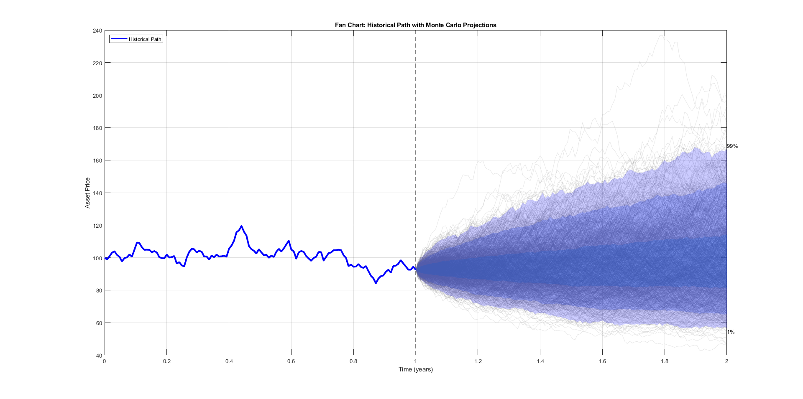{#fig-enter-label}

A fan chart is a powerful visualization technique in financial risk analysis that combines historical price data with forward-looking probabilistic forecasts. The chart displays the historical price path as a solid line, while colored confidence bands (typically ranging from 1%-99% to 25%-75%) represent different probability intervals of future price distributions generated through Geometric Brownian Motion simulations. The median (50th percentile) shows the central tendency of forecasts, while the expanding width of the bands over time visually communicates increasing uncertainty in longer-term projections. Analysts use these charts to identify when market prices approach statistically significant thresholds - for instance, when actual prices breach the 5th or 95th percentile bands, suggesting deviations from the model's expected range. The fan chart's intuitive representation of uncertainty makes it particularly valuable for communicating complex risk scenarios to stakeholders, as it simultaneously shows the most probable outcomes while acknowledging the possibility of extreme events through its widening confidence intervals at longer time horizons.

# The Continuous Time Market Model Settings

Let's take in exam a continous time market model. For every $t\in[0,T]$ we consider a stochastic vector $\boldsymbol{X_t}:=(X_t^1,...,X_t^M)$ of the market state variables. This is a vector of variables describing the market at time $t$ --- such as interest rates, economic indicators, etc. These variables evolve randomly over time, influenced by both deterministic trends (drift $\boldsymbol{\mu}$) and randomness via Brownian motions $\boldsymbol{W}_t$. The dynamics of the vector is: $$
    d\boldsymbol{X_t}=\boldsymbol{\mu}dt+\Sigma d\boldsymbol{W_t}
$$

Where

- $\boldsymbol{\mu}:=(\mu^1,...,\mu^M)^T$ is the drift vector

- $\Sigma:=(\sigma_{i,k}), \quad i=1,...,M,\quad k=1,...,n$ is the variance-covariance matrix

- $\boldsymbol{W_t}:=(W_t^1,...,W_t^n)^T$ is the vector of independent brownian motions

Moreover, let $B=\{B_t\}_{t\in [0,T]}$, and $P=\{P_t\}_{t\in [0,T]}$, two stochastic processes which represent, respectively, a risk-free security and the price of a risky asset like a stock.\
More precisely, we will have:

- $B_t=e^{\int_0^t r_s ds}$, since $\{r_t\}_{t\in [0,T]}$ is the process which describes the risk-free rate and $B_t$ represent a risk-free Zero Coupon Bond (ZCB). It grows deterministically at the risk-free rate $r_t$, with no randomness. Its dynamics is: $$
          dB_t=r_tB_tdt
  $$ with $B_0:=1$

- $P_t=\hat{P}(t,X_t)$, where $\hat{P}(^. ,^.)$ is a continuous, differentiable deterministic function.The dynamics of $P$ are obtained by applying Itō's lemma and using the multiplication rules [^3], as follows:

  $$\frac{dP_t}{P_t} = \frac{1}{P_t} \left[ \frac{\partial \tilde{P}}{\partial t} + \sum_{i=1}^M \mu^{(i)} \frac{\partial \tilde{P}}{\partial X_i^{(i)}} + \frac{1}{2} \sum_{i,j=1}^M \frac{\partial^2 \tilde{P}}{\partial X_i^{(i)} \partial X_i^{(j)}} \sum_{h,k=1}^n \sigma_{i,k} \cdot \sigma_{j,h} \right] dt$$

  $$+ \frac{1}{P_t} \sum_{i=1}^M \frac{\partial \tilde{P}}{\partial X_i^{(i)}} \sum_{k=1}^n \sigma_{i,k} \, dW_i^{(k)};$$

  or, in compact form,

  $$\frac{dP_t}{P_t} = \mu_P \, dt + \sum_{i=1}^M \sigma_P^{(k)} \, dW_i^{(k)},$$

  where

  $$\mu_P := \frac{1}{P_t} \left[ \frac{\partial \tilde{P}}{\partial t} + \nabla \tilde{P} \cdot \mu + \frac{1}{2} \sum_{i,j=1}^M \frac{\partial^2 \tilde{P}}{\partial X_i^{(i)} \partial X_i^{(j)}} \sum_{h,k=1}^n \sigma_{i,k} \cdot \sigma_{j,h} \right],$$

  $$\sigma_P^{(k)} := \frac{1}{P_t} \sum_{i=1}^M \frac{\partial \tilde{P}}{\partial X_i^{(i)}} \sum_{k=1}^n \sigma_{i,k}.$$

  The quantity $\nabla \tilde{P}$ is the gradient of the vector $\tilde{P}$.

  Using Itô's Lemma, we compute how a function of stochastic variables evolves. The dynamics of $P_t$, which depends on the market state $\boldsymbol{X}_t$.

![Comparison of risk-free bond (<em>B</em><em>t</em>) and risky asset (<em>P</em><em>t</em>) trajectories. The blue curve shows deterministic growth <em>B</em><em>t</em> = <em>e</em><em>r</em><em>t</em> (<em>r</em> = 5%), while red curves show 6 simulated paths of a geometric Brownian motion (<em>μ</em> = 10%, <em>σ</em> = 20%).](figures/marketstate.png){#fig-risk-vs-risky}

An investor's portfolio will consist of the prices of the securities in which they invest their wealth, weighted by the amount of each security held by the investor at time $t$. The shares of the securities are represented by

$$\theta_t := (\theta_t^{(1)}, \ldots, \theta_t^{(N)}),$$

which is called the investment strategy. The portfolio takes the form:

$$V_t := \sum_{k=1}^N \theta_t^{(k)} P_t^{(k)}.$$

# Portfolio Optimization

Let us consider a financial market with $n$ risky assets, whose returns over a given investment horizon are represented by a random vector $\boldsymbol{R} = (R_1, R_2, \dots, R_n)^\top$. Each component $R_i$ denotes the return of asset $i$, and the investor allocates their wealth across these assets through a vector of portfolio weights $\boldsymbol{w} = (w_1, w_2, \dots, w_n)^\top$, where $w_i$ is the proportion of total wealth invested in asset $i$. We assume that $\boldsymbol{w}^\top \boldsymbol{1} = 1$, i.e., the entire wealth is invested in the portfolio.

The expected returns of the assets are given by the vector $\boldsymbol{\mu} := \mathbb{E}[\boldsymbol{R}] \in \mathbb{R}^n$, and the risk (in terms of variance) is captured by the covariance matrix $\Sigma := \mathbb{E}\left[ (\boldsymbol{R} - \boldsymbol{\mu})(\boldsymbol{R} - \boldsymbol{\mu})^\top \right] \in \mathbb{R}^{n \times n}$, which is symmetric and positive semi-definite.

The return of the portfolio is the weighted sum of the asset returns: $$R_p := \boldsymbol{w}^\top \boldsymbol{R},$$ with expected value and variance given by: $$\mathbb{E}[R_p] = \boldsymbol{w}^\top \boldsymbol{\mu}, \qquad \text{Var}(R_p) = \boldsymbol{w}^\top \Sigma \boldsymbol{w}.$$

The fundamental problem of portfolio optimization, as introduced by Markowitz, consists in determining the vector of weights $\boldsymbol{w}$ that minimizes the portfolio risk (variance) while achieving a desired level of expected return. Formally, the mean-variance optimization problem is stated as follows: $$\begin{aligned}
    &\min_{\boldsymbol{w}} && \boldsymbol{w}^\top \Sigma \boldsymbol{w} \\
    &\text{subject to} && \boldsymbol{w}^\top \boldsymbol{1} = 1, \\
    &&& \boldsymbol{w}^\top \boldsymbol{\mu} = \mu^*,
\end{aligned}$$ where $\mu^*$ is a fixed target expected return. The solution to this quadratic optimization problem yields the portfolio with minimum risk among all those with expected return $\mu^*$.

Alternatively, an investor may wish to maximize a utility function that trades off expected return and variance, typically of the form: $$U(\boldsymbol{w}) := \boldsymbol{w}^\top \boldsymbol{\mu} - \frac{\gamma}{2} \boldsymbol{w}^\top \Sigma \boldsymbol{w},$$ where $\gamma > 0$ is the risk aversion parameter. The corresponding optimization problem becomes: $$\begin{aligned}
    &\max_{\boldsymbol{w}} && \boldsymbol{w}^\top \boldsymbol{\mu} - \frac{\gamma}{2} \boldsymbol{w}^\top \Sigma \boldsymbol{w} \\
    &\text{subject to} && \boldsymbol{w}^\top \boldsymbol{1} = 1.
\end{aligned}$$

Solving these optimization problems across varying values of $\mu^*$ or $\gamma$ allows us to construct the *efficient frontier*, which is the set of portfolios offering the highest expected return for each level of risk. Every point on the efficient frontier corresponds to an optimal trade-off between risk and return, and the investor's preferences determine which portfolio on this frontier is most suitable.

Starting from a classical mean-variance optimization framework, we will explore how stochastic processes---specifically the Geometric Brownian Motion (GBM)---can be employed to model the future returns of the assets comprising the portfolio.

In the classical Markowitz model, asset returns are assumed to be characterized by a known mean vector and covariance matrix, which are typically estimated from historical data. However, this static approach does not capture the time dynamics of asset prices and the inherent uncertainty in future returns.

To address this limitation, we introduce a stochastic modeling approach, where the price process $\{S_t^i\}_{t \in [0,T]}$ of asset $i$ is assumed to follow a Geometric Brownian Motion, defined as:

$$dS_t^i = \mu_i S_t^i \, dt + \sigma_i S_t^i \, dW_t^i,$$

where:

- $\mu_i \in \mathbb{R}$ is the expected rate of return of asset $i$,

- $\sigma_i > 0$ is the volatility (standard deviation of returns),

- $W_t^i$ is a standard Brownian motion (possibly correlated across assets),

- $S_t^i$ is the asset price at time $t$.

Under this model, the logarithmic returns are normally distributed, and the prices are lognormally distributed. This allows us to simulate multiple future scenarios of asset prices and returns using Monte Carlo methods, and to incorporate such distributions into the optimization process.

In this stochastic setting, portfolio optimization is no longer static but becomes a dynamic or scenario-based optimization problem, where we can estimate future return distributions and evaluate expected utility, Value-at-Risk (VaR), or Conditional Value-at-Risk (CVaR) across simulated paths.

However, in the following treatment, we will adopt a simplified approach: while preserving the original mean-variance objective function, we will simulate the future dynamics of asset returns through stochastic processes. This allows us to analyze the performance and risk of different portfolio allocations under a probabilistic representation of future market scenarios, without altering the optimization criteria themselves.

## Sample

Ten stocks listed on the New York Stock Exchange (NYSE) have been selected, with daily return data spanning the period from January 10, 2020 to January 10, 2025, and exhibiting the following characteristics:

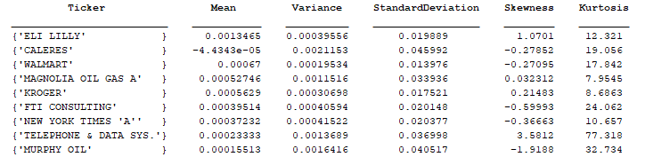{#fig-enter-labelx}

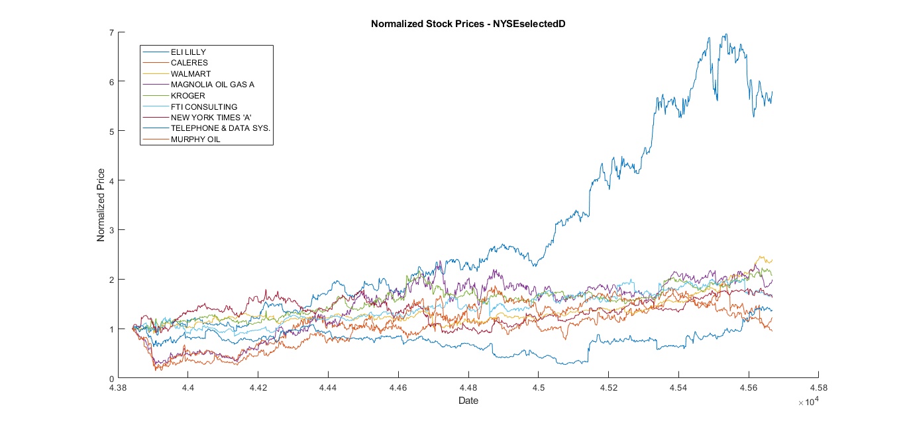{#fig-enter-label}

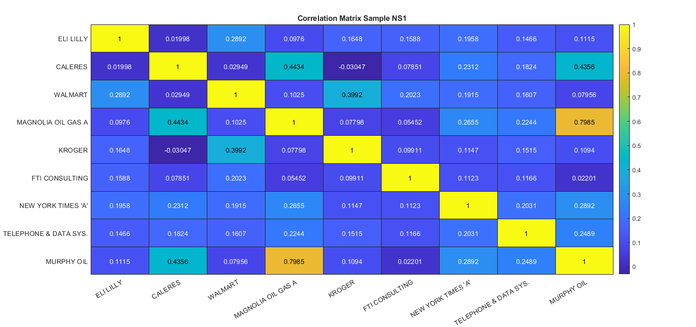{#fig-enter-labelx}

## Markowitz mean-variance optimization

We consider investing only if the profit exceeds the minimum required profit $\overline{\pi}$. Assuming unit capital, this hypothesis holds when the optimal investment does not depend on the actual capital invested, allowing us to focus on percentages of unit capital. The first optimization problem seeks the best allocation of our unit capital across different assets $z = (z^1, z^2, ..., z^n) \in \mathbb{R}^n$ that minimizes risk while keeping the portfolio return greater than or equal to $\overline{\pi}$ (0 in our case).

The key observation is that $z$ represents percentages of unit capital, so the sum of its components must equal one. Introducing the vector $e = \{1, 1, ..., 1\} \in \mathbb{R}^n$, we use dot product notation to express this sum as: $$z^1 + z^2 + \dots + z^n = 1 \cdot z^1 + 1 \cdot z^2 + \dots + 1 \cdot z^n = (e, z).$$ Thus, the full capital allocation constraint becomes $(e, z) = 1$. The non-negativity condition $z \geq 0$ (where $0$ is the lower bound) prohibits short selling. The minimum return requirement is written as: $$(m, z) \geq \overline{\pi}.$$ The complete optimization problem is then formulated as: $$\begin{aligned}
\min_z \quad & (z, Vz) \\
\text{subject to} \quad & (m, z) \geq \overline{\pi} \\
& (e, z) = 1 \\
& z \geq 0,
\end{aligned}$$ where $V$ is the covariance matrix representing risk.\
The results of the optimization are the following: ELI LILLY: 0.12728 CALERES: 0.022392 WALMART: 0.31421 MAGNOLIA OIL GAS A: 0.024015 KROGER: 0.19155 FTI CONSULTING: 0.16774 NEW YORK TIMES 'A': 0.13353 TELEPHONE & DATA SYS.: 0.011855 MURPHY OIL: 0.0074251\
With an annualized return of $0.16944$ and an annualized risk of $0.16753$

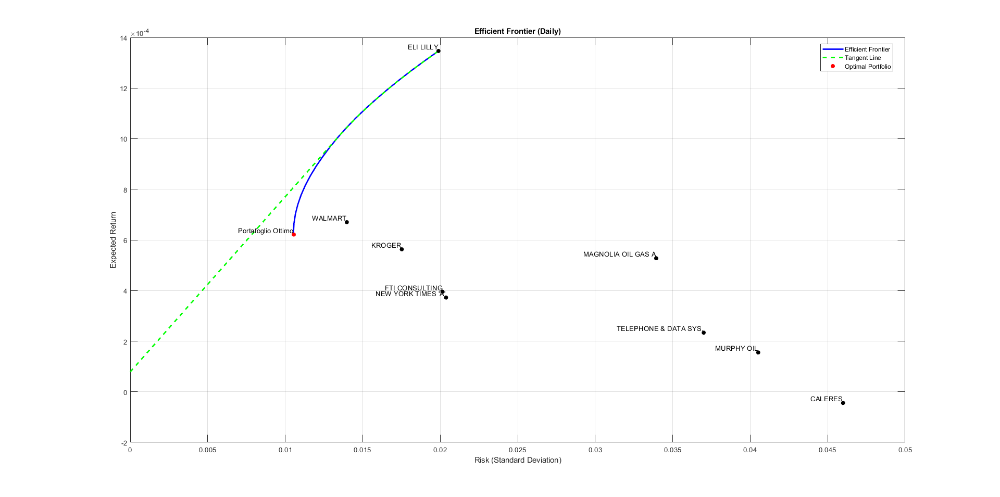{#fig-enter-label}

## Optimization under GBM-Modeled Forecasts of the Components 

The portfolio optimization implemented adopts a forward-looking, simulation-based methodology grounded in the dynamics of a Geometric Brownian Motion (GBM). Unlike classical mean-variance optimization, which directly uses historical estimates of expected returns and covariances, this approach simulates the future paths of asset prices under stochastic dynamics, capturing the inherent uncertainty of financial markets in a more realistic and flexible framework.

In particular, historical log returns are first computed from time series data of selected assets. From these, the annualized mean returns and volatilities are estimated. These statistics are then used to generate Monte Carlo simulations of future asset price trajectories based on the GBM model:

$$dS_t = \mu S_t \, dt + \sigma S_t \, dW_t,$$

which has the analytical solution (in discretized form):

$$S_{t+\Delta t} = S_t \exp\left( \left( \mu - \frac{1}{2} \sigma^2 \right) \Delta t + \sigma \sqrt{\Delta t} \cdot Z \right), \quad Z \sim \mathcal{N}(0,1).$$

The simulation is repeated multiple times (e.g., 1000 scenarios) over a time horizon (typically one year), producing a distribution of future price paths. From these simulations, log-returns are calculated, and the average returns and covariance matrix are computed across both time and scenarios. These simulated quantities form the input for a portfolio optimization problem, in which the portfolio weights are chosen to minimize risk (i.e., portfolio variance) under budget and positivity constraints:

$$\min_{x} \quad x^\top \Sigma x \quad \text{subject to} \quad \sum_{i} x_i = 1, \quad x_i \geq 0,$$

where $\Sigma$ is the covariance matrix estimated from simulated returns, and $x$ is the vector of asset weights. This contrasts with the classical mean-variance optimization framework, which directly formulates the problem based on observed historical averages and includes a minimum return threshold. Under the assumption of unit capital, the classical formulation seeks an allocation $z = (z_1, z_2, ..., z_n) \in \mathbb{R}^n$ such that:

$$\min_{z} \quad z^\top V z$$

subject to:

$$(m, z) \geq \pi, \quad (e, z) = 1, \quad z \geq 0,$$

where $m$ is the vector of expected returns, $\pi$ is the minimum required profit, $V$ is the historical covariance matrix, and $e = (1, ..., 1)$ enforces the full budget constraint. This formulation minimizes portfolio variance while ensuring the expected return is not lower than a required threshold and forbids short selling.

While the classical formulation is elegant and computationally efficient, it relies entirely on past data, potentially underestimating the true distribution of future outcomes. In contrast, the GBM-based approach offers a scenario-driven view of uncertainty, accommodating non-linearity and forward-looking risk assessments. Moreover, the simulation-based model can be easily extended to incorporate more complex features such as jumps, stochastic volatility, or regime switching, providing a more adaptable framework for real-world portfolio management.

The simulation based on the last 100 days of known prices yields:

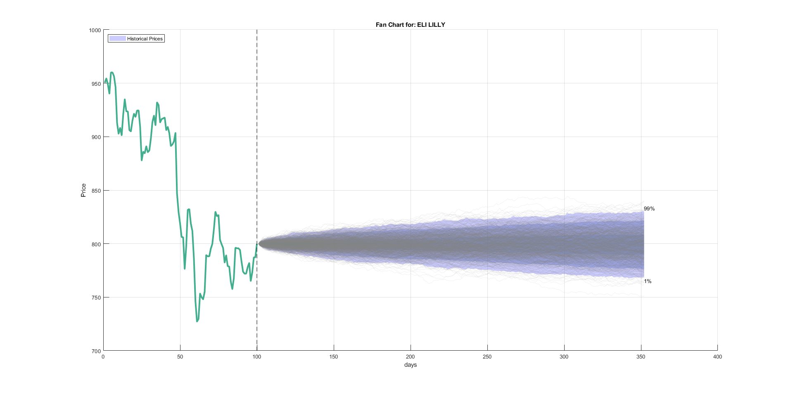{#fig-enter-labelx}

<figure id="fig:quadruple" data-latex-placement="H">
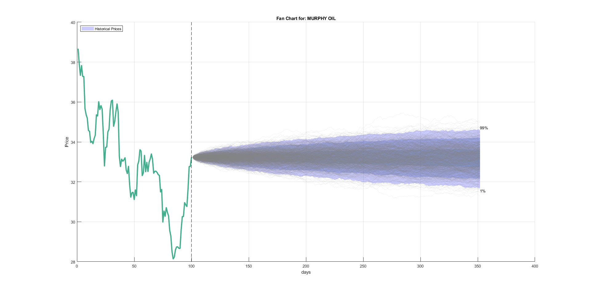{#fig-1}
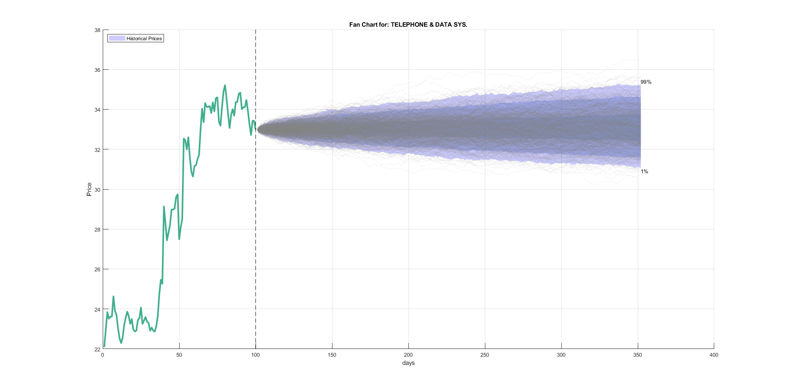{#fig-2}
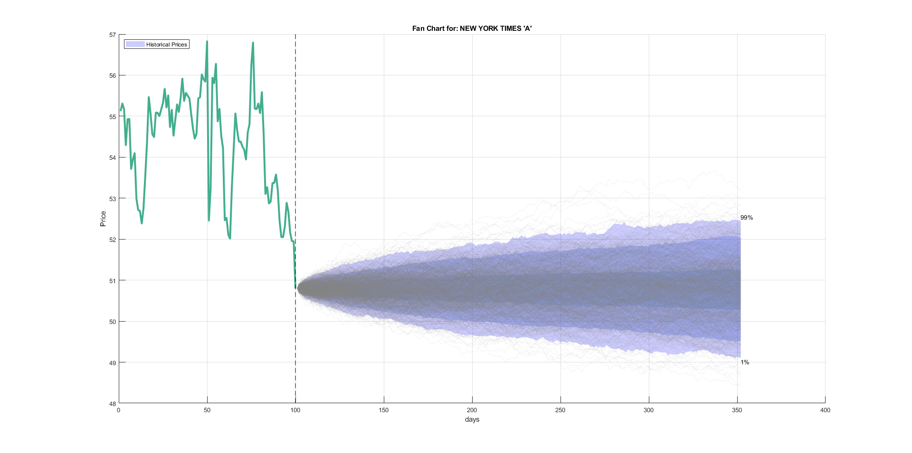{#fig-3}
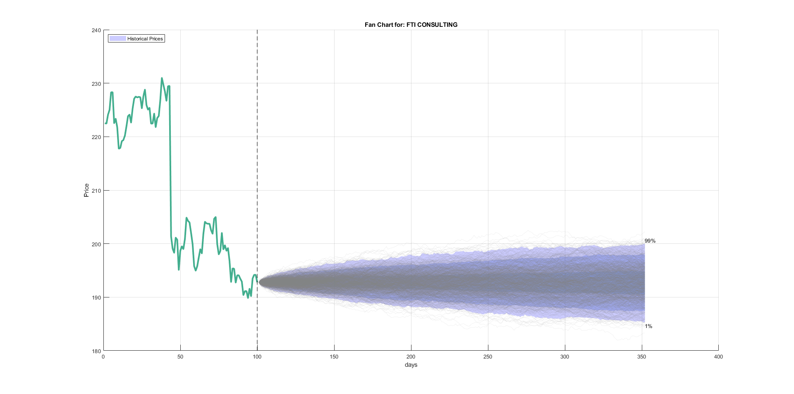{#fig-4}
<figcaption></figcaption>
</figure>

<figure id="fig:quadruple" data-latex-placement="H">
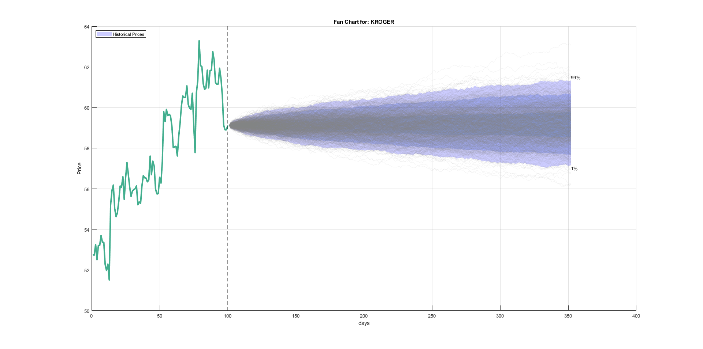{#fig-1x}
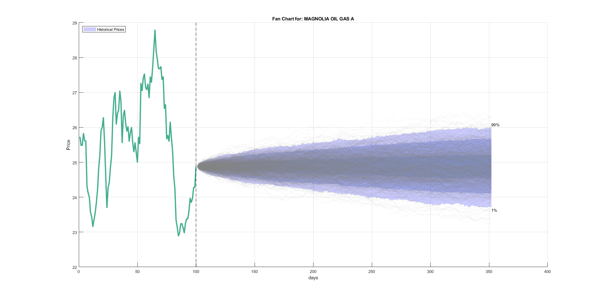{#fig-2x}
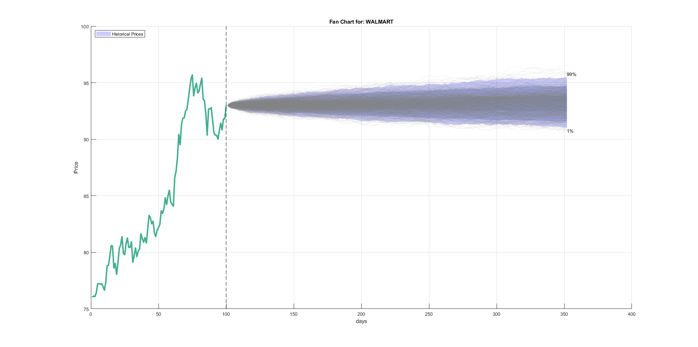{#fig-3x}
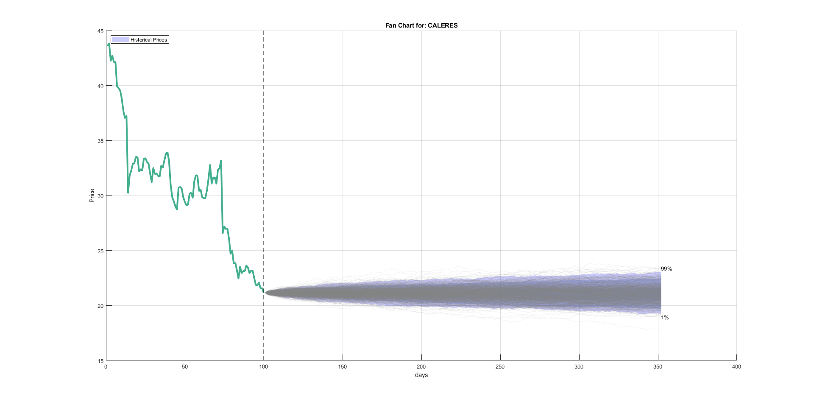{#fig-4x}
<figcaption></figcaption>
</figure>

In this case, we aim to maximize returns while simultaneously minimizing the variance.\
The optimal solution is given by:

ELI LILLY: 81.53% CALERES: 0.00% WALMART: 18.47% MAGNOLIA OIL GAS A: 0.00% KROGER: 0.00% FTI CONSULTING: 0.00% NEW YORK TIMES 'A': 0.00% TELEPHONE AND DATA SYS.: 0.00% MURPHY OIL: 0.00%

# Conclusions

This works presents an integrated approach to portfolio optimization by combining continuous-time stochastic modeling, Monte Carlo simulation, and the classical mean-variance framework. By modeling asset prices through a geometric Brownian motion (GBM), we capture the essential features of market behavior, such as random fluctuations, compounding returns, and the time-dependent nature of volatility. The GBM model, although relatively simple, provides a tractable and analytically well-understood foundation for simulating future asset dynamics under uncertainty.

Monte Carlo simulation has been applied to generate a large number of possible future price paths for a selection of ten NYSE-listed stocks. These simulations are based on empirically estimated parameters (drift and volatility), which are derived from historical log returns. Unlike deterministic models, the use of simulated stochastic paths allows us to analyze the full distribution of possible portfolio outcomes, capturing the inherent uncertainty in asset returns and enabling a more robust understanding of portfolio risk.

Building on this, we implemented the Markowitz mean-variance optimization model using the output of the simulations to construct portfolios that minimize variance for a given level of expected return. This approach, although originally formulated in a static setting, benefits significantly from the enriched probabilistic information provided by the simulations. The efficient frontier derived from the simulated returns offers a more nuanced view of the trade-off between risk and return, grounded in a stochastic representation of future market behavior rather than historical extrapolation alone.

Our findings underscore the importance of integrating computational techniques such as Monte Carlo simulation into portfolio construction, especially in settings where closed-form solutions are either unavailable or insufficiently flexible. Furthermore, the combination of GBM-based modeling and Monte Carlo allows for straightforward extensions: transaction costs, portfolio constraints, time-varying volatilities, or even alternative stochastic processes such as mean-reverting models can be incorporated within the same framework.

Ultimately, this methodology equips investors and risk managers with a practical and adaptable toolset. It not only supports informed asset allocation decisions under uncertainty but also provides a foundation for more advanced research into risk-adjusted performance, stress testing, and scenario analysis in modern portfolio management.

# Appendix

Matlab Code

    function z = ottimizzazione_markowitz()
        
        A = readtable('DBEXAM.xlsx', 'Sheet', 'NS1', 'ReadRowNames', true, 'VariableNamingRule', 'preserve');
        tickers = A.Properties.VariableNames;
        prezzi_iniziali = A{end, :};
        A = table2array(A);

        
        n = size(A, 1);
        R = log(A(2:n, :) ./ A(1:n-1, :));
        mu = mean(R) * 252; 
        sigma = std(R) * sqrt(252); 

        
        num_assets = size(A, 2);
        num_simulations = 10000;
        time_horizon = 252;
        dt = 1/time_horizon;
        
        rendimenti_simulati = zeros(num_simulations, num_assets);
        for sim = 1:num_simulations
            for asset = 1:num_assets
                prezzi_sim = simulateGBM(prezzi_iniziali(asset), mu(asset), sigma(asset), time_horizon, dt);
                rendimenti_simulati(sim, asset) = log(prezzi_sim(end)/prezzi_sim(1)); 
            end
        end

        
        mu_sim = mean(rendimenti_simulati)'; 
        cov_mat = cov(rendimenti_simulati); 

        
        gamma = 1; 
        z0 = ones(num_assets, 1)/num_assets; 
        Aeq = ones(1, num_assets); 
        Beq = 1;
        LB = zeros(num_assets, 1); 
        UB = ones(num_assets, 1); 

        
        options = optimoptions('fmincon', 'Algorithm', 'sqp', 'Display', 'iter');
        [x, fval] = fmincon(@(x) - (mu_sim' * x) + gamma * (x' * cov_mat * x), ...
                          z0, [], [], Aeq, Beq, LB, UB, [], options);

        
        disp('Pesi ottimali:');
        for i = 1:num_assets
            fprintf('
        end
        fprintf('Expected Return: 
        fprintf('Annual Volatility: 
        fprintf('Sharpe Ratio (rf=0): 
    end

    function prezzi = simulateGBM(S0, mu, sigma, time_horizon, dt)
        prezzi = S0 * exp(cumsum((mu - sigma^2/2)*dt + sigma*sqrt(dt)*randn(time_horizon,1)));
    end

    Pesi ottimali:
    ELI LILLY: 81.72
    CALERES: 0.00
    WALMART: 18.28
    MAGNOLIA OIL GAS A: 0.00
    KROGER: 0.00
    FTI CONSULTING: 0.00
    NEW YORK TIMES A: 0.00
    TELEPHONE & DATA SYS.: 0.00
    MURPHY OIL: 0.00
    Expected Return: 26.40
    Annual Volatility: 26.39

The presented script implements portfolio optimization according to the Markowitz model, simultaneously integrating two fundamental objectives: the maximization of expected returns and the minimization of risk, the latter measured through return variance. The adopted approach is based on a Monte Carlo simulation that utilizes the Geometric Brownian Motion (GBM) model to generate future scenarios of asset prices, from which the necessary statistical parameters for optimization are derived.

The procedure begins with the acquisition of historical data. The financial asset names and corresponding most recent prices are extracted. Subsequently, daily logarithmic returns are calculated, from which annualized estimates of expected returns and volatilities for each asset are derived.

The simulation phase generates 10,000 price evolution scenarios for each asset through the GBM model, expressed by the stochastic differential equation: $$dS_t = \mu S_t dt + \sigma S_t dW_t$$ where $dW_t$ represents a standard Wiener process. From each simulation, the final logarithmic return is obtained, allowing the construction of an empirical return distribution.

From the simulated data, expected returns and the covariance matrix are calculated, which constitute the inputs for the optimization problem. The objective function minimizes the expression: $$- \mu^T x + \gamma x^T \Sigma x$$ where $x$ represents the vector of portfolio weights, $\mu$ the vector of expected returns, $\Sigma$ the covariance matrix, and $\gamma$ a parameter regulating risk aversion. The problem is subject to budget constraints ($\sum x_i = 1$) and non-negativity of weights ($x_i \geq 0$).

The optimization results include the optimal portfolio composition, expressed as percentages for each asset, along with key performance metrics: expected return, annualized volatility, and the Sharpe Ratio, the latter calculated assuming a risk-free rate of zero.

Practical applications of this tool range from individual wealth management to institutional portfolio construction, enabling financial operators to make informed decisions about the risk-return trade-off. Possible extensions include efficient frontier analysis for different target return levels and the introduction of additional constraints on asset weights.

# Bibliography

- Oliva, I., Renò,R. (2021). *Principi di Finanza Quantitativa*. Apogeo Education. Maggioli Editore.

- Lanconelli Alberto (2024), *Stochastic Processes* (Dispensa per il corso di Stochastic processes). Università degli studi di Bologna, Dipartimento di Scienze Statistiche.

- Pocci, C., Rotundo, G., De Kok, R. (2016). *MATLAB per le applicazioni economiche e finanziarie*. Apogeo education, Maggioli Editore.

[^1]: A sigma-algebra is a collection of subsets of a set $X$ that includes $X$ is closed under complementation, and is closed under countable unions. It is used to define measurable sets in probability and measure theory.

[^2]: $\mathcal{L}^2$ is a space of functions that are \"square-integrable.\" This means that if you take the function, square it, and then add up (integrate) the values over the entire domain, the result must be a finite number.

[^3]: For Itō processes $X_t$ and $Y_t$: $d(X_t Y_t) = X_t \, dY_t + Y_t \, dX_t + dX_t \, dY_t,$ where $dX_t \, dY_t = \sigma_X \sigma_Y \, dt$ (if $dW_t^{(1)} = dW_t^{(2)}$). For correlated Brownian motions: $$ d(X_t Y_t) = X_t   dY_t + Y_t   dX_t + \_X \_Y   dt.

::: {.paper-download}
[Download PDF](stochastic_modelling_for_investment_portfolios_dynamics-riot-1.pdf){.btn-paper download=""}
:::
