# Introduction {#sec-introduction .unnumbered}

The analysis of financial time series represents one of the most complex and fascinating challenges in modern econometrics. The ability to model and forecast asset price dynamics is not merely a theoretical exercise but constitutes the essential foundation for building robust quantitative trading strategies and for conscious risk management. This work, titled "Financial Econometrics Models: a theoretical framework for statistical arbitrage trading strategies", aims to provide a rigorous theoretical framework that links empirical observation of financial markets to the mathematical tools necessary to operate within them, with a particular emphasis on Statistical Arbitrage strategies.

The starting point of our analysis lies in the study of the "Stylized Facts" of financial returns. Academic literature and empirical evidence have widely demonstrated that the assumption of normality (Gaussianity) of returns, typical of classical financial models, is often inadequate to describe reality. Markets exhibit peculiar characteristics such as fat tails, skewness, and non-linear dependence. Phenomena like Volatility Clustering -- the alternation of periods of calm and turbulence -- and the Leverage Effect, where volatility reacts differently to positive or negative shocks, require the adoption of more sophisticated models than simple linear regression or the random walk.

The first part of the work is thus dedicated to deconstructing these phenomena and presenting univariate models for the mean and, crucially, for volatility. The ARCH (AutoRegressive Conditional Heteroskedasticity) and GARCH family of models are analyzed as essential tools for capturing the time-varying nature of risk and modeling the persistence of volatility observed in real data. Understanding how conditional variance evolves over time is the first step to avoiding being "blind" to market risk.

However, the true added value for trading operations lies in the analysis of relationships between multiple assets. The second part of the document extends the framework to the multivariate context, introducing crucial concepts such as cointegration and common stochastic trends. While correlation, often unstable over time, measures short-term co-movement, cointegration allows for the identification of long-term equilibrium relationships between variables. It is here that econometrics meets the practice of Pairs Trading and statistical arbitrage: the ability to distinguish between a random wandering (random walk) and a temporary deviation from a stable equilibrium is what allows for the generation of profitable trading signals.

Through the exploration of VAR (Vector AutoRegression) models and, more specifically, VECM (Vector Error Correction Models), this work outlines the methodology for treating non-stationary time series that share a common trend. The VECM, in particular, is presented as the tool of choice for simultaneously modeling short-term dynamics and the adjustment towards long-term equilibrium, offering a solid statistical basis for investment decisions. In summary, the objective of this paper is to bridge the gap between advanced econometric theory and its practical application, demonstrating how a rigorous quantitative approach is necessary to navigate the complexity of modern financial markets.

# Stylized Facts

Financial markets, at first glance, appear as a chaotic swirl of random price movements. However, beneath this apparent randomness lies a deep, underlying structure -- a set of robust statistical regularities that persist across different time periods, asset classes, and geographic markets. These empirical regularities are known as Stylized Facts.

Stylized facts are not universal laws, but they are consistent enough to form the essential "stylized" reality that any credible financial model must be able to capture and explain. They serve as the critical litmus test for model validity; a model that fails to replicate these facts is, in essence, a model of a different, simpler world than the one in which we trade.

This chapter is dedicated to elucidating these core stylized facts, with a particular focus on those related to the dynamics of asset returns and, most importantly, their volatility. A profound understanding of these properties is not merely an academic exercise. It is the foundational step that justifies the entire sophisticated modeling enterprise that follows -- from the univariate GARCH models to the dynamic correlations of the DCC framework. Without an appreciation for volatility clustering and the leverage effect, the development of such models would be unmotivated. We would be content with simple, constant-variance assumptions, which, as this chapter will demonstrate, are fundamentally at odds with market reality.

For the entire article, we are going to model log-returns only, due to their good statistical and mathematical properties such as stationarity and additivity: $$r_t = \ln\!\left( \frac{P_t}{P_{t-1}} \right)$$

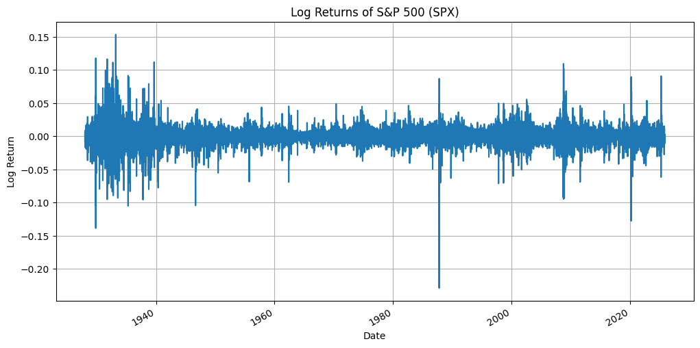{#fig-logret}

# Non-Gaussianity

If one were to assume that financial markets adhere to the elegant principles of a Gaussian world, as suggested by the classic Black-Scholes model, then extreme market events would be vanishingly rare.

This stark contradiction between theoretical finance and market reality leads us to the first pivotal stylized fact: the unconditional distribution of asset returns is not Gaussian. This phenomenon, often termed Non-Gaussianity, is primarily characterized by two features visible in the empirical distribution of returns: excess kurtosis ("fat tails") and, frequently, skewness.

In this section, we will dissect this crucial concept. We will define kurtosis and skewness not just as statistical abstractions, but as the very measures that quantify the market's propensity for extreme movements and asymmetric risks. Understanding the "fat-tailed" nature of returns is not a mere academic exercise; it is a fundamental imperative for accurate risk management. It forces us to move beyond the comforting but flawed assumption of normality and to adopt models and techniques -- such as Value at Risk (VaR) derived from GARCH processes with non-normal distributions -- that are robust enough to account for the true, leptokurtic nature of financial risk. This foundational insight justifies the entire framework of advanced volatility modeling that follows.

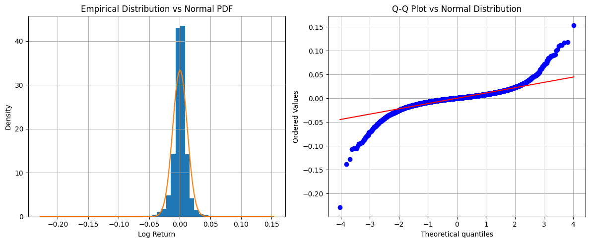{#fig-normal-comp}

According to the Gaussian distribution, a drop of more than five standard deviations in a single day should occur roughly once every 14,000 years. The empirical evidence, however, tells a different and far more dramatic story: such "sigma events" have punctuated financial history with a disconcerting regularity -- from the Black Monday of 1987 to the 2008 Global Financial Crisis and the 2020 COVID-19 crash.

{#fig-tails}

The estimation of excess kurtosis and skewness yield $-0.4667$ and $18.7386$ respectively, meaning that the distribution of log-returns is left-skewed (left tail fatter) and leptokurtic (tails are heavier than the normal).

Statistical tests lead to the same conclusion. As the Jarque-Bera test suggests:

::: {#tbl-jarque-bera}
  **Statistic**                             **Value**
  ----------------------- ---------------------------
  Jarque-Bera statistic                $360,513.7026$
  P-value                                    $0.0000$
  **Conclusion**            Reject $H_0$ (Not Normal)

  : Jarque-Bera Test Results
:::

# Leverage Effect

Beyond the stark reality of fat tails, financial markets exhibit a profound asymmetry in how they process gains versus losses, a phenomenon known as the Leverage Effect. This stylized fact captures the consistent empirical observation that negative returns induce a larger increase in future volatility than positive returns of an identical magnitude. The very term "Leverage Effect" stems from the initial corporate finance explanation, where a falling stock price mechanically increases a firm's debt-to-equity ratio, rendering its equity riskier and more volatile. However, this balance-sheet channel alone proves insufficient, as the effect is pervasive across asset classes like indices and currencies that lack such a fundamental leverage structure. A more complete understanding thus integrates crucial elements from market microstructure and behavioral finance.

The asymmetry is fundamentally driven by the behavioral dominance of fear over greed. Negative price shocks often trigger widespread risk aversion and herding behavior, leading to aggressive, synchronous selling and liquidation that amplifies volatility far more than the enthusiastic but typically more dispersed buying during bullish periods. This is further compounded by a volatility feedback mechanism, where an anticipated rise in future volatility itself makes the asset riskier, potentially leading to immediate price declines and creating a self-reinforcing cycle of fear and selling.

The critical implication of this is that any model assuming a symmetric response to news, such as the standard GARCH model, is inherently misspecified for most financial markets. It would systematically underestimate risk in downturns and overestimate it during rallies, leading to flawed forecasts. This very limitation served as the direct impetus for the development of sophisticated asymmetric volatility models, such as the GJR-GARCH and EGARCH, which we will explore in the following section.

We can define $r_t^2$ as a proxy for volatility since: $$
\text{Var}[r_t] = \mathbb{E}[r_t^2] - (\mathbb{E}[r_t])^2
$$

Given that the daily average return is approximately zero ($\mathbb{E}[r_t] \approx 0$), we obtain: $$
(\mathbb{E}[r_t])^2 \approx 0 \implies \text{Var}[r_t] \approx \mathbb{E}[r_t^2]
$$

In order to visualize the leverage effect we use a scatterplot of returns $r_{t-1}$ (i.e., lagged one period) vs today's volatility $r_t^2$, in order to assess the effects of positive and negative shocks.

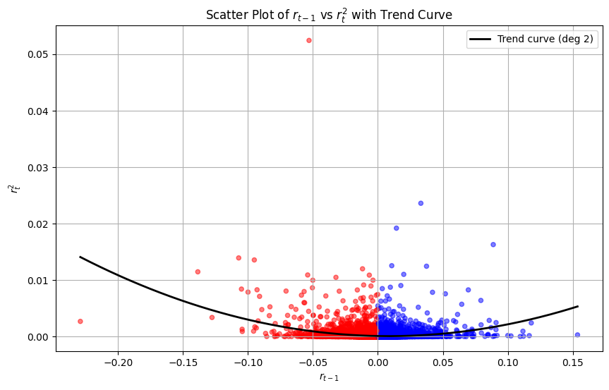{#fig-leverage}

We can observe that on the left hand side, the trend curve is steeper meaning that, on average, a negative return produces a higher volatility on the following day than a positive one of the same entity.

# Volatility Persistence and Clustering

If the Leverage Effect reveals the market's asymmetric response to news, then Volatility Clustering uncovers its inherent temporal memory for risk. This stylized fact describes the most visible pattern in financial time series: the tendency for large price changes (of either sign) to be followed by more large changes, and for small price changes to be followed by more small changes. In other words, periods of high and low volatility tend to cluster together in time, creating distinct regimes of turbulence and calm in market activity.

This phenomenon is intuitively recognizable -- periods of steady trading are punctuated by sudden storms of intense volatility. While visually apparent, its implications for modeling are profound. It directly contradicts the classical assumption of independent and identically distributed (i.i.d.) returns with constant variance (homoscedasticity). Crucially, this does not violate the Efficient Market Hypothesis regarding returns: while prices themselves may not be predictable (i.e., returns do not typically exhibit significant autocorrelation), the magnitude of these returns, captured by squared returns $r_t^2$ or absolute returns $|r_t|$, displays strong serial dependence.

The clustering phenomenon is driven by a deeper statistical property: Volatility Persistence. This refers to the slow decay of the autocorrelation function of volatility measures, indicating that shocks to volatility have long-lasting effects. Where volatility clustering describes the observable pattern, volatility persistence quantifies the dynamic property of the process -- the degree to which current volatility depends on its own past.

It was precisely to formalize this intuition that Robert Engle pioneered the ARCH model. The core innovation of ARCH, and its generalization, GARCH, was to explicitly model the conditional variance as a time-dependent process where today's variance is a function of past squared innovations and its own recent history, thereby capturing both the clustering and persistence of volatility.

{#fig-clustering}

The red bands demark the periods where the volatility clustering was remarkable such as after the subprime crisis and Covid-19.

### Empirical Evidence of Volatility Clustering {#sec-empirical-evidence-of-volatility-clustering .unnumbered}

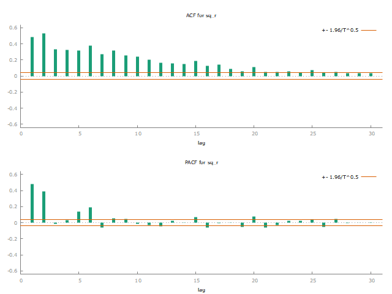{#fig-acf-pacf}

The Autocorrelation (ACF) and Partial Autocorrelation (PACF) plots for the squared log returns of the SPX provide the definitive statistical evidence for the phenomenon of volatility clustering. The ACF plot reveals the overarching character of volatility persistence, showing a slow, methodical decay of autocorrelation that remains statistically significant across numerous lags. This pattern indicates that the memory of the market's volatility is long. Simultaneously, the PACF plot offers a more refined view by isolating the direct effect of each specific lag.

To establish robust statistical evidence of volatility clustering, we employ two complementary methodologies: a **regression-based approach** and a **portmanteau test**.

### Regression Analysis with HAC Standard Errors {#sec-regression-analysis-with-hac-standard-errors .unnumbered}

We first estimate an OLS regression of current squared returns on their 15 lagged values, employing HAC (Heteroskedasticity and Autocorrelation Consistent) standard errors to ensure robust inference.

::: {#tbl-ols-results}
+---------------+-----------------+----------------+---------------+---------------+
| **Variable**  | **Coefficient** | **Std. Error** | **$t$-ratio** | **$p$-value** |
+:==============+:===============:+:==============:+:=============:+:=============:+
| const         | 0.2684          | 0.1049         | 2.559         | 0.0106        |
+---------------+-----------------+----------------+---------------+---------------+
| $r^2_{t-1}$   | 0.2846          | 0.1121         | 2.538         | 0.0112        |
+---------------+-----------------+----------------+---------------+---------------+
| $r^2_{t-2}$   | 0.3832          | 0.0879         | 4.360         | 0.0000        |
+---------------+-----------------+----------------+---------------+---------------+
| $r^2_{t-3}$   | -0.0847         | 0.1469         | -0.576        | 0.5644        |
+---------------+-----------------+----------------+---------------+---------------+
| $\vdots$      | $\vdots$        | $\vdots$       | $\vdots$      | $\vdots$      |
+---------------+-----------------+----------------+---------------+---------------+
| $r^2_{t-10}$  | -0.0132         | 0.0439         | -0.301        | 0.7638        |
+---------------+-----------------+----------------+---------------+---------------+
| $R^2$         | 0.3898          | Adj. $R^2$                     | 0.3873        |
+---------------+-----------------+--------------------------------+---------------+
| $F(10, 2491)$ | 26.71           | $P$-value($F$)                 | 0.0000        |
+---------------+-----------------+--------------------------------+---------------+

: OLS Regression Results (Dependent Variable: $r_t^2$)
:::

The results reveal a significant predictive relationship: coefficients for the first two lags are strongly significant ($\beta_1 = 0.285, p = 0.011; \beta_2 = 0.383, p < 0.001$), indicating that volatility from the previous two days contains substantial information about current volatility. The overall regression is highly significant ($F = 26.71, p < 0.001$).

### Ljung-Box Portmanteau Test {#sec-ljung-box-portmanteau-test .unnumbered}

While the regression approach quantifies specific lag relationships, the Ljung-Box test offers a more immediate and comprehensive assessment of overall autocorrelation structure in squared returns.

::: {#tbl-ljung-box}
   **Lag**    **ACF**    **PACF**   **Q-Stat**   **$p$-value**
  ---------- ---------- ---------- ------------ ---------------
      1        0.4829     0.4829      586.42         0.000
      2        0.5304     0.3876     1294.22         0.000
      3        0.3333    -0.0165     1573.78         0.000
   $\vdots$   $\vdots$   $\vdots$    $\vdots$      $\vdots$
      30       0.0377     0.0037     3784.62         0.000

  : Ljung-Box Test Results for $r_t^2$
:::

The test provides overwhelming evidence of volatility persistence. All Q-statistics are highly significant across 30 lags ($Q(1) = 586.42, p < 0.001$; $Q(30) = 3784.62, p < 0.001$), decisively rejecting the null hypothesis of no autocorrelation.

# Correlation between assets is not constant over time

The concept of dynamic correlation represents a fundamental departure from traditional financial theory. Where classical models presumed constant relationships between assets, we now understand that correlation evolves through time as a function of market regimes and economic conditions. This temporal variation is not merely statistical noise but a core characteristic of market behavior with profound implications.

In the context of pairs trading, the entire strategy rests upon a stable statistical relationship. When dynamic correlation breaks down, the spread between assets ceases to mean-revert and instead may diverge indefinitely. This represents not simply a failed trade but a fundamental failure in the strategy's premise. The risk manifests most severely during market stress when correlations converge toward unity, precisely when diversification is most needed.

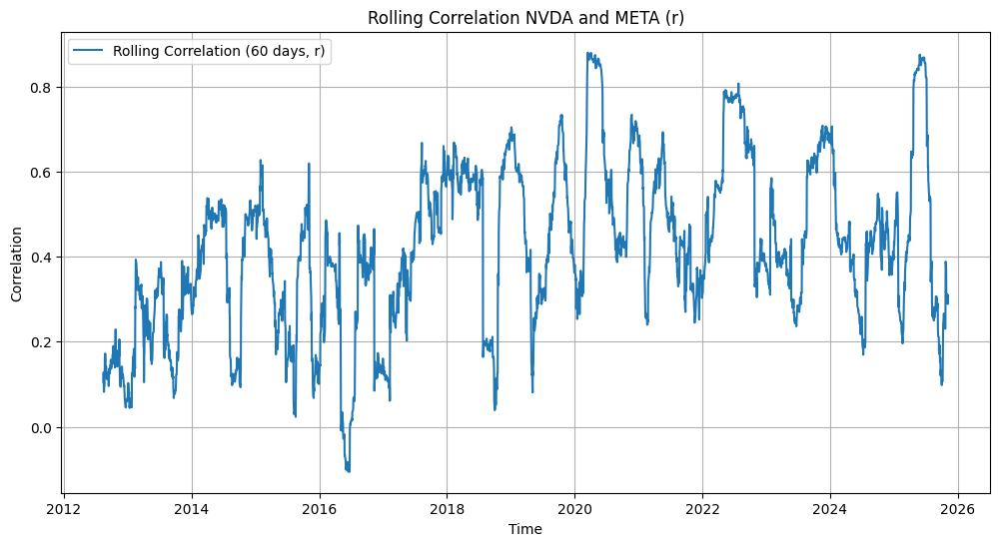{#fig-rolling-corr}

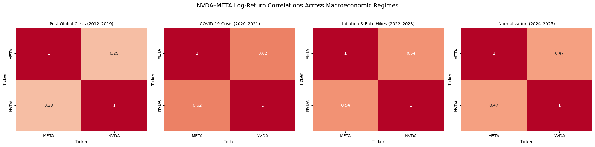{#fig-regimes}

The period from 2012 to 2025 encompasses several distinct economic regimes, each characterized by unique correlation dynamics. From 2012 through 2019, markets experienced the post-global crisis environment defined by quantitative easing, low interest rates, and relative stability. During this phase, asset correlations typically exhibited moderate and stable behavior as markets normalized.

The subsequent COVID-19 crisis period of 2020-2021 marked a dramatic departure, featuring sharp market declines, extreme volatility with the VIX exceeding 80, and unprecedented central bank interventions. This environment produced highly elevated correlations across assets as market-wide stress dominated individual security behavior.

A third distinct regime emerged from 2022 to 2023 as inflation surged globally, prompting aggressive monetary tightening and compounded by geopolitical conflicts. This phase witnessed more variable correlation patterns, with notable divergence between sectors as investors discriminated between inflation-resistant and rate-sensitive assets.

### The diversification meltdown phenomenon {#sec-the-diversification-meltdown-phenomenon .unnumbered}

The diversification meltdown phenomenon represents one of the most critical challenges to traditional portfolio theory and pairs trading strategies. This counterintuitive effect describes the situation where, during periods of market stress when diversification is most needed, correlations between assets converge toward unity, causing previously diversified portfolios to experience simultaneous losses across all holdings.

During normal market conditions, assets exhibit varying degrees of correlation based on their fundamental characteristics, sectors, and geographic exposures. However, during systemic crises -- such as the 2008 financial crisis, the 2020 pandemic crash, or the 2022 inflation shock -- a "flight to safety" mentality prevails. Investors engage in mass liquidation across risk assets, regardless of individual fundamentals, creating what financial economists term systemic correlation.

This phenomenon is visually evident in @fig-corra, where the rolling correlation between NVDA and META shows significant spikes during turbulent periods. The correlation structure undergoes what statisticians call regime switching -- abrupt transitions from a low-correlation regime to a high-correlation regime that persist throughout the crisis duration.

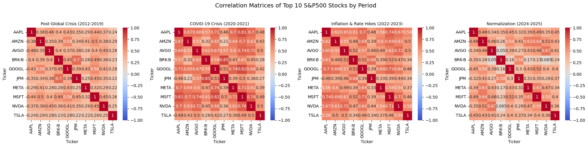{#fig-corra}

### Implications for Pairs Trading {#sec-implications-for-pairs-trading .unnumbered}

For pairs trading strategies, the diversification meltdown presents an existential threat:

- **Breakdown of Mean Reversion**: The fundamental premise of pairs trading -- that deviations from historical relationships will revert -- fails when the underlying correlation structure itself changes.

- **Simultaneous Spread Widening**: During correlation breakdowns, both legs of a pairs trade may move in the same direction, causing the spread to widen beyond historical boundaries and triggering margin calls or stop-losses.

The diversification meltdown can be formally represented through the dynamics of the correlation matrix. Let $\rho_{ij,t}$ represent the time-varying correlation between assets $i$ and $j$. During normal regimes: $$\rho_{ij,t} \sim \mathcal{N}(\mu_{\rho}, \sigma_{\rho}^2)$$ with moderate cross-sectional variation. During crisis regimes, the distribution shifts: $$\rho_{ij,t} \rightarrow \rho_{ij,t} \sim \mathcal{N}(\mu_{\rho}^{\text{crisis}}, (\sigma_{\rho}^{\text{crisis}})^2)$$ where $\mu_{\rho}^{\text{crisis}} \gg \mu_{\rho}$ and $(\sigma_{\rho}^{\text{crisis}})^2 \ll \sigma_{\rho}^2$, indicating higher average correlations with reduced dispersion.

# Non-linear dependence

A fundamental stylized fact of financial markets is the presence of nonlinear dependence between asset returns. This phenomenon describes how the dependence structure between return series changes conditional on market regimes, contrasting sharply with the assumption of constant linear correlation underlying traditional multivariate models. While standard correlation measures (e.g., Pearson's $\rho$) adequately capture linear relationships where the conditional expectation $E(Y|X)$ is a linear function of $X$, they fail to detect more complex, state-dependent co-movements.

### Exceedance Correlations {#sec-exceedance-correlations .unnumbered}

A powerful methodology for empirically documenting nonlinear dependence is the analysis of exceedance correlations. Let $X$ and $Y$ be two standardized return series (mean zero, unit variance). The exceedance correlation $\tilde{\rho}(p)$ at probability level $p$ is defined separately for the left and right tails as: $$\begin{aligned}
    \tilde{\rho}(p) & = \text{Corr}\left(X, Y \,|\, X \leq Q_X(p) \text{ and } Y \leq Q_Y(p)\right), & \text{for } p \leq 0.5 \\
    \tilde{\rho}(p) & = \text{Corr}\left(X, Y \,|\, X > Q_X(p) \text{ and } Y > Q_Y(p)\right), & \text{for } p > 0.5
\end{aligned}$$ where $Q_X(p)$ and $Q_Y(p)$ denote the $p$-th quantiles of $X$ and $Y$, respectively.

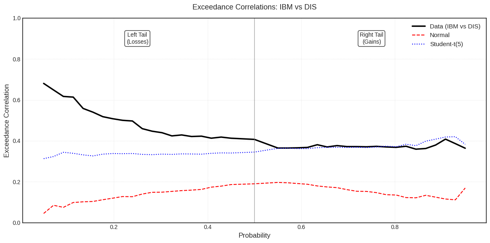{#fig-exccorr}

The exceedance correlation analysis for IBM and Disney reveals a distinct asymmetry in their dependence structure. The graph demonstrates that during extreme loss periods (left tail), correlations between the two stocks increase significantly, exceeding the predictions of theoretical models. This indicates that during market crises, IBM and Disney tend to move together much more strongly compared to normal periods.

# Volume-Volatility Relationship

The positive relationship between trading volume and volatility represents one of the most robust empirical regularities in financial markets, documenting that periods of high trading activity systematically associate with elevated price volatility. This phenomenon finds theoretical foundation in the mixture of distributions hypothesis, where both volume and volatility respond to a common latent variable: the rate of information arrival.

In volatility modeling, this relationship justifies incorporating volume as an exogenous variable in GARCH specifications: $$\sigma_t^2 = \omega + \alpha \varepsilon_{t-1}^2 + \beta \sigma_{t-1}^2 + \gamma V_{t-1}$$ where $V_{t-1}$ represents normalized volume.

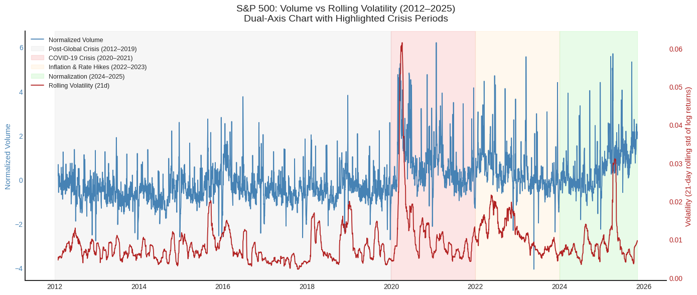{#fig-vol-vol}

# Cointegration and common trends

The concept of cointegration represents a fundamental statistical property with profound implications for pairs trading strategies. Two non-stationary time series $X_t$ and $Y_t$, both integrated of order one $I(1)$, are said to be cointegrated if there exists a parameter $\beta$ such that the linear combination $\epsilon_t = Y_t - \beta X_t$ forms a stationary process $I(0)$.

### Cointegration is time varying {#sec-cointegration-is-time-varying .unnumbered}

The assumption of time-invariant cointegration parameters is often unrealistic in financial markets, as clearly demonstrated by the rolling window analysis in @fig-cointime and @fig-rolling-adf. The dynamic evolution of both the intercept ($\alpha$) and the slope coefficient ($\beta$) reveals that the long-run equilibrium relationship between XOM and CVX is not constant but subject to significant structural shifts over the 2012-2026 period.

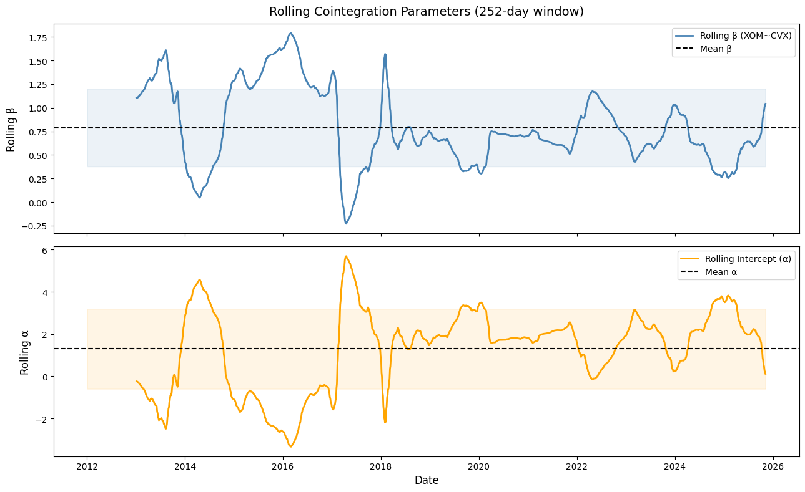{#fig-cointime}

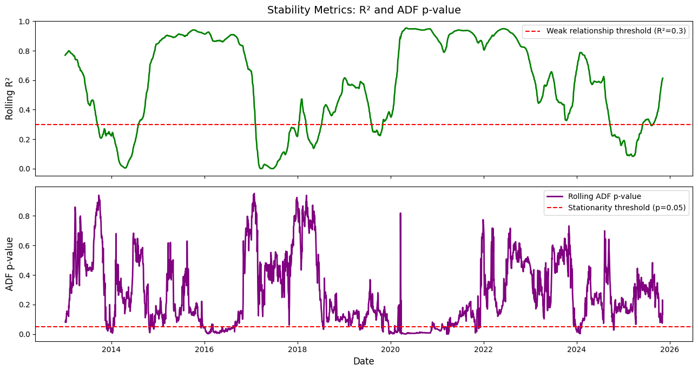{#fig-rolling-adf}

::: {.paper-download}
[Download PDF](stylized-facts-in-financial-returns.pdf){.btn-paper download=""}
:::
