.

# Univariate volatility modelling

## Data

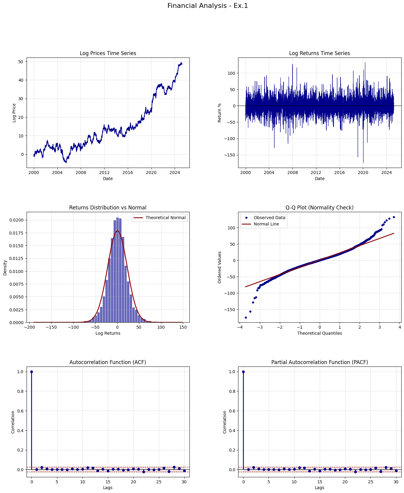{#fig-placeholder}

::: {#tbl-descriptive-stats}
  **Metric**                                                  **Value**
  ------------------------- -------------------------------------------
  Observations                                              6.580,00000
  Mean                                                          0,74206
  Median                                                        0,50763
  Min                                                        -174,35039
  Max                                                         132,45985
  Variance                                                    496,99687
  Stdev                                                        22,29343
  Skewness                                                      0,06033
  Exc. Kurtosis                                                 2,83522
  Jarque-Bera ($p$-value)                         $0,00000 \times 10^0$
  **Normality test**          *Rejected $H_0$: Non Normal distribution*

  : Statistics
:::

## Model and Estimation

The original time series, represented by log prices ($p_t$), was preliminarily transformed into log-returns ($r_t$) to guarantee that the series was weakly stationary, a necessary condition for GARCH modelling. The returns were calculated, exploiting the properties of logarithms, as: $r_t = (p_t - p_{t-1}) \times 100$. The scale ($\times 100$) was adopted to improve the convergence of the numerical Maximum Likelihood optimization.

For the mean equation, a Constant Mean model was specified, that is: $r_t = \mu + \varepsilon_t$. The choice of the use of a constant $\mu$, excluding AR or MA terms, is twofold:

- **EMH:** In line with the hypothesis of the weak form EMH, the series does not show a serial autocorrelation such as to justify complicated ARMA models; past returns have no predictive power on future ones.

- **Significance of the Drift $\mu$:** The estimation results confirm that the parameter $\mu$ is equal to 0.5372 with a p-value of 0.0247. Since the p-value is lower than the significance level of 5%, we reject the null hypothesis $\mu=0$. There exists therefore a structural drift (positive trend) in the returns that represents the expected long-run return; omitting this term would have led to a wrong specification of the residuals $\varepsilon_t$ to feed to the volatility models.

To identify the dynamics of the conditional variance ($\sigma^2_t$), a gridsearch was performed on 72 different specifications, comparing symmetric (GARCH) and asymmetric (GJR, EGARCH, APARCH) models combined with different error distributions (Normal, Student's t, Skew-t). The selection ratio adopted was the minimization of the BIC, in order to select the most parsimonious model. What resulted from the comparative investigation is:

- **Absence of Leverage effect:** The test on the GJR-GARCH(1,1) model returned a coefficient $\gamma$ equal to -0.0199 with a p-value of 0.259. Not being statistically significant, there is no evidence that negative shocks increase volatility more than positive ones. This led to the exclusion of asymmetric models (in contrast with the literature on returns)

- **Absence of Asymmetry in the Distribution:** The skewness parameter ($\lambda$) in the Skew-t model did not result significant (p-value 0.150), suggesting a symmetric distribution of shocks.

- **Confirmation of Leptokurtosis:** In all tested models, the DoF parameter ($\nu$) resulted strongly significant and far from the values of the Gaussian distribution.

On the basis of these evidences, the GARCH(1,1) model with Student's t distribution resulted the best model for the data (minimum BIC: 58829.9). The estimated variance DGP is the following: $$\sigma^2_t = \omega + \alpha \varepsilon_{t-1}^2 + \beta \sigma^2_{t-1}$$ The estimated coefficients tell us that:

- **Reactivity ($\alpha = 0.1119$, $p < 0.001$):** The ARCH coefficient is significant and indicates that volatility reacts rapidly to new information (shocks on squared returns). A value of about 0.11 suggests a sensitivity quite moderate but rapid to market shocks.

- **Persistence ($\beta = 0.7883$, $p < 0.001$):** The GARCH coefficient is significant, meaning a strong memory of the process. Periods of high or low volatility tend to persist over time, confirming the presence of volatility clustering.

- **Stationarity:** The sum $\alpha + \beta = 0.9002$ is less than 1. This confirms to us that the process is stationary and mean-reverting: even though shocks have high persistence, volatility tends to return to its long-run average given by $\omega / (1 - \alpha - \beta)$.

- **Tail risk ($\nu = 7.11$, $p < 0.001$):** The shape parameter of the Student's t is estimated at 7.11. This value confirms to us the presence of fat tails. The probability of observing extreme returns (tail events) is significantly higher than that predicted by a Gaussian distribution.

We have demonstrated that the asset presents a volatility structure not constant over time. The optimal model is a symmetric GARCH(1,1) with errors distributed according to a Student's t. Such specification adequately captures the underlying positive trend, the volatility clustering with high persistence and the high probability of extreme events, without needing corrections for leverage or for the skewness of the distribution.

::: {#tbl-garch-comparison}
+:--------------------+:-------------------:+:-------------------:+:-------------------:+:-------------------:+:-------------------:+
|                     | **(1)**             | **(2)**             | **(3)**             | **(4)**             | **(5)**             |
+---------------------+---------------------+---------------------+---------------------+---------------------+---------------------+
| **Parameter**       | **GARCH-t**         | **GARCH-Skew-t**    | **EGARCH-t**        | **APARCH-t**        | **GJR-GARCH-t**     |
+---------------------+---------------------+---------------------+---------------------+---------------------+---------------------+
| *Mean Equation:* $r_t = \mu + \varepsilon_t$                                                                                      |
+---------------------+---------------------+---------------------+---------------------+---------------------+---------------------+
| $\mu$ (Constant)    | 0.5372\*\*          | 0.6459\*\*\*        | 0.5638\*\*          | 0.5408\*\*          | 0.5776\*\*          |
+---------------------+---------------------+---------------------+---------------------+---------------------+---------------------+
|                     | (0.2392)            | (0.2498)            | (0.2384)            | (0.2391)            | (0.2426)            |
+---------------------+---------------------+---------------------+---------------------+---------------------+---------------------+
| *Variance Equation*                                                                                                               |
+---------------------+---------------------+---------------------+---------------------+---------------------+---------------------+
| $\omega$ (Constant) | 50.1605\*\*\*       | 50.0267\*\*\*       | 0.6102\*\*\*        | 19.0549             | 49.5487\*\*\*       |
+---------------------+---------------------+---------------------+---------------------+---------------------+---------------------+
|                     | (6.8199)            | (6.7661)            | (0.0846)            | (14.1298)           | (6.7143)            |
+---------------------+---------------------+---------------------+---------------------+---------------------+---------------------+
| $\alpha$ (ARCH)     | 0.1119\*\*\*        | 0.1109\*\*\*        | 0.2334\*\*\*        | 0.1195\*\*\*        | 0.1208\*\*\*        |
+---------------------+---------------------+---------------------+---------------------+---------------------+---------------------+
|                     | (0.0117)            | (0.0116)            | (0.0198)            | (0.0127)            | (0.0147)            |
+---------------------+---------------------+---------------------+---------------------+---------------------+---------------------+
| $\beta$ (GARCH)     | 0.7883\*\*\*        | 0.7893\*\*\*        | 0.9019\*\*\*        | 0.7946\*\*\*        | 0.7903\*\*\*        |
+---------------------+---------------------+---------------------+---------------------+---------------------+---------------------+
|                     | (0.0200)            | (0.0198)            | (0.0137)            | (0.0198)            | (0.0198)            |
+---------------------+---------------------+---------------------+---------------------+---------------------+---------------------+
| $\gamma$ (Leverage) | \-                  | \-                  | \-                  | \-                  | -0.0199             |
+---------------------+---------------------+---------------------+---------------------+---------------------+---------------------+
|                     |                     |                     |                     |                     | (0.0176)            |
+---------------------+---------------------+---------------------+---------------------+---------------------+---------------------+
| $\delta$ (Power)    | \-                  | \-                  | \-                  | 1.6937\*\*\*        | \-                  |
+---------------------+---------------------+---------------------+---------------------+---------------------+---------------------+
|                     |                     |                     |                     | (0.2323)            |                     |
+---------------------+---------------------+---------------------+---------------------+---------------------+---------------------+
| *Distribution Parameters*                                                                                                         |
+---------------------+---------------------+---------------------+---------------------+---------------------+---------------------+
| $\nu$ (DoF / Eta)   | 7.1135\*\*\*        | 7.1257\*\*\*        | 7.1358\*\*\*        | 7.1429\*\*\*        | 7.1333\*\*\*        |
+---------------------+---------------------+---------------------+---------------------+---------------------+---------------------+
|                     | (0.5854)            | (0.5901)            | (0.5896)            | (0.5901)            | (0.5890)            |
+---------------------+---------------------+---------------------+---------------------+---------------------+---------------------+
| $\lambda$ (Skew)    | \-                  | 0.0259              | \-                  | \-                  | \-                  |
+---------------------+---------------------+---------------------+---------------------+---------------------+---------------------+
|                     |                     | (0.0180)            |                     |                     |                     |
+---------------------+---------------------+---------------------+---------------------+---------------------+---------------------+
| **Log-Likelihood**  | -29393.0            | -29391.9            | -29396.3            | -29392.3            | -29392.3            |
+---------------------+---------------------+---------------------+---------------------+---------------------+---------------------+
| **AIC**             | 58795.9             | 58795.8             | 58802.6             | 58796.5             | 58796.7             |
+---------------------+---------------------+---------------------+---------------------+---------------------+---------------------+
| **BIC**             | **58829.9**         | 58836.5             | 58836.6             | 58837.3             | 58837.4             |
+---------------------+---------------------+---------------------+---------------------+---------------------+---------------------+
| *Note: Standard errors in brackets. \*\*\* p$<$<!-- -->0.01, \*\* p$<$<!-- -->0.05, \* p$<$<!-- -->0.1.*                          |
+-----------------------------------------------------------------------------------------------------------------------------------+

: Grid Search summary, best models
:::

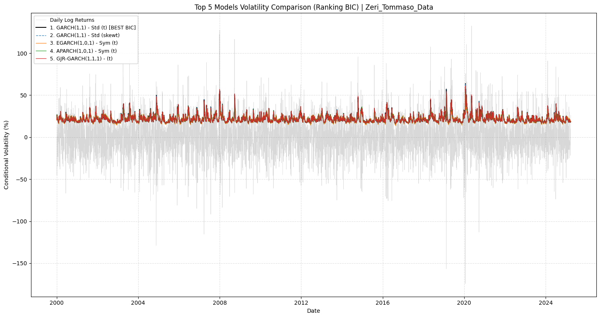{#fig-placeholderx}

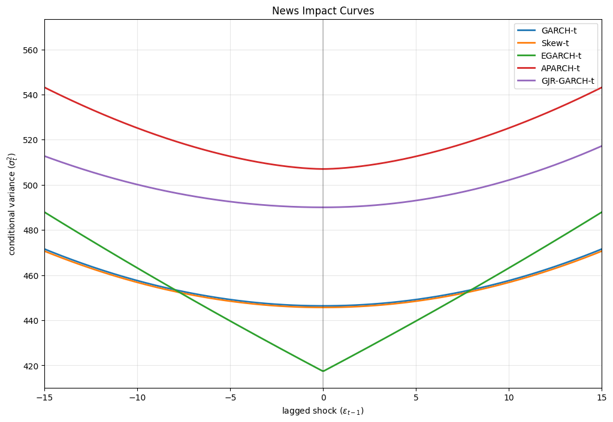{#fig-placeholder}

The News Impact Curve synthesizes how the shocks in the returns ($\epsilon_t$) transform themselves into conditional volatility for the next period ($\sigma^2_{t+1}$). For the asset in question, the NIC reflects the symmetric nature of the model that fits better the data, the GARCH(1,1).

From the analysis emerge the following evidences:

- **Symmetry of Shocks:** In clear counter-trend with respect to a large part of the literature on stock returns, the NIC presents itself as a parabola almost entirely symmetric and centered on zero. This finds confirmation in the test of the GJR-GARCH model, where the asymmetry parameter $\gamma = -0.0199$ resulted statistically not significant ($p\text{-value} = 0.259$). This means that positive and negative shocks of equal entity generate practically the same increment of volatility.

- **Reactivity to Shocks ($\alpha$):** The concavity of the NIC is determined by the ARCH parameter $\alpha = 0.1119$. The angular coefficient of the curve indicates a moderate but immediate reactivity. Every new information that deviates from the mean $\mu = 0.5372$ increments the predicted variance, independently from the direction of the price.

- **Absence of Leverage effect:** The analysis confirms that there is no evidence of a significant leverage effect. This suggests that the structure of the risk of the asset responds more to the magnitude of the news (intensity of the shock) than to their sign, making the symmetric GARCH(1,1) model the most effective specification for our data.

To conclude, the News Impact Curve fully justifies the choice of a symmetric model: the future uncertainty responds in a homogeneous way to bullish or bearish fluctuations.

::: {#tbl-best-model}
+----------------------+---------------------+---------------------+---------------------+---------------------+
| **Variable**         | **Coefficient**     | **Std. Error**      | **t-Statistic**     | **Prob.**           |
+:=====================+:===================:+:===================:+:===================:+:===================:+
| *Mean Equation*                                                                                              |
+----------------------+---------------------+---------------------+---------------------+---------------------+
| $\mu$ (Constant)     | 0.5372              | 0.2392              | 2.2457              | 0.0247\*\*          |
+----------------------+---------------------+---------------------+---------------------+---------------------+
| *Variance Equation*                                                                                          |
+----------------------+---------------------+---------------------+---------------------+---------------------+
| $\omega$ (Constant)  | 50.1605             | 6.8199              | 7.3550              | 0.0000\*\*\*        |
+----------------------+---------------------+---------------------+---------------------+---------------------+
| $\alpha$ (ARCH term) | 0.1119              | 0.0117              | 9.5660              | 0.0000\*\*\*        |
+----------------------+---------------------+---------------------+---------------------+---------------------+
| $\beta$ (GARCH term) | 0.7883              | 0.0200              | 39.4146             | 0.0000\*\*\*        |
+----------------------+---------------------+---------------------+---------------------+---------------------+
| *Distribution Parameter*                                                                                     |
+----------------------+---------------------+---------------------+---------------------+---------------------+
| $\nu$ (Deg. Freedom) | 7.1135              | 0.5854              | 12.1523             | 0.0000\*\*\*        |
+----------------------+---------------------+---------------------+---------------------+---------------------+
| **R-squared**        | 0.000               | **Log-Likelihood**                        | -29393.0            |
+----------------------+---------------------+-------------------------------------------+---------------------+
| **Adj. R-squared**   | 0.000               | **AIC**                                   | 58795.9             |
+----------------------+---------------------+-------------------------------------------+---------------------+
| **Distribution**     | Std. Student's t    | **BIC**                                   | 58829.9             |
+----------------------+---------------------+-------------------------------------------+---------------------+
| Significance levels: \*\*\* p$<$<!-- -->0.01, \*\* p$<$<!-- -->0.05, \* p$<$<!-- -->0.1                      |
+--------------------------------------------------------------------------------------------------------------+

: Best model: AR(0)-GARCH(1,1) student-t distribution
:::

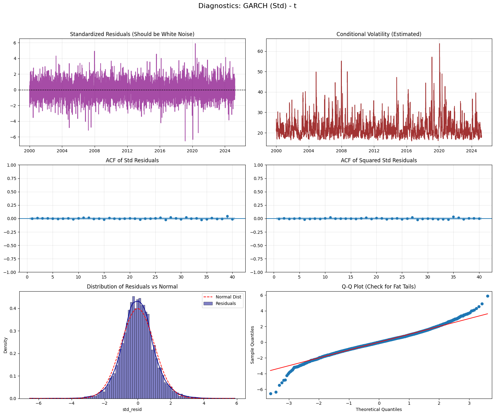{#fig-placeholderx}

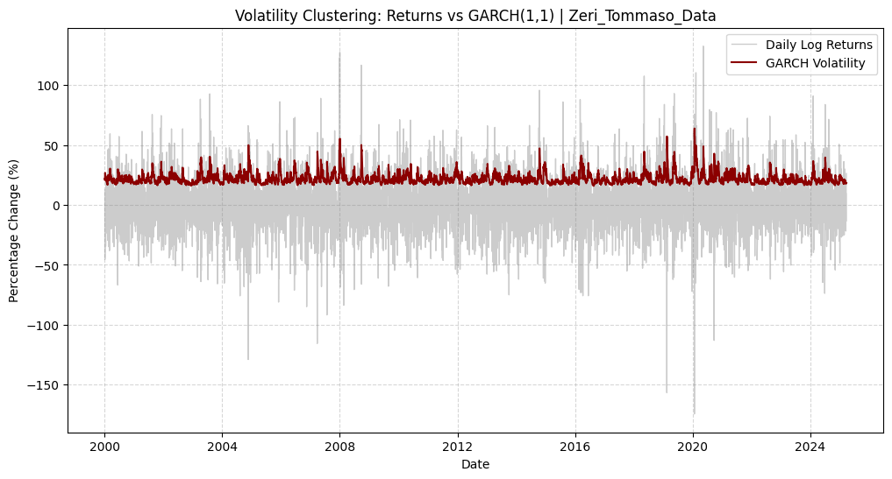{#fig-placeholder}

## Forecasting

The process of vol. forecast for the best model, that is the GARCH(1,1) t is based on the recursive decomposition of the conditional variance. For the static forecast one step ahead ($h=1$), the value is determined entirely by the information available at time $t$: $$
E_t[\sigma^2_{t+1}] = \omega + \alpha_1\epsilon^2_t + \beta_1\sigma^2_t
$$ In our case, the volatility predicted for tomorrow (25/03/2025 standing to the database) is equal to 19.743%. For time horizons superior ($h > 1$), the dynamics reflects the mean reversion towards the long-run variance. Substituting recursively the expectations, the forecast at $h$ steps depends on the parameter of total persistence $\phi = (\alpha_1 + \beta_1)$: $$
E_t[\sigma^2_{t+h}] = \sum_{i=0}^{h-1} \omega(\alpha_1 + \beta_1)^i + (\alpha_1 + \beta_1)^{h-1}(\alpha_1\epsilon^2_t + \beta_1\sigma^2_t)
$$

The results obtained for the next 5 days show us a growing trend:

::: center
  Date         Volatility Forecast (%)
  ------------ -------------------------
  2025-03-25   19.74
  2025-03-26   20.03
  2025-03-27   20.28
  2025-03-28   20.50
  2025-03-29   20.70
:::

Since the term structure is inclined positively, one deduces that the current volatility is lower than the long-run average of the process. The speed of convergence towards such average is governed by the parameter $\phi$.

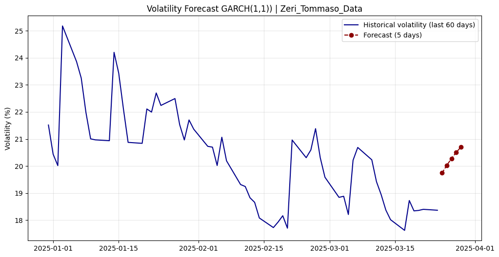{#fig-placeholderx}

# Multivariate volatility modelling

## Data

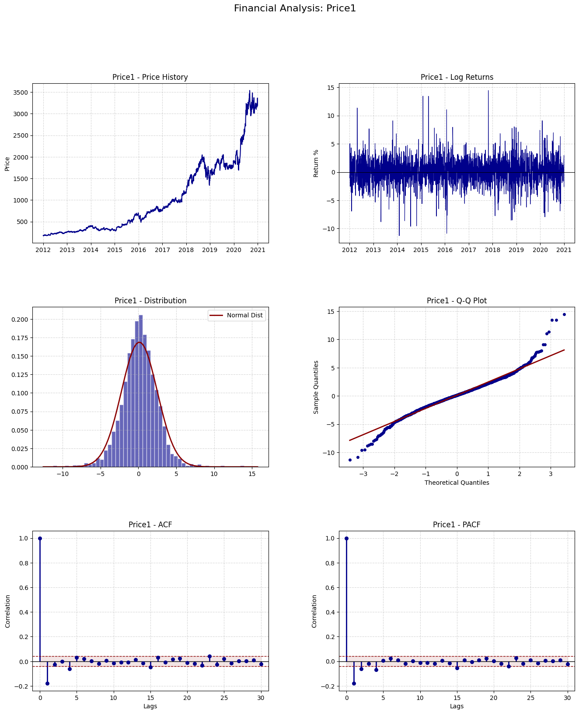{#fig-placeholder}

::: {#tbl-price1-stats}
  **Metric**               **Value**
  ------------------- --------------------
  Observations               2,264
  Mean                       0.1279
  Median                     0.1288
  Min / Max            -11.2730 / 14.4524
  Std. Dev.                  2.3647
  Skewness                   0.0954
  Exc. Kurtosis              2.9640
  Jarque-Bera ($p$)        \< 0.0001
  Normality                 Rejected

  : Descriptive Statistics: PRICE1
:::

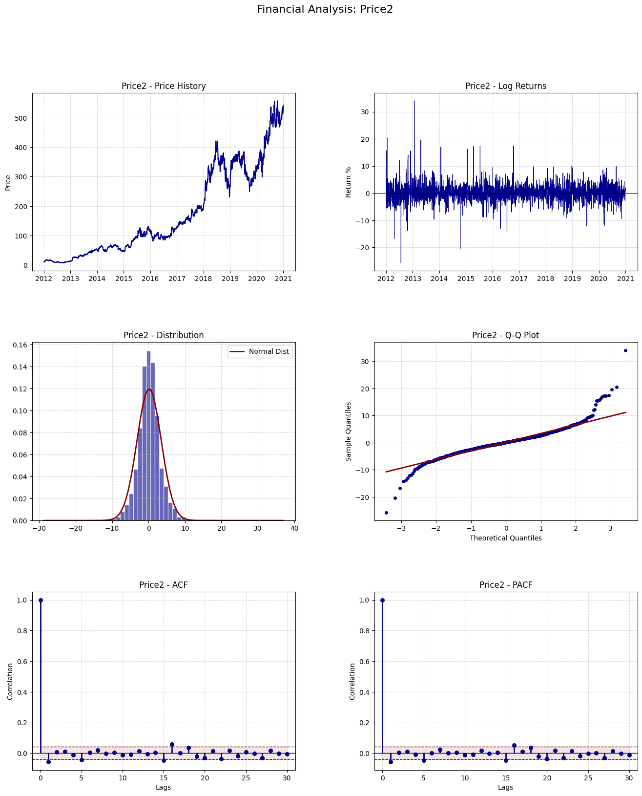{#fig-placeholderx}

::: {#tbl-price2-stats}
  **Metric**               **Value**
  ------------------- --------------------
  Observations               2,264
  Mean                       0.1738
  Median                     0.1235
  Min / Max            -25.6847 / 34.0033
  Std. Dev.                  3.3333
  Skewness                   0.6035
  Exc. Kurtosis             10.2931
  Jarque-Bera ($p$)          0.0000
  Normality                 Rejected

  : Descriptive Statistics: PRICE2
:::

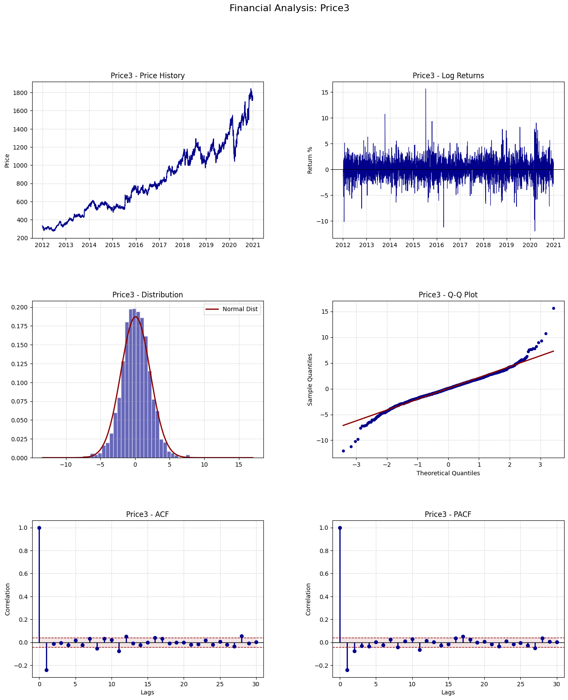{#fig-placeholder}

::: {#tbl-price3-stats}
  **Metric**               **Value**
  ------------------- --------------------
  Observations               2,264
  Mean                       0.0731
  Median                     0.0721
  Min / Max            -12.0022 / 15.6360
  Std. Dev.                  2.1292
  Skewness                   0.0233
  Exc. Kurtosis              3.2250
  Jarque-Bera ($p$)        \< 0.0001
  Normality                 Rejected

  : Descriptive Statistics: PRICE3
:::

### Correlation and Covariance Matrices {#sec-correlation-and-covariance-matrices .unnumbered}

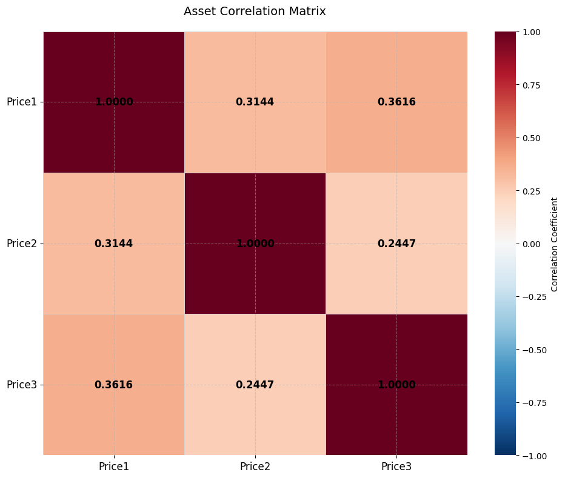{#fig-placeholderx}

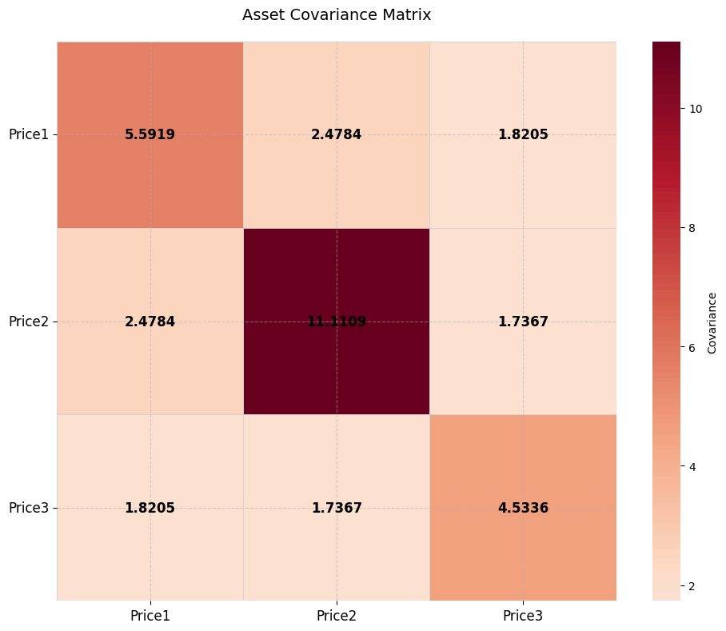{#fig-placeholder}

## Model and Estimation

In this second investigation we want to verify to what extent the logreturns of three assets (Price1, Price2, Price3) follow interconnected and time-varying volatility paths. It is therefore a multivariate problem. Given the probable dynamicity of the relations, the analysis was conducted on a sample of 2264 observations using a three-phase approach based on the Dynamic Conditional Correlation (DCC-GARCH) model of Engle (2002). Following the literature of Sheppard (2010), the modelling of the conditional covariance matrix $\Sigma_t$ requires a decomposition that separates the individual variances from the joint correlations: $$\Sigma_t = D_t R_t D_t$$ where $D_t$ is a diagonal matrix of the conditional standard deviations ($\sigma_{i,t}$) estimated through univariate GARCH processes. While the Constant Conditional Correlation (CCC) model of Bollerslev (1990) assumes a correlation matrix $R$ constant over time ($\Sigma_t = D_t R D_t$), the DCC model extends such specification introducing a \"BEKK-like\" type dynamics for the correlations. In this way it allows the matrix $R_t$ to evolve in response to market shocks.

For each of the three assets an ARMA(1,1) was initially estimated as model for the mean: $$r_{i,t} = \mu_i + \phi r_{i,t-1} + \theta \epsilon_{i,t-1} + \epsilon_{i,t}$$ This pre-filtering phase was necessary to guarantee that the residuals $\epsilon_t$ were free of linear dependence. The use of an ARMA component ensures that the volatility clustering analyzed subsequently is not influenced by distortions in the mean, permitting the model to operate on white noise residuals. In the second phase, one proceeded to the estimation of the conditional variances through GJR-GARCH(1,1,1) to capture the possible leverage effect (in agreement with the literature): $$\sigma^2_{i,t} = \omega_i + \alpha_i \epsilon^2_{i,t-1} + \gamma_i I_{t-1} \epsilon^2_{i,t-1} + \beta_i \sigma^2_{i,t-1}$$ The results reveal heterogeneity among the assets:

- **Price1 and Price3:** They show a classic GARCH structure with high persistence ($\beta$ respectively of 0.72 and 0.83). The parameter $\alpha$ with low value tells us that volatility reacts in a non-explosive way to new information.

- **Price2:** Presents a high $\alpha$ (0.25) and a low $\beta$ (0.08). This indicates to us that Price2 is extremely sensitive to immediate shocks, but has little memory. The peaks of uncertainty tend to be reabsorbed almost immediately.

- **Leverage Effect ($\gamma$):** The values of $\gamma$ result little significant, confirming a response almost entirely symmetric to shocks.

The most relevant aspect of the interconnection is governed by the parameters $a$ and $b$ of the covariance matrix $Q_t$: $$Q_t = (1 - a - b)\bar{R} + a(u_{t-1} u'_{t-1}) + b Q_{t-1}$$ The estimates made (**$a=0.00718$**, **$b=0.98700$**) highlight an almost unitary persistence ($a+b = 0.99418$). This result is very important: it suggests to us that, although the correlations among the assets vary over time (validating the use of the DCC with respect to the CCC), such variations are extremely slow and persistent. An increase of the correlation due to a systemic shock does not vanish in the short period, but creates almost a \"new regime\" of interconnection that persists for varied time.

The descriptive analysis of the dynamic correlations gives us the empirical proof of the interconnection:

- The couple Price1-Price3 is the most interconnected, with an average correlation of 0.3626.

- The variability (Std.Dev between 0.06 and 0.08) and the range between Min and Max (e.g. Price1-Price2 oscillates between 0.14 and 0.56) demonstrate that a CCC model would have been inadequate and would have underestimated the systemic risk in moments of peak.

Therefore, the data confirm that the three assets follow volatility paths not only variable over time, but intrinsically linked by a structure of dynamic and persistent dependence. This suggests the necessity of strategies of dynamic diversification in case one wants to hold them in portfolio.

::: {#tbl-univariate-garch}
  **Asset**    $\omega$ (Constant)   $\alpha$ (ARCH)   $\gamma$ (GJR)   $\beta$ (GARCH)
  ----------- --------------------- ----------------- ---------------- -----------------
  Price1             1.1012              0.0412            0.0649           0.7211
  Price2             7.9471              0.2580           -0.0796           0.0857
  Price3             0.3862              0.0443            0.0506           0.8379
                                                                       

  : Parameters estimation, univariate GARCH(Phases 1 and 2)
:::

::: {#tbl-dcc-params}
  **Parameter**                    **Estimation**
  ------------------------------- ----------------
  Alpha ($a$) - Shock reaction        0.00718
  Beta ($b$) - Persistency            0.98700
  **Total persistency ($a+b$)**     **0.99418**

  : DCC parameters
:::

::: {#tbl-corr-stats}
  **Pair**            **Min**   **Max**   **Mean**   **Std. Dev**
  ------------------ --------- --------- ---------- --------------
  Price1 -- Price2    0.1451    0.5673     0.3102       0.0803
  Price1 -- Price3    0.2257    0.5554     0.3626       0.0642
  Price2 -- Price3    0.1244    0.4600     0.2586       0.0634
                                                    

  : Dynamic Conditional Correlations Statistics
:::

## Why a DCC and not a BEKK? {#sec-why-a-dcc-and-not-a-bekk .unnumbered}

Although the BEKK-GARCH allows to capture the volatility spillovers in a direct way, the DCC of Engle results the most intelligent choice:

- **Parsimony and simplicity:** The BEKK model suffers from the \"curse of dimensionality\", where the number of parameters to estimate simultaneously grows exponentially with the number of assets ($N=3$). The DCC, through a sequential estimation procedure, reduces the computational complexity and guarantees a greater stability in the convergence of the algorithm.

- **Interpretability of Correlations:** Unlike the BEKK, the DCC decomposes in an explicit way the covariance matrix into conditional variances and correlations. This allows a direct and simple analysis of the estimated coefficients, facilitating the analysis of the interconnection.

- **Modularity:** The DCC approach allows to specify the best univariate GARCH model for each time series in an independent way, and this allows to capture the peculiarities of the asset (such as asymmetries or different distributions of errors) before proceeding to the estimation of the multivariate dependence structure.

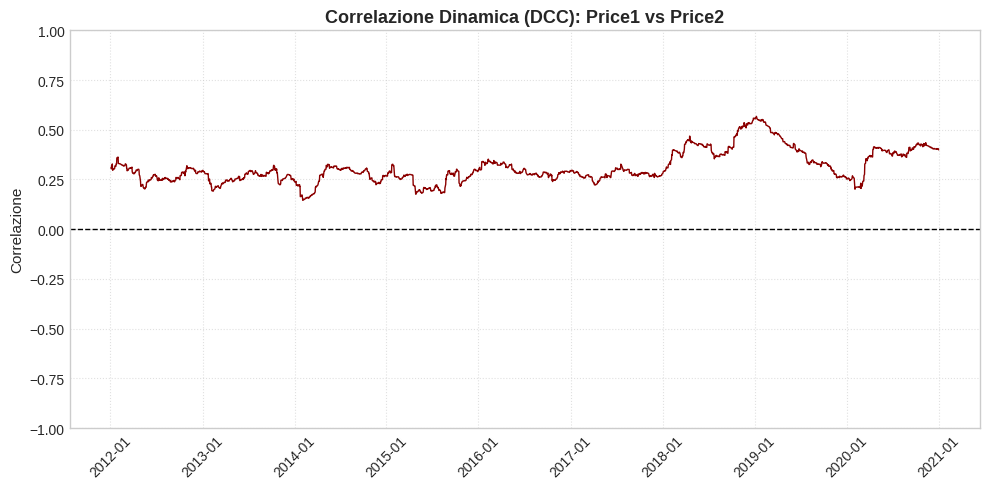{#fig-placeholderx}

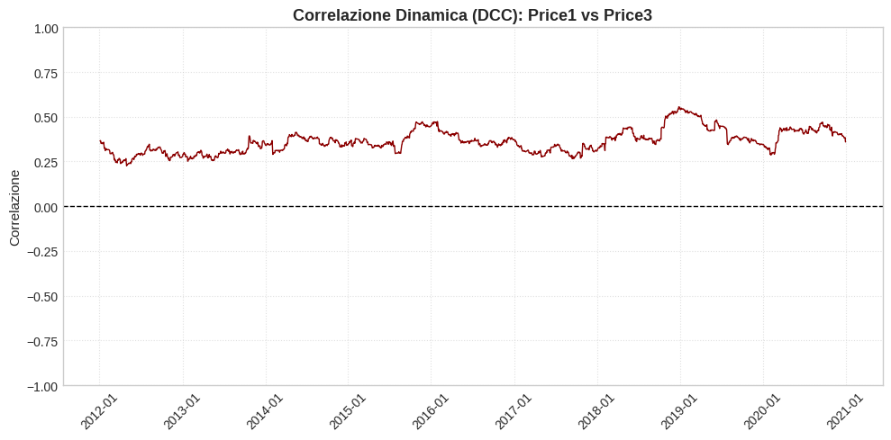{#fig-placeholder}

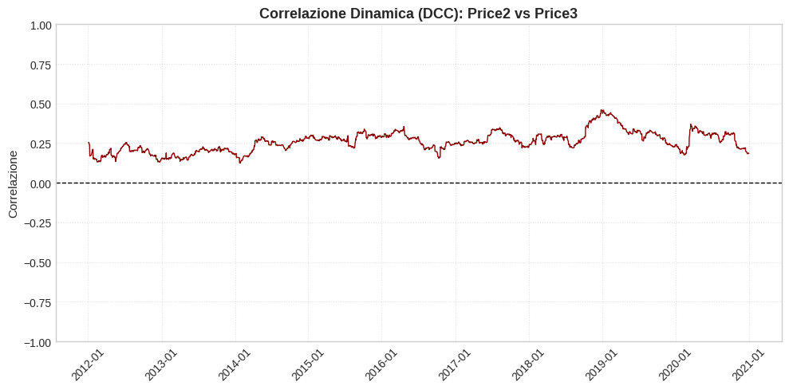{#fig-placeholderx}

We observe that the paths present a trend less noisy with respect to the series of historical returns. This is coherent with the high persistence estimated by the model ($\beta \approx 0.72-0.83$ for the variances and $b \approx 0.98$ for the DCC).

## Matrix representation of the DCC-GARCH model

The DCC decomposes the conditional covariance matrix $\Sigma_t$ to separate the dynamics of the individual variances from the total structure of the correlations: $$
    \Sigma_t = D_t R_t D_t
$$

### Univariate component: matrix $D_t$ {#sec-univariate-component-matrix-d-t .unnumbered}

The matrix $D_t$ is a diagonal matrix $3 \times 3$ that contains the conditional standard deviations ($\sigma_{i,t}$) calculated with the GJR-GARCH(1,1,1) models estimated during the first phase: $$
D_t = \begin{bmatrix}
\sigma_{1,t} & 0 & 0 \\
0 & \sigma_{2,t} & 0 \\
0 & 0 & \sigma_{3,t}
\end{bmatrix}
$$ The equations are:

- **Price1:** $\sigma_{1,t}^2 = 1.1012 + 0.0412 \epsilon_{1,t-1}^2 + 0.0649 I_{t-1} \epsilon_{1,t-1}^2 + 0.7211 \sigma_{1,t-1}^2$

- **Price2:** $\sigma_{2,t}^2 = 7.9471 + 0.2580 \epsilon_{2,t-1}^2 - 0.0796 I_{t-1} \epsilon_{2,t-1}^2 + 0.0857 \sigma_{2,t-1}^2$

- **Price3:** $\sigma_{3,t}^2 = 0.3862 + 0.0443 \epsilon_{3,t-1}^2 + 0.0506 I_{t-1} \epsilon_{3,t-1}^2 + 0.8379 \sigma_{3,t-1}^2$

### Multivariate component: matrix $R_t$ {#sec-multivariate-component-matrix-r-t .unnumbered}

The dynamic correlation $R_t$ was obtained rescaling $Q_t$, which follows an AR process based on the parameters $a$ and $b$: $$
Q_t = (1 - a - b)\bar{R} + a(u_{t-1} u'_{t-1}) + b Q_{t-1}
$$ Substituting the estimates $a = 0.00718$ and $b = 0.98700$ (from which $1-a-b = 0.00582$), and using the matrix $\bar{R}$ we obtain: $$
Q_t = 0.00582 \begin{bmatrix}
1 & 0.3102 & 0.3626 \\
0.3102 & 1 & 0.2586 \\
0.3626 & 0.2586 & 1
\end{bmatrix} + 0.00718 (u_{t-1} u'_{t-1}) + 0.98700 Q_{t-1}
$$ The final correlation matrix $R_t$ is given by: $$
R_t = \text{diag}(Q_t)^{-1/2} Q_t \text{diag}(Q_t)^{-1/2} = \begin{bmatrix}
1 & \rho_{12,t} & \rho_{13,t} \\
\rho_{12,t} & 1 & \rho_{23,t} \\
\rho_{13,t} & \rho_{23,t} & 1
\end{bmatrix}
$$

### Conditional Covariance matrix ($\Sigma_t$) {#sec-conditional-covariance-matrix-sigma-t .unnumbered}

The dynamic interconnection among the three assets is instead represented by the complete covariance matrix: $$
\Sigma_t = \begin{bmatrix}
\sigma_{1,t}^2 & \rho_{12,t}\sigma_{1,t}\sigma_{2,t} & \rho_{13,t}\sigma_{1,t}\sigma_{3,t} \\
\rho_{12,t}\sigma_{2,t}\sigma_{1,t} & \sigma_{2,t}^2 & \rho_{23,t}\sigma_{2,t}\sigma_{3,t} \\
\rho_{13,t}\sigma_{3,t}\sigma_{1,t} & \rho_{23,t}\sigma_{3,t}\sigma_{2,t} & \sigma_{3,t}^2
\end{bmatrix}
$$ The high persistence observed of the system ($\phi = a+b \approx 0.99$) indicates that the correlation coefficients $\rho_{ij,t}$ tend to deviate from the mean value $\bar{R}$ in a very slow way, confirming the presence of structural interconnections stable but anyway variable over time.

# VAR and SVAR models

## Data

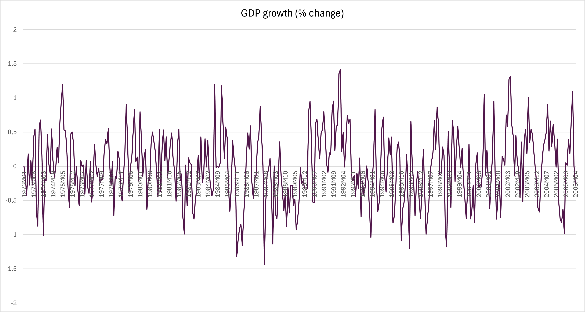{#fig-placeholder}

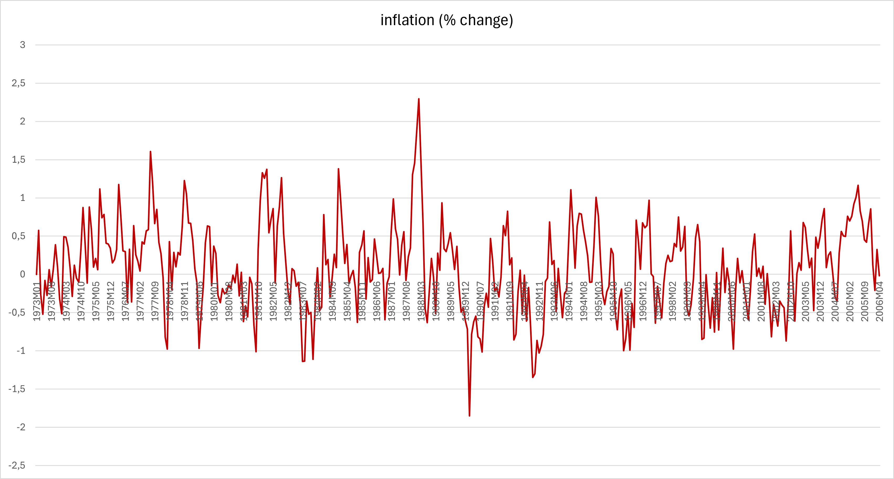{#fig-placeholderx}

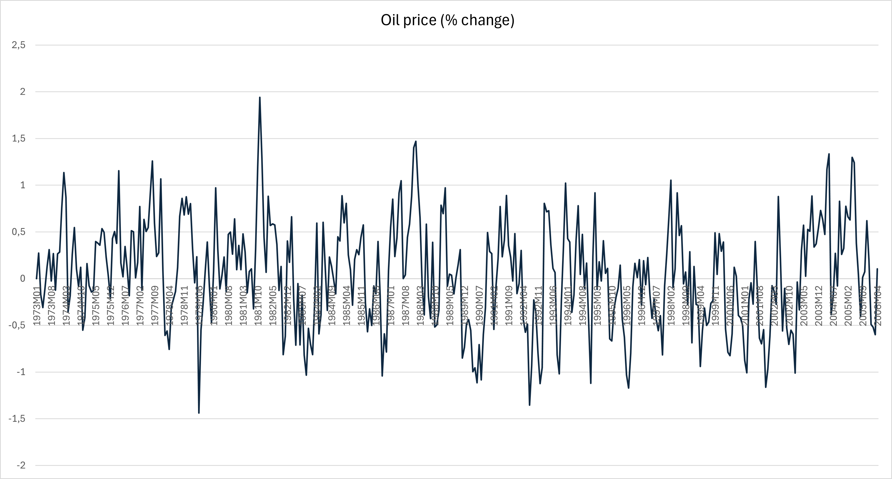{#fig-placeholder}

## Model and Estimation

In this analysis we want to investigate on the mechanism of propagation of the shocks of the price of oil on the macroeconomic variables of a Small Open Economy. The vector of the variables of the SOE is: $y_t = [Oil_t, Inf_t, Growth_t]'$, where $Oil_t$ represents the rate of variation of the price of oil (log-returns), $Inf_t$ the rate of inflation and $Growth_t$ the rate of growth of the GDP.

The choice of the order of the variables in the vector $y_t$ answers to a precise structural identification based on the economic theory. In a Small Open Economy, one assumes that the domestic economy is price-taker with respect to the international energy markets. Therefore, the price of oil is treated as the variable most exogenous in the short period. The price of oil can influence simultaneously inflation and GDP, but not vice versa in the same instant $t$.

This structure is implemented with a SVAR model that has been identified recursively through the Cholesky Decomposition of the covariance matrix of the residuals, following the order: $Oil \to Inf \to Growth$.

From the statistics, the series appear centered around zero with comparable standard deviations ($\approx 0.55$). This tells us that the transformations in growth rates have made the variables stationary, a necessary condition to implement a VAR model.

The analysis of the Information Criteria is coherent. As reported in the output in appendix, both the AIC ($-5.124$), and the BIC ($-5.002$) and the HQIC ($-5.076$) are minimum in correspondence of an order $P=1$. Therefore, the best model based on the data is a VAR(1): $$
    y_t = c + \Phi_1 y_{t-1} + \epsilon_t
$$ Such choice is supported by the diagnostics of the residuals: the Durbin-Watson tests for the three equations (respectively 1.93, 2.00, 1.95) are close to the theoretical value of 2.0, indicating that there is no serial autocorrelation and confirming that a single lag suffices to capture the dynamics of the system (the residuals are therefore Vector White Noise).

The stability of the system is confirmed by the analysis of the roots of the inverse characteristic polynomial. The absolute values of the roots reported ($4.00, 1.83, 1.46$) are all strictly greater than 1 (or, equivalently, the eigenvalues of the companion form matrix are internal to the unit circle). This tells us that the system is Weakly Stationary: the effects of the shocks are transitory and the variables tend to return to their long-run averages. The analysis of the estimated coefficients (Reduced-Form OLS) and of the structural impulse response functions (Structural IRF) highlights the following mechanisms:

1.  **Transmission mechanism on Prices:** The equation for $Inf_t$ shows a highly significant coefficient for $L1.Oil$ equal to 0.294 ($p=0.000$). This result provides strong evidence of the so-called energy pass-through: a positive shock to the prices of oil translates rapidly into an increase of inflation. The structural IRF will confirm an immediate and positive peak of inflation in response to an oil shock.

2.  **Impact on the real economy:** In the equation for $Growth_t$, the direct coefficient of oil ($L1.Oil$) is equal to 0.034 and is not statistically significant ($p=0.482$). But growth is influenced negatively by past inflation ($L1.Inf = -0.105$, $p=0.028$). The IRFs show that the recessive effect of oil on growth is not direct, but rather indirect. The oil shock increases inflation, and the erosion of purchasing power and subsequently depresses real growth.)

3.  **Limitations of the Small Open Economy Hypothesis:** It is interesting to note that in the equation $Oil_t$, the coefficients of the lagged domestic variables ($L1.Inf$ and $L1.Growth$) result significant. Although this is in contrast with the theoretical hypothesis of pure exogeneity, this result tells us that the variable \"Oil\" might reflect shocks of global demand synchronized with the domestic economic cycle, rather than pure shocks of exogenous supply. However, the identification used isolates the component of orthogonal innovation, allowing us anyway to interpret the IRF as responses to structural shocks.

The estimated VAR(1) model is robust. The results seen confirm to us that for the Small Open Economy, the price of oil is a structural driver of inflation (it has a direct and significant effect), while it influences the real economy in an indirect way acting on prices.

In a Small Open Economy, in theoretical line, the endogenous variables such as inflation ($Inf_t$) and the growth of GDP ($Growth_t$) should not influence the international price of oil ($Oil_t$), given that the national economy acts as price-taker. However, the estimated VAR model and the Granger causality tests highlight a feedback loop statistically significant from the endogenous variables towards the price of oil (for example, we have estimated a causality of $Inf \to Oil$ with $p < 0.01$). This result, although it appears in contradiction with the SOE hypothesis, can be interpreted on the basis of the synchronization of the global economic cycle. The endogeneity captures likely the correlation between the domestic economic cycle and the global aggregate demand. The phases of global economic expansion push upwards both the international prices of oil and the GDP. Consequently, the VAR registers this co-movement as a predictive relation.

To reconcile this statistical evidence with the economic theory, the strategy of identification adopted in the structural analysis (SVAR) results fundamental. Applying Cholesky with the ordering $y_t = [Oil_t, Inf_t, Growth_t]'$, we impose a recursive structure in which $Oil_t$ is treated as given and exogenous with respect to the domestic variables in the same contemporaneous period. This allows us to isolate orthogonal supply shocks coherent with the economic theory, filtering the component of endogenous feedback for the purposes of the analysis of the IRFs.

::: {#tbl-var-estimation}
+--------------------+-----------------------------------------------------------------------+
|                    | **Dependent Variable (Target)**                                       |
+:===================+:=================:+:=======================:+:=======================:+
| 2-4 **Regressor**  | **Oil ($Oil_t$)** | **Inflation ($Inf_t$)** | **Growth ($Growth_t$)** |
+--------------------+-------------------+-------------------------+-------------------------+
| **Constant**       | 0.013             | 0.027                   | 0.001                   |
+--------------------+-------------------+-------------------------+-------------------------+
|                    | (0.022)           | (0.020)                 | (0.023)                 |
+--------------------+-------------------+-------------------------+-------------------------+
| **Oil ($t-1$)**    | 0.524\*\*\*       | 0.295\*\*\*             | 0.034                   |
+--------------------+-------------------+-------------------------+-------------------------+
|                    | (0.048)           | (0.044)                 | (0.049)                 |
+--------------------+-------------------+-------------------------+-------------------------+
| **Inf ($t-1$)**    | 0.134\*\*\*       | 0.501\*\*\*             | -0.105\*\*              |
+--------------------+-------------------+-------------------------+-------------------------+
|                    | (0.047)           | (0.043)                 | (0.048)                 |
+--------------------+-------------------+-------------------------+-------------------------+
| **Growth ($t-1$)** | 0.113\*\*         | -0.048                  | 0.456\*\*\*             |
+--------------------+-------------------+-------------------------+-------------------------+
|                    | (0.044)           | (0.040)                 | (0.044)                 |
+--------------------+-------------------+-------------------------+-------------------------+
| **R-squared**      | 0.28              | 0.35                    | 0.25                    |
+--------------------+-------------------+-------------------------+-------------------------+

: Results of the Estimation of the VAR(1) Model
:::

\
*Note: Standard errors in brackets. \*\*\* p$<$<!-- -->0.01, \*\* p$<$<!-- -->0.05, \* p$<$<!-- -->0.1.*

The estimated VAR model can be written in matrix form:

$$
\begin{bmatrix}
Oil_t \\
Inf_t \\
Growth_t
\end{bmatrix}
=
\begin{bmatrix}
0.013 \\
0.027 \\
0.001
\end{bmatrix}
+
\begin{bmatrix}
0.524 & 0.134 & 0.113 \\
0.295 & 0.501 & -0.048 \\
0.034 & -0.105 & 0.456
\end{bmatrix}
\begin{bmatrix}
Oil_{t-1} \\
Inf_{t-1} \\
Growth_{t-1}
\end{bmatrix}
+
\begin{bmatrix}
\epsilon_{1,t} \\
\epsilon_{2,t} \\
\epsilon_{3,t}
\end{bmatrix}
$$

## Impulse-Response Functions

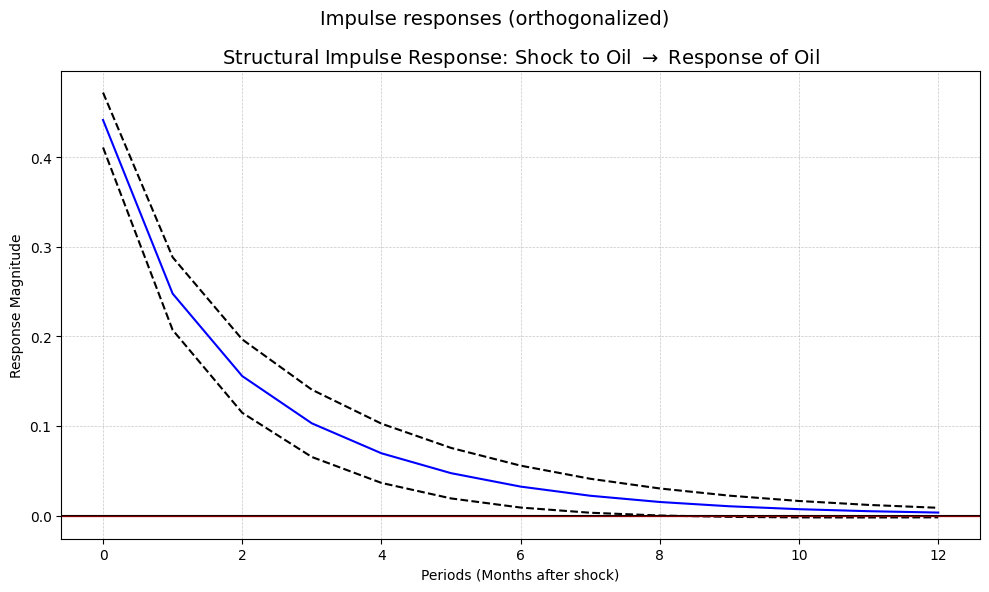{#fig-placeholderx}

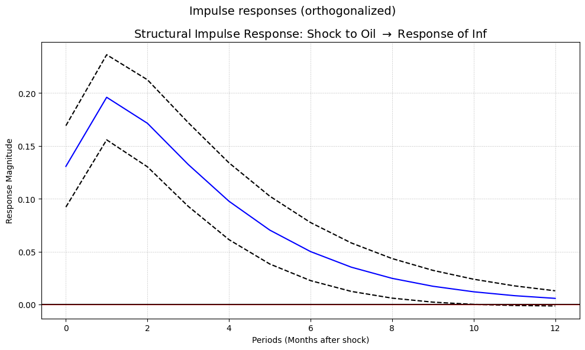{#fig-placeholder}

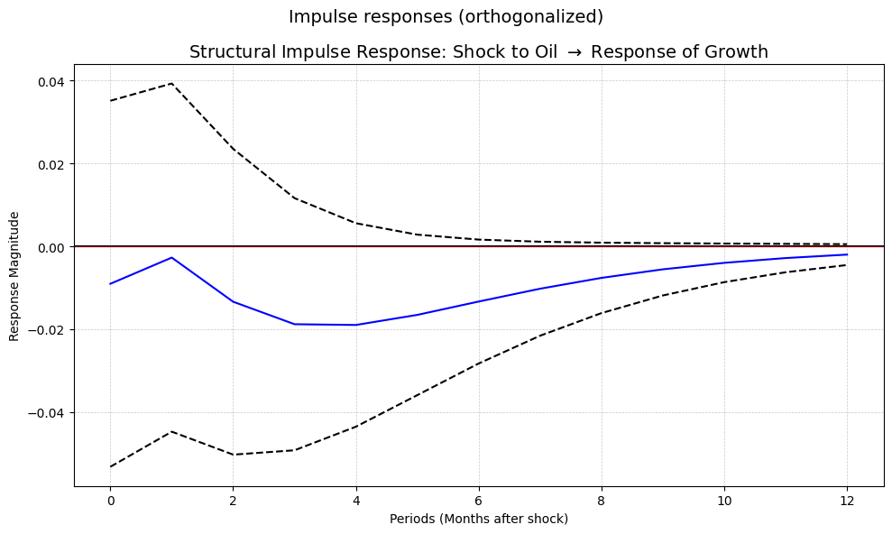{#fig-placeholderx}

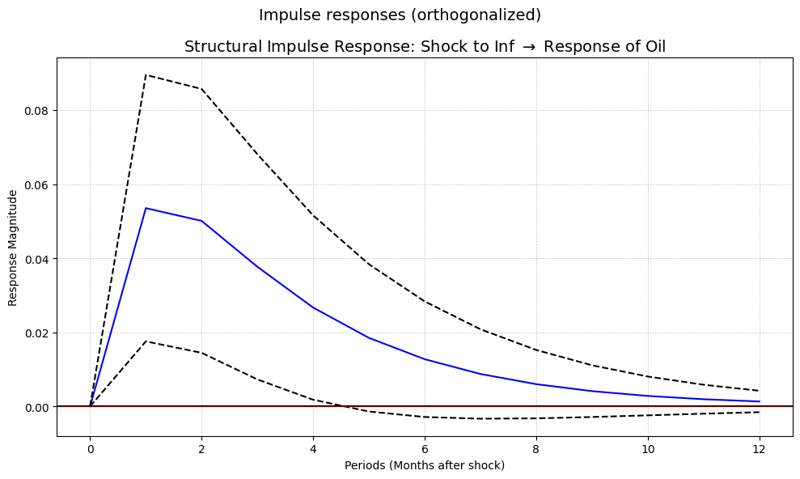{#fig-placeholder}

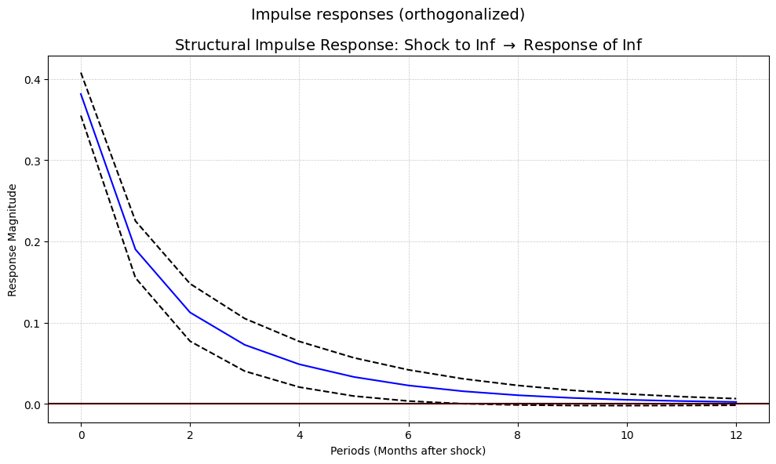{#fig-placeholderx}

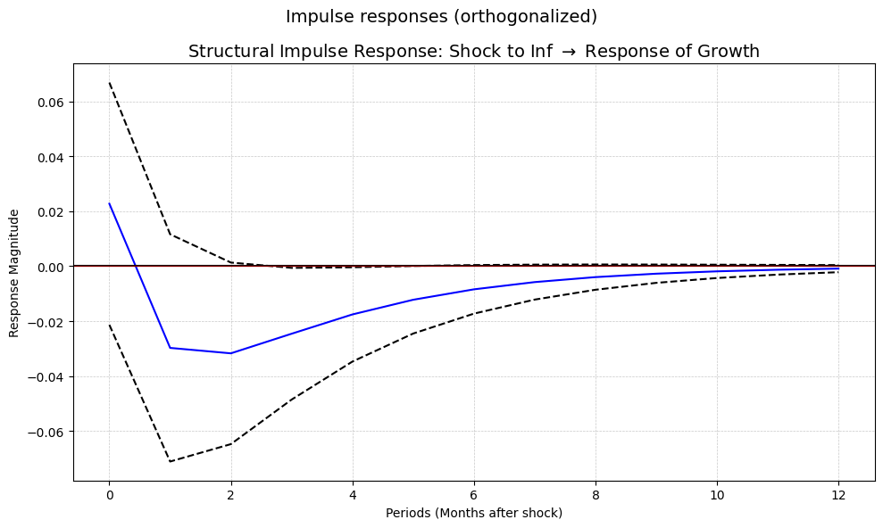{#fig-placeholder}

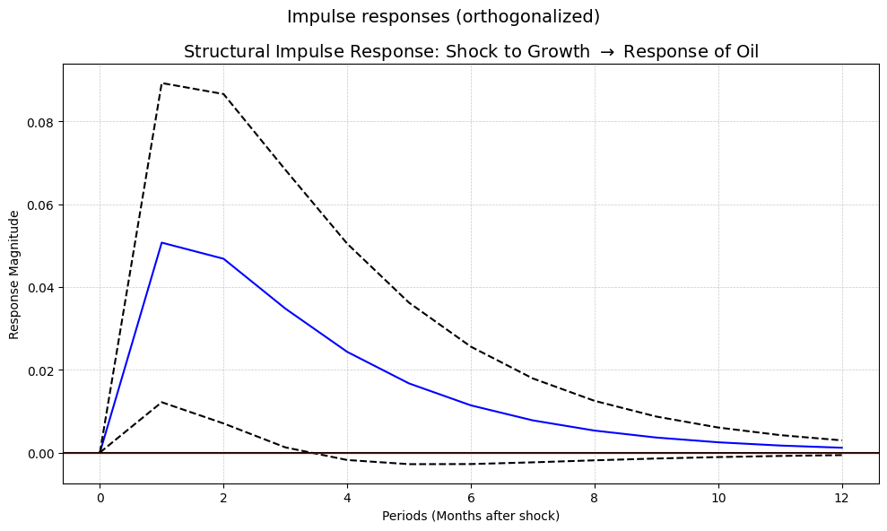{#fig-placeholderx}

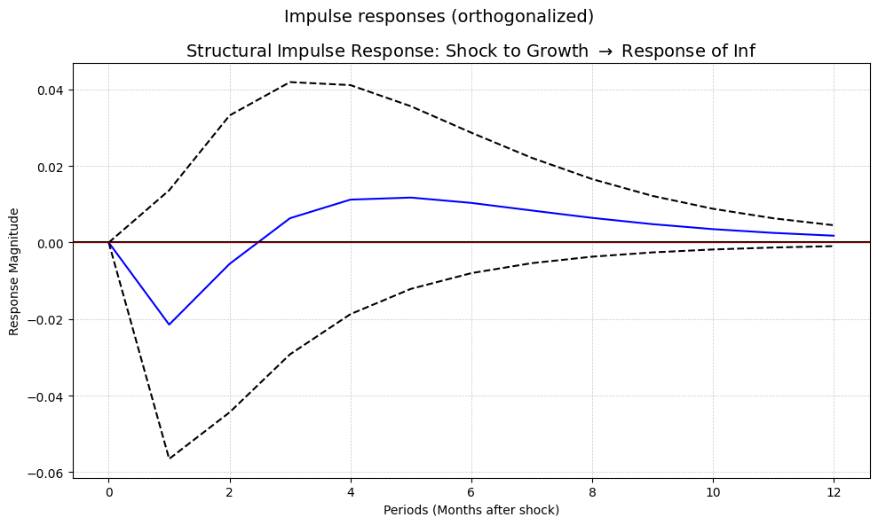{#fig-placeholder}

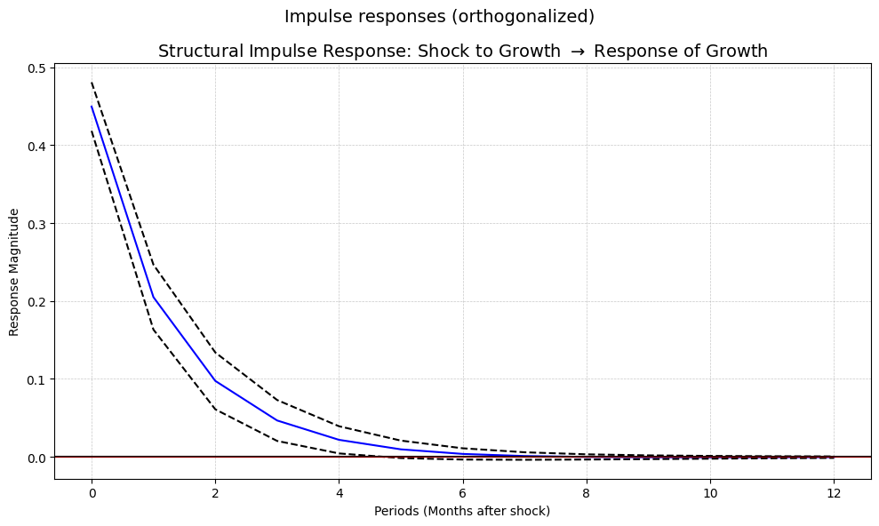{#fig-placeholderx}

## Forecasting

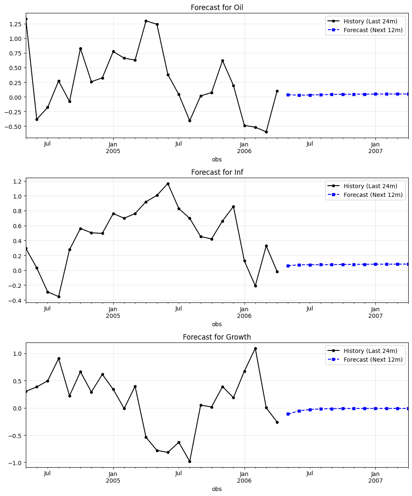{#fig-placeholder}

Using the estimated VAR(1), forecasts were generated out-of-sample for a time horizon of $h=12$ months (May 2006 - April 2007). The forecasts are calculated recursively according to the formula $E_t[y_{t+h}] = \hat{\Phi}_0 + \hat{\Phi}_1 E_t[y_{t+h-1}]$.

@tbl-forecast reports the predicted values. The analysis of the path of prediction highlights a clear property of Mean Reversion, which is coherent with the condition of stationarity verified previously.

::: {#tbl-forecast}
  **Date**    **Oil Price**   **Inflation**   **Growth**
  ---------- --------------- --------------- ------------
  2006-05         0.035           0.061         -0.113
  2006-06         0.027           0.073         -0.055
  2006-07         0.031           0.074         -0.031
  2006-08         0.036           0.074         -0.020
  2006-09         0.040           0.075         -0.014
  2006-10         0.042           0.077         -0.012
  2006-11         0.044           0.078         -0.011
  2006-12         0.046           0.080         -0.010
  2007-01         0.047           0.081         -0.010
  2007-02         0.047           0.081         -0.010
  2007-03         0.048           0.082         -0.010
  2007-04         0.048           0.082         -0.011

  : 12-months forecast (h-step ahead)
:::

The predicted trajectories show the convergence towards the unconditional averages of long run:

- **Growth ($Growth$):** Starts from a negative value ($-0.113$) but recovers, stabilizing around $-0.01$, indicating the absorption of the initial shock within 6 months.

- **Inflation ($Inf$) and Oil ($Oil$):** Both show a gradual dynamics of rise towards the respective long-run average (about $0.08$ for inflation and $0.048$ for oil).

The rapid convergence confirms the robustness and the stability of the estimated VAR system, indicating that the current shocks have transitory and non-permanent effects on the economy.

## Forecast Error Variance Decomposition

The FEVD analysis allows us to quantify the relative importance of every structural shock in explaining the volatility of the variables of the system. @tbl-fevd summarizes the percentages of variance explained for horizons of short ($t=1$), medium ($t=5$) and long period ($t=10$).

::: {#tbl-fevd}
+---------------------------------+-----------------------------+-----------------------------+-----------------------------+
|                                 | **Var. Oil**                | **Var. Inf**                | **Var. Growth**             |
+:================================+:=======:+:=======:+:=======:+:=======:+:=======:+:=======:+:=======:+:=======:+:=======:+
| 2-4 (lr)5-7 (lr)8-10 **Period** | **Oil** | **Inf** | **Grw** | **Oil** | **Inf** | **Grw** | **Oil** | **Inf** | **Grw** |
+---------------------------------+---------+---------+---------+---------+---------+---------+---------+---------+---------+
| **1 (Impact)**                  | 100%    | 0.0     | 0.0     | 10.5    | 89.5    | 0.0     | 0.0     | 0.2     | 99.7    |
+---------------------------------+---------+---------+---------+---------+---------+---------+---------+---------+---------+
| **5 (Mid run)**                 | 95.3    | 2.5     | 2.2     | 36.5    | 63.3    | 0.2     | 0.5     | 1.3     | 98.2    |
+---------------------------------+---------+---------+---------+---------+---------+---------+---------+---------+---------+
| **10 (Long run)**               | 95.2    | 2.6     | 2.2     | 37.2    | 62.5    | 0.3     | 0.6     | 1.4     | 98.0    |
+---------------------------------+---------+---------+---------+---------+---------+---------+---------+---------+---------+

: Forecast Error Variance Decomposition
:::

\
*Note: values in %.*

What emerges are 3 fundamental structural evidences:

1.  **Exogeneity of Oil:** The variance of the price of oil is explained almost entirely by itself (95.2% in the long run). The marginal contribution of the endogenous variables confirms the validity of the hypothesis of Small Open Economy: internal shocks do not retroact significantly on the international prices of energy.

2.  **High Energy Pass-Through:** One observes a notable impact of oil shocks on the variability of inflation. In the long run, over 37% of the variance of inflation is attributable to external shocks on oil. This identifies the energy channel as a primary source of instability of prices for the economy.

3.  **Independence of Growth:** Contrary to expectations, the variance of GDP growth ($Growth$) is dominated almost exclusively by its own idiosyncratic shocks (98%). The shocks on Oil and Inflation, although having punctual effects (as seen in the IRFs), explain a negligible fraction ($<2\%$) of the overall volatility of growth. This suggests that the real economic cycle is driven prevalently by factors of domestic demand or supply not correlated directly to energy prices.

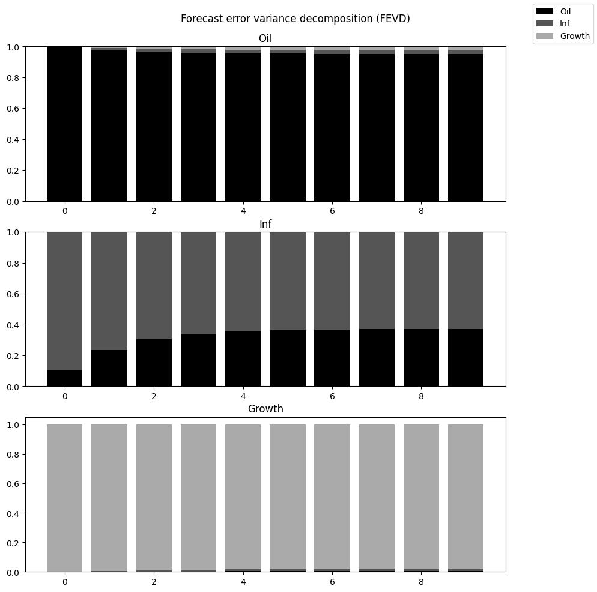{#fig-placeholderx}

## Granger Causality

::: {#tbl-granger}
  **Direction Causality**   **Hypothesis**               **P-Value**    **Evidence**
  ------------------------- --------------------------- ------------- -----------------
  $Oil \to Inf$             Oil G-causes Inflation         0.0000      \*\*\* (Strong)
  $Inf \to Oil$             Inflation G-causes Oil         0.0047      \*\*\* (Strong)
  $Inf \to Growth$          Inflation G-causes Growth      0.0287       \*\* (Media)
  $Growth \to Oil$          Growth G-causes Oil            0.0098      \*\*\* (Strong)

  : Granger causality test
:::

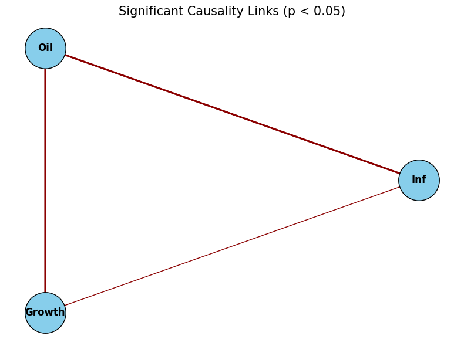{#fig-granger-network}

# Bibliography and Github repository

# References {.unnumbered}

[]{#ref-github-repo}Zeri, T. (2026). *Financial Econometrics Models: Code Repository*. GitHub. <https://github.com/tommasozeri/Econometrics-Of-Financial-Markets>

[]{#ref-sheppard2021}Sheppard, K. (2021). *Financial Econometrics Notes*. University of Oxford.

[]{#ref-danielsson2011}Danielsson, J. (2011). *Financial Risk Forecasting*. Chichester: John Wiley & Sons.

[]{#ref-emanuele-bacchiocchi}Emanuele Bacchiocchi (2025). *Econometrics of financial markets class notes, 2nd cycle degree in Quantitative Finance, University of Bologna*.

::: {.paper-download}
[Download PDF](time-series-analysis.pdf){.btn-paper download=""} [Code](https://github.com/tommasozeri/Econometrics-Of-Financial-Markets){.btn-paper}
:::
