# Introduction

Drawing on the theoretical foundations established in the econometric literature, particularly the framework presented by Sheppard ([Sheppard 2021](#ref-sheppard2021)), this work develops a comprehensive methodological approach for analyzing financial market dynamics, ranging from volatility forecasting to long-run equilibrium modeling. The research philosophy follows a systematic pedagogical progression: moving from the analysis of univariate stylized facts to multivariate interdependence, and finally to the implementation of statistical arbitrage strategies.

The starting point is the recognition that financial time series violate the standard assumptions of classical Gaussian statistics. The distinction between homoskedastic and heteroskedastic processes represents the critical foundation of this analysis. While homoskedasticity assumes constant variance over time---an assumption consistently refuted by empirical data---heteroskedasticity acknowledges the time-varying nature of risk. This aligns with the observed behavior of markets, where calm periods alternate with episodes of significant turbulence, a phenomenon known as *Volatility Clustering*.

To capture these dynamics, we adopt the framework of Conditional Heteroskedasticity. This approach specifies that asset return variance is not random but depends explicitly on past information. By modeling volatility as an autoregressive process---where current volatility is a function of its own historical values and past innovations---we can formally capture the persistence of market risk. The ARCH and GARCH families of models build upon this foundation. As detailed in the subsequent sections, we extend the standard GARCH specification to account for the *Leverage Effect* through asymmetric models such as EGARCH and GJR-GARCH, and address the issue of fat tails by employing non-Gaussian distributions like the Skewed Student-t.

However, for the purpose of quantitative trading, modeling individual asset risk is necessary but insufficient. The focus must shift to the joint dynamics of asset prices. While standard multivariate analysis often relies on correlation---a measure that is shown to be unstable and short-sighted---this thesis grounds its strategy in the concept of *Cointegration*. Unlike correlation, cointegration identifies long-run equilibrium relationships between non-stationary assets, implying that they share a common stochastic trend.

Consequently, the theoretical framework expands to detailed methodologies for testing and modeling these relationships, specifically the Engle-Granger and Johansen procedures. The analysis culminates in the comparison between Vector Autoregression (VAR) and Vector Error Correction Models (VECM). We demonstrate that for cointegrated pairs, the VECM is the superior specification, as it introduces an error correction mechanism that captures the mean-reverting forces essential for statistical arbitrage. Collectively, this integrated framework provides the necessary mathematical tools to identify, model, and exploit market inefficiencies across different time horizons.

# Conditional Mean models

Before delving into the specifics of forecasting and volatility, it is essential to establish a stable foundation for time series analysis. This foundation rests on the key concepts of stationarity and ergodicity. Stationarity, in its essential form, implies that the fundamental properties of the data-generating process do not change over time. Think of it as a form of statistical regularity; without it, the past would be an unreliable guide to the future, making modeling futile.

## Stationarity

This stability can be defined at different levels of strictness. Strict Stationarity requires that the entire joint probability distribution of any set of observations---for example, $(Y_t, Y_{t+1}, \ldots, Y_{t+h})$---depends only on the time gaps between them ($h$) and not on the specific time point ($t$). This is a very strong assumption.

A more practical and widely used concept is Covariance Stationarity (or weak stationarity). A process is covariance stationary if it satisfies three conditions:

1.  Its mean is constant and finite: $\mathbb{E}[Y_t] = \mu$ for all $t$

2.  Its variance is constant and finite: $\mathbb{V}[Y_t] = \sigma^2 < \infty$ for all $t$

3.  The covariance between any two observations depends only on their time lag: $\mathbb{E}[(Y_t - \mu)(Y_{t-s} - \mu)] = \gamma_s$ for all $t$ and $s$

This last quantity, $\gamma_s$, is called the **autocovariance** at lag $s$, and it measures the linear dependence between observations $s$ periods apart. It is crucial to understand that covariance stationarity applies only to these *unconditional* moments. A process can be covariance stationary while its *conditional* mean---the expected value given the past---varies predictably over time.

## Ergodicity

Ergodicity, a related concept, ensures that what we observe in a single, long series of data is representative of the process as a whole. In practical terms, it allows us to learn about the underlying process's properties by studying one historical path of the data. Formally, ergodicity is a form of asymptotic independence; observations far apart in time are nearly independent.

The profound implication is captured by the **Ergodic Theorem**: if a process is stationary and ergodic with finite $r$th moment $\mu_r$, then the time average converges in probability to the population moment: $$\frac{1}{T}\sum_{t=1}^T Y_t^r \xrightarrow{p} \mu_r$$ For example, the sample mean $\frac{1}{T}\sum_{t=1}^T Y_t$ becomes a consistent estimator for the true, unconditional mean $\mu$. Without ergodicity, even a stationary process could prevent us from learning its properties from a single historical record.

## White Noise and the Information Set

Within this stable framework, we can focus on modeling. The simplest building block is White Noise. A process $\{\epsilon_t\}$ is white noise if:

1.  $\mathbb{E}[\epsilon_t] = 0$ for all $t$

2.  $\mathbb{V}[\epsilon _t] = \sigma^2 < \infty$ for all $t$

3.  $\mathbb{E}[\epsilon_t \epsilon_{t-j}] = 0$ for all $t$ and $j \neq 0$

It is the fundamental \"unpredictable\" shock in many models. While an i.i.d. sequence is white noise, the reverse is not always true; white noise only rules out *linear* dependence, allowing for more complex, nonlinear dependencies.

The core idea of time series modeling is to describe how a series evolves based on its own past history. We formalize this past history as the **information set** available at time $t$, denoted $I_t$, which contains all the observed values of the series and any other relevant variables up to that point. The primary tool for this analysis is the **conditional expectation**, $\mathbb{E}[Y_{t+h} | I_t]$ (often abbreviated as $\mathbb{E}_t[Y_{t+h}]$), which represents the optimal forecast of a future value given everything we know today.

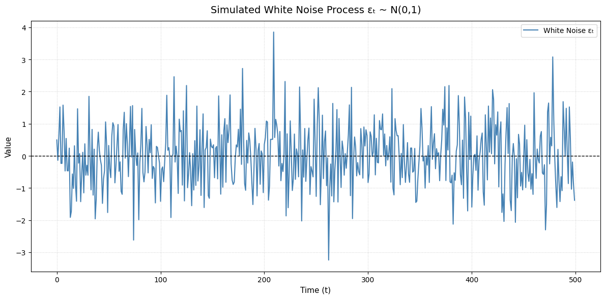{#fig-wn}

Models designed to capture these predictable patterns, such as the Autoregressive (AR) and Moving Average (MA) models, are known collectively as **conditional mean models**. It is perfectly possible for a process to be stationary---oscillating around a fixed long-run average---while still having a conditional mean that changes predictably from one period to the next. The innovations, or shocks, in these models are typically assumed to be white noise, meaning they are unpredictable from a linear perspective.

## Models for the mean

### MA Models {#sec-ma-models .unnumbered}

Moving Average processes model a time series where the current value depends on current and past shock terms. An MA(Q) process has autocorrelations that cut off after lag Q. The unconditional mean is constant at $\theta_0$, while the conditional mean varies with past shocks. The variance structure shows that unconditional variance exceeds average conditional variance due to the moving average component's additional variability.

### AR Models {#sec-ar-models .unnumbered}

Autoregressive processes model a time series where the current value depends linearly on its own previous values. An AR(1) process follows $Y_t = \phi_0 + \phi_1 Y_{t-1} + \varepsilon_t$. Unlike MA processes, AR models have infinite memory with autocorrelations that decay gradually rather than cutting off abruptly. For stationarity, the autoregressive coefficient must satisfy $|\phi_1| < 1$. The unconditional mean is $\frac{\phi_0}{1-\phi_1}$, while the conditional mean depends on the most recent observation. AR processes can be represented as infinite-order MA processes through recursive substitution, revealing their persistent nature.

### ARMA Models and GARCH Applications {#sec-arma-models-and-garch-applications .unnumbered}

ARMA models combine both autoregressive and moving average components, providing a flexible framework for modeling various time series patterns. An ARMA(1,1) process is specified as $Y_t = \phi_0 + \phi_1 Y_{t-1} + \theta_1 \varepsilon_{t-1} + \varepsilon_t$. These models capture both the persistence of AR components and the finite memory effects of MA components. In financial applications, particularly with GARCH models for volatility, the mean equation often employs a simple constant mean (0 for daily returns) rather than complex ARMA structures, especially for intraday data. This preference stems from the dominance of volatility effects in high-frequency returns, where conditional heteroskedasticity overwhelms mean dynamics, and the computational advantage of parsimonious specifications in capturing the primary source of variation.

# Univariate Volatility Models

## Volatility and time-varying Volatility

The term \"volatility\" encompasses several distinct but related concepts across financial contexts. Understanding these differences is crucial for both theoretical modeling and practical application.

#### Volatility as Standard Deviation

Volatility is most fundamentally defined as the standard deviation of asset returns. Practitioners often prefer volatility to variance since it maintains the same units as the original data. When analyzing returns, volatility expressed as a percentage---such as 5%---provides an intuitively meaningful measure of dispersion.

#### Realized Volatility (backward looking measure)

Historically, realized volatility referred to volatility measured over an arbitrary period using the conventional estimator: $$\hat{\sigma} = \sqrt{\frac{1}{T-1}\sum_{t=1}^T (r_t - \hat{\mu})^2}$$ In modern finance, however, the term primarily denotes volatility measures constructed from ultra-high-frequency (UHF) tick data, which capture intraday price movements with remarkable precision.

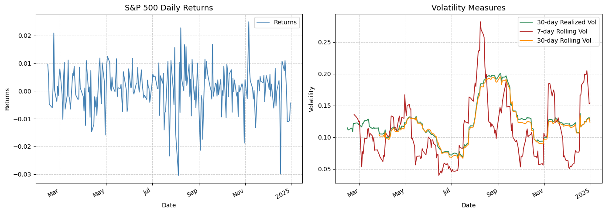{#fig-back}

#### Conditional Volatility

Conditional volatility represents the expected future volatility at time $t+h$, conditioned on all available information up to time $t$ ($\mathcal{F}_t$). The one-period ahead conditional volatility is denoted $E_t[\sigma_{t+1}]$, forming the cornerstone of volatility forecasting models.

#### Implied Volatility (forward looking measure)

Implied volatility emerges from option pricing models as the volatility parameter that equates model prices to observed market prices, providing a forward-looking measure of market uncertainty. The Black-Scholes formula for a European call option: $$C_t = BS(S_t, K, r, \tau, \sigma) = S_t N(d_1) - Ke^{-r\tau}N(d_2)$$ where $$d_1 = \frac{\ln(S_t/K) + (r + \sigma^2/2)\tau}{\sigma\sqrt{\tau}}, \quad d_2 = d_1 - \sigma\sqrt{\tau},$$ can be inverted to solve for the implied volatility $\sigma_{IV}$ that matches the market price $C_{market}$, given the underlying price $S_t$, strike $K$, risk-free rate $r$, and time-to-maturity $\tau$. Formally, implied volatility is obtained by solving: $$\sigma_{IV} = \underset{\sigma}{\text{argmin}} \left| C_{market} - C_{BS}(S_t, K, r, \tau, \sigma) \right|.$$ This inversion process effectively extracts traders' collective expectations about future volatility, as reflected in option prices determined by market supply and demand. The resulting implied volatility represents a forward-looking estimate of volatility with real financial stakes, as it embodies the consensus view of market participants who risk capital on their volatility forecasts.

Recent econometric advances have introduced model-free implied volatility estimators, such as the VIX index, which avoid strong parametric assumptions about the underlying price process. These estimators provide more robust measures of expected volatility by aggregating information across multiple option contracts with different strike prices, capturing the entire volatility smile rather than relying on a single at-the-money option.

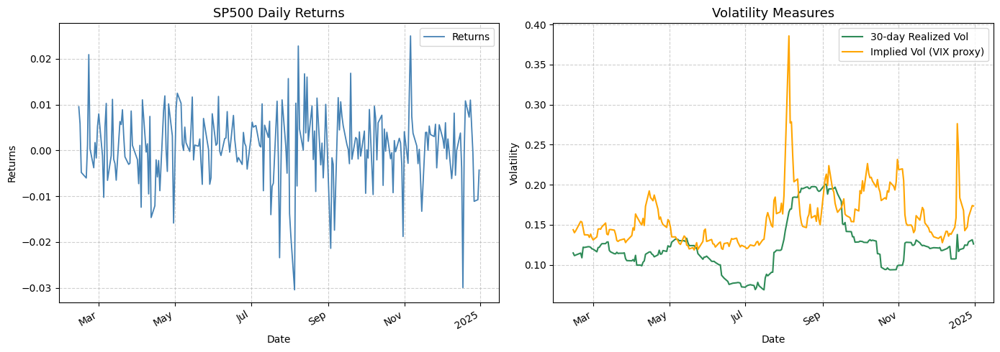{#fig-vvix}

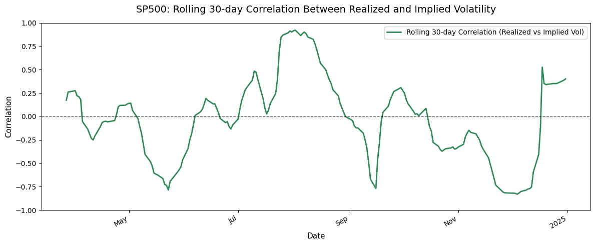{#fig-rollingvolvix}

It is important to note that standard time series techniques---such as smoothing, filtering, and forecasting---can be applied to any volatility measure, whether historical or implied. However, the efficacy of such approaches is highly context-dependent. As previously observed, the correlation between historical (e.g., 30-day realized) volatility and implied volatility varies considerably over time. This variability can be attributed to several factors.

A primary reason for this time-varying correlation lies in the fundamental nature of the two measures: implied volatility is forward-looking, reflecting market expectations, whereas realized volatility is backward-looking, measured from past returns. The relationship between these measures depends on the prevailing volatility regime and its trajectory---whether volatility is increasing or decreasing---which in turn affects their degree of co-movement.

Another important remark concerns the structure of implied volatility itself. It varies with both moneyness and time to expiration, giving rise to the well-documented volatility smile and term structure. In this analysis, we rely on an aggregate measure of implied volatility, which is generally sufficient as it remains broadly correlated with the relative implied volatilities of options on the same underlying.

A well-documented empirical phenomenon is that realized volatility tends to be lower, on average, than what is suggested by implied volatility. This systematic bias has given rise to numerous volatility trading strategies. A common approach involves maintaining a net short vega exposure---profiting from a potential decline in volatility---while delta-hedging to neutralize directional risk. Such strategies are predicated on the observed tendency of implied volatility to overestimate future realized volatility, thereby creating a potential premium for sellers of volatility insurance.

#### Annualized Volatility

When volatility is estimated over non-annual periods, it can be scaled to an annualized basis for comparability. For instance, with $\sigma_{\text{daily}}$ representing daily volatility and 252 trading days annually: $$\sigma_{\text{annual}} = \sigma_{\text{daily}} \times \sqrt{252}$$ This transformation facilitates comparison across assets and sampling frequencies.

#### From Volatility to Variance

While this discussion centers on volatility, all concepts apply equally to variance. The remainder of this chapter focuses specifically on modeling conditional variance, denoted $\mathbb{E}_t[\sigma_{t+1}^2]$ or, more generally, $\mathbb{E}_t[\sigma_{t+h}^2]$[^1]

Time-varying volatility represents one of the most persistent stylized facts in financial markets, characterizing virtually every asset return series. While statistical models capture its dynamics effectively, understanding the economic mechanisms behind these patterns provides valuable context.

#### Information Arrival and News Surprises

The arrival of unexpected public information triggers portfolio rebalancing as market participants revise expectations, generating transient volatility spikes during price adjustment. While documented in government bonds and foreign exchange markets, many assets show limited sensitivity to scheduled announcements, and the resulting volatility typically dissipates within minutes---too briefly to explain lower-frequency volatility cycles.

#### Leverage and Volatility Feedback Effects

In equity markets, the leverage effect suggests that declining firm value increases financial leverage, thereby amplifying equity volatility. Simultaneously, volatility feedback operates through risk premia: heightened volatility raises required returns, necessitating immediate price declines that further amplify volatility. Both channels receive empirical support, particularly in broad market indices, though neither fully captures volatility's complete dynamic structure.

#### Market Microstructure and Liquidity

Transient illiquidity episodes can induce volatility clustering through market microstructure channels. When market depth deteriorates, even modest order flow imbalances can generate disproportionate price movements. However, liquidity-driven volatility typically persists for hours or days, insufficient to explain longer-term volatility cycles.

#### Macroeconomic State Uncertainty

During periods of economic regime uncertainty, slight belief revisions can trigger significant portfolio reallocations, creating self-reinforcing feedback loops between asset prices and fundamental beliefs. This mechanism likely exerts strongest influence during transitions between economic growth and contraction phases.

#### Synthesis of Mechanisms

The empirical behavior of financial volatility likely emerges from a complex interplay of these mechanisms---information effects, leverage, feedback, illiquidity, and state uncertainty---alongside behavioral factors not yet fully articulated. The statistical models developed subsequently aim to capture these manifestations of time-varying volatility, providing essential tools for financial modeling and risk management.

## ARCH models (AutoRegressive Conditional Heteroskedasticity)

The complete ARCH(P) model, introduced by Engle (1982), captures time-varying volatility by modeling conditional variance as a function of past squared innovations. The model specification is:

$$\begin{aligned}
r_t &= \mu_t + \varepsilon_t \\
\varepsilon_t &= \sigma_t e_t, \quad e_t \sim \text{i.i.d. } \mathcal{N}(0,1) \\
\sigma_t^2 &= \omega + \alpha_1 \varepsilon_{t-1}^2 + \alpha_2 \varepsilon_{t-2}^2 + \cdots + \alpha_P \varepsilon_{t-P}^2
\end{aligned}$$

where $\mu_t$ represents the conditional mean process. The key feature of ARCH models is that the conditional variance $\sigma_t^2$ depends on the past $P$ squared shocks, making it $\mathcal{F}_{t-1}$-measurable since all right-hand side variables are known at time $t-1$.

The unconditional variance $\bar{\sigma}^2 = \mathbb{E}[\varepsilon_t^2]$ can be derived under stationarity assumptions. Starting from the conditional variance equation and taking expectations:

$$\mathbb{E}[\sigma_t^2] = \omega + \alpha_1 \mathbb{E}[\varepsilon_{t-1}^2] + \alpha_2 \mathbb{E}[\varepsilon_{t-2}^2] + \cdots + \alpha_P \mathbb{E}[\varepsilon_{t-P}^2]$$

Using the law of iterated expectations and the fact that $\mathbb{E}[e_t^2] = 1$, we have $\mathbb{E}[\varepsilon_{t-i}^2] = \mathbb{E}[\sigma_{t-i}^2 e_{t-i}^2] = \mathbb{E}[\sigma_{t-i}^2]$. Under covariance stationarity, $\mathbb{E}[\sigma_t^2] = \mathbb{E}[\sigma_{t-1}^2] = \cdots = \mathbb{E}[\sigma_{t-P}^2] = \bar{\sigma}^2$, yielding:

$$\bar{\sigma}^2 = \omega + (\alpha_1 + \alpha_2 + \cdots + \alpha_P) \bar{\sigma}^2$$

Solving for the unconditional variance:

$$\bar{\sigma}^2 = \frac{\omega}{1 - \sum_{i=1}^P \alpha_i}$$

This result requires $\sum_{i=1}^P \alpha_i < 1$ for a finite positive variance, ensuring the stationarity of the ARCH process. As the persistence measure $\sum \alpha_i$ approaches unity, the process exhibits increasingly persistent volatility and the unconditional variance grows without bound.

### Stationarity of ARCH

An ARCH(P) model is covariance stationary provided that the conditional mean specification corresponds to a stationary process and the parameters satisfy the condition $1 - \alpha_1 - \alpha_2 - \cdots - \alpha_P > 0$. Under these assumptions, the unconditional variance is given by: $$\mathbb{E}[\varepsilon_t^2] = \bar{\sigma}^2 = \frac{\omega}{1 - \alpha_1 - \alpha_2 - \cdots - \alpha_P}.$$ This result follows from the law of iterated expectations and the property that $\mathbb{E}[e_t^2] = 1$.

A crucial requirement for any covariance stationary ARCH process is that all variance evolution parameters $\alpha_1, \alpha_2, \ldots, \alpha_P$ must be positive. This ensures that the conditional variance remains positive. Additionally, $\omega > 0$ is necessary to guarantee covariance stationarity.

To develop intuition, consider a simple ARCH(1) model with zero mean: $$\begin{aligned}
r_t &= \varepsilon_t \\
\sigma_t^2 &= \omega + \alpha_1 \varepsilon_{t-1}^2 \\
\varepsilon_t &= \sigma_t e_t, \quad e_t \sim \text{i.i.d. } \mathcal{N}(0,1)
\end{aligned}$$ While the conditional variance specification appears unique, the squared error $\varepsilon_t^2$ can be expressed as an AR(1) process. By adding $\varepsilon_t^2 - \sigma_t^2$ to both sides of the volatility equation, we obtain: $$\varepsilon_t^2 = \omega + \alpha_1 \varepsilon_{t-1}^2 + \eta_t$$ where $\eta_t = \sigma_t^2(e_t^2 - 1)$ is a mean-zero white noise process. This AR(1) representation allows us to directly apply results from linear time series analysis. The autocovariances of $\varepsilon_t^2$ for an ARCH(1) process are identical to those of an AR(1) process, with the $s$-th autocovariance given by: $$\text{Cov}(\varepsilon_t^2, \varepsilon_{t-s}^2) = \alpha_1^s \mathbb{V}[\varepsilon_t^2].$$

### ARCH Kurtosis

The second interesting property of ARCH models is that the kurtosis of the shocks ($\varepsilon_t$) is strictly greater than the kurtosis of a normal distribution. This may seem counterintuitive since all shocks $\varepsilon_t = \sigma_t e_t$ are normal by assumption. However, an ARCH model is a variance-mixture of normals, which necessarily results in excess kurtosis. The direct proof is straightforward:

$$\kappa = \frac{\mathbb{E}[\varepsilon_t^4]}{(\mathbb{E}[\varepsilon_t^2])^2} = \frac{\mathbb{E}[\mathbb{E}_{t-1}[\varepsilon_t^4]]}{(\mathbb{E}[\mathbb{E}_{t-1}[\varepsilon_t^2]])^2} = \frac{\mathbb{E}[\mathbb{E}_{t-1}[e_t^4 \sigma_t^4]]}{(\mathbb{E}[\mathbb{E}_{t-1}[e_t^2 \sigma_t^2]])^2} = \frac{\mathbb{E}[3 \sigma_t^4]}{(\mathbb{E}[\sigma_t^2])^2} = 3 \frac{\mathbb{E}[\sigma_t^4]}{(\mathbb{E}[\sigma_t^2])^2} \geq 3$$

The key steps in this derivation rely on the facts that $\varepsilon_t^4 = e_t^4 \sigma_t^4$ and that $\mathbb{E}_{t}[e_t^4] = 3$, since $e_t$ is a standard normal variable. The final conclusion that $\frac{\mathbb{E}[\varepsilon_t^4]}{(\mathbb{E}[\varepsilon_t^2])^2} \geq 3$ follows from noting that for any random variable $Y$, $\mathbb{V}[Y] = \mathbb{E}[Y^2] - (\mathbb{E}[Y])^2 \geq 0$, and thus it must be the case that $\mathbb{E}[\sigma_t^4] \geq (\mathbb{E}[\sigma_t^2])^2$, or equivalently $\frac{\mathbb{E}[\sigma_t^4]}{(\mathbb{E}[\sigma_t^2])^2} \geq 1$.

The kurtosis $\kappa$ of an ARCH(1) process can be explicitly derived as: $$\kappa = \frac{3(1 - \alpha_1^2)}{1 - 3\alpha_1^2} > 3,$$ which is greater than 3 since $1 - 3\alpha_1^2 < 1 - \alpha_1^2$ for any $\alpha_1 \neq 0$.

## GARCH models (General AutoRegressive Conditional Heteroskedasticity)

The Generalized Autoregressive Conditionally Heteroskedastic (GARCH) model, introduced by Bollerslev in 1986, extends the ARCH framework by incorporating lagged conditional variances in addition to lagged squared innovations. A GARCH(P,Q) process is formally defined by the system of equations:

$$\begin{aligned}
r_t &= \mu_t + \varepsilon_t \\
\sigma_t^2 &= \omega + \sum_{i=1}^P \alpha_i \varepsilon_{t-i}^2 + \sum_{j=1}^Q \beta_j \sigma_{t-j}^2 \\
\varepsilon_t &= \sigma_t e_t, \quad e_t \sim \text{i.i.d. } \mathcal{N}(0,1)
\end{aligned}$$

where $\mu_t$ represents the conditional mean. The most prevalent specification in empirical finance is the GARCH(1,1) model, which provides a parsimonious yet flexible representation of volatility dynamics:

$$\sigma_t^2 = \omega + \alpha_1 \varepsilon_{t-1}^2 + \beta_1 \sigma_{t-1}^2$$

This specification expresses current conditional variance as a weighted average of a constant term, yesterday's squared innovation, and yesterday's conditional variance. The key advantage of GARCH over ARCH lies in its parsimony; while an ARCH model requires many lags to capture persistent volatility, the GARCH(1,1) specification can represent an infinite-order ARCH process with only three parameters. This equivalence can be demonstrated through recursive substitution: an ARCH($\infty$) process can be rewritten as a GARCH(1,1) model where the parameters are functions of the underlying ARCH parameters. Specifically, any ARCH($\infty$) process can be represented as a GARCH(1,1) with $\omega = \alpha_0(1-\beta)$, $\alpha = \alpha_1$, and $\beta$ capturing the persistence of the process. This mathematical equivalence allows GARCH models to capture the same long-memory properties of volatility with far fewer parameters, making them more efficient for estimation and forecasting while maintaining the ability to model the volatility clustering and persistence observed in financial time series.

As with ARCH models, GARCH specifications require parameter restrictions to ensure that conditional variances remain positive. In the simplest GARCH(1,1) case, these restrictions require $\omega > 0$, $\alpha_1 \geq 0$, and $\beta_1 \geq 0$. For higher-order GARCH models, the restrictions become more complex---it is sometimes possible for one of the $\alpha$ parameters to be slightly negative while still maintaining positive conditional variances, though the general requirement remains that the parameters should be non-negative to guarantee well-behaved volatility processes.

The GARCH(1,1) model admits an elegant representation as an ARMA(1,1) process for squared innovations. Through algebraic manipulation, we can express $\varepsilon_t^2$ as:

$$\varepsilon_t^2 = \omega + (\alpha_1 + \beta_1) \varepsilon_{t-1}^2 - \beta_1 \eta_{t-1} + \eta_t$$

where $\eta_t = \varepsilon_t^2 - \sigma_t^2$ represents the volatility surprise or innovation. This ARMA representation provides valuable intuition about the dynamics of the process and facilitates the derivation of its statistical properties. For general GARCH(P,Q) specifications, the corresponding ARMA representation becomes ARMA(max(P,Q), Q).

The unconditional variance of a GARCH process can be derived by taking expectations of both sides of the volatility equation. For a GARCH(1,1) model, this yields:

$$\bar{\sigma}^2 = \frac{\omega}{1 - \alpha_1 - \beta_1}$$

provided that $\alpha_1 + \beta_1 < 1$. This condition ensures covariance stationarity and implies that the process exhibits mean reversion toward this long-run variance. For general GARCH(P,Q) models, the unconditional variance extends naturally to:

$$\bar{\sigma}^2 = \frac{\omega}{1 - \sum_{i=1}^P \alpha_i - \sum_{j=1}^Q \beta_j}$$

The autocorrelation structure of squared returns in GARCH models can be analyzed through the ARMA representation. In the GARCH(1,1) case, the autocorrelations of $\varepsilon_t^2$ decay geometrically at rate $\alpha_1 + \beta_1$, similar to the autocorrelation pattern of an ARMA(1,1) process. This analytical tractability makes GARCH models particularly appealing for both theoretical analysis and empirical applications, as it allows researchers to understand and predict the persistence patterns of volatility shocks over time.

### GARCH Kurtosis

A notable property of GARCH models is their ability to generate excess kurtosis in asset returns, even when the underlying innovations follow a normal distribution. For a GARCH(1,1) process, the kurtosis can be derived as:

$$\kappa = \frac{3(1 + \alpha_1 + \beta_1)(1 - \alpha_1 - \beta_1)}{1 - 2\alpha_1\beta_1 - 3\alpha_1^2 - \beta_1^2} > 3$$

This expression reveals that the kurtosis is strictly greater than 3, the kurtosis of a normal distribution. The source of this excess kurtosis lies in the time-varying nature of volatility---GARCH processes are variance mixtures of normals, where the changing variance across periods introduces fat tails in the unconditional return distribution. Even though the conditional distribution at each point in time is normal, the unconditional distribution exhibits the leptokurtic behavior commonly observed in financial returns. This property makes GARCH models particularly suitable for capturing the empirical characteristics of financial data, where extreme returns occur more frequently than would be predicted by a simple normal distribution.

### EGARCH

The Exponential GARCH (EGARCH) model introduced by Nelson (1991) represents a significant departure from traditional ARCH and GARCH specifications by modeling the natural logarithm of the conditional variance. This transformation eliminates the need for parameter restrictions to ensure positive variance, providing greater flexibility in model estimation. The general EGARCH(P,O,Q) process is defined as:

$$\begin{aligned}
r_t &= \mu_t + \varepsilon_t \\
\ln(\sigma_t^2) &= \omega + \sum_{p=1}^P \beta_p \left( \frac{|\varepsilon_{t-p}|}{\sigma_{t-p}} - \sqrt{\frac{2}{\pi}} \right) + \sum_{o=1}^O \gamma_o \frac{\varepsilon_{t-o}}{\sigma_{t-o}} + \sum_{q=1}^Q \alpha_q \ln(\sigma_{t-q}^2) \\
\varepsilon_t &= \sigma_t e_t, \quad e_t \sim \text{i.i.d. } \mathcal{N}(0,1)
\end{aligned}$$

Consider the simpler EGARCH(1,1,1) specification with constant mean to understand the dynamics:

$$\begin{aligned}
r_t &= \mu + \varepsilon_t \\
\ln(\sigma_t^2) &= \omega + \beta_1 \left( \frac{|\varepsilon_{t-1}|}{\sigma_{t-1}} - \sqrt{\frac{2}{\pi}} \right) + \gamma_1 \frac{\varepsilon_{t-1}}{\sigma_{t-1}} + \alpha_1 \ln(\sigma_{t-1}^2)
\end{aligned}$$

Three distinct components drive the log-variance dynamics. The first term, $\beta_1 \left( \frac{|\varepsilon_{t-1}|}{\sigma_{t-1}} - \sqrt{\frac{2}{\pi}} \right)$, represents the magnitude effect as the absolute value of a standardized normal shock minus its expectation. The second term, $\gamma_1 \frac{\varepsilon_{t-1}}{\sigma_{t-1}}$, captures the sign effect through the standardized shock itself. The final term, $\alpha_1 \ln(\sigma_{t-1}^2)$, provides persistence through the lagged log-variance. The asymmetric response to shocks can be analyzed by decomposing the total shock coefficient conditional on the sign of $e_{t-1}$:

$$\text{Shock coefficient} = 
\begin{cases}
\beta_1 + \gamma_1 & \text{when } e_{t-1} < 0 \\
\beta_1 - \gamma_1 & \text{when } e_{t-1} > 0
\end{cases}$$

Typically, $\gamma_1$ is estimated to be negative, producing the leverage effect where negative shocks increase volatility more than positive shocks of equal magnitude. The use of standardized shocks in the variance equation makes the model more robust to outliers, while the ARMA-like structure in the log-variance ensures persistent volatility dynamics. EGARCH models often provide superior empirical fit compared to standard GARCH specifications, particularly for asset returns exhibiting asymmetric volatility responses.

### GJR-GARCH

The GJR-GARCH model, introduced by Glosten, Jagannathan, and Runkle (1993), extends the standard GARCH framework by incorporating asymmetric terms to capture the leverage effect commonly observed in equity markets. This phenomenon describes the tendency for volatility to increase more substantially following negative shocks compared to positive shocks of equal magnitude. The general GJR-GARCH(P,O,Q) process is specified as:

$$\begin{aligned}
r_t &= \mu_t + \varepsilon_t \\
\sigma_t^2 &= \omega + \sum_{p=1}^P \beta_p \sigma_{t-p}^2 + \sum_{o=1}^O \gamma_o \varepsilon_{t-o}^2 I[\varepsilon_{t-o} < 0] + \sum_{q=1}^Q \alpha_q \varepsilon_{t-q}^2 \\
\varepsilon_t &= \sigma_t e_t, \quad e_t \sim \text{i.i.d. } \mathcal{N}(0,1)
\end{aligned}$$

where $\mu_t$ represents the conditional mean process and $I[\varepsilon_{t-o} < 0]$ is an indicator function that takes the value 1 when the shock is negative and 0 otherwise. The asymmetric component $\gamma_o \varepsilon_{t-o}^2 I[\varepsilon_{t-o} < 0]$ specifically captures the differential impact of negative shocks on future volatility.

Considering the GJR-GARCH(1,1,1) specification provides clarity on the dynamic structure:

$$\sigma_t^2 = \omega + \beta_1 \sigma_{t-1}^2 + \gamma_1 \varepsilon_{t-1}^2 I[\varepsilon_{t-1} < 0] + \alpha_1 \varepsilon_{t-1}^2$$

To ensure positive conditional variances, the parameters must satisfy $\omega > 0$, $\beta_1 \geq 0$, $\gamma_1 + \alpha_1 \geq 0$, and $\beta_1 \geq 0$. Under the assumption of conditionally normal innovations, the GJR-GARCH(1,1,1) process is covariance stationary when the persistence condition $\beta_1 + \frac{1}{2}\gamma_1 + \alpha_1 < 1$ is satisfied. The model effectively captures the empirical regularity that negative returns induce disproportionately larger increases in future volatility, making it particularly suitable for modeling financial time series exhibiting asymmetric volatility responses.

### TARCH

The Threshold ARCH (TARCH) model, also known as AVGARCH and ZARCH, introduces a fundamental modification to the GARCH framework by parameterizing the conditional standard deviation rather than the conditional variance (Taylor, 1986; Zakoian, 1994). This approach models volatility using absolute values of shocks and incorporates asymmetric effects through threshold terms, providing an alternative specification for capturing leverage effects in financial time series. The general TARCH(P,O,Q) process is defined as:

$$\begin{aligned}
r_t &= \mu_t + \varepsilon_t \\
\sigma_t &= \omega + \sum_{p=1}^P \beta_p \sigma_{t-p} + \sum_{o=1}^O \gamma_o |\varepsilon_{t-o}| I[\varepsilon_{t-o} < 0] + \sum_{q=1}^Q \alpha_q |\varepsilon_{t-q}| \\
\varepsilon_t &= \sigma_t e_t, \quad e_t \sim \text{i.i.d. } \mathcal{N}(0,1)
\end{aligned}$$

where $\mu_t$ represents the conditional mean process and $I[\varepsilon_{t-o} < 0]$ is an indicator function that activates for negative shocks. The asymmetric term $\gamma_o |\varepsilon_{t-o}| I[\varepsilon_{t-o} < 0]$ specifically captures the differential impact of negative shocks on future volatility, similar to the mechanism in GJR-GARCH but operating on the standard deviation scale.

The TARCH(1,1,1) specification illustrates the model's dynamics clearly:

$$\sigma_t = \omega + \beta_1 \sigma_{t-1} + \gamma_1 |\varepsilon_{t-1}| I[\varepsilon_{t-1} < 0] + \alpha_1 |\varepsilon_{t-1}|$$

To ensure positive conditional standard deviations, the parameters must satisfy $\omega > 0$, $\beta_1 \geq 0$, $\gamma_1 + \alpha_1 \geq 0$, and $\beta_1 \geq 0$. Models based on conditional standard deviations often demonstrate superior empirical performance compared to variance-based specifications, as absolute values of shocks are less sensitive to extreme observations than squared shocks, providing more robust volatility estimates in the presence of outliers while effectively capturing asymmetric volatility responses.

### APARCH

The Asymmetric Power ARCH (APARCH) model, introduced by Ding, Granger, and Engle (1993), provides a comprehensive framework that generalizes both the GJR-GARCH and TARCH specifications by directly parameterizing the power transformation of the conditional volatility. This flexible formulation allows for endogenous determination of the optimal power parameter while capturing asymmetric volatility responses in a parsimonious structure. The general APARCH(P,O,Q) process is defined as:

$$\begin{aligned}
r_t &= \mu_t + \varepsilon_t \\
\sigma_t^\delta &= \omega + \sum_{j=1}^{\max(P,O)} \beta_j \sigma_{t-j}^\delta + \sum_{j=1}^O \gamma_j (|\varepsilon_{t-j}| - \gamma_j' \varepsilon_{t-j})^\delta + \sum_{q=1}^Q \alpha_q |\varepsilon_{t-q}|^\delta \\
\varepsilon_t &= \sigma_t e_t, \quad e_t \sim \text{i.i.d. } \mathcal{N}(0,1)
\end{aligned}$$

where $\mu_t$ represents the conditional mean process and $\delta > 0$ is the power parameter that determines the transformation of volatility. The model requires $P \geq O$, with $\gamma_j = 0$ for $j > O$ when $P > O$. Positive conditional variance is ensured when $\omega > 0$, $\beta_j \geq 0$, and $|\gamma_j'| \leq 1$.

The nesting relationship with other GARCH variants becomes apparent through specific parameter restrictions. When $\delta = 2$, the APARCH(1,1,1) reduces to:

$$\sigma_t^2 = \omega + \beta_1 \sigma_{t-1}^2 + \alpha_1 (|\varepsilon_{t-1}| - \gamma_1 \varepsilon_{t-1})^2$$

which expands to:

$$\sigma_t^2 = \omega + \beta_1 \sigma_{t-1}^2 + \alpha_1 \varepsilon_{t-1}^2 + \alpha_1 \gamma_1^2 \varepsilon_{t-1}^2 - 2\alpha_1 \gamma_1 |\varepsilon_{t-1}|\varepsilon_{t-1}$$

The asymmetric response to shocks can be analyzed through the shock coefficient:

$$\text{Shock coefficient} = 
\begin{cases}
\alpha_1 (1 - \gamma_1)^2 & \text{when } \varepsilon_{t-1} > 0 \\
\alpha_1 (1 + \gamma_1)^2 & \text{when } \varepsilon_{t-1} < 0
\end{cases}$$

Typically, $\gamma_1$ is estimated to be negative, producing the characteristic leverage effect where negative shocks increase volatility more than positive shocks. The APARCH framework nests several important special cases: GJR-GARCH when $\delta = 2$, TARCH when $\delta = 1$, standard GARCH when $\delta = 2$ and $\gamma_j = 0$, and ARCH when additional restrictions apply. This generality makes APARCH particularly valuable for capturing diverse volatility dynamics in financial time series.

### News Impact Curve

The News Impact Curve represents a fundamental tool for comparing different volatility models, as it measures the effect of a current shock on the conditional variance in the subsequent period. This curve enables the visualization and quantification of differences in volatility responses among various ARCH specifications, particularly useful for identifying asymmetries and nonlinearities.

The formal definition of the News Impact Curve is given by setting the variance in all previous periods to the unconditional variance expectation, which normalizes comparisons between models and eliminates dependence on the current variance level.

The News Impact Curve plot for NVIDIA returns reveals distinctive patterns across different models. The ARCH(1) and GARCH(1,1) specifications display a symmetric, parabolic response to shocks, characteristic of linear models where positive and negative shocks of equal magnitude produce identical volatility increases. In contrast, the EGARCH(1,1,1), GJR-GARCH(1,1,1), and TARCH(1,1,1) models exhibit pronounced asymmetry: negative shocks generate significantly larger volatility increases compared to positive shocks of the same magnitude. This phenomenon, known as the leverage effect, is particularly evident for NVIDIA, reflecting the greater sensitivity of volatility to negative news typical of large-cap technology stocks.

The steeper curve for asymmetric models in the negative shock region indicates that investors react more intensely to losses than to gains, leading to increased hedging demand during market downturns. The asymmetric shape of the News Impact Curves for NVIDIA has important practical implications for risk management. Symmetric models would systematically underestimate tail risk during negative market phases, while the greater sensitivity to negative shocks justifies the use of asymmetric models for Value at Risk calculations and optimal portfolio construction. The persistence of the leverage effect suggests that negative shocks have a more lasting impact on future volatility, influencing medium-term trading strategies.

The comparison of News Impact Curves confirms the superiority of asymmetric models in capturing the volatility dynamics of technology stocks like NVIDIA, where the leverage effect represents a structural characteristic of the return generating process.

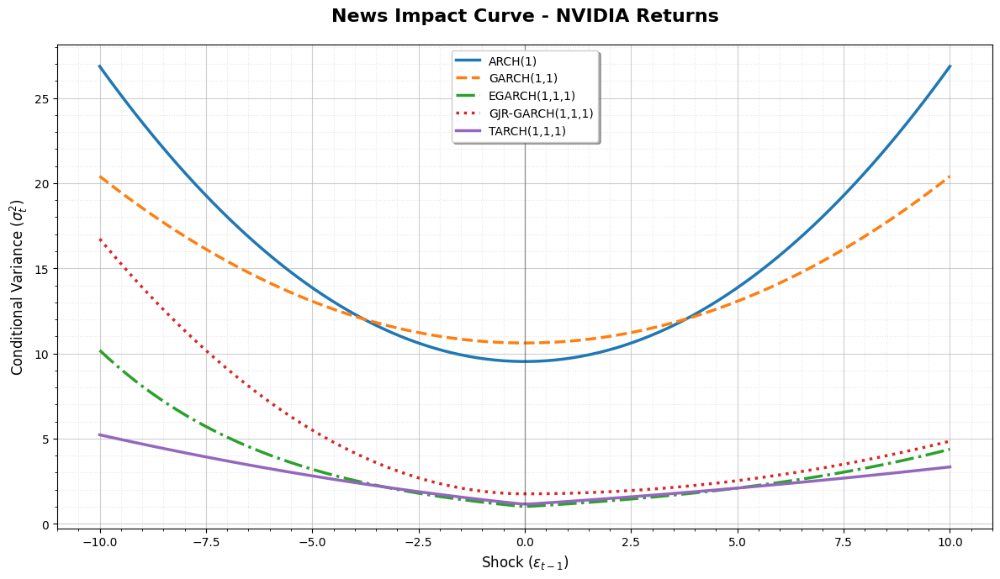{#fig-nic}

### Distribution assumptions

The assumption of conditionally normal errors in GARCH models offers significant benefits, including straightforward estimation and strongly consistent parameter estimators. However, there are compelling reasons to consider alternative distributional assumptions for the innovations. The primary motivations are twofold. First, employing a distribution that more accurately approximates the true conditional distribution of the standardized returns can enhance the precision of the volatility process parameter estimates. In the context of Maximum Likelihood Estimation (MLE), this leads to fully efficient estimators. Second, in many practical applications of GARCH models, such as Value-at-Risk (VaR) estimation and option pricing, the choice of the conditional density is paramount, as it directly influences tail risk measures and pricing kernels. Among the numerous distributions proposed in the literature, three have gained particular prominence.

- **Standardized Student's t:** Introduced by Bollerslev (1987), this distribution is always fat-tailed and typically provides a superior fit to the leptokurtic nature of most financial return series compared to the normal distribution. It is crucial that the degrees of freedom parameter, $\nu$, exceeds 2 to ensure the variance is finite. The density is given by: $$f(r_t; \sigma^2_t) = \frac{\Gamma\left(\frac{\nu+1}{2}\right)}{\sqrt{\pi(\nu-2)}\Gamma\left(\frac{\nu}{2}\right)} \frac{1}{\sigma_t} \left(1 + \frac{(r_t-\mu)^2}{\sigma_t^2(\nu-2)}\right)^{-\frac{\nu+1}{2}}$$ where $\Gamma(\cdot)$ is the gamma function.

- **Generalized Error Distribution (GED):** Utilized by Nelson (1991), this is a flexible family that nests the normal distribution when its shape parameter $\kappa=2$, produces fat tails when $\kappa<2$, and exhibits thin tails when $\kappa>2$. For the variance to be finite, the condition $\kappa > 1$ must hold. The density is: $$f(r_t; \sigma^2_t) = \frac{\kappa \exp\left(-\frac{1}{2}\left|\frac{r_t-\mu}{\lambda\sigma_t}\right|^\kappa\right)}{\lambda 2^{1+1/\kappa}\Gamma(1/\kappa)\sigma_t}$$ where $\lambda = \sqrt{2^{-2/\kappa}\Gamma(1/\kappa)/\Gamma(3/\kappa)}$.

- **Hansen's Skewed t:** Proposed by Hansen (1994), this distribution provides a generalization of the standardized Student's t by incorporating a separate parameter, $\lambda$, to control the skewness, while $\nu$ governs the tail thickness. This allows the density to account for the empirical fact that standardized returns may not only be leptokurtic but also asymmetric. The density is defined as: $$f(\epsilon_t; \nu, \lambda) = 
      \begin{cases}
      bc\left[1 + \frac{1}{\nu-2}\left(\frac{b\epsilon_t + a}{1-\lambda}\right)^2\right]^{-\frac{\nu+1}{2}} & \epsilon_t < -\frac{a}{b} \\
      bc\left[1 + \frac{1}{\nu-2}\left(\frac{b\epsilon_t + a}{1+\lambda}\right)^2\right]^{-\frac{\nu+1}{2}} & \epsilon_t \geq -\frac{a}{b}
      \end{cases}$$ where $$\begin{aligned}
      a &= 4\lambda c\left(\frac{\nu-2}{\nu-1}\right), \\
      b &= \sqrt{1 + 3\lambda^2 - a^2}, \\
      c &= \frac{\Gamma\left(\frac{\nu+1}{2}\right)}{\sqrt{\pi(\nu-2)}\Gamma\left(\frac{\nu}{2}\right)}.
  \end{aligned}$$

These alternative distributions often yield a better approximation to the empirical density of standardized residuals from GARCH models by explicitly modeling the excess kurtosis and, in the case of the skewed t, the skewness observed in financial data.

## Volatility forecasting

### Forecasting with GARCH Models

Forecasts from GARCH(1,1) models are constructed following the same steps as in the ARCH case. The one-step ahead forecast is: $$E_t[\sigma_{t+1}^2] = E_t[\omega + \alpha_1 \varepsilon_t^2 + \beta_1 \sigma_t^2] = \omega + \alpha_1 \varepsilon_t^2 + \beta_1 \sigma_t^2$$ since all terms are known at time $t$. The two-step ahead forecast requires more steps due to the presence of the lagged conditional variance term: $$\begin{aligned}
E_t[\sigma_{t+2}^2] &= E_t[\omega + \alpha_1 \varepsilon_{t+1}^2 + \beta_1 \sigma_{t+1}^2] \\
&= \omega + \alpha_1 E_t[\varepsilon_{t+1}^2] + \beta_1 E_t[\sigma_{t+1}^2] \\
&= \omega + \alpha_1 E_t[e_{t+1}^2 \sigma_{t+1}^2] + \beta_1 E_t[\sigma_{t+1}^2] \\
&= \omega + \alpha_1 E_t[e_{t+1}^2]E_t[\sigma_{t+1}^2] + \beta_1 E_t[\sigma_{t+1}^2] \\
&= \omega + \alpha_1 \cdot 1 \cdot E_t[\sigma_{t+1}^2] + \beta_1 E_t[\sigma_{t+1}^2] \\
&= \omega + (\alpha_1 + \beta_1)E_t[\sigma_{t+1}^2]
\end{aligned}$$ where the independence between $e_{t+1}$ and $\sigma_{t+1}^2$ is used. Substituting the one-step ahead forecast shows that the two-step forecast depends only on time $t$ information: $$E_t[\sigma_{t+2}^2] = \omega + (\alpha_1 + \beta_1)(\omega + \alpha_1 \varepsilon_t^2 + \beta_1 \sigma_t^2) = \omega + (\alpha_1 + \beta_1)\omega + (\alpha_1 + \beta_1)\alpha_1 \varepsilon_t^2 + (\alpha_1 + \beta_1)\beta_1 \sigma_t^2$$ For the three-step ahead forecast, $E_t[\sigma_{t+3}^2] = \omega + (\alpha_1 + \beta_1)E_t[\sigma_{t+2}^2]$, and so: $$E_t[\sigma_{t+3}^2] = \omega + (\alpha_1 + \beta_1)[\omega + (\alpha_1 + \beta_1)\omega + (\alpha_1 + \beta_1)\alpha_1 \varepsilon_t^2 + (\alpha_1 + \beta_1)\beta_1 \sigma_t^2]$$ Repeated substitution reveals a pattern in the multi-step forecasts which is compactly expressed as: $$E_t[\sigma_{t+h}^2] = \sum_{i=0}^{h-1} \omega(\alpha_1 + \beta_1)^i + (\alpha_1 + \beta_1)^{h-1}(\alpha_1 \varepsilon_t^2 + \beta_1 \sigma_t^2)$$ This shows that the $h$-step ahead forecast depends on the total persistence parameter $\phi = \alpha_1 + \beta_1$.

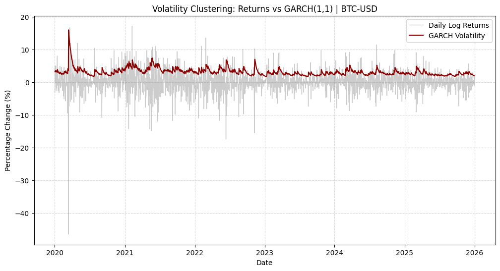{#fig-garchret}

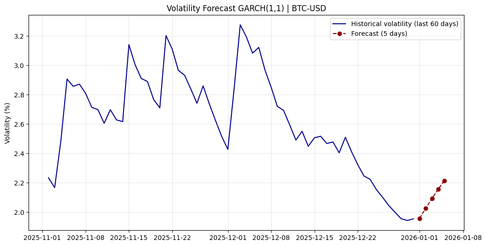{#fig-garchstatic}

```
Volatility forecast for the next 5 days:
2026-01-01    1.96
2026-01-02    2.03
2026-01-03    2.09
2026-01-04    2.16
2026-01-05    2.22
Freq: D, dtype: float64
forecast for tomorrow is: 1.958
```

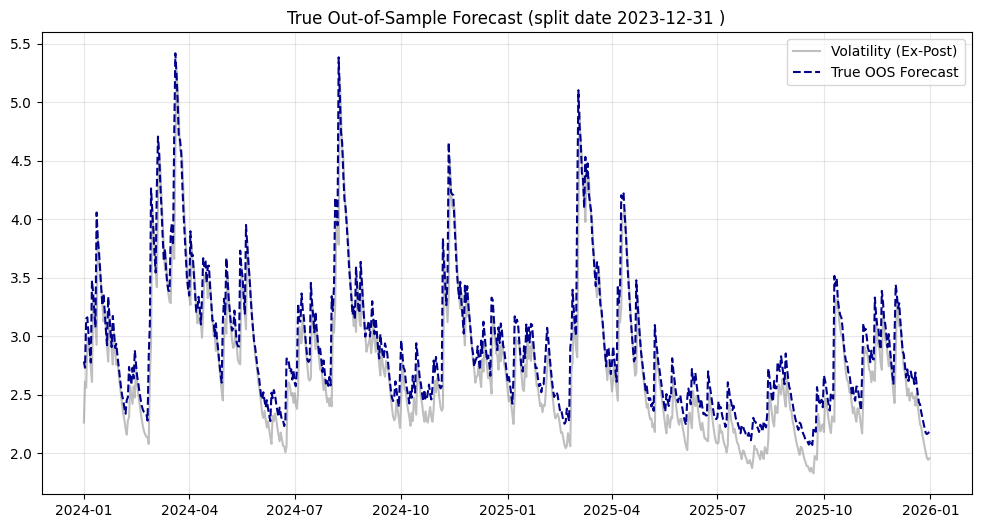{#fig-garchdynamic}

### Forecasting with GJR-GARCH Models

Despite similarities to ARCH and GARCH models, forecasts from GJR-GARCH are complicated by the presence of the asymmetric term. If the expected value of the squared shock does not depend on the sign of the return, so that $E[e_t^2|e_t < 0] = E[e_t^2|e_t > 0] = 1$, then the probability that $e_{t-1} < 0$ appears in the forecasting formula. When the standardized residuals are normal (or any other symmetric distribution), then this probability is $\frac{1}{2}$. If the density is unknown, this probability must be estimated from the model residuals.

In the GJR-GARCH model, the one-step-ahead forecast is: $$E_t[\sigma_{t+1}^2] = \omega + \alpha_1 \varepsilon_t^2 + \gamma \varepsilon_t^2 I_{[\varepsilon_t < 0]} + \beta_1 \sigma_t^2$$ The two-step-ahead forecast is: $$\begin{aligned}
E_t[\sigma_{t+2}^2] &= E_t[\omega + \alpha_1 \varepsilon_{t+1}^2 + \gamma \varepsilon_{t+1}^2 I_{[\varepsilon_{t+1} < 0]} + \beta_1 \sigma_{t+1}^2] \\
&= \omega + \alpha_1 E_t[\varepsilon_{t+1}^2] + \gamma E_t[\varepsilon_{t+1}^2 I_{[\varepsilon_{t+1} < 0]}] + \beta_1 E_t[\sigma_{t+1}^2] \\
&= \omega + \alpha_1 E_t[\sigma_{t+1}^2] + \gamma E_t[\sigma_{t+1}^2 I_{[e_{t+1} < 0]}] + \beta_1 E_t[\sigma_{t+1}^2]
\end{aligned}$$ Assuming the residuals are conditionally normally distributed, then $E_t[\sigma_{t+1}^2 I_{[e_{t+1} < 0]}] = \frac{1}{2}E_t[\sigma_{t+1}^2]$. Substituting this expression: $$E_t[\sigma_{t+2}^2] = \omega + \alpha_1 E_t[\sigma_{t+1}^2] + \gamma \cdot \frac{1}{2} E_t[\sigma_{t+1}^2] + \beta_1 E_t[\sigma_{t+1}^2] = \omega + \left(\alpha_1 + \frac{\gamma}{2} + \beta_1\right) E_t[\sigma_{t+1}^2]$$ This shows that the forecasting recursion depends on the modified persistence parameter $\phi = \alpha_1 + \frac{\gamma}{2} + \beta_1$ when distribution is symmetric.

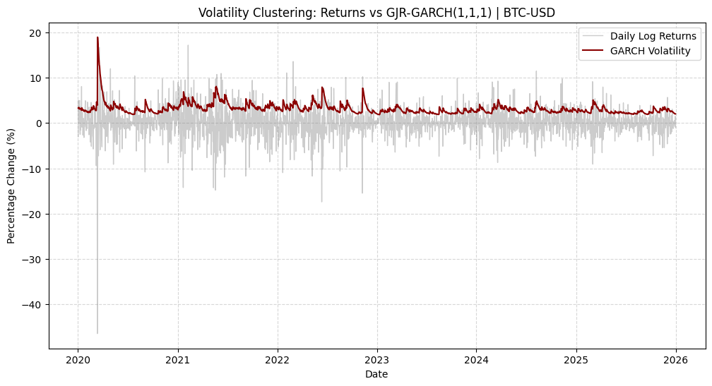{#fig-gjrret}

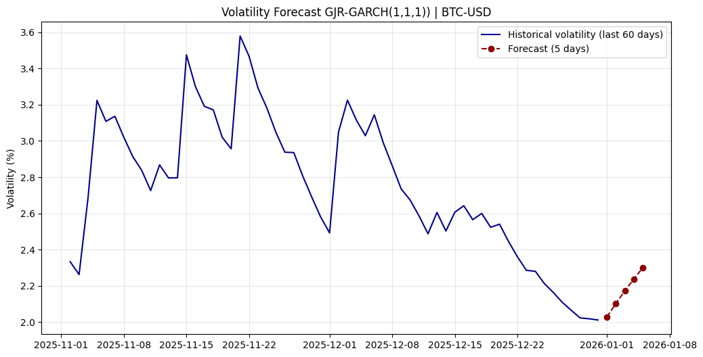{#fig-gjrstatic}

```
Volatility forecast for the next 5 days:
2026-01-01    2.03
2026-01-02    2.10
2026-01-03    2.17
2026-01-04    2.24
2026-01-05    2.30
Freq: D, dtype: float64
forecast for tomorrow is: 2.028
```

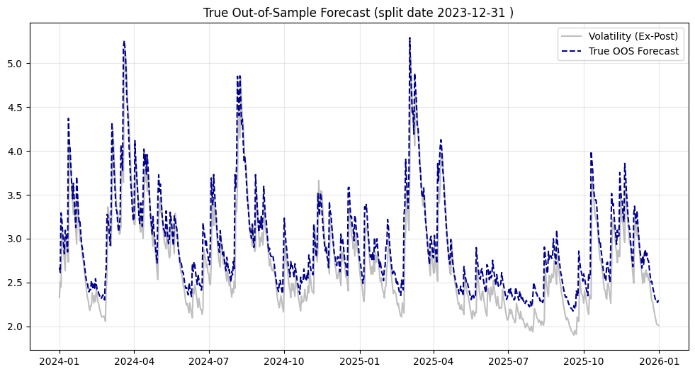{#fig-gjrdynamic}

### Forecasting with TARCH Models

Multi-step forecasts from other models in the ARCH-family, particularly those that are not linear combinations of $\varepsilon_t^2$, are nontrivial and generally do not have simple recursive formulas. For example, consider forecasting the variance from the simplest nonlinear ARCH-family member, a TARCH(1,0,0) model, $$\sigma_t = \omega + \alpha_1 |\varepsilon_{t-1}|$$ As is always the case, the 1-step ahead forecast is known at time $t$, $$\begin{aligned}
E_t[\sigma_{t+1}^2] &= E_t[(\omega + \alpha_1 |\varepsilon_t|)^2] \\
&= E_t[\omega^2 + 2\omega\alpha_1 |\varepsilon_t| + \alpha_1^2 \varepsilon_t^2] \\
&= \omega^2 + 2\omega\alpha_1 E_t[|\varepsilon_t|] + \alpha_1^2 E_t[\varepsilon_t^2] \\
&= \omega^2 + 2\omega\alpha_1 |\varepsilon_t| + \alpha_1^2 \sigma_t^2
\end{aligned}$$ The 2-step ahead forecast is more complicated and is given by $$\begin{aligned}
E_t[\sigma_{t+2}^2] &= E_t[(\omega + \alpha_1 |\varepsilon_{t+1}|)^2] \\
&= E_t[\omega^2 + 2\omega\alpha_1 |\varepsilon_{t+1}| + \alpha_1^2 \varepsilon_{t+1}^2] \\
&= \omega^2 + 2\omega\alpha_1 E_t[|\varepsilon_{t+1}|] + \alpha_1^2 E_t[\varepsilon_{t+1}^2] \\
&= \omega^2 + 2\omega\alpha_1 E_t[|e_{t+1}|\sigma_{t+1}] + \alpha_1^2 E_t[e_{t+1}^2\sigma_{t+1}^2] \\
&= \omega^2 + 2\omega\alpha_1 E_t[|e_{t+1}|]E_t[\sigma_{t+1}] + \alpha_1^2 E_t[e_{t+1}^2]E_t[\sigma_{t+1}^2] \\
&= \omega^2 + 2\omega\alpha_1 E_t[|e_{t+1}|](\omega + \alpha_1 |\varepsilon_t|) + \alpha_1^2 \cdot 1 \cdot (\omega^2 + 2\omega\alpha_1 |\varepsilon_t| + \alpha_1^2 \sigma_t^2)
\end{aligned}$$ The challenge in multi-step ahead forecasting of a TARCH model arises since the forecast depends on more than $E_t[e_{t+h}^2] = 1$. In the above example, the forecast depends on both $E_t[e_{t+1}^2] = 1$ and $E_t[|e_{t+1}|]$. When returns are normally distributed, $E_t[|e_{t+1}|] = \sqrt{\frac{2}{\pi}}$, but if the driving innovations have a different distribution, this expectation will differ. The forecast is then, assuming the conditional distribution is normal, $$E_t[\sigma_{t+2}^2] = \omega^2 + 2\omega\alpha_1 \sqrt{\frac{2}{\pi}} (\omega + \alpha_1 |\varepsilon_t|) + \alpha_1^2 (\omega^2 + 2\omega\alpha_1 |\varepsilon_t| + \alpha_1^2 \sigma_t^2)$$ The difficulty in multi-step forecasting using \"nonlinear\" GARCH models--those which involve powers other than two--follows directly from Jensen's inequality. In the case of TARCH, $$(E_t[\sigma_{t+h}])^2 \neq E_t[\sigma_{t+h}^2]$$ or in the general case of an arbitrary power, $$(E_t[\sigma_{t+h}])^2 \neq E_t[\sigma_{t+h}^2]$$

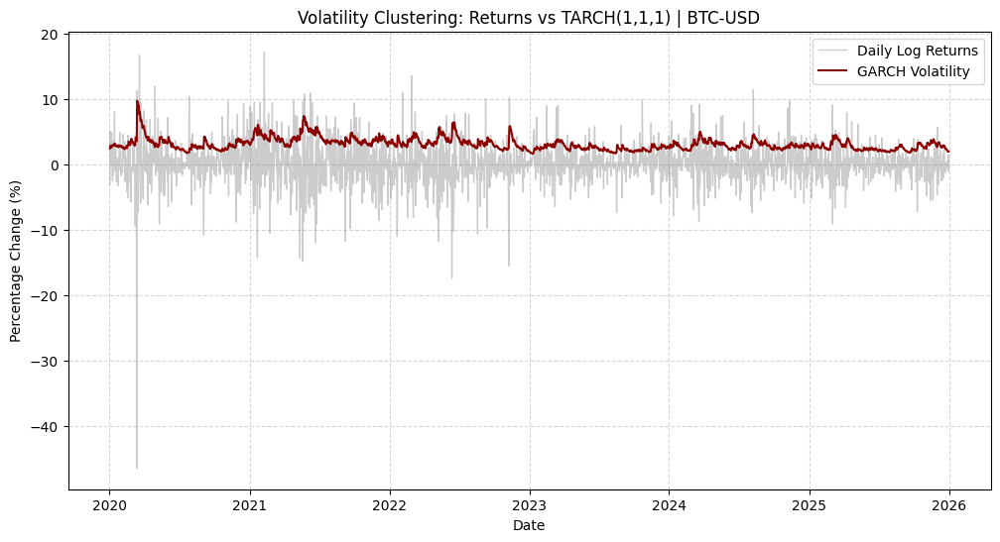{#fig-tarchret}

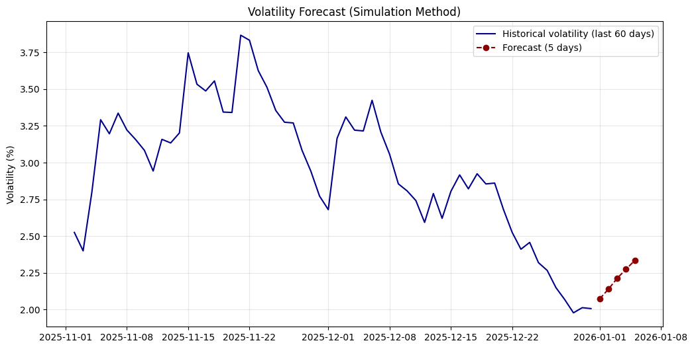{#fig-tarchstatic}

```
Volatility forecast for the next 5 days:
2026-01-01    2.07
2026-01-02    2.14
2026-01-03    2.21
2026-01-04    2.27
2026-01-05    2.33
Freq: D, dtype: float64
Forecast for tomorrow is: 2.072
```

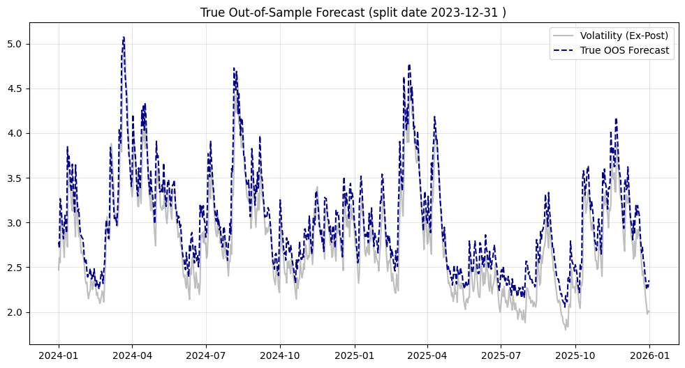{#fig-tarchdynamic}

### Forecasting with EGARCH Models

Multi-step forecasts for the EGARCH model present a different set of challenges compared to the standard GARCH or TARCH specifications. While the TARCH model difficulties arise from non-integer powers in the recursion, the EGARCH model simplifies the recursive structure by modeling the logarithm of the variance, but complicates the recovery of the variance level itself.

Consider forecasting the variance from the simplest EGARCH(1,0,0) specification (an AR(1) process on the log-variance): $$\ln(\sigma^2_t) = \omega + \beta_1 \ln(\sigma^2_{t-1}) + g(z_{t-1})$$ where $g(z_{t-1}) = \theta z_{t-1} + \gamma(|z_{t-1}| - E[|z_{t-1}|])$ and $z_t = \varepsilon_t / \sigma_t$.

As is always the case, the 1-step ahead forecast for the *log-variance* is known at time $t$: $$\begin{aligned}
E_t[\ln(\sigma^2_{t+1})] &= E_t[\omega + \beta_1 \ln(\sigma^2_t) + g(z_t)] \\
&= \omega + \beta_1 \ln(\sigma^2_t) + g(z_t)
\end{aligned}$$ Since all terms on the right-hand side are determined at time $t$, this forecast is deterministic.

The 2-step ahead forecast for the *log-variance* follows a simple linear recursion: $$\begin{aligned}
E_t[\ln(\sigma^2_{t+2})] &= E_t[\omega + \beta_1 \ln(\sigma^2_{t+1}) + g(z_{t+1})] \\
&= \omega + \beta_1 E_t[\ln(\sigma^2_{t+1})] + E_t[g(z_{t+1})]
\end{aligned}$$ Assuming standard normal errors, $E_t[g(z_{t+1})] = 0$ by construction. Thus, the forecast for the log-variance is linear: $$E_t[\ln(\sigma^2_{t+h})] = \omega + \beta_1 E_t[\ln(\sigma^2_{t+h-1})]$$ However, the challenge in EGARCH forecasting arises when converting this back to the variance level, $\sigma^2$. The forecast of interest is $E_t[\sigma^2_{t+h}]$, not $E_t[\ln(\sigma^2_{t+h})]$. Due to the non-linear transformation, we cannot simply exponentiate the expected log-variance.

Using the definition $\sigma^2_{t+h} = \exp(\ln(\sigma^2_{t+h}))$, the 1-step ahead forecast for the variance is: $$E_t[\sigma^2_{t+1}] = \exp(\omega + \beta_1 \ln(\sigma^2_t) + g(z_t)) = \sigma^2_{t+1}$$ The 2-step ahead forecast demonstrates the bias: $$\begin{aligned}
E_t[\sigma^2_{t+2}] &= E_t[\exp(\ln(\sigma^2_{t+2}))] \\
&= E_t[\exp(\omega + \beta_1 \ln(\sigma^2_{t+1}) + g(z_{t+1}))] \\
&= \exp(\omega) \cdot E_t[\exp(\beta_1 \ln(\sigma^2_{t+1}))] \cdot E_t[\exp(g(z_{t+1}))] \\
&= \exp(\omega) \cdot (\sigma^2_{t+1})^{\beta_1} \cdot E_t[\exp(g(z_{t+1}))]
\end{aligned}$$ The difficulty here follows directly from Jensen's inequality for the convex exponential function: $$E_t[\sigma^2_{t+h}] = E_t[\exp(\ln(\sigma^2_{t+h}))] > \exp(E_t[\ln(\sigma^2_{t+h})])$$ Simply exponentiating the log-variance forecast ($\hat{\sigma}^2_{t+h} \approx \exp(\widehat{\ln \sigma^2}_{t+h})$) systematically underestimates the true volatility. The correct forecast requires evaluating the expectation of the exponentiated news impact curve, $E[\exp(g(z))]$, which depends on the specific distribution of the residuals $z_t$. For normal errors, this requires a convexity adjustment factor based on the moment generating function of the normal distribution.

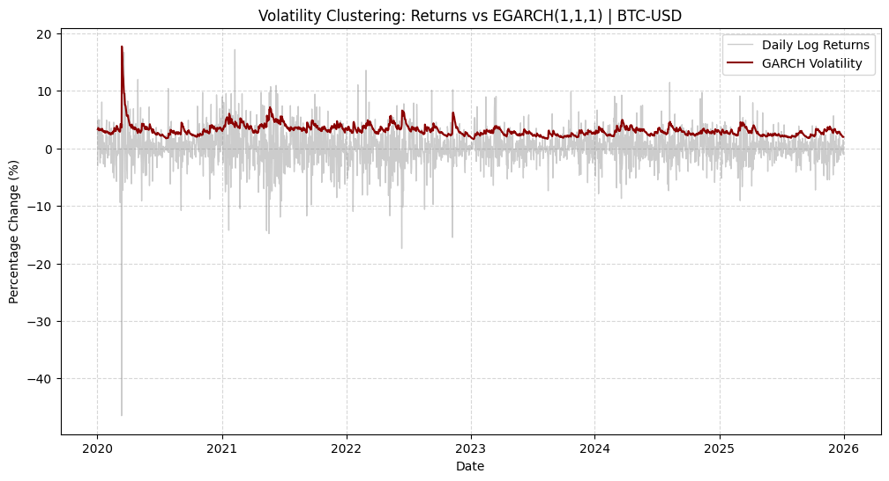{#fig-egarchret}

{#fig-egarchstatic}

```
Volatility forecast for the next 5 days:
2026-01-01    2.06
2026-01-02    2.14
2026-01-03    2.20
2026-01-04    2.27
2026-01-05    2.34
Freq: D, dtype: float64
Forecast for tomorrow is: 2.057
```

{#fig-egarchdynamic}

### Forecasting with APARCH Models

Multi-step forecasts for the APARCH model involve a specific challenge related to the power parameter $\delta$. Unlike the GARCH model where the forecast recursion is linear in variance ($\delta=2$), or the TARCH model where linearity holds for volatility ($\delta=1$), the APARCH model allows $\delta$ to take any positive value. This flexibility implies that while we can derive a recursive formula for the fractional power of volatility, $\sigma^\delta$, obtaining an unbiased forecast for the variance $\sigma^2$ requires handling non-linear transformations.

Consider forecasting using the simplified APARCH(1,1) specification derived from the general notation: $$\sigma^\delta_t = \omega + \beta_1 \sigma^\delta_{t-1} + \alpha_1 (| \varepsilon_{t-1} | - \gamma_1 \varepsilon_{t-1})^\delta$$ where $\varepsilon_t = \sigma_t e_t$ and $e_t \sim \text{i.i.d. } N(0, 1)$.

As is always the case, the 1-step ahead forecast for the *power volatility* is known at time $t$: $$\begin{aligned}
E_t[\sigma^\delta_{t+1}] &= E_t[\omega + \beta_1 \sigma^\delta_t + \alpha_1 (| \varepsilon_t | - \gamma_1 \varepsilon_t)^\delta] \\
&= \omega + \beta_1 \sigma^\delta_t + \alpha_1 (| \varepsilon_t | - \gamma_1 \varepsilon_t)^\delta
\end{aligned}$$ Since all terms are in the information set at time $t$, this forecast is deterministic.

The 2-step ahead forecast for $\sigma^\delta_{t+2}$ can be derived by taking the conditional expectation: $$\begin{aligned}
E_t[\sigma^\delta_{t+2}] &= E_t[\omega + \beta_1 \sigma^\delta_{t+1} + \alpha_1 (| \varepsilon_{t+1} | - \gamma_1 \varepsilon_{t+1})^\delta] \\
&= \omega + \beta_1 E_t[\sigma^\delta_{t+1}] + \alpha_1 E_t[ (| \sigma_{t+1} e_{t+1} | - \gamma_1 \sigma_{t+1} e_{t+1})^\delta ]
\end{aligned}$$ We can factor out $\sigma_{t+1}$ from the shock term, noting that $\sigma_{t+1}$ is determined at time $t$ relative to the expectation of $e_{t+1}$: $$\begin{aligned}
E_t[\sigma^\delta_{t+2}] &= \omega + \beta_1 E_t[\sigma^\delta_{t+1}] + \alpha_1 E_t[ \sigma^\delta_{t+1} (| e_{t+1} | - \gamma_1 e_{t+1})^\delta ] \\
&= \omega + \beta_1 E_t[\sigma^\delta_{t+1}] + \alpha_1 E_t[\sigma^\delta_{t+1}] \cdot E_t[ (| e_{t+1} | - \gamma_1 e_{t+1})^\delta ]
\end{aligned}$$ Let $\kappa_{\delta} = E[(|e_t| - \gamma_1 e_t)^\delta]$. This term is a constant that depends only on the distribution of $e_t$, the asymmetry parameter $\gamma_1$, and the power $\delta$. The recursion simplifies to: $$E_t[\sigma^\delta_{t+2}] = \omega + (\beta_1 + \alpha_1 \kappa_{\delta}) E_t[\sigma^\delta_{t+1}]$$ Generally, for any horizon $h$: $$E_t[\sigma^\delta_{t+h}] = \omega + (\beta_1 + \alpha_1 \kappa_{\delta}) E_t[\sigma^\delta_{t+h-1}]$$ However, the challenge in APARCH forecasting arises when converting this forecast back to the variance level, $\sigma^2$, which is the standard metric for risk. The forecast of interest is $E_t[\sigma^2_{t+h}]$, which implies predicting the quantity $(\sigma^\delta_{t+h})^{2/\delta}$.

Using the definition $\sigma^2_{t+h} = (\sigma^\delta_{t+h})^{2/\delta}$, we see that unless $\delta = 2$: $$E_t[\sigma^2_{t+h}] = E_t [ (\sigma^\delta_{t+h})^{2/\delta} ]$$ The difficulty here follows directly from Jensen's inequality. If $\delta < 2$ (a common empirical finding), the function $f(x) = x^{2/\delta}$ is convex. If $\delta > 2$, it is concave. Therefore: $$E_t[\sigma^2_{t+h}] \neq (E_t[\sigma^\delta_{t+h}])^{2/\delta}$$ Simply raising the forecast of the power volatility to the exponent $2/\delta$ yields a biased estimate of the future variance. Unlike the GARCH model where $\delta=2$ and the transformation is linear, or the EGARCH model where the bias comes from the log-normal transformation, the APARCH bias depends on the curvature of the power function. Consequently, unbiased multi-step variance forecasts for APARCH models generally require simulation methods (Montecarlo) to properly evaluate the expectation of the transformed volatility.

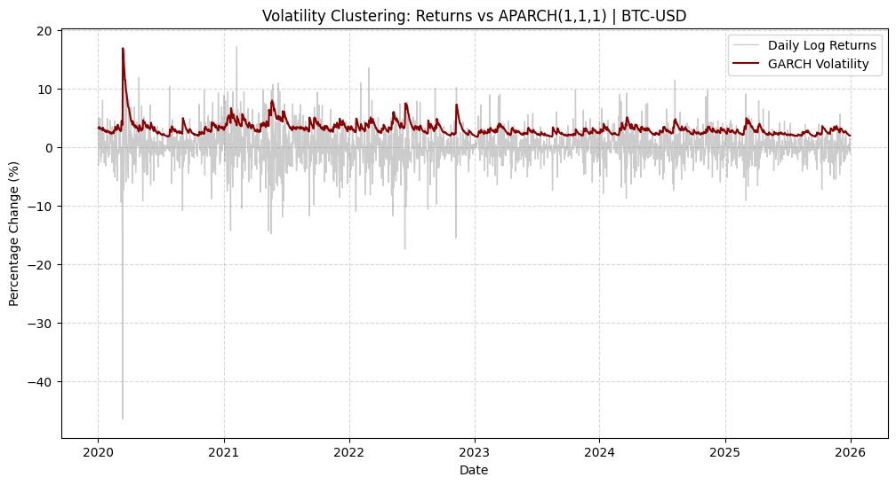{#fig-aparchret}

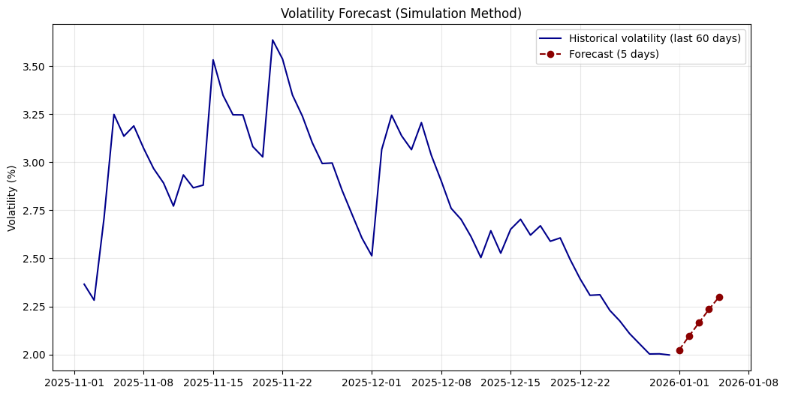{#fig-aparchstatic}

```
Volatility forecast for the next 5 days:
2026-01-01    2.02
2026-01-02    2.10
2026-01-03    2.17
2026-01-04    2.23
2026-01-05    2.30
Freq: D, dtype: float64
Forecast for tomorrow is: 2.024
```

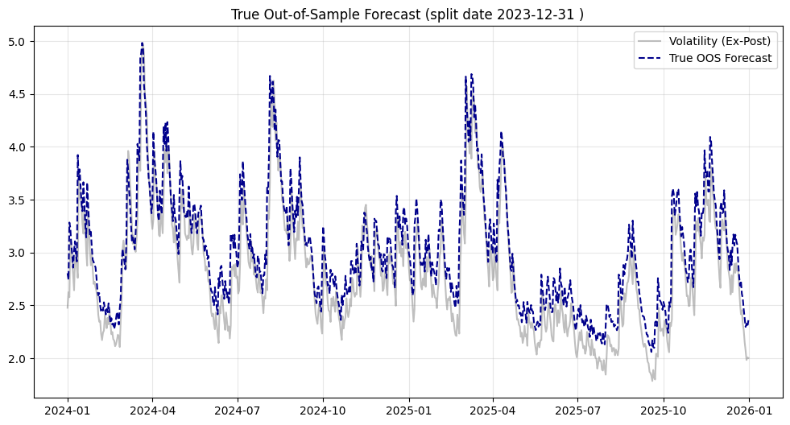{#fig-aparchdynamic}

## Volatility Forecasting Simulation for GLD in Python

This section presents the results of a comprehensive volatility forecasting exercise conducted on GLD (SPDR Gold Shares) returns. The analysis employs various GARCH-family models with different distributions and parameter configurations to identify the optimal specification for volatility forecasting.

### Data and Methodology {#sec-data-and-methodology .unnumbered}

The dataset consists of 5310 daily observations of GLD returns. A grid search approach was implemented, in a ad-hoc python class, to systematically evaluate multiple model specifications, including:

- **Volatility Models**: GARCH, GJR-GARCH, and EGARCH

- **Distributions**: Normal, Student's t, and Skewed t

- **Parameter Combinations**: Various (p, o, q) configurations

- **Selection Criteria**: Akaike Information Criterion (AIC) and Bayesian Information Criterion (BIC)

### Grid Search Results {#sec-grid-search-results .unnumbered}

The comprehensive grid search evaluated 72 different model specifications. The complete results are summarized in the table below, showing model performance across different distributions and parameter configurations.

Based on the Bayesian Information Criterion (BIC), which penalizes model complexity more heavily than AIC, the top five performing models were identified:

```
=== RANKING TOP 10 MODELS (Criterium: minimum BIC) ===
          Model   Dist  p  o  q            BIC            AIC
0     GJR-GARCH  skewt  1  1  1  14876.100896  14830.059466
1     GJR-GARCH      t  1  1  1  14878.446072  14838.981989
2  EGARCH (o=1)  skewt  2  1  1  14879.998008  14827.379231
3     GJR-GARCH  skewt  2  1  1  14882.185243  14829.566466
4  EGARCH (o=1)  skewt  1  1  1  14883.514823  14837.473393
5  EGARCH (o=1)      t  2  1  1  14883.744374  14837.702944
6     GJR-GARCH  skewt  1  1  2  14884.678243  14832.059466
7     GJR-GARCH      t  2  1  1  14884.925752  14838.884322
8  EGARCH (o=1)      t  1  1  1  14886.245609  14846.781527
9     GJR-GARCH      t  1  1  2  14887.023419  14840.981989

=== WINNER ===
Model: GJR-GARCH
Specification: p=1, o=1, q=1
Distribution: skewt
```

### Optimal Model: GJR-GARCH with Skewt Distribution {#sec-optimal-model-gjr-garch-with-skewt-distribution .unnumbered}

The GJR-GARCH(1,1,1) model with constant mean and skewt distribution emerged as the optimal specification, achieving the lowest BIC value of 14876.100896. This model effectively captures the leverage effects and fat-tailed characteristics commonly observed in financial returns.

The estimated parameters for the winning model are:

```
Constant Mean - GJR-GARCH Model Results                                         
=========================================================================================
Dep. Variable:                       scaled_ret   R-squared:                        0.000
Mean Model:                       Constant Mean   Adj. R-squared:                   0.000
Vol Model:                            GJR-GARCH   Log-Likelihood:                -7408.03
Distribution:       Standardized Skew Student's t   AIC:                            14830.1
Method:                        Maximum Likelihood   BIC:                            14876.1
                                                    No. Observations:                  5310
Date:                            Fri, Jan 09 2026   Df Residuals:                      5309
Time:                                   12:59:40   Df Model:                             1
                                  Mean Model                                         
============================================================================
                 coef    std err          t       P>|t|       95.0
----------------------------------------------------------------------------
mu             0.0370  1.285e-02       2.877  4.018e-03 [1.178e-02,6.215e-02]
                               Volatility Model                                      
==============================================================================
                 coef    std err          t       P>|t|         95.0
------------------------------------------------------------------------------
omega       8.3148e-03  2.418e-03       3.439  5.847e-04    [3.575e-03,1.305e-02]
alpha[1]       0.0656  8.375e-03       7.834  4.718e-15    [4.920e-02,8.203e-02]
gamma[1]      -0.0394  8.467e-03      -4.655  3.246e-06 [-5.601e-02,-2.282e-02]
beta[1]        0.9498  6.123e-03     155.103       0.000        [  0.938,  0.962]
                                 Distribution                                         
==============================================================================
                 coef    std err          t       P>|t|         95.0
------------------------------------------------------------------------------
eta             5.4776       0.406      13.475  2.194e-41        [  4.681,  6.274]
lambda        -0.0616  1.824e-02      -3.378  7.311e-04 [-9.737e-02,-2.586e-02]
==============================================================================         **
```

All estimated parameters are statistically significant at the 1% level, confirming the robust fit of the model specification. The persistence parameter $\beta_1$ is estimated at 0.9498, indicating a high degree of volatility clustering and long memory in the conditional variance process; this implies that shocks to volatility decay very slowly over time.

Of particular interest is the asymmetry parameter $\gamma_1$, estimated at -0.0394. In the standard GJR-GARCH framework applied to equities, a positive $\gamma$ typically captures the leverage effect, where negative returns increase volatility more than positive returns. However, the statistically significant negative coefficient observed here implies an \"inverse leverage\" or \"safe haven\" effect unique to Gold (GLD).

Specifically, positive shocks (price increases) induce a higher volatility response ($\alpha_1 = 0.0656$) compared to negative shocks of equal magnitude ($\alpha_1 + \gamma_1 = 0.0262$). This empirical finding aligns with the asset's economic role as a hedge, where sharp price appreciations are often driven by panic-buying episodes during market distress, thereby elevating uncertainty more than price corrections.

The model demonstrates excellent fit characteristics and will be used for subsequent volatility forecasting exercises.

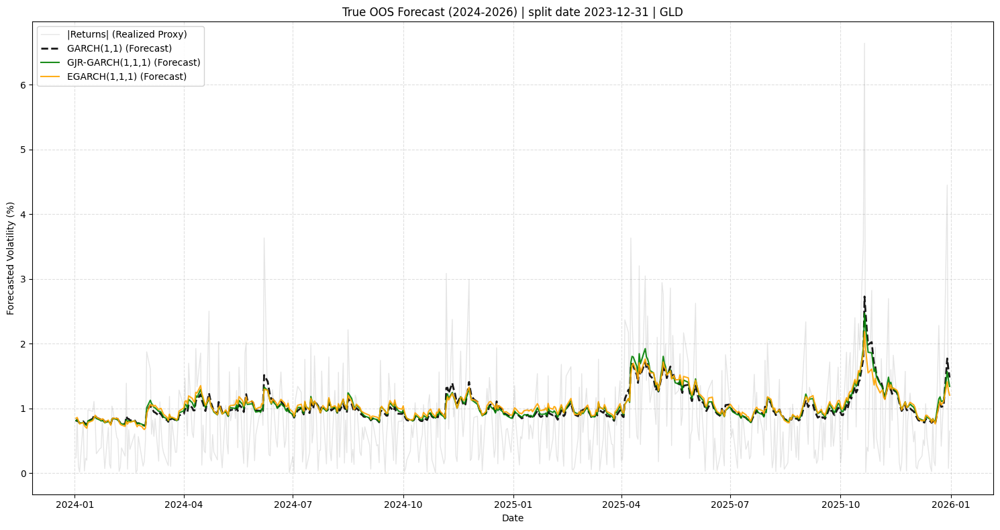{#fig-forecastcomp}

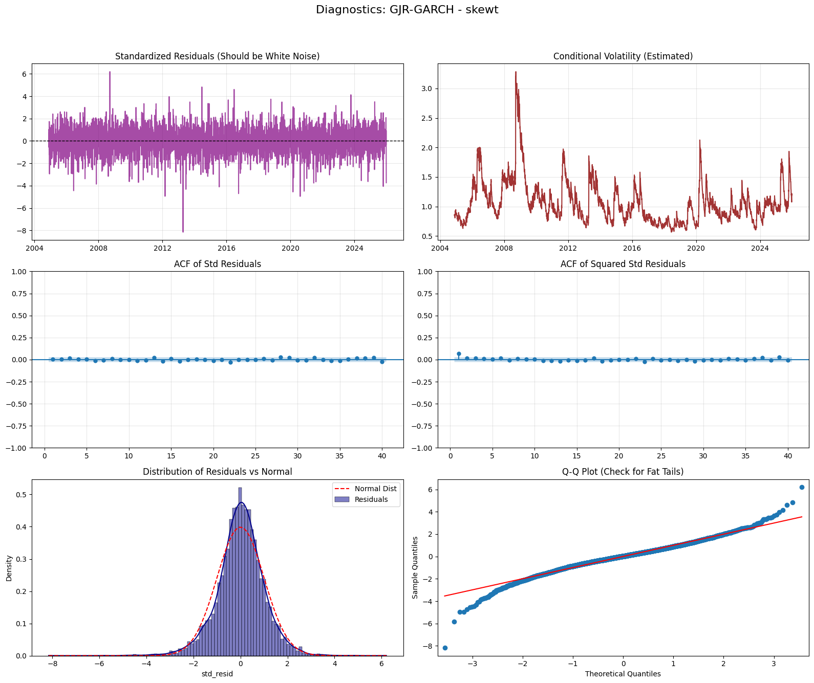{#fig-diagnostics}

# Bibliography and Github repository {#sec-bibliography-and-github-repository .unnumbered}

# References {.unnumbered}

[]{#ref-github-repo}Zeri, T. (2026). *Financial Econometrics Models: Code Repository*. GitHub. <https://github.com/tommasozeri/Financial-Econometrics-Models>

[]{#ref-sheppard2021}Sheppard, K. (2021). *Financial Econometrics Notes*. University of Oxford.

[]{#ref-danielsson2011}Danielsson, J. (2011). *Financial Risk Forecasting*. Chichester: John Wiley & Sons.

[^1]: $E_t[\sigma_{t+h}^2]$ refers to the conditional expectation given the information set $I_t$, i.e. $\mathbb{E}[\sigma^2_{t+h}|I_t]$.


::: {.paper-download}
[Download PDF](univariate-volatility-modelling-1.pdf){.btn-paper download=""} [Code](https://github.com/tommasozeri/Financial-Econometrics-Models){.btn-paper}
:::
