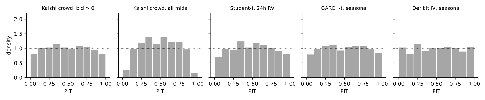
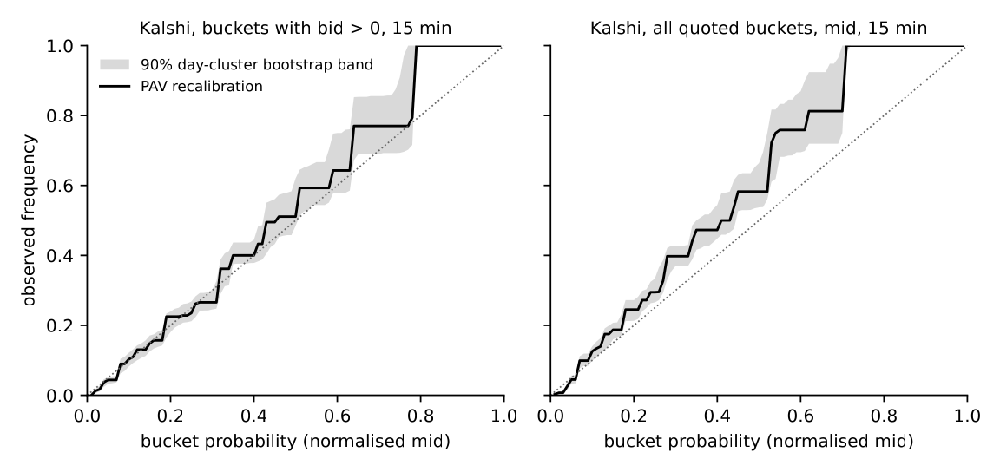
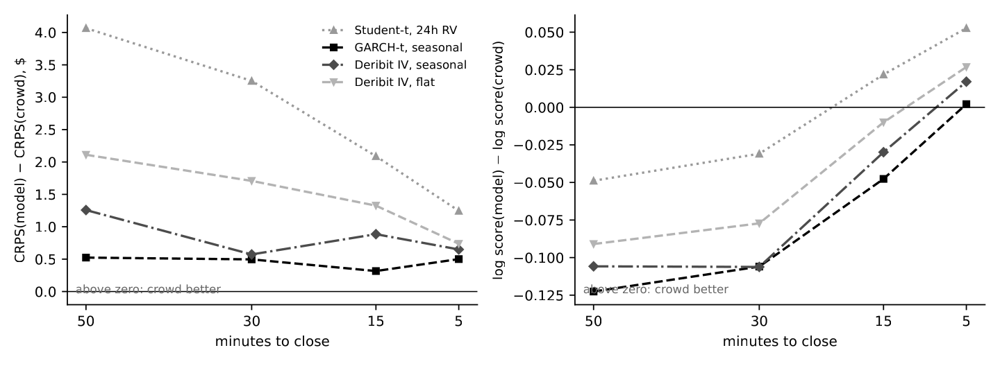
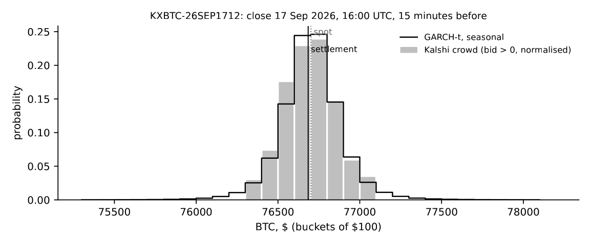

# The question

Galton found that the median of 787 guesses of an ox's weight was within one percent of the truth ([Galton 1907](#ref-galton)). Prediction markets are built on the same idea, with money attached: prices should aggregate what traders know, and the result should forecast well ([Wolfers and Zitzewitz 2004](#ref-wz)). For binary events the question has been studied often. For a whole distribution it has not, because few markets sell one.

Kalshi does. For every hour it lists a ladder of contracts that each pay one dollar if Bitcoin settles in a given 100-dollar bucket. Normalized, the prices are a probability distribution over the next hour's price, and every hour the outcome is known. This note asks three questions of it:

1.  Is the distribution calibrated: does the price fall in the crowd's 80% interval 80% of the time?

2.  Is it more accurate than forecasts that a single analyst could build from public data, and does it add anything to them?

3.  Is the crowd wiser when it is larger?

A companion note compared Kalshi's "above $K$" ladders with the distribution implied by options ([Zeri 2026](#ref-a07)). This one uses the range contracts and asks about accuracy against outcomes, not agreement between markets.

# Contracts and data

#### The contracts.

Series KXBTC. An hourly event opens one hour before its close and contains about 188 contracts: buckets of 100 dollars (e.g. 76,700 to 76,799.99) and two open-ended tails. Exactly one settles yes. The settlement value is the simple average of the 60 seconds of the CF Benchmarks Bitcoin Real-Time Index (BRTI) before the close.

#### Sample.

All settled hourly events from 13 September 2026 (the earliest date served by Kalshi's live endpoints) to 12 November 2026: 1,340 events over 61 days. Daily and weekly events of the same series are left out.

#### Order book.

One-minute candles with the best bid and ask of each contract. The standard download fetches candles only for contracts that eventually traded, and the winning bucket always trades: a forecast built from those contracts alone would know which buckets were candidates. I therefore fix the set of buckets before the hour starts, as every bucket within 3,000 dollars of the previous hour's settlement, and download candles for all of them, traded or not: 78,071 contracts, 60,046 of which the standard download had skipped. Hourly volatility is about 35 basis points, roughly 280 dollars, so this ladder spans more than ten standard deviations.

#### Other data.

Binance BTC/USDT one-minute klines from 10 August to 11 November 2026. Deribit Bitcoin option trades from 10 September to 11 November 2026, 423,181 trades with the implied volatility of each. The BRTI and Binance differ by a small basis: the median ratio of Kalshi settlement values to the Binance one-minute average is 0.99904 (minus 9.6 basis points) with a standard deviation of 5.8 basis points. All model forecasts use the Binance price times a rolling median of that ratio over the last eight settlements.

# The forecasts

All forecasts are made at a snapshot $\tau\in\{50,30,15,5\}$ minutes before the close and use only information available then. Each is a probability $q_k$ for every bucket $k$ of the event.

## The crowd

The last one-minute candle ending at or before the snapshot (and not more than three minutes before it) gives the bid $b_k$ and the ask $a_k$. Two rules turn quotes into probabilities.

-   *All mids*: $q_k\propto(b_k+a_k)/2$ for every quoted bucket of the fixed ladder.

-   *Bid above zero*: $q_k\propto(b_k+a_k)/2$ only where $b_k>0$, that is, where some trader is paying for the bucket.

Buckets that do not qualify get $10^{-4}$ before normalization, so that every score is finite. The reason for the second rule is the shape of the book away from the money. A typical far bucket is quoted at 0 bid and 1 cent ask, and a bucket a few hundred dollars from spot often at 0 bid and 8 or 9 cents ask (@tbl-book). These are a market maker's offers, not anyone's belief: nobody pays 1 cent for them. Their mids, summed over dozens of buckets, add 16% to 41% of probability mass. I take the second rule as the main reading and report the first as a check of how much the reading matters.

::: {#tbl-book}
  minutes before close                         50      30      15       5
  --------------------------------------- ------- ------- ------- -------
  buckets with bid $>0$, median                10       8       6       4
  sum of their mids, median                 0.994   1.004   1.009   1.004
  sum of all mids on the ladder, median     1.414   1.229   1.206   1.164
  winning bucket had bid $>0$               95.5%   96.2%   98.1%   99.2%

  : The order book at the snapshot. 1,340 events.
:::

## Statistical benchmarks

All benchmarks put a distribution on the log return from the spot $S$ (Binance times basis) to the settlement value, and integrate it over each bucket. Because the settlement is a 60-second average, the variance still to come is that of $\tau-2/3$ minutes rather than $\tau$. The five benchmarks differ in the variance forecast $v$ and, for the first, in the shape.

-   *Gaussian, 24h RV*: normal, $v$ = mean squared one-minute log return over the previous 24 hours, times $\tau-2/3$.

-   *Student-$t$, 24h RV*: the same $v$ with a Student-$t$ of 4 degrees of freedom scaled to variance $v$.

-   *GARCH-$t$, seasonal*: five-minute returns are divided by an intraday factor $s(h)$, the mean squared one-minute return in UTC hour $h$ over the previous 28 days relative to the overall mean. The factor averages 0.52 at 06:00 and 2.48 at 15:00 UTC. A GARCH(1,1) with Student-$t$ innovations ([Bollerslev 1986](#ref-bollerslev)) is fitted every midnight on the previous 30 days of deseasonalized returns and filtered up to the last five-minute return known at the snapshot. Its forecasts for the coming steps are multiplied back by $s(h)$ minute by minute and summed over the remaining window ([Andersen and Bollerslev 1997](#ref-ab)).

-   *Deribit IV, flat*: the size-weighted median implied volatility of trades within 1.5% of the money in the 60 minutes before the snapshot, on the nearest expiry at least two hours away with three such trades, carried forward up to six hours when none qualifies. Median 29.8% a year. The annual variance is spread evenly over time.

-   *Deribit IV, seasonal*: the same annual variance, spread over the hour with the profile $s(h)$.

The last three use the Student-$t$(4) shape, so that among the Student-$t$, GARCH and IV forecasts only the variance changes.

# How forecasts are scored

For event $i$ with winning bucket $k^*$ the scores are:

-   the *log score* $-\ln q_{k^*}$, in nats;

-   the *CRPS*, here the ranked probability score times the bucket width, $100\sum_k (F_k-\mathbf 1\{k\ge k^*\})^2$ with $F_k$ the cumulative forecast. It is in dollars and is close to the expected absolute error of a draw from the forecast minus half the forecast's own spread ([Gneiting and Raftery 2007](#ref-gr));

-   the randomized *probability integral transform* $\mathrm{PIT}=F_{k^*-1}+u\,q_{k^*}$, $u$ uniform (the same draw for every forecast of an event). A calibrated forecast has uniform PIT ([Gneiting 2007](#ref-gbr)). I report $12\,\mathrm{Var}(\mathrm{PIT})$, which is 1 when the PIT is uniform, below 1 when the forecast is too wide and above 1 when it is too narrow, and the coverage of central intervals, $\Pr(|\mathrm{PIT}-\tfrac12|<\tfrac{\ell}{2})$ for $\ell=50\%,80\%,90\%$.

Both scores are proper: no forecast can expect to do better by misreporting. The log score punishes thin tails hard; the CRPS is driven by the bulk.

Differences in mean scores are tested as in Diebold and Mariano ([Diebold and Mariano 1995](#ref-dm)) with standard errors clustered by day (61 clusters): events in the same day share a volatility regime. Calibration of single buckets is checked with Cox's regression $\mathrm{logit}\,\Pr(y=1)=a+b\,\mathrm{logit}(q)$ ([Cox 1958](#ref-cox)) and Spiegelhalter's test, on buckets the crowd actually priced, again clustered by day. The *linear pool* $w\,q^{\text{crowd}}+(1-w)\,q^{\text{model}}$ ([Hall and Mitchell 2007](#ref-hm); [Geweke and Amisano 2011](#ref-ga)) uses for each day the weight that minimizes the mean log score on the other 60 days. All tests come from the `probeval` module of the companion methods note.

# Results

## The reading of the book decides calibration

::: {#tbl-rules}
  minutes before close                      50        30        15         5
  ---------------------------------- --------- --------- --------- ---------
  *All mids*                                                       
  coverage of the 50% interval           0.709     0.647     0.640     0.619
  coverage of the 80% interval           0.962     0.945     0.955     0.931
  $12\,\mathrm{Var}(\mathrm{PIT})$        0.55      0.65      0.65      0.69
  Cox slope $b$                           1.38      1.37      1.41      1.41
  CRPS minus Student-$t$, \$           $+73.1$   $+16.6$   $+10.8$   $+11.3$
  *Bid above zero*                                                 
  coverage of the 50% interval           0.493     0.524     0.536     0.525
  coverage of the 80% interval           0.807     0.820     0.836     0.819
  $12\,\mathrm{Var}(\mathrm{PIT})$        1.00      0.95      0.92      0.95
  Cox slope $b$                           1.06      1.12      1.12      1.07
  CRPS minus Student-$t$, \$            $-4.1$    $-3.3$    $-2.1$    $-1.2$

  : The crowd under the two readings of the book. Every CRPS difference has $p<0.001$.
:::

Read with every mid, the crowd's distribution is much too wide: its 80% interval contains the outcome 93% to 96% of the time and the PIT is humped (@fig-pit). The Cox slope of 1.4 says the same at the level of single buckets: likely buckets win more often than priced and unlikely ones less. As a forecast it loses to the plain Student-$t$ at every horizon.

Read only where someone pays, the same crowd is close to calibrated. Coverage is within a few points of nominal, the PIT is nearly flat, and the Cox slope is 1.06 to 1.12. The joint test of $a=0$, $b=1$ still rejects ($p\le0.0001$): a mild favourite-longshot pattern ([Snowberg and Wolfers 2010](#ref-sw)). At fifteen minutes the fitted line puts a bucket priced at 10% at 9.1% and one priced at 40% at 42.7% (@fig-rel). Spiegelhalter's test rejects calibration at 50, 30 and 15 minutes ($p=0.0004$, $0.0004$, $0.002$) but not at five ($p=0.15$).

{#fig-pit}

{#fig-rel}

From here on "the crowd" means the reading with bid above zero.

## Calibration of the benchmarks

::: {#tbl-cal}
                                            50      30      15       5
  ------------------------------------ ------- ------- ------- -------
  *$12\,\mathrm{Var}(\mathrm{PIT})$*                           
  Kalshi crowd                            1.00    0.95    0.92    0.95
  Student-$t$, 24h RV                     0.96    0.92    0.88    0.90
  GARCH-$t$, seasonal                     1.02    0.98    0.93    0.93
  Deribit IV, seasonal                    1.07    1.02    0.98    0.97
  Deribit IV, flat                        1.02    0.98    0.95    0.95
  *coverage of the 80% interval*                               
  Kalshi crowd                           0.807   0.820   0.836   0.819
  Student-$t$, 24h RV                    0.802   0.824   0.846   0.837
  GARCH-$t$, seasonal                    0.802   0.807   0.834   0.819
  Deribit IV, seasonal                   0.771   0.794   0.791   0.805
  Deribit IV, flat                       0.789   0.807   0.819   0.819

  : Calibration by horizon (columns: minutes before close).
:::

Every forecast in @tbl-cal is close to calibrated, so calibration does not separate them. Two patterns appear. All forecasts are slightly too wide close to the close: fifteen minutes before it, the ratio of mean squared realized return to mean forecast variance is 0.63 for the GARCH, 0.73 for the Student-$t$, 0.86 for seasonal IV and 0.91 for flat IV, against 0.82 to 1.20 at 30 and 50 minutes. And the seasonal IV is slightly too narrow at 50 minutes, where its 80% interval covers 77%.

## Accuracy

::: {#tbl-scores}
                                  50          30          15           5
  ---------------------- ----------- ----------- ----------- -----------
  *CRPS, dollars*                                            
  Kalshi crowd             **129.7**    **98.8**    **63.2**    **33.4**
  Gaussian, 24h RV             135.9       104.1        66.9        35.6
  Student-$t$, 24h RV          133.7       102.1        65.2        34.6
  GARCH-$t$, seasonal          130.2        99.3        63.5        33.9
  Deribit IV, seasonal         130.9        99.4        64.0        34.0
  Deribit IV, flat             131.8       100.5        64.5        34.1
  *log score, nats*                                          
  Kalshi crowd                 2.313       2.023       1.561   **0.990**
  Gaussian, 24h RV             2.347       2.099       1.670       1.107
  Student-$t$, 24h RV          2.264       1.992       1.583       1.043
  GARCH-$t$, seasonal      **2.191**   **1.917**   **1.513**       0.992
  Deribit IV, seasonal         2.207       1.917       1.531       1.007
  Deribit IV, flat             2.222       1.946       1.551       1.017

  : Mean scores, lower is better; best in bold. 1,340 events.
:::

::: {#tbl-dm}
  crowd minus model                      50                 30                 15                  5
  ---------------------- ------------------ ------------------ ------------------ ------------------
  *CRPS, dollars*                                                                 
  Student-$t$, 24h RV       $-4.07$ (0.000)    $-3.25$ (0.000)    $-2.09$ (0.000)    $-1.25$ (0.000)
  GARCH-$t$, seasonal        $-0.52$ (0.38)     $-0.50$ (0.23)     $-0.32$ (0.25)    $-0.50$ (0.016)
  Deribit IV, seasonal      $-1.26$ (0.030)     $-0.57$ (0.24)    $-0.89$ (0.009)    $-0.65$ (0.013)
  Deribit IV, flat          $-2.11$ (0.001)    $-1.71$ (0.003)    $-1.33$ (0.000)    $-0.74$ (0.012)
  *log score, nats*                                                               
  Student-$t$, 24h RV       $+0.049$ (0.09)    $+0.031$ (0.25)    $-0.022$ (0.28)   $-0.053$ (0.002)
  GARCH-$t$, seasonal      $+0.123$ (0.000)   $+0.106$ (0.000)   $+0.048$ (0.004)    $-0.002$ (0.88)
  Deribit IV, seasonal     $+0.106$ (0.000)   $+0.106$ (0.000)    $+0.030$ (0.09)    $-0.017$ (0.27)
  Deribit IV, flat         $+0.091$ (0.001)   $+0.077$ (0.003)    $+0.010$ (0.56)    $-0.027$ (0.12)

  : Differences in mean score, crowd minus model, with Diebold--Mariano $p$-values clustered by day in brackets. Negative: crowd better.
:::

On the CRPS the crowd has the lowest mean score at every horizon (@tbl-scores and @tbl-dm, @fig-skill). Against the 24-hour Student-$t$ the gap is 3% to 4% and always significant. Against the seasonal GARCH it is 0.4% to 1.5%, or 32 to 52 cents, and only the five-minute gap is significant. Against implied volatility the crowd is ahead by 0.6 to 2.1 dollars, significant in seven of eight comparisons.

On the log score the order changes. At 50 and 30 minutes the GARCH and both IV forecasts beat the crowd by 0.08 to 0.12 nats; at fifteen minutes only the GARCH does, by 0.05. The Student-$t$ is not distinguishable from the crowd at those three horizons. Five minutes before the close the crowd is level with the GARCH and ahead of the rest. The reason is the tails. The crowd prices four to ten buckets; when Bitcoin moves outside them the crowd has put almost nothing there and the log score charges $-\ln 10^{-4}\approx 9$ nats. At 50 minutes the winning bucket had no bid in 4.5% of events. A model always leaves some mass two or three hundred dollars away. The CRPS, which counts how far the miss was rather than how little was put on it, barely notices.

{#fig-skill}

@fig-example shows an ordinary event, chosen as the one closest to the median CRPS of both the crowd and the GARCH. The two distributions agree on the centre and the crowd puts nothing beyond four hundred dollars from spot.

{#fig-example}

## Does the crowd add information?

::: {#tbl-pool}
                                                                                 50                 30                 15                  5
  -------------------------------------------------------------- ------------------ ------------------ ------------------ ------------------
  *weight of the crowd in the pool, full sample*                                                                          
  with Student-$t$, 24h RV                                                     0.61               0.61               0.74               0.85
  with GARCH-$t$, seasonal                                                     0.31               0.23               0.46               0.71
  with Deribit IV, seasonal                                                    0.44               0.33               0.56               0.74
  with Deribit IV, flat                                                        0.48               0.47               0.64               0.76
  *log score of the pool minus the model alone, out of sample*                                                            
  Student-$t$, 24h RV                                              $-0.047$ (0.000)   $-0.046$ (0.000)   $-0.059$ (0.000)   $-0.063$ (0.000)
  GARCH-$t$, seasonal                                               $-0.006$ (0.14)    $-0.003$ (0.22)   $-0.009$ (0.013)   $-0.020$ (0.001)
  Deribit IV, seasonal                                             $-0.023$ (0.001)   $-0.011$ (0.024)   $-0.025$ (0.000)   $-0.036$ (0.000)
  Deribit IV, flat                                                 $-0.024$ (0.001)   $-0.024$ (0.001)   $-0.040$ (0.000)   $-0.044$ (0.000)

  : Linear pools of the crowd with each model. The out-of-sample score uses for each day the weight estimated on the other 60 days; $p$-values in brackets.
:::

A pool tells whether the crowd knows something the model does not. With the 24-hour Student-$t$ and with both IV forecasts the pool beats the model at every horizon, and the weight on the crowd is between a third and 85% (@tbl-pool). With the seasonal GARCH the weight is 0.23 to 0.31 at 30 and 50 minutes and the gain is not significant; at 15 and 5 minutes the weight rises to 0.46 and 0.71 and the pool is better by 0.009 and 0.020 nats. From 30 minutes on, the crowd's weight grows with every model as the close approaches; between 50 and 30 minutes it falls slightly with three of them. The pools also beat the crowd alone on the log score: the model fills the tails the crowd leaves empty.

## The crowd does not forecast the direction

The median of the crowd's distribution is a point forecast of the settlement. Its mean absolute error is 178.7, 137.1, 91.3 and 53.1 dollars at the four horizons, against 177.5, 133.8, 87.0 and 45.3 for the current spot price. The spot is better by 1.1 dollars at 50 minutes ($p=0.24$) and by 3.3 to 7.8 dollars at the other horizons ($p<0.001$). Part of the gap is the grid: the crowd's median is a bucket midpoint, up to 50 dollars from where a continuous median would be. Still, the crowd's centre is no better than the last price, as one expects of a price that follows a martingale over an hour. The crowd's information is in the width and the shape of the distribution, not in its location.

## A larger crowd is not a wiser one

Volume traded on the event before the snapshot measures how many people took part. Splitting events into terciles of that volume, the crowd's log score relative to the Student-$t$ does not improve from the low to the high tercile at any horizon. A regression of the event's score difference on $\log(1+\text{volume})$ and on the log of the forecast standard deviation (volume rises with volatility) gives a volume coefficient between $-0.005$ and $0.022$ nats, with $p$ from 0.53 to 0.86.

Under the all-mids reading a volume effect does appear: 0.05 to 0.07 nats per log unit of volume with $p\le0.013$ at 15, 30 and 50 minutes (none at five, $p=0.60$). Busier events have fewer buckets quoted at zero bid, so the all-mids reading is less distorted there. The effect concerns the reading of the book, not the wisdom of the crowd.

# What it means

The Kalshi crowd produces a calibrated forecast of Bitcoin's next hour, and on the CRPS no forecast here beats it. That is the wise-crowd result. Its size, though, depends on the competitor. Most of the crowd's advantage over a 24-hour volatility estimate is what a seasonal volatility model also captures: the variance of returns at 15:00 UTC is almost five times that at 06:00, and both the crowd and the GARCH know it. Against that model the crowd is roughly level until the last fifteen minutes.

Close to the close the crowd does know something more. From fifteen minutes the pool with the GARCH gives it real weight and improves on the model; at five minutes the weight is 0.71 and the crowd is level with the GARCH or ahead of every forecast on both scores. A likely source is the most recent price path and the 60-second averaging, which traders watch and which a model fitted on five-minute bars sees only in part.

The crowd's weakness is the tails. It does not price buckets it considers unlikely, and when it is wrong it is wrong with near-certainty. A trader who sells it the tails, or a forecaster who mixes it with a model, gains most from it.

None of this depends on Galton's mechanism of independent errors cancelling. The crowd is a few market makers posting ladders and a few traders taking them, and it does not get better with more volume. It is wise the way a market is: by pricing what its best-informed participants know, close to the moment they know it.

# Limits

*The reading of the book.* The main result rests on treating buckets without a bid as empty. That is a choice, defended above, and the opposite choice reverses the conclusion. A forecast built from transaction prices would avoid the choice but leaves most buckets without a price.

*The tick.* Prices move in cents, so the crowd cannot put less than 1% on a bucket that it prices at all, nor more than 0 on one it does not. The log score of the crowd is therefore driven by $10^{-4}$, an arbitrary number; the CRPS is not.

*Mids are not prices one can trade at.* A crowd that forecasts well does not imply a profit after the spread and Kalshi's fee.

*Benchmarks.* All model forecasts share the Student-$t$(4) shape. A density built from the whole option smile, as in the companion note ([Zeri 2026](#ref-a07)), or a model on one-second data, could do better. The GARCH is refitted daily, not at every snapshot.

*Sample.* Two months and one volatility regime. Events on the same day are correlated and inference is clustered by day, leaving 61 independent units. The pool is evaluated leave-one-day-out over the same period, not on a later one.

# Reproduction {#sec-reproduction .unnumbered}

Code and results are in the folder of this note. `experiments/fetch_ladder.py` downloads the full ladder of candles, `woc_eval.py` (argument `bidpos` or `mid`) builds the crowd and the RV benchmarks and writes the main tables, `vol_models.py` and `hard_benchmarks.py` add GARCH and implied volatility, `paper_figs.py` draws the figures.

# References {.unnumbered}

[]{#ref-galton}F. Galton (1907). Vox populi. *Nature* 75, 450--451.

[]{#ref-wz}J. Wolfers and E. Zitzewitz (2004). Prediction markets. *Journal of Economic Perspectives* 18(2), 107--126.

[]{#ref-a07}T. Zeri (2026). The distribution of Bitcoin implied by Kalshi's strikes and the one implied by options. Research note.

[]{#ref-bollerslev}T. Bollerslev (1986). Generalized autoregressive conditional heteroskedasticity. *Journal of Econometrics* 31(3), 307--327.

[]{#ref-ab}T. G. Andersen and T. Bollerslev (1997). Intraday periodicity and volatility persistence in financial markets. *Journal of Empirical Finance* 4(2--3), 115--158.

[]{#ref-gr}T. Gneiting and A. E. Raftery (2007). Strictly proper scoring rules, prediction, and estimation. *Journal of the American Statistical Association* 102(477), 359--378.

[]{#ref-gbr}T. Gneiting, F. Balabdaoui and A. E. Raftery (2007). Probabilistic forecasts, calibration and sharpness. *Journal of the Royal Statistical Society B* 69(2), 243--268.

[]{#ref-dm}F. X. Diebold and R. S. Mariano (1995). Comparing predictive accuracy. *Journal of Business and Economic Statistics* 13(3), 253--263.

[]{#ref-cox}D. R. Cox (1958). Two further applications of a model for binary regression. *Biometrika* 45(3--4), 562--565.

[]{#ref-hm}S. G. Hall and J. Mitchell (2007). Combining density forecasts. *International Journal of Forecasting* 23(1), 1--13.

[]{#ref-ga}J. Geweke and G. Amisano (2011). Optimal prediction pools. *Journal of Econometrics* 164(1), 130--141.

[]{#ref-sw}E. Snowberg and J. Wolfers (2010). Explaining the favorite-long shot bias: is it risk-love or misperceptions? *Journal of Political Economy* 118(4), 723--746.

::: {.paper-download}
[Download PDF](wisdom-of-crowds-bitcoin-range.pdf){.btn-paper download=""}
[Spiegazione in italiano (PDF)](wisdom-of-crowds-bitcoin-range-spiegazione.pdf){.btn-paper download=""}
:::
